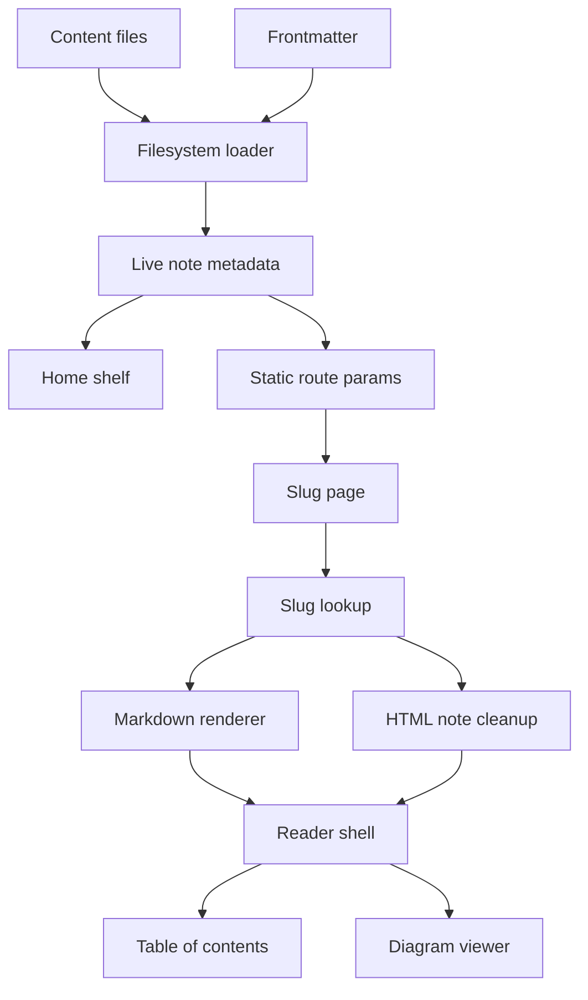

# Loud Recall — Project Blueprint

This guide describes the implementation in this repository as inspected on the documentation branch. It is a technical manual for developers and maintainers; it distinguishes source code behavior from runtime behavior that was not exercised.

## 1. Product and current maturity

Loud Recall is a personal, file-backed learning library. It presents long-form notes as a browsable collection organized by subject and format, with reading aids for dense material. The source defines four subjects—Finance, Health, AI, and Life—and two formats—`masterclass` and `article`—in [`lib/subjects.ts`](lib/subjects.ts). The current `content/` tree contains three live Markdown notes: one each in AI, Finance, and Life. Health currently has no published note.

This is a content-led web prototype, not a multi-author publishing platform. Note discovery and reading are implemented in source. There are no accounts, backend APIs, database, comments, editing interface, or browser storage layer. The three current notes set `verified: false`, which the reader shows as “Unverified draft”; that is content-level metadata, not a product-wide publication state.

## 2. Technology and repository map

| Area | Implementation |
|---|---|
| Web framework | Next.js 16 App Router, React 19, TypeScript |
| Styling | Tailwind CSS 4 through PostCSS; global design tokens and prose styling in `app/globals.css` |
| Content source | `.md` and `.html` files under `content/`; parsed with `gray-matter` |
| Markdown pipeline | Unified, Remark, Rehype, KaTeX, Shiki-backed code highlighting, Mermaid |
| Icons and class helpers | `lucide-react`, `clsx`, `tailwind-merge` |
| Persistence | Git-tracked files and frontmatter only; no database or client persistence in the inspected application source |
| Tests | No test script is declared in `package.json` |

Important folders:

- `app/` — home route, dynamic note route, root metadata, robots, and sitemap.
- `components/` — shelf, reader presentation, responsive tables, diagrams, callouts, and branding.
- `lib/` — subject definitions, filesystem content loading, and Markdown processing.
- `content/<subject>/<optional-topic>/` — published and draft note files. A file's basename becomes its URL slug.
- `public/` — icons, manifest, logo assets, and social preview image.
- `shelved/` — older notes retained outside the live content tree; the loader only scans `content/`.
- `_context_files/` — project writing contracts/context; these are not runtime content.

## 3. Architecture at a glance



The home route in [`app/page.tsx`](app/page.tsx) calls `getSortedDocumentsData()` and passes metadata to `HomeViewContainer`. The dynamic route in [`app/%5Bslug%5D/page.tsx`](app/%5Bslug%5D/page.tsx) creates paths with `generateStaticParams()`, prepares note metadata, and loads a live note by slug. Markdown content passes through `renderMarkdown`; HTML notes use a cleanup/scoping function and render through `dangerouslySetInnerHTML`. Both are wrapped in the client-side `ClientReader`.

The routes and data helpers are written for Next.js server rendering/static generation, while interactive search, filters, reader progress, active heading state, and diagram controls run in client components. This describes the code structure; no build or deployment was run for this audit.

## 4. Content model and file loading

### 4.1 Folder and slug rules

`lib/markdown.ts` recursively scans `content/` for `.md` and `.html`. Directories and files beginning with `_` or `.` are skipped. The first directory under `content/` is treated as the subject folder; the second directory, if present, becomes the topic. The filename without extension is the slug. Slugs must be unique across the entire content tree: both list loading and individual lookup throw if duplicates are detected.

A recognized subject folder wins over frontmatter. If there is no recognized folder, a recognized `subject` frontmatter value may be used; otherwise loading throws. The supported subject identifiers are `finance`, `health`, `ai`, and `life`.

### 4.2 Frontmatter fields

| Field | Meaning and behavior |
|---|---|
| `title` | Display title; falls back to the first Markdown H1, then the slug. |
| `description` | Card/SEO description; falls back to the first eligible paragraph after the H1. |
| `subject` | Used only if the folder does not resolve to a known subject. |
| `format` | `article` or `masterclass`; any other/missing value defaults to `masterclass`. |
| `order` | Optional integer used to order learning volumes. |
| `status` | `draft` is excluded; every other value, including missing, is treated as `live`. Set explicitly to `draft` to keep a note off the shelf. |
| `updated` / `date` | Updated date; `updated` takes priority over `date`. |
| `created` | Optional original/published date for metadata. |
| `verified` | Boolean `true` becomes `verified`; false/missing becomes `unverified`; a non-empty string is preserved. |
| `tags` | Array or comma-separated string, normalized to trimmed strings. |

Example:

```yaml
---
title: "A Practical Guide to Credit Risk"
description: "A worked introduction to lending risk and expected loss."
format: masterclass
order: 1
status: draft
updated: 2026-10-01
verified: false
tags:
  - lending
  - risk
---
```

A folder such as `content/finance/credit-risk/guide.md` produces slug `guide`, subject `finance`, and topic `credit-risk`. A duplicate `guide.md` elsewhere is an error even if its subject differs.

### 4.3 Reading statistics and sort order

The loader removes a leading HTML comment, frontmatter, script/style blocks, and HTML tags before counting whitespace-separated words. Estimated read time is `max(1, ceil(wordCount / 225))` minutes. This is a simple estimate; Markdown syntax, equations, and code can affect its accuracy.

The catalog sorts notes with explicit `order` first, then `updated` descending, then title alphabetically. Home-page subject sections apply their own presentation ordering: masterclasses by `order`, and articles by update date.

## 5. User-facing features and components

| Feature | Main implementation | Source-confirmed behavior |
|---|---|---|
| Subject shelves and cards | `HomeViewContainer`, `HomeClientView` | Four configured subjects, counts and totals, masterclass sequence, articles, empty “Coming soon” cards |
| Search and filters | `HomeClientView` | Search title, description, tags, and subject label; filter to a subject; `/` focuses search; `?subject=<id>` initializes selection and filter changes update the URL without navigation |
| Note reader | `[slug]/page.tsx`, `ClientReader` | Format/tags, estimated words/time, updated date, verification label, scroll progress |
| Table of contents | `extractHeadings`, `ClientReader` | Builds from H2 Markdown headings outside fenced code, with HTML H2 fallback; active section follows IntersectionObserver; sidebar on large screens and sheet on smaller screens |
| Markdown features | `lib/render.tsx` | GFM, math, directives/callouts, syntax highlighted code, responsive tables, SVG styling, Mermaid recognition |
| Diagram interaction | `MermaidDiagram`, `DiagramFrame` | Mermaid renders client-side; expanded SVG viewer includes fit, zoom, pan, keyboard controls, and touch pinch handling |
| Search-friendly metadata | route metadata, sitemap, robots | Per-note titles/descriptions/canonicals and Open Graph fields; sitemap includes home and live note slugs; robots exposes the sitemap URL |
| Legacy paths | `next.config.ts` | Three permanent redirects for older credit-risk and personal-note slugs |

The standalone `ShelfList` component exists, but the home route currently renders the newer `HomeViewContainer`/`HomeClientView` composition.

### Markdown callouts

`remark-directive` is transformed in `lib/render.tsx`. The supported directive names are `permanent-rule`, `never-confuse`, `trap`, `mental-model`, and `key-insight`; these become the `Callout` React component. `never-confuse` divides content into two labeled columns, with default labels if no explicit left/right directives are supplied.

### Mermaid and diagram rendering

A fenced `mermaid` block is detected by the custom `ResponsivePre` renderer and handed to `MermaidDiagram`. Mermaid is dynamically imported in the browser, initialized with strict security mode and SVG text labels, and asked to render the chart. `DiagramFrame` measures SVG viewBox dimensions and font sizes, fits the diagram to the content column while maintaining a minimum label size, and offers a full-screen pan/zoom surface. The code has a visible error state that shows the chart source when Mermaid rejects a diagram.

## 6. Rendering pipeline and important algorithms

### 6.1 Markdown transformation order

`renderMarkdown()` configures a Unified processor in this sequence:

1. Parse Markdown (`remark-parse`) and GFM extensions (`remark-gfm`).
2. Parse math and directives (`remark-math`, `remark-directive`); transform supported directives into callouts and comparison columns.
3. Convert Markdown AST to HTML AST while allowing authored HTML, then parse raw HTML nodes.
4. Normalize authored SVG sizing and add heading slugs.
5. Render math with KaTeX and code with `rehype-pretty-code`.
6. Convert the result into React elements with custom mappings for responsive tables/pre blocks/SVG and callouts.

Ordering matters: directives are interpreted before Markdown-to-HTML conversion; raw HTML is parsed before heading slugs and final React mapping.

### 6.2 Table of contents extraction

`extractHeadings()` walks source lines, tracks both backtick and tilde fences, and only considers `## ` lines outside fences. It uses `github-slugger` to produce IDs consistent with duplicate headings. If no Markdown H2 was found, it scans HTML `<h2>` tags and uses their explicit IDs or generated slugs. This is a pragmatic source-text extractor, not a full Markdown AST walk; unusual heading syntax may not be included.

### 6.3 Search

For each candidate note, the client normalizes the query with trim + lowercase. A note matches when title, description, any tag, or configured subject name contains the query. The selected subject is an additional AND condition. Searching switches the shelf from grouped subject sections to a flat result list. Search only sees metadata passed from the server, not full note body text.

### 6.4 Reader progress and active heading

Scroll progress is `scrollY / (documentHeight - viewportHeight) * 100`, clamped to 0–100; pages with no scrollable height report zero. An IntersectionObserver marks a heading active using a lower-page root margin and the reader scrolls the matching sidebar entry into view. These interactions depend on browser APIs and are described from source, not runtime tested.

## 7. Local setup and commands

Requirements: Git, Node.js supported by the pinned Next.js version, and npm. The repository includes `package-lock.json`.

```bash
git clone https://github.com/tharungajula2/loud-recall.git
cd loud-recall
npm ci
npm run dev
```

Open `http://localhost:3000`. Declared scripts are:

| Command | Purpose |
|---|---|
| `npm run dev` | Start Next.js development server. |
| `npm run build` | Build the production app. |
| `npm run start` | Serve a previously built app. |
| `npm run lint` | Run ESLint. |

The documentation audit did not install dependencies or run these commands. The root package is marked `private: true`, which is an npm package publishing flag, not evidence that the GitHub repository is private.

## 8. Adding and editing a note

1. Choose one of the subject directories: `ai`, `finance`, `health`, or `life`.
2. Add a `.md` or `.html` file. Optional nested folders become topic labels; basename becomes the public slug.
3. Add frontmatter with a clear title, description, format, status, and update date. Use `status: draft` while the note is not ready to appear.
4. Ensure the slug is unique across all subjects.
5. Write the body using Markdown, GFM tables, math, supported directives, Mermaid fences, or authored HTML/SVG as needed.
6. Review factual accuracy and set `verified: true` only when the project's intended review has actually occurred. The renderer does not validate factual claims.

The filesystem loader excludes only files/directories beginning with `_` or `.` and files that are not `.md` or `.html`. A missing status currently defaults to live, so explicitly mark work-in-progress content `draft`.

## 9. Troubleshooting

| Symptom | Likely source-level cause / check |
|---|---|
| A note is missing | Confirm file is below `content/`, uses `.md`/`.html`, is not hidden/underscore-prefixed, resolves to an allowed subject, and is not `status: draft`. |
| A page build reports duplicate slug | Rename one file; slugs are basename-only and must be globally unique. |
| A note shows a fallback title or description | Check frontmatter spelling or the first H1/paragraph fallback rules. |
| Table of contents omits a heading | TOC extraction only recognizes Markdown H2 (`## `), or HTML H2 when no Markdown H2 exists; headings inside fenced examples are skipped. |
| Mermaid shows source and an error | Inspect Mermaid syntax and the error box. Mermaid rendering happens in a browser effect, so test in an actual browser after starting the app. |
| Diagram labels are clipped | Check Mermaid labels and font rendering; the diagram component waits for document fonts and uses SVG text, but runtime/browser verification is still needed. |
| Read time looks odd | Estimate is derived from a simple 225 words/minute count after limited markup stripping. |

## 10. Security, privacy, and operational boundaries

- Note files are authored into the application bundle/runtime; there is no user account or authorization layer in the inspected source.
- Markdown enables raw HTML via `allowDangerousHtml` followed by `rehypeRaw`, and `.html` notes use `dangerouslySetInnerHTML` after text-based cleanup. This is suitable only for trusted, reviewed repository content. The cleanup scopes CSS and removes some wrapper chrome; it is not a general-purpose HTML sanitizer.
- `mermaid` is configured with `securityLevel: 'strict'`, and authored Mermaid diagrams render in the client.
- No database, analytics, or browser-local persistence was found in the inspected application source. External hosting, logs, and network behavior were not audited.
- Metadata config defines `https://loud-recall.vercel.app` as the site base and robots/sitemap endpoint. This repository source does not establish that the deployment is currently reachable or current.

## 11. Limitations and realistic extensions

Current limits include a three-note catalog, no application tests in the declared scripts, no editorial UI, no full-text body search, only four hard-coded subjects, metadata-based verification labels with no review workflow, and no runtime/build verification in this audit. Dynamic Mermaid and DOM observers also need browser validation across supported devices.

Reasonable next steps, if product scope expands:

- Add a content validation script for frontmatter schemas, duplicate slugs, internal links, and stale dates.
- Add tests for parsing/sorting, search matching, duplicate-slug detection, TOC fence handling, and rendered directive mapping.
- Introduce full-text search via a generated local index if the note library grows.
- Add an editorial review process that records reviewer/date/evidence for `verified` content.
- Externalize the subject registry or validate frontmatter against a schema to avoid silent drift.
- Add accessible keyboard focus management and automated/browser checks for the expanded diagram dialog.
- If collaborative authoring becomes a requirement, design a trusted content ingestion pipeline before accepting user-authored HTML.

The learning content structure—long-form explainer, topic shelves, worked examples, reusable callout patterns, and visible verification status—could inform a future Trelis Student knowledge or family-learning experience. That is a product idea; this repository contains no student, family, progress, or learning-outcome feature.

## 12. Source reference index

- [Home route](app/page.tsx)
- [Dynamic note route, metadata, and HTML handling](app/%5Bslug%5D/page.tsx)
- [Client reader and table of contents](app/%5Bslug%5D/ClientReader.tsx)
- [File-backed content model](lib/markdown.ts)
- [Subject definitions](lib/subjects.ts)
- [Markdown render pipeline and heading extraction](lib/render.tsx)
- [Home page shell](components/HomeViewContainer.tsx)
- [Search, filters, and subject shelves](components/HomeClientView.tsx)
- [Mermaid rendering](components/MermaidDiagram.tsx)
- [SVG pan/zoom viewer](components/DiagramFrame.tsx)
- [Callout components](components/Callout.tsx)
- [Responsive tables](components/ScrollTable.tsx)
- [Package scripts and dependencies](package.json)
- [Next.js redirects](next.config.ts)
- [SEO sitemap](app/sitemap.ts)
- [Robots rules](app/robots.ts)
