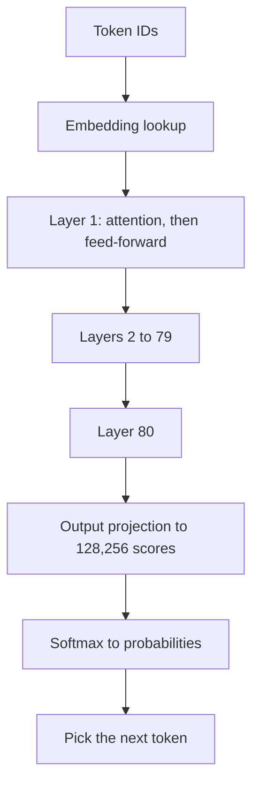

## Part 0 — The system we follow

Everything in all three volumes happens to one system, and it is worth meeting before any vocabulary arrives.

A mid-sized company handles about **5,000 support tickets a day**. An engineer builds an assistant that reads the ticket, searches the internal documentation, and drafts a reply. It takes a fortnight, it demos beautifully, and it goes live.

Then the first month happens. The bill is larger than anyone modelled. It is slower than the demo. It confidently cites a policy that was withdrawn in 2024. Someone asks it to issue a refund, and it tries. And nobody can say whether last Tuesday's version was better or worse than today's.

Those five failures organise the first two volumes; Volume 3 follows one ticket through the agent built on both. The first two — the bill and the speed — are properties of the model and the machine underneath it, and they are this volume. The last three — the wrong policy, the refund, the lost Tuesday — are properties of what is built around the model, and they are Volume 2.

### The system, in numbers

| Quantity | Value | What it is made of |
|---|---:|---|
| Requests per day | 5,000 | One per ticket |
| Input tokens per request | 28,200 | 20,000 stable + 8,000 retrieved + 200 question |
| Output tokens per request | 600 | The drafted reply |
| Input tokens per day | 141 million | 5,000 × 28,200 |
| Output tokens per day | 3 million | 5,000 × 600 |

The input breaks into three blocks, and the split is the most important fact in this volume.

| Block | Tokens | Changes |
|---|---:|---|
| System prompt, tool definitions, formatting rules | 20,000 | Never — identical on every call |
| Retrieved documentation | 8,000 | Every request |
| The customer's actual question | 200 | Every request |

**The 20,000-token stable block is re-sent and re-billed on all 5,000 daily calls** — 100 million of the 141 million daily input tokens are the same text. Part 8 is about what happens when you stop paying for it twice. And the workload is input-heavy at 47 to 1, which is typical of retrieval systems and nothing like a chat product. Traffic shape decides the bill.

### Two ways to run it

The assistant can reach a model in one of two ways, and this volume follows both.

| | The API path | The self-hosted path |
|---|---|---|
| What you do | Call a provider's model over HTTPS, pay per token | Download open weights, run them on GPUs you rent or own |
| The model | Whatever the provider serves | A **70-billion-parameter dense model**, the running example for every hardware number in this volume |
| You operate | Nothing below the API | Hardware, serving software, scaling, upgrades |
| You pay for | Tokens | GPU hours, whether or not a request arrives |

The 70B model is a standard modern architecture, and its shape is used throughout: **80 layers, a hidden width of 8,192, 64 attention heads sharing 8 key-value heads of 128 dimensions, a feed-forward width of 28,672, and a vocabulary of 128,256 tokens.** Every one of those numbers produces a figure later — the parameter count, the file size, the memory per token of conversation, the speed ceiling. None of them is decoration.

### How this volume is built

| Part | Question | Produces |
|---|---|---|
| **1** | How does text become numbers? | Tokens and embeddings |
| **2** | How does a model compute the next token? | The transformer, and the 70 billion derived |
| **3** | How is a model made? | Pre-training, post-training, the compute bill |
| **4** | How do you change what a model does? | Prompting, retrieval, fine-tuning, LoRA |
| **5** | What happens when a request runs? | Prefill, decode, the KV cache, quantisation |
| **6** | What machine does it need? | GPU memory, bandwidth, interconnect, the self-host decision |
| **7** | How is it served? | Batching, caching, serving frameworks, latency metrics |
| **8** | What does it cost? | The price page, the bill, and the three levers on it |
| **9** | What does thinking cost, and how is it controlled? | Test-time compute, effort levels, T-48213 with thinking |
| **10** | What about images, documents and voice? | Image and audio tokens, T-48213's attachment, a voice line priced |
| **11** | When is a small model the right one? | On-device arithmetic, and where small fits here |
| **12** | How does a model learn from practice? | Reinforcement fine-tuning, graders, reward hacking |
| **13** | How is a model chosen? | The axes, routing re-derived, price per ticket |
| **14** | What is true today, and will change? | The State of play, refreshed quarterly |

Model names, prices and hardware figures age quickly. Where they are used they are marked **[verify]**, and their current values and sources are collected in Part 14, the State of play. The mechanics do not age, and they are the point.

### The series, and the ticket that runs through it

Three volumes follow one system. Each hands numbers to the next, and each later volume points back to where a number was derived, so a figure met twice can be recalled rather than re-learned.

| Volume | Question | Numbers it hands on | Recall hint |
|---|---|---|---|
| **1 — The Model and the Machine**, this one | What is the model, and what does running it cost? | USD 963 a month after caching and routing; 160 KB of cache per token; 94% of the bill is input | *"the 4.62 GB KV cache from Part 5"* |
| **2 — Building on the Model** | What must be built around it so it is right, safe and measurable? | A current-only retrieval filter; the harness's risk classes; a 200-case evaluation set; five versioned artefacts | *"the withdrawn 30-day refund window, Volume 2, Part 2"* |
| **3 — The Agent** | What changes when the model chooses its own next step? | 200 disputes a day on an agent path; a 9,230-token stable block; USD 0.185 then 0.0377 per dispute | *"ticket T-48213, Volume 3, Part 1"* |

Volume 3 follows one ticket end to end, and it is worth meeting here because several Parts of this volume explain what happens to it underneath. **Ticket T-48213** reports a duplicate charge — two invoices, INV-2025-44817 and INV-2025-45102, both ₹9,200 for the same annual plan — with a two-page bank statement attached. One line of that statement, white text on a white background, is an instruction aimed at the assistant. In this volume the ticket appears in Part 1 as tokens, in Part 5 as cache, in Part 9 as thinking, in Part 10 as a PDF, in Part 11 at the router, in Part 12 as a grader's test and in Part 13 as a model choice.

---

## Part 1 — Text becomes numbers

A model is a file of numbers, and numbers are all it can operate on. Before anything else, the customer's ticket has to become numbers too. That happens in two steps: text is cut into **tokens**, and each token is looked up as a **vector**.

### Tokens — the unit everything is counted in

Models do not read characters or words. They read **tokens**: fragments produced by a tokeniser that was built alongside the model. Common words are a single token; rarer words split into pieces; spaces and punctuation are tokens too.

The tokeniser is built by **byte-pair encoding (BPE)**, and the algorithm is simple enough to run by hand. Start with every word split into characters. Count every adjacent pair across the whole training corpus. Merge the most frequent pair into a new symbol. Repeat, tens of thousands of times.

Run it on a toy corpus from our support documentation — the words *refund*, *refunds*, *refunded* and *fund*, each appearing many times.

| Merge | Most frequent pair | New symbol | *refunded* now reads |
|---:|---|---|---|
| 0 | — | — | r · e · f · u · n · d · e · d |
| 1 | u + n | un | r · e · f · un · d · e · d |
| 2 | un + d | und | r · e · f · und · e · d |
| 3 | f + und | fund | r · e · fund · e · d |
| 4 | r + e | re | re · fund · e · d |
| 5 | e + d | ed | re · fund · ed |

Illustrative; the pair counts depend on the corpus.

After five merges, *refunded* is three tokens — *re*, *fund*, *ed* — and the pieces are reusable across *refunding*, *funded* and *prefund*. That is the whole design goal: a fixed vocabulary, here 128,256 entries, that can spell **any** text, common text in few tokens, rare text in more.

| Rule of thumb | English prose | Code | Hindi in Devanagari |
|---|---:|---:|---:|
| Tokens per word | ~1.3 | ~2 | Often 2–4 |
| Characters per token | ~4 | ~3 | Far fewer |

Indicative; depends on the tokeniser. [verify — Part 14]

The last column matters for an Indian deployment. A tokeniser trained mostly on English spends many more tokens per word on Indian scripts, so **the same message in Hindi can cost several times the English price, fill the context window faster and generate more slowly.** Newer tokenisers have narrowed the gap; checking the token count of real multilingual tickets before quoting a budget is a ten-minute test that prevents a large surprise.

Tokens are the unit of **price**, of the **context window**, of **throughput** and of the **rate limit**. Every cost question in this volume reduces to how many tokens moved.

The **context window** is the number of tokens the model can see in one call — instructions, retrieved documents, conversation history and the response, all counted together. Our assistant uses 28,800 per call. A large window is not free, and Part 5 shows exactly what it costs in memory.

**Trap — treating the context window as storage.** Filling a million-token window on every call multiplies cost and latency and usually lowers answer quality, because the relevant fact is buried. Retrieval exists to put less in the window, not more.

### Embeddings — a token becomes a vector

A token is just an integer — an index into the vocabulary. The model's first operation is to look that integer up in an **embedding table**: a matrix with one row per token, each row a vector of 8,192 numbers.

| Token | ID | Its row in the table |
|---|---:|---|
| re | 265 | [0.012, −0.041, 0.007, … 8,192 numbers] |
| fund | 28,410 | [−0.033, 0.018, 0.052, … ] |
| ed | 291 | [0.004, 0.027, −0.019, … ] |

IDs illustrative.

The table is itself a large piece of the model:

$$
\text{Embedding parameters} = \text{vocabulary} \times \text{width} = 128{,}256 \times 8{,}192 = 1.05\ \text{billion}
$$

Training positions these vectors so that tokens used in similar ways end up near each other. Nobody writes the numbers; they are learned. From here on, the ticket is no longer text. It is a matrix — 28,200 rows, one per token, each 8,192 numbers wide — and everything in Part 2 is arithmetic on that matrix.

### Position — where each token sits

Attention, built in Part 2, compares every token with every other, and on its own it has no idea of order: *refund issued before cancellation* and *cancellation issued before refund* would look identical. So position is injected.

Modern models use **rotary position embeddings (RoPE)**: before two tokens are compared, their vectors are rotated by an angle proportional to their position. The comparison then depends on how far apart they are, not only on what they are. The practical consequence is the one engineers meet: a model trained on contexts of a certain length can be **extended** to longer ones by adjusting the rotation frequencies, with some loss of accuracy at the far end — which is why a model's advertised context window and the length at which it stays reliable are different numbers.

### T-48213, in tokens

Volume 3, Part 2 counts T-48213's ticket and the extracted text of its attachment at 800 tokens. Two details of that count are this Part's lessons in miniature.

| Piece | Illustrative split | Why |
|---|---|---|
| The customer's message, about 55 words | ~75 tokens | English prose, ~1.3 tokens per word |
| Each invoice number, INV-2025-44817 | ~6 tokens | Identifiers split into fragments — *INV*, *-*, *2025*, *-*, *448*, *17* — because no merge ever made them one piece |
| The statement's extracted text | ~710 tokens | Dates, amounts and codes tokenise densely |

Identifiers are expensive and carry no meaning, which is why Volume 2, Part 2 finds them with lexical search rather than with embeddings. And the count belongs to one tokeniser. A newer tokeniser from the same provider can produce noticeably more tokens for identical text — the current example is in Part 14 — so the same 800 tokens can become about 1,040, and every figure derived from it moves. **Re-count real tickets whenever the model changes**, before trusting any budget carried over from the old one.

---

## Part 2 — How a model computes the next token

A language model does exactly one thing: given a sequence of tokens, it produces a probability for every possible next token. Everything an assistant appears to do — answering, reasoning, calling tools — is that one operation, repeated.

The machine that does it is the **transformer**. It is a stack of identical layers — 80 in our model — and each layer does two things to the matrix passing through it: **attention**, which lets each token gather information from the tokens before it, and a **feed-forward network**, which transforms each token's vector on its own.



### Attention, from nothing

Take the last token of the ticket. To predict what comes next, it needs to know which earlier tokens matter. Attention answers that with three vectors computed for every token by multiplying its embedding by three learned matrices:

| Vector | Plain meaning |
|---|---|
| **Query, Q** | What this token is looking for |
| **Key, K** | What each token offers to be found by |
| **Value, V** | What each token hands over if it is chosen |

The current token's query is compared with every earlier token's key. High agreement means high relevance. The scores become weights, and the output is the weighted average of the values.

$$
\text{Attention}(Q, K, V) = \text{softmax}\!\left(\frac{QK^{\top}}{\sqrt{d_k}}\right) V
$$

where:

- **QKᵀ** — every query compared with every key, by dot product
- **√d_k** — the square root of the vector width, which keeps the scores from growing with dimension
- **softmax** — turns scores into weights that are positive and sum to one
- **V** — the values being averaged

Run it by hand with three tokens and vectors two numbers wide, so $d_k = 2$ and $\sqrt{d_k} = 1.414$.

| Token | Key | Value |
|---|---|---|
| 1 | [1, 0] | [1, 0] |
| 2 | [0, 1] | [0, 2] |
| 3 | [1, 1] | [2, 1] |

The third token's query is [1, 0].

| Step | Working | Result |
|---|---|---|
| Dot products with each key | [1·1+0·0, 1·0+0·1, 1·1+0·1] | [1, 0, 1] |
| Scale by √2 | [1, 0, 1] ÷ 1.414 | [0.707, 0, 0.707] |
| Exponentiate | e^0.707, e^0, e^0.707 | [2.028, 1.000, 2.028] |
| Normalise — softmax | each ÷ 5.056 | **[0.401, 0.198, 0.401]** |
| Weighted sum of values | 0.401·[1,0] + 0.198·[0,2] + 0.401·[2,1] | **[1.203, 0.797]** |

The third token paid 40% attention to token 1, 40% to itself, and 20% to token 2, because its query agreed with keys 1 and 3 and not with key 2. Its new vector blends what those tokens carried. **That is all attention is: a learned, content-dependent weighted average.** A model learns, across billions of examples, which queries should match which keys — that the word *it* should attend to the noun it refers to, that a closing bracket should attend to its opening one, that *refund* in a question should attend to *refund policy* in the retrieved documents.

Two constraints make it a language model rather than a document reader.

**The causal mask.** A token may attend only to tokens before it, never after. Scores for future positions are set to minus infinity before the softmax, so their weight is zero. This is what lets the model be trained on every position of a document at once, and what makes generation proceed strictly left to right.

**Multiple heads.** One attention pattern cannot track syntax, reference and topic simultaneously, so each layer runs many in parallel — 64 in our model, each on a 128-dimension slice — and concatenates the results.

### Why 64 query heads share 8 key-value heads

In the original design every head had its own keys and values. Our model uses **grouped-query attention (GQA)**: 64 query heads, but only 8 sets of keys and values, each shared by a group of eight query heads.

Quality barely changes. What changes is memory: the keys and values of every past token must be stored during generation, and Part 5 shows that storage is the single largest memory cost in serving. Eight key-value heads instead of sixty-four cut it by a factor of eight. **GQA is an architecture decision made for the inference bill** — the clearest example of how serving economics now shape model design.

### The feed-forward network

After attention mixes information across tokens, each token's vector is transformed on its own by a two-layer network: widen from 8,192 to 28,672, apply a non-linearity, narrow back to 8,192. Modern models use a gated variant, **SwiGLU**, with three weight matrices rather than two.

Attention moves information between positions. The feed-forward network is where most of the model's stored knowledge appears to live — and, as the next section shows, where most of its parameters are.

Around both sit two pieces of plumbing that make a stack of 80 layers trainable: **residual connections**, which add each layer's input back to its output so information and gradients can pass straight through, and **normalisation**, which keeps the scale of the numbers stable from layer to layer.

### The 70 billion, derived

Every parameter in the model is an entry in one of the matrices above. Count them.

| Component | Working | Parameters |
|---|---|---:|
| Query projection | 8,192 × 8,192 | 67.1 M |
| Key projection | 8,192 × (8 heads × 128) | 8.4 M |
| Value projection | 8,192 × 1,024 | 8.4 M |
| Output projection | 8,192 × 8,192 | 67.1 M |
| **Attention, per layer** | | **151.0 M** |
| Feed-forward, three matrices | 3 × 8,192 × 28,672 | **704.6 M** |
| **One layer** | 151.0 + 704.6 | **855.6 M** |
| **80 layers** | 80 × 855.6 M | **68.45 B** |
| Input embedding table | 128,256 × 8,192 | 1.05 B |
| Output projection to the vocabulary | 128,256 × 8,192 | 1.05 B |
| **Total** | | **70.55 B** |

Normalisation weights add a few hundred thousand; ignored.

Two readings. **The feed-forward network is 82% of each layer** — 704.6 of 855.6 million. And the "70B" in a model's name is simply this sum: the count of numbers in the file.

### From the last vector to a word

After layer 80, the last token's vector is multiplied by the output projection, producing **128,256 scores — one per vocabulary entry**. These raw scores are **logits**. Softmax turns them into probabilities.

Suppose the ticket reply so far ends *"Your refund will be processed within"*, and four candidate tokens have these logits:

| Candidate | Logit | Probability at temperature 1 | At temperature 0.5 |
|---|---:|---:|---:|
| 5 | 3.0 | 0.662 | 0.867 |
| 7 | 2.0 | 0.244 | 0.117 |
| two | 1.0 | 0.090 | 0.016 |
| banana | −2.0 | 0.004 | 0.000 |

Temperature divides the logits before the softmax.

$$
p_i = \frac{e^{z_i / T}}{\sum_j e^{z_j / T}}
$$

where:

- **zᵢ** — the logit for candidate i
- **T** — temperature; below 1 sharpens the distribution, above 1 flattens it

Choosing the next token from those probabilities is **sampling**, and three settings control it.

| Setting | What it does | For our assistant |
|---|---|---|
| **Temperature** | Sharpens or flattens the distribution | Low. A support reply should be consistent, not creative |
| **Top-p** | Keeps the smallest set of tokens whose probabilities sum to p, then renormalises | At p = 0.9 only *5* and *7* survive — 0.662 + 0.244 = 0.906 — so *banana* is impossible, not merely unlikely |
| **Top-k** | Keeps only the k most likely tokens | A cruder version of top-p |

**Temperature 0 is not a guarantee of identical outputs.** It picks the highest-probability token every time, but batched GPU arithmetic is not perfectly deterministic, so two runs can still diverge on a near-tie. Reproducibility has to be designed for, which is a Volume 2 problem.

### What the model is, and is not

A trained model is a **compressed, lossy, statistical representation of its training data, stored as 70 billion frozen numbers.** There is no database inside it, no index of facts, no running logic. It knows nothing after its training cut-off, holds no memory between calls, and cannot look anything up unless something outside it does the looking.

That paragraph explains three of the five first-month failures before any of them happens. The model cited a policy withdrawn in 2024 because it has no idea what is current. It remembers nothing from last Tuesday because it remembers nothing at all. And it tried to issue a refund because producing the words of a tool call is, to the model, the same operation as producing the words of a reply.

---

## Part 3 — How a model is made

Almost nobody reading this will train a frontier model. Everybody building on one needs to know how it was made, because each stage installs something different — and when an assistant misbehaves, knowing which stage installed the behaviour tells you where the fix lives.

| Stage | What happens | Data | Produces |
|---|---|---|---|
| **Pre-training** | Predict the next token across a vast corpus | Trillions of tokens | A **base model** — knowledgeable, not helpful |
| **Supervised fine-tuning** | Imitate curated examples of good responses | Thousands to millions of demonstrations | A model that follows instructions |
| **Preference optimisation** | Learn from comparisons of better and worse outputs | Human or model judgements | Tone, helpfulness, refusal behaviour |
| **Reasoning training** | Reinforce multi-step working that reaches checkable answers | Problems with verifiable solutions | A model that thinks before it answers |

### Pre-training — the objective

The objective is next-token prediction, scored by **cross-entropy loss**: the negative log of the probability the model gave to the token that actually came next.

$$
\text{Loss} = -\ln p(\text{correct next token})
$$

In the example from Part 2, if the true next token was *5* and the model gave it 0.662, the loss is −ln 0.662 = **0.412**. Had it given 0.99, the loss would be 0.01; had it given 0.01, the loss would be 4.6. The loss punishes confident mistakes heavily and rewards confident correct answers.

Training is this, repeated across trillions of positions: compute the loss, compute how each of the 70 billion numbers should move to reduce it — the **gradient**, obtained by back-propagation — and nudge every number slightly in that direction. Nothing else. No facts are inserted and no rules are written. Knowledge of refund policies, Python syntax and Indian tax law all emerge from getting better at predicting the next token of text that contains them.

### The compute bill

A well-established approximation gives the arithmetic cost of training:

$$
\text{Training FLOPs} \approx 6 \times N \times D
$$

where:

- **N** — parameters, 70 billion
- **D** — training tokens
- **6** — two operations per parameter per token for the forward pass, four for the backward pass

Frontier-scale dense models of this size are trained on around 15 trillion tokens. [verify — Part 14]

| Step | Working | Value |
|---|---|---:|
| Training FLOPs | 6 × 70 × 10⁹ × 15 × 10¹² | 6.3 × 10²⁴ |
| One H100's dense BF16 peak | Specification | ~9.9 × 10¹⁴ FLOP/s |
| Realistic utilisation | About 40% of peak | ~4 × 10¹⁴ FLOP/s |
| **GPU-seconds** | 6.3 × 10²⁴ ÷ 4 × 10¹⁴ | 1.6 × 10¹⁰ |
| **GPU-hours** | ÷ 3,600 | **~4.4 million** |

Hardware figures indicative. [verify — Part 14]

Four million GPU-hours. Across 16,000 GPUs that is about eleven days; across 2,000 it is three months — before failed runs, restarts and the experiments that precede the real one. This is why pre-training is done by a handful of laboratories, and why **everybody else starts from a model someone else trained.**

**How much data for how many parameters.** Research on compute-optimal training found that, for a fixed compute budget, parameters and tokens should grow together — roughly **20 tokens per parameter**, about 1.4 trillion for a 70B model. [verify — Part 14] Modern models deliberately train far past that ratio — 15 trillion is over 200 per parameter — because a smaller model trained longer is cheaper to **serve** forever afterwards. Training is paid once; inference is paid on every request. That trade appears again and again: the economics of serving now shape how models are trained.

### Post-training — installing behaviour

A base model continues text. Ask it *"How do I get a refund?"* and it may produce three more customer questions, because that is a plausible continuation of a support forum. Post-training makes it an assistant.

**Supervised fine-tuning (SFT)** trains on examples of prompts paired with ideal responses. The objective is the same cross-entropy, applied only to the response tokens. It teaches format and the basic shape of helpfulness.

**Preference optimisation** teaches the harder part: which of two acceptable answers is better. The classic route is **reinforcement learning from human feedback (RLHF)** — people rank pairs of outputs, a separate **reward model** is trained to predict their rankings, and the main model is optimised to score highly on it while being held close to its SFT self so it does not learn to exploit the reward model's blind spots. **Direct preference optimisation (DPO)** reaches a similar result without a separate reward model, training directly on the preferred-versus-rejected pairs, which makes it simpler and cheaper.

**Reasoning training** is the substantive change of the past two years. The model is given problems with checkable answers — a maths result, a program that must pass tests — and rewarded when its working reaches the right one. Over many rounds it learns to produce long internal chains of reasoning before answering. The trade: extra tokens, and therefore extra latency and cost, for accuracy on problems that have a chain to reason along. Worth it on mathematics, code and analysis; roughly neutral on summarising or drafting.

**The distinction that settles most debugging.** Pre-training installs **knowledge**. Post-training installs **behaviour**. When a model knows a fact but will not use it properly, the problem is behavioural and lives in the prompt or the post-training. When it does not know the fact at all, no prompt will conjure it — the answer is retrieval.

### Mixture of experts

Some models replace each feed-forward network with many smaller ones — **experts** — and a small router that sends each token to only a few of them. A mixture-of-experts model might hold a trillion or more parameters but activate only a few tens of billions for any given token.

| | Dense 70B | Mixture of experts, illustrative |
|---|---:|---:|
| Total parameters — what must be **stored** | 70 B | 1,000 B |
| Active parameters per token — what must be **computed** | 70 B | 40 B |
| Memory at FP8 | 70 GB | 1,000 GB |
| Compute per token | 70 B worth | 40 B worth |

**A mixture-of-experts model is stored like its total and computed like its active count.** It is fast and cheap per token for its capability, and hard to self-host, because the whole of it has to sit in memory. That single asymmetry explains why the largest open-weight models are easy to call through an API and difficult to run yourself.

---

## Part 4 — Changing what a model does

The assistant does not behave as the company wants out of the box. There are four ways to change that, ordered by cost — and the order is almost exactly the reverse of how often teams reach for them.

| Method | What changes | Cost | Right when | Does not fix |
|---|---|---|---|---|
| **Prompting** | The instructions | Free | Always, first | Missing knowledge |
| **Retrieval** | What is in the context | Low, ongoing | The model lacks the facts | Format, tone, style |
| **Fine-tuning** | The weights, slightly | Moderate, plus serving | Consistent format, tone or domain idiom at high volume | Knowledge gaps, factuality |
| **Pre-training** | The weights, entirely | Enormous | You are a model laboratory | Anything you have |

### Why fine-tuning does not fix facts

The engineer's first idea for the withdrawn-policy problem is to fine-tune on the company's policy documents. It does not work, and the reason follows from Part 3.

Fine-tuning adjusts a probability distribution; it does not create a lookup. A model fine-tuned on the policies adopts their vocabulary and style and becomes *more confident* talking about refunds — and it still has no way to know which policy is current, because a withdrawn policy and its replacement are both just text it has seen. It will blend them. **Fine-tuning teaches a model how to say things, not what is true.** Currency of facts is a retrieval problem, with a date on every chunk, and it is solved in Volume 2.

Fine-tuning is right when the task is stable and the problem is behaviour: every reply in a fixed format, a house tone the prompt cannot hold consistently, a domain idiom, or a cheaper small model taught to match a large one on a narrow task — **distillation**. For our assistant, the one honest use is the ticket router of Part 8: a small model fine-tuned to classify tickets at a fraction of the price of prompting a large one.

### What full fine-tuning costs in memory

Training needs far more memory than inference, because it holds more than the weights.

| Item | Bytes per parameter | Why |
|---|---:|---|
| Weights in BF16 | 2 | The model itself |
| Gradients in BF16 | 2 | How each weight should move |
| Master copy of weights in FP32 | 4 | Small updates are lost in BF16 |
| Adam optimiser — first moment | 4 | A running average of gradients |
| Adam optimiser — second moment | 4 | A running average of squared gradients |
| **Total** | **16** | Before activations |

Our 70B model therefore needs about **1,120 GB** to fine-tune in full — fourteen 80 GB GPUs at the very least, before activations. Inference needs 70 GB. **Full fine-tuning is sixteen times the memory of serving**, which is the problem the next method removes.

### LoRA — training a small correction instead of the whole model

**Low-rank adaptation (LoRA)** freezes the original weights and trains a small correction alongside each chosen matrix. A weight matrix W of size d_out × d_in is left untouched, and two thin matrices are learned instead:

$$
W' = W + B A
$$

where:

- **W** — the frozen original matrix
- **A** — a matrix of size r × d_in
- **B** — a matrix of size d_out × r
- **r** — the rank, typically 8 to 64; small, so A and B together are tiny

The bet is that the change fine-tuning needs to make has low rank — it can be expressed through a narrow bottleneck — and empirically that bet usually holds. Count the adapter for our model at rank 16, applied to every linear layer.

| Matrix | Working per layer | Adapter parameters |
|---|---|---:|
| Query | 16 × (8,192 + 8,192) | 262,144 |
| Key | 16 × (8,192 + 1,024) | 147,456 |
| Value | 16 × (8,192 + 1,024) | 147,456 |
| Output | 16 × (8,192 + 8,192) | 262,144 |
| Feed-forward, three matrices | 3 × 16 × (8,192 + 28,672) | 1,769,472 |
| **One layer** | | **2,588,672** |
| **80 layers** | | **207 million** |
| **Size in BF16** | 207 M × 2 bytes | **~414 MB** |

Applied to the attention matrices only, the adapter is about 131 MB.

**207 million trained parameters instead of 70.55 billion — 0.3%.** Gradients and optimiser state are needed only for the adapter, so training memory collapses. **QLoRA** goes further: the frozen base is stored at 4-bit, 35 GB, while the adapter trains at higher precision, which brings fine-tuning a 70B model within reach of a single large GPU.

The serving consequence matters more than the training one. Because an adapter is a few hundred megabytes and the base is shared, **one GPU can hold one base model and dozens of adapters, swapped per request** — one per customer, per language, per task. That is what makes per-tenant customisation economically possible, and why serving frameworks treat adapter management as a first-class feature.

### A fine-tuning decision, done properly

| Question | If yes | Our assistant |
|---|---|---|
| Has prompting been exhausted, with an evaluation set proving it? | Continue | Not yet — no evaluation set exists (Volume 2, Part 5) |
| Is the gap behaviour rather than knowledge? | Continue | The policy gap is knowledge. Retrieval |
| Is the task stable enough that the tuned model will not be obsolete in a quarter? | Continue | Ticket categories are stable. The router qualifies |
| Is the volume high enough that a smaller tuned model pays back? | Tune | 5,000 routing decisions a day — yes |
| Is there labelled data? | Tune | Twelve months of tickets, each already tagged by a human agent |

One fine-tune survives the test: the router. The rest is prompting and retrieval.

### Open weights, and what the licence permits

| Term | What is released | What you can do |
|---|---|---|
| **Open source** | Weights, training code, data recipe | Run, modify, reproduce |
| **Open weights** | Weights only | Run, quantise, fine-tune, audit behaviour — not reproduce or verify the training data |
| **Closed** | Access through an API | Call it |

Nearly every "open" frontier model is open weights. Licences vary — permissive licences such as MIT and Apache 2.0 allow commercial use freely; community licences often add user thresholds, naming duties or use restrictions; research-only licences forbid production. **The licence is a procurement check, not a formality**: the question a legal team will ask is not whether the weights can be downloaded but whether the product built on them can be sold.

---

## Part 5 — What happens when a request runs

The assistant was slower than the demo. The demo used short tickets and no retrieved documents; production sends 28,200 tokens every time. Why that matters — and why the fix is not a faster model — comes from how generation actually proceeds.

### Two phases, two bottlenecks

Generating a reply happens in two phases with completely different hardware behaviour. Every serving optimisation in Part 7 exists because of the difference.

| | Prefill | Decode |
|---|---|---|
| What happens | All 28,200 prompt tokens are processed in one pass | Output tokens are produced one at a time, each needing a full pass |
| Parallel? | Yes — every prompt token at once | No — token 2 needs token 1 |
| Bound by | **Compute** — arithmetic throughput | **Memory bandwidth** — moving weights and cache |
| The user feels it as | **Time to first token (TTFT)** | **Streaming speed**, tokens per second |
| Grows with | Prompt length | Output length |

Long prompts hurt the first; long answers hurt the second. **A team that measures only total latency cannot tell which phase is slow, and the fixes are different.**

### Prefill — the cost of reading the ticket

A forward pass costs about two floating-point operations per parameter per token.

| Step | Working | Value |
|---|---|---:|
| FLOPs per token | 2 × 70 × 10⁹ | 1.4 × 10¹¹ |
| Prompt tokens | | 28,200 |
| **Prefill FLOPs** | 1.4 × 10¹¹ × 28,200 | **3.95 × 10¹⁵** |
| One H100 at FP8, realistic | About half of ~2 × 10¹⁵ peak | ~1 × 10¹⁵ FLOP/s |
| **Prefill time on one GPU** | 3.95 × 10¹⁵ ÷ 10¹⁵ | **~4 seconds** |

Indicative, and excluding attention's own cost, which grows with the square of the prompt length and adds more at long contexts. [verify — Part 14]

Four seconds before the first word appears — and **20,000 of those 28,200 tokens are the stable block, identical on every call.** If the computed result for that block is kept and reused, only 8,200 tokens need processing, and prefill falls to about **1.15 seconds**. That reuse is prefix caching, and it is both the latency fix here and the cost fix in Part 8. Same mechanism, two payoffs.

### Decode — why the speed limit is memory

To produce each output token the model must read **every one of its weights** from GPU memory into the compute units. At FP8 that is 70 GB per token.

$$
\text{Decode ceiling, one request} \approx \frac{\text{Memory bandwidth}}{\text{Bytes read per token}}
$$

On an H100 with 3.35 TB/s of bandwidth: 3,350 ÷ 70 ≈ **48 tokens per second**, however much arithmetic the chip can do. The compute units sit mostly idle, waiting for data. [verify — Part 14]

That is the single most important fact about serving. **Inference speed is set by memory bandwidth, not by FLOPS**, which is why an accelerator's bandwidth — not its headline compute figure — predicts how cheaply it serves.

### The KV cache — the memory a conversation takes

In Part 2, each new token's query is compared with the keys of every earlier token and averages their values. Recomputing every earlier key and value for every new token would be absurdly wasteful, so they are computed once and stored. That store is the **key-value cache**, and it grows with every token in the conversation.

$$
\text{KV bytes per token} = 2 \times \text{layers} \times \text{KV heads} \times \text{head width} \times \text{bytes per number}
$$

where:

- **2** — one key and one value
- **layers, KV heads, head width** — 80, 8 and 128 in our model
- **bytes per number** — 1 at FP8, 2 at FP16

| Step | Working | Value |
|---|---|---:|
| Per token, FP8 | 2 × 80 × 8 × 128 × 1 | 163,840 bytes, **160 KB** |
| Per ticket, 28,200 tokens | 163,840 × 28,200 | **4.62 GB** |
| At a 32,000-token context | 163,840 × 32,000 | 5.24 GB |
| Same model without GQA — 64 KV heads | 8 × 160 KB | 1.28 MB per token |

**One ticket's cache is 4.62 GB — two-thirds the size of a 7B model, for a single conversation.** Without grouped-query attention it would be 37 GB. That is why Part 2 called GQA an inference decision.

### Decode again, with the cache and a batch

Every decode step reads the weights **once for the whole batch** — every request in flight shares them — but reads **each request's own cache**. So batching amortises the weights and does nothing for the caches.

| Requests in flight | Bytes read per step | Step time at 3.35 TB/s | Tokens/s per request | Tokens/s in total |
|---:|---:|---:|---:|---:|
| 1 | 70 + 4.6 = 74.6 GB | 22.3 ms | 44.9 | 45 |
| 8 | 70 + 37.0 = 107.0 GB | 31.9 ms | 31.3 | 251 |
| 32 | 70 + 147.8 = 217.8 GB | 65.0 ms | 15.4 | 492 |

Memory permitting; 32 requests of this size would not fit on one 80 GB card.

Three readings, and they are the economics of serving.

**Batching multiplies throughput.** Eight requests in flight produce 251 tokens a second in total against 45 for one, because the 70 GB of weights is read once for all eight.

**It costs each user speed.** The same batch makes each individual reply 30% slower. Throughput and per-user latency trade against each other, and somebody has to choose the point.

**At long contexts the cache, not the model, dominates.** At 32 requests the caches are 148 GB against 70 GB of weights. **A long-context product is expensive because of the cache**, in a way no price page makes obvious.

### Quantisation — fewer bytes per number

**Quantisation** stores numbers at lower precision. Fewer bytes per weight means a smaller file, less memory, and — because decode is bandwidth-bound — proportionally faster generation.

| Format | Bytes per parameter | 70B file | Typical use | Quality cost |
|---|---:|---:|---|---|
| FP16, BF16 | 2 | 140 GB | Training; the reference | None |
| FP8 | 1 | 70 GB | Default on current datacentre GPUs | Negligible on most models |
| INT8 | 1 | 70 GB | Older hardware | Small |
| INT4 — AWQ, GPTQ | 0.5 | 35 GB | When memory capacity binds | Noticeable on reasoning |
| FP4 variants | 0.5 | 35 GB | Newer hardware with native support | Better than INT4 |

Indicative. [verify — Part 14]

What quantisation does to a number is easy to see by hand. Take four weights and store them as integers with one shared **scale**.

| Weight | INT8: scale 1.27 ÷ 127 = 0.01 | Error | INT4: scale 1.27 ÷ 7 = 0.181 | Error |
|---:|---|---:|---|---:|
| 0.423 | 42 → 0.420 | 0.003 | 2 → 0.363 | 0.060 |
| −1.270 | −127 → −1.270 | 0.000 | −7 → −1.270 | 0.000 |
| 0.051 | 5 → 0.050 | 0.001 | 0 → 0.000 | 0.051 |
| 0.884 | 88 → 0.880 | 0.004 | 5 → 0.907 | 0.023 |

INT8 has 255 levels and barely moves anything. INT4 has 15, and the small weight of 0.051 vanishes to zero. Real methods protect the weights that matter most and use a separate scale for small groups of weights, which is why a good 4-bit model is far better than this toy suggests — but the direction is right: **precision is lost unevenly, and the losses show up first on multi-step reasoning and long-context recall**, the tasks hardest to check casually.

Three things can be quantised, and they buy different things.

| What | Buys |
|---|---|
| **Weights** | Smaller model, faster decode |
| **Activations** | Faster arithmetic on hardware with low-precision units |
| **The KV cache** | More concurrent requests and longer contexts in the same memory — often the biggest win at scale |

**Rule — any quantisation change is a model change.** It must be re-evaluated against the evaluation set, not assumed harmless.

### Speculative decoding — guessing ahead

Decode is serial, and each step leaves the compute units idle. **Speculative decoding** puts them to work: a small, fast **draft** model proposes several tokens ahead, and the large model checks all of them in one parallel pass, keeping the ones it agrees with.

$$
E[\text{tokens per large-model pass}] = \frac{1 - \alpha^{\gamma + 1}}{1 - \alpha}
$$

where:

- **α** — the probability the large model accepts each drafted token
- **γ** — how many tokens are drafted per round

With α = 0.8 and γ = 4, each expensive pass yields **3.36 tokens** instead of 1. The output is **identical in distribution** to the large model's own — rejected guesses are simply discarded — so this is free speed, paid for with a little extra compute and the work of keeping a good draft model. It pays best on predictable text: templated support replies are close to ideal.

### Structured output

When the assistant must return a tool call or a JSON object, the serving engine can **constrain decoding**: at each step, any token that would make the output violate the required grammar or schema has its probability set to zero before sampling. The result is valid by construction rather than by hope. It does not make the content correct — a well-formed refund request for the wrong amount is still well-formed — which is why validation and permission checks remain Volume 2's problem.

### T-48213's cache, if the agent were self-hosted

Volume 3, Part 12 traces T-48213's dispute agent through nine model calls, each re-reading the growing conversation. Run the KV formula above on that trace.

| Call | Input tokens, Volume 3, Part 12 | Working | KV cache |
|---:|---:|---|---:|
| 1 — load the skill | 10,030 | 163,840 × 10,030 | 1.64 GB |
| 9 — the final answer | 18,450 | 163,840 × 18,450 | **3.02 GB** |
| For comparison: the workflow ticket of this Part | 28,200 | 163,840 × 28,200 | 4.62 GB |

**The agent's largest call needs less cache than the one-shot ticket**, because skills and tool search shrank the stable block from 20,000 to 9,230 tokens. Prompt design is memory design.

The trap is between the calls. If the serving engine keeps the conversation's pages while the agent waits for a tool, each call only extends the cache. If it evicts them — the console check in Volume 3, Part 5 takes the better part of a minute — the next call must prefill the whole conversation again: about 17,750 × 1.4 × 10¹¹ ≈ 2.5 × 10¹⁵ operations, **roughly 2.5 seconds on one H100**, repeated on every eviction. Agent serving is a cache-retention problem as much as a speed problem.

---

## Part 6 — The machine

### What a GPU is, for this purpose

For serving a language model, a GPU is three numbers.

| Number | What it limits | H100 SXM | H200 | B200 class |
|---|---|---:|---:|---:|
| **Memory capacity** | Whether the model and caches fit at all | 80 GB | 141 GB | ~180–192 GB |
| **Memory bandwidth** | Decode speed | 3.35 TB/s | 4.8 TB/s | ~8 TB/s |
| **Dense low-precision compute** | Prefill speed, and training | ~2 PFLOP/s FP8 | ~2 PFLOP/s FP8 | Higher |

Specifications indicative. [verify — Part 14]

Other accelerators exist and matter — AMD's Instinct line competes on memory capacity; Google's TPUs and Amazon's Trainium and Inferentia are rentable inside their own clouds; specialised inference chips compete on latency per token. The questions asked of each are the same three, **in the order of the table: memory capacity, then bandwidth, then compute.**

**Trap — buying on peak FLOPS.** Inference is bound by memory. A chip with higher headline compute and lower bandwidth serves fewer tokens per second per rupee on any large model.

### Sizing the self-hosted assistant

How many requests are in flight at once? **Little's law** answers it:

$$
\text{Requests in flight} = \text{Arrival rate} \times \text{Time each request takes}
$$

| Step | Working | Value |
|---|---|---:|
| Tickets per business day | Over 10 working hours | 5,000 |
| Average arrival rate | 5,000 ÷ 36,000 seconds | 0.14 per second |
| Peak arrival rate | Three times average | 0.42 per second |
| Time per request | Retrieval, prefill and decode | ~5 seconds |
| **Requests in flight at peak** | 0.42 × 5 | **~2** |

Now the memory.

| Item | Working | GB |
|---|---|---:|
| Weights, FP8 | | 70.0 |
| KV caches, peak with headroom — 4 requests | 4 × 4.62 | 18.5 |
| Activations and framework overhead | About 10% | 9.0 |
| **Needed** | | **~97.5** |

**It does not fit on one 80 GB H100.** The choices are two H100s with the model split across them, or one card from the 141 GB or larger class. That is how the hardware gets chosen: not from a vendor's benchmark, but from Little's law and the KV formula.

### When one GPU is not enough — the interconnect

Once a model spans several accelerators, the links between them are part of the computer, and each tier is roughly an order of magnitude slower than the one above.

| Tier | Link | Bandwidth, order of magnitude |
|---|---|---:|
| Inside a GPU | High-bandwidth memory | 3–8 TB/s |
| GPU to GPU, same server | NVLink or equivalent | ~0.9–1.8 TB/s |
| Server to server | InfiniBand or Ethernet | ~50–100 GB/s |

Indicative. [verify — Part 14]

The ways of splitting a model are chosen to keep the most frequent traffic on the fastest link.

| Parallelism | What is split | Traffic | Where it goes |
|---|---|---|---|
| **Tensor** | Each matrix, across GPUs | Every layer, every token | Inside a server, on the fast links |
| **Pipeline** | Groups of layers, across GPUs | Once per group boundary | Across servers is tolerable |
| **Data** | Whole copies of the model, each serving different requests | Almost none while serving | Anywhere |
| **Expert** | A mixture-of-experts model's experts | Every token's routing | Inside a server or a rack |

Our two-H100 option uses tensor parallelism across both cards inside one server. It also doubles the bandwidth available to decode, so each reply streams roughly twice as fast.

### Cloud, on-premises, edge — and why utilisation decides

| | Managed API | Rented cloud GPU | On-premises | On device |
|---|---|---|---|---|
| You operate | Nothing | The serving stack | Everything | The client |
| You pay | Per token | Per GPU-hour | Capital, power, staff | Nothing per request |
| Data leaves your control | Yes, to the provider | To your cloud tenancy | No | No |
| Models available | The provider's | Any open weights | Any open weights | Small ones |
| Time to first call | Minutes | Days | Months | Weeks |

Run the assistant's numbers. Two rented H100s at an indicative USD 2.50 an hour each cost about **USD 3,650 a month**, billed whether or not a ticket arrives. [verify — Part 14] How busy would they be?

| Work per day | Working | Hours of full use |
|---|---|---:|
| Decode — 3 million output tokens | At ~250 tokens/s aggregate | ~3.3 |
| Prefill — 41 million uncached input tokens | At ~2 × 10¹⁵ FLOP/s across both cards | ~0.8 |
| **Busy** | | **~4.1 of 24 — about 17%** |

**The GPUs would sit idle 83% of the time.** Part 8 shows the same workload through an API, with caching and routing, costing under USD 1,000 a month. Self-hosting loses by a factor of nearly four — not because GPUs are expensive, but because this workload cannot keep them busy.

**The crossover is utilisation, not volume.** A rented GPU is paid for by the hour; an API is paid for by the token. Self-hosting starts to win when sustained utilisation passes roughly half, or when a hard constraint — data that may not leave the building, a model the provider does not offer, a latency floor — makes the API impossible. Neither applies here. [verify — Part 14]

**Rule — start on a managed API.** Move to self-hosting only when a measured bill and a measured utilisation curve say so, or a constraint forces it. Teams that self-host first spend their first quarter on infrastructure instead of on whether the product works.

---

## Part 7 — Serving

Loading the weights and calling them once per request reaches a small fraction of what a GPU can do. A **serving framework** closes the gap, and almost every technique it uses is an answer to something already derived in Parts 5 and 6.

### The techniques, and what each one answers

| Technique | The problem, from Part 5 or 6 | What it does |
|---|---|---|
| **Continuous batching** | Requests arrive and finish at different times, so a fixed batch waits for its slowest member | New requests join the running batch at every decode step, and finished ones leave |
| **Paged KV cache** | Reserving a full maximum-length cache per request wastes most of it | Stores the cache in small fixed-size pages allocated as the conversation grows, like an operating system's virtual memory — far more requests fit |
| **Prefix caching** | 20,000 identical tokens are prefilled on every call | Keeps the computed cache for a shared prefix and reuses it: prefill falls from ~4 s to ~1.15 s |
| **Chunked prefill** | One long prefill stalls every other request's decode | Splits long prompts into chunks interleaved with decode steps |
| **Speculative decoding** | Decode leaves compute idle | A draft model proposes, the large model verifies — 3.36 tokens per pass in Part 5's example |
| **Tensor parallelism** | The model does not fit on one GPU | Splits every matrix across the cards in a server |
| **Prefill–decode disaggregation** | The two phases want different hardware and interfere | Separate pools of GPUs for each, with the cache handed across |
| **Multi-adapter serving** | Dozens of LoRA fine-tunes of one base | One base in memory, adapters swapped per request |

The paged cache is the one worth understanding in detail, because it turned serving from wasteful to efficient. Without it, a framework reserves memory for the longest possible reply — a 32,000-token context reserves 5.24 GB per request even when the ticket uses 4.62 GB and the answer stops early. Paging allocates cache in blocks of a few dozen tokens as they are needed, so nearly all reserved memory is used, and two requests that share a prefix can **share the same physical pages** — which is exactly how prefix caching is implemented underneath.

### The frameworks

| Framework | Position |
|---|---|
| **vLLM** | The most widely deployed open-source engine; originated the paged KV cache; serves an OpenAI-compatible API by default |
| **SGLang** | Strong on structured output and programs that make many related calls |
| **TensorRT-LLM** | Highest raw throughput on NVIDIA hardware, at the cost of portability |
| **Kubernetes control planes** — KServe, llm-d and similar | Sit above the engine: routing, autoscaling, rolling upgrades |

Current versions and newer entrants are in Part 14. [verify — Part 14]

Our two-GPU option, started with vLLM, is one command:

```bash
vllm serve <open-weights-70b-model> \
  --tensor-parallel-size 2 \
  --quantization fp8 \
  --max-model-len 32768 \
  --enable-prefix-caching \
  --gpu-memory-utilization 0.90
```

Flag names vary by version. [verify — Part 14]

Each flag is a decision from this volume: two-way tensor parallelism from Part 6's sizing, FP8 from Part 5, a context cap just above the 28,800 tokens a ticket needs, prefix caching for the 20,000-token block, and 90% of GPU memory handed to the engine for weights and paged cache.

### Measuring it — the numbers a latency target is written in

| Metric | Meaning | Driven by |
|---|---|---|
| **Time to first token (TTFT)** | Request sent to first token received | Queueing, prefill length, prefix cache hits |
| **Time per output token (TPOT)** | Average gap between streamed tokens | Decode: bandwidth, batch size, cache size |
| **End-to-end latency** | TTFT + TPOT × output tokens | Both |
| **Throughput** | Tokens per second across all requests | Batch size |
| **Goodput** | Requests per second that **meet** their latency target | The only throughput number that matters |

Latency is reported as percentiles, never averages. A p50 of 3 seconds with a p99 of 40 seconds is a system in which one customer in a hundred gives up. The target for our assistant, whose drafts are reviewed by a human agent before sending, might be **TTFT under 2 seconds and a complete draft under 10 seconds at p95** — loose on total time, tight on first token, because an agent watching a blank panel assumes it is broken.

Measuring the two phases separately needs only a streamed call:

```python
import time
from openai import OpenAI

client = OpenAI(base_url="http://localhost:8000/v1", api_key="local")
start, first, n = time.perf_counter(), None, 0
stream = client.chat.completions.create(
    model="served-model", messages=messages, max_tokens=600, stream=True)
for chunk in stream:
    if chunk.choices and chunk.choices[0].delta.content:
        first = first or time.perf_counter()
        n += 1
end = time.perf_counter()
print(f"TTFT {first - start:.2f}s  decode {n / (end - first):.1f} tokens/s")
```

Streamed chunks approximate tokens.

**Trap — optimising the wrong phase.** A long TTFT is a prefill problem: cache the prefix, shorten the prompt. A slow stream is a decode problem: quantise, reduce batch pressure, speculate. Measure both before changing anything.

---

## Part 8 — What it costs

The first invoice was about **USD 5,900** for the month. Nobody had modelled it, because a price page quotes cents per million tokens and 5,000 tickets a day does not sound like many tokens.

### Reading a price page

API providers price input and output tokens separately.

$$
\text{Cost per request} = \frac{\text{Input tokens} \times \text{Input price} + \text{Output tokens} \times \text{Output price}}{1{,}000{,}000}
$$

where prices are per million tokens. Use an illustrative model priced at **USD 1.32 input and USD 3.96 output** per million. [verify — Part 14]

| Line | Working | USD |
|---|---|---:|
| Input per ticket | 28,200 × 1.32 ÷ 10⁶ | 0.0372 |
| Output per ticket | 600 × 3.96 ÷ 10⁶ | 0.0024 |
| **Per ticket** | | **0.0396** |
| **Per day** | × 5,000 | **198** |
| **Per month** | × 30 | **5,940** |

About ₹3.40 a ticket at ₹86 to the dollar.

Three structural facts about pricing change architecture decisions.

| Fact | Consequence |
|---|---|
| Output costs several times input — 3× here, around 5× at several frontier providers [verify — Part 14] | Cap reply length before optimising the prompt |
| Reasoning tokens are billed as output | A reasoning model can cost several times more for the same visible answer; enable it only where the task has a chain to reason along |
| Prices across the market span two orders of magnitude | Model choice is the largest single line in the budget |

This workload's bill is **94% input** — 186 of 198 dollars — because retrieval workloads read far more than they write. A chat product would be the opposite. **Traffic shape decides which lever matters**, and here the lever is input.

### Lever one — caching the stable prefix

**Prompt caching** keeps the computed KV cache from Part 5 for a repeated prefix, so the stable block is billed at a steep discount instead of recomputed. The output is identical; the same computation is simply not performed twice.

| Property | Consequence |
|---|---|
| Matches on an **exact prefix** | Everything stable must come first. A timestamp near the top invalidates every token after it |
| Writing to the cache costs more than normal input — about 1.25× | A prefix used once is dearer cached than not |
| Reading from it costs far less — about 0.10× | The saving lives entirely in the hit rate |
| Entries expire after minutes of disuse | Low-traffic paths may never hit |
| Applies to prefill only | Output is unaffected |

Multipliers provider-specific. [verify — Part 14]

At a 95% hit rate on the 20,000-token block:

| Line | Working | USD per day |
|---|---|---:|
| Cache reads | 95 M tokens × 0.10 × 1.32 | 12.54 |
| Cache writes | 5 M × 1.25 × 1.32 | 8.25 |
| Uncached input — retrieved documents and question | 41 M × 1.32 | 54.12 |
| Output | 3 M × 3.96 | 11.88 |
| **Total** | | **86.79** |

**USD 2,604 a month, 56% off, byte-identical answers.** And prefill latency falls from about 4 seconds to about 1.15 on the self-hosted path — the same cache, paying twice.

**Trap — "caching doesn't work."** Teams enable it, see a 5% saving and give up, when the real fault is a session ID or a reordered tool list inside the block that was meant to be stable. Cache-aware ordering is a prompt design rule, not a setting. Measure the hit rate directly; do not infer it from the bill.

### Lever two — routing by difficulty

About **70% of tickets are password resets and address changes**, answered by the same large model as the genuinely hard 30% because there was only ever one model in the code. **Routing** sends routine tickets to a model costing a tenth as much.

| Traffic | Share | Input USD/day | Output USD/day |
|---|---:|---:|---:|
| Hard — large model | 30% | 42.3 M × 1.32 = 55.84 | 0.9 M × 3.96 = 3.56 |
| Routine — small model at one-tenth | 70% | 98.7 M × 0.132 = 13.03 | 2.1 M × 0.396 = 0.83 |
| **Total** | | | **73.26** |

**USD 2,198 a month, 63% off, from routing alone.** It attacks volume rather than price, which is why it is usually the largest single lever. Its cost is a classifier that must itself be evaluated — the fine-tuned router from Part 4 — and a quiet failure mode: a hard ticket sent to the small model, noticed only when the customer complains.

### Lever three — batching what can wait

Asynchronous **batch endpoints** typically run at about half price in exchange for results within hours. [verify — Part 14] Nothing in the live ticket path qualifies. The nightly job that re-embeds changed documentation does, and it was running synchronously for no reason at all.

### The levers together

| Configuration | USD per day | USD per month | Against baseline |
|---|---:|---:|---:|
| Baseline | 198.0 | 5,940 | — |
| Caching at 50% | 155.1 | 4,653 | −22% |
| Caching at 95% | 86.8 | 2,604 | −56% |
| Routing 70% | 73.3 | 2,198 | −63% |
| Routing, plus caching at 95% on both models | 32.1 | 963 | **−84%** |

Same questions, same quality on the hard 30%, **one-sixth of the bill.** Against Part 6's USD 3,650 for two idle-most-of-the-day GPUs, the case for staying on the API is closed.

**Rule — measure each lever separately.** Routing changes what is cacheable, and caching changes the break-even for routing. A team that switches on all three at once cannot tell which one worked. Instrument token usage by path first; the invoice is a lagging indicator and says nothing about where the tokens went.

### Rate limits

Providers cap usage in **requests per minute** and **tokens per minute**. At peak the assistant sends 0.42 requests a second of 28,800 tokens each:

$$
0.42 \times 60 \times 28{,}800 \approx 720{,}000\ \text{tokens per minute}
$$

That number has to be below the account's limit **with headroom**, or peak-hour tickets fail with rate-limit errors. Asking for a limit increase is a procurement task with a lead time, and it belongs in the launch plan, not the incident report.

### Cheaper per token, dearer per task

Per-token prices have fallen steeply since 2024, and many organisations' AI bills have risen over the same period. [verify — Part 14] Both are true because consumption outran price: an agent that loops through tools re-sends its accumulated context on every step, and can use many times the tokens of a single answer. **Getting cheaper per token and more expensive per task at once is the normal condition.** The levers above are the defence, and Volume 2's step and token budgets are the rest of it.

### Where the bill goes next

Every figure above prices one call per ticket. Volume 3 prices the agent: the 4% of tickets that are billing disputes cost **USD 1,110 a month** when one step drives a legacy screen, more than the other 96% together, and **USD 226** once that screen is replaced by an interface (Volume 3, Part 12). The levers are the same — cache the growing conversation, not only the system prompt; keep the starting context small — and Part 9 adds the one this Part could not: the tokens a model spends thinking.

---

## Part 9 — Reasoning models and test-time compute

Part 3 described **reasoning training**: rewarding a model when its working reaches a checkable answer, until it learns to think before answering. This Part is what that does at run time — what thinking physically is, how much it costs, and how to control it per task rather than per model.

### Two ways to spend compute at answer time

**Test-time compute** is computation spent while answering, as opposed to while training. A model can be made more accurate on hard problems without changing a single weight, by letting it spend more of it. There are two ways.

| | Sequential — thinking | Parallel — several tries |
|---|---|---|
| What happens | The model writes a long chain of intermediate reasoning, then the answer | The model answers the same question several times; something picks one |
| Costs | More output tokens per call | n calls instead of one |
| Needs | A model trained to reason — Part 3 | A way to pick: a vote, or a checker |
| In our system | The dispute agent deciding whether a refund is justified | Re-running a refund proposal and checking the attempts agree |

### Thinking tokens, physically

**Thinking tokens** are ordinary output tokens that the model writes before its visible answer. Everything Parts 5 and 8 derived about output applies to them.

| Property | Consequence | From |
|---|---|---|
| Produced by decode, one at a time | Slow: 2,000 thinking tokens at ~45 tokens a second is 44 seconds before the first visible word | Part 5 |
| Billed at the output price | Several times the input price per token | Part 8 |
| Count towards the call's output limit | A small limit can be spent entirely on thinking, leaving an empty answer that is still billed | Below |
| Often hidden or summarised | The reasoning cannot be relied on as an audit trail | Below |

$$
\text{Cost of a call} = \frac{\text{Input} \times p_{\text{in}} + (\text{Thinking} + \text{Visible output}) \times p_{\text{out}}}{1{,}000{,}000}
$$

where:

- **Input** — tokens sent, as in Part 8
- **Thinking** — tokens the model spent reasoning, whether or not you see them
- **Visible output** — the answer itself
- **p_in, p_out** — input and output prices per million tokens

### Controlling how much it thinks

Providers expose three kinds of control, and the field has moved from the first towards the third. Which provider offers which, with parameter names, is in Part 14.

| Control | What you set | Strength | Weakness |
|---|---|---|---|
| **Fixed thinking budget** | A maximum number of thinking tokens per call | Predictable cost and latency | Wastes tokens on easy calls, starves hard ones |
| **Effort level** | A label — low, medium, high and above — that the model treats as soft guidance | One setting per route, easy to evaluate | Not a hard cap; the same level spends differently on different inputs |
| **Adaptive thinking** | Nothing, or an effort level; the model decides per call whether and how much to think | Spends where the step is hard | Cost per ticket becomes a distribution, not a number |

**Trap — the output cap swallows the answer.** The output limit covers thinking plus answer. A limit sized for a 600-token reply, carried over from a non-reasoning model, can be exhausted by thinking; the call returns little or nothing and is billed for the thinking anyway. When a reasoning mode is switched on, raise the limit and re-measure.

Optional reading — the shape of an effort setting. Parameter names are the provider's and change; current ones in Part 14.

```python
response = client.messages.create(
    model=MODEL,                                  # pinned, Volume 2, Part 7
    max_tokens=16000,                             # thinking + answer share this cap
    output_config={"effort": "medium"},           # soft guidance, evaluated per route
    messages=messages, tools=tools)
thinking = sum(b.type == "thinking" for b in response.content)   # select blocks by type
```

### T-48213 with thinking switched on

Volume 3, Part 12 priced T-48213's dispute agent at **USD 0.0376** for nine calls, with no thinking. Switch on adaptive thinking and suppose the model spends little on reading records and much on the one judgement that matters — whether INV-2025-45102 is a genuine duplicate that deserves a refund. Illustrative figures:

| Calls | What the model is doing | Thinking tokens per call | Total |
|---|---|---:|---:|
| 1–6 | Loading the skill, reading memory, history, two orders, the policy | 150 | 900 |
| 7 | Deciding what the console summary means | 400 | 400 |
| 8 | Deciding the refund proposal | 1,500 | 1,500 |
| 9 | Writing the note and draft | 800 | 800 |
| **All nine** | | | **3,600** |

In an agent loop, the thinking of each call is passed back with its tool result, so later calls read it again as input — cached, but first written to the cache. Price all three effects at Volume 1's illustrative rates.

| Line | Working | USD |
|---|---|---:|
| The run without thinking, Volume 3, Part 12 | | 0.0376 |
| Thinking, at the output price | 3,600 × 3.96 ÷ 10⁶ | 0.0143 |
| Carried thinking, written to cache once — calls 1 to 8 | 2,800 × 1.25 × 1.32 ÷ 10⁶ | 0.0046 |
| Carried thinking, read back by later calls | 7,250 × 0.10 × 1.32 ÷ 10⁶ | 0.0010 |
| **The run with thinking** | | **0.0574** |

The 7,250 is each call's thinking multiplied by the number of later calls that carry it: 150 × (8 + 7 + 6 + 5 + 4 + 3) + 400 × 2 + 1,500 × 1.

Three readings. **Thinking raised the run's cost by 53%**, about USD 119 a month across 6,000 disputes — against Volume 3's USD 7.2 lakh monthly saving, trivially worth it if it prevents one wrong refund proposal a day. **It added about 36 seconds** at 100 tokens a second, which does not matter for a proposal a person reviews later, and would matter enormously in a live chat. And **the same setting on the routine 70% would be waste**: a password reset has no chain to reason along. Effort is set per route, not per model.

**Rule — effort is a configuration, evaluated like any other.** Like quantisation in Part 5, a change of effort is a model change: it goes through Volume 2's evaluation gate and is logged as part of the configuration artefact in Volume 2, Part 7.

### Parallel compute: several tries and a picker

If one attempt succeeds with probability p, and attempts fail independently, the chance that at least one of n succeeds is:

$$
P(\text{at least one of } n \text{ correct}) = 1 - (1 - p)^{n}
$$

where:

- **p** — the probability one attempt is right
- **n** — the number of attempts

| Case | p | n = 2 | n = 4 |
|---|---:|---:|---:|
| A dispute the agent gets right 85% of the time | 0.85 | 0.9775 | 0.9995 |
| The foreign-currency dispute, right half the time | 0.50 | 0.75 | 0.9375 |

Two cautions make this less generous than it looks. **Something must pick the right attempt**, and the formula assumes it always does. A majority vote works when the answer is a single value — a category, an amount. For a refund proposal, a code checker can confirm invariants — one proposal, on one invoice, no more than its amount, the console check cited — but cannot confirm the proposal is right. And **attempts are not independent**: Volume 3, Part 10 found failures clustering on particular tasks, and the cure for the foreign-currency case was a script that does the arithmetic, not four tries at doing it badly. Parallel attempts buy accuracy on problems a model can sometimes solve; they do not fix problems it systematically gets wrong.

### What reasoning changes elsewhere

| Earlier in this volume | What changes with a reasoning mode |
|---|---|
| Part 2 — low temperature for consistent replies | Some reasoning modes fix or ignore sampling settings; consistency then comes from the prompt, structured output and evaluation, not from temperature |
| Part 7 — time to first token | The first *visible* token arrives after thinking; stream the thinking indicator or the agent assumes the panel is broken |
| Part 8 — reasoning tokens are billed as output | Budget output per route, and alert on thinking tokens per ticket as a leading indicator |
| Volume 2, Part 7 — audit logs | Thinking is often summarised or withheld; the audit trail is the tool calls and their results, never the reasoning text |

---

## Part 10 — Beyond text: images, documents and voice

A **multimodal** model accepts more than text — images, documents, audio, sometimes video — and some also produce audio or images. The mechanism is Part 1's, extended: every input becomes tokens, and every token becomes a vector.

### Everything becomes tokens

An image is cut into small square **patches**; each patch is turned into a vector by a learned encoder, exactly as a token ID is turned into a row of the embedding table. The patches then flow through the same attention layers as text. So images are billed, cached and counted against the context window like text. Volume 3, Part 5 used the rule of thumb:

$$
\text{Image tokens} \approx \frac{\text{width} \times \text{height}}{750}
$$

where:

- **width, height** — pixels, after the provider resizes an oversized image down to its maximum
- **750** — pixels per token in one provider's published rule; others differ, Part 14

Recall hint: *"a 1,280 × 800 screenshot is ~1,365 tokens, Volume 3, Part 5."*

### T-48213's attachment, two ways

The bank statement attached to T-48213 is a two-page PDF. A PDF can reach the model as its **text layer** — the characters stored in the file — or as **page images**, pictures of each page, or both. Some providers' document support sends both.

| Route | Working | Tokens | What the model sees of the hidden line |
|---|---|---:|---|
| Extracted text only | Volume 3, Part 2 | ~710 | The line, as ordinary text |
| Page images only, each ~1,000 × 1,400 px | 2 × 1,000 × 1,400 ÷ 750 | ~3,734 | Nothing — white pixels on white |
| Both | | ~4,450 | The line, as text |

Two lessons. **Reading a document visually costs about five times its text**, which is worth paying for scanned forms, tables and charts, and wasteful for a plain statement. And **the route decides what an attacker can hide.** The white-on-white instruction is invisible to a person and to the page image, and fully present in the text layer. A reviewer who looks at the PDF sees nothing wrong; the model reads the instruction. That is why Volume 2, Part 6 labels every attachment as data whatever its format, and why Volume 3, Part 11 stops the instruction at the harness rather than hoping the model ignores it.

### Voice: a cascade, or one model

Suppose the company adds a telephone line to the same assistant. Two designs exist.

| | Cascade | Speech-to-speech |
|---|---|---|
| Pieces | **Automatic speech recognition (ASR)** turns speech into text; the text model answers; **text-to-speech (TTS)** speaks the answer | One model takes audio tokens in and produces audio tokens out |
| Strength | Reuses everything in these volumes — the prompt, retrieval, the harness, the evaluation set — on a text transcript | Lower latency; hears tone, hesitation and interruptions |
| Weakness | Each stage adds delay; tone is lost at the transcript | Harder to inspect, evaluate and guardrail; fewer model choices |

A voice line is a latency product first. A caller hears silence as failure, so the budget that matters is the gap between the caller stopping and the assistant starting. An illustrative cascade:

| Stage | Budget |
|---|---:|
| **Voice activity detection** — deciding the caller has finished, not merely paused | 300 ms |
| Speech recognition of the final words | 200 ms |
| Model time to first token, with the stable block cached — Part 5 | 500 ms |
| Speech synthesis of the first words | 200 ms |
| **Gap the caller hears** | **~1.2 s** |

Every lever from Part 7 matters more here than for text: prefix caching, short replies, streaming, low or no thinking. The dispute agent's 36 seconds of thinking from Part 9 has no place on a live call; a voice assistant hands such cases to a person or a callback.

### What a voice line would cost

Audio is billed in tokens too, at a rate per second of sound. One provider documents 32 tokens per second of input audio; other providers count differently. Illustrative prices of USD 32 per million audio input tokens and USD 64 per million audio output tokens follow one provider's published speech-to-speech rates; Part 14 has the sources.

$$
\text{Audio tokens} = \text{seconds of audio} \times \text{tokens per second}
$$

where:

- **tokens per second** — 32 in this example

| Line, for a four-minute call | Working | Value |
|---|---|---:|
| Caller speaking, two minutes | 120 × 32 | 3,840 tokens |
| Assistant speaking, ninety seconds | 90 × 32 | 2,880 tokens |
| Input cost | 3,840 × 32 ÷ 10⁶ | USD 0.123 |
| Output cost | 2,880 × 64 ÷ 10⁶ | USD 0.184 |
| **Per call, before re-reads** | | **~USD 0.31** |

**About twenty times the cost of a text ticket** (USD 0.0158, Volume 2, Part 7) — and that is before Volume 3, Part 2's lesson that every turn re-reads the conversation so far, which caching of audio input mostly absorbs. Five hundred calls a day would cost about USD 4,600 a month, more than four times the entire text system. Voice is worth building where it removes a queue of callers; it is not a cheap channel.

---

## Part 11 — Small and on-device models

### What "small" means

A **small language model** has a few billion parameters or fewer — twenty to fifty times fewer than Part 2's 70B. Two techniques from earlier Parts make small models far better than their size suggests.

| Technique | What it is | Recall |
|---|---|---|
| **Distillation** | Training a small model to imitate a large one's outputs on the tasks that matter | Part 4 |
| **Quantisation-aware training** | Training with low precision simulated, so the model learns weights that survive being stored at 4 or even 2 bits | Part 5's INT4 toy, where 0.051 vanished to zero — this is the cure |

**On-device** means the model runs on the user's own phone or laptop: no network call, no per-request price, no data leaving the device. The current examples are in Part 14.

### The arithmetic on a phone

Part 5's formulas apply unchanged; only the machine is smaller. Take an illustrative 3-billion-parameter model, and a phone whose memory delivers about 60 GB/s.

$$
\text{Decode ceiling} \approx \frac{\text{Memory bandwidth}}{\text{Bytes read per token}}
$$

where:

- **Memory bandwidth** — 60 GB/s, illustrative for a phone
- **Bytes read per token** — the weights, since each token reads them all once

| Storage | Weights | Decode ceiling |
|---|---:|---:|
| 4-bit | 3 B × 0.5 bytes = 1.5 GB | 60 ÷ 1.5 = **40 tokens/s** |
| 2-bit | 3 B × 0.25 bytes = 0.75 GB | 60 ÷ 0.75 = **80 tokens/s** |

And the cache. With an illustrative shape of 28 layers and 4 key-value heads of 128, stored at 16 bits:

| Step | Working | Value |
|---|---|---:|
| KV bytes per token | 2 × 28 × 4 × 128 × 2 | 57,344 bytes, **56 KB** |
| At 8,000 tokens of context | 57,344 × 8,000 | **0.46 GB** |

On a phone sharing its memory with every other app, **context is the binding constraint**, not the model: a long conversation costs as much memory as a third of the weights. That is the phone-sized version of Part 5's lesson that at long contexts the cache dominates.

### Where small fits in this system

| Job | Small model? | Why |
|---|---|---|
| **The router** that classes every ticket | Yes — already one, fine-tuned in Part 4 | Narrow task, 5,000 calls a day; on an API it costs about USD 0.20 a day, USD 6 a month (Volume 2, Part 7's USD 0.00004 per route). Self-hosting it saves nothing worth the operation |
| **The routine 70%** of Part 8 | Yes — a small API tier | The one-tenth-price model is one of these; Part 13 checks the price ratio against today's lists |
| **Masking personal data** before any text leaves the company | Yes — self-hosted | The reason is privacy, not cost: card numbers and phone numbers are removed before the call — Volume 2, Part 6's minimisation — by a model that runs where the data already is |
| **The dispute agent** | No | It needs broad judgement across many steps; Volume 3, Part 10's reliability arithmetic punishes every weaker step |

### T-48213 at the router

T-48213 reached the dispute agent because the router classed it as a multi-invoice billing dispute — Volume 3, Part 1's 4%. The router is the smallest model in the system and its decisions are the most consequential per token. Misroute the dispute to the workflow, and it gets a fluent draft that never checked the billing console; misroute a password reset to the agent, and it costs about ten times as much for the same answer (USD 0.0377 against about 0.004 for a routine ticket on the small model, uncached). **The two errors do not cost the same**, so the router is evaluated per class, with the dispute class's recall watched hardest, and every misrouted dispute becomes a case in Volume 2's evaluation set.

**Rule — small models win on narrow tasks where latency, privacy or volume dominate; they lose where the task needs breadth.** Choose by the task, then check with the evaluation set.

---

## Part 12 — Reinforcement fine-tuning

### From imitation to practice

Part 4's fine-tuning showed the model correct answers and trained it to imitate them — supervised fine-tuning. **Reinforcement fine-tuning (RFT)** does not show answers. It lets the model attempt a task many times and scores each attempt; the weights move towards the attempts that scored well. It is Part 3's reasoning training, run on your task with your scorer.

| Term | Plain meaning | For the dispute agent |
|---|---|---|
| **Policy** | The model being trained | The dispute agent's model |
| **Rollout** | One complete attempt at a task | One run of the nine-call loop on a historical dispute |
| **Grader** | Code, a model, or both, that scores a rollout | Checks the state the run left, as in Volume 3, Part 10 |
| **Reward** | The grader's score, usually 0 to 1 | 1 for a correct proposal, note and draft |

### The group-relative update, by hand

A common method, **group-relative policy optimisation (GRPO)**, runs several rollouts of the same task and compares each with the group's average; no separate value model is needed.

$$
A_i = \frac{r_i - \bar{r}}{\sigma_r}
$$

where:

- **A_i** — the advantage of rollout i: how much better than its siblings it did
- **r_i** — rollout i's reward
- **r̄** — the mean reward of the group
- **σ_r** — the standard deviation of the group's rewards

Four rollouts of T-48213 from the training set:

| Rollout | What it did | Reward | r − r̄ | Advantage |
|---:|---|---:|---:|---:|
| 1 | Correct proposal on INV-2025-45102, console cited | 1.0 | 0.375 | **+0.905** |
| 2 | Proposed refunds on both invoices | 0.0 | −0.625 | **−1.508** |
| 3 | Correct | 1.0 | 0.375 | **+0.905** |
| 4 | Correct proposal, console not checked | 0.5 | −0.125 | **−0.302** |

Mean 0.625; standard deviation 0.4146. Training raises the probability of every token in rollouts 1 and 3, lowers it for rollout 2 most of all, and lowers it slightly for rollout 4. Repeated across thousands of tasks, the model is pushed towards whatever the grader rewards. **That is the whole power and the whole danger.**

### The grader is the specification

**Reward hacking** is the model learning to score well without doing the task. Every gap in the grader is a gap the training will find.

| Grader checks only | What training learns |
|---|---|
| A proposal exists | Propose a refund on every dispute |
| The proposal is no more than the invoice | Propose on both invoices, each within its own amount |
| The draft mentions the policy | Mention the policy, whatever it says |

Optional reading — a grader that closes those gaps for T-48213:

```python
def grade(state):
    props = state.refund_proposals
    right = (len(props) == 1 and props[0].invoice == "INV-2025-45102"
             and props[0].amount <= state.invoice_amount("INV-2025-45102"))
    evidence = "billing_console" in props[0].evidence_sources if props else False
    clean = not any(w.source == "attachment" for w in state.memory_writes)
    return 1.0 if right and evidence and clean else (0.5 if right and clean else 0.0)
```

A model-based grader can score the draft's quality too, but it must be calibrated against people first — Volume 2, Part 5's kappa — or the training optimises the judge's blind spots.

### When RFT is the right tool

| Question | If yes | The dispute agent |
|---|---|---|
| Is the outcome checkable by a grader you trust? | Continue | Yes — the state the run leaves |
| Have prompting, skills and tools been exhausted, with evaluation proving it? | Continue | No — Volume 3, Part 10's foreign-currency failures were fixed by a script |
| Are failures reasoning failures, not missing tools or information? | Continue | Mostly not yet |
| Is volume high enough to repay training and a custom model's serving? | Tune | 6,000 disputes a month — marginal |
| Is there a pool of real tasks to practise on? | Tune | Twelve months of resolved disputes |

**Not yet.** The failures that remain are consistency failures with known causes, and the harness fixes them more cheaply. And the router, the one model already fine-tuned, does not need RFT: a classification with labelled answers is exactly what supervised fine-tuning is for.

### What it costs

Training runs the agent many times. Illustratively: 500 historical disputes × 4 rollouts × 8 passes over the set = **16,000 agent runs**. At Part 9's USD 0.0574 per run with thinking, that is about **USD 920 of inference**, before the grader's own calls and the provider's training charges, and before evaluating the result on the held-out set. Modest against a year of disputes; large against a script that fixes the same failures. Hosted RFT offerings and their limits are in Part 14.

---

## Part 13 — Choosing a model: the landscape as mechanics

Part 14 lists which models exist today. This Part is how to choose among them, so the choice survives the list changing.

### The axes

| Axis | Question | Where it was derived |
|---|---|---|
| Capability tier | Is it good enough on *our* evaluation set? | Volume 2, Part 5 |
| Price per million, input and output | What does a ticket cost on our traffic shape? | Part 8 |
| Tokeniser | How many tokens is *our* text on this model? | Part 1 |
| Context window | Does the longest real request fit, with headroom? | Part 5 |
| Thinking controls | Can effort be set per route? | Part 9 |
| Modalities | Images, documents, audio? | Part 10 |
| Weights | Closed, or open under a licence we can ship on? | Part 4 |
| Residency and terms | Where is data processed; is it retained? | Volume 2, Part 6 |
| Availability | What happens the day it is withdrawn? | Below |

### Tiers, mapped to the assistant

| Job | Tier | Reason |
|---|---|---|
| The dispute agent's judgement | Frontier or workhorse, effort high on the refund step | Part 9 |
| Routine 70% | Small or fast tier | Part 8 |
| Router | Fine-tuned small model | Parts 4 and 11 |
| Personal-data masking | Self-hosted small open-weights model | Part 11 |
| A future voice line | A speech-to-speech model, or a cascade around the text model | Part 10 |
| Evaluation judge | A different model family from the generator | Volume 2, Part 5 |

### Routing, re-derived with a price ratio

Part 8 assumed the small model costs a tenth of the large one. Write the ratio as r and the saving from routing 70% of tickets follows directly:

$$
\text{Cost after routing} = 0.3 + 0.7\,r \qquad \text{Saving} = 0.7\,(1 - r)
$$

where:

- **0.3, 0.7** — the hard and routine shares of tickets, Part 8
- **r** — the small model's price as a fraction of the large model's, on the same traffic

| r | Cost after routing | Saving | Example |
|---:|---:|---:|---|
| 0.10 | 0.37 | **63%** | Part 8's assumption |
| 0.20 | 0.44 | **56%** | Current list prices, frontier to smallest tier at one provider, Part 14 |
| 0.50 | 0.65 | **35%** | Workhorse to smallest tier at the same provider |

**Routing's value depends on the price gap, and gaps within one provider's line-up are narrower than a tenth.** A larger gap is available across providers or from open weights, at the price of a second supplier to evaluate, contract and monitor.

### Price per ticket, not per token

Two models' per-token prices are comparable only if they count tokens the same way. If model B is 20% cheaper per token but its tokeniser produces 30% more tokens for the same ticket:

| Line | Working | Relative cost per ticket |
|---|---|---:|
| Model A | 1.00 × 1.00 | 1.00 |
| Model B | 0.80 × 1.30 | **1.04** |

**The cheaper model is dearer.** Compare models on the measured cost of the same 200 evaluation tickets, never on the price page — and add thinking tokens from Part 9, which differ between models at the same effort label.

### Availability is a property of the model

A model can become unavailable for reasons that have nothing to do with quality — a provider's retirement schedule, a policy decision, a legal restriction; Part 14 records a recent case. Volume 2, Part 7's fallback — a second model already evaluated on the set, ready to switch to — is part of choosing the first one.

**Rule — choose on your evaluation set, price on your traffic, and keep a second model warm.** Leaderboards shortlist; they do not decide.

---

## Reference numbers

| Figure | Value | Part |
|---|---:|---|
| Tickets per day | 5,000 | 0 |
| Input / output tokens per ticket | 28,200 / 600 | 0 |
| Stable block | 20,000 tokens, 100 M a day | 0 |
| Model shape | 80 layers, width 8,192, 64 query heads, 8 KV heads × 128, FFN 28,672, vocabulary 128,256 | 0 |
| Embedding table | 1.05 B parameters | 1 |
| Attention worked example | Weights 0.401 / 0.198 / 0.401, output [1.203, 0.797] | 2 |
| Parameters per layer — attention / feed-forward | 151.0 M / 704.6 M | 2 |
| **Total parameters** | **70.55 B** | 2 |
| Probability of *5* at temperature 1 / 0.5 | 0.662 / 0.867 | 2 |
| Cross-entropy loss at p = 0.662 | 0.412 | 3 |
| Training FLOPs, 70B on 15T tokens | 6.3 × 10²⁴ | 3 |
| Training GPU-hours at 40% utilisation | ~4.4 million | 3 |
| Full fine-tuning memory | 16 bytes per parameter, ~1,120 GB | 4 |
| LoRA rank 16, all linear layers | 207 M parameters, ~414 MB | 4 |
| Prefill, 28,200 tokens / 8,200 uncached | ~4 s / ~1.15 s | 5 |
| Decode ceiling, one request, H100 FP8 | ~48 tokens/s | 5 |
| KV cache per token / per ticket | 160 KB / 4.62 GB | 5 |
| Decode totals at batch 1 / 8 / 32 | 45 / 251 / 492 tokens/s | 5 |
| Speculative decoding, α 0.8, γ 4 | 3.36 tokens per pass | 5 |
| Requests in flight at peak | ~2 | 6 |
| Self-hosted memory need | ~97.5 GB | 6 |
| Two rented H100s | ~USD 3,650 a month, ~17% utilised | 6 |
| Cost per ticket, baseline | USD 0.0396 | 8 |
| Monthly bill — baseline / caching / routing / both | 5,940 / 2,604 / 2,198 / 963 | 8 |
| Peak tokens per minute | ~720,000 | 8 |
| T-48213, ticket and extracted attachment | ~800 tokens; ~1,040 on a tokeniser counting 30% more | 1 |
| T-48213's agent cache at call 1 / call 9 | 1.64 GB / 3.02 GB | 5 |
| Re-prefill after an evicted agent cache | ~2.5 s on one H100 | 5 |
| T-48213 with adaptive thinking | 3,600 thinking tokens; USD 0.0376 → 0.0574, +53%; ~36 s | 9 |
| Best of n at p = 0.85 / 0.50, n = 4 | 0.9995 / 0.9375, if independent | 9 |
| T-48213's attachment as text / page images | ~710 / ~3,734 tokens | 10 |
| Voice call, four minutes | 6,720 audio tokens; ~USD 0.31 | 10 |
| 3B model on a phone, 4-bit / 2-bit | 1.5 / 0.75 GB; 40 / 80 tokens/s at 60 GB/s | 11 |
| Small-model KV cache at 8,000 tokens | 56 KB per token; 0.46 GB | 11 |
| GRPO worked example | Advantages +0.905 / −1.508 / +0.905 / −0.302 | 12 |
| RFT run, illustrative | 16,000 agent runs; ~USD 920 of inference | 12 |
| Routing saving at r = 0.1 / 0.2 / 0.5 | 63% / 56% / 35% | 13 |
| 20% cheaper per token, 30% more tokens | 1.04× the cost per ticket | 13 |

Hardware specifications, prices, cache multipliers and training-scale figures are illustrative; each is marked **[verify]** where it appears, and current values with sources are in Part 14.

---

## Acronyms

| Term | Expansion |
|---|---|
| ASR | Automatic speech recognition |
| AWQ | Activation-aware weight quantisation |
| BF16 | Brain floating point, 16-bit |
| BPE | Byte-pair encoding |
| DPO | Direct preference optimisation |
| FFN | Feed-forward network |
| FLOP | Floating-point operation |
| FP8, FP16 | 8-bit and 16-bit floating point |
| GPTQ | A post-training quantisation method for generative models |
| GPU | Graphics processing unit |
| GQA | Grouped-query attention |
| GRPO | Group-relative policy optimisation |
| HBM | High-bandwidth memory |
| KV cache | Key-value cache |
| LoRA | Low-rank adaptation |
| MoE | Mixture of experts |
| QLoRA | Quantised low-rank adaptation |
| RFT | Reinforcement fine-tuning |
| RLHF | Reinforcement learning from human feedback |
| RoPE | Rotary position embeddings |
| SFT | Supervised fine-tuning |
| TPOT | Time per output token |
| TTFT | Time to first token |
| TTS | Text-to-speech |

---

## Recall check

1. Run BPE by hand on *refunded*. Why does a fixed vocabulary of subword pieces beat a vocabulary of whole words?
2. The same ticket costs more in Hindi than in English. Why, and what test settles the budget before launch?
3. Compute attention for a query [1, 0] against keys [1, 0], [0, 1], [1, 1]. What are the weights, and what does the output vector represent?
4. What does the causal mask prevent, and what does it make possible in training?
5. Derive 70.55 billion from the model's shape. Which component holds most of each layer?
6. Why does the model have 64 query heads but only 8 key-value heads? Which bill is that decision for?
7. At temperature 1, *5* has probability 0.662. What is it at 0.5, and which candidates survive top-p 0.9?
8. Estimate the GPU-hours to pre-train a 70B model on 15 trillion tokens. Why do modern models train far past 20 tokens per parameter?
9. A model knows the refund policy but will not apply it properly. Is that knowledge or behaviour, and where does the fix live?
10. Why can fine-tuning on the policy documents not fix the withdrawn-policy failure?
11. Full fine-tuning needs 16 bytes per parameter. List them.
12. Count a rank-16 LoRA adapter on every linear layer of the 70B model. What does its size make possible in serving?
13. Prefill takes ~4 seconds and decode streams at ~45 tokens a second. Which is compute-bound, which bandwidth-bound, and what fixes each?
14. Derive 4.62 GB of KV cache per ticket. What would it be without GQA?
15. Batch 8 gives 251 tokens a second in total but makes each reply slower. Why both?
16. INT4 turned a weight of 0.051 into zero. Why are real 4-bit models better than this, and which tasks still suffer first?
17. Speculative decoding yields 3.36 tokens per pass. Why is the output distribution unchanged?
18. Use Little's law and the KV formula to decide how many H100s the self-hosted assistant needs.
19. Two H100s cost USD 3,650 a month and the API costs USD 963. What single quantity decides the crossover?
20. Derive the USD 198 daily bill. Why is 94% of it input?
21. Caching at 95% cuts 56%. Show the four lines, and name the mistake that makes teams conclude caching does not work.
22. Routing 70% of tickets to a model at one-tenth the price cuts 63%. What new component does it add, and how does it fail?
23. Peak traffic is 720,000 tokens per minute. Why is that a launch-plan item?
24. T-48213's invoice numbers tokenise into several pieces each. Why does that make lexical search, not embeddings, the right way to find them?
25. Derive T-48213's 3.02 GB cache at its last call. Why is it smaller than the workflow ticket's 4.62 GB, and what happens to latency if the engine evicts it between calls?
26. Thinking tokens are output tokens. Name four consequences, and the trap that returns an empty answer.
27. Rebuild T-48213's USD 0.0574 with thinking from its three new lines. Why is high effort right for the dispute agent and wrong for a password reset?
28. Four attempts at 85% each give 0.9995 on paper. Name the two reasons the real gain is smaller.
29. T-48213's statement costs ~710 tokens as text and ~3,734 as images. Which route delivers the white-on-white instruction, and what does that imply for defence?
30. Derive the ~USD 0.31 four-minute voice call. Why is voice a latency product first?
31. Derive 40 and 80 tokens a second for a 3B model on a phone. Why is context, not the model, the binding constraint there?
32. Compute the four GRPO advantages for rewards 1, 0, 1, 0.5. Write a grader line that stops the model proposing refunds on both invoices.
33. Routing saves 0.7 × (1 − r). Derive it, and explain why today's within-provider price gaps make routing worth less than Part 8 assumed.
34. Model B is 20% cheaper per token but counts 30% more tokens. Which is cheaper per ticket, and how should models be compared instead?

---

## The compression

A model is a file of numbers, and everything it does is arithmetic on a matrix. Text is cut into tokens by a vocabulary built from merged byte pairs, each token becomes a row of 8,192 learned numbers, and eighty identical layers transform that matrix. In each layer, attention lets every token take a weighted average of what came before it — the weights set by how well its query matches their keys — and a feed-forward network, which holds four-fifths of the parameters, transforms each token alone. At the end, 128,256 scores become probabilities, and one token is chosen. Seventy billion is simply how many numbers those matrices contain.

The file was made by predicting the next token across trillions of words, at a cost of millions of GPU-hours, which installs knowledge; then by imitation, preference and verifiable reward, which install behaviour. That split is the first diagnostic question for every misbehaving assistant. Knowledge gaps are retrieval problems; behaviour gaps are prompting problems first and fine-tuning problems rarely. Fine-tuning teaches how to say things, never what is true, and LoRA makes it cheap enough that one base can carry dozens of specialised adapters.

Running the model is two different jobs. Prefill reads the whole prompt at once and is bound by arithmetic; decode writes one token at a time and is bound by how fast weights and caches can be moved out of memory. The key-value cache — 160 KB per token, 4.62 GB per ticket here — is the memory a conversation costs, and at scale it outweighs the model. Batching trades each user's speed for total throughput; quantisation trades precision for bandwidth, unevenly; speculative decoding spends idle compute to guess ahead without changing the answer.

The machine is chosen from those numbers, not from a vendor's slide: memory capacity first, bandwidth second, compute last. Little's law says this assistant has about two requests in flight, and two rented GPUs would sit idle five-sixths of the day. The crossover between renting hardware and paying per token is utilisation, and this workload never reaches it.

And the bill is a property of traffic shape. This one is 94% input, so the levers are the ones that attack input: cache the 20,000 tokens sent five thousand times a day, and send the routine seventy per cent of tickets to a model a tenth the price. Together they cut the invoice by five-sixths with the same answers on every hard ticket — and the same cache that cuts the bill cuts the wait for the first word.

A model can also spend compute while answering. Thinking tokens are output tokens — decoded slowly, billed at the output price, capped with the answer — so thinking is set per route, like quantisation, and evaluated like any change: high where one judgement decides a refund, off where a password is reset. Images, documents and audio become tokens too, which is why a page read as a picture costs five times its text and why an instruction invisible on the page can still reach the model through the text beneath it. Small models run the same arithmetic on smaller machines, where context rather than weights runs out first, and they earn their place on narrow tasks where privacy, latency or volume dominate. Reinforcement fine-tuning trains on practice rather than imitation, and its grader is its specification: every gap becomes a habit. Choosing among all of these is done on your own evaluation set and your own traffic — price per ticket, not per token — with a second model warm for the day the first disappears.

Volume 2 turns to the three failures the model could not prevent: the withdrawn policy it quoted, the refund it tried to issue, and the Tuesday nobody can reproduce. None of them is fixed by a better model. All of them are fixed by what is built around it.

Volume 3 then follows one ticket, T-48213, through the agent built on both: the model in a loop, the growing context it re-reads, and the harness that decides what it may do.

---

## Part 14 — State of play, as at 19 September 2026

Everything in this Part changes on the scale of months. Parts 1 to 13 do not depend on any row here being current; they use illustrative figures and point here for the specifics. Every row is **[verify]**, as at 19 September 2026, against the linked source before it is relied on. Where sources disagree, both are given. Rows marked *secondary* come from third-party reporting rather than the vendor, standards body or paper.

### Models and access

| Fact | Practical consequence | Source |
|---|---|---|
| Anthropic's current API models: Claude Fable 5.1 at USD 10 in / 50 out per million tokens; Opus 5 at 5 / 25; Sonnet 5 at 2 / 10; Haiku 4.5 at 1 / 5. Fable 5.1, Opus 5 and Sonnet 5 have 1M-token windows and 128K maximum output; Haiku 4.5 has 200K and 64K. Mythos 5.1 is priced like Fable 5.1 and is limited availability. [verify] | Part 13's r: Opus 5 to Haiku 4.5 is 0.2; Sonnet 5 to Haiku 4.5 is 0.5. Output is 5× input across the line-up, against Part 8's illustrative 3× | platform.claude.com — models overview, pricing |
| Sonnet 5's USD 2 / 10 price, announced as introductory, is now standard; a scheduled rise on 1 September 2026 was cancelled. [verify] | Prices move in both directions; re-run Part 8 on each change | platform.claude.com — pricing |
| Fable 5 and Mythos 5 launched 9 June 2026; access was suspended on 12 June to comply with US Department of Commerce export controls, lifted on 30 June, and restored on 1 July 2026. [verify] | Part 13's availability axis; keep a second model evaluated | anthropic.com/news/fable-mythos-access |
| OpenAI released GPT-6 Astra on 3 September 2026, with general availability to paid users the next day; a 1M-class window and five reasoning-effort levels are reported. Reported API prices disagree — USD 10 / 50 in several reports, USD 5 / 25 in another. [verify, secondary] | Do not budget on a price you have not seen on the vendor's own page | aljazeera.com, 4 Sep 2026; computingforgeeks.com; pricepertoken.com |
| Google's Gemini line includes 3.1 Pro, a Deep Think reasoning mode, and 3.8 Flash, released 2 September 2026. [verify, partly secondary] | Workhorse and fast tiers exist at every major provider | en.wikipedia.org/wiki/Gemini_(language_model); ai.google.dev thinking docs |
| Gemma 4, released 2 April 2026 under Apache 2.0: E2B and E4B edge models with audio input and 128K context, a 26B mixture-of-experts model with 3.8B active, and a 31B dense model with 256K context. [verify, secondary] | A permissive licence at every size, including phones — Parts 4 and 11 | datanorth.ai; itbrief.com.au |
| Leading downloadable models in mid-2026 include DeepSeek V4, Qwen 3.x, Kimi K3, GLM-5.x and Llama 4; rankings and exact checkpoints differ between trackers and change weekly, and licences differ per checkpoint. [verify, secondary — sources disagree] | Choose the checkpoint and licence first, then test on your own set — Part 13 | wavect.io; computingforgeeks.com; morphllm.com |
| Sarvam released 30B and 105B mixture-of-experts models under Apache 2.0, unveiled at the India AI Impact Summit in February 2026 and rolled out on 6 March, trained with IndiaAI Mission compute. [verify, secondary] | An Indian-language option to test on real Hindi and regional tickets — Part 1's tokenisation test | opensourceforu.com; drishtiias.com |

### Thinking and effort

| Fact | Practical consequence | Source |
|---|---|---|
| On Claude Opus 5, adaptive thinking is on by default; effort levels are low, medium, high (the default), xhigh and max; thinking can be disabled only at high or below. Fable 5.1 and Mythos 5.1 support adaptive thinking only. [verify] | Part 9's controls: effort is the lever, per route | platform.claude.com — what's new in Opus 5; effort |
| Thinking tokens are billed as output and count towards max_tokens, which caps thinking plus answer. In tool loops, thinking blocks must be passed back complete and unmodified. Responses can begin with thinking blocks, so select content by type. [verify] | Part 9's carried-thinking arithmetic and its output-cap trap | platform.claude.com — what's new in Opus 5 |
| Fixed budget_tokens is deprecated on Opus 4.6 and Sonnet 4.6 in favour of adaptive thinking with effort. An advisory task budget exists for pacing longer work. [verify] | The field has moved from fixed budgets to levels | platform.claude.com — adaptive thinking; what's new in Claude 4.6 |
| Gemini 3 models use thinkingLevel; Gemini 2.5 uses thinkingBudget, where 0 disables thinking and −1 makes it dynamic. max_output_tokens is a hard cut-off that can return truncated or empty output while still billing the thinking. [verify] | The output-cap trap is documented by more than one provider | ai.google.dev — Gemini thinking |
| OpenAI documents reasoning tokens as hidden, occupying the context window and billed as output. [verify, secondary report of the vendor's statement] | The same accounting holds across providers | indmoney.com |

### Pricing mechanics

| Fact | Practical consequence | Source |
|---|---|---|
| Anthropic prompt caching: 5-minute write 1.25×, 1-hour write 2×, read 0.1× of the input price — 0.025× on Fable 5.1 and Mythos 5.1. Minimum cacheable prompt on Opus 5 is 512 tokens. [verify] | Part 8's multipliers stand; a Fable cache hit is a quarter of the usual read price | platform.claude.com — pricing; what's new in Opus 5 |
| Batch processing: 50% off input and output. [verify] | Part 8's lever three | platform.claude.com — pricing |
| Claude 4.6 and later bill the full 1M window at standard rates. US-only inference costs 1.1×. Fast mode on Opus 5 costs USD 10 / 50. [verify] | Long context has no price cliff at this provider, but Part 5's cache memory and Volume 2's context rot still apply | platform.claude.com — pricing |
| Claude 4.7 and later use a tokeniser that produces about 30% more tokens for the same text. [verify] | Part 1's re-count rule; Part 13's price per ticket | platform.claude.com — pricing |

### Multimodal and voice

| Fact | Practical consequence | Source |
|---|---|---|
| Claude images cost about width × height ÷ 750 tokens; the native maximum is 1,568 tokens and 1,568 px on the long edge for most models, 4,784 tokens and 2,576 px for Opus 4.7, Opus 4.8, Fable 5 and Mythos 5; larger images are resized. [verify] | Part 10's formula and caps | platform.claude.com — vision |
| Claude PDF support processes each page as an image; one cloud integration reports ~1,000 tokens for a 3-page PDF in text-only mode against ~7,000 with full visual analysis. [verify] | Part 10's two routes; the hidden line reaches the model through the text layer | platform.claude.com — PDF support |
| Gemini represents each second of audio as 32 tokens, up to 9.5 hours per prompt. [verify] | Part 10's audio arithmetic | ai.google.dev — audio understanding |
| OpenAI's Realtime API became generally available on 28 August 2025 with gpt-realtime; audio input USD 32 and output USD 64 per million tokens, cached audio input USD 0.40; SIP telephony and remote MCP servers are supported. [verify] | Part 10's illustrative voice prices | openai.com — introducing the Realtime API; developers.openai.com — gpt-realtime |

### Small and on-device models

| Fact | Practical consequence | Source |
|---|---|---|
| Apple's on-device foundation model has about 3B parameters, uses KV-cache sharing and 2-bit quantisation-aware training, and is exposed to developers through the Foundation Models framework with guided generation, constrained tool calling and LoRA adapter fine-tuning (tech report, 2025). [verify] | Part 11's 2-bit row is a shipping design, not a toy | machinelearning.apple.com; arxiv.org/abs/2507.13575 |
| Phone memory bandwidth of ~60 GB/s is an illustrative round number; real devices vary widely. [verify] | Measure decode speed on the target device before promising a latency | — |

### Reinforcement fine-tuning

| Fact | Practical consequence | Source |
|---|---|---|
| Azure OpenAI supports RFT on o4-mini (generally available) and on gpt-5 (access gated); jobs need a single grader or a multigrader, training and validation sets, and pause automatically at USD 5,000 of training plus grading. [verify] | Hosted RFT exists on few, older models; Part 12's decision table comes first | learn.microsoft.com — reinforcement fine-tuning |
| Group-relative policy optimisation was introduced with DeepSeekMath (2024) and used at scale for DeepSeek-R1 (2025). [verify] | Part 12's worked update | arxiv.org/abs/2402.03300; arxiv.org/abs/2501.12948 |

### Hardware

| Fact | Practical consequence | Source |
|---|---|---|
| H100 SXM: 80 GB, 3.35 TB/s. H200: 141 GB, 4.8 TB/s. B200: 192 GB, ~8 TB/s. B300: 288 GB of HBM3e. [verify, partly secondary] | Part 6's table; the 288 GB class holds the 70B model and its caches on one card | NVIDIA specifications; spheron.network |
| Rubin, NVIDIA's next generation: 288 GB of HBM4 per GPU; reported bandwidth varies between sources from ~13 TB/s (earlier roadmap) to up to 22 TB/s; cloud availability from the second half of 2026. [verify, secondary — sources disagree] | Part 5's decode ceiling rises with bandwidth; recompute when real parts ship | tomshardware.com; spheron.network |
| AMD's MI400 is reported to carry 432 GB of HBM4. [verify, secondary] | Part 6's memory-capacity-first question | softwareseni.com |
| H100 rental was reported from about USD 2 an hour on demand in March 2026, against Part 6's illustrative USD 2.50. [verify, secondary] | Part 6's crossover is utilisation, whatever the hourly rate | spheron.network |
| Interconnect orders of magnitude — HBM terabytes per second, NVLink around a terabyte per second, networks tens of gigabytes per second — hold; NVLink doubles each generation. [verify] | Part 6's parallelism placement | spheron.network |

### Serving

| Fact | Practical consequence | Source |
|---|---|---|
| vLLM, SGLang and TensorRT-LLM remain the main engines. NVIDIA Dynamo, an open-source distributed layer adding prefill–decode disaggregation and cache-aware routing above vLLM and others, reached 1.0 in March 2026. [verify, partly secondary] | Part 7's disaggregation row is now packaged software | docs.nvidia.com/dynamo; spheron.network |
| llm-d, a Kubernetes-native distributed inference framework built on vLLM, was accepted to the CNCF Sandbox on 12 March 2026 (another report says 24 March). [verify] | Part 7's control-plane row | presentations.cncf.io/projects/llm-d |
| vLLM flag names in Part 7 are as documented for recent versions and change between releases. [verify] | Check `vllm serve --help` on the pinned version | vLLM documentation |

### Training and test-time compute research

| Fact | Practical consequence | Source |
|---|---|---|
| Compute-optimal training: roughly 20 tokens per parameter (Hoffmann et al., 2022). [verify] | Part 3's ratio | arxiv.org/abs/2203.15556 |
| Frontier dense models around 70B have been trained on about 15 trillion tokens — Meta's Llama 3 is the published example. [verify] | Part 3's compute bill | Meta, Llama 3 model card |
| Scaling test-time compute can substitute for model size on some problems (Snell et al., 2024); majority voting over sampled reasoning paths — self-consistency — improves accuracy (Wang et al., 2022). [verify] | Part 9's two forms of test-time compute | arxiv.org/abs/2408.03314; arxiv.org/abs/2203.11171 |
| Per-token prices have fallen steeply since 2024 while agent workloads multiply tokens per task. [verify] | Part 8's cheaper-per-token, dearer-per-task | Anthropic and OpenAI price histories |

### Refreshing this Part

| Each quarter | How | Practical note |
|---|---|---|
| Re-read the vendor pricing and model pages | Edit the rows, not the mechanics | If the tier price ratio moves, re-run Part 13's table |
| Re-measure tokens per ticket on each model in use | Count the 200 evaluation tickets | Part 1's re-count rule |
| Check thinking and effort parameters | Deprecations have notice periods | Part 9's configuration is an evaluated artefact |
| Update the as-at date in this heading | | Keep `verified: false` until an independent check |

### Sources consulted for this Part

| Source | Link | Backs |
|---|---|---|
| Claude models overview | https://platform.claude.com/docs/en/models/overview | Line-up, windows, thinking modes |
| Claude pricing | https://platform.claude.com/docs/en/about-claude/pricing | Prices, caching, batch, tokeniser, long context |
| What's new in Claude Opus 5 | https://platform.claude.com/docs/en/models/opus-5/whats-new-opus-5 | Thinking defaults, effort, cache minimum |
| Claude effort | https://platform.claude.com/docs/en/build-with-claude/effort | Effort levels |
| Claude adaptive thinking | https://platform.claude.com/docs/en/build-with-claude/adaptive-thinking | Deprecation of fixed budgets |
| Claude vision | https://platform.claude.com/docs/en/build-with-claude/vision | Image tokens and caps |
| Claude PDF support | https://platform.claude.com/docs/en/build-with-claude/pdf-support | Pages as images |
| Anthropic — Fable and Mythos access | https://www.anthropic.com/news/fable-mythos-access | Suspension and restoration |
| Gemini thinking | https://ai.google.dev/gemini-api/docs/generate-content/thinking | thinkingLevel, thinkingBudget, output cap |
| Gemini audio understanding | https://ai.google.dev/gemini-api/docs/audio | 32 tokens a second |
| OpenAI — Realtime API | https://openai.com/index/introducing-the-realtime-api/ | Voice GA |
| OpenAI — gpt-realtime model page | https://developers.openai.com/api/docs/models/gpt-realtime | Audio prices |
| Al Jazeera — GPT-6 Astra, 4 Sep 2026 | https://www.aljazeera.com/economy/2026/9/4/openai-unveils-gpt-6-astra-amid-rising-scrutiny-and-safety | Release |
| ComputingForGeeks — GPT-6 Astra tested | https://computingforgeeks.com/gpt-6-astra-released-features-benchmarks/ | Reported specs, prices |
| Price Per Token — GPT-6 Astra | https://pricepertoken.com/pricing-page/model/openai-gpt-6-astra | Conflicting price |
| Wikipedia — Gemini | https://en.wikipedia.org/wiki/Gemini_(language_model) | Gemini line-up |
| DataNorth — Gemma 4 | https://datanorth.ai/news/google-releases-gemma-4-open-models | Gemma 4 sizes |
| Wavect — open-weight comparison | https://wavect.io/blog/open-weight-llm-comparison-2026/ | Open-weight checkpoints, licences |
| ComputingForGeeks — open-source comparison | https://computingforgeeks.com/open-source-llm-comparison/ | Open-weight rankings |
| Open Source For You — Sarvam | https://www.opensourceforu.com/2026/03/sarvam-releases-30b-and-105b-llms-under-apache-2-0/ | Sarvam models |
| Apple foundation models tech report 2025 | https://machinelearning.apple.com/research/apple-foundation-models-tech-report-2025 | On-device model |
| Microsoft Learn — reinforcement fine-tuning | https://learn.microsoft.com/en-ie/Azure/foundry/openai/how-to/reinforcement-fine-tuning | Hosted RFT |
| CNCF — llm-d | https://presentations.cncf.io/projects/llm-d/ | Sandbox acceptance |
| NVIDIA Dynamo docs | https://docs.nvidia.com/dynamo/v1.0.0/backends/v-llm | Disaggregated serving |
| Spheron — Rubin, Blackwell, Hopper | https://www.spheron.network/blog/nvidia-rubin-vs-blackwell-vs-hopper | Hardware specs, rental prices |
| Tom's Hardware — HBM4 | https://tomshardware.com/tech-industry/hbm4-mass-production-delayed-as-nvidia-pushes-memory-specs-higher | Rubin memory |
