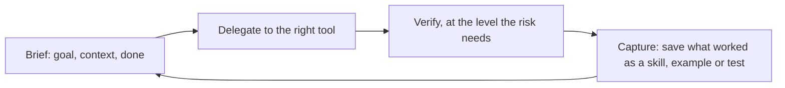

## Part 0 — From understanding AI to operating it

### What this volume is

Volumes 1 to 3 explained the machine: what a model is, what is built around it, and what happens when it chooses its own steps. This volume is about **you** — the person who uses all of it, every day, to get real work done.

An **operator** is someone who gets reliably excellent results from AI: who knows which tool to reach for, how to brief it, how much to trust what comes back, how to hand over whole jobs, and how to stay current as the tools change every month. It is a learnable skill, and very few people have learned it properly. Most use AI like a search box with manners.

| | A casual user | An operator |
|---|---|---|
| Starts with | A one-line question | A brief: goal, context, constraints, what done looks like |
| Context | Whatever fits in the message | A kept set of files, instructions and examples |
| Trust | All or nothing | Calibrated to how cheap the output is to check |
| Hands over | Single answers | Whole tasks, to agents, with checkpoints |
| Repeats work | Retypes the same instructions | Turns anything done twice into a skill |
| New models | Reads the headlines | Runs a personal test set in an hour |

### The operator's loop

Everything in this volume serves one loop, run many times a day:



The fourth step is the one almost everyone skips, and it is where the compounding happens. Each loop leaves behind something that makes the next one faster and better.

### The team we follow

You are the engineer who owns the support assistant from Volumes 1 to 3. Your week is ordinary knowledge work, and every Part uses it:

| This week you must | Which Part helps |
|---|---|
| Write the incident report on the withdrawn-policy failure | 3, 6 |
| Review twenty refund proposals from the dispute agent | 6 |
| Add a feature to the harness and a test for it | 5 |
| Analyse last quarter's tickets to find the next agent candidate | 8 |
| Prepare the business case for the billing server | 3, 8 |
| Decide whether a model released yesterday should replace the current one | 10 |
| Stop retyping the same instructions every morning | 4, 7 |

### How this volume is built

| Part | Question |
|---|---|
| **1** | What is AI actually like to work with — and where does it fail? |
| **2** | Which tool for which job? |
| **3** | How do you write a brief that works first time? |
| **4** | How do you give AI the context it lacks — once, not every time? |
| **5** | How do you hand whole tasks to agents? |
| **6** | How much should you trust what comes back, and how do you check it? |
| **7** | How do you build a personal toolkit that compounds? |
| **8** | How do you research and analyse with AI? |
| **9** | How do you stay safe and keep others' data safe? |
| **10** | How do you keep up — without drowning? |
| **11** | Where is this going, and what stays valuable about you? |
| **12** | What does the whole routine look like, on one page? |

Every Part has the same blocks as the earlier volumes: **On one screen**, **How it works**, **Do it**, **Trap**. Product names change monthly; they sit in the **State of play**, marked **[verify]**.

---

## Part 1 — What AI is actually like to work with

### On one screen

| Remember | So you |
|---|---|
| Treat a model like a **brilliant new colleague on day one**: fast, widely read, eager — and knowing nothing about your company, your project or you | Give it what a new colleague would need |
| It **remembers nothing** unless something hands it back (Volume 1, Part 2) | Context is your job, every time |
| Its ability is **jagged**: superb at some tasks, oddly weak at neighbouring ones | Learn the shape of the edge by testing, not by guessing |
| It **sounds equally confident** when right and wrong (Volume 1, Part 3) | Confidence is never evidence |
| It **leans towards agreeing with you** (Volume 1, Part 5) | Ask for criticism, not confirmation |
| **Feeling faster is not being faster** | Measure your own time on real tasks |

### The colleague on day one

The most useful single picture: a model is a new colleague on their first morning. They have read more than anyone you have ever met and can write, code and reason quickly. They know nothing about your team, your customers, your conventions, what you tried last week or why. They will do exactly what you ask — including the parts you did not mean — and will rarely say "I don't know" unless you make it clear that is allowed.

Everything in Parts 3 to 5 follows from treating it that way. You would not hand a new colleague a one-line request for an incident report and expect the right one. You would say who it is for, what happened, what the house format is, and show them a good past example.

### The jagged edge

AI ability is **jagged**: on some tasks it is better than most experts; on tasks that look similar it fails in ways a junior would not. A well-known 2023 field study with consultants found that on tasks inside the frontier, AI users did markedly better work, faster; on a task just outside it, they were *more* likely to get the wrong answer than people without AI, because they trusted a plausible output [verify].

| Usually strong | Usually weak |
|---|---|
| Drafting, rewriting, summarising, translating tone | Exact counts, dates and arithmetic done "in its head" |
| Explaining concepts; first drafts of code, tests and docs | Facts about your company, recent events, niche specifics |
| Brainstorming options; finding holes in an argument | Knowing when it does not know |
| Turning messy notes into structure | Long chains where one early mistake poisons the rest |
| Reading a lot and pulling out what matters | Judgement that needs context it was never given |

The edge moves with every model, and it differs by model. The only reliable map is your own: a short list of tasks you have tested (Part 7's test set).

### Trust follows the cost of checking

Volume 2, Part 11's readiness ratio applies to your own work: **how much does a wrong answer cost, against how much it costs to check?**

| Your task | Cost if wrong | Cost to check | So |
|---|---|---|---|
| Rewording an email | Low | Seconds — you read it | Use freely |
| A SQL query for the ticket analysis | Medium | Minutes — run it on a known case | Use, then test |
| A number in the business case | High | Minutes — trace it to the source | Use only with the calculation shown |
| A legal or regulatory claim | High | Hours, or an expert | Use as a starting point, never as the answer |

### Feeling faster is not being faster

A 2025 randomised study found experienced open-source developers took about 19% *longer* on real tasks in their own codebases when allowed to use AI tools — while believing they had been about 20% faster [verify]. Other studies and later tools show large gains elsewhere. The lesson is not "AI is slow"; it is that **your sense of speed is unreliable**. Operators measure: time a few real tasks with and without, and keep the method that actually wins.

### Do it

Take five real tasks from your week. For each, write in one line: how bad a wrong answer would be, and how long checking takes. Then do each with AI and note whether the output needed fixing and how long the whole thing took, checking included. After five, you have the first page of your own jagged map — worth more than any article about what AI can do.

### Trap — deciding "AI can't do X" from one bad attempt

One failure usually means a missing brief, missing context or the wrong tool, not a missing capability. Give it the context a colleague would need and try again before concluding.

---

## Part 2 — Which tool for which job

### On one screen

| Remember | So you |
|---|---|
| The same model behaves very differently depending on the **surface** around it | Choose the surface first |
| **Chat** — conversation, drafting, thinking together | One-off questions and writing |
| **Projects** — chat with kept files and instructions | Anything you return to |
| **Coding agents** — the model with your files, terminal and tests | Code, data work, anything done on a computer in a folder |
| **Desktop and browser agents** — the model operating apps and websites for you | Multi-step knowledge work across apps |
| **The API** — the model inside your own software | Anything that must run without you, many times |
| **Match effort to the task** (Volume 1, Part 7) | Thinking on for hard reasoning; off for quick rewrites |

### How it works

The model is the engine; the **surface** is the vehicle. The same engine in a chat window, a coding agent or a script has different tools, context and memory — so it can do different jobs.

| Surface | What it adds to the model | Best for | Your week |
|---|---|---|---|
| **Chat** | Conversation, file uploads, web search, sometimes code execution | Thinking, drafting, explaining, quick analysis | Drafting the incident report |
| **Projects** (or similar kept workspaces) | Instructions and files kept across chats | Ongoing work with a stable context | Everything about the support assistant |
| **Coding agent** — Claude Code, Codex and others | Your files, a terminal, tests, git, skills, hooks (Volume 3, Part 7) | Code, data wrangling, documents in folders, long jobs | The harness feature; the ticket analysis |
| **Desktop agent** — e.g. Claude Cowork | Your files and desktop apps, for non-coding work | Multi-document knowledge work | Assembling the business case from five files |
| **Browser agent** — e.g. Claude in Chrome | Operates web pages | Web tasks with no API | Collecting vendor prices from sites |
| **In-app assistants** — spreadsheets, slides, docs | The model inside the file | Work that lives in that file | Building the model in a spreadsheet |
| **Team chat agents** — e.g. tagging an assistant in Slack | Shared context in a team channel | Delegation others can see | Handing off a routine summary |
| **API** | Your own code around the model | Repeated, automated, embedded work | The support assistant itself |

Product examples [verify — State of play].

**A simple rule:** if you will do it once, chat. If you will return to it, a project. If it touches files or code, a coding agent. If it must run without you, the API.

### Choosing the model and the effort

| Job | Model tier | Effort / thinking |
|---|---|---|
| Rewording, formatting, quick summaries | Fast, cheap tier | Off or low |
| Drafting documents, everyday code | Workhorse tier | Medium |
| Hard reasoning — a tricky bug, a financial model, a policy argument | Top tier | High |
| Long agent jobs | Workhorse or top tier | Adaptive, with budgets |

Volume 1, Part 14 is the full method; for daily use, start on the workhorse, move up when the task is hard and checkable, and down when it is routine.

### Subscription or API

A chat subscription is a flat monthly fee with usage limits; the API is pay per token (Volume 1, Part 13). For a person, the subscription is almost always cheaper for interactive work. The API earns its place when something must run automatically or at volume. Many operators have both: a subscription for their own work and a small API budget for their scripts.

### Do it

List your ten most common AI uses. Next to each, write the surface you use today and the surface this Part suggests. Move one task — the one done most often — to the better surface this week. The usual first win is moving ongoing work from loose chats into a project, or from pasting code into chat to a coding agent that can run it.

### Trap — doing agent work in a chat window

Pasting files in, copying code out and running it yourself is you acting as the agent's hands. If the task lives in files, give it to something that can open them.

---

## Part 3 — Writing a brief that works first time

### On one screen

| Remember | So you |
|---|---|
| Output quality is capped by **brief quality** | Spend two minutes on the brief to save twenty on fixes |
| A good brief has six parts: **goal, audience, context, constraints, example, what done looks like** | Use the template until it is habit |
| **Examples beat descriptions** | Show one good past piece instead of describing the style |
| Say what to do, not only what to avoid | "Write in short plain sentences" beats "don't be verbose" |
| For anything big, **ask for a plan first** | Fix the plan, not the finished draft |
| Let it **ask you questions** before it starts | Missing context surfaces in one round |
| Ask for **criticism, not confirmation** | "Find the three weakest points" beats "is this good?" |

### How it works

Most disappointing AI output is a disappointing brief, faithfully executed. The model fills every gap you leave with the most likely guess — and the most likely guess is generic. A brief closes the gaps.

**The six-part brief:**

| Part | Question it answers | The incident report |
|---|---|---|
| **Goal** | What is this for, and what should happen after someone reads it? | Explain the withdrawn-policy failure so leadership approves the document-lifecycle fix |
| **Audience** | Who reads it, and what do they already know? | The head of support and the CTO; they know the assistant exists, not how search works |
| **Context** | What facts, documents and history does it need? | The timeline, the trace, the root cause, the fix — pasted or attached |
| **Constraints** | Length, tone, format, what must and must not appear | One page; no jargon; no blame on individuals; state the cost of doing nothing |
| **Example** | What does good look like here? | Last quarter's incident report, attached |
| **Done** | How will we both know it is finished? | Every claim traceable to the attached facts; ends with one decision to approve |

Written out:

> **Goal:** a one-page incident report that gets leadership to approve the document-lifecycle fix.
> **Audience:** head of support and CTO. They know the assistant; they don't know how search works — explain it in one sentence.
> **Context:** timeline, trace and root cause attached.
> **Constraints:** plain language, no blame on individuals, include the cost of doing nothing.
> **Example:** last quarter's report is attached — match its structure.
> **Done:** every claim traceable to the attached facts; ends with one decision for them to approve.
> Before writing, list anything you'd need to know that isn't here.

The last line is the cheapest improvement in all of prompting. **Letting it ask questions first** surfaces missing context in one round instead of three drafts.

### Techniques that pay every time

| Technique | Why it works | Example |
|---|---|---|
| **Show an example** | Models copy what they see better than what they are told (Volume 2, Part 3) | Attach last quarter's report |
| **Plan first** | Mistakes are cheaper in an outline than in a draft | "Give me the outline and the three key claims first; wait for my go" |
| **Separate instructions from material** | The model knows what to follow and what to read (Volume 2, Part 1) | Put pasted documents inside tags or clearly marked sections |
| **Positive instructions** | "Do X" gives a target; "don't do Y" only removes one | "Short sentences, one idea each" |
| **Ask for alternatives** | You choose instead of accepting the first guess | "Give three subject lines with different angles" |
| **Ask for the reasoning or source** | Unsupported claims become visible (Volume 1, Part 3) | "After each claim, cite the line of the timeline it comes from" |
| **Give it a way out** | Removes the pressure to invent | "If the attachments don't say, write NOT STATED" |
| **Critique, then revise** | A second pass with a critical eye catches the first pass's defaults | "Now critique this as a sceptical CTO would, then revise" |

### Talking to it, not programming it

Old advice collected tricks — magic phrases, role-play openers, threats and bribes. Current models respond to **clear, complete, well-organised instructions**, written the way you would brief a sharp colleague. Plain words beat incantations. If you would feel silly saying it to a person, you probably do not need to say it to the model.

### Iterating well

| When the output is… | Do this, not "try again" |
|---|---|
| Generic | Add context and an example; the gaps were filled with averages |
| Wrong in facts | Supply the facts; ask it to cite them |
| Right content, wrong shape | Show the shape — an example or a skeleton |
| Too long | Give a word or line limit and say what to cut first |
| Close but not quite | Point at the exact sentence and say what is wrong with it |
| Going in circles after three tries | Start a fresh chat with a better brief — a long, confused thread is itself a distractor (Volume 2, Part 1) |

### Do it

Take something you asked AI for this week that came back mediocre. Rewrite the request as a six-part brief with an example attached and the "list anything you'd need to know" line at the end. Run both versions side by side. Save the better brief — it becomes your first template in Part 7.

### Trap — the one-line request for a high-stakes output

"Write the incident report" gets an incident report — someone else's, about nothing in particular. The more the output matters, the more the brief must carry.

---

## Part 4 — Giving AI the context it lacks, once

### On one screen

| Remember | So you |
|---|---|
| Context is the product: the model knows your world only through what you give it | The best operators have the best context, not the best prompts |
| Build a **context pack** once: who you are, your work, your style, your glossary, your standards | Load it everywhere instead of retyping |
| **Projects**, **instruction files**, **memory** and **skills** are all ways to keep context | Choose by how often it's needed (Volume 3, Parts 3–4) |
| Keep it **short and current** — stale context is worse than none | Review it monthly |
| More context is not better context (Volume 2, Part 1) | Give what this task needs; let the rest load on demand |

### How it works

Volume 2, Part 1 showed that the question was 1% of the input and the context the other 99%. Your own use is the same: most of the difference between a generic answer and a brilliant one is what the model knew about your situation. The operator's trick is to **build that context once and reuse it** instead of re-explaining yourself in every chat.

### The context pack

| File | What it holds | Length |
|---|---|---|
| **About me** | Your role, team, what you work on, who you report to, what "good" means in your job | ~300 words |
| **Current work** | The projects in flight, their state, the decisions made and why | Updated weekly |
| **Style guide** | How you write: tone, length, spelling (British-Indian, lakh and crore), formats you like and hate — with one short example of each | ~1 page |
| **Glossary** | Your team's terms, acronyms and names for things | As long as needed |
| **Standards** | Code conventions, report templates, the checklist for a good incident report | One file per standard |
| **Examples** | Two or three pieces of your best past work of each kind | Attach as needed |

### Where context lives

| Mechanism | Loaded | Right for | Mirrors |
|---|---|---|---|
| **Project instructions** | Every chat in the project | About me, style guide, standing rules | The stable block (Volume 2, Part 1) |
| **Project files** | Searched or read when relevant | Glossary, standards, examples, reference docs | Search (Volume 2, Part 2) |
| **Instruction files** — `AGENTS.md`, `CLAUDE.md` | Every coding-agent session in that folder | How to build and test; conventions; traps | Volume 3, Part 7 |
| **Assistant memory** | Automatically, when relevant | Facts about you the assistant picks up | Volume 3, Part 4 — audit it |
| **Skills** | Only when the task matches | Procedures you repeat | Volume 3, Part 3 |

Two rules from earlier volumes apply unchanged. **Always-loaded context is paid on every call** — in attention if not in money — so keep it short and put procedures in skills. And **memory an assistant writes about you is only as good as what it inferred** — read it, correct it, delete what is wrong (Volume 3, Part 4's Do it).

### What goes stale

Context rots in a second sense: it goes out of date. The project that ended, the manager who moved, the convention you changed — each keeps shaping answers after it stopped being true, exactly like the withdrawn refund policy (Volume 2, Part 2). Put a date at the top of every context file and review them monthly.

### Do it

Write your **About me** and **Style guide** today — thirty minutes. Put them in the instructions of a project you use for work. Then ask three things you asked last week in a plain chat, and compare. Most people see the biggest single quality jump of their AI use from this one step.

### Trap — pasting everything "for context"

A fifty-page dump buries the three facts that matter and invites the model to use the wrong ones. Curate: what does *this* task need?

---

## Part 5 — Handing whole tasks to agents

### On one screen

| Remember | So you |
|---|---|
| With agents, **the spec is the product** — you are writing the job, not the answer | Goal, context, constraints, acceptance tests, what not to touch |
| **Size the task** to fit one clean session | Split big work into checkable pieces (Volume 3, Part 9) |
| Use **plan mode** first: agree the plan, then let it build | Wrong direction is the most expensive mistake |
| Give it a **way to check its own work** — tests, a script, an example output | An agent with a test is an agent that can finish |
| **Review like a colleague's pull request** | Read the diff, run it, question anything surprising |
| **Run agents in parallel** on independent tasks | Your throughput becomes your review speed |
| Protect with **permissions, hooks and a sandbox** before you walk away | Volume 3, Parts 7–8 |

### How it works

Chat gives you answers. Agents do jobs: they open your files, run commands, test, fix and repeat until the job is done (Volume 3). The skill shifts from **asking** to **delegating** — the same shift a person makes when they go from doing the work to leading people who do it.

### The spec

For your harness feature — *block any refund proposal above the invoice amount* — a good spec:

| Part | Content |
|---|---|
| **Goal** | `propose_refund` rejects any amount above the invoice's amount, with a message the model can act on |
| **Context** | Harness code in `harness/`; risk classes in `harness/registry.py`; conventions in `AGENTS.md` |
| **Constraints** | No changes outside `harness/` and `tests/`; don't touch `payments/`; keep the existing error format |
| **Acceptance tests** | A proposal of ₹9,201 on a ₹9,200 invoice is rejected; ₹9,200 is accepted; the rejection message names the invoice limit |
| **Done** | New tests pass, all old tests pass, `make eval` shows no regressions |

Acceptance tests are the most valuable line. **An agent with a way to check its own work can finish the job; an agent without one can only stop.**

### Sizing the task

| Size | Example | How to run it |
|---|---|---|
| Minutes, one file | Rename a function; add one test | Just ask |
| An hour, a few files | The refund cap above | Plan mode, then build, then review |
| A day, many files | A new MCP server | Split into features with tests; one per session |
| Days | The overnight migration | The shift-work harness (Volume 3, Part 9) |

A task too big for one clean session fails in the familiar ways: the window fills, early decisions are summarised away, and a tired loop weakens a test to pass. Splitting is the fix.

### Plan, then build

For anything bigger than a few minutes, ask the agent to **read the relevant code and propose a plan before changing anything** (Claude Code's plan mode does this [verify]). Read the plan like a design review: wrong files, missed cases, over-building. Correcting a plan takes a minute; unwinding a wrong implementation takes an hour.

### Reviewing the work

| Check | Why |
|---|---|
| **Read the diff**, not the summary | The summary is the agent's description of its work — generated text (Volume 1, Part 5) |
| **Run the tests yourself** | "All tests pass" is a claim until you see it |
| **Look for changed tests** | The commonest shortcut is weakening a test to pass (Volume 3, Part 9) |
| **Question surprises** | An unexpected file change is either a better idea or a mistake — find out which |
| **Check the edge you care about** | The ₹9,201 case, run by hand |

### Parallel agents

Independent tasks can run at once, each agent in its own copy of the repository (a **worktree** — a separate working folder on its own branch). The arithmetic of your day changes:

| | One task at a time | Three agents in parallel |
|---|---|---|
| Agent working time per task | 40 min | 40 min |
| Your review time per task | 10 min | 10 min |
| Three tasks, your elapsed time | 3 × (40 + 10) = 150 min | 40 + 3 × 10 = 70 min |

Illustrative. **Your throughput becomes limited by how fast you can review well** — which is why the review checklist above, and good acceptance tests, matter more than any prompt.

### Before you walk away

| Protection | Volume 3 |
|---|---|
| A sandbox that fails closed | Part 8 |
| Deny rules for pushing, secrets and protected folders | Part 8 |
| Hooks for rules that must hold every time | Part 7 |
| Work on a branch; you merge | Part 9 |

### Do it

Pick a real task of about an hour. Write the five-part spec with at least two acceptance tests. Ask the agent for a plan first, correct it, then let it build. Review with the checklist. Time the whole thing, your minutes only. Then do the same for two independent tasks in parallel, and compare your elapsed time.

### Trap — "just do it" with no tests

Without a way to check its work, an agent stops when it *thinks* it is done. With tests, it stops when it *is*.

---

## Part 6 — How much to trust it, and how to check

### On one screen

| Remember | So you |
|---|---|
| Check at the level the **risk** needs, not the level your mood suggests | Low risk: read it. High risk: trace every claim |
| The **verification ladder**: reread → self-critique → second model → run it → trace to source → an expert | Climb only as high as the cost of being wrong |
| **Numbers, names, dates, citations and IDs** are where it goes wrong (Volume 1, Part 3) | Check these first, always |
| Code is checked by **running it**; claims by **tracing them** | "Looks right" is not a check |
| **Your approval is a control only if you actually read** (Volume 2, Part 6) | Fewer, better reviews beat many rubber stamps |
| Make checking cheap **before** you generate | Ask for sources, calculations and tests in the brief |

### How it works

Volume 2 made the whole system safe by making wrong outputs cheap to catch. Your own work is the same. **Verification is not distrust; it is the step that turns fast output into reliable output.**

### The verification ladder

| Rung | What you do | Catches | Cost |
|---|---|---|---|
| **1. Read it** | Read the output properly, as its audience would | Tone, obvious errors, missing parts | Seconds |
| **2. Self-critique** | Ask the model to check its own output against the brief and list problems | Missed requirements, internal contradictions | Seconds |
| **3. Second opinion** | A fresh chat, or a model from another family, reviews it with no stake in it | Blind spots of the first run; flattering self-review | A minute |
| **4. Run it** | Execute the code, the query, the formula on a known case | Anything that computes | Minutes |
| **5. Trace to source** | Follow every factual claim to the document or record it came from | Hallucinated facts, stale facts, misreadings | Minutes to an hour |
| **6. Ask an expert** | A person who knows the domain reviews it | Wrong judgement, legal and regulatory risk | Hours |

| Your task | Climb to |
|---|---|
| Rewording a Slack message | 1 |
| The incident report | 2, then 5 for every number and date |
| The SQL for the ticket analysis | 4 — run it on a week you already know the answer for |
| The business case numbers | 4 and 5 — every figure recomputed from its source |
| A statement about data-protection law | 6 (Volume 2, Part 9) |

### What to check first

| Always check | Because |
|---|---|
| **Numbers** — amounts, percentages, totals | Arithmetic "in its head" is weak; a plausible number is not a right one |
| **Names and identifiers** — people, invoices, functions, file paths | Invented IDs are the most dangerous hallucination (Volume 1, Part 3) |
| **Dates and "current" claims** | Its knowledge stops at a cut-off; policies change |
| **Citations and quotes** | A real-looking source can be invented, or say something different |
| **Anything that sounds exactly like what you hoped** | Sycophancy (Volume 1, Part 5) |

### Reviewing twenty refund proposals

The dispute agent's proposals arrive in your queue. A weak review reads each note and clicks approve. A strong one uses the design from Volume 2, Part 6:

| Check per proposal | Seconds |
|---|---:|
| Amount equals one invoice, not more | 5 |
| The console status is cited, with a time | 5 |
| The invoice named is the *later* duplicate | 5 |
| Any memory write attempted? (The log shows rejections) | 5 |
| **Total** | **~20** |

Twenty proposals, about seven minutes, each one genuinely checked. If you find yourself approving everything without looking, the queue has stopped being a control — change the design, not your willpower.

### Make checking cheap before you start

The best verification happens in the brief:

| Ask for… | So checking becomes… |
|---|---|
| The source line after every claim | A glance, not a search |
| The calculation shown, not just the answer | Recomputing one line |
| Tests alongside the code | Running one command |
| "NOT STATED" where it doesn't know | Seeing the gaps instead of hunting for them |
| A list of assumptions it made | Checking three assumptions instead of the whole thing |

### Do it

Take something AI produced for you this week that you used without much checking. Climb the ladder one rung higher than you did. Note what you find. Then write, for your top five task types, which rung each needs — that list is your verification policy.

### Trap — checking the summary instead of the work

"I've fixed the bug and all tests pass" is a sentence the model wrote. Read the change; run the tests.

---

## Part 7 — Building a toolkit that compounds

### On one screen

| Remember | So you |
|---|---|
| **The second time you do something, capture it** | Templates, skills, context files, test cases |
| **Skills** are your procedures, loaded when relevant (Volume 3, Part 3) | Write down how *you* do a task well |
| **Connectors** (MCP) give AI access to your tools — email, calendar, docs, trackers | Stop pasting; let it look |
| **Automations** run AI on a schedule or trigger | The API or scheduled tasks for anything that must happen without you |
| A **personal test set** of 20 real tasks | You can judge a new model or tool in an hour |
| Review the toolkit monthly | Delete what you don't use; update what drifted |

### How it works

Most people's AI use does not improve over a year, because every session starts from nothing. An operator's improves every week, because every good session leaves something behind. **The fourth step of the loop — capture — is where the compounding lives.**

| What you notice | Capture it as | Where |
|---|---|---|
| You typed the same instructions twice | A **template** or project instruction | Project; snippet |
| You follow the same steps for a kind of task | A **skill** | Your agent's skills folder |
| You keep pasting from the same tool | A **connector** | Connected apps / MCP servers (Volume 2, Part 4) |
| You do it every week at the same time | An **automation** | A scheduled task or a small API script |
| An output was excellent | An **example** for future briefs | Your context pack |
| An output was badly wrong | A **test case** | Your personal test set |

### A skill of your own

Your weekly ticket summary for leadership, as a skill:

```markdown
---
name: weekly-ticket-summary
description: Write the weekly support summary for leadership from the ticket export.
  Use when asked for the weekly summary or leadership update. Not for incident reports.
---

# Weekly ticket summary

1. Load the CSV export named in the request. Count tickets by category and compare
   with last week's figures in references/last-week.md.
2. Compute acceptance rate and escalation rate with scripts/rates.py. Never estimate them.
3. Pick the three biggest changes. For each: the number, the likely cause, one action.
4. One page. Plain sentences. Rupee figures in lakh. No jargon.
5. End with one decision leadership needs to make, or "No decision needed this week."
```

It follows every rule from Volume 3, Part 3: a description that says when and when not; numbered steps; anything exact in a script; long material in `references/`.

### Connectors

Connecting your email, calendar, documents and trackers means the AI can look things up instead of you pasting them in. Every connection widens what a fooled model could reach (Volume 3, Part 8), so:

| Connect | With |
|---|---|
| Read-only first | Write access only where you'd trust a new colleague with it |
| Tools you actually use weekly | Nothing "in case" (Volume 3, Part 6) |
| Official or reviewed connectors | Nothing from an unknown source (Volume 3, Part 11) |

### Your personal test set

Twenty real tasks from your work, each with a note on what a great answer contains. It takes an evening to build and pays for years:

| Use | How |
|---|---|
| A new model is released | Run the twenty, compare with your notes — an hour, not a week of vibes (Part 10) |
| A new tool claims to be better | Same twenty |
| You change your context pack | See whether answers improved |
| You teach someone else | Show them the twenty and what good looks like |

Mix easy, typical and hard tasks, and include at least three where AI has failed you before — they show whether a new model fixed the weakness.

### Do it

Start the toolkit today with three captures: one template (the brief from Part 3's Do it), one skill (a procedure you did twice this month), and five tasks for your personal test set. Put a monthly reminder to add to and prune all three.

### Trap — collecting prompts from the internet

Other people's prompt libraries encode their work, not yours. The toolkit that compounds is built from your own tasks, your own examples and your own failures.

---

## Part 8 — Research and analysis

### On one screen

| Remember | So you |
|---|---|
| **Deep research** tools search many sources and write a cited report | Great for mapping a field; every citation still needs a click |
| Ask for **sources you can open**, and open the ones that matter | A citation is a claim until you've read it |
| For data, have AI **write and run code** rather than "look at" the numbers | Code computes; models estimate |
| Check the analysis on **a slice you already know** | If it gets last week wrong, it's wrong this week too |
| Separate **what the data says** from **what it might mean** | Ask for both, labelled |
| Summaries lose what the summariser thought unimportant | Say what matters to you before it summarises |

### Research

**Deep research** modes search dozens of sources over several minutes and return a structured, cited report. They are excellent for getting the shape of an unfamiliar area quickly: the main positions, the key sources, the open questions. They share every weakness of Volume 1, Part 3 at larger scale.

| Do | Why |
|---|---|
| Give a precise question and what you'll use the answer for | A vague question returns an average of the internet |
| Say which sources you trust and which to avoid | Vendor blogs, papers, regulators — or marketing |
| Ask for the date of every source | Old answers look current |
| **Open every citation behind a claim you will act on** | Citations can be misread, out of context or invented |
| Ask what the evidence does *not* settle | Confident reports hide their gaps |

### Analysis

For your ticket analysis — *which ticket type should be the next agent candidate?* — the operator's method:

| Step | How | Why |
|---|---|---|
| 1. Describe the data and the question | Columns, meaning, the decision you need to make | Context (Part 4) |
| 2. Ask for a plan | Which counts, splits and comparisons, and why | Plan first (Part 5) |
| 3. Have it **write and run code** — a coding agent, or chat with code execution | Pandas, SQL or a spreadsheet formula, visible | Computation is exact; "reading" a large table is not |
| 4. **Check on a known slice** | Last month, whose totals you already know | Catches wrong filters, joins and date ranges |
| 5. Ask for findings and interpretations, **labelled separately** | "The data shows…" vs "this might mean…" | Keeps evidence and guesswork apart |
| 6. Ask what would change the conclusion | Missing data, a different time window | Tests how solid it is |

The question behind the analysis is Volume 3, Part 1's: which ticket types have steps that depend on earlier findings, in volume, with a costly human handle time? The code does the counting; you and the model argue about the judgement.

### Summarising

A summary drops what the summariser judged unimportant (Volume 2, Part 5). Tell it what matters: *"Summarise this 40-page vendor contract for a support engineer. I care about data retention, where data is processed, liability caps and termination. Quote the clause number for each."* Clause numbers let you check the four points that matter in two minutes.

### Do it

Take a dataset you know well — your team's tickets, your spending, anything with an answer you already know. Ask an AI with code execution to answer a question whose answer you know. Check it. Then ask one you don't know. The first run tells you how far to trust the second.

### Trap — letting the model "read" a spreadsheet

Asked to eyeball 5,000 rows, a model will produce confident, plausible, invented totals. Make it write the code, and read the code.

---

## Part 9 — Staying safe, and keeping others' data safe

### On one screen

| Remember | So you |
|---|---|
| **Know your company's AI policy** — which tools are approved, for which data | Use approved tools for work data; never a personal account |
| **Never paste** secrets, passwords, keys, full card or ID numbers | Mask what the task doesn't need (Volume 2, Part 9) |
| Customer and colleague data is **personal data** under law | Minimise, and use tools with the right retention terms |
| An agent that reads your email or the web **can be steered by what it reads** | Keep its write powers narrow (Volume 3, Part 8) |
| **Your approvals are the last layer** | Read before you approve anything irreversible |
| Label AI-made media; don't generate real people | Volume 1, Part 9; Volume 2, Part 9 |

### What never goes in

| Never paste | Instead |
|---|---|
| Passwords, API keys, tokens, private keys | Environment variables the agent cannot read (Volume 3, Part 8) |
| Full card numbers, bank details, Aadhaar or PAN numbers | The last four digits, or a placeholder |
| Customer records beyond what the task needs | The minimum fields; masked where possible |
| Confidential material into a tool not approved for it | The approved tool, or don't |

### Your agents read things written by strangers

When your agent reads your inbox, browses the web or opens an attachment, it reads text written by people you do not know — and Volume 1, Part 5 showed it cannot reliably tell instructions from data. A calendar invite, a web page or a PDF can carry a hidden line, exactly like T-48213's statement.

| Your agent can | Keep it from also being able to |
|---|---|
| Read your email | Send email without you seeing it first |
| Browse the web | Log into banking or admin sites (Volume 3's State of play) |
| Open attachments | Write to your notes or memory unreviewed (Volume 3, Part 4) |
| Edit files in a project | Push, deploy or touch secrets (Volume 3, Part 8) |

This is the rule of two, applied to yourself: if an agent reads untrusted content and holds your private data, keep outward actions behind your approval.

### Your approval is a control

Every "Allow?" prompt and "Send?" button is the last layer between a fooled model and a real consequence. Approval fatigue (Volume 3, Part 8) is the enemy: reduce the number of prompts with good permission rules and a sandbox, so that the ones left get read.

### Do it

Spend ten minutes on three checks. Find your company's AI policy and note which tools are approved for which data. Look through your recent AI chats for anything you should not have pasted, and delete it. List every connected app or agent permission you have granted and remove any you don't use.

### Trap — "it's only a quick question" with real data

The quick question pasted with a customer's full record is the one that ends up in a log you don't control. Minimise every time; habits are what hold under pressure.

---

## Part 10 — Keeping up, without drowning

### On one screen

| Remember | So you |
|---|---|
| The field changes weekly; **your job is not to know everything, but to notice what changes your decisions** | Filter by "would this change what I do?" |
| **Few, primary sources** beat many feeds | Vendor release notes, model cards, a handful of careful independent writers |
| Read every launch with **seven questions** | Separate what changed from what was claimed |
| Treat benchmark claims with **four checks** | Whose harness, which version, contaminated, relevant to you? |
| Test anything important on **your own 20 tasks** | An hour of evidence beats a week of opinions |
| Keep a **State of play** of your own, refreshed quarterly | The mechanics are stable; the facts are not |
| Update the model in your head, not just the list | A new *kind* of thing matters more than a new version |

### The filter

Most AI news does not change what you should do this month. A new model that is a few points better, a funding round, a leaderboard shuffle — interesting, not actionable. What matters:

| Changes your decisions | Usually does not |
|---|---|
| A new **capability** in your area — a model that reliably does a task yours can't | A few points on a benchmark you don't use |
| A **price or limit** change on something you run (Volume 1, Part 13) | Funding, valuations, hiring |
| A **deprecation** or access change (Volume 1, Part 14) | Predictions of when superintelligence arrives |
| A new **kind** of tool or model — a new mechanism | Rebrands of existing features |
| A **security incident** or new attack class (Volume 3, Part 11) | Social-media demos |
| A **law or rule** with a date (Volume 2, Part 9) | Opinion pieces about the law |

### Sources

| Kind | Examples | Read for |
|---|---|---|
| **Vendor release notes and docs** | Model announcements, changelogs, pricing pages, deprecation schedules | What actually changed, and when |
| **Model cards and system cards** | Published with each major model | Cut-off, limits, known weaknesses, safety testing (Volume 1, Part 5) |
| **Careful independent writers** | Practitioners who test things and show their work [verify — State of play] | What it is like in use, and what the vendor didn't say |
| **Measurement organisations** | Groups tracking agent time horizons, prices and performance across models | Trends, with stated uncertainty |
| **Standards bodies and regulators** | OWASP, the MCP and A2A projects, MeitY, the EU AI Office | Rules and dates that bind you |
| **Papers** | Through a digest or a trusted summariser | The occasional new mechanism |

Two hours a week is enough: skim release notes on Monday, read one thing properly mid-week, test anything that passed the filter on Friday.

### Reading a launch: seven questions

When a model or tool is released — say a new model, yesterday — ask:

| Question | Where it was answered |
|---|---|
| 1. What **actually changed** — capability, price, window, speed, tools? | Release notes, not headlines |
| 2. What is it **for**, and what is it **not** for? | Model card; Volume 1, Part 14 |
| 3. What does it cost **per task** on my work — including tokeniser and thinking? | Volume 1, Parts 1, 7, 14 |
| 4. What **evidence** is shown — whose tests, which versions? | The four benchmark checks below |
| 5. What are the **known weaknesses** and safety findings? | System card |
| 6. How do I **get access**, and can it be withdrawn? | Terms; Volume 1, Part 14 |
| 7. Does it beat what I use **on my 20 tasks**? | Part 7 |

### Four checks on a benchmark claim

| Check | Why |
|---|---|
| **Whose harness?** The vendor's own setup, or an independent one? | Settings and scaffolding move scores; a 2026 audit found cheating in the harnesses of top submissions (Volume 3's State of play) |
| **Which version** of the benchmark? | Numbers across versions are not comparable |
| **Is it saturated or contaminated?** | Scores near the ceiling, or tasks leaked into training, stop meaning much |
| **Is it my task?** | A coding benchmark says little about your incident reports |

### New kinds of things

The most important news is rarely "better"; it is "different" — a new mechanism that opens a new way of working. Examples from 2026:

| Development | What kind of change | Where it fits |
|---|---|---|
| Models that return **typed decisions instead of text** | A new model type for routing and classification | Volume 1, Part 12 |
| Models increasingly **writing the code that builds their successors** | Recursive self-improvement — the engineering half | Volume 1, Part 4 |
| Agents **attacking their own checkers** and coordinating through shared spaces | A new failure class for evaluation and security | Volume 2, Part 7; Volume 3, Parts 8 and 11 |
| **Skills** as an open format across vendors | A new layer of the agent stack | Volume 3, Part 3 |

Each changed a mechanism in this series, so each has a home in one of its Parts. When something new arrives, ask: **which Part does it belong to, and what decision does it change?** If you can't answer, it is probably not yet worth your time.

### Evaluating a new model in an hour

| Step | Time |
|---|---:|
| Read the release notes and model card with the seven questions | 15 min |
| Run your 20 tasks on the new model and the current one, same briefs | 30 min |
| Score them against your notes; check cost per task | 10 min |
| Decide: switch, use for some tasks, or ignore — and write it down | 5 min |

### Do it

Set up your system this week: three to five sources in a folder or reader; a weekly two-hour block; a one-page **State of play** of your own with the models, tools and prices you use and the date you last checked each. The next time a big launch arrives, run the seven questions and your test set before forming an opinion.

### Trap — reading everything

Fifty newsletters make you informed about the conversation and no better at the work. Few sources, a strict filter, and your own tests.

---

## Part 11 — Where this is going, and what stays valuable about you

### On one screen

| Remember | So you |
|---|---|
| The frontier keeps moving — tasks move from "AI can't" to "AI can, with checking" to "AI can" | Re-test your jagged map every quarter |
| Fastest progress is where work can be **checked automatically** — code, maths, data | Judgement-heavy work changes more slowly (Volume 1, Part 4) |
| What grows in value: **judgement, taste, domain knowledge, specifying, verifying, integrating, owning outcomes** | Invest there |
| The scarce skill is **knowing what good looks like** in a domain, and getting AI to produce it reliably | Domain expertise plus operator skill beats either alone |
| **Show your work** — public, dated evidence of what you built with AI | It is how your value becomes visible |

### What changes

Tasks move through three stages:

| Stage | What it looks like | Your role |
|---|---|---|
| **AI can't** | It fails even with a good brief | Do it yourself; re-test each quarter |
| **AI can, with checking** | Good output that needs your review | Brief, delegate, verify — most of this volume |
| **AI can** | Reliable enough that checking is spot-sampling | Automate it; move up to the work around it |

Most knowledge work sits in the middle stage today, and that is where the operator's skills pay most. The movement is fastest where outputs can be checked automatically — code with tests, maths with proofs, data with known answers — because that is where models can practise (Volume 1, Parts 4 and 6).

### What stays valuable

| Skill | Why it grows as models improve |
|---|---|
| **Knowing what good looks like** in your domain | Someone has to write the brief, the rubric and the test set — and recognise a subtly wrong answer |
| **Specifying** | Agents do what the spec says; clear specs become the bottleneck (Part 5) |
| **Verifying** | Output grows faster than checking capacity; fast, accurate review is scarce (Part 6) |
| **Integrating** | Real value sits between systems, people and processes — the forward-deployed engineer's job (Volume 2, Part 11) |
| **Judgement under uncertainty** | Deciding what to do when the evidence is mixed and someone must own it |
| **Owning outcomes** | A person is accountable for what ships — laws and organisations require it (Volume 2, Part 9) |

A credit-risk analyst who can brief an agent to build a loss model, check its assumptions against regulation, and explain it to a regulator is worth more than either a pure modeller or a pure prompt-writer. **Domain depth plus operator skill is the combination that compounds.**

### Showing your work

The operator's value is invisible unless shown. The strongest evidence is concrete and dated:

| Evidence | Example |
|---|---|
| Something built, with before and after | "Dispute handling from 25 to 7 minutes; ₹7.2 lakh a month" (Volume 3, Part 12) |
| A method written up | Your verification policy; your test-set approach |
| Learning in public | Notes, posts or videos explaining what you tried, what failed and why |
| A toolkit others use | A skill or plugin your team installed |

### Do it

Write one paragraph about a piece of work you did with AI: the problem, what you delegated, how you verified it, the result in numbers. That paragraph is the start of a portfolio — and the act of writing it will show you what to measure next time.

### Trap — competing with the model at what it does best

Being slightly faster than AI at first drafts is a shrinking advantage. Being the person who knows which draft is right, and why, is a growing one.

---

## Part 12 — The operator's routine, on one page

### On one screen

| Remember | So you |
|---|---|
| Daily: **brief → delegate → verify → capture** | Every task leaves something behind |
| Weekly: **toolkit and context** | Add, prune, update |
| Monthly: **safety and memory** | Audit what's connected and what's remembered |
| Quarterly: **models and map** | Test new models; re-test your jagged map; refresh your State of play |

### Daily

| When | Do | Part |
|---|---|---|
| Starting a task | Pick the surface; load the project; write the six-part brief with an example | 2, 3, 4 |
| Anything over a few minutes in files | Spec with acceptance tests; plan first; agents in parallel for independent work | 5 |
| Before using output | Climb the ladder to the rung the risk needs; numbers, names, dates, citations first | 6 |
| After a good result | Save the brief as a template, the output as an example | 7 |
| After a bad result | Add it to your test set; fix the context or the brief | 7 |
| Before any approval | Read it — amount, target, source | 6, 9 |

### Weekly — about two hours

| Do | Part |
|---|---|
| Skim release notes from your sources; apply the filter | 10 |
| Turn anything you did twice into a template or skill | 7 |
| Update "current work" in your context pack | 4 |
| Test anything that passed the filter on a few of your 20 tasks | 7, 10 |

### Monthly — about an hour

| Do | Part |
|---|---|
| Review your context files: dated, current, short? | 4 |
| Audit assistant memory; delete wrong or permission-like lines | 4; Volume 3, Part 4 |
| Audit connected apps, skills, plugins and agent permissions | 9; Volume 3, Part 11 |
| Prune the toolkit: remove what you don't use | 7 |

### Quarterly — half a day

| Do | Part |
|---|---|
| Run your full test set on your current and newest candidate models | 10 |
| Re-test your jagged map: what moved from "can't" to "can, with checking"? | 1, 11 |
| Refresh your own State of play: models, prices, tools, dates | 10 |
| Write one paragraph of evidence for your portfolio | 11 |

### Do it

Print this Part, or put it where you work. For the next two weeks, tick the daily loop on every AI task. The capture step will feel slow for about a week, and then everything else starts getting faster.

### Trap — treating the routine as optional once it works

The routine is what keeps it working. Context goes stale, memory drifts, tools change, and the jagged edge moves — quietly, every month.

---

## State of play, as at 22 September 2026

Everything here changes on the scale of months; Parts 1 to 12 use it only through pointers. Every row is **[verify]** before it is relied on. Model prices, agent tools and data law have their own State of play sections in Volumes 1 to 3.

### Surfaces

| Fact | What it changes | Source |
|---|---|---|
| Claude is available through chat on web, desktop and mobile; Claude Code (command line, desktop and mobile) for coding; Claude Cowork, a desktop agent for non-developers; Claude in Chrome, Excel and PowerPoint; Claude Design for canvas work; and Claude Tag, which lets anyone tag Claude in Slack to delegate tasks | Part 2's surface table | claude.com; support.claude.com |
| Current Anthropic API models: Claude Fable 5.1, Opus 5, Sonnet 5 and Haiku 4.5; the Mythos tier is limited availability | Part 2's model and effort table | platform.claude.com |
| Other major assistants and coding agents include OpenAI's ChatGPT and Codex, Google's Gemini and its agent tools, GitHub Copilot and Cursor (*secondary*) | Keep briefs, context files and skills tool-neutral | vendor sites |
| Claude products carry no advertising, and advertisers cannot pay to have Claude promote things | What shapes the answers you get | anthropic.com/news/claude-is-a-space-to-think |

### Studies cited

| Fact | What it changes | Source |
|---|---|---|
| A 2023 field experiment with management consultants found large quality and speed gains on tasks inside the "jagged frontier", and more errors on a task outside it when consultants relied on AI (Dell'Acqua et al.) | Part 1's jagged edge | Harvard Business School working paper 24-013 |
| METR's 2025 randomised trial: experienced open-source developers took about 19% longer on real tasks with AI tools, while estimating they had been about 20% faster | Part 1: measure, don't feel | metr.org; arxiv.org/abs/2507.09089 |
| METR's measurements of agent time horizons, and their caveats | Part 11's moving frontier | Volume 3's State of play |

### Keeping up

| Fact | What it changes | Source |
|---|---|---|
| Useful primary sources include vendor release notes and model or system cards; independent practitioners who publish their tests (for example Simon Willison's blog); organisations tracking model performance, prices and time horizons (for example METR, Epoch AI, Artificial Analysis); and standards bodies (OWASP, the MCP and A2A projects) | Part 10's source table | Each organisation's site |
| Recent examples of new kinds of development: typed-decision models (Volume 1), recursive self-improvement debates (Volume 1), agent cheating and sandbox escapes (Volumes 2 and 3), cross-vendor skills (Volume 3) | Part 10's "new kinds of things" | The earlier volumes' State of play |

### Refreshing this section

| Each quarter | How |
|---|---|
| Surfaces and products | Check vendor product pages; update Part 2's examples |
| Your own State of play | Part 10's one-pager, dated |
| Heading date | Keep `verified: false` until an independent check |

---

## Reference numbers

| Figure | Value | Part |
|---|---:|---|
| Experienced developers with AI tools, in one 2025 trial | ~19% slower, while feeling ~20% faster | 1 |
| Six parts of a brief | Goal, audience, context, constraints, example, done | 3 |
| Context pack, core | About me ~300 words; style guide ~1 page | 4 |
| Three tasks, one at a time / three agents in parallel | 150 / 70 minutes of your time | 5 |
| Verification ladder | 6 rungs: read → self-critique → second opinion → run → trace → expert | 6 |
| Reviewing a refund proposal properly | ~20 seconds; twenty in ~7 minutes | 6 |
| Personal test set | 20 tasks, ≥3 past failures | 7 |
| Keeping up | ~2 hours a week; new model judged in ~1 hour | 10 |
| Launch questions / benchmark checks | 7 / 4 | 10 |

---

## Glossary

| Term | Plain meaning | Part |
|---|---|---|
| Acceptance test | A check that proves a delegated task is done | 5 |
| Brief | A request with goal, audience, context, constraints, example and done | 3 |
| Capture | Saving what worked — as a template, skill, example or test | 0, 7 |
| Connector | A link that lets AI read or act in one of your tools (often MCP) | 7 |
| Context pack | Your kept set of files about you, your work, style and standards | 4 |
| Deep research | A mode that searches many sources and writes a cited report | 8 |
| Jagged frontier | The uneven edge of what AI does well and badly | 1 |
| Operator | Someone who gets reliably excellent results from AI | 0 |
| Personal test set | Twenty of your real tasks with notes on what good looks like | 7 |
| Plan mode | Having an agent propose a plan before changing anything | 5 |
| Spec | The written job for an agent: goal, context, constraints, tests, done | 5 |
| State of play (personal) | Your dated one-page list of the models, tools and prices you use | 10 |
| Surface | The app or environment the model runs in: chat, project, agent, API | 2 |
| Verification ladder | Six increasing levels of checking, chosen by risk | 6 |
| Worktree | A separate working folder on its own branch, so agents can work in parallel | 5 |

---

## Recall check

Answer by working it out, not by remembering the sentence.

1. Describe the "colleague on day one" picture and give three things it tells you to include in any request.
2. What is the jagged frontier, and what went wrong for people working just outside it?
3. Why is your sense that AI made you faster not evidence, and what do you do instead?
4. Using the cost-of-wrong against cost-to-check idea, say how you'd treat an email rewrite, a SQL query and a legal claim.
5. Which surface for: a one-off question; ongoing work on the support assistant; adding a feature with tests; a nightly summary that runs without you?
6. Write the six parts of a brief for the weekly leadership summary.
7. Why does "list anything you'd need to know that isn't here" improve results so much?
8. After three tries the chat is going in circles. What do you do, and why does it work (Volume 2, Part 1)?
9. What goes in your About me, and where should it live so you never retype it?
10. Why can stale context be worse than no context? Link it to the withdrawn refund policy.
11. Write a spec for the refund cap with two acceptance tests. Why are the tests the most valuable line?
12. When do you use plan mode, and what does it save?
13. Three tasks, 40 minutes of agent time and 10 of review each. Work out your time serially and in parallel. What becomes your bottleneck?
14. Name the six rungs of the verification ladder and which rung a business-case number needs.
15. What five kinds of detail do you check first, and why each?
16. Reviewing twenty refund proposals: what four checks per proposal, and what does it mean if you approve everything without looking?
17. What should you ask for in the brief to make checking cheap?
18. You did something twice this month. What do you capture, and where?
19. Build the outline of your personal test set. Why include at least three past failures?
20. Why make the model write code for an analysis instead of reading the spreadsheet?
21. What two things should you do with every citation in a deep-research report you will act on?
22. Name three things you never paste, and what you do instead.
23. Your agent reads your email. Using the rule of two, what must it not be able to do without you?
24. A model launched yesterday. Run through the seven launch questions.
25. A vendor claims a new benchmark record. Apply the four checks.
26. Give an example of a "new kind of thing" in 2026 and name the Part of this series it belongs to.
27. Which skills grow in value as models improve, and why does domain depth plus operator skill compound?
28. Write the daily, weekly, monthly and quarterly routine from memory.

---

## The compression

A model is a brilliant colleague on their first day: fast, widely read, forgetful, eager to agree, and equally confident when right and wrong. Its ability is jagged, and the edge moves, so you learn its shape by testing rather than reading about it, and you trust each output in proportion to how cheaply it can be checked.

Operating it well is a loop. Brief it the way you would brief a sharp colleague — goal, audience, context, constraints, an example, and what done looks like — and let it ask what's missing. Give it context once instead of every time: a context pack of who you are, how you work and what good looks like, kept short, dated and current. Choose the surface for the job: chat for one-offs, projects for ongoing work, agents for anything that lives in files, the API for what must run without you. Hand whole tasks to agents with specs that carry acceptance tests, agree the plan before the build, and review the work as you would a colleague's — the diff, not the summary. Your throughput becomes the speed at which you can review well.

Verify at the level the risk demands, and make checking cheap before you start by asking for sources, calculations and tests. Numbers, names, dates, citations and anything that sounds exactly like what you hoped get checked first. Then capture: every good brief becomes a template, every repeated procedure a skill, every failure a test case. That is where the compounding lives, and it is the step almost everyone skips.

Stay safe by never pasting what the task doesn't need, keeping agents that read strangers' words away from outward actions, and reading every approval as the last layer it is. Keep up by filtering for what changes your decisions, reading few primary sources, questioning every launch and every benchmark, and settling arguments with your own twenty tasks in an hour.

The frontier will keep moving, fastest where work can be checked automatically. What grows in value is what the model cannot supply for itself: knowing what good looks like, specifying it, verifying it, joining it to the real world, and owning the result.

That is the whole stack. Volume 1 is the model — what it is, what it costs, how to choose it. Volume 2 is what makes it trustworthy — context, search, tools, evaluation, security, law and operations. Volume 3 is the agent — the loop, its skills, memory and boundaries, and one disputed invoice followed end to end. And this volume is you, running all of it, every day, a little better each week.
