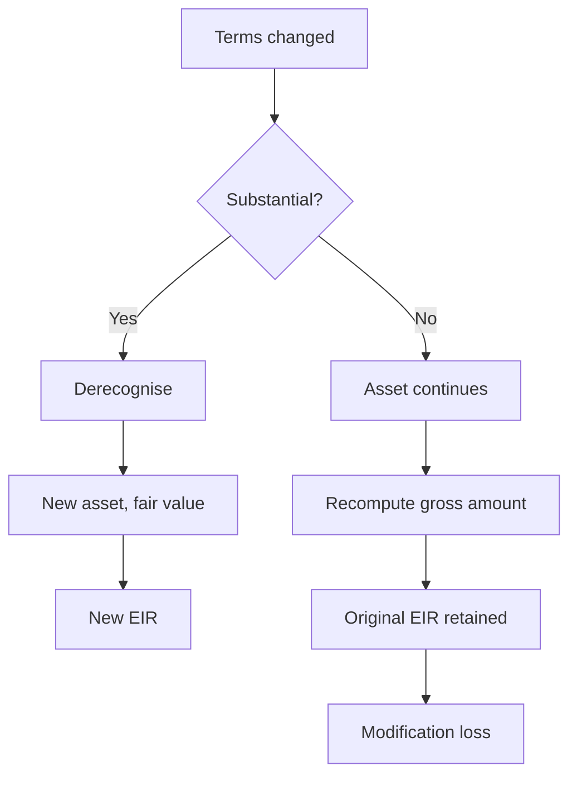

## Part 0 — The bank

Everything in this document happens inside one institution. It is a mid-sized Indian bank, and this is its balance sheet.

| Assets | ₹ crore | Liabilities and equity | ₹ crore |
|---|---:|---|---:|
| Cash and balances with RBI | 130 | Deposits — retail | 900 |
| Investments | 520 | Deposits — wholesale | 400 |
| Advances, net of allowance | 978 | Borrowings | 200 |
| Fixed and other assets | 72 | Other liabilities | 50 |
| | | Equity capital and reserves | 150 |
| **Total** | **1,700** | **Total** | **1,700** |

Two lines on that sheet do the work of this volume, and both need unpacking before anything else makes sense.

**Advances, net of allowance.** The bank has ₹1,000 crore of loans outstanding. It does not expect all of it back. So it subtracts ₹22 crore — its own estimate of what will be lost — and shows ₹978 crore. That ₹22 crore is the **loss allowance**: not cash set aside in an account, but a deduction from the value of the asset. The bank still holds ₹1,000 crore of loans; it is simply admitting on the face of the balance sheet that ₹22 crore of them will not come back. When the estimate goes up, the extra is charged against that year's profit. Provision, allowance and impairment provision all name the same thing; this document says allowance.

**Equity capital and reserves.** ₹150 crore of the owners' money. It has two components. **Capital** is what shareholders paid in when they bought their shares. **Reserves** are profits the bank earned in past years and did not pay out as dividends — retained, and therefore still belonging to shareholders but working inside the bank. Both sit last in the queue in a failure: depositors are paid first, bondholders next, and shareholders get whatever remains, which is usually nothing. That last-in-the-queue position is precisely what makes it capital, and it is why a loss reduces reserves rather than reducing deposits.

The ratio between them is the whole subject. The bank has lent ₹1,000 crore and has ₹150 crore of its own money behind it. Depositors supplied the other ₹1,300 crore and expect it back in full. If the loan book loses more than ₹150 crore, the deposits start absorbing losses, and at that point the bank has failed.

So the question that organises everything is: **how much can this book lose, how much of that should we already have set aside, and how much capital must stand behind the rest?**

### The book

The ₹1,000 crore of advances is spread across ten corporate borrowers.

| # | Borrower sector | Exposure ₹ crore | Share | Rating |
|---|---|---:|---:|---|
| 1 | Steel manufacturing | 100 | 10.0% | BBB |
| 2 | Cement | 150 | 15.0% | A |
| 3 | Textiles | 80 | 8.0% | BB |
| 4 | Road construction | 200 | 20.0% | BBB |
| 5 | Pharmaceuticals | 60 | 6.0% | A |
| 6 | Non-banking financial company | 120 | 12.0% | AA |
| 7 | Hotels | 70 | 7.0% | BB |
| 8 | Auto components | 90 | 9.0% | BBB |
| 9 | Power distribution | 90 | 9.0% | BBB |
| 10 | Information technology services | 40 | 4.0% | AA |
| | **Total** | **1,000** | **100%** | |

Those are drawn amounts — money actually out of the door and sitting in advances. The bank has also sanctioned ₹180 crore of cash credit limits to the same ten borrowers, of which ₹72 crore is drawn and already inside the ₹1,000 crore. The remaining **₹108 crore is undrawn and appears nowhere on the balance sheet**, which will turn out to matter a great deal.

Borrower 1, the steel manufacturer, is the one to watch. Over the next four years it will be downgraded, fall past due, be classified non-performing, and default. Following that single ₹100 crore facility from disbursement to write-down is how this volume is built, because every concept in credit risk shows up somewhere along that path.

### How to read this

The volume works inwards from the loan and back out to the balance sheet.

Parts 1 to 3 stay with a single exposure: what it is worth, what can go wrong with it, and how its quality changes over time. Part 4 zooms out to the whole book, because ten loans behave differently from ten times one loan. Parts 5 and 6 build the ₹22 crore allowance — first under the accounting standard, then under RBI's rules, which give different answers on the same exposure. Part 7 arrives at the ₹150 crore of capital and asks whether it is enough. Part 8 steps back from the one borrower to the credit function that runs the whole book — appetite, limits, pricing, early warning, and how the same questions look on a retail book.

Volume 2 reads the rest of the sheet — deposits, borrowings, the investment and trading book, how the spread is priced internally, and the reporting machine and delivery work that assemble all of it into returns.

---

## Part 1 — What a loan is worth

### The money out is not the asset

On 1 April, the bank disburses ₹100 crore to the steel manufacturer. A five-year term loan, interest at 10% paid annually, the whole principal repaid at the end of year five. At the same time the bank collects a ₹2 crore processing fee from the borrower.

So ₹100 crore left the bank and ₹2 crore came back. Net cash out of the door on day one: **₹98 crore**.

Now: what should the loan appear as in advances?

The naive answer is ₹100 crore, because that is the principal. The naive answer is wrong, and seeing why is the foundation of everything that follows. The bank did not part with ₹100 crore. It parted with ₹98 crore, and in return it will receive ₹10 crore a year for five years plus ₹100 crore at the end. The asset is worth what was actually invested in it, and the return on it is whatever rate makes those future receipts equal ₹98 crore today.

That rate is not 10%.

### The effective interest rate

The **effective interest rate (EIR)** is the rate that exactly discounts all estimated future cash receipts over the expected life of the asset back to what was actually paid out at origination.

$$
\text{Net cash out} = \sum_{t=1}^{n} \frac{CF_t}{(1 + \text{EIR})^t}
$$

Solving for our loan gives 10.54%. The check:

| Year | Cash received ₹ crore | Discount factor at 10.54% | Present value ₹ crore |
|---|---:|---:|---:|
| 1 | 10.00 | 0.9047 | 9.05 |
| 2 | 10.00 | 0.8184 | 8.18 |
| 3 | 10.00 | 0.7405 | 7.40 |
| 4 | 10.00 | 0.6699 | 6.70 |
| 5 | 110.00 | 0.6060 | 66.66 |
| | | **Total** | **97.99** |

Which is ₹98 crore, the money that actually left. The contractual rate is 10%; the effective rate is 10.54%. The fee did not disappear into fee income on day one — it was folded into the yield and will be released across five years.

Two consequences follow immediately, and both bite later:

- **The fee cannot be booked upfront.** A bank that recognises ₹2 crore of fee income in year one is overstating that year's profit and understating the next four.
- **The EIR is fixed at initial recognition and never revised for changes in credit risk.** When this borrower deteriorates in year three, every discounting operation in the impairment calculation will still use 10.54%. The rate is a property of the original bargain, not of the borrower's current condition.

The uplift is smaller than it looks because the loan is long. The same ₹2 crore fee on a one-year loan would have lifted the rate from 10% to over 12%, because there is only one year to spread it over. Fee-heavy short-tenor lending carries a much larger gap between the coupon the customer thinks they are paying and the yield the bank is actually earning.

### What is the loan worth a year later?

It is 31 March, twelve months after disbursement. The borrower has paid its ₹10 crore of interest, on time. The finance team has to state what this loan is worth on the balance sheet.

Start with what the bank has in it. ₹98 crore went out. ₹10 crore came back. So ₹88 crore?

No — because the loan *earned* during the year, and it did not earn ₹10 crore. It earned the effective rate on what was invested in it: 10.54% of ₹98 crore, which is **₹10.33 crore**.

So the loan grew by ₹10.33 crore and shrank by the ₹10 crore that was paid out.

$$
98.00 + 10.33 - 10.00 = 98.33
$$

**The loan is worth more than it was a year ago, even though the borrower made a payment.** Only ₹10 crore of the ₹10.33 crore earned actually arrived as cash. The missing ₹0.33 crore is the processing fee being handed back a little at a time — it was folded into the asset on day one and is released across five years.

That figure, ₹98.33 crore, is the **gross carrying amount**. Think of it as a running account for the loan: what it earns goes in, what the borrower pays comes out.

$$
GCA_t = GCA_{t-1} \times (1 + \text{EIR}) - \text{Cash received}_t
$$

| Year | Opening | Interest earned at 10.54% | Cash received | Closing |
|---|---:|---:|---:|---:|
| 1 | 98.00 | 10.33 | 10.00 | 98.33 |
| 2 | 98.33 | 10.36 | 10.00 | 98.69 |
| 3 | 98.69 | 10.40 | 10.00 | 99.09 |
| 4 | 99.09 | 10.45 | 10.00 | 99.54 |
| 5 | 99.54 | 10.49 | 110.00 | 0.00 |

All figures ₹ crore.

The asset climbs from ₹98 crore to exactly ₹100 crore by maturity, then the final payment extinguishes it. Landing on ₹100.00 is the proof the machinery works: by the end, the whole ₹2 crore fee has been released and the loan is worth its face value.

### Getting the number at any date without rolling forward

Rolling year by year is fine when you have the history. Usually you do not — you have a loan, a date, and a number due this afternoon.

The shortcut is this: **the gross carrying amount is the present value of the cash flows still to come, discounted at the effective interest rate.**

Test it at the end of year three. Still owed: ₹10 crore next year, ₹110 crore the year after.

$$
10 \times 0.9047 + 110 \times 0.8184 = 9.05 + 90.02 = 99.07
$$

The same ₹99.09 crore the roll-forward gave, to rounding. Two routes, one number.

This is the definition worth carrying, because it says what the gross carrying amount actually *means*: **what the borrower still owes, valued at the yield the bank originally struck.** Which is exactly why it is the right starting point when the borrower defaults in Part 2 — the loss is what is still owed, less what will actually arrive.

Note also what it is *not*. It is not the ₹100 crore principal, and it is not affected by the borrower's credit quality. If the borrower is downgraded tomorrow, the gross carrying amount does not move by a rupee. It is a function of the EIR and the cash received, nothing else.

### The three numbers, and how they relate

Credit deterioration does not touch the gross carrying amount. It is handled by a second number sitting alongside it.

At the end of year one the bank estimates that ₹0.20 crore of this loan will not come back. It does not reduce the ₹98.33 crore — that is what is owed. It records a separate **loss allowance** of ₹0.20 crore and subtracts it:

| | ₹ crore | What it is |
|---|---:|---|
| Gross carrying amount | 98.33 | What the borrower owes, at the original yield |
| Loss allowance | (0.20) | What the bank thinks it will not get back |
| **Net carrying amount** | **98.13** | What appears in advances on the balance sheet |

That third line is the ₹978 crore in Part 0, one loan at a time.

Two of these move for completely different reasons, and keeping them apart is the single most useful habit in impairment work:

- **Gross carrying amount** moves with the *contract* — interest earned, cash received. Credit has no effect on it.
- **Loss allowance** moves with the *borrower* — ratings, arrears, recovery expectations. The contract has no effect on it.

Part 5 is nothing but these three columns, watched across four reporting dates as the borrower deteriorates.

## Part 2 — What can go wrong

### A default, and the loss it causes

Skip forward. In year three the steel manufacturer stops paying, and the bank moves to enforce its security — the factory land and building, valued at ₹70 crore when the loan was sanctioned.

Here is what actually happens.

The gross carrying amount at the point of default is ₹99.09 crore. The property, revalued, is worth ₹52 crore, because steel demand has collapsed and so has the market for steel plants. Enforcement takes three years through the tribunal. The asset eventually sells for ₹48 crore. Legal, valuation and enforcement costs come to ₹4 crore. Net cash into the bank: **₹44 crore, three years after the default date**.

Is the loss ₹99.09 − ₹44.00 = ₹55.09 crore?

No, and this is the point most people miss. The ₹44 crore arrives three years late. Discounted back at the effective interest rate of 10.54%:

$$
PV = 44.00 \times \frac{1}{1.1054^3} = 44.00 \times 0.7405 = 32.58
$$

The recovery is worth **₹32.58 crore** at the default date. The loss is ₹99.09 − ₹32.58 = **₹66.51 crore**.

Time cost the bank ₹11.42 crore. Nothing changed about the property, the borrower or the security. The tribunal simply took three years, and three years at 10.54% destroys a quarter of the recovery.

### The three parameters

Now the loss can be decomposed, and only now does the vocabulary earn its place.

| Parameter | What it measured above | Value here |
|---|---|---:|
| **Exposure at default (EAD)** | How much was owed when it failed | ₹99.09 crore |
| **Loss given default (LGD)** | Share of that not recovered, discounted, net of costs | 67% |
| **Probability of default (PD)** | Chance of this happening at all, per year | 0.50% at origination |

$$
\text{Expected loss} = PD \times LGD \times EAD
$$

LGD is derived, not assumed:

$$
LGD = 1 - \frac{\text{PV of net recoveries}}{EAD} = 1 - \frac{32.58}{99.09} = 67.1\%
$$

Compare that with the number a careless analyst would report. Undiscounted, ₹44 crore recovered on ₹99 crore owed is a 44% recovery rate and an LGD of 56%. Discounting the delay moves LGD from 56% to 67% — eleven percentage points of loss created entirely by court time.

That is why LGD estimation is a question about legal systems and enforcement calendars as much as about collateral values. A jurisdiction where security is realised in eighteen months and one where it takes five years will produce completely different LGDs from identical collateral.

### Why LGD must be estimated for bad years, not average ones

The property was worth ₹70 crore at sanction and fetched ₹48 crore at sale. That is not bad luck. Steel plants become hard to sell in exactly the conditions that cause steel companies to fail. The collateral and the borrower are driven by the same thing.

Basel therefore requires **downturn LGD** — LGD estimated under stressed conditions rather than averaged across the cycle. An LGD calibrated on recoveries from benign years will be systematically optimistic at the moment it is needed, because the average year contains few defaults and the bad year contains most of them. Property is worth least in the year everyone is trying to sell property.

The same logic runs through every collateral type: shares pledged by a promoter fall when the promoter's company is in trouble; receivables assigned by a distressed firm are owed by customers who have stopped paying it.

### Exposure at default, and why today's balance is the wrong number

Borrower 8, the auto components manufacturer, has a ₹90 crore relationship: a ₹60 crore term loan and a ₹30 crore cash credit limit against which it has drawn ₹12 crore. Utilisation on the revolving line is 40%.

If that borrower defaults, will the cash credit still be at ₹12 crore?

It will not. A company heading towards failure draws every rupee available to it, because the alternative is stopping operations. Historically this borrower's peer group draws to roughly 80% of the remaining headroom before failing. So:

$$
EAD = \text{Drawn} + CCF \times \text{Undrawn}
$$

| Component | ₹ crore |
|---|---:|
| Drawn today | 12.00 |
| Undrawn headroom (30 − 12) | 18.00 |
| Credit conversion factor applied | 80% |
| Additional drawing assumed | 14.40 |
| **Exposure at default** | **26.40** |

The **credit conversion factor (CCF)** is that 80%: the fraction of undrawn limit assumed to be drawn by the time default occurs. It is estimated from the bank's own history of what defaulted borrowers actually did to their limits in the months before failing.

For the steel term loan, EAD is simply the gross carrying amount, because there is nothing undrawn. The parameter earns its keep entirely on revolving and committed facilities — which is exactly why the ₹108 crore of undrawn limits that appears nowhere on the balance sheet is a real exposure the bank must measure and capitalise.

### Probability of default

PD is the chance the borrower fails within a stated horizon, usually one year. Our steel borrower was rated BBB at origination, and the bank's rating scale attaches a one-year PD of 0.50% to BBB.

**What counts as default** has two limbs, and either alone is sufficient:

| Limb | Test | Character |
|---|---|---|
| **Days past due** | 90 days past due on a material obligation | Objective, mechanical |
| **Unlikely to pay** | The bank judges the obligor unlikely to meet obligations in full without recourse to actions such as realising security | Judgemental |

The second limb is judgemental, and judgement can be leaned on. A bank with a narrow unlikely-to-pay policy reports fewer defaults, lower PDs, lower capital requirements and lower provisions than an identical bank with a wide one — same book, better numbers.

So how is that stopped?

| Control | How it works |
|---|---|
| **The policy is written and approved** | The bank must document what triggers unlikely-to-pay, get it approved at board level, and apply it consistently. It cannot be decided case by case at the moment of inconvenience. |
| **The 90-day limb is a hard floor** | However narrow the judgement, 90 days past due is a default regardless. The bank can be late to call a default; it cannot avoid one. |
| **Peer benchmarking** | The supervisor sees every bank's default rates by segment. A bank reporting materially fewer defaults than peers on a similar book is asked why, and "our policy is narrower" is the answer that starts an examination. |
| **The use test** | Under IRB, the same default definition must drive credit decisions, limits, pricing and collections — not just the capital calculation. A bank that calls an exposure performing for capital while its own collections team is working it has failed the test visibly. |
| **Back-testing** | Predicted default rates are compared to realised ones each year. Systematic under-prediction is evidence of a definition being applied too narrowly. |
| **Supervisory inspection** | Examiners pull individual files and form their own view. Where they disagree, they can require reclassification and additional provisions. |

The mandatory indicators help too: restructuring at a loss to the bank, sale of the exposure at a material credit-related discount, and the borrower entering insolvency proceedings are all specified triggers rather than matters of opinion. In India this is reinforced from another direction entirely — CRILC in Part 6 means every lender sees how the *other* lenders have classified a shared borrower, so a bank calling an exposure standard while three others call it non-performing is visible to the supervisor without anyone having to ask.

### The same borrower has two PDs, legitimately

This confuses people and it should not, because the two numbers answer different questions.

| Flavour | Behaviour | Used for | Why |
|---|---|---|---|
| **Through-the-cycle (TTC)** | Averaged across good and bad years; moves slowly | Basel capital | Capital requirements should not swing violently with the cycle and force banks to cut lending in a downturn, deepening it |
| **Point-in-time (PIT)** | Reflects conditions today; moves with the cycle | Ind AS 109 expected credit loss | Accounting wants today's best estimate, not a long-run average |

Our steel borrower carries a TTC PD of 0.50% for capital and a PIT PD that was around 0.35% in the boom year and rose to 2.8% when steel prices collapsed. Both are correct. A risk system that cannot hold both, tagged and reconciled, will produce numbers that fail one framework or the other.

### Expected loss and unexpected loss

The bank's chief risk officer has to answer a question from the board: **how much should we expect to lose on this book next year?**

Not in a crisis. In an ordinary year. The answer is arithmetic — apply the parameters to every exposure and add them up.

| Rating | One-year PD | Exposure ₹ crore | LGD | Expected loss ₹ crore |
|---|---:|---:|---:|---:|
| AA | 0.10% | 160 | 45% | 0.07 |
| A | 0.20% | 210 | 45% | 0.19 |
| BBB | 0.50% | 480 | 45% | 1.08 |
| BB | 2.30% | 150 | 45% | 1.55 |
| | | **1,000** | | **2.89** |

**₹2.89 crore a year.** That is 0.29% of the book, and it is not a disaster — it is a cost of doing business, like rent. The bank knows about it in advance, prices it into loan spreads, and carries it as an allowance. The board is not alarmed.

Now year three arrives and the steel borrower fails. The impairment charge is **₹62.77 crore**.

That is twenty-two years of expected losses in one year, and it is where the interesting question lives. If the bank had been setting aside ₹2.89 crore a year, it would have accumulated about ₹8.7 crore over three years. It is short by ₹54 crore.

**Could it have provided for this?** No — and the reason is not that the estimate was bad. It is that ₹2.89 crore is an *average*, and averages describe what happens across many years, not what happens in any particular one. In most years the book loses less than ₹2.89 crore. Occasionally it loses vastly more. The bank cannot know which year is which, so it cannot provide for it in advance.

So there are two entirely different animals, and they need two entirely different responses.

| | Expected loss | Unexpected loss |
|---|---|---|
| What it is | The average annual loss | How far a bad year exceeds the average |
| Is it predictable? | Yes, from parameters | No — only its distribution is |
| How the bank handles it | Prices it into loan spreads; carries it as an allowance | Holds capital against it |
| What it reduces | Profit, a little, every year | Equity, a lot, occasionally |
| In our bank | ₹2.89 crore a year | ₹62.77 crore in year three |

Picture the bank's annual loss as a distribution. Most years cluster near ₹2.89 crore. A long tail stretches right, because losses can be enormous but never negative — the best possible year is one where nothing defaults, and that is only about ₹2.89 crore better than average, while the worst year is unbounded.

<svg viewBox="0 0 700 320" xmlns="http://www.w3.org/2000/svg" role="img" aria-label="Loss distribution showing expected loss at the mean and unexpected loss as the distance to the 99.9th percentile">
  <path d="M 200 260 L 200 100 C 240 128 262 162 300 190 C 360 224 440 246 520 254 L 520 260 Z" fill="#ececec"/>
  <path d="M 60 260 C 100 260 132 96 180 96 C 228 96 250 156 300 190 C 360 224 430 244 510 253 C 560 258 604 260 650 260" fill="none" stroke="#000" stroke-width="1.6"/>
  <line x1="60" y1="260" x2="660" y2="260" stroke="#000" stroke-width="1"/>
  <line x1="200" y1="100" x2="200" y2="260" stroke="#000" stroke-width="1.2" stroke-dasharray="4 3"/>
  <line x1="520" y1="200" x2="520" y2="260" stroke="#000" stroke-width="1.2" stroke-dasharray="4 3"/>
  <line x1="200" y1="292" x2="520" y2="292" stroke="#000" stroke-width="1"/>
  <path d="M 200 292 l 7 -4 l 0 8 Z" fill="#000"/>
  <path d="M 520 292 l -7 -4 l 0 8 Z" fill="#000"/>
  <text x="200" y="88" text-anchor="middle" font-size="13" fill="#000">Expected loss</text>
  <text x="200" y="72" text-anchor="middle" font-size="13" fill="#000">₹2.89 crore</text>
  <text x="520" y="190" text-anchor="middle" font-size="13" fill="#000">99.9th percentile</text>
  <text x="360" y="285" text-anchor="middle" font-size="13" fill="#000">Unexpected loss — absorbed by capital</text>
  <text x="360" y="312" text-anchor="middle" font-size="13" fill="#000">Annual loss on the book →</text>
</svg>

Read that picture in three pieces.

- **Up to the dashed line at ₹2.89 crore** — expected loss. Covered by the allowance, funded out of loan spreads.
- **The shaded band beyond it** — unexpected loss. Covered by capital. Our ₹62.77 crore year sits in here.
- **Past the right-hand line** — the losses capital does not cover. The bank fails.

The regulator chooses where that right-hand line goes, and it chooses the **99.9th percentile of one year's losses**. That is a deliberate statement: a supervised bank should have no more than a one-in-a-thousand chance of exhausting its capital in any year.

This split is the architecture of the entire framework, and it is why the two halves of this volume exist. Parts 5 and 6 build the allowance for expected loss. Part 7 builds the capital for unexpected loss. They are not two views of the same thing — they are two defences against two different problems, and confusing them is the standard conceptual error.

---

## Part 3 — Ratings and migration

### Two ratings, two jobs

The steel borrower was rated BBB. That rating is about the **borrower** — its financials, its sector, its management, whatever support a parent group might provide. It drives PD, and it is the same for every facility the bank has with that borrower.

The ₹100 crore term loan also carries a **facility rating**, which is about the transaction — its security, its seniority, its structure. It drives LGD, and it differs facility by facility.

Conflating them produces a specific and costly error: a well-secured loan to a weak borrower gets treated as low risk, when in fact the probability of having to enforce is high and only the severity is contained. The bank will be in court; it will simply recover more when it gets there.

### Ratings move

A rating is not a permanent label. Every year, some BBB borrowers become BB, some become A, and a few default. The bank measures this with a **transition matrix**: each row is a starting grade, each column an ending grade one year later, and the cells are probabilities.

| From ↓ / To → | AA | A | BBB | BB | B | Default |
|---|---:|---:|---:|---:|---:|---:|
| **AA** | 92.0 | 6.5 | 1.0 | 0.3 | 0.1 | 0.10 |
| **A** | 2.0 | 90.0 | 6.5 | 1.0 | 0.3 | 0.20 |
| **BBB** | 0.3 | 5.0 | 88.0 | 5.0 | 1.2 | 0.50 |
| **BB** | 0.1 | 0.6 | 6.0 | 84.0 | 7.0 | 2.30 |
| **B** | 0.0 | 0.2 | 0.8 | 7.0 | 84.0 | 8.00 |
| **Default** | 0 | 0 | 0 | 0 | 0 | 100 |

All figures per cent. Every row sums to 100, because after a year the borrower must be *somewhere* — better, same, worse, or defaulted.

**Read the BBB row for our steel borrower.** Over the next year: 88.0% chance it is still BBB, 5.0% chance it slips to BB, 1.2% chance it falls to B, 5.0% chance it improves to A, 0.3% chance it improves to AA, and 0.50% chance it defaults.

That last figure answers a question left open in Part 2. **Where does the one-year PD for a rating come from?** It is the default column of that rating's row. BBB's PD of 0.50% is not a separate estimate produced by a separate model — it is a cell in this table. Same for BB's 2.30% and AA's 0.10%. One matrix, and every rating's PD is read off it.

The matrix itself is built by counting. Take every BBB-rated borrower the bank had at the start of each of the last fifteen years, look at where each one was a year later, and express the counts as percentages. Out of a thousand BBB borrowers, roughly 880 were still BBB, 50 had slipped to BB, and 5 had defaulted. The row is history, tabulated.

**Why the default row is all zeros except the last cell.** Once a borrower defaults it stays defaulted, forever, in the model's arithmetic. This is called an **absorbing state**: probability flows in and never flows out.

That is obviously not true in life — companies emerge from insolvency, restructured loans get repaid, and the bank's own recovery process in Part 2 collected ₹44 crore from a defaulted borrower. So why model it that way?

Because default is the event the model exists to predict, and the prediction is over. The question the matrix answers is "what is the chance this borrower defaults in the next five years?" Once it has defaulted, the answer is fixed and the exposure moves to a different set of machinery entirely — recovery, LGD, Stage 3, enforcement. A borrower that cures and returns to performing is not put back into this matrix; it is treated as a fresh exposure with a fresh rating. The absorbing state is a boundary between two models, not a claim about corporate mortality.

### From one year to several

The bank does not only need a one-year PD. Ind AS 109 will shortly demand the probability of default over the loan's whole remaining life. That comes from applying the matrix repeatedly.

What is the chance our BBB borrower has defaulted by the end of year two? It can happen two ways: it defaults in year one, or it survives year one in some grade and defaults from that grade in year two.

| Where it is after year 1 | Probability | One-year PD from there | Contribution to year-2 default |
|---|---:|---:|---:|
| Still BBB | 88.0% | 0.50% | 0.4400% |
| Downgraded to BB | 5.0% | 2.30% | 0.1150% |
| Downgraded to B | 1.2% | 8.00% | 0.0960% |
| Upgraded to A | 5.0% | 0.20% | 0.0100% |
| Upgraded to AA | 0.3% | 0.10% | 0.0003% |
| Defaulted in year 1 | 0.5% | — | — |
| | | **Defaults during year 2** | **0.6613%** |

So the two-year cumulative probability of default is:

$$
F(2) = 0.5000\% + 0.6613\% = 1.1613\%
$$

Repeat the operation for year three, year four, year five, and you have the **PD term structure** for a BBB borrower — the input Ind AS 109 needs.

Notice where the year-two default probability came from. Only two-thirds of it (0.44%) is the borrower staying BBB and failing anyway. The rest comes from it being somewhere worse by then. **Multi-period credit risk is mostly migration risk.**

### The four quantities everyone confuses

Part 5 will need a specific number: **the chance this borrower defaults during year two.** Not by year two — *during* it.

That sounds like the 0.6613% just computed, and it nearly is. But there are four closely related quantities here, they are all derived from the same term structure, they all sound alike, and picking the wrong one is the standard implementation error. Build them one at a time from what is already known.

**Cumulative PD** — the chance of having defaulted at any point up to time $t$. Written $F(t)$. For BBB: $F(1) = 0.5000\%$, and $F(2) = 1.1613\%$ from the table above. It only ever rises, because a default that has happened stays happened.

**Survival** — the chance of getting to $t$ without defaulting. It is just the other side of the same coin.

$$
S(t) = 1 - F(t)
$$

$$
S(1) = 99.5000\% \qquad S(2) = 98.8387\%
$$

**Marginal PD** — the chance of defaulting *during* period $t$, viewed from today. If 99.5000% of BBB borrowers reach the end of year one and 98.8387% reach the end of year two, then the difference is the fraction that fell over during year two.

$$
S(1) - S(2) = 99.5000\% - 98.8387\% = 0.6613\%
$$

**Conditional PD** — the chance of defaulting during period $t$ *given that the borrower made it to the start of it*. This is a different question. It is not asked of all BBB borrowers, only of the 99.5000% still standing at the end of year one.

$$
\frac{S(1) - S(2)}{S(1)} = \frac{0.6613\%}{99.5000\%} = 0.6646\%
$$

Also called the hazard rate.

| Term | The question it answers | BBB, year 2 |
|---|---|---:|
| Cumulative PD $F(t)$ | Has it defaulted by now? | 1.1613% |
| Survival $S(t)$ | Has it survived to now? | 98.8387% |
| Marginal PD | Does it default during year 2, out of all borrowers? | 0.6613% |
| Conditional PD | Does it default during year 2, out of survivors? | 0.6646% |

The last two differ by only 0.0033 percentage points here, which is why they get muddled. That closeness is an accident of BBB being a safe grade — 99.5% survive year one, so dividing by 99.5% barely changes anything.

Run the same arithmetic on a B-rated borrower with an 8% first-year PD and only 92% survive. Now the divisor bites, and marginal and conditional diverge by roughly 9% of their own value. On a five-year term structure that error compounds every period.

**Which one does lifetime ECL use?** Marginal PD. The reason is a double-counting trap. Lifetime ECL adds up the expected loss from each future year, as seen from today. If year three's loss were weighted by the conditional PD, it would be weighted by a probability that *assumes the borrower survived years one and two* — but the calculation has already accounted for that survival by treating years one and two as separate lines. Weighting by conditional PD counts the survival twice.

The check is simple: the marginal PDs across all periods, plus the survival probability at the end, must sum to 1. Every borrower either defaults in some period or survives the whole life. If a term structure fails that test, the wrong quantity is in the column.

### Two assumptions inside the matrix, both false

Repeated multiplication of a transition matrix carries two assumptions worth naming, because supervisors will ask about them.

**Markov.** The chance of migrating depends only on the current grade, not on how the borrower got there. In reality a borrower recently downgraded from A to BBB is materially more likely to fall again than one that has sat at BBB for five years. Downgrade momentum is real and the matrix does not see it.

**Time-homogeneous.** The same matrix applies in every year. In reality migration matrices are strongly cyclical — downgrade probabilities in a recession are several times those in an expansion. Using an average matrix to project a five-year term structure produces a curve that is too flat: too pessimistic in good years, far too optimistic in bad ones.

Both failures push the same way. They understate the risk of a portfolio that is already deteriorating, which is the portfolio you most need the numbers for. Banks compensate with scenario-weighted matrices and with overlays, both of which appear in Part 5.

---

## Part 4 — The book, not the loan

### Why a book is riskier than its loans

Ten borrowers, ₹1,000 crore, expected loss ₹2.89 crore a year. That number assumed each borrower fails independently of the others.

They do not. The steel manufacturer, the auto components maker and the power distributor are all exposed to industrial demand and to the same input costs. When one fails, the others are more likely to fail in the same year — not because of any contractual link, but because the thing that killed the first is still in the air.

Concentration is the failure of independence, and it works at three levels:

| Level | What clusters | Example in this book |
|---|---|---|
| **Single-name** | One borrower is too large a share | Road construction at ₹200 crore, 20% of the book |
| **Sector** | Several borrowers share a demand driver | Steel, auto components and power — ₹280 crore of correlated industrial exposure |
| **Geographic or factor** | Common region, currency or commodity | Borrowers concentrated in one state's industrial belt |

Two exposures of ₹50 crore to unrelated borrowers are safer than one exposure of ₹100 crore, because the pair can fail separately while the single name cannot fail by halves.

### Measuring it

The standard measure is the **Herfindahl-Hirschman Index** — the sum of squared exposure shares.

$$
HHI = \sum_{i=1}^{n} w_i^2
$$

where $w_i$ is exposure $i$ as a fraction of the total book.

Squaring is what makes it work. A 20% share contributes 0.0400; a 4% share contributes 0.0016 — one twenty-fifth as much, for one fifth the size. Large positions dominate the index and small ones barely register, which is exactly the behaviour you want from a concentration measure.

Our book:

| Borrower | Exposure ₹ crore | Share $w_i$ | $w_i^2$ |
|---|---:|---:|---:|
| Road construction | 200 | 0.20 | 0.0400 |
| Cement | 150 | 0.15 | 0.0225 |
| Non-banking financial company | 120 | 0.12 | 0.0144 |
| Steel | 100 | 0.10 | 0.0100 |
| Auto components | 90 | 0.09 | 0.0081 |
| Power distribution | 90 | 0.09 | 0.0081 |
| Textiles | 80 | 0.08 | 0.0064 |
| Hotels | 70 | 0.07 | 0.0049 |
| Pharmaceuticals | 60 | 0.06 | 0.0036 |
| Information technology | 40 | 0.04 | 0.0016 |
| **Total** | **1,000** | **1.00** | **0.1196** |

The index alone means little. Its reciprocal is what you report:

$$
\frac{1}{HHI} = \frac{1}{0.1196} = 8.4
$$

**The book behaves like 8.4 equal-sized exposures**, not ten. A perfectly even ten-borrower book would score $HHI = 0.10$ and read as exactly 10.0 effective names. The bank has, in effect, already given up 1.6 names to lumpiness.

### The test that matters

The credit committee is asked to approve an additional ₹100 crore to the road construction borrower, taking it to ₹300 crore and the book to ₹1,100 crore. The borrower is BBB, has paid on time for six years, and the pricing is good.

| | Before | After |
|---|---:|---:|
| Total book ₹ crore | 1,000 | 1,100 |
| Largest exposure ₹ crore | 200 | 300 |
| Largest share | 20.0% | 27.3% |
| HHI | 0.1196 | 0.1402 |
| **Effective number of names** | **8.4** | **7.1** |

The book grew 10% and its effective diversification fell by 1.3 names. Every individual credit assessment was satisfied. Nothing about the borrower changed. The book got larger and less safe at the same time, and the only instrument that shows this is a portfolio measure, because no single-name analysis can see it.

This is why **large exposure limits** exist as hard caps rather than as inputs to a judgement. RBI's framework caps a bank's exposure to a single counterparty at 20% of eligible Tier 1 capital, extendable to 25% in specified cases, and to a group of connected counterparties at 25%. [verify]

Apply that here. Tier 1 capital is ₹150 crore, so the single-name cap is ₹30 crore. **Every exposure in this book breaches it.** That is deliberate — a bank with ₹150 crore of capital has no business holding ten ₹100 crore corporate exposures, and the arithmetic of Part 7 will show exactly why. Real banks of this size lend in far smaller tickets or hold far more capital.

### Reducing the risk: what mitigation actually is

The steel loan was secured on factory land and building worth ₹70 crore at sanction. Does that ₹70 crore reduce the bank's risk?

Only to the extent it is **legally enforceable and operationally real**. The tests are sequential and failing any one of them makes the security worthless for risk purposes:

- **Documented** — a charge agreement exists and is signed
- **Perfected** — the charge is registered with the Registrar of Companies and CERSAI, so it binds third parties and establishes priority
- **Valued** — an independent valuation exists and is refreshed at a stated frequency
- **Monitored** — someone checks the asset still exists, is insured, and has not been charged to another lender

An unregistered charge is not mitigation. It is a piece of paper that will lose to any registered lender in the queue.

### The forms mitigation takes

| Technique | Mechanism | What it changes |
|---|---|---|
| **Eligible financial collateral** | Cash, deposits, government securities, listed shares pledged to the bank | Reduces exposure at default |
| **Guarantees and credit derivatives** | A third party promises to pay if the borrower does not | Substitutes the guarantor's credit quality for the borrower's, on the covered portion |
| **On-balance-sheet netting** | Loans and deposits with the same counterparty offset | Reduces exposure at default, where enforceable in insolvency |
| **Physical collateral** | Property, plant, receivables | Reduces loss given default; recognised for capital only under the internal ratings based approach |

Note which column each sits in. Financial collateral and netting reduce **EAD**. Guarantees swap out the **PD**. Physical property reduces **LGD**. Three different levers on the same loss identity, and a system that treats them all as "security value" will compute the wrong number.

### Haircuts, and why the steel collateral was worth less than ₹70 crore

Where collateral is recognised by reducing exposure, its value is not taken at face. Three haircuts apply, and each one is a specific thing that went wrong in our default:

| Haircut | Reason | What happened here |
|---|---|---|
| **On the exposure** | The amount owed may grow between now and default | Gross carrying amount rose from ₹98.00 crore to ₹99.09 crore |
| **On the collateral** | Its market value may fall before it can be sold | Property fell from ₹70 crore to a ₹48 crore realisation |
| **For currency mismatch** | Exposure and collateral in different currencies | Not applicable — both in rupees |

A fourth adjustment applies where the protection matures before the exposure does. A three-year guarantee on a five-year loan does not cover years four and five, and recognition is reduced proportionately for the **maturity mismatch**. Protection that expires first is not protection.

Run the haircuts on the steel loan at sanction and the ₹70 crore of security supports perhaps ₹45 crore of covered exposure, not ₹70 crore. The bank's realised recovery of ₹32.58 crore discounted — against ₹45 crore of haircut value — shows the haircuts were still not conservative enough, because they did not price the three-year enforcement delay.

---

## Part 5 — The allowance

### How the rest of this volume works

Parts 1 to 4 built the machinery. From here nothing new is introduced. One borrower deteriorates and fails across four reporting dates, and we watch what that single event does to three things.

| Block | The question | Built in |
|---|---|---|
| **The asset** | What is this loan worth on the balance sheet? | Part 5 |
| **The Indian rules** | What does RBI require on the same loan on the same day? | Part 6 |
| **The capital** | What does it do to the bank's capital ratio? | Part 7 |

Three blocks of one table, same four dates. Part 7 closes with all three assembled and read together. These are not three subjects — they are one event read three ways, and the reason they are separate parts is that they answer to three different rulebooks.

The four dates:

| | T0 | T1 | T2 | T3 |
|---|---|---|---|---|
| **Date** | 1 Apr Y1 | 31 Mar Y2 | 31 Mar Y3 | 31 Mar Y4 |
| **What happened** | ₹100 crore disbursed | Paid ₹10 crore on time | Downgraded BBB→BB, 40 days past due | 95 days past due, unlikely to pay |

### The question the accounting asks

Ind AS 109 asks one question at every reporting date:

**How much has this exposure's credit risk changed since the day it was first recognised?**

Not "is it bad?" — "has it got worse than we underwrote?" A loan written at BB and still BB is behaving exactly as expected. A loan written at AA and now BBB has deteriorated badly, even though BBB is a perfectly respectable grade. The standard cares about the second, not the first.

The answer places the exposure in one of three stages, and the stage decides two things.

| | Stage 1 | Stage 2 | Stage 3 |
|---|---|---|---|
| **Condition** | No significant increase in credit risk since origination | Significant increase, but not credit-impaired | Credit-impaired |
| **Allowance covers** | Losses from defaults in the next 12 months | Losses from defaults over the whole remaining life | The actual shortfall |
| **Interest revenue** | EIR × **gross** carrying amount | EIR × **gross** carrying amount | EIR × **net** carrying amount |

Staging is symmetric: an exposure that recovers moves back down, and the interest treatment reverses with it.

**One trap in the wording.** Stage 1 is not the loss expected *during* the next twelve months. It is the **whole lifetime loss** the exposure would suffer, weighted by the chance that the default happens within twelve months. On a fifteen-year mortgage, a default in month eleven causes losses for years afterwards, and all of it sits inside the Stage 1 number. The twelve months restricts *when the default occurs*, not *when the loss lands*.

### T0 — the day it is written

Origination is now, so credit risk cannot have increased since origination. Stage 1.

Inputs, every one of them already built:

| Input | Value | Where it came from |
|---|---:|---|
| 12-month PD, BBB | 0.50% | Transition matrix, Part 3 |
| LGD, secured, downturn view | 45% | Collateral analysis, Part 2 |
| Exposure at default | ₹98.33 crore | Gross carrying amount at end of year 1, Part 1 |
| Discount factor, 1 year at 10.54% | 0.9047 | EIR, Part 1 |

$$
ECL = PD \times LGD \times EAD \times DF
$$

Read left to right, one step at a time:

| Step | Working | ₹ crore |
|---|---|---:|
| If it defaults, what is lost | 45% × 98.33 | 44.25 |
| Weighted by the chance of default in 12 months | 0.50% × 44.25 | 0.221 |
| Brought back to today, one year at 10.54% | 0.221 × 0.9047 | **0.20** |

The allowance is **₹0.20 crore**, and the same amount is charged to profit on day one.

The bank has booked a ₹98 crore asset and immediately recognised a loss on it. That is a **day-one loss**, and it is intentional: some fraction of every loan ever written does not come back, and the standard makes the bank say so at the start rather than when it becomes obvious.

The discounting matters and is easy to skip. Default is assumed at the end of year one, so the loss it causes is a year away and is worth less than its face today. **Every ECL figure in this document is a present value at the original effective interest rate** — the 10.54% fixed in Part 1 and never revised.

### T1 — a year passes, nothing happens

The borrower pays ₹10 crore on time. Still BBB. Nothing has moved.

| Step | Working | ₹ crore |
|---|---|---:|
| Loss if it defaults | 45% × 98.69 | 44.41 |
| Weighted by 12-month PD | 0.50% × 44.41 | 0.222 |
| Discounted one year | 0.222 × 0.9047 | **0.20** |

The only thing that changed is the exposure, from ₹98.33 crore to ₹98.69 crore, because the gross carrying amount rolled forward.

**The charge to profit this year is nil.** Not because nothing was provided — the bank still holds ₹0.20 crore — but because the closing allowance equals the opening one. The charge is always the *movement*, never the balance.

$$
\text{Impairment charge} = \text{Closing allowance} - \text{Opening allowance}
$$

Interest revenue for the year is ₹10.33 crore: 10.54% on a **gross** carrying amount of ₹98.00 crore. Stage 1 interest ignores the allowance entirely.

### T2 — the step

In year two Chinese steel imports surge, domestic prices fall, the borrower's cash generation deteriorates. The annual review downgrades it **BBB → BB**. It is also **40 days past due**.

Neither is a default. Forty days is nowhere near ninety, and under RBI's rules the loan is still Standard. But the accounting question is not whether it has failed — it is whether risk has increased significantly since origination. A two-notch downgrade taking the one-year PD from 0.50% to 2.30%, a 4.6× increase, is significant on any reading.

**Stage 2.** The allowance must now cover the whole remaining life, which is three years.

Three years means three rows, each with its own PD, exposure and discount factor. Marginal PDs come from applying the BB row of the transition matrix repeatedly, exactly as Part 3 did for BBB. LGD has risen from 45% to 55% because the collateral is a steel plant and steel plant values fall with the sector.

| Year from T2 | Marginal PD | LGD | EAD ₹ crore | Loss if default | Weighted | Discount factor | ECL ₹ crore |
|---:|---:|---:|---:|---:|---:|---:|---:|
| 1 | 2.30% | 55% | 99.09 | 54.50 | 1.253 | 0.9047 | 1.134 |
| 2 | 2.52% | 55% | 99.54 | 54.75 | 1.380 | 0.8184 | 1.129 |
| 3 | 2.65% | 55% | 100.00 | 55.00 | 1.458 | 0.7405 | 1.079 |
| | | | | | | **Lifetime ECL** | **3.34** |

Each row is the same three steps as T0 — loss if it defaults, weighted by the chance of it defaulting in *that* year, discounted back from *that* year. Lifetime ECL is their sum. Nothing new; the same calculation run three times.

**Why marginal PD and not cumulative.** Each row must be weighted by the probability, seen from today, that default happens in that specific year. Cumulative PD would count the same default in every subsequent row.

### The scenarios inside that 2.30%

The standard requires a probability-weighted estimate across a range of outcomes, not a single view. The PDs above already carry that weighting. Here is the same number reached the other way — computing lifetime ECL under each scenario, then weighting the results.

| Scenario | Weight | Steel sector assumption | Lifetime ECL ₹ crore | Contribution |
|---|---:|---|---:|---:|
| Base | 60% | Prices stabilise at current levels | 3.10 | 1.860 |
| Downside | 30% | Import pressure continues, prices fall a further 15% | 4.05 | 1.215 |
| Upside | 10% | Safeguard duty imposed, prices recover | 2.60 | 0.260 |
| | | **Probability-weighted** | | **3.34** |

Two routes, one number — the same check Part 1 ran on the gross carrying amount.

**The weighted figure is higher than the base case.** That is the whole reason for doing it: losses are asymmetric, the downside hurts more than the upside helps, and a single-scenario estimate is systematically too low.

The scenarios must be the **same** ones the bank uses in stress testing and capital planning. A bank running an optimistic view for impairment and a pessimistic one for capital is telling two stories about the same future, and that inconsistency is exactly what auditors and supervisors look for.

### The overlay

The model is calibrated on data ending before the import surge began. Management adds **₹0.40 crore** on top for a sector stress that is visible in the market and absent from the model.

A **management overlay** is a post-model adjustment, and it is watched closely because it is a discretionary line inside a number that determines reported profit. Three disciplines make one defensible: a documented trigger, a stated quantification method, and a **release condition** — the observable event on which it will be reversed. An overlay with no release condition becomes permanent, and a permanent overlay is a model correction nobody has made.

The classic error is **double counting**: the overlay is added in the walk *and* embedded in the parameters. It is invisible unless the walk reconciles line by line.

### The walk

The closing allowance is ₹3.74 crore. Proving that balance proves nothing about the charge, and the charge is what hits profit. So the control is not the balance — it is the **movement analysis**, which explains every rupee between opening and closing.

| Line | Working | ₹ crore |
|---|---|---:|
| Opening allowance at T1 | | 0.20 |
| Transfer to Stage 2 — 12-month remeasured to lifetime, LGD unchanged | 2.73 − 0.20 | +2.53 |
| Change in LGD, 45% → 55% | 3.34 − 2.73 | +0.61 |
| Management overlay | | +0.40 |
| **Closing allowance at T2** | | **3.74** |
| **Charge to profit for the year** | 3.74 − 0.20 | **3.54** |

Read the split. Two-thirds of the charge is the *stage transfer* — the same borrower, the same parameters, measured over three years instead of one. A fifth is the *parameter change*. The rest is judgement. A walk that lumped these together would hide which of the three actually happened, and they have completely different implications.

**The allowance rose eighteen-fold on a loan that is 40 days past due and still classified Standard.** No payment has been permanently missed, no security enforced, and the borrower may well recover. The bank has still taken ₹3.54 crore off profit.

That step is the most consequential mechanic in the standard, which is why the trigger for it is the most scrutinised judgement in impairment work. Too many exposures into Stage 2 and profit collapses; too few and the provision is inadequate when the losses arrive.

### What triggers the step

**Significant increase in credit risk (SICR)** is assessed on three tiers. Any one is sufficient.

| Tier | Trigger | Character |
|---|---|---|
| **Quantitative** | Lifetime PD today has risen materially against the lifetime PD expected at origination for this point in the life | Primary; requires the origination PD to have been stored |
| **Qualitative** | Watch-list placement, covenant breach, forbearance granted, adverse sector or management developments | Catches deterioration before the model does |
| **Backstop** | More than 30 days past due | Rebuttable presumption; a floor, not the test |

Three things about this are worth holding on to.

**The comparison is against origination, not an absolute level.** A loan written at BB and still BB stays in Stage 1. A loan written at AA and now A may move to Stage 2 despite A being better than the first loan ever was. This obliges the bank to have stored the PD at origination for every exposure, forever — trivial to state, a serious data problem in practice, and the first thing that breaks on loans written before the system existed.

**Thirty days is a backstop, not the test.** A bank waiting for 30 days past due has already failed the standard, because the qualitative or quantitative trigger should have fired first. Our borrower was downgraded *and* 40 days past due; the downgrade alone was enough.

**Relative, not absolute.** A move from 0.10% to 0.50% is a five-fold increase on a very safe asset. A move from 4.00% to 4.50% is a small relative change on a much riskier one. The first is more likely to be significant, which is counterintuitive until you remember the question is about *change since origination*.

### T3 — credit-impaired

In year three the borrower stops paying. At 31 March it is 95 days past due, it has announced it is seeking to restructure, and the credit committee concludes it is unlikely to pay in full without enforcing security.

**Stage 3.** Two things change.

**The measurement method changes.** Below Stage 3, loss is $PD \times LGD \times EAD$ because default is a possibility. In Stage 3 default has effectively happened, so PD is 1 and the calculation collapses to something more direct — what is owed, less what will actually arrive, discounted.

$$
ECL = GCA - PV(\text{expected cash flows})
$$

| Step | Working | ₹ crore |
|---|---|---:|
| Gross carrying amount | Part 1 | 99.09 |
| Expected realisation from security | Revalued steel plant | 48.00 |
| Less enforcement, legal and valuation costs | | (4.00) |
| Net expected recovery | | 44.00 |
| Discounted 3 years at 10.54% | 44.00 × 0.7405 | 32.58 |
| **Allowance required** | 99.09 − 32.58 | **66.51** |
| **Net carrying amount** | | **32.58** |

Those are the same figures Part 2 used to derive the 67% LGD. Nothing new has been estimated — the Stage 3 allowance *is* the Part 2 loss calculation, arrived at from the other end.

Look at the last two lines together. **The net carrying amount equals the present value of what the bank actually expects to collect.** That is what the whole apparatus of gross, allowance and net exists to produce: a balance sheet number that is the bank's honest estimate of the asset's worth. The EIR, the amortisation, the staging, the parameters — all of it is machinery for getting to ₹32.58 crore.

The charge for the year is 66.51 − 3.74 = **₹62.77 crore**. On a book with ₹2.89 crore of annual expected loss, one borrower has produced twenty-two years of it at once. That is the unexpected loss of Part 2, and Part 7 shows what it does to capital.

### The interest switch

From Stage 3, interest revenue is the effective rate applied to the **net** carrying amount rather than the gross.

| Basis | Working | Interest revenue, year 4 |
|---|---|---:|
| Stage 1 or 2 — on gross | 10.54% × 99.09 | ₹10.45 crore |
| Stage 3 — on net | 10.54% × 32.58 | ₹3.43 crore |

The logic is exact. ₹66.51 crore of this asset is not expected to arrive, and revenue may not be accrued on money that will never be collected. Booking the full ₹10.45 crore would recognise income the bank already knows is uncollectible — and would then require provisioning against it, so the same amount would appear as revenue in one line and impairment in another, inflating both. The switch removes the round trip.

Two boundaries that get confused:

- The switch applies to **interest revenue only**. The discounting *inside* the ECL calculation still uses the original EIR on the original gross amounts. Same rate, two uses, only one of them changes.
- It **reverses on cure**. If the borrower recovers to Stage 2, interest goes back onto gross.

### Block one, assembled

| | T0 | T1 | T2 | T3 |
|---|---:|---:|---:|---:|
| **Event** | Disbursed | Paid on time | BBB→BB, 40 dpd | 95 dpd, impaired |
| **Stage** | 1 | 1 | 2 | 3 |
| Gross carrying amount | 98.00 | 98.33 | 98.69 | 99.09 |
| Loss allowance | 0.20 | 0.20 | 3.74 | 66.51 |
| **Net carrying amount** | **97.80** | **98.13** | **94.95** | **32.58** |
| Interest revenue, year just ended | — | 10.33 | 10.36 | 10.40 |
| Impairment charge to profit | 0.20 | 0.00 | 3.54 | 62.77 |

All figures ₹ crore. Three identities hold in every column, and they are the checks that catch almost every impairment error:

- Net = gross − allowance
- Charge = closing allowance − opening allowance
- The four charges sum to the closing allowance: 0.20 + 0.00 + 3.54 + 62.77 = 66.51

Note what the gross carrying amount did through all of this: **nothing that credit caused.** It rolled from 98.00 to 99.09 on the EIR and the cash received, exactly as Part 1 said it would, while the borrower collapsed. All the credit deterioration lives in the second row.

### Stock and flow — and what a write-off does

Two words cause most of the confusion in impairment conversations, and the walk only works once they are separated.

- The **allowance** is a **stock** — a balance at a point in time, like the level of water in a tank. On the whole book it is the ₹22 crore on the Part 0 balance sheet.
- The **impairment charge** is a **flow** — what passed through profit in the period. It is the water flowing in.

The steel walk above had only inflows. A full walk on the whole book also has water draining out.

$$
\text{Closing allowance} = \text{Opening allowance} + \text{Charge} - \text{Write-offs}
$$

where:

- **Opening allowance** — the balance at the start of the period
- **Charge** — the amount recognised in profit this period, which raises the allowance
- **Write-offs** — amounts removed from the books as unrecoverable, which drain it

One quarter on the whole book, landing on the Part 0 figure:

| Line | ₹ crore |
|---|---:|
| Opening allowance | 20.00 |
| Charge to profit — new lending, stage transfers, parameter changes | +4.00 |
| Write-off of a fully provided ₹2 crore exposure | (2.00) |
| **Closing allowance** | **22.00** |

**The write-off does not create a loss.** The loss was taken quarters earlier, when the allowance against that exposure was raised. The write-off removes ₹2 crore of gross loan and ₹2 crore of allowance together, so the net carrying amount does not move and profit is untouched. Only the part of a write-off that was *not* already provided is charged at the time — which is why a large write-off with a small charge is normal, and a large write-off with an equally large charge means the allowance was too thin.

**Recoveries do not refill the tank.** Cash later collected on something already written off is credited straight to profit. And writing an exposure off in the books does not give up the legal claim; Indian banks routinely keep pursuing recovery on accounts written off for accounting purposes. [verify]

The charge itself is then decomposed — new lending, transfers between stages, parameter and model changes, overlays, write-offs not fully provided — and the pieces must add up to the total — the book-level version of the three-line steel walk above. An unexplained residual is where errors live, and producing this decomposition is one of the most common requests a reporting analyst receives.

**Trap — "our provisions went up by ₹4 crore" and "we hold ₹22 crore of provisions" answer different questions.** One is the flow, the other the stock. Being asked for one and answering with the other is the fastest way to sound as though you have not done the work.

---

## Part 6 — The same loan under RBI's rules

### A different question

Ind AS 109 asks a judgement question: has risk increased significantly? RBI's **income recognition, asset classification and provisioning (IRAC)** norms ask a clerical one: **how many days overdue?**

The answer determines classification, classification determines the provision, and there is almost no discretion in between. That is deliberate. A rules regime is harder to game, easier to supervise across hundreds of banks, and produces numbers comparable between them. What it gives up is timeliness — it cannot act until the borrower actually misses payments.

Until 31 March 2027 Indian banks provision under IRAC. Ind AS 109 applies to NBFCs, to the consolidated accounts of groups reporting under Ind AS, and to overseas branches under IFRS 9. From 1 April 2027 RBI moves commercial banks onto the expected credit loss model of Part 5 — the section before Block two sets out what changes. [verify] In practice a bank of any size already runs both, and reconciling them is a monthly production task.

Two regimes, one loan. This part puts the second set of numbers next to the first.

### The ladder

| Days past due | IRAC status | Our borrower | ECL stage |
|---|---|---|---:|
| 0 | Standard | T0, T1 | 1 |
| 1–30 | Standard, flagged **SMA-0** | — | 1 |
| 31–60 | Standard, flagged **SMA-1** | **T2 — 40 days** | **2** |
| 61–90 | Standard, flagged **SMA-2** | — | 2 |
| Over 90 | **Sub-standard** — a non-performing asset | **T3 — 95 days** | 3 |
| 12 months as sub-standard | Doubtful | Y5 if unresolved | 3 |
| Loss identified, not written off | Loss | — | 3 |

**SMA** is a *special mention account* — not a classification but an early-warning flag, reported to RBI and used to force attention before an asset turns. [verify]

Read the two right-hand columns together at T2. The accounting had already moved to Stage 2 and taken ₹3.54 crore off profit while IRAC still said Standard. **The accounting saw it a full year before the classification did.** That lag is the strongest single argument for expected-loss provisioning, and it is exactly what 2008 exposed in the incurred-loss regimes that came before.

### The provision

IRAC provisions are percentages of **contractual outstanding** — ₹100 crore here, not the ₹99.09 crore amortised cost, because IRAC does not use the EIR.

| Classification | Secured portion | Unsecured portion |
|---|---:|---:|
| Standard — general provision, most sectors | 0.40% | — |
| Sub-standard | 15% | 25% |
| Doubtful, up to 1 year | 25% | 100% |
| Doubtful, 1 to 3 years | 40% | 100% |
| Doubtful, over 3 years | 100% | 100% |
| Loss | 100% | 100% |

Indicative and subject to change. [verify]

Applied to our borrower:

| | Classification | Rate | Working | Provision ₹ crore |
|---|---|---:|---|---:|
| T0 | Standard | 0.40% | 0.40% × 100 | 0.40 |
| T1 | Standard | 0.40% | 0.40% × 100 | 0.40 |
| T2 | Standard, SMA-1 | 0.40% | 0.40% × 100 | 0.40 |
| T3 | Sub-standard | 15% | 15% × 100 | 15.00 |

### The crossover

Now put the two side by side.

| ₹ crore | T0 | T1 | T2 | T3 |
|---|---:|---:|---:|---:|
| ECL allowance | 0.20 | 0.20 | 3.74 | 66.51 |
| IRAC provision | 0.40 | 0.40 | 0.40 | 15.00 |
| **Which is higher** | **IRAC** | **IRAC** | **ECL** | **ECL** |

They cross between T1 and T2, and both sides of that crossover teach something.

**At T0 and T1, IRAC demands more.** A healthy BBB loan attracts a flat 0.40% general provision regardless of how good it is, while ECL computes the loan's own tiny expected loss and gets ₹0.20 crore. The rules regime is *more* conservative on good assets, because a flat percentage cannot tell a AA from a BBB.

**At T2 and T3, ECL demands vastly more.** Once the borrower deteriorates, ECL reprices immediately and IRAC waits for the calendar. At T3 the gap is ₹51.51 crore on the same loan on the same day.

Neither number is wrong. **IRAC provisions on elapsed time; ECL provisions on expected cash.** IRAC will reach a similar place eventually — it just takes years:

| Reporting date | Age as NPA | Classification | Rate | IRAC provision ₹ crore |
|---|---|---|---:|---:|
| 31 Mar Y4 | new | Sub-standard | 15% | 15.00 |
| 31 Mar Y5 | 1 year | Doubtful, up to 1 year | 25% | 25.00 |
| 31 Mar Y6 | 2 years | Doubtful, 1 to 3 years | 40% | 40.00 |
| 31 Mar Y8 | 4 years | Doubtful, over 3 years | 100% | 100.00 |

ECL said ₹66.51 crore in Y4. IRAC passes that figure somewhere in Y7 or Y8. Four years later, on an asset whose recovery prospects have not changed at all — because the escalation is driven by **age, not information**. That is not a defect: it forces resolution rather than indefinite carrying, which is precisely what the escalation is for.

### The impairment reserve

Where an entity applies Ind AS and the IRAC requirement is **higher** than its ECL, the shortfall is appropriated from net profit into an **impairment reserve** — a prudential floor ensuring the accounting can never provide less than the regulator demands. [verify]

At T0 and T1 that is exactly our position: IRAC ₹0.40 crore against ECL ₹0.20 crore, so ₹0.20 crore is set aside in the reserve. At T2 and T3, ECL is higher and no reserve arises.

On a large book of well-secured retail loans the T0 situation is the normal one, and the reserve is a real and permanent feature of the balance sheet rather than a curiosity.

### Interest: two mechanics, one refusal

| | IRAC | Ind AS 109 |
|---|---|---|
| Once the asset is non-performing | Interest is recognised **only when received** | Interest accrues on the **net** carrying amount |
| Effect in year 4 | ₹0 unless cash arrives | ₹3.43 crore |

Different routes, the same refusal: neither regime will book income the bank does not expect to collect. IRAC does it by stopping the accrual outright; Ind AS does it by shrinking the base the accrual runs on.

### CRILC — the other lenders' view

Our borrower has facilities with three other banks. Each of them sees only its own exposure, its own arrears, its own security. If the borrower pays us and defaults elsewhere, we learn nothing until the failure arrives whole.

The **Central Repository of Information on Large Credits (CRILC)** closes that gap. Banks report every borrower with aggregate exposure at or above ₹5 crore, including classification and SMA status, and accounts flagged SMA-2 are reported weekly. The data is returned to the system, so every lender sees every other lender's view of a shared borrower. [verify]

The consequence for us is direct: the day our borrower went SMA-1, its other lenders knew. And had it gone SMA-2 with one of them first, **we** would have known — and Stage 2 would have been triggered by the qualitative limb of SICR before our own payment record showed anything.

CRILC is therefore not just a supervisory return. It is a **credit risk input**, and a bank that treats it as a reporting obligation rather than a monitoring feed is throwing away the earliest signal it has.

### Restructuring

At T3 the borrower proposes cutting the rate from 10% to 7% and extending maturity by two years.

The accounting question is not whether that is a good idea. It is: **has the change been substantial enough that the original asset no longer exists?**

The test is quantitative. Discount the **original** remaining cash flows and the **modified** cash flows, both at the **original** EIR, and compare.

| | Cash flows | Working at 10.54% | PV ₹ crore |
|---|---|---|---:|
| **Original** | ₹10 crore in year 4; ₹110 crore in year 5 | 10(0.9047) + 110(0.8184) | 99.07 |
| **Modified** | ₹7 crore in years 4–6; ₹107 crore in year 7 | 7(0.9047 + 0.8184 + 0.7405) + 107(0.6699) | 88.92 |
| | | **Change** | **10.15** |

$$
\frac{10.15}{99.07} = 10.2\%
$$

Above the 10% threshold, so the modification is substantial: the original asset is **derecognised** and a new one recognised at fair value with a fresh EIR.

Notice how close that is to the line. Had the rate been cut to 7.5% rather than 7%, the change would have fallen just under 10%, the asset would have continued, the gross carrying amount would have been recomputed at the lower figure, and the difference booked immediately as a **modification loss**. Same commercial deal, materially different accounting, decided by a mechanical threshold — which is exactly where restructuring terms get negotiated to land on a preferred side, and exactly why auditors test it.

Three things that catch people:

- **The original EIR is used throughout** where the asset is not derecognised. That is the point: discounting at a fresh market rate would conceal the loss the standard exists to reveal.
- **Restructuring a stressed borrower is itself evidence of impairment.** It cannot leave the exposure in Stage 1. Under IRAC, restructuring a standard account for financial difficulty downgrades it to sub-standard.
- **Derecognition does not reset the credit history.** The new asset is recognised in Stage 3 if the borrower is still impaired, not in Stage 1 because it is "new".

### If restructuring is not enough

| Route | What it is | When |
|---|---|---|
| **Prudential Framework** | RBI's stressed asset framework — review period on default, inter-creditor agreement, resolution plan within a deadline | First response on any large default |
| **SARFAESI** | Secured creditor enforces security directly, without a court, after notice | Security registered and perfected |
| **DRT** | Debt Recovery Tribunal adjudicates recovery suits | Unsecured or contested claims |
| **IBC / NCLT** | Time-bound corporate insolvency resolution, or liquidation | Where the enterprise, not just the debt, needs resolving |

Subject to change. [verify]

The framework's key lever is that **provisions escalate if resolution misses the prescribed timelines**, which converts delay into an immediate cost to profit. Left alone, lenders prefer to wait rather than crystallise a loss, and that inaction is what let stressed assets accumulate in the Indian system before the framework existed.

The three-year enforcement timeline in Part 2 — the one that turned a 56% LGD into 67% — is why all of this machinery exists, and why Indian LGDs run materially higher than in jurisdictions with faster enforcement.

### From 1 April 2027 — banks move to expected credit loss

Everything in this part so far describes the regime Indian banks provision under today. It is ending.

On 27 April 2026 RBI issued final directions moving commercial banks from the incurred-loss model of IRAC to the expected credit loss model of Part 5, **effective 1 April 2027**, for commercial banks other than small finance banks, payments banks, regional rural banks and local area banks. [verify]

| | What it takes from Part 5 | What is specifically Indian |
|---|---|---|
| **Staging** | Three stages, assessed on significant increase in credit risk since origination | Days-past-due backstops sit alongside the judgement |
| **Measurement** | 12-month ECL in Stage 1, lifetime in Stages 2 and 3; effective interest rate method | A three-year window to apply the EIR method to loans already on the book [verify] |
| **Floors** | — | **Prudential floors** by exposure class and stage: the model's answer, but never less than a regulatory minimum — the same role the impairment reserve plays today. The final directions set, for example, a 0.25% Stage 1 floor on individual housing loans and a 2.5% Stage 2 floor on certain state-government exposures [verify] |
| **Transition** | — | The one-time increase in provisions on 1 April 2027 may be spread over four years, to FY 2030-31 [verify] |

Read the crossover table above through the new rules and the change is obvious. At T2 the bank would carry the ₹3.74 crore Stage 2 allowance, not the ₹0.40 crore standard provision — ₹3.34 crore more, charged a full year before IRAC would have noticed. At T3, ₹66.51 crore rather than ₹15.00 crore. **The lag that was the strongest argument for expected-loss provisioning is the thing the directions remove.**

For anyone working in a bank through 2026 and 2027, this is the largest single piece of work on the desk, and every piece of it is in these volumes: origination ratings and dates stored per account so SICR can be assessed at all, lifetime PD term structures and macroeconomic scenarios, EIR fields for existing loans, a day-one impact assessment, and a parallel run of ECL against IRAC before cutover — the machine in Volume 2, Parts 4 to 8, pointed at this one change.

### Block two, assembled

| | T0 | T1 | T2 | T3 |
|---|---|---|---|---|
| IRAC classification | Standard | Standard | Standard, SMA-1 | Sub-standard |
| IRAC provision ₹ crore | 0.40 | 0.40 | 0.40 | 15.00 |
| ECL allowance ₹ crore | 0.20 | 0.20 | 3.74 | 66.51 |
| Impairment reserve ₹ crore | 0.20 | 0.20 | — | — |
| Interest treatment | Accrual | Accrual | Accrual | IRAC: on receipt |

---

## Part 7 — The capital behind it

### What capital is

Part 2 left a gap. Expected loss on this book is ₹2.89 crore a year; year three produced a ₹62.77 crore charge. **Provisions cover the first. Capital covers the second.**

Capital is not a fund sitting somewhere. It is a statement about **who absorbs losses first**. The ₹150 crore of equity and reserves on the right-hand side of Part 0's balance sheet is money whose owners have agreed to be paid last. When the loan book loses value, that loss reduces equity. Only when equity is exhausted do depositors begin to lose — and that point is failure.

So the regulatory question is: **how much equity is enough, given what this particular book could lose in a bad year?** Not a flat percentage of assets, because ₹100 crore lent to a AA-rated IT company and ₹100 crore lent to a BB-rated hotel are not the same risk. The requirement has to scale to the risk, and that is what everything below does.

### The stack

Not all capital absorbs losses equally, so it is tiered by how reliably it does.

| Tier | Instruments | Absorbs losses |
|---|---|---|
| **Common equity Tier 1 (CET1)** | Paid-up equity, retained earnings, disclosed reserves, less deductions | First, immediately, no trigger needed |
| **Additional Tier 1 (AT1)** | Perpetual instruments, fully discretionary coupons, write-down or conversion trigger | Going concern, once triggered |
| **Tier 2** | Subordinated debt, minimum five years' original maturity, amortised in the last five | Gone concern — in liquidation |

CET1 is the only tier that absorbs without anything having to happen first, which is why it carries the strictest definition, the largest deductions, and the ratio supervisors actually watch. Goodwill, deferred tax assets that depend on future profitability, and investments in other financial institutions' capital are deducted precisely because they will be worth nothing in the circumstances where capital is needed.

Our bank: **CET1 ₹150 crore**, no AT1, and **₹40 crore of Tier 2** subordinated debt sitting inside the ₹200 crore of borrowings. Total regulatory capital **₹190 crore**.

### Risk-weighted assets — the standardised approach

The denominator scales each exposure by its riskiness. Under the **standardised approach** the weights come off a table, keyed to external ratings.

| Rating | Risk weight |
|---|---:|
| AAA | 20% |
| AA | 30% |
| A | 50% |
| BBB | 100% |
| BB and below | 150% |
| Unrated | 100% |

Indicative; subject to change. [verify]

| Borrower | Exposure ₹ crore | Rating | Weight | RWA ₹ crore |
|---|---:|---|---:|---:|
| Road construction | 200 | BBB | 100% | 200 |
| Cement | 150 | A | 50% | 75 |
| Non-banking financial company | 120 | AA | 30% | 36 |
| Steel | 100 | BBB | 100% | 100 |
| Auto components | 90 | BBB | 100% | 90 |
| Power distribution | 90 | BBB | 100% | 90 |
| Textiles | 80 | BB | 150% | 120 |
| Hotels | 70 | BB | 150% | 105 |
| Pharmaceuticals | 60 | A | 50% | 30 |
| Information technology | 40 | AA | 30% | 12 |
| **Advances** | **1,000** | | | **858** |

Then the rest of the sheet, plus what is not on it:

| Item | Exposure ₹ crore | Treatment | RWA ₹ crore |
|---|---:|---|---:|
| Advances, from above | 1,000 | | 858 |
| Undrawn cash credit limits | 108 | 50% conversion, then 100% weight | 54 |
| Cash and balances with RBI | 130 | 0% | 0 |
| Investments — government securities | 400 | 0% | 0 |
| Investments — corporate | 120 | 100% | 120 |
| Fixed and other assets | 72 | 100% | 72 |
| **Credit risk RWA** | | | **1,104** |
| Market risk | | Trading book — derived below | 40 |
| Operational risk | | Business indicator — derived below | 90 |
| **Total RWA** | | | **1,234** |

**The ₹108 crore of undrawn limits produced ₹54 crore of RWA.** They appear nowhere on the balance sheet, cost nothing to fund, and are genuinely available to the borrowers who would draw them at exactly the wrong moment. Same exposure the credit conversion factor in Part 2 was built to measure, and the reason off-balance-sheet items are the first thing a supervisor asks about.

### Where the ₹40 crore and the ₹90 crore come from

Two lines in that table were not built from exposures. Market and operational risk are computed as a capital charge in rupees and grossed up so they can sit in the same denominator as credit risk.

$$
\text{RWA} = \text{Capital charge} \times 12.5
$$

The 12.5 is the reciprocal of the 8% reference ratio, the same factor that turns an IRB capital requirement into a risk weight later in this part. [verify]

**Operational risk** is the risk of loss from failed processes, people or systems, or from external events. It includes legal risk and excludes strategic and reputational risk. RBI's standardised approach does not try to model it; it uses the size of the business as a proxy, through a **business indicator (BI)** built from the income statement, each line a three-year average. [verify]

| Component | Working | ₹ crore |
|---|---|---:|
| Interest income | Advances 98.0 + investments 34.3 + balances with RBI 4.4 | 136.70 |
| Interest expense | Retail 45.0 + wholesale 26.0 + borrowings 15.6 | 86.60 |
| Net interest income | 136.70 − 86.60 | 50.10 |
| Cap — 2.25% of interest-earning assets | 2.25% × (1,000 + 520 + 130) | 37.13 |
| **Interest, leases and dividend component** | The lower of the two | **37.13** |
| **Services component** | Fee and commission income 17.50 + other operating income 2.50 | **20.00** |
| **Financial component** | Trading book net gain 1.90 + banking book securities gains 0.97 | **2.87** |
| **Business indicator** | 37.13 + 20.00 + 2.87 | **60.00** |
| **Business indicator component** | 12% × 60.00 — the rate for the smallest bucket | **7.20** |
| **Operational risk RWA** | 7.20 × 12.5 | **90.0** |

Income lines other than net interest income, and the bucket threshold, are illustrative. [verify]

Three readings. **The interest cap bites**: net interest income of ₹50.1 crore is capped at ₹37.13 crore, so a bank earning an unusually wide margin is not charged for all of it. **Size, not losses, drives the charge**: for a bank in the smallest bucket the internal loss multiplier is set at 1, so the requirement equals the business indicator component whatever its loss history. [verify] And the ₹50.1 crore is the same net interest income that Volume 2 splits across the bank's units with funds transfer pricing — the income statement feeds the capital calculation directly.

**Market risk** is the trading desk's ₹60 crore of government securities and a ₹15 crore net open foreign exchange position: a ₹1.845 crore interest rate charge and a ₹1.350 crore currency charge, ₹3.195 crore in total, which × 12.5 is ₹39.94 crore, carried as ₹40 crore. The interest rate line needs duration, so it is derived in full in Volume 2, Part 3.

### The ratios

$$
\text{Capital ratio} = \frac{\text{Regulatory capital}}{\text{Risk-weighted assets}}
$$

| Ratio | Working | Our bank | Minimum | Minimum + buffer |
|---|---|---:|---:|---:|
| CET1 | 150 / 1,234 | 12.16% | 5.5% | 8.0% |
| Tier 1 | 150 / 1,234 | 12.16% | 7.0% | 9.5% |
| Total capital | 190 / 1,234 | 15.40% | 9.0% | 11.5% |

Indian minima including the 2.5% capital conservation buffer; subject to change. [verify]

Comfortable — over ₹51 crore of CET1 headroom above the 8% requirement.

The **capital conservation buffer** is not a minimum in the usual sense. Falling into it does not make the bank non-compliant; it restricts what the bank may **distribute**. Dividends, buybacks and discretionary bonuses are constrained progressively as the ratio falls through the buffer, on the reasoning that a bank running low on capital should be rebuilding it rather than paying it out. Two further buffers may apply: a **countercyclical buffer**, switched on when system-wide credit growth looks excessive, and a **D-SIB surcharge** on banks whose failure would be systemic.

### Internal ratings — the same question, the bank's own answer

The standardised table gives our steel exposure 100% because it is BBB. It would give 100% to a one-year loan to a strong BBB and 100% to a seven-year loan to a weak one. The table cannot see maturity, cannot see collateral quality, and cannot see the difference between a BBB at the top of its band and a BBB about to fall out of it.

Under the **internal ratings based (IRB)** approach the bank supplies its own parameters and a supervisory formula converts them into a capital requirement — the same PD, LGD and EAD built in Part 2, now doing a second job.

| Approach | Bank estimates | Supervisor prescribes |
|---|---|---|
| **Foundation IRB** | PD | LGD, EAD, maturity |
| **Advanced IRB** | PD, LGD, EAD | The risk weight function itself |

The formula looks forbidding written out in one line. It is four ideas in sequence, and each one is a question you can already answer.

It has a name you will hear in every capital conversation: the **asymptotic single risk factor (ASRF)** model, built on **Vasicek's** one-factor model of portfolio default, and "the Basel IRB formula" means the same thing. *Single risk factor* because one common economic factor drives every borrower. *Asymptotic* because it assumes a book so finely granular that no single name matters — exactly the assumption our ten-borrower book violates, which is why concentration is pushed to Pillar 2 at the end of this part. Written in one line:

$$
K = \left[LGD \times N\!\left(\frac{G(PD) + \sqrt{R}\;G(0.999)}{\sqrt{1-R}}\right) - PD \times LGD\right] \times \frac{1 + (M - 2.5)\,b}{1 - 1.5\,b}
$$

where:

- **K** — capital requirement per rupee of exposure
- **N** and **G** — the standard normal distribution and its inverse
- **R** — asset correlation, prescribed; **M** — effective maturity; **b** — the maturity adjustment coefficient

Steps 1 to 5 take it apart.

**Step 1 — how tied is this borrower to the economy?**

Losses on a portfolio depend on how much its borrowers fail *together*. Basel prescribes an **asset correlation** $R$ as a function of PD, running from 24% down to 12%:

$$
R = 0.12\,w + 0.24\,(1-w), \qquad w = \frac{1 - e^{-50 \times PD}}{1 - e^{-50}}
$$

For our BBB borrower at PD 0.50%, **R = 0.2135**.

The shape is deliberate and worth understanding. Low-PD borrowers get *higher* correlation: a AAA company fails only when the whole economy fails, so its default is almost pure systemic risk. High-PD borrowers get lower correlation: a company already in trouble usually fails for its own reasons, whatever the economy is doing. This is the concentration idea of Part 4 entering the capital calculation — though only as a broad average, which is why supervisors add a concentration charge separately under Pillar 2.

**Step 2 — what is this borrower's default probability in a one-in-a-thousand year?**

Take the borrower's own PD and place it on a standard normal scale, then ask what it becomes when the common economic factor sits at its 99.9th percentile bad point.

$$
PD_{\text{conditional}} = N\!\left[\frac{G(PD) + \sqrt{R}\;G(0.999)}{\sqrt{1-R}}\right]
$$

| Step | Working | Value |
|---|---|---:|
| Borrower's PD on the normal scale | $G(0.005)$ | −2.5758 |
| The 99.9th percentile stress | $G(0.999)$ | 3.0902 |
| Stress scaled by correlation | $\sqrt{0.2135} \times 3.0902$ | 1.4279 |
| Combined and rescaled | $(-2.5758 + 1.4279) / \sqrt{0.7865}$ | −1.2944 |
| Back to a probability | $N(-1.2944)$ | **9.77%** |

**A borrower with a 0.50% chance of failing in an average year has a 9.77% chance in a one-in-a-thousand year.** That single number is the whole idea of bank capital, and it is the 99.9th percentile line from the loss distribution in Part 2, now with an actual value attached.

**Step 3 — strip out expected loss.**

Capital covers unexpected loss only; expected loss is already covered by the allowance. So subtract it.

| Step | Working | Value |
|---|---|---:|
| Loss rate in the stressed year | 45% × 9.7738% | 4.398% |
| Less expected loss rate | 45% × 0.50% | (0.225%) |
| **Unexpected loss rate** | | **4.173%** |

This is where the architecture of Part 2 becomes literal. The framework does not merely *assume* provisions and capital do different jobs — it subtracts one from the other in the formula.

**Step 4 — adjust for maturity.**

A longer loan has more time to migrate downwards before it matures, so it needs more capital for the same PD today.

$$
b = \left(0.11852 - 0.05478 \ln PD\right)^2, \qquad \text{adjustment} = \frac{1 + (M - 2.5)\,b}{1 - 1.5\,b}
$$

At PD 0.50%, **b = 0.16709**. Our loan has an effective maturity of 2.5 years, so the numerator is 1 and the adjustment is $1 / (1 - 0.2506) = 1.3345$.

$$
K = 4.173\% \times 1.3345 = 5.569\%
$$

**Step 5 — turn a capital requirement into a risk weight.**

$K$ is capital as a share of exposure. RWA is that grossed up at the framework's 8% reference point, which is why the factor is 12.5.

| Step | Working | Value |
|---|---|---:|
| Risk weight | 5.569% × 12.5 | **69.6%** |
| RWA | 69.6% × 99.09 | **₹68.98 crore** |

### What the IRB curve shows that the table cannot

Run the same five steps on three variations and set them against the standardised weight.

| Exposure | PD | LGD | Maturity | Standardised | IRB |
|---|---:|---:|---:|---:|---:|
| Steel at origination | 0.50% | 45% | 2.5 yrs | 100% | **69.6%** |
| Same borrower, 5-year loan | 0.50% | 45% | 5.0 yrs | 100% | **98.7%** |
| Steel at T2, downgraded | 2.30% | 55% | 2.5 yrs | 150% | **145.9%** |
| The AA borrower in the book | 0.10% | 45% | 2.5 yrs | 30% | **29.7%** |

Three things fall out.

**The saving is real and that is the incentive.** ₹68.98 crore of RWA instead of ₹99.09 crore — 30% less capital tied up against the same loan. Multiply across a book and it is the reason banks invest years in IRB accreditation.

**Maturity does the work the table cannot see.** The same borrower, the same rating, the same collateral: a five-year loan carries a 98.7% weight against 69.6% for a two-and-a-half year one. Standardised charges both 100% and is right by accident on one of them.

**The table is a coarse fit to the same curve.** At BB the two agree within four points; at AA within a third of a point. IRB is not a different theory of capital — it is the same curve read at the borrower's own coordinates instead of at the midpoint of a band.

Two guardrails go with it. An **output floor** caps total RWA under internal models at a set percentage of the standardised result [verify], introduced after a period in which two banks with near-identical books reported materially different requirements. And the **use test**: the default definition and the ratings that feed IRB must be the same ones driving credit decisions, limits, pricing and collections. A bank calling an exposure performing for capital while its own collections team is working it has failed visibly — which is the Part 2 default definition being enforced from the capital side.

### What one borrower does to the ratio

Now run the ledger from Parts 5 and 6 through the capital calculation, on the standardised approach.

**T0 and T1 — performing.** Steel is BBB, weighted 100%, contributing ₹100 crore of RWA. CET1 ₹150 crore against RWA ₹1,234 crore.

**T2 — downgraded.** Two things move at once, in opposite directions, and this is the mechanic worth internalising.

| | Working | Effect |
|---|---|---|
| **Denominator rises** | Weight 100% → 150%, so steel RWA 100 → 150 | Total RWA 1,234 → 1,284 |
| **Numerator falls** | ₹3.54 crore impairment charge reduces retained earnings | CET1 150.00 → 146.46 |

**T3 — defaulted.** The ₹62.77 crore charge takes CET1 to ₹83.69 crore. The risk weight on a non-performing asset depends on provision coverage: at 67% coverage, above the 50% threshold, the weight drops to 50%. [verify] Steel RWA falls to ₹50 crore and total RWA to ₹1,184 crore.

### Block three, assembled

| | T0 | T1 | T2 | T3 |
|---|---:|---:|---:|---:|
| Steel risk weight | 100% | 100% | 150% | 50% |
| CET1 capital ₹ crore | 150.00 | 150.00 | 146.46 | 83.69 |
| Total RWA ₹ crore | 1,234 | 1,234 | 1,284 | 1,184 |
| **CET1 ratio** | **12.16%** | **12.16%** | **11.41%** | **7.07%** |
| Total capital ratio | 15.40% | 15.40% | 14.52% | 10.45% |
| Position | Comfortable | Comfortable | Comfortable | **Inside the buffer** |

Three readings, and they are the point of this entire volume.

**A downgrade costs capital before any default.** Between T1 and T2 the bank lost 75 basis points of CET1 on a loan still classified Standard and still expected to pay. Nothing had been lost. The risk had merely become visible.

**The two effects compound.** The provision cuts the numerator while the migration raises the denominator. A framework modelling only one of them would understate the impact by roughly half — which is why an ECL forecast and a capital forecast have to be run off the same downgrade assumptions.

**Concentration is not an abstraction.** One exposure at 10% of the book took CET1 from 12.16% to 7.07% — through the buffer, into distribution restrictions, and into needing a capital raise. That is the arithmetic behind the ₹30 crore large exposure cap in Part 4. Had the exposure been ₹30 crore, the same default would have cost roughly ₹19 crore and CET1 would have landed near 10.6% — bruised, but inside the buffer.

And note that RWA *fell* between T2 and T3 while the bank lost ₹62.77 crore. A heavily provided non-performing asset attracts a lower weight than a performing sub-investment-grade one, because most of the loss has already gone through capital. **The denominator improving does not mean the bank improved.**

### What Pillar 1 cannot see

| Pillar | Content | What it catches that the others do not |
|---|---|---|
| **1 — Minimum requirements** | Credit, market and operational risk capital by prescribed rules | Comparable, mechanical, auditable |
| **2 — Supervisory review** | ICAAP, stress testing, risks absent from Pillar 1 | Concentration, interest rate risk in the banking book, strategic and reputational risk |
| **3 — Market discipline** | Public disclosure of risk and capital position | Lets funding markets price the bank's risk themselves |

Pillar 2 exists because Pillar 1 is deliberately incomplete. Our bank's concentration — 8.4 effective names against ₹150 crore of capital — is barely visible in the Pillar 1 arithmetic and is precisely what destroyed the ratio at T3. The **internal capital adequacy assessment process (ICAAP)** is where the bank must state its own view of how much capital it needs, stress it, and defend the answer.

The stress test for this bank writes itself: what if steel, auto components and power — ₹280 crore of correlated industrial exposure — deteriorate together? CET1 does not survive it. The ICAAP then produces either a capital add-on or a lending limit, which is the test doing its job.

### The leverage backstop

$$
\text{Leverage ratio} = \frac{\text{Tier 1 capital}}{\text{Total exposure measure}}
$$

The exposure measure is **unweighted** — on-balance-sheet assets plus off-balance-sheet items at conversion factors, no risk weighting at all. Our bank: ₹150 crore against roughly ₹1,754 crore, giving **8.55%** against a 3.5% minimum for a non-systemic bank. [verify]

The contrast is the point. A bank stuffed with government securities and residential mortgages can show a magnificent risk-based ratio while holding very little capital against a very large balance sheet, because those assets weight at or near zero. The leverage ratio is deliberately blind to risk weighting so it cannot be optimised the same way. The two constraints bind different banks: risk-based ratios bind banks with risky books, leverage binds banks with large low-weight ones.

### What changes on 1 April 2027 — the revised standardised approach

The same day ECL arrives, the denominator changes too. RBI's directions on the standardised approach for credit risk, issued on 27 April 2026 and effective **1 April 2027**, are India's implementation of the final Basel III reforms — what the industry has been calling Basel IV. [verify]

| Change | Before | From 1 April 2027 |
|---|---|---|
| Corporate rated BBB | 100% | **75%** |
| Large unrated corporates — threshold for the penal weight | ₹200 crore | ₹500 crore |
| Conversion factors on undrawn commitments | Maturity-based | Recalibrated; unconditionally cancellable commitments on a glide path to 10% |
| External ratings | Mapped to weights | Mapped, plus a due diligence requirement — a rating may not be used blindly |

All subject to the final directions. [verify]

Run the first row alone through the capital table earlier in this part, holding everything else as it is — which the directions do not, so this isolates one effect rather than forecasting the ratio.

| | Before | After |
|---|---:|---:|
| Steel at T0, BBB | ₹100 crore RWA | ₹75 crore RWA |
| All four BBB borrowers, ₹480 crore | ₹480 crore RWA | ₹360 crore RWA |
| Total RWA | ₹1,234 crore | ₹1,114 crore |
| **CET1 ratio** | **12.16%** | **13.46%** |

One date, both halves of the ratio. **ECL raises provisions and cuts the numerator; the revised standardised approach lowers several weights and cuts the denominator.** A bank's capital plan for FY 2027-28 has to run both through the same book at the same time, which is the "same downgrade assumptions for ECL and capital" point from Block three, now on a regulatory calendar.

---

## Part 8 — Running the book

Parts 1 to 7 followed one book, and one borrower in it through one failure. A credit function does not run a book one borrower at a time. It decides in advance what book it is willing to hold, turns that into limits a credit officer can apply, prices each loan for the capital it consumes, and watches for T2 before T2 arrives. This part is that machinery, built from numbers already on the page.

### The credit lifecycle, and where each part of this volume sits

| Stage | What happens | What it uses from this volume | Who owns it |
|---|---|---|---|
| **Origination** | A relationship manager sources the proposal | — | Business, first line |
| **Appraisal** | Financial analysis, cash flow and debt service cover, industry and management assessment, security | Collateral tests, Part 4 | Credit underwriting |
| **Rating** | Internal rating model assigns a grade and PD | Parts 2 and 3; the scorecard in Volume 2, Part 7 | Credit risk, second line |
| **Sanction** | Approved at the level the delegation of authority sets for its size and rating | Limits and appetite, below | Credit committee |
| **Documentation** | Charges created and perfected, covenants written | "Perfected", Part 4 | Credit administration |
| **Disbursement** | Money out; the asset goes on at ₹98 crore | EIR and amortised cost, Part 1 | Operations |
| **Monitoring** | Annual review, covenant tests, stock statements, early warning | Early warning, below | Credit monitoring |
| **Stress and resolution** | SMA flags, Stage 2 and 3, restructuring or enforcement | Parts 5 and 6 | Credit, recovery |
| **Write-off** | Removed from the books, recovery continues | Stock and flow, Part 5 | Finance, recovery |

Three lines of defence run across all of it: the business and underwriting own the risk they take, an independent credit risk function sets the framework and challenges, and internal audit tests that both did what they said.

### Risk appetite — the book the board is willing to hold

A **risk appetite statement** is the board saying, in numbers, how much risk it will accept in pursuit of its plan. It is the top of the chain every limit below descends from.

| Metric | Board appetite | Our bank at T0 | At T3 |
|---|---:|---:|---:|
| CET1 ratio, floor | ≥ 10.0% | 12.16% | **7.07%** |
| Gross NPA ratio, ceiling | ≤ 3.0% | 0.0% | **10.0%** |
| Expected loss rate on the book | ≤ 0.50% | 0.29% | — |
| Largest single-name exposure, % of Tier 1 | ≤ 15% | **133%** | **133%** |
| Largest sector, % of advances | ≤ 15% | **20%** | **20%** |
| Effective number of names | ≥ 20 | **8.4** | **8.4** |

Board thresholds are illustrative internal choices, not regulatory figures.

The first three rows were comfortable until T3. **The last three were breached on day one** — the ₹200 crore road construction exposure is 133% of Tier 1 capital and 20% of the book, and the Part 4 concentration numbers say the same thing in portfolio terms. A risk appetite statement read properly would have flagged this bank's failure mode before the steel borrower was ever downgraded. That is its purpose: the metrics that look fine are a lagging view of the ones that do not.

### Limits — how appetite reaches a credit officer's desk

The board's numbers are too coarse to approve a loan against, so they cascade.

| Level | Example | Set by |
|---|---|---|
| **Appetite** | CET1 ≥ 10%; effective names ≥ 20 | Board |
| **Portfolio limits** | No sector above 15% of advances; sub-investment grade below 25% of the book | Risk committee |
| **Group and single-name limits** | The regulatory 20% of Tier 1, ₹30 crore; an internal limit inside it | Credit policy, regulation |
| **Facility limit** | The sanctioned amount on each account | Sanctioning authority |
| **Utilisation** | What is drawn against the facility | The borrower, within the limit |

Each limit carries two thresholds: an **early warning trigger**, at which the owner must explain and propose action, and the **hard limit**, beyond which new business stops and the breach is escalated. A limit with no trigger is only discovered once breached.

### Pricing for risk — RAROC on the steel loan

A loan's price has to cover three things: the funding it consumes, the loss it is expected to cause, and a return on the capital it ties up. **Risk-adjusted return on capital (RAROC)** puts them in one ratio.

$$
RAROC = \frac{\text{Credit spread} - \text{Expected loss} - \text{Operating cost}}{\text{Capital}}
$$

where:

- **Credit spread** — customer rate less the funding charge, so funding is already paid for
- **Expected loss** — PD × LGD × EAD, the cost of business from Part 2
- **Operating cost** — the cost of originating and running the loan
- **Capital** — the capital the loan consumes, here the IRB requirement K × EAD from Part 7

| Input | At origination | At T2, downgraded | Where it comes from |
|---|---:|---:|---|
| Credit spread ₹ crore | 2.50 | 2.50 | 10.00% customer rate less the 7.50% five-year funding charge — Volume 2, Part 2 |
| Expected loss ₹ crore | 0.22 | 1.25 | 0.50% × 45% × 99.09; then 2.30% × 55% × 99.09 |
| Operating cost ₹ crore | 0.50 | 0.50 | Assumed |
| **Risk-adjusted return** | **1.78** | **0.75** | |
| Capital ₹ crore | 5.52 | 11.57 | K of 5.569%, then 145.9% ÷ 12.5 = 11.67%, each × 99.09 |
| **RAROC** | **32.3%** | **6.5%** | |
| Hurdle rate | 15% | 15% | The bank's cost of equity — illustrative |

**The same contract went from twice the hurdle to less than half of it.** Nothing about the loan's terms changed. The expected loss rose five-fold and the capital doubled — the migration of Part 3 and the IRB curve of Part 7, arriving in the pricing.

Solve for the spread that would restore the hurdle at T2.

| Step | Working | ₹ crore |
|---|---|---:|
| Required return on capital | 15% × 11.57 | 1.74 |
| Plus expected loss and cost | 1.25 + 0.50 | 1.75 |
| **Spread required** | | **3.49** |
| **Customer rate required** | 7.50% funding + 3.49% | **10.99%** |

That is the conversation at renewal: price the loan at about 11%, take more security to lower LGD and capital, shorten the tenor, or reduce the exposure. And note what made the arithmetic possible — the 7.50% funding charge. **Get FTP wrong and every RAROC in the bank is wrong by the same error**, which is why Volume 2 spends a part on it.

### Early warning — seeing T2 before T2

The steel borrower was downgraded at T2. The evidence existed well before, in places a credit function can watch.

| Signal family | What is watched | On our steel borrower before T2 | Source |
|---|---|---|---|
| **Financial** | Interest cover, leverage, covenant headroom | Interest cover fell from 3.1× towards 0.9× | Quarterly results, covenant certificates |
| **Account conduct** | Limit utilisation, overdrawals, delayed stock statements, returned cheques | Cash credit running at its limit for months | Core banking |
| **Market** | Bond spreads, share price, rating agency outlooks | Spreads on steel issuers widening | Market data |
| **Sector and external** | Import volumes, commodity prices, tax filings | The import surge and falling steel prices | Industry data |
| **Other lenders** | CRILC classification and SMA flags | Any other lender's SMA flag, visible to all | CRILC, Part 6 |

A signal is a trigger for a review, not a verdict. The review puts the name on a **watchlist** with an action plan — tighten covenants, reduce limits, take more security, or plan an exit — and that watchlist decision is exactly the qualitative evidence the SICR assessment in Part 5 needs. Early warning is also the one place in credit where machine learning is freely used (Volume 2, Part 7): it ranks attention, and no customer is refused on its say-so.

### The same questions on a retail book

This volume's book is ten corporate names, each rated individually. A retail book is thousands of small loans, and the same questions are answered in pools.

| Question | Corporate — this volume | Retail |
|---|---|---|
| Who is rated? | The obligor, one at a time | A pool: product × score band × origination month |
| Where PD comes from | A rating model plus analyst judgement | Application and behaviour scorecards, automated |
| How deterioration shows | Rating migration, Part 3 | Days-past-due buckets and **roll rates** |
| How underwriting quality shows | Annual review of each name | **Vintage curves** — each month's originations tracked by months on book |
| LGD | Collateral-specific workout | Pool-level recovery curves |
| Early warning | Signals on the name | Behaviour score changes |

**Roll rates** are the retail transition matrix. Each month, what share of each days-past-due bucket moves one bucket worse?

| From | To | Monthly roll rate |
|---|---|---:|
| Current | 1–30 days | 3% |
| 1–30 days | 31–60 days | 30% |
| 31–60 days | 61–90 days | 50% |
| 61–90 days | 90+ — non-performing | 70% |

Illustrative.

$$
100 \times 3\% \times 30\% \times 50\% \times 70\% = 0.315
$$

**Of every ₹100 crore current today, about ₹0.32 crore reaches non-performing four months later** if nothing changes. It is the same Markov chain as Part 3, run on days past due instead of ratings, with the same two false assumptions: that a loan's next step depends only on its current bucket, and that the rates hold steady. A collections team that cuts the roll rate out of the 31–60 bucket from 50% to 40% cuts that flow by a fifth — which is how a collections strategy is valued.

**Vintage curves** answer Part 5's question for a pool. Plot cumulative default rate against months on book for each month's originations. If this quarter's loans are defaulting faster at month six than last year's did, underwriting has loosened — "has it got worse than we underwrote?" asked of a whole cohort rather than one borrower.

---

## The whole thing, on one table

One borrower, four dates, three rulebooks.

| | T0 | T1 | T2 | T3 |
|---|---:|---:|---:|---:|
| **Date** | 1 Apr Y1 | 31 Mar Y2 | 31 Mar Y3 | 31 Mar Y4 |
| **Event** | Disbursed | Paid on time | BBB→BB, 40 dpd | 95 dpd, impaired |
| **The asset — Part 5** | | | | |
| Gross carrying amount | 98.00 | 98.33 | 98.69 | 99.09 |
| ECL stage | 1 | 1 | 2 | 3 |
| Loss allowance | 0.20 | 0.20 | 3.74 | 66.51 |
| Net carrying amount | 97.80 | 98.13 | 94.95 | 32.58 |
| Impairment charge | 0.20 | 0.00 | 3.54 | 62.77 |
| **The Indian rules — Part 6** | | | | |
| IRAC classification | Standard | Standard | Standard, SMA-1 | Sub-standard |
| IRAC provision | 0.40 | 0.40 | 0.40 | 15.00 |
| Impairment reserve | 0.20 | 0.20 | — | — |
| **The capital — Part 7** | | | | |
| Steel risk weight | 100% | 100% | 150% | 50% |
| CET1 capital | 150.00 | 150.00 | 146.46 | 83.69 |
| Total RWA | 1,234 | 1,234 | 1,284 | 1,184 |
| **CET1 ratio** | **12.16%** | **12.16%** | **11.41%** | **7.07%** |

All ₹ crore unless a percentage.

Read down any column and you have a bank's complete position on one exposure on one day. Read across any row and you have how that position moved. Read the three blocks against each other and you have the argument the whole industry is having: **the accounting saw it at T2, the Indian classification saw it at T3, and the capital ratio paid for both.**

---

## Reference numbers

| Figure | Value | Part |
|---|---:|---|
| Balance sheet total | ₹1,700 crore | 0 |
| Gross advances | ₹1,000 crore | 0 |
| Undrawn commitments, off balance sheet | ₹108 crore | 0, 7 |
| Equity capital and reserves | ₹150 crore | 0, 7 |
| Steel loan, principal | ₹100 crore | 1 |
| Steel loan, net cash disbursed | ₹98 crore | 1 |
| Contractual rate | 10.00% | 1 |
| Effective interest rate | 10.54% | 1 |
| Expected loss on the book, annual | ₹2.89 crore | 2 |
| LGD, discounted | 67% | 2 |
| LGD, undiscounted | 56% | 2 |
| Credit conversion factor, revolving | 80% | 2 |
| BBB one-year PD | 0.50% | 3 |
| BBB two-year cumulative PD | 1.16% | 3 |
| BB one-year PD | 2.30% | 3 |
| HHI | 0.1196 | 4 |
| Effective number of names | 8.4 | 4 |
| ECL allowance, T0 and T1 | ₹0.20 crore | 5 |
| ECL allowance, T2 | ₹3.74 crore | 5 |
| ECL allowance, T3 | ₹66.51 crore | 5 |
| Impairment charge, year 3 | ₹62.77 crore | 5 |
| Book-level walk — opening, charge, write-off, closing | 20.00 + 4.00 − 2.00 = ₹22.00 crore | 5 |
| Interest revenue, year 4, on gross vs net | ₹10.45 / ₹3.43 crore | 5 |
| IRAC provision, standard | 0.40% | 6 |
| IRAC provision, T3 | ₹15.00 crore | 6 |
| Impairment reserve, T0 and T1 | ₹0.20 crore | 6 |
| Modification test threshold | 10% | 6 |
| ECL for commercial banks effective | 1 April 2027 | 6 |
| Total risk-weighted assets | ₹1,234 crore | 7 |
| Asset correlation R at PD 0.50% | 0.2135 | 7 |
| Conditional PD in a 1-in-1,000 year | 9.77% | 7 |
| IRB capital requirement K | 5.57% | 7 |
| IRB risk weight vs standardised | 69.6% vs 100% | 7 |
| CET1 ratio, T0 | 12.16% | 7 |
| CET1 ratio, T3 | 7.07% | 7 |
| Leverage ratio | 8.55% | 7 |
| Business indicator / its component | ₹60.00 crore / ₹7.20 crore | 7 |
| Operational / market risk RWA | ₹90 crore / ₹40 crore | 7 |
| BBB weight from 1 April 2027, and CET1 on that change alone | 75%, 13.46% | 7 |
| RAROC — origination / T2 | 32.3% / 6.5% | 8 |
| Customer rate restoring a 15% hurdle at T2 | 10.99% | 8 |
| Four-month roll to NPA per ₹100 crore current | ₹0.315 crore | 8 |

Regulatory minima, risk weights, provisioning percentages and floors, reporting thresholds and effective dates are subject to change and are marked **[verify]** where they appear.

---

## Acronyms

| Term | Expansion |
|---|---|
| ASRF | Asymptotic single risk factor model |
| AT1 | Additional Tier 1 capital |
| BI | Business indicator |
| BIC | Business indicator component |
| CCF | Credit conversion factor |
| CERSAI | Central Registry of Securitisation Asset Reconstruction and Security Interest of India |
| CET1 | Common equity Tier 1 |
| CRILC | Central Repository of Information on Large Credits |
| DRT | Debt Recovery Tribunal |
| EAD | Exposure at default |
| ECL | Expected credit loss |
| EIR | Effective interest rate |
| EL | Expected loss |
| FTP | Funds transfer pricing |
| GCA | Gross carrying amount |
| HHI | Herfindahl-Hirschman Index |
| IBC | Insolvency and Bankruptcy Code |
| ICAAP | Internal capital adequacy assessment process |
| ILM | Internal loss multiplier |
| IRAC | Income recognition, asset classification and provisioning |
| IRB | Internal ratings based approach |
| LGD | Loss given default |
| NPA | Non-performing asset |
| PD | Probability of default |
| PIT | Point-in-time |
| RAROC | Risk-adjusted return on capital |
| RWA | Risk-weighted assets |
| SARFAESI | Securitisation and Reconstruction of Financial Assets and Enforcement of Security Interest Act |
| SICR | Significant increase in credit risk |
| SMA | Special mention account |
| TTC | Through-the-cycle |
| UL | Unexpected loss |

---

## Recall check

1. ₹100 crore disbursed, ₹2 crore fee collected. Why does the asset go on at ₹98 crore, and where does the ₹2 crore go?
2. The gross carrying amount rises from ₹98.00 crore to ₹100.00 crore over five years with no further lending. Why, and what does credit deterioration do to it?
3. Net recoveries of ₹44 crore on ₹99.09 crore of exposure. Why is LGD 67% and not 56%?
4. A cash credit line is 40% drawn today. Why is that not the exposure at default, and what is?
5. The same borrower has a TTC PD of 0.50% and a PIT PD of 2.8% on the same day. Why are both correct?
6. Two-thirds of a BBB borrower's second-year default probability does not come from it staying BBB. Where does the rest come from?
7. HHI 0.1196 across ten borrowers. What does 8.4 mean, and why does lending ₹100 crore more to a *good* borrower make the book worse?
8. At T2 the allowance goes from ₹0.20 crore to ₹3.74 crore. Split the ₹3.54 crore charge into its three components and say which is the largest.
9. At T3 the net carrying amount is ₹32.58 crore. What is that number, precisely?
10. Interest revenue drops from ₹10.45 crore to ₹3.43 crore at Stage 3. What else uses the 10.54% and does *not* change?
11. At T0, IRAC demands ₹0.40 crore and ECL ₹0.20 crore. Which regime is more conservative on a healthy loan, and what happens to the difference?
12. At T3, IRAC says ₹15 crore and ECL says ₹66.51 crore on the same loan. Which is wrong, and when does IRAC catch up?
13. A borrower with a 0.50% one-year PD has a 9.77% PD in the IRB calculation. What has been done to it, and what is that number for?
14. IRB gives our steel loan a 69.6% risk weight against the standardised 100%, but only 29.7% against 30% for the AA borrower. Why do they converge?
15. The same BBB borrower, same collateral, gets 69.6% at 2.5 years and 98.7% at 5 years. What does the standardised table charge, and what is it missing?
16. The downgrade at T2 cost 75 basis points of CET1 before any default. Through which two channels?
17. RWA *fell* between T2 and T3 while the bank lost ₹62.77 crore. Explain.
18. A fully provided ₹2 crore loan is written off. What happens to gross loans, the allowance, the net carrying amount and profit?
19. From 1 April 2027, what does the steel loan's provision look like at T2, and why is that the whole point of the change?
20. What is a prudential floor under the 2027 ECL directions, and which feature of today's regime already plays the same role?
21. Build the business indicator from the income statement. Why is net interest income capped, and why does the loss history not matter for a small bank?
22. What do ASRF and Vasicek refer to, and which assumption behind "asymptotic" does our ten-borrower book violate?
23. From 1 April 2027 a BBB corporate weighs 75%. What does that alone do to CET1, and why must it be planned together with ECL?
24. Three risk appetite metrics were breached on day one while the CET1 ratio looked comfortable. Which three, and what does that say about the metrics that look fine?
25. RAROC falls from 32.3% to 6.5% on an unchanged contract. Name the two channels, and derive the customer rate that restores a 15% hurdle.
26. Why does a wrong FTP rate corrupt every RAROC in the bank?
27. Name four early warning signals visible on the steel borrower before T2, and say what a signal triggers.
28. Roll rates of 3%, 30%, 50% and 70%. Of ₹100 crore current, how much is non-performing four months later, and which Part 3 assumptions does that inherit?
29. This quarter's vintage curve sits above last year's at month six. What does it tell you?

---

## The compression

A bank lends money it mostly does not own. Its own money — capital — is what stands between a loss and a depositor.

A loan is worth what was actually paid out, and it earns the rate reconciling that outlay to its future receipts. Fees are part of the yield, not day one's profit. That gross carrying amount moves only with the contract; credit never touches it.

Every loan has an expected loss: how likely it is to fail, how much would be owed when it did, and how little would come back after the courts had finished. Small, predictable, priced into the spread, carried as an allowance. A cost of business.

What cannot be provided for is the year the average does not hold — the year one borrower in a concentrated book takes twenty-two years of expected losses at once. That is what capital is for, and how much is required depends on how risky the book is. The standardised table answers that from a rating; the IRB curve answers the same question from the bank's own PD, LGD, maturity and a prescribed correlation, by asking what this borrower's default probability becomes in a one-in-a-thousand year and charging for the gap between that and the average.

Between allowance and capital sits the argument the whole industry is having: **when to take the provision.** The rules-based answer waits for missed payments and escalates on age. The forward-looking answer moves the moment risk deteriorates against what was underwritten — a year earlier and four times larger. Both run in India, on the same exposures, and reconciling them is monthly production work.

Follow one borrower and all of it connects. Written at ₹98 crore. Provided ₹0.20 crore on day one, against an IRAC floor of ₹0.40 crore. Downgraded, still classified Standard, provided ₹3.74 crore. Defaulted, provided ₹66.51 crore while IRAC still asked for ₹15 crore. And the bank's CET1 ratio fell from 12.16% to 7.07% — through the numerator because the provision hit profit, and through the denominator because a worse borrower carries more weight.

From 1 April 2027 regulation settles that argument for Indian banks. They move to expected credit loss, with prudential floors doing the job the impairment reserve does today — and on the same date the standardised weights change, BBB corporates falling from 100% to 75%. Provisions rise and several weights fall on one day, so the numerator and the denominator have to be planned together.

And a book is run, not just measured. The board states its appetite in numbers, and ours was breached on concentration from the first day while every headline ratio looked fine. Limits carry that appetite down to a single facility. Each loan is priced to earn its cost of capital after funding, expected loss and running cost — the steel loan cleared its hurdle twice over at origination and fell to less than half of it on downgrade without a word of the contract changing. Early warning exists to see T2 before T2. On a retail book the same questions are asked of pools: roll rates for migration, vintages for underwriting.

Volume 2 turns to the other side of the balance sheet: where the ₹1,300 crore of funding comes from, what happens when it wants to leave, how the two sides reprice against each other, how the spread is split internally, what the traded book is and what it costs in capital, and how every number in both volumes is assembled into the returns that go to the regulator.
