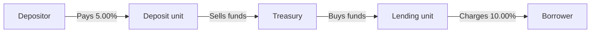

## Part 0 — Where the money comes from, and how to read this volume

Volume 1 read the asset side: ₹1,000 crore lent to ten borrowers, one of which failed, and what that did to capital. It treated the ₹1,300 crore of funding as given.

It is not given. It belongs to other people, most of whom can ask for it back tomorrow.

| Liabilities and equity | ₹ crore | Contractual maturity | Can it leave at short notice? |
|---|---:|---|---|
| Retail deposits — savings and current | 500 | On demand | Contractually yes; behaviourally rarely |
| Retail deposits — term | 400 | 6 months to 3 years | On premature withdrawal, with penalty |
| Wholesale deposits — corporates | 250 | 1 to 6 months | At maturity, and they will not roll if worried |
| Wholesale deposits — financial institutions | 150 | 7 to 90 days | Immediately, and first to go |
| Borrowings — market and refinance | 160 | Overnight to 5 years | Partly |
| Borrowings — Tier 2 subordinated | 40 | Over 5 years | No |
| Other liabilities | 50 | Various | No |
| Equity capital and reserves | 150 | Perpetual | Never |
| **Total** | **1,700** | | |

The business is the gap between the two sides: ₹1,000 crore lent for about four years, funded with money whose average contractual life is nearer one. Net interest income is **₹50.1 crore** a year — worth holding on to, because the steel default in Volume 1 cost ₹62.77 crore, more than a full year of it.

### How this volume is weighted

| Parts | Subject | Depth | Why |
|---|---|---|---|
| **1 to 3** | Liquidity, repricing and funds transfer pricing, the investment and trading book | **Working view first, then full depth** — each part opens compressed, then goes all the way down on what the role is examined on: FTP in Part 2, capital markets products and their capital cost in Part 3 | Treasury and markets sit next to every credit risk and regulatory reporting role; the working view holds the conversation, the depth survives the follow-up questions |
| **4 to 7** | Risk data, regulatory reporting, delivery, models | **Full** | This is the machine a credit risk business analyst actually works inside, and it is what connects everything in both volumes |
| **8** | A liquidity reporting change programme, run end to end | **Full, practical** | The job itself: who owns which number, the documents, data sourcing, data quality, testing, releases and where to start |

Read Parts 1 to 3 for the working view on a first pass and come back for the depth. Parts 4 to 8 are the point of this volume.

---

## Part 1 — Liquidity

Two tests, two horizons. **Thirty days:** do we survive a run? **One year:** is the funding structure sustainable?

### The event

April Y4. The steel default becomes public, a rating agency puts the bank on watch citing single-name concentration, and **₹270 crore walks out in a month** — ₹150 crore of financial-institution placements that decline to roll, ₹100 crore of maturing corporate deposits, ₹20 crore of retail. Nothing about the loan book changed. The bank simply became a name people did not want.

Loans cannot be called in. Only what can be sold or pledged today counts.

### The thirty-day test — LCR

$$
LCR = \frac{\text{High quality liquid assets}}{\text{Net cash outflows over 30 days under stress}} \geq 100\%
$$

Both halves are prescribed, not estimated, so the number means the same at every bank.

| Numerator — HQLA | ₹ crore | Haircut | Counts |
|---|---:|---:|---:|
| Balances with RBI above CRR | 72 | 0% | 72 |
| Government securities available | 374 | 0% | 374 |
| Corporate bonds, AA rated (Level 2A) | 60 | 15% | 51 |
| **Total HQLA** | | | **497** |

Advances count for nothing — they cannot be sold in thirty days near value. Level 2 assets are capped at 40% of HQLA; here they are 10%. Government securities held for the **statutory liquidity ratio (SLR)** are mandatory and therefore in principle unavailable, but RBI permits a defined portion to count anyway, on the reasoning that the bank could borrow against them from the central bank. [verify]

| Denominator — outflows | Balance ₹ crore | Run-off | Outflow ₹ crore |
|---|---:|---:|---:|
| Retail deposits — stable | 600 | 5% | 30.0 |
| Retail deposits — less stable | 300 | 10% | 30.0 |
| Wholesale — non-financial corporates | 250 | 40% | 100.0 |
| Wholesale — financial institutions | 150 | 100% | 150.0 |
| Undrawn committed credit lines | 108 | 30% | 32.4 |
| Other contractual outflows | — | — | 10.0 |
| **Gross outflows** | | | **352.4** |
| Less inflows within 30 days, capped at 50% | 80 | 50% | (40.0) |
| **Net cash outflows** | | | **312.4** |

Rates indicative and subject to change. [verify]

$$
LCR = \frac{497}{312.4} = 159\%
$$

**Three things to take from that table.**

**Funding is priced by who is lending it.** Retail savings run off at 5%; other banks' money runs off at 100%. Twenty times the flight risk on the same rupee, because a household does not move its salary account over a headline and a treasury desk moves that morning.

**The ₹108 crore of undrawn limits appears again.** It made ₹54 crore of RWA in Volume 1 and it makes ₹32.4 crore of assumed outflow here — same reasoning both times: distressed borrowers draw everything available.

**Inflows are capped** at 50% for corporate exposures and 75% of outflows overall. A bank cannot assume its way out by claiming borrowers will pay on time in a stress; the borrowers are in the same stress.

### What the ratio does not tell you

Run the actual ₹270 crore of outflows and rebuild both halves.

| | Before | Working, after the run | After |
|---|---:|---|---:|
| HQLA ₹ crore | 497 | 497 − 270 paid out | 227 |
| Retail deposits | 900 | 900 − 20 | 880 |
| ↳ outflow at 5% / 10% | 60.0 | 580(5%) + 300(10%) | 59.0 |
| Wholesale — corporates | 250 | 250 − 100 | 150 |
| ↳ outflow at 40% | 100.0 | 150 × 40% | 60.0 |
| Wholesale — financial institutions | 150 | all gone | 0 |
| ↳ outflow at 100% | 150.0 | — | 0.0 |
| Undrawn lines, other, less inflows | 2.4 | unchanged | 2.4 |
| **Net cash outflows ₹ crore** | **312.4** | | **121.4** |
| **LCR** | **159%** | 227 / 121.4 | **187%** |

**The ratio improved.** The bank has lost 54% of its liquid assets and all its wholesale bank funding, and the regulatory liquidity metric went up.

That is arithmetic behaving correctly, and it teaches the most important thing about the LCR: **the runnable funding ran, so the assumed future run-off fell.** The denominator shrank faster than the numerator. The ratio describes the *next* thirty days, and after the flighty money has gone, the next thirty days genuinely do look calmer.

What it cannot say is that a second month of the same size leaves the bank with nothing. Which is why a bank does not manage liquidity on the LCR. It manages on the **stock of HQLA in rupees**, the **daily net funding position**, and the maturity ladder below. The ratio is the regulatory floor, not the control.

### The maturity ladder

The LCR says nothing about *when inside* the thirty days the gaps fall, or about months two to sixty. The **structural liquidity statement (SLS)** slots every asset and liability into a time bucket by when it produces or consumes cash.

**Cumulative gap** is the running total of (inflows − outflows) from bucket 1 to that bucket. It is the number that matters, because a hole in week three is not fixed by a surplus in year four. **Tolerance limits** are RBI caps on how negative that cumulative gap may be, expressed as a percentage of cumulative outflows, and they tighten at the near end where the risk is — commonly cited as 5%, 10%, 15% and 20% for the first four buckets. [verify]

| Bucket | Inflows | Outflows | Gap | Cumulative gap | Cumulative outflows | Cum. gap % | Limit |
|---|---:|---:|---:|---:|---:|---:|---:|
| Day 1 | 130 | 40 | +90 | +90 | 40 | +225% | −5% |
| 2–7 days | 10 | 60 | −50 | +40 | 100 | +40% | −10% |
| 8–14 days | 10 | 50 | −40 | 0 | 150 | 0% | −15% |
| 15–30 days | 20 | 90 | −70 | −70 | 240 | **−29%** | **−20%** |
| 31 days–2 months | 30 | 120 | −90 | −160 | 360 | −44% | — |
| 2–3 months | 30 | 130 | −100 | −260 | 490 | −53% | — |
| 3–6 months | 80 | 200 | −120 | −380 | 690 | −55% | — |
| 6 months–1 year | 150 | 250 | −100 | −480 | 940 | −51% | — |
| 1–3 years | 400 | 300 | +100 | −380 | 1,240 | −31% | — |
| 3–5 years | 500 | 250 | +250 | −130 | 1,490 | −9% | — |
| Over 5 years | 340 | 210 | +130 | 0 | 1,700 | 0% | — |
| **Total** | **1,700** | **1,700** | | | | | |

All ₹ crore. Read the 15–30 day row across: outflows of ₹90 crore against inflows of ₹20 crore give a gap of −₹70 crore; added to the +₹0 running total it makes a cumulative gap of −₹70 crore; against ₹240 crore of cumulative outflows that is −29%, and the limit is −20%. **A breach** — on the same balance sheet, on the same day, that the LCR read 159%.

**Why they disagree.** Both are computed correctly and they treat the same ₹400 crore of government securities completely differently: HQLA under the LCR because they can be repo'd this afternoon, bucket ten under the SLS because they contractually mature in 3–5 years. The statement therefore permits marketable securities to be slotted by **expected realisation**, documented — and reslotting ₹374 crore into the near buckets turns the gaps positive.

**Behavioural slotting** is the same idea on the liability side, and it is bigger. ₹500 crore of savings and current accounts are contractually repayable on demand. Slot them at contractual maturity and Day 1 goes catastrophically negative and the statement is useless. But aggregate balances at this bank have not fallen below ₹380 crore in six years through two rate cycles. That ₹380 crore is the **core deposit** assumption: modelled, board-approved, back-tested, and reused in the EVE calculation in Part 2. It is the single most consequential judgement in ALM, and it sits under governance rather than in a modeller's spreadsheet.

### The one-year test — NSFR

The steel loan runs five years; the wholesale deposits funding part of it run three months. Every quarter the bank bets the market stays open. Nothing about that fails a thirty-day test.

$$
NSFR = \frac{\text{Available stable funding}}{\text{Required stable funding}} \geq 100\%
$$

**ASF** asks how much of each liability will still be here in a year: equity 100%, retail 90–95%, three-month bank money 0%. **RSF** asks how much long-term funding each asset needs behind it: cash 0%, government securities 5%, a five-year corporate loan 85%.

| | ₹ crore |
|---|---:|
| Available stable funding — equity 150, Tier 2 40, retail 840, corporate wholesale 125, long borrowings 100 | **1,255** |
| Required stable funding — advances 846, corporate bonds 60, G-secs 20, fixed assets 72, commitments 5 | **1,003** |
| **NSFR** | **125%** |

Factors indicative. [verify]

| | LCR | NSFR |
|---|---|---|
| Question | Survive thirty days of a run? | Is the structure sustainable for a year? |
| Fixed by | Holding liquid assets | Changing the composition of liabilities |
| Failure looks like | Not enough government securities | Long assets funded with short money |

A bank holding ₹800 crore of government securities funded entirely overnight has a magnificent LCR and a dreadful NSFR. It passes the thirty-day test and its business model is a bet that the interbank market opens tomorrow. That is why the second ratio was written, and it states the instruction that summarises this part: **fund long assets with long money.**

### Other liquidity controls

The two ratios and the ladder are the regulatory core. Four more controls sit around them, and a liquidity conversation assumes all four.

| Control | What it is | On our bank |
|---|---|---|
| **Intraday liquidity** | Cash needed at specific moments during the day to settle payments | A bank can end the day comfortably and still fail a settlement at 11am. How it is reported is in Part 8 |
| **Encumbrance** | Assets pledged as security are not available for anything else | Government securities out on repo in Part 3 are not HQLA while they are out — pledged HQLA is not HQLA |
| **Funding concentration** | Reliance on a few large depositors, one market or one tenor | ₹150 crore from financial institutions was under 12% of funding and 48% of the LCR's assumed outflows |
| **Contingency funding plan** | The documented playbook for a run: early warning triggers, actions in order, who decides | Month two of the April Y4 run — which securities to repo, and when to reach for the MSF |

**Trap — SLR securities are not automatically free HQLA.** An asset already required for another obligation, or already pledged, cannot be counted twice. Only the portion RBI permits may count, net of anything encumbered — which is why the HQLA table counts ₹374 crore of government securities rather than the full ₹400 crore. [verify]

---

## Part 2 — Repricing, and who gets paid for it

Liquidity asks whether the money is there. This part asks what happens to the **spread** when rates move, and then who inside the bank should be credited with earning it.

### The trade

₹100 crore lent for five years at 10%, funded with six-month wholesale deposits at 6.5%. Spread ₹3.5 crore. Then the deposit matures and must be replaced — and if short rates have risen 200 basis points it costs 8.5%, while the loan still pays 10%, fixed.

Borrowing short and lending long is the business. It is also the exposure, and it is measured two ways.

### The earnings view — NII sensitivity

Everything repricing within a year is counted; everything beyond is ignored.

| | ₹ crore |
|---|---:|
| Rate-sensitive assets repricing within 1 year | 500 |
| Rate-sensitive liabilities repricing within 1 year | 800 |
| **Repricing gap** | **−300** |

$$
\Delta NII \approx \text{Gap} \times \Delta r = -300 \times 1\% = -\text{₹}3.0\ \text{crore}
$$

The bank is **liability-sensitive** — costs move up before income does. ₹3 crore is **6% of the ₹50.1 crore of net interest income** from Part 0.

Two limitations supervisors probe: it is blind beyond twelve months, so a thirty-year fixed mortgage book and a thirteen-month one look identical; and it assumes deposit rates move one-for-one with the market, which they do not. That pass-through is the **deposit beta**, a modelled input sitting under governance beside the core deposit assumption.

### The value view — EVE sensitivity

The ₹3 crore is one year's instalment of a longer bill. If rates rise and stay there, the bank is stuck earning 10% on a five-year loan while funding it dearer for its whole life.

So revalue everything. Assets fall when the discount rate rises; liabilities also fall, and a fall in what you owe is a gain. Which side wins depends on **duration** — how long the money is tied up.

$$
\Delta EVE \approx -\left(D_A - D_L \times \frac{L}{A}\right) \times A \times \Delta r
$$

| Input | Value |
|---|---:|
| Duration of assets | 2.4 years |
| Duration of liabilities | 1.5 years |
| Liabilities / assets | 1,550 / 1,700 |
| **Duration gap** | **1.03 years** |

$$
\Delta EVE = -1.03 \times 1{,}700 \times 1\% = -\text{₹}17.5\ \text{crore}
$$

That is **11.7% of Tier 1 capital**. The Basel outlier test applies six prescribed shocks and flags a bank whose EVE falls by more than 15% of Tier 1 under any of them. [verify] At ±200 basis points our bank is near 23% — an outlier, meaning supervisory attention and probably a Pillar 2 add-on.

| | NII sensitivity | EVE sensitivity |
|---|---|---|
| Horizon | Next 12 months | All future cash flows |
| Measures | Earnings | Value |
| Blind to | Anything beyond a year | Timing of earnings inside the horizon |

**The trap is running only one.** Manage to NII alone and a bank loads up on long fixed-rate assets funded by sticky deposits, which looks wonderful for twelve months and accumulates enormous duration. Manage to EVE alone and reported earnings swing violently, which is what analysts actually see. Both go to ALCO, both carry board limits, and both run on the same behavioural assumptions — so when the core deposit number changes, both numbers change.

### Funds transfer pricing

The branch lent at 10%, the retail network raised deposits at 5%, the bank earned 5%. Who earned it?

Give it all to lending and nobody raises deposits. Give it all to deposits and nobody lends. Split it and both are paid for something neither did — because a large part of that 5% was earned by **funding a five-year asset with six-month money**, which is a risk position, not a customer relationship.

**FTP** puts treasury in the middle as an internal counterparty: it buys funds from the deposit unit at a rate matched to their behavioural tenor and sells them to the lending unit at a rate matched to the loan's tenor.

| Component | On the steel loan | What it is | Who bears the risk |
|---|---:|---|---|
| Credit spread | ₹2.50 crore | Compensation for default risk | Lending unit |
| Deposit spread | ₹1.00 crore | Value of raising funds below market | Deposit unit |
| Maturity transformation | ₹1.50 crore | Compensation for the term mismatch | Treasury |
| | **₹5.00 crore** | | |

Now the incentives are right. The lending unit's ₹2.50 crore is what the ₹0.20 crore of day-one expected credit loss should be measured against. And **the ₹1.50 crore sits in treasury, the only unit that can hedge the risk that produced it.**

**The failure mode:** charge the lending unit at overnight rates — roughly 6% instead of 7.5% — and the five-year loan appears to earn ₹4 crore instead of ₹2.5 crore. Long-dated lending looks more profitable than it is, the bank writes more of it, and the maturity transformation risk accumulates in a unit that cannot see it and cannot hedge it. Mispriced FTP is how a balance sheet quietly acquires the exposure Part 2 measures.

### FTP in full — the mechanism

The split above is the idea. The rest of this part is the machinery underneath it, built from nothing, because an FTP requirements conversation is about the machinery.

**Funds transfer pricing** is the internal mechanism that separates the three. Treasury becomes an internal counterparty sitting between every asset and every liability in the bank.

The deposit unit does not fund the loan. It **sells** its money to treasury and is paid an internal rate for it — the **FTP credit**. The lending unit does not use the deposit. It **buys** money from treasury and pays an internal rate for it — the **FTP charge**. No cash moves; these are book entries in the management accounts.

Two rules make the whole thing work, and everything else is detail:

- **The FTP rate is matched to the tenor of the item being priced.** A five-year loan is charged the five-year rate. Overnight money is credited the overnight rate.
- **Treasury keeps whatever is left**, which is exactly the compensation for the mismatch it now owns and can hedge.

The units are now insulated. **The lending unit's margin no longer moves when interest rates move**, because its charge was fixed at origination against a five-year funding cost. Its margin is compensation for one thing only: the borrower's credit risk. Which means it can finally be compared with the expected credit loss on that borrower — the ₹0.20 crore day-one allowance from Volume 1 — and the comparison means something.

### The transfer pricing curve

#### What it physically is

A table. One row per tenor, one rate per row, republished on a stated frequency by treasury under a governed policy.

| Tenor | Transfer rate |
|---|---:|
| Overnight | 5.50% |
| 1 month | 5.65% |
| 3 months | 5.90% |
| 6 months | 6.15% |
| 1 year | 6.40% |
| 2 years | 6.80% |
| 3 years | 7.10% |
| 5 years | **7.50%** |
| 10 years | 8.00% |

Illustrative; a real curve is refreshed at least monthly and often daily. [verify]

That is the entire artefact. Everything that follows reads a number off that table.

<svg viewBox="0 0 520 372" xmlns="http://www.w3.org/2000/svg" role="img" aria-label="Transfer pricing curve rising from 5.50 percent overnight to 8.00 percent at ten years, with the five-year lending charge and the blended deposit credit marked">
  <line x1="70" y1="300" x2="440" y2="300" stroke="#000" stroke-width="1"/>
  <line x1="70" y1="300" x2="70" y2="55" stroke="#000" stroke-width="1"/>
  <line x1="70" y1="100" x2="352" y2="100" stroke="#000" stroke-width="1" stroke-dasharray="4 3"/>
  <line x1="70" y1="174" x2="240" y2="174" stroke="#000" stroke-width="1" stroke-dasharray="4 3"/>
  <polyline points="70,260 117,228 164,208 211,188 258,156 305,132 352,100 399,60" fill="none" stroke="#000" stroke-width="1.8"/>
  <circle cx="352" cy="100" r="4" fill="#000"/>
  <circle cx="240" cy="174" r="4" fill="#ececec" stroke="#000" stroke-width="1.5"/>
  <line x1="462" y1="100" x2="462" y2="174" stroke="#000" stroke-width="1.2"/>
  <path d="M 462 100 l -4 7 l 8 0 Z" fill="#000"/>
  <path d="M 462 174 l -4 -7 l 8 0 Z" fill="#000"/>
  <text x="470" y="132" font-size="12" fill="#000">0.92%</text>
  <text x="470" y="148" font-size="12" fill="#000">to treasury</text>
  <text x="358" y="92" font-size="12" fill="#000">Lending charge 7.50%</text>
  <text x="76" y="168" font-size="12" fill="#000">Deposit credit 6.58%</text>
  <text x="70" y="318" font-size="11" fill="#000" text-anchor="middle">ON</text>
  <text x="117" y="318" font-size="11" fill="#000" text-anchor="middle">3m</text>
  <text x="164" y="318" font-size="11" fill="#000" text-anchor="middle">6m</text>
  <text x="211" y="318" font-size="11" fill="#000" text-anchor="middle">1y</text>
  <text x="258" y="318" font-size="11" fill="#000" text-anchor="middle">2y</text>
  <text x="305" y="318" font-size="11" fill="#000" text-anchor="middle">3y</text>
  <text x="352" y="318" font-size="11" fill="#000" text-anchor="middle">5y</text>
  <text x="399" y="318" font-size="11" fill="#000" text-anchor="middle">10y</text>
  <text x="64" y="304" font-size="11" fill="#000" text-anchor="end">5.0</text>
  <text x="64" y="64" font-size="11" fill="#000" text-anchor="end">8.0</text>
  <text x="255" y="342" font-size="12" fill="#000" text-anchor="middle">Tenor</text>
  <text x="24" y="180" font-size="12" fill="#000" text-anchor="middle" transform="rotate(-90 24 180)">Transfer rate %</text>
</svg>

#### What the curve is built from

The rate must represent **what it would cost the bank to raise money of that tenor in the market today.** Not the average cost of the deposits it already has — the *marginal* cost of the next rupee.

That distinction is the single most common error, so it is worth stating in reverse: a bank whose existing deposits average 5.00% must still charge a five-year loan 7.50%, because if it writes another five-year loan it will have to raise five-year money at 7.50% to fund it. Pricing off the historic average would make every new loan look ₹2.50 more profitable than it is.

The curve is usually assembled in two layers.

| Layer | What it represents | Where it comes from |
|---|---|---|
| **Base rate** | The pure time value of money at that tenor, with no credit or liquidity content | The interest rate swap or OIS curve, observable in the market |
| **Funding spread** | What *this bank* pays above that, for money of that tenor | The bank's own issuance levels, wholesale deposit rates, and secondary spreads on its own paper |

Splitting them is not cosmetic. **The base layer transfers interest rate risk to treasury; the spread layer transfers funding and liquidity risk.** Banks that report the two separately can tell the difference between a treasury that made money on rates and one that made money because the bank's own credit spread tightened — which are different things and reflect on different people.

#### Two policy decisions to be aware of

**Is the rate fixed at origination or reset with the curve?** For a fixed-rate loan it must be **fixed at origination** and carried for the loan's life — matched-funded. Otherwise the lending unit's margin swings every month with a curve it cannot pass on to a borrower whose rate cannot change. For a floating-rate loan the FTP rate **resets** alongside the customer rate, on the same dates. Get this wrong in the specification and a book of fixed-rate lending shows phantom profits and losses forever.

**How often is the curve refreshed, and which vintage applies?** New business is priced off today's curve. Existing fixed-rate business keeps its origination-date curve. Which means the system must store, per account, the curve identifier and the curve date that applied at origination — a field that is trivially easy to omit and impossible to reconstruct later.

### Which point on the curve a product gets

This is where FTP is won or lost. The curve is arithmetic; the tenor assignment is judgement, and it moves real money between units.

#### Contractual is not behavioural

Start with what the contract says, then ask what actually happens.

| Product | Contractual maturity | What actually happens | Assigned FTP tenor | Evidence needed |
|---|---|---|---|---|
| 5-year bullet term loan | 5 years | Principal repaid once, at the end | **5 years** | The contract |
| 5-year amortising loan | 5 years | Principal returns steadily throughout | **Weighted average life**, about 2.9 years | The amortisation schedule |
| Cash credit / overdraft | On demand | Balances revolve but a core never clears | **Core portion at 1 year, volatile portion overnight** | Balance history per account |
| Savings and current accounts | On demand | ₹380 crore of ₹500 crore has never left | **Core at 3 years, volatile overnight** | Six years of balance data |
| 1-year term deposit | 1 year | Mostly rolls; a fraction breaks early | **1 year**, adjusted for the premature withdrawal rate | Rollover and break history |
| Credit card revolver | On demand | Persistent balances, high churn of individuals | **Behavioural**, from balance history | Balance history |
| Prepayable retail loan | 5 years | A fraction refinances when rates fall | **Prepayment-adjusted life**, shorter than contractual | Prepayment history by vintage |

**The rule: the FTP tenor is the behavioural life, not the contractual one.**

Two of those rows deserve unpacking because they carry most of the money.

**Why an amortising loan is not five-year money.** A ₹100 crore bullet loan has ₹100 crore outstanding for five years. A ₹100 crore amortising loan has ₹100 crore outstanding on day one and almost nothing in year five, so on average far less money is tied up for far less time. Funding it as though it were five-year money over-charges the lending unit and hands treasury a profit it did not earn. The weighted average life is the honest answer.

**Why ₹500 crore of on-demand deposits are mostly three-year money.** Every rupee of savings and current account balance is contractually repayable today. Slot it that way and the deposit unit is credited the overnight rate of 5.50% on all ₹500 crore. But aggregate balances at this bank have not fallen below ₹380 crore in six years through two rate cycles. Individual customers come and go; the aggregate does not move. That ₹380 crore behaves like three-year money and is credited as such.

#### The connection that matters most

That ₹380 crore is not a new number. It is the **core deposit assumption** from Part 1 — the same figure that decided which time bucket ₹500 crore of on-demand deposits landed in on the structural liquidity statement, and the same figure feeding the liability duration of 1.5 years behind the ₹17.5 crore EVE sensitivity earlier in this part.

**It must be one number, from one model, under one governance.** If FTP assumes a three-year behavioural life and ALM assumes four, the bank is pricing on one view of its own deposits and measuring risk on another. Every unit's reported profit and every reported interest rate risk number then rest on inconsistent foundations, and no reconciliation between them is possible because there is nothing to reconcile to.

This is the single most useful sentence in this part for a requirements conversation: **behavioural life is a shared input, not an FTP input.** The specification must name the source model, not restate the assumption.

#### Working the blended deposit credit

The deposit unit holds the ₹900 crore retail book, costing ₹45.0 crore a year, an average of 5.00%. Slot it and read the curve.

| Slice | ₹ crore | Assigned tenor | Curve rate | Weighted contribution |
|---|---:|---|---:|---:|
| Core savings and current | 380 | 3 years | 7.10% | 2,698 |
| Volatile savings and current | 120 | Overnight | 5.50% | 660 |
| Term deposits, average residual | 400 | 1 year | 6.40% | 2,560 |
| **Total** | **900** | | | **5,918** |

$$
\text{Blended FTP credit} = \frac{5{,}918}{900} = 6.58\%
$$

Now the three-way split on the steel loan falls out with nothing left over.

| Component | Working | Rate | Who bears the risk |
|---|---|---:|---|
| **Credit spread** — lending unit | 10.00% received − 7.50% charged | **2.50%** | Lending unit |
| **Deposit spread** — deposit unit | 6.58% credited − 5.00% paid | **1.58%** | Deposit unit |
| **Maturity transformation** — treasury | 7.50% charged − 6.58% credited | **0.92%** | Treasury |
| | | **5.00%** | |

The short version above gave this split as 2.50 / 1.00 / 1.50, using a single assumed tenor on each side. The credit spread is unchanged — the five-year point genuinely is 7.50% — but once the deposit book is slotted behaviourally rather than treated as short money, **₹0.58 of every ₹100 moves from treasury to the deposit unit.** That shift is the entire economic content of behavioural slotting, and it is why the deposit unit cares intensely about a model it does not own.

### What else is in the FTP charge

The base rate covers the time value of money. Two other things cost the bank real money and must be charged to whoever causes them, or they are free and the business will consume them without limit.

#### Term liquidity premium

Already inside the curve above, but worth separating because it is often reported on its own line. It is the difference between the pure base rate at a tenor and what this bank pays at that tenor — the price of *committing* funding for that long rather than the price of the time value.

A bank with a wide funding spread has a steep liquidity premium and should be writing shorter, more granular assets. A bank with a narrow one can afford duration. **The premium is the mechanism by which a bank's own creditworthiness reaches the price it quotes a borrower** — which is why it is a treasury policy input, refreshed with the bank's own market levels, and not a fixed number in a spreadsheet.

#### Contingent liquidity charge

The ₹108 crore of undrawn commitments has already carried two numbers: **₹54 crore of risk-weighted assets** in Volume 1, and **₹32.4 crore of assumed thirty-day outflow** in the LCR in Part 1. It appears here a third time, and this is the appearance that changes behaviour.

Because the LCR assumes 30% of those limits are drawn in a stress, the bank must hold liquid assets against them. Those assets sit in short government paper yielding less than the stable funding that carries them, and the difference is a real annual cost.

| Step | Working | Value |
|---|---|---:|
| Undrawn commitments | Volume 1, off balance sheet | ₹108.0 crore |
| HQLA required, at the 30% LCR run-off rate | 108.0 × 30% | ₹32.4 crore |
| Cost of carry — 1-year stable funding less short G-sec yield | 6.40% − 6.00% | 0.40% |
| **Annual cost** | 32.4 × 0.40% | **₹0.13 crore** |
| **Charged as a fee on the undrawn limit** | 0.13 ÷ 108 | **12 basis points** |

Twelve basis points a year on undrawn limits. **That is what a commitment fee is** — not an arbitrary charge, but the recovery of a liquidity cost the customer imposes by holding an option to draw. A bank that does not charge it is giving away liquidity insurance for nothing, and its relationship managers will grant enormous headroom because headroom is free and customers like it.

Then the borrower deteriorates and draws it, as distressed borrowers do, and the ₹108 crore becomes exposure at default — the credit conversion factor from Volume 1, arriving as a real balance.

#### Optionality charge

A borrower who may repay at par without penalty holds a free option. If rates fall, they refinance elsewhere, the asset disappears, and treasury is left holding a five-year funding position against nothing. The bank loses precisely when it can least afford to.

Two ways to price it: charge the estimated option cost as a spread, or assign the **prepayment-adjusted behavioural life** rather than the contractual one, which shortens the tenor and lowers the charge to reflect what the asset really is. The second is more common because it uses machinery the bank already has.

The mirror image sits on the liability side. A term depositor who may break early with a modest penalty holds the same kind of option, and the premature withdrawal rate is the same kind of input.

#### The all-in charge

| Component | On the steel loan | Source |
|---|---:|---|
| Base rate at 5 years | 7.50% | The curve, above |
| Contingent liquidity | — | No undrawn limit on this facility |
| Optionality | — | Bullet loan, no prepayment right |
| **All-in FTP charge** | **7.50%** | |

Deliberately simple, so the components are visible. On a five-year facility with a ₹30 crore undrawn line and a prepayment right, all three lines would be populated and the all-in charge would exceed the curve point.

### FTP across the whole balance sheet

One curve, one set of tenor assignments, applied to everything. Each unit's margin is what it receives less what it pays, counting FTP as a real cash flow.

| Unit | Balance ₹ crore | Receives | Pays | Margin ₹ crore |
|---|---:|---|---|---:|
| **Lending** | 1,000 advances | ₹98.0 crore from borrowers at 9.80% | FTP charge at a blended 7.25% = ₹72.5 crore | **25.50** |
| **Retail deposits** | 900 | FTP credit at 6.58% = ₹59.2 crore | ₹45.0 crore to depositors at 5.00% | **14.18** |
| **Wholesale deposits** | 400 | FTP credit at 3 months, 5.90% = ₹23.6 crore | ₹26.0 crore to depositors at 6.50% | **−2.40** |
| **Borrowings** | 200 | FTP credit at 2 years, 6.80% = ₹13.6 crore | ₹15.6 crore at 7.80% | **−2.00** |
| **Treasury** | | FTP charges ₹72.5 crore, plus ₹34.3 crore investments and ₹4.4 crore RBI balances | FTP credits of ₹59.2 + ₹23.6 + ₹13.6 crore | **14.82** |
| | | | **Net interest income** | **50.10** |

**It reconciles exactly to the ₹50.1 crore of net interest income.** That is the control on any FTP implementation: the sum of the units' margins must equal the bank's actual NII to the rupee. Every internal charge appears twice, once as a cost and once as income, so they must cancel. A residual means a tenor was assigned on one side and not the other, or a balance was priced twice, or one was missed entirely.

Three things fall out of that table, and they are the reason the exercise is worth doing.

**Wholesale funding loses money.** The ₹400 crore of corporate and financial-institution deposits costs 6.50% and is credited 5.90%, so it runs at **−₹2.40 crore**. Nothing has gone wrong. Short wholesale money is genuinely worth less than it costs, because it cannot fund anything long. It exists for balance-sheet management, not as a profit line — and it is the same ₹150 crore of financial-institution money that ran 100% in the April Y4 stress and dominated the ₹312.4 crore of assumed outflows. **FTP prices it as what it is,** and a bank that reports it as profitable is hiding both the cost and the risk.

**Borrowings look the same way** for the same reason, at −₹2.00 crore.

**Treasury's ₹14.82 crore is not all maturity transformation.** Part of it is the benefit of ₹200 crore of funding that costs nothing at all — ₹150 crore of equity and ₹50 crore of other liabilities. That benefit has to be credited somewhere, and the convention chosen decides how treasury looks.

| Equity credited at | Value of free funding | Leaves as transformation |
|---|---:|---:|
| Overnight, 5.50% | ₹11.00 crore | **₹3.82 crore** |
| 5 years, 7.50% | ₹15.00 crore | **−₹0.18 crore** |

**The same treasury, the same balance sheet, profitable or loss-making depending on a policy convention.** Which is why the equity credit rate is a governed decision written into FTP policy, disclosed, and changed only deliberately — and why the first question to ask of any FTP result is what rate equity was credited at.

### How FTP breaks

Six failure modes. Each one is a real design choice made badly, and each has a number attached.

| # | Failure | What it looks like | What it costs |
|---:|---|---|---|
| 1 | **Overnight FTP on long assets** | The lending unit is charged 5.50% instead of a blended 7.25% | Lending margin appears as **₹43.0 crore instead of ₹25.5 crore**. Long-dated lending looks 69% more profitable than it is, the bank writes more of it, and the transformation risk accumulates in treasury unpriced |
| 2 | **A single pooled rate** | Every product charged the bank's average cost of funds, 5.60% | No tenor signal at all. A one-month loan and a ten-year loan cost the same internally. The balance sheet lengthens invisibly |
| 3 | **FTP tenor ≠ ALM behavioural tenor** | FTP uses 3 years for core deposits, ALM uses 4 | Pricing rests on one view of the deposit book, the ₹17.5 crore EVE sensitivity on another. Neither can be reconciled to the other |
| 4 | **No contingent liquidity charge** | Undrawn limits are free to the business | Headroom proliferates because it costs nothing, then reappears as ₹54 crore of RWA, ₹32.4 crore of LCR outflow, and exposure at default when borrowers draw it |
| 5 | **Stale curve** | The curve is refreshed quarterly while funding costs move weekly | New business is priced off last quarter's cost of funds. In a rising market every loan written is underpriced from the day it is booked |
| 6 | **FTP as a negotiation** | Business units lobby for a lower charge to hit their targets | The rate stops being a measurement and becomes an outcome. Once one exception is granted the number means nothing anywhere |

The sixth is the one that decides whether the other five stay fixed. **FTP has to be a governed, published rate with a documented change process and no exceptions**, owned by treasury or ALCO rather than by the units it prices, for the same reason the model validation function in Part 7 has to report independently: the value of the number lies entirely in nobody being able to negotiate it.

### What the FTP computation needs

The FTP engine takes a balance and returns a charge. Everything it needs to do that has to arrive from somewhere, defined, on a schedule. This is the elicitation.

#### Data requirements by domain

| Domain | Fields | Source | What it decides |
|---|---|---|---|
| **Instrument** | Account ID, product code, currency, principal, contractual maturity date, amortisation type, rate type (fixed or floating), customer rate | Core banking | Which curve, which tenor bucket, fixed or resetting |
| **Behavioural** | Assigned behavioural life, core/volatile split, prepayment rate, premature withdrawal rate | **ALM model output** — not re-derived here | Overrides contractual tenor. Must be the same values the liquidity buckets and EVE use |
| **Balance** | Daily or month-end balance, accrued interest, undrawn limit | Core banking, general ledger | The charge is balance × rate × day count |
| **Curve** | Curve ID, curve date, tenor point, base rate, funding spread | Treasury / market data | The rate itself, and which vintage applies |
| **Add-on rates** | Contingent liquidity rate, optionality spread, equity credit rate | Treasury FTP policy | The components beyond the base rate |
| **Organisation** | Business unit, cost centre, product hierarchy, booking entity | Reference data | Where each margin lands |
| **Dates and conventions** | Origination date, next reset date, reporting date, day count basis | Core banking | Which curve vintage, and how many days of accrual |

Two of those rows carry the risk.

**The behavioural row is a dependency, not a calculation.** The specification must name the upstream model and its output table, not restate the ₹380 crore. If it restates it, the number will be updated in one place and not the other, and the bank will discover it during a variance investigation two years later.

**The dates row decides whether the answer is stable.** Origination date plus curve ID plus curve date is what lets a fixed-rate loan keep its original charge for five years. Omit any of the three and the charge silently becomes a moving number on an asset whose customer rate cannot move.

#### The FTP mapping specification

Three rows, filled the way the deliverable actually looks.

| | Row 1 — the hard one | Row 2 — the base rate | Row 3 — the add-on |
|---|---|---|---|
| **Source system** | ALM behavioural model output; core banking | Treasury curve store; FTP reference data | Core banking; treasury FTP policy |
| **Source field** | `BEHAV_LIFE_MTHS`, `CORE_PCT`; `PROD_CODE`, `MAT_DT`, `AMORT_TYPE` | `CURVE_ID`, `CURVE_DT`, `TENOR_PT`, `BASE_RATE`, `FUND_SPRD` | `UNDRAWN_LIMIT_AMT`; `CONTINGENT_LIQ_BPS` |
| **Target field** | `ftp_assigned_tenor_months` | `ftp_base_rate_pct` | `ftp_contingent_charge_amt` |
| **Transformation** | For non-maturity products, take `BEHAV_LIFE_MTHS` from the ALM model, applied separately to the core and volatile portions using `CORE_PCT`. For amortising products, compute weighted average life from the contractual schedule. For bullet products, use `MAT_DT` less `ORIG_DT` | Read the curve point at `ftp_assigned_tenor_months`, interpolating linearly between published tenors. For fixed-rate instruments use the curve where `CURVE_DT` = `ORIG_DT`; for floating-rate use the latest `CURVE_DT` on or before the reset date | `UNDRAWN_LIMIT_AMT` × `CONTINGENT_LIQ_BPS` ÷ 10,000, accrued daily on actual/365 |
| **Null and default handling** | Null `BEHAV_LIFE_MTHS` on a non-maturity product **rejects the record to the exception queue** — it must never default to overnight, which would silently transfer margin from the deposit unit to treasury | Null or missing curve for the required `CURVE_DT` rejects the record. Never fall back to today's curve on a fixed-rate instrument | Null `UNDRAWN_LIMIT_AMT` defaults to zero. Null `CONTINGENT_LIQ_BPS` rejects |
| **Owner** | Head of ALM | Head of treasury | Head of treasury |
| **Reference** | FTP policy — tenor assignment; ALM behavioural model documentation | FTP policy — curve construction and vintage | FTP policy — contingent liquidity; LCR run-off assumption |

**Look at what the three null-handling cells actually decide.** Each is a rule that changes reported profit, written as a data rule. Defaulting a missing behavioural life to overnight would move margin from the deposit unit to treasury on every affected account, permanently and invisibly. Falling back to today's curve on a fixed-rate loan would make the lending unit's margin swing with rates it cannot pass on. Neither would ever produce an error message.

**And the last two columns are the ones dropped under time pressure and the ones that matter in two years,** when the person who wrote the rule has left and someone asks why the deposit unit's margin changed. Owner and reference are what make an answer possible.

#### The questions to ask before writing any of it

| Question | Why it decides the design |
|---|---|
| Is the rate fixed at origination or does it reset? | Determines whether curve vintage must be stored per account, forever |
| Where does behavioural life come from, and who owns it? | Determines whether FTP is consistent with the liquidity and EVE numbers |
| What is the equity credit rate? | Determines whether treasury reports a profit or a loss |
| Is FTP computed on daily balances or month-end? | Determines the data volume by roughly thirty times, and the accuracy on revolving products |
| Are undrawn limits charged? | Determines whether commitment growth is visible |
| What is the exception process when a rate is disputed? | Determines whether the number survives contact with the business |
| Does the sum of unit margins tie to reported NII? | The reconciliation control. If it is not designed in, it will not exist |

---

## Part 3 — The investment book and the market

### Why the bank owns ₹520 crore of securities

| Purpose | Which holdings |
|---|---|
| Satisfy the statutory liquidity ratio | Government securities |
| Provide HQLA for the LCR | G-secs, AA corporate bonds |
| Serve as repo collateral for funding | Government securities |
| Earn a return on surplus funds | All of it |

One holding, four jobs. How it is **classified** at purchase determines whether its price moves hit profit, hit reserves, or hit nothing — which is why classification is a governed decision, not a bookkeeping one.

### The mechanics that matter

**Price and yield move inversely,** and the sensitivity is duration — the same duration as the EVE calculation. The ₹400 crore government book at duration 4 loses about ₹16 crore on a 100 basis point rise.

**Repo turns securities into cash.** Sell ₹210 crore of G-secs today, agree to buy them back tomorrow slightly dearer, receive ₹200 crore — a 5% haircut. Economically a secured overnight loan; legally a sale and repurchase, which is what makes it robust if the counterparty fails. Repo is what makes the Part 1 claim that government securities are liquid operationally true.

**The Indian money market** is where the short funding actually comes from.

| Market | What it is | Secured |
|---|---|---|
| Call, notice and term money | Overnight to 14 days interbank | No |
| **TREPS** | Triparty repo cleared through CCIL — the dominant overnight market | Yes |
| **LAF** | Repo and reverse repo with RBI; the policy corridor | Yes |
| **MSF** | Marginal standing facility, above the repo rate — emergency overnight | Yes |
| Treasury bills, CDs, commercial paper | 91–364 day government, bank and corporate paper | — |

Subject to change. [verify]

The ₹150 crore that ran in April Y4 came largely from these markets, which is why it ran fast — it is priced daily and reprices on sentiment. And the **MSF is what the bank reaches for in month two of a run**, at a penal rate, which is the point at which a liquidity problem becomes public.

### Hedging, and the risk the hedge creates

The balance sheet cannot be changed by decree, so the bank hedges: an **interest rate swap**, ₹100 crore notional, five years, **pay fixed 7.2% / receive six-month MIBOR**. No principal moves; only the difference between the two streams. Floating funding cost becomes fixed, matching the fixed asset, and the Part 2 exposure disappears on that ₹100 crore.

| Instrument | Obligation | Character |
|---|---|---|
| **Forward** | Both must transact at an agreed future price | Linear, over-the-counter |
| **Future** | Same, standardised and exchange-traded with daily margin | Linear, low counterparty risk |
| **Swap** | Exchange of two cash flow streams | Linear — a series of forwards |
| **Option** | One party has the right, not the obligation | Asymmetric; buyer pays a premium |

But when rates rise 200 basis points the swap is worth about ₹8 crore **to us**, owed by the counterparty. If it fails, the hedge fails exactly when it was needed.

| | Loan credit risk | Counterparty credit risk |
|---|---|---|
| Exposure at default | Roughly the outstanding balance | Depends where market rates are that day |
| Direction | The bank is always owed | Either party may owe the other |
| Measured as | Drawn + CCF × undrawn | Current exposure + potential future exposure |

Mitigated by **netting** (all trades with one counterparty collapse to a single enforceable exposure), **collateral under a CSA** (variation margin daily), **initial margin**, and **central clearing** through **CCIL**, which novates the trade to a central counterparty holding margin from everyone. The capital charge for the counterparty's own credit deterioration is **CVA**.

**Wrong-way risk** is the failure to watch for: exposure grows in exactly the scenarios where the counterparty is most likely to fail. Buying protection on a company from a bank heavily exposed to that same company is the textbook case — and it is the same correlation problem as downturn LGD in Volume 1, where the steel plant was worth least in precisely the year the steel borrower failed.

Settlement infrastructure worth knowing by name: **CCIL** (central counterparty), **NDS-OM** (G-sec order matching), **RTGS and NEFT** (payments), **CDSL and NSDL** (depositories).

### Capital markets products, from zero

So far this part has treated the ₹520 crore as one holding with four jobs, and the swap as one hedge. From here it takes the products themselves apart, assuming no prior knowledge — and they are, without exception, promises.

A bond is a promise to pay money on dates. A share is a promise of a slice of whatever is left over. A currency trade is a promise to swap one country's money for another's. A derivative is a promise whose size depends on some other price.

None of them is a physical object. All of them are contracts, and every number from here to the end of this part is an attempt to answer one of two questions: **what is this promise worth today**, and **how much does that change when something moves.**

| Family | In one sentence | Our bank holds |
|---|---|---|
| **Fixed income** — bonds | A loan you can sell to someone else | ₹400 crore government, ₹120 crore corporate |
| **Equities** — shares | Ownership of a slice of a company | Very little, deliberately |
| **Foreign exchange** | One currency swapped for another | Positions arising from customer business |
| **Derivatives** | A contract whose value comes from another price | The ₹100 crore interest rate swap |

The running bank is the same one: **₹1,700 crore of assets, ₹520 crore of securities, ₹1,234 crore of risk-weighted assets of which ₹40 crore is market risk** — a number derived below, in the section on what the market book costs in capital.

### Fixed income

#### A bond is a loan you can sell

The bank lent ₹100 crore to the steel manufacturer. It cannot sell that loan easily — it is a private agreement between two parties, documented specifically, with no market for it.

Now imagine the same borrowing done differently. Instead of one lender, the company borrows from a thousand lenders, each contributing a small standardised piece, on identical terms written once. Each piece is a **bond**, and because every piece is identical, they can be traded. Someone who wants their money back before maturity does not need the company's permission — they sell to somebody else.

**That is the only real difference between a loan and a bond: standardisation, which makes a market possible.** Everything else is the same. Money out now, interest along the way, principal back at the end, and the risk that the borrower fails.

#### The four things that define one

| Term | What it means | Example |
|---|---|---|
| **Face value** (par, principal) | The amount repaid at maturity | ₹100 |
| **Coupon** | The interest rate paid on face value, on fixed dates | 7% a year |
| **Maturity** | When the face value is repaid | 5 years from now |
| **Issuer** | Who owes the money | Government of India, or a company |

Those four give you every cash flow the bond will ever produce.

| Year | Cash received |
|---:|---:|
| 1 | ₹7 |
| 2 | ₹7 |
| 3 | ₹7 |
| 4 | ₹7 |
| 5 | ₹107 |

Indian government bonds pay half-yearly rather than annually. The arithmetic below is identical with the coupon halved and the number of periods doubled; annual is used here so the numbers stay readable.

#### Price and yield move in opposite directions

Here is the one mechanic that everything in fixed income rests on, and it is worth taking slowly because it is counterintuitive the first time.

The bond above pays ₹7 a year. Suppose you bought it at ₹100, so you are earning 7%.

Now the market changes and newly issued bonds of the same kind pay 8%. **Would anyone buy your bond at ₹100?** No — they can get ₹8 a year for the same ₹100 elsewhere. Your bond only becomes attractive if it is cheaper, so its price falls until the ₹7 a year plus the ₹100 at maturity adds up to an 8% return for whoever buys it now.

How far does it fall? Discount every cash flow at 8% — exactly the present value machinery from Volume 1, where the same operation turned five years of loan receipts into ₹98 crore.

| Year | Cash | Discount factor at 8% | Present value |
|---:|---:|---:|---:|
| 1 | 7 | 0.9259 | 6.48 |
| 2 | 7 | 0.8573 | 6.00 |
| 3 | 7 | 0.7938 | 5.56 |
| 4 | 7 | 0.7350 | 5.15 |
| 5 | 107 | 0.6806 | 72.82 |
| | | **Price** | **96.01** |

**The price fell to ₹96.01.** Nothing about the bond changed — same issuer, same coupon, same maturity. Only the return available elsewhere changed, and the price moved to compensate.

Run it the other way. If market rates fall to 6%, the same discounting gives **₹104.21**, because a bond paying 7% is now generous.

| Market yield | Price | Relationship |
|---:|---:|---|
| 6% | ₹104.21 | Below coupon → price above par, "premium" |
| 7% | ₹100.00 | Equal to coupon → price at par |
| 8% | ₹96.01 | Above coupon → price below par, "discount" |

#### Yield to maturity

**Yield to maturity (YTM)** is the single rate that makes the bond's future cash flows equal its current price. It is the return you earn if you buy at that price and hold to maturity.

If that sounds familiar, it is: **YTM is the effective interest rate from Volume 1**, applied to a traded instrument instead of a loan. The 10.54% that reconciled ₹98 crore out to five years of receipts, and the 8% that reconciles ₹96.01 to the table above, are the same idea and the same arithmetic.

Price and yield are therefore two ways of saying one thing. Quote a bond by price and its yield is implied; quote it by yield and its price is implied. Traders quote government bonds by yield and corporate bonds often by spread over the government yield, which is the next idea.

#### Clean price, dirty price and accrued interest

A bond pays its coupon on fixed dates. If you buy four months after the last coupon, you will receive the whole next coupon even though the seller held the bond for a third of the period. So you pay them for it.

| | Working | ₹ |
|---|---|---:|
| **Clean price** — what is quoted | | 96.01 |
| **Accrued interest** — the seller's share of the next coupon | 7 × 120 ÷ 365 | 2.30 |
| **Dirty price** — what actually settles | 96.01 + 2.30 | **98.31** |

The quoted price is clean because it moves only with market conditions. The dirty price sawtooths upwards between coupon dates and drops on each payment, which would make price charts unreadable. **You pay dirty and you quote clean.**

Get this wrong in a system specification and every bond in the book is mispriced by up to a full coupon — a defect that reconciles nowhere and is invisible on coupon dates.

#### Duration — how much the price moves

If price moves with yield, the next question is *how much*, and the answer is **duration**.

**Macaulay duration** is the weighted average time until you get your money back, weighting each cash flow by its present value. For our bond it is **4.39 years** — less than the 5-year maturity, because the coupons arrive earlier than the principal.

**Modified duration** converts that into a sensitivity:

$$
\text{Modified duration} = \frac{\text{Macaulay duration}}{1 + y} = \frac{4.39}{1.07} = 4.10
$$

Read it as: **a 1% rise in yield costs about 4.10% of the price.**

| | Predicted by duration | Actually happened |
|---|---:|---:|
| Yield +100 bp | −4.10% | −3.99% |
| Yield −100 bp | +4.10% | +4.21% |

The prediction is slightly wrong both times, and always in the holder's favour: the fall is smaller than predicted and the rise is larger. That asymmetry is **convexity** — the price-yield relationship is a curve, not a straight line, and duration is the straight line drawn at a tangent to it. Over small moves the difference is negligible. Over large ones it matters, which is why long-dated books report convexity alongside duration.

#### DV01 — duration in rupees

Duration is a percentage. Risk limits are in money, so the working measure is **DV01**: the value change for a one basis point move.

$$
DV01 = \text{Position} \times \text{Modified duration} \times 0.0001
$$

| Step | Working | Value |
|---|---|---:|
| Position | The bank's government book | ₹400 crore |
| Modified duration | From above | 4.10 |
| **DV01** | 400 × 4.10 × 0.0001 | **₹0.164 crore per bp** |
| Same figure in lakhs | | **₹16.4 lakh per bp** |
| Move of 100 bp | 0.164 × 100 | **₹16.4 crore** |

That ₹16.4 crore is the number the mechanics earlier in this part rounded to "about ₹16 crore", at a duration of 4 rather than 4.10. **DV01 is how a treasury desk actually holds a position in its head** — not "₹400 crore of five-year bonds" but "₹16.4 lakh a basis point", because that is the form in which it can be compared to a limit, netted against a hedge, and added to other positions.

#### Credit spread

Two bonds, same maturity, same coupon. One issued by the government, one by a company. The company's must yield more, because it might not pay.

$$
\text{Corporate yield} = \text{Government yield} + \text{Credit spread}
$$

The spread is the market's price for the borrower's default risk — the traded equivalent of everything in Volume 1. Where the loan book expressed that risk as a PD of 0.50% and an expected loss of ₹0.20 crore, the bond market expresses it as a number of basis points, continuously, and revises it every day.

Two consequences:

- **A bond's price falls when its issuer deteriorates, even if rates do not move.** Two independent sources of loss, and market risk systems must separate them or a credit event looks like a rate move.
- **The spread is a live opinion on credit quality**, available for any traded issuer without waiting for a rating action. Banks use spreads as an early warning input alongside the ratings from Volume 1.

#### The main types

| Type | What is different | Where our bank meets it |
|---|---|---|
| **Government bond (G-sec)** | Sovereign issuer, deepest market, repo-eligible | ₹400 crore — SLR, HQLA, and repo collateral |
| **Treasury bill** | Government, under one year, no coupon — issued at a discount | Short-dated HQLA |
| **Corporate bond** | Company issuer, carries a credit spread | ₹120 crore of AA paper, Level 2A HQLA at a 15% haircut |
| **Floating rate note** | Coupon resets to a benchmark periodically | Very low duration — the coupon moves so the price barely does |
| **Zero coupon bond** | No coupon; all return from the discount to par | Duration equals maturity exactly, so maximum rate sensitivity |
| **Covered bond, securitisation** | Backed by a pool of assets rather than the issuer alone | Not held here |

The floating rate note row is worth pausing on, because it explains something in Part 2. **A floating rate note has almost no duration** — when market rates rise, the note's own coupon rises with them, so its price barely moves. That is why a bank worried about the ₹17.5 crore EVE sensitivity holds floating rather than fixed paper. The same instinct, on the other side, is why the borrower's fixed-rate five-year loan was the problem in the first place.

### Equities

#### A share is ownership, not a promise to repay

A bond is a claim of a fixed amount. A **share** is a claim on whatever is left after everyone else has been paid — employees, suppliers, lenders, bondholders, the tax authority. It has no maturity and no promised payment.

| | Bond | Share |
|---|---|---|
| What you own | A claim to fixed amounts on fixed dates | A fraction of the company |
| Paid | Before shareholders | Last, out of what remains |
| Upside | Capped at the promised cash flows | Unlimited |
| Downside | The issuer defaults, and you recover something | Can go to zero, and often does first |
| Maturity | Yes | None |

That ordering — the **capital stack** — is the same one in Volume 1: depositors first, then Tier 2 subordinated debt, then Additional Tier 1, then common equity absorbing losses immediately and without any trigger. **A share is the riskiest claim on any company, including a bank**, and the reason equity is the only capital the regulator fully trusts is the reason a share is the last thing paid.

#### The numbers that describe one

| Measure | Meaning | Reading it |
|---|---|---|
| **Market capitalisation** | Share price × shares outstanding | What the market says the whole company's equity is worth |
| **Dividend yield** | Annual dividend ÷ price | The cash return, if the dividend continues — it need not |
| **Price/earnings ratio** | Price ÷ earnings per share | Rupees paid per rupee of annual profit; a high number means growth is expected |
| **Beta** | Sensitivity to the whole market | Beta 1.3 means the share tends to move 1.3× the index |
| **Delta** | Value change per unit move in the price | For a share held outright, delta is simply the position size |

Beta is the equity version of a familiar idea. It is the same question the Basel asset correlation asked in Volume 1's IRB calculation — how tied is this name to the wider economy — answered from market prices rather than a prescribed formula.

#### Why a bank holds almost none

Equity investments attract punitive capital treatment, and **holdings in other financial institutions' capital are deducted from CET1 outright** rather than risk-weighted. The reasoning is the one behind every CET1 deduction in Volume 1: if banks hold each other's equity, the system's capital is counted twice and vanishes together in exactly the stress it was held for.

So a commercial bank's equity exposure is small and deliberate. An investment bank is different — it holds equities as **trading inventory**, bought to be sold, plus positions arising from market-making, prime brokerage and equity derivatives hedging. Same instrument, entirely different purpose, and the banking book and trading book section below is about why that difference decides the accounting and the capital.

#### Corporate actions

Shares change form. A **dividend** pays cash and the price drops by roughly that amount on the ex-date. A **bonus issue or split** multiplies the share count and divides the price, leaving value unchanged. A **rights issue** offers existing holders new shares below market price. A **buyback** reduces the share count.

Trivial economically; a persistent source of data defects. Every corporate action requires a position and a price history to be adjusted on the right date, and a missed split makes a share look as though it lost half its value overnight.

### Foreign exchange

#### What is being traded

An FX rate is a price of one money in another. **USD/INR 86.00** means one US dollar costs 86 rupees. The first currency is what you are buying; the second is what you pay in.

Every FX trade has two sides — you cannot buy dollars without selling rupees — which makes it the one market where a "position" is always simultaneously long one thing and short another.

#### Three shapes

| Type | What it is | Settles |
|---|---|---|
| **Spot** | Buy currency now at today's rate | Usually two business days |
| **Forward** | Agree today a rate for a fixed future date | On that future date |
| **FX swap** | Spot one way and a forward the other, together | Both legs |

The FX swap is the workhorse and it is not really a currency trade at all. Selling dollars spot and buying them back forward is **borrowing rupees against dollars for the period in between** — a secured loan in another currency, which is why treasury desks use it to manage funding rather than to take a currency view.

#### Why a forward rate is not a forecast

This is the point where FX becomes intuitive, so it is worth doing the arithmetic.

You have ₹86 and want dollars in a year. Two routes.

| Route | Steps | Ends with |
|---|---|---|
| **A — wait** | Keep ₹86 in rupees for a year at 6.40%, then buy dollars | ₹91.50, converted at the unknown future rate |
| **B — now** | Buy $1 today at 86.00, deposit it for a year at 4.20% | $1.042, guaranteed |

If a forward rate existed that made route B better than route A with certainty, everyone would take it and the rate would move. So the forward rate must be the one that makes both routes identical.

$$
\text{Forward} = \text{Spot} \times \frac{1 + r_{\text{INR}}}{1 + r_{\text{USD}}}
$$

| Step | Working | Value |
|---|---|---:|
| Spot | | 86.00 |
| Rupee rate, 1 year | The transfer pricing curve | 6.40% |
| Dollar rate, 1 year | | 4.20% |
| **Forward** | 86.00 × 1.0640 ÷ 1.0420 | **87.82** |
| Forward premium | 87.82 − 86.00 | **1.82** |
| As a percentage | 1.82 ÷ 86.00 | **2.11%**, close to the 2.20% rate difference |

**The dollar is more expensive forward than spot purely because rupee interest rates are higher.** It says nothing whatsoever about where anyone thinks the rate is going. This is **covered interest parity**, and it is the single most useful thing to know about FX: forward points are an interest rate difference wearing a currency costume.

A practical consequence for a bank: **an FX forward is a rates position, not a currency position.** Hedging currency with forwards leaves you with interest rate exposure in two currencies, which is why FX and rates desks sit together.

#### The risk

The **net open position** is the bank's exposure in each currency after netting everything — assets, liabilities, spot, forward and derivatives. A bank with more dollar assets than dollar liabilities loses when the dollar weakens, regardless of how well those assets perform.

Regulators cap it, usually as a percentage of capital and both per currency and in aggregate. [verify] The measurement problem is that it must include every product in this part at once: a dollar bond, a dollar loan, a forward and a cross-currency swap all contribute, and if any one system is missed the position is wrong in a direction nobody can see.

**Settlement risk** is the FX-specific hazard. In a spot trade you pay rupees in Mumbai and receive dollars in New York, hours apart. In between, you have paid and not been paid. The industry's answer is payment-versus-payment settlement, which makes both legs conditional on each other.

### Derivatives in full

#### The definition, and what it is for

A **derivative** is a contract whose value is *derived* from something else — a rate, a price, an index. You never own the underlying thing. You own a claim whose size depends on where it goes.

Two legitimate reasons to use one, and they look identical on a trade ticket:

| Purpose | What it does | Example |
|---|---|---|
| **Hedging** | Offsets an exposure you already have | The bank pays fixed on a swap to offset floating funding cost |
| **Speculation** | Creates an exposure you did not have | The same swap, with no underlying position |

The distinction is intent, it is invisible in the contract, and the banking book and trading book section below is about how a bank is required to prove which one it was.

#### Linear and not

The four shapes are in the table under the hedge earlier in this part. Two points that table does not carry.

The first three are **linear**: gains and losses are proportional and symmetric. Only the option is not, and that is what makes it a different animal.

**Forward versus future** is worth one line because the difference is operational, not economic. A future is standardised, cleared through an exchange, and marked to market daily with margin flowing each day — so counterparty risk is small but cash moves constantly. A forward is bespoke, bilateral, and settles once — so it fits the exposure exactly but carries the counterparty for the whole life.

#### Working the swap

The hedge earlier in this part: **₹100 crore notional, five years, the bank pays fixed at 7.2% and receives six-month MIBOR.**

| Rates | Funding cost change on ₹100 crore | Swap: receives floating, pays fixed | Net |
|---|---:|---:|---:|
| Unchanged | 0 | 0 | **0** |
| +200 bp | −₹2.0 crore | +₹2.0 crore | **0** |
| −200 bp | +₹2.0 crore | −₹2.0 crore | **0** |

The floating funding cost has been converted to fixed, matching the fixed-rate asset it funds, and the interest rate exposure on that ₹100 crore is gone.

**No principal ever changes hands.** Only the difference between two interest streams is exchanged, calculated on a notional amount that exists purely as a multiplier. Which leads to the distinction that matters more than any other in derivatives.

#### Notional, market value, exposure

| Measure | On our swap | What it is | What it is good for |
|---|---:|---|---|
| **Notional** | ₹100 crore | The number the interest calculation is multiplied by | Almost nothing. It is never paid or received |
| **Market value** | ₹8 crore after a 200 bp rise | What the contract is worth today if closed out | Accounting; the balance sheet carrying amount |
| **Current exposure** | ₹8 crore | The mark-to-market, when it is in your favour | What you lose if the counterparty fails **today** |
| **Potential future exposure** | An add-on | How far in your favour it could move before maturity | What you could lose if they fail **later** |
| **Exposure at default** | Current + potential future | The two together | The capital calculation |

**A ₹100 crore notional swap is not a ₹100 crore exposure.** It is an ₹8 crore exposure plus an estimate of how much worse that could get. Headlines about hundreds of trillions of derivatives outstanding are quoting gross notional, which is the least informative number available.

The counterparty table under the hedge earlier in this part set a derivative against a loan, and its direction row is the real difference. **A derivative can be an asset one week and a liability the next**, which is why collateral is exchanged daily under a credit support annex rather than taken once at the start.

#### Options

An option gives its buyer a **right** and its seller an **obligation**. The buyer pays a **premium** for that asymmetry, and the premium is the most the buyer can lose.

| Term | Meaning |
|---|---|
| **Call** | The right to **buy** at the strike price |
| **Put** | The right to **sell** at the strike price |
| **Strike** | The agreed price |
| **Premium** | What the buyer pays upfront |
| **In the money** | Exercising now would be profitable |
| **Expiry** | The last date the right can be used |

Take a call: strike ₹500, premium ₹30.

<svg viewBox="0 0 480 350" xmlns="http://www.w3.org/2000/svg" role="img" aria-label="Payoff diagram for a bought call option with a strike of 500 and premium of 30, showing maximum loss of 30 and break-even at 530">
  <line x1="70" y1="229" x2="440" y2="229" stroke="#000" stroke-width="1"/>
  <line x1="70" y1="300" x2="70" y2="55" stroke="#000" stroke-width="1"/>
  <line x1="70" y1="272" x2="420" y2="272" stroke="#000" stroke-width="1" stroke-dasharray="4 3"/>
  <line x1="210" y1="272" x2="210" y2="229" stroke="#000" stroke-width="1" stroke-dasharray="3 3"/>
  <polyline points="70,272 210,272 420,60" fill="none" stroke="#000" stroke-width="2"/>
  <circle cx="252" cy="229" r="4" fill="#fff" stroke="#000" stroke-width="1.5"/>
  <text x="76" y="290" font-size="12" fill="#000">Maximum loss ₹30</text>
  <text x="180" y="320" font-size="12" fill="#000">Strike ₹500</text>
  <text x="258" y="222" font-size="12" fill="#000">Break-even ₹530</text>
  <text x="330" y="90" font-size="12" fill="#000">Profit unlimited</text>
  <text x="440" y="247" font-size="12" fill="#000" text-anchor="end">Price at expiry →</text>
  <text x="26" y="150" font-size="12" fill="#000" text-anchor="middle" transform="rotate(-90 26 150)">Profit per share</text>
</svg>

Read it in three pieces.

| Price at expiry | What the buyer does | Profit |
|---|---|---:|
| Below ₹500 | Does not exercise — buying in the market is cheaper | −₹30, the premium |
| ₹500 to ₹530 | Exercises, but the gain is less than the premium | Between −₹30 and 0 |
| Above ₹530 | Exercises profitably | Price − 530, rising without limit |

**The flat left-hand section is the whole point.** The buyer's loss stops at the premium however far the price falls, while the upside continues — which is exactly what insurance looks like, and an option is best understood as insurance with a market price.

The seller has the mirror image: a small fixed income and, on a naked position, unlimited loss. **Selling options is profitable almost all the time and occasionally catastrophic**, and that shape is why option sellers are capitalised, margined and monitored differently from everyone else.

Rate-market versions of the same instrument appear constantly in a bank: a **cap** is a set of call options on an interest rate that pays when the rate rises above a strike, a **floor** pays when it falls below, and a **swaption** is the right to enter a swap. A bank worried about the ₹3 crore of net interest income it loses per 100 basis points can buy a cap instead of swapping — paying a premium to keep the upside if rates fall, rather than giving it up.

Two more terms you will hear. **Delta** is how much the option's value moves per unit move in the underlying — near zero when far out of the money, near one when deep in. **Vega** is sensitivity to volatility, and it exists only for options: for a linear product, how much the price *wobbles* is irrelevant to what the contract is worth. For an option it is central, because volatility is what makes the right to choose valuable.

### Banking book and trading book

#### One boundary, three consequences

The same government bond can sit in two places on the same balance sheet and be treated completely differently. The dividing question is **intent**.

| | Banking book | Trading book |
|---|---|---|
| Why it is held | To hold — for yield, liquidity, or a regulatory requirement | To trade — for short-term resale or to hedge a trading position |
| Horizon | Long | Short, actively managed against limits |
| Our bank | Most of the ₹400 crore government book: SLR, HQLA, repo collateral | A small desk, producing ₹40 crore of market risk RWA |

Three things follow, and they are why the boundary is policed.

| Consequence | Banking book | Trading book |
|---|---|---|
| **Accounting** | Amortised cost, or fair value through other comprehensive income. Price moves may bypass profit entirely | Fair value through profit and loss. Every price move hits earnings, daily |
| **Capital** | **Credit risk** RWA — the standardised weights from Volume 1 | **Market risk** RWA — computed from price volatility, and separately from counterparty credit risk on derivatives |
| **Risk measurement** | Interest rate risk in the banking book: the NII and EVE measures | Value at risk, sensitivities, stress — measured daily |

#### Why it is worth policing

The incentive runs one way. A position sitting on a loss is more comfortable in the banking book, where the loss need not pass through profit. A position sitting on a gain is more comfortable in the trading book, where it can be recognised immediately.

Moving instruments across the boundary to choose the treatment is **regulatory arbitrage**, and it was a real and material failure in 2008, when illiquid positions sat in trading books at low capital charges and then could not be sold at anything near their marked value. The response has been to make the boundary far harder to cross: designation at initial recognition, a documented policy, board approval for any reclassification, and a capital floor that prevents a transfer from reducing the requirement.

**For a business analyst this is a data field, and a consequential one.** Every instrument carries a book designation that determines its accounting treatment, its capital calculation and which return it lands in. It is set once, it is expensive to change, and a mapping specification that treats it as a routine attribute rather than a governed one has understated the control around it.

### Market risk — the numbers that measure it

| Risk | The question | Measured by |
|---|---|---|
| **Market risk** | What do we lose if prices move? | VaR, sensitivities, stress scenarios |
| **Counterparty credit risk** | What do we lose if the other side fails? | Current exposure plus potential future exposure |
| **Settlement risk** | What do we lose if we pay and they do not? | Amount at risk during the settlement window |
| **Liquidity of the instrument** | Can we get out at a fair price? | Bid-ask spread, market depth, days to liquidate |
| **Issuer credit risk** | What if the bond's issuer defaults? | Credit spread, and everything in Volume 1 |

#### Sensitivities

The working measures, one per product family. Each answers "how much do I lose for a one-unit move."

| Measure | Applies to | Our bank |
|---|---|---|
| **DV01** | Anything with interest rate exposure | ₹16.4 lakh per basis point on the government book |
| **Delta** | Equities, options, FX | Position size for outright holdings |
| **Vega** | Options only | Nil — the bank holds none |
| **Credit spread sensitivity** | Corporate bonds | Loss per basis point of spread widening |

Sensitivities are what limits are written against, because they are additive across positions and immediately comparable to a hedge.

#### Value at risk

**VaR** answers: over a given horizon and confidence level, what loss will not be exceeded?

Work it on the government book.

| Step | Working | Value |
|---|---|---:|
| DV01 | From fixed income, above | ₹0.164 crore per bp |
| Daily volatility of the yield | Historical | 4 bp |
| Daily volatility of the position | 0.164 × 4 | ₹0.66 crore |
| 99% confidence multiplier | Normal distribution | 2.326 |
| **1-day 99% VaR** | 0.66 × 2.326 | **₹1.53 crore** |
| **10-day 99% VaR** | 1.53 × √10 | **₹4.83 crore** |

Read it precisely: **on 99 days out of 100, one day's loss on this book should be less than ₹1.53 crore.** It says nothing about the hundredth day.

That silence is VaR's known weakness and the reason it is never used alone. The regulatory response has been to supplement or replace it with **expected shortfall**, which averages the losses beyond the threshold and therefore does describe the tail, and to require stress testing against specific historical and hypothetical scenarios regardless of what the statistics say.

The same limitation appeared in Volume 1. The 99.9th percentile that set the IRB capital requirement, and the ₹62.77 crore loss that sat inside the tail of the loss distribution, are the identical shape of problem: a percentile tells you where a line is, not what lies past it.

### What the market book costs in capital

Volume 1's capital table carried a market risk line of ₹40 crore that it did not derive, and left the swap out entirely. Both come from here.

Market and operational risk are computed as a capital charge in rupees, then grossed up into risk-weighted assets so they can sit in the same denominator as credit risk.

$$
\text{RWA} = \text{Capital charge} \times 12.5
$$

The 12.5 is the reciprocal of the 8% reference ratio — the same factor that turned the IRB capital requirement into a risk weight in Volume 1, Part 7. [verify]

#### The ₹40 crore

Of the ₹400 crore government book, ₹60 crore sits on the trading desk — held to trade, and fair valued through profit and loss. Alongside it, customer foreign exchange business leaves a ₹15 crore net open position overnight.

| Component | Working | Charge ₹ crore |
|---|---|---:|
| Interest rate — general market risk | 60 × modified duration 4.10 × prescribed yield move 0.75% | 1.845 |
| Interest rate — specific risk | Government paper carries no issuer risk | 0.000 |
| Foreign exchange | Net open position 15 × 9% | 1.350 |
| **Market risk capital charge** | | **3.195** |
| **Market risk RWA** | 3.195 × 12.5 | **39.94, carried as 40** |

The yield move is prescribed per maturity band and the foreign exchange rate per the capital rules; both are indicative. [verify]

Read the first row as DV01 with a regulatory shock attached. The desk's ₹60 crore at duration 4.10 has a DV01 of ₹2.46 lakh, and the rule asks what 75 basis points does to it: ₹1.845 crore. **Standardised market risk capital is a sensitivity multiplied by a prescribed move**, not a statistical estimate. That is the difference from the VaR above, which the bank computes for its own limits on the whole government book — a management number, not this charge.

**What is changing.** Basel's revised market risk framework, the **Fundamental Review of the Trading Book (FRTB)**, replaces this with a sensitivities-based method, moves internal models from VaR to expected shortfall, and tightens the boundary between the books. RBI is finalising its version separately from the credit and operational risk changes that take effect on 1 April 2027. [verify] The data consequence is the same either way: every trading position needs its sensitivities by risk factor, and the book designation field decides whether a position is in scope at all.

#### The swap that was not in the capital table

The ₹100 crore swap is a banking book hedge, so it attracts no market risk charge. It attracts **counterparty credit risk**, measured under the **standardised approach for counterparty credit risk (SA-CCR)**.

$$
EAD = 1.4 \times (RC + PFE)
$$

where:

- **RC** — replacement cost: the current mark-to-market when it is in the bank's favour, otherwise zero
- **PFE** — potential future exposure: a supervisory add-on for how far the trade could move before maturity
- **1.4** — the supervisory alpha, a buffer for model uncertainty

For a five-year rupee interest rate swap, the add-on is the notional scaled by a supervisory duration and a supervisory factor.

| Step | Working | Value |
|---|---|---:|
| Supervisory duration, 0 to 5 years | $(1 - e^{-0.25}) \div 0.05$ | 4.42 |
| Adjusted notional | 100 × 4.42 | ₹442 crore |
| Supervisory factor, interest rates | Prescribed | 0.5% |
| **PFE add-on** | 442 × 0.5% | **₹2.21 crore** |

Simplified: an unmargined trade with a positive mark-to-market, so the maturity factor and the multiplier are both 1. [verify]

| | At inception | After rates rise 200 bp |
|---|---:|---:|
| Replacement cost ₹ crore | 0.00 | 8.00 |
| PFE ₹ crore | 2.21 | 2.21 |
| **EAD** — 1.4 × (RC + PFE) | **3.09** | **14.29** |
| Risk weight — a bank counterparty | 20% | 20% |
| **RWA ₹ crore** | **0.62** | **2.86** |

Counterparty risk weight indicative. [verify]

**₹0.62 crore of RWA at inception is why Volume 1's table could leave the swap out** — immaterial against ₹1,234 crore. But the same trade after a 200 basis point move carries 4.6 times the exposure, from nothing more than rates moving in the bank's favour. And a credit support annex that collects the ₹8 crore as variation margin takes replacement cost back towards zero, which is the capital case for collateral in one line.

**CVA.** A separate charge covers the fall in value of the bank's derivative claims when a counterparty's credit spread widens, even though nobody has defaulted. It exists because the Basel Committee found that, in 2008, most counterparty credit losses came through these valuation adjustments rather than through actual defaults. [verify]

### Where every product lands

One table, joining this part to both volumes.

| Product | Book | Accounting | Capital treatment | Liquidity treatment | Appears in |
|---|---|---|---|---|---|
| **Government bonds ₹400 crore** | Banking | Amortised cost or FVOCI | Credit risk RWA at 0% | Level 1 HQLA at no haircut; 5% RSF; SLR in Form A | Capital return, LCR, NSFR, structural liquidity, Form A |
| **Corporate bonds ₹120 crore** | Banking | FVOCI | Credit risk RWA at 100% — ₹120 crore | Level 2A HQLA at a 15% haircut; 50% RSF | Capital return, LCR, NSFR |
| **Trading inventory** | Trading | Fair value through profit and loss | Market risk RWA — ₹40 crore | Generally excluded from HQLA | Capital return, market risk return |
| **Equities** | Either | FVPL, or FVOCI by election | Punitive weight; deducted from CET1 where in financial institutions | Not HQLA | Capital return |
| **FX positions** | Either | Fair value | Market risk RWA for the net open position | Currency-specific LCR where material | Capital return, net open position return |
| **Interest rate swap** | Banking, as a hedge | Fair value; hedge accounting if documented | Counterparty credit risk RWA, plus a CVA charge | Collateral flows are LCR outflows | Capital return, LCR, derivatives returns |
| **Repo** | Banking | Secured borrowing — the security stays on balance sheet | Counterparty risk on the cash leg | Funding, and the mechanism that turns HQLA into cash | LCR, NSFR, Form A |

Two rows repay a second look.

**The repo row.** In a repo the security is legally sold, yet it stays on the balance sheet, because the bank retains the risk and rewards — it will buy the bond back at an agreed price whatever happens to its value in between. **Accounting follows economic substance, not legal form**, and that principle decides the treatment of securitisations, sale-and-leasebacks and a large part of structured finance.

**The swap row.** Hedge accounting is available only if the hedge relationship is **documented at inception** and demonstrated to be effective. Without that documentation the swap is fair-valued through profit and loss while the exposure it hedges sits at amortised cost, so a perfect economic hedge produces violently swinging reported earnings. The hedge works and the accounting does not — a documentation failure with an eight-figure consequence, and one of the cleanest examples of why the paperwork in Parts 5, 6 and 8 is not administrative.

---

## Part 4 — Risk data

### The question that exposes everything

At 5pm on the day the steel default becomes public, the CFO asks one question:

**"What is our total exposure to the steel sector, across every product and every entity, right now?"**

Not the loan book. Total. The ₹100 crore term loan. The undrawn cash credit limit to the same borrower. Corporate bonds of steel companies inside the ₹120 crore investment portfolio. Derivative exposure to steel counterparties. Guarantees issued. The overseas branch.

If the answer takes three days, the bank has a data problem no amount of modelling sophistication compensates for. Every number in both volumes — the ₹66.51 crore allowance, the ₹1,234 crore of RWA, the 159% LCR, the ₹17.5 crore EVE sensitivity — is downstream of whether the bank can find its own exposures reliably.

### BCBS 239

That failure was systemic in 2008: banks could not aggregate their own risk fast enough to act. **BCBS 239** is the response — principles for risk data aggregation and risk reporting, in four areas. [verify]

The principles read as abstractions. Each one is a specific thing that goes wrong, and the three-day answer above is a symptom of all four at once.

| Area | What it requires | What its absence looked like at 5pm | What fixing it means in practice |
|---|---|---|---|
| **Governance and infrastructure** | The board owns data as an asset; architecture that aggregates in normal *and* stressed conditions | Nobody could say who owns "sector code". Three systems held one, populated by three different teams, none accountable | A named data owner per critical element, a data policy the board approved, and an architecture review before any new system is bought |
| **Risk data aggregation** | Accurate, complete, timely, adaptable — and largely automated | Loans came from the warehouse, bonds from the treasury system by email, the overseas branch by spreadsheet | One conformed exposure layer where a loan, a bond and a guarantee to the same obligor sit as three rows under one obligor identifier |
| **Risk reporting** | Reports that are accurate, clear, comprehensive, frequent enough, and reach the right people | A sector report existed. It ran monthly, covered advances only, and was four weeks old | Reports defined by the decision they support, not by what the system can produce; on-demand rather than calendar-driven for anything used in a crisis |
| **Supervisory review** | The supervisor assesses compliance and can compel remediation | The bank self-assessed as "largely compliant" for three years while the gaps above persisted | Evidence, not assertion: lineage documents, data quality dashboards, and a remediation plan with dates that get met |

**The pattern across all four:** none of them is a technology problem. Each is a question about who is accountable for a number, and technology only reflects the answer.

Four words carry the operational weight, and each is tested a specific way.

| Requirement | Plain meaning | How it is tested | Failure in our bank |
|---|---|---|---|
| **Accuracy** | The number is right, and can be shown to be right | Reconcile the risk figure to the finance general ledger; explain every difference, don't just quantify it | Advances in the risk system do not tie to the ledger |
| **Completeness** | Nothing material is missing | Count exposures and total value against source system control totals, across every product, entity and geography | The overseas branch's steel exposure sits on a separate system nobody extracts |
| **Timeliness** | It arrives early enough to act on | Measure elapsed time from data cut-off to usable answer, in business-as-usual **and** in a stress simulation | Three days for a sector exposure question |
| **Adaptability** | A new question can be answered without a project | Ask a question the reports were not designed for and see whether anyone can answer it this week | Sector analysis was never built, so it needs a change request |

**Adaptability is the one quietly hardest and most often failed.** A bank can meet the first three with a rigid, well-controlled pipeline producing exactly the reports it was designed to produce — and then be unable to answer a question nobody anticipated. Crises consist entirely of questions nobody anticipated. The design answer is to hold **granular data** in the warehouse rather than pre-aggregated totals: if the warehouse stores one row per exposure with sector, obligor, product and entity on it, the CFO's question is a query. If it stores monthly sector subtotals, the question is a project.

### Lineage — walking a number back

**Data lineage** is the documented path from a number in a submitted return back to the field in the source system it came from, including every transformation on the way. It sounds like documentation. It is actually the only way to answer a challenge.

Here is the challenge. The risk committee pack shows a Stage 3 allowance of **₹66.51 crore** on the steel exposure. The finance ledger shows an impairment balance of **₹64.10 crore**. A difference of **₹2.41 crore**, and the return is due on Friday.

Nobody in the room knows which is right. So walk it back, layer by layer, checking one thing at each.

| # | Layer | What you check here | What you find |
|---:|---|---|---|
| 6 | **Regulatory return** | Does the cell equal the ledger balance it is mapped to? | Return cell = ₹64.10 crore, sourced from the ledger. Consistent — the defect is upstream |
| 5 | **Finance ledger** | What journal created this balance, and what fed it? | A ₹60.36 crore impairment charge posted from the ECL engine's month-end file, on top of the ₹3.74 crore already held at T2. Total ₹64.10 crore — but the charge should have been ₹62.77 crore |
| 4 | **ECL engine** | What inputs produced the number the committee saw? | Today's run: GCA ₹99.09 crore − PV of recoveries ₹32.58 crore = ₹66.51 crore, using a collateral realisation of **₹48.00 crore** |
| 3 | **Staging module** | Is the stage right, and on what evidence? | Stage 3 on 95 days past due and unlikely-to-pay. Correct, and not the issue |
| 2 | **Risk data warehouse** | Which collateral valuation was in the snapshot the *ledger* file was built from? | The month-end snapshot carries a valuation of **₹51.25 crore**, dated three months earlier |
| 1 | **Collateral system** | When was the current valuation actually keyed in? | The ₹48.00 crore revaluation was entered at 23:10 on the cut-off date |

**The root cause.** The collateral system's nightly extract runs at 22:00. The revaluation was keyed at 23:10 — seventy minutes late. So the month-end warehouse snapshot, and therefore the file that fed the ledger, carried the old ₹51.25 crore valuation. The committee pack was produced two days later from a refreshed run that had picked the revaluation up.

Check the arithmetic both ways and the difference explains itself exactly:

| Valuation used | Working | Allowance |
|---|---|---:|
| Stale, ₹51.25 crore | 99.09 − (51.25 − 4.00) × 0.7405 | ₹64.10 crore |
| Current, ₹48.00 crore | 99.09 − (48.00 − 4.00) × 0.7405 | ₹66.51 crore |
| | **Difference** | **₹2.41 crore** |

The 0.7405 is the three-year discount factor at the 10.54% effective interest rate from Volume 1 — the same rate, doing the same job, three layers down the stack.

**Three things this shows, and they are why lineage exists.**

Neither number was *wrong*. Both were correctly computed from the inputs each had. The defect was a **cut-off dependency**, not a calculation error, and no amount of re-checking the formula would have found it.

Every arrow between two layers is a transformation that can silently be wrong — a currency conversion, a date convention, an obligor identifier that does not match between the loan system and the collateral system. Lineage is what lets someone walk it back instead of defending the number by assertion.

And the fix is not "re-run". It is a scheduling dependency (the extract must wait for the valuation window to close, or the window must close before the extract), plus a data quality rule that rejects a snapshot whose valuation date is older than the reporting date by more than a stated tolerance. **Fix the class, not the instance** — otherwise the same seventy minutes recurs next quarter on a different exposure.

### Making the data trustworthy

Five controls. Each one exists because of a specific failure, and our ₹2.41 crore supplies most of them.

| Control | What it does | The instance behind it |
|---|---|---|
| **Golden source** | One designated authoritative system per data element, so two systems cannot both claim to be right | Collateral valuation is authoritative in the collateral system. The loan system also holds a valuation field, populated at sanction and never updated — it says ₹70 crore and it is not the golden source |
| **Reconciliation** | Risk figures tie to the finance ledger, with differences *explained*, not merely quantified | The ₹2.41 crore. A reconciliation that reported "difference ₹2.41 crore, under investigation" for three cycles would have been useless; one that named the cut-off dependency ended the problem |
| **Data quality rules** | Automated checks for completeness, validity, consistency and duplication, with a dashboard and named owners | "Collateral valuation date must be within twelve months of the reporting date"; "an exposure in Stage 3 must have a security record"; "days past due may not decrease without a payment record" |
| **Data dictionary** | One agreed definition per term, so a word means the same thing in every system | Volume 1 used **exposure** three ways: drawn advances in the HHI calculation, drawn plus converted undrawn in the capital calculation, and gross carrying amount in the impairment calculation. All three are correct in their context — and a bank without a dictionary has three systems each confident it holds "exposure" and three totals nobody can reconcile |
| **Data ownership** | A named business person accountable for each critical data element — not a team, a person | Somebody owns "collateral valuation". They own the definition, the quality thresholds, and the decision when a rule fires |

The dictionary sounds bureaucratic and is not: it is the reason the CFO's 5pm question can be answered at all, because "steel sector exposure" has to mean one thing before it can be summed.

---

## Part 5 — Regulatory reporting

### What actually gets submitted

Every number built across both volumes ends up in a return.

| Return | Content | Frequency |
|---|---|---|
| Capital adequacy | RWA, capital components, CET1 and total ratios | Quarterly |
| Asset classification and provisioning | IRAC classification, NPAs, provisions held | Quarterly |
| **CRILC** | Borrowers at or above ₹5 crore, classification, SMA flags | Periodic; SMA-2 weekly |
| Structural liquidity statement | The bucket ladder | Fortnightly |
| LCR and NSFR | Liquidity ratios and their components | Monthly and quarterly |
| Form A | CRR and SLR maintenance | Fortnightly |
| Large exposures | Exposures against single and group counterparty limits | Quarterly |
| Interest rate sensitivity | The repricing gap | Monthly |
| Pillar 3 disclosures | Public risk and capital disclosure | Half-yearly |

Names, thresholds and frequencies subject to change. [verify]

**Every row of that table has already been built.** Here is where, so the table reads as a summary of what you know rather than a list of new things.

| Return | Built in | The number, to recall it |
|---|---|---|
| Capital adequacy | Volume 1, Part 7 | RWA ₹1,234 crore; CET1 12.16%, falling to 7.07% at T3 |
| Asset classification and provisioning | Volume 1, Part 6 | The days-past-due ladder; sub-standard at T3 at 15% secured, ₹15.00 crore |
| CRILC | Volume 1, Part 6 | Every borrower at or above ₹5 crore, so every lender sees the SMA flag we raise |
| Structural liquidity statement | Volume 2, Part 1 | The eleven buckets; a −29% cumulative gap against a −20% limit |
| LCR and NSFR | Volume 2, Part 1 | 159% and 125% |
| Large exposures | Volume 1, Part 4 | The 20%-of-Tier-1 cap — ₹30 crore, which every exposure in the book breaches |
| Interest rate sensitivity | Volume 2, Part 2 | The −₹300 crore one-year repricing gap |
| Pillar 3 | Volume 1, Part 7 | The third pillar — public disclosure so funding markets can price the bank themselves |
| **Form A** | **Not yet** | Below |

### The gap — CRR, SLR and Form A

Two mandatory holdings sit underneath everything in Volume 2 and have only been referred to in passing.

| | **Cash reserve ratio (CRR)** | **Statutory liquidity ratio (SLR)** |
|---|---|---|
| What it is | A percentage of net demand and time liabilities held as a balance with RBI | A percentage of NDTL held in cash, gold or approved securities |
| Our bank | ₹58 crore of the ₹130 crore RBI balance | Most of the ₹400 crore government securities book |
| Earns | Nothing | The coupon on the securities |
| Maintained | On a fortnightly average, with a daily minimum | Daily |

**Net demand and time liabilities (NDTL)** is the base both are struck on: broadly deposits and other liabilities to the system, net of interbank assets. **Form A** is the fortnightly return reporting NDTL and the maintenance of both ratios. [verify]

Why a credit risk person should care: **it is the same ₹400 crore.** It is an SLR holding in Form A, HQLA in the LCR, a 5% RSF item in the NSFR, bucket-ten collateral in the structural liquidity statement until it is reslotted by expected realisation, a 0% risk weight in the capital return, and ₹34.3 crore of interest income in Part 0. One holding, six treatments, all defensible, all reported separately — and if the totals do not reconcile back to one securities position, one of the six is wrong.

### One exposure, five returns

These are not independent documents. The ₹99.09 crore steel exposure appears in the **capital return** as risk-weighted assets, in the **asset classification return** as a sub-standard NPA, in **CRILC** as a defaulted borrower visible to every other lender, in the **large exposures return** against the ₹30 crore limit it breaches, and in the **structural liquidity statement** as an inflow that will not arrive. **One exposure, five returns, and they must agree.**

That sentence is the whole reason Parts 4 to 7 exist. Five returns produced by different teams on different calendars from the same underlying row is only possible if there is one underlying row.

### The production cycle

| # | Step | What it produces |
|---:|---|---|
| 1 | Data cut-off | A frozen position across every source system |
| 2 | Extract | Raw records landed in staging, unaltered |
| 3 | Transform and enrich | Mapped, conformed, joined to reference data |
| 4 | Compute | RWA, ratios, buckets, sensitivities |
| 5 | Reconcile to ledger | Risk figures tied to finance, differences explained |
| 6 | Variance analysis | Every material movement attributed to a business event |
| 7 | Review and challenge | Independent scrutiny of the output |
| 8 | Sign-off | Preparer, reviewer, function head, attesting officer |
| 9 | Submit | Filed within the regulatory deadline |

That is the theory. Here is the same nine steps as the quarter actually ran — 31 March Y4, the quarter the steel borrower defaulted, producing the capital adequacy and provisioning returns.

The **credit risk business analyst** on this cycle sits between the risk function, which owns what the number should be, and the technology and vendor teams, who own how it is produced. The right-hand column is that job.

| Day | What happens | What goes wrong | What the BA is doing |
|---|---|---|---|
| **31 Mar, 22:00** | Cut-off. Every source system freezes its position | The collateral revaluation is keyed at 23:10 — seventy minutes after the extract | Nothing yet. This surfaces on day 4 and is the ₹2.41 crore from Part 4 |
| **Day 1** | Extract and staging load | Three obligor records fail the load with a null sector code | Confirming with the business whether "unclassified" is a valid sector or a data defect — a definition question, not a technical one |
| **Day 2** | Transform, enrich, compute | The staging rule flags 41 accounts crossing 90 days past due, including steel | Checking the rule fired for the right reason: is it 90 days, or unlikely-to-pay, or both? The classification drives the provision and must be evidenced |
| **Day 3** | ECL and RWA engines run | The steel exposure's risk weight drops from 150% to 50% on provision coverage above 50% | Producing the evidence that coverage is 67% — because a weight *falling* while a borrower defaults is the first thing a reviewer will challenge |
| **Day 4** | Reconcile to the ledger | Risk allowance ₹66.51 crore, ledger ₹64.10 crore. ₹2.41 crore unexplained | Running the lineage walk from Part 4. Finding the cut-off dependency. Deciding which number is right for *this* return |
| **Day 5** | Variance analysis | RWA moved ₹1,234 → ₹1,184 crore while the bank lost ₹62.77 crore | Attributing every rupee of the movement to a named business event, below |
| **Day 6** | Review and challenge | The risk committee asks why the capital ratio fell 434 basis points | Explaining it through two channels — the provision cut CET1, the migration moved the weight — with the Volume 1 arithmetic behind each |
| **Day 7** | Sign-off | The attesting officer will not sign while the ₹2.41 crore is open | Writing it up: cause, which figure is correct, the correction, and the control that stops it recurring |
| **Day 8** | Submit | Filed | Logging the manual adjustment and raising the change request for the extract schedule |

### Reconciliation and variance — the two that get compressed

These are steps 5 and 6, and they are the two most often squeezed when the deadline is tight. They are also the two that do the real work.

**Reconciliation to the ledger.** RWA is computed in a risk engine; advances are recorded in a finance ledger. They must tie. A ₹2.41 crore unexplained difference is not a rounding issue — it means one system holds something the other does not, and whichever is wrong, a return is about to be filed with a number nobody can defend. The discipline is that a difference must be **explained**, not merely quantified: "difference ₹2.41 crore, under investigation" carried for three cycles is a control that has failed silently.

**Variance analysis.** Every material movement from the prior period must be attributed to a business event, not to a system change.

| Driver | ₹ crore |
|---|---:|
| Opening RWA at T2 | 1,284 |
| Steel: weight 150% → 50% on provision coverage above 50% | (100) |
| New lending | 0 |
| Repayments | 0 |
| **Closing RWA at T3** | **1,184** |

If that ₹100 crore cannot be attributed to a named cause, the bank does not know why its capital ratio moved, which means it does not know its capital ratio. This is the **allowance walk from Volume 1 applied to a different number** — the same walk that split the ₹3.54 crore charge at T2 into stage transfer, LGD change and overlay. The principle is identical in both places: **proving the closing balance proves nothing; explaining the movement proves everything.**

### The controls around the number

Five controls, and each one answers a specific question a supervisor will ask.

| Control | The question it answers | What it looks like on our cycle |
|---|---|---|
| **Four-eyes review** | Did anyone other than the preparer look at this? | The person who ran the ECL engine did not also approve its output. Two named individuals, recorded, on every return |
| **Sign-off hierarchy** | Did accountability rise to someone who can be held to it? | Preparer → reviewer → head of regulatory reporting → CFO or CRO → board risk committee where required. The attesting officer's refusal to sign on day 7 is this control working, not this control failing |
| **Attestation** | Is a named person formally stating this is accurate and complete? | A signed statement attached to the submission. It is personal and it is why day 7 exists |
| **Audit trail** | Can every change be traced to a person, a time and a reason? | The ₹2.41 crore correction is logged as a manual adjustment with the cause, the approver and the change request number |
| **Restatement protocol** | What happens if a filed return turns out to be wrong? | A defined route to notify, correct and resubmit — decided in advance, because deciding it under pressure produces the wrong answer |

**Manual adjustments deserve their own attention.** Every cycle produces a few — a correction the system cannot make in time, a mapping gap, a known defect. Each is legitimate on its own. Collectively, a growing population of *recurring* manual adjustments is the clearest available evidence that the underlying system no longer produces the right answer and the reporting team is compensating by hand every month. Supervisors count them and ask what is being done to remove them.

Our ₹2.41 crore is the perfect specimen. Adjusted by hand once, it is a control working. Adjusted by hand every quarter because nobody moved the extract schedule, it is a finding.

### How the return physically reaches RBI

Every return in the table above is filed through RBI's **Centralised Information Management System (CIMS)**, its data warehouse for regulatory collection, reached through the Sankalan portal. CIMS replaced the older XBRL submission site return by return; Form A, for instance, moved across in June 2024 after a period in which banks filed on both. [verify]

| | What it means | Where it bites |
|---|---|---|
| **Return codes and templates** | Every return has a code and a fixed cell structure | The mapping specification's target field is ultimately a return cell, not an internal report line |
| **Validation at the door** | The platform runs its own rules on submission — arithmetic ties, mandatory cells, cross-return checks | A return can be rejected on deadline day for a rule nobody ran internally. Replicate the regulator's validation rules as pre-submission checks |
| **Parallel filing** | Old and new channels run together for a period | The same number filed twice must be the same number — a free reconciliation, if someone does it |

### The same machine under other regulators

Foreign banks in India and global capability centres serving UK and European entities use different names for the same returns. The machine is identical; the labels are not.

| India — RBI | UK / EU equivalent | The difference worth knowing |
|---|---|---|
| Capital adequacy return | COREP own funds and capital templates | Same Basel origin; the UK's Basel 3.1 changes start 1 January 2027 |
| Large exposures | COREP large exposures | Same concept, limits set against Tier 1 |
| Asset classification and provisioning | FINREP, including forbearance and non-performing exposure templates | A non-performing exposure turns on unlikely-to-pay as well as 90 days past due |
| LCR, NSFR | LCR and NSFR templates | Same Basel standard; some run-off rates differ |
| Structural liquidity statement | Additional liquidity monitoring metrics (ALMM) maturity ladder | |
| Internal liquidity pack | PRA110 cash flow mismatch | A UK supervisory return, not only an internal view |
| ICAAP, with a liquidity chapter | ICAAP, and a separate ILAAP | |
| Interest rate sensitivity | IRRBB reporting | |
| CRILC | No UK equivalent; AnaCredit in the euro area | |
| Form A — CRR and SLR | No direct equivalent | Reserve requirements differ |

Subject to change. [verify] The calculations, the data problems and everything in Parts 4, 6 and 8 transfer intact.

---

## Part 6 — How the machine is built and changed

### Who owns what

Three parties are involved in every regulatory reporting programme, and most delivery failures are a confusion about which one owns a decision.

| Party | Who they actually are | Owns | Does **not** own |
|---|---|---|---|
| **Business and risk** | Credit risk policy, the CRO's team, finance, regulatory reporting | What the number *means* — the regulation's interpretation, the definition of default, the LGD assumption, the sign-off | How it is built, or when the release goes out |
| **Technology** | Data engineering, application support, release management, infrastructure | The pipeline, the platform, the deployment, availability, performance | What the number *should be* |
| **Vendor** | The supplier of the ECL, RWA or ALM engine and its regulatory update cycle | The product, its calculation logic, its regulatory content updates, its documentation | The bank's own data, its correctness, or how the bank has configured the product |

**The commonest failure, precisely stated.** A regulatory rule changes. The vendor ships a release implementing it. Technology deploys the release from the vendor's release notes. Nobody in the business ever wrote down the bank's own interpretation of the rule. Six months later a supervisor asks why an exposure is being treated the way it is, and the honest answer is "because the vendor's release did that", which is not an answer.

**Which is the business analyst's job.** Sitting between those three, the BA owns no system and no policy — and owns the artefacts that connect them:

| Artefact | What it is | Why it is the BA's |
|---|---|---|
| Requirements and interpretation | The bank's written reading of the rule, approved by risk | Written in business language, testable by technology |
| Mapping specification | Every field, every transformation, every default | The only document both sides can hold each other to |
| Test scenarios and expected results | What "correct" looks like, before the build | Derived from the interpretation, not from the output |
| Parallel run reconciliation | Old versus new, every difference explained | Neither side can do this alone |
| Traceability matrix | Requirement → spec → build → test → evidence | What proves, later, that the rule was implemented deliberately |

### The layers — what the machine physically is

Five layers. This is the part most often taught as a diagram and never explained, so here is what each one actually is, and what our steel loan looks like standing in it.

**1. Source systems.** The applications that *run* the bank — where a loan is opened, an instalment posted, a valuation captured, a deposit taken. Core banking, the collateral system, treasury, trade finance, the general ledger. The critical point: **these systems exist to transact, not to report.** They were designed to open an account in ninety seconds, not to answer what the bank's steel exposure is. Everything downstream exists because they cannot.

**2. Staging.** A landing area holding raw extracts exactly as received — the whole file, unaltered, one per system per day, never overwritten. It looks like waste until you need it. **Immutable staging is what makes variance analysis possible at all:** if last quarter's extract can be overwritten, there is no way to prove that a difference between last quarter's number and this quarter's came from the business rather than from a change in what the source sent. It is also what let the Part 4 lineage walk establish that the warehouse snapshot carried ₹51.25 crore.

**3. Risk data warehouse.** Cleansed, conformed, joined. This is where a loan account, a collateral record and a rating become **one row about one exposure**, and where the same borrower held under three different customer numbers in three systems becomes one obligor. It is also where "exposure" stops being three things and becomes one defined thing — the data dictionary from Part 4, implemented.

**4. Calculation engines.** The products that take that row and compute — an ECL engine, an RWA engine, an ALM engine, typically bought rather than built. They hold the regulatory logic and receive vendor updates when rules change. They are configured by the bank, which is where most of the bank-specific risk lives.

**5. Reporting layer.** Return templates, aggregation, validation rules, the submission file, and the disclosure pack. Owned by finance and regulatory reporting.

Now the same loan, standing in each layer.

| Layer | Our steel exposure here | Who you talk to |
|---|---|---|
| **Source systems** | Loan account with principal ₹100 crore, a next-due-date, a 95-days-past-due flag; a separate collateral record with a ₹48.00 crore valuation and its date; a customer record with a sector code | Business operations, application support |
| **Staging** | Last night's full loan master dump and full collateral dump, as received, including the fields nobody uses, kept and never altered | Data engineering |
| **Risk data warehouse** | One row: obligor ID, facility ID, gross carrying amount ₹99.09 crore, EIR 10.54%, rating BB, days past due 95, security value ₹48.00 crore, sector "steel" | Risk data team |
| **Calculation engines** | Staging rules return Stage 3; the ECL engine computes 99.09 − 32.58 = ₹66.51 crore; the RWA engine returns a 50% weight on 67% coverage | Risk, and the vendor |
| **Reporting layer** | ₹66.51 crore lands in a provisioning return cell; ₹50 crore of steel RWA lands in the capital return; the SMA history lands in CRILC | Regulatory reporting, finance |

Read that table downwards and the whole of Part 4 and Part 5 becomes concrete: the ₹2.41 crore defect was a mismatch between layers 1 and 2, the data dictionary is a layer 3 problem, the vendor relationship is layer 4, and the five returns from one exposure happen at layer 5.

### Oracle, in practical terms

**Oracle** — or an equivalent relational database — is what layers 3 and 4 physically sit on. Worth knowing plainly what that means, because it comes up constantly and is rarely explained.

Data lives in **tables**: rows and columns, one row per exposure per reporting date. Tables are linked by **keys** — an obligor ID in the exposure table matching the obligor ID in the customer table — and **referential integrity** means the database itself refuses to hold an exposure whose obligor does not exist. Calculations run as **set-based operations**: not "loop through 40,000 loans one at a time" but "apply this rule to every row at once", which is why a quarter-end run finishes in minutes rather than days.

Four things a business analyst actually meets:

| Thing | What it is | Why it matters to you |
|---|---|---|
| **Schema** | A named collection of tables — staging, warehouse and results usually sit in separate ones | Tells you which layer you are looking at |
| **View** | A saved query presented as if it were a table | Reporting often reads views, not tables, so the definition you care about may live in the view, not the data |
| **Partition by reporting date** | The table is physically split by date | This is what lets the bank re-run or re-open a prior quarter without disturbing the current one. If it is missing, history is not reproducible |
| **Stored procedure** | Calculation logic written and run inside the database | Business rules can be buried here rather than in the engine — so "where is this rule implemented?" has more than one possible answer |

### What SQL is actually for

Not building the system — **investigating** it. The value is not the syntax; it is knowing which question to ask.

| Situation | The question | Shape of the query | What a result means |
|---|---|---|---|
| Quarter-end reconciliation | Do risk and finance agree on advances? | Sum exposure by classification in the warehouse; compare to the ledger balance | A difference is a defect until named |
| Variance investigation | Why did RWA move ₹100 crore? | Join this period's exposure table to last period's on facility ID; return rows where rating, classification or balance changed | The list *is* the variance explanation |
| Proving a control fired | Are there Stage 1 accounts more than 30 days past due? | Select accounts where days past due > 30 and stage = 1 | **The result should be empty.** A row is a staging rule that did not fire |
| Lineage trace | Where did ₹66.51 crore come from? | Follow one facility ID through staging, warehouse and results tables for one reporting date | Shows which layer the value changed at |
| Data quality check | Is the collateral data fit to use? | Count nulls, duplicates and out-of-range values in valuation and valuation date | Sizes the problem before you escalate it |
| UAT evidence | Does the build match the spec? | Run the spec's rule by hand on a sample; compare to what the engine produced | Discrepancies are defects with evidence attached |
| Regulatory challenge | Which exposures breach the large exposure limit? | Aggregate exposure by obligor group; return groups above 20% of Tier 1 | This is the Volume 1 Part 4 limit, queried |

**The pattern worth internalising is the third row: write the query that should return nothing.** An exception query coming back empty is a passed control. A query confirming what you expect to see proves far less than one designed to find what should not exist.

### The mapping specification

The single most important artefact in a regulatory reporting build, and the one most often written badly.

| Column | Content |
|---|---|
| Source system | Where the field comes from |
| Source field | Its exact name in that system |
| Target field | Where it lands |
| Transformation | The rule, stated unambiguously |
| Default and null handling | What happens when the source is empty |
| Owner | The named business person who approved this rule |
| Regulatory reference | The paragraph this implements |

Abstract until you write one. Here are two rows for our steel exposure — one simple, one not.

| | Row 1 | Row 2 |
|---|---|---|
| **Source system** | Core banking | Collateral system |
| **Source field** | `DPD_COUNT` | `SEC_VAL_AMT`, `SEC_VAL_DT` |
| **Target field** | `days_past_due` | `collateral_value_inr` |
| **Transformation** | Days since the earliest unpaid instalment on any facility of the obligor, not per facility | Value in INR at the latest valuation on or before the reporting date. Where the valuation is more than 12 months old, apply the prescribed indexation haircut |
| **Null handling** | Null is **not** zero — reject the record to the exception queue | Null value with a Stage 3 exposure rejects the record; null on a Stage 1 unsecured exposure defaults to zero |
| **Owner** | Head of credit policy | Head of credit risk |
| **Regulatory reference** | IRAC — 90-day NPA definition; Ind AS 109 — 30-day SICR backstop | Basel credit risk mitigation; internal collateral valuation policy |

Look at what those two transformation cells actually decide. **Row 1 says days past due is measured at obligor level, not facility level** — so a borrower current on its term loan and 95 days overdue on its cash credit is 95 days past due on both. That single sentence moves exposures into Stage 3 and into sub-standard classification. It is a policy decision, written as a mapping rule, and if it is wrong the provision is wrong on every affected borrower.

**Row 2 is where the ₹2.41 crore lived.** "The latest valuation on or before the reporting date" is exactly the rule that the 23:10 keying broke, and "more than 12 months old" is exactly the data quality rule that should have caught it.

**The last two columns are the ones dropped under time pressure and the ones that matter in two years,** when the person who wrote the rule has left and a supervisor asks why an exposure is treated as it is. Owner and regulatory reference are what turn "the vendor's release did that" into a defensible answer.

### Change and run

| | Change | Run |
|---|---|---|
| Purpose | Implement new requirements | Produce the numbers each cycle |
| Rhythm | Project timelines | The reporting calendar |
| Risk | Delivering late or wrong | Missing a deadline, filing a bad number |
| Who | Programme team, vendor, technology | Reporting team, risk, finance |

They compete for the same people, and **run always wins in the short term** because the deadline is real and immediate. A change programme staffed with people who also carry the quarter-end close will slip every quarter-end, predictably. The plan should assume it rather than discover it — which in practice means not scheduling a design workshop for the first week of April, and not asking the person doing day-4 reconciliation to also review a specification that week.

### Testing, and the stage that cannot be skipped

| Stage | Question | On our build |
|---|---|---|
| Unit | Does this component behave as specified? | Does the staging rule return Stage 3 at 95 days past due? |
| Integration | Do the components work together across the pipeline? | Does a collateral revaluation flow from source through staging to the ECL engine in one run? |
| User acceptance | Does the business agree the output is correct? | Risk recomputes ₹66.51 crore by hand from the spec and compares |
| Regression | Did the change break anything that previously worked? | The other 39 accounts that crossed 90 days still classify as before |
| **Parallel run** | Do old and new produce the same numbers, and where they differ, **why**? | Both systems produce the same return for the same quarter, line by line |

**Parallel run is the one that cannot be skipped** on a regulatory change. Old and new produce the same return for the same period, and every difference is explained and signed off *before* cutover. **An unexplained difference is a defect until proven otherwise** — because on the day of cutover the bank files the new system's number and will be asked why it changed.

And the difference log is the deliverable, not a by-product. "New system shows ₹66.51 crore where old showed ₹64.10 crore, because the new extract schedule picks up same-day revaluations" is a *good* parallel run result: the number changed, deliberately, for a stated reason, approved in advance.

Cutover then needs a stated go/no-go decision, a rollback plan that has been **tested** rather than written, a heightened review of the first production cycle, and a documented handover from the project team to the run team. **Projects that end at go-live rather than at the first successful production cycle** leave the run team debugging someone else's build against a regulatory deadline.

### Waterfall, agile, and what a regulatory programme actually runs

Everything above describes *what* gets built. The delivery method decides in what order it is built, and on what evidence each piece is signed off.

| | Waterfall | Agile |
|---|---|---|
| Shape | Sequential phases — requirements, design, build, test, deploy — each signed off before the next starts | Short iterations, usually two-week **sprints**, each delivering a working increment |
| Requirements live in | A business requirements document, signed before build | A **backlog** of epics and user stories, reprioritised every sprint |
| Change is | Expensive, through formal change control | Expected, absorbed at the next sprint planning |
| Evidence of progress | Signed documents at phase gates | Working output reviewed at the end of each sprint |
| Fits when | Scope is fixed by a rule and a deadline, and sign-off must be auditable | The answer is discovered by building — dashboards, data exploration, tooling |

**Regulatory programmes almost always run a hybrid**, for a reason worth being able to state. The regulator fixes the date and the rule, so scope cannot flex the way agile assumes, and the attesting officer needs a signed interpretation and a requirements trail. But pipelines, mappings and validation rules are built faster, and tested earlier, in sprints. So the documents at the top of the chain — concept paper, methodology paper, requirements — are waterfall artefacts with signatures, and the build beneath them is a backlog.

The business analyst therefore writes the same requirement in both forms. Here is the obligor-level days-past-due rule from the mapping specification above, as a user story.

| Element | Content |
|---|---|
| **Story** | As a credit risk reporting analyst, I need days past due measured at obligor level, so that an obligor overdue on any facility is classified consistently across all its facilities |
| **Acceptance — main path** | Given an obligor whose term loan is 0 days past due and whose cash credit is 95 days past due, when the reporting date run completes, then both facilities carry 95 days past due and IRAC status sub-standard |
| **Acceptance — reject path** | Given a null `DPD_COUNT` on any facility, when the run completes, then the record sits in the exception queue and has not been defaulted to zero |
| **Definition of done** | Built, unit tested, reconciled to the ledger control total, evidence attached, and the mapping specification row updated with its owner and regulatory reference |

Two things to notice. The acceptance criteria are the **predefined expected results** from the testing section, written before the build — agile does not remove that discipline, it moves it into the story. And the definition of done carries the reconciliation and the mapping row, because a story marked done without them has produced code nobody can defend at parallel run.

Where the pieces are tracked matters less than whether they trace. Stories typically live in a tool such as Jira and documents in a wiki such as Confluence; the traceability matrix is what links each regulatory paragraph to a story, a test and its evidence.

---

## Part 7 — Models

### None of Volume 1's numbers were observed

Every parameter that drove the allowance and the capital ratio came out of a model.

| Model | Produces | Consumed by |
|---|---|---|
| **PD model** | 0.50% for BBB, 2.30% for BB | ECL staging and measurement; IRB capital |
| **LGD model** | 45%, raised to 55% on downgrade | ECL measurement; IRB capital |
| **EAD / CCF model** | The 80% conversion factor on undrawn limits | ECL measurement; capital on the ₹108 crore off balance sheet |
| **Behavioural models** | ₹380 crore of core deposits; prepayment rates | Liquidity buckets; NII and EVE |
| **Scenario models** | 60 / 30 / 10 base, downside, upside weights | Forward-looking ECL; stress testing |

The ₹66.51 crore allowance, the ₹1,234 crore of RWA and the ₹17.5 crore EVE sensitivity are all model outputs. **A model wrong by a modest margin moves the capital ratio further than most business decisions do** — which is why the rest of this part is about proving one works.

### What a PD model actually is

It takes what the bank knows about a borrower and returns a number between 0 and 1.

The visible half is a **scorecard**: drivers, each contributing points. Here is our steel borrower's, at origination and again at T2.

| Driver | At origination | Points | At T2 | Points |
|---|---|---:|---|---:|
| Base — portfolio average | | 50 | | 50 |
| Leverage — debt / EBITDA | 3.4× | +6 | 5.2× | +1 |
| Interest cover | 3.1× | +8 | 0.9× | −1 |
| Size — turnover | ₹900 crore | +5 | ₹780 crore | +5 |
| Sector outlook | Steel, stable | −4 | Steel, negative | −8 |
| Payment behaviour, 12 months | Clean | +5 | 40 days past due | 0 |
| **Score** | | **70** | | **47** |

| Score band | Grade |
|---|---|
| 85 and above | AA |
| 78 – 84 | A |
| 62 – 77 | **BBB** |
| 42 – 61 | **BB** |
| Below 42 | B |

**That is the BBB → BB downgrade from Volume 1 Part 3, produced.** The migration that moved the exposure to Stage 2, raised the risk weight from 100% to 150% and cost 75 basis points of CET1 did not come from a committee's opinion. It came from interest cover falling below 1.0 and forty days of arrears, converted into nine lost points.

### Why logistic regression

The score becomes a probability through a **logistic** function. Logistic regression models the **log-odds** of default as a straight line in the drivers:

$$
\ln\left(\frac{PD}{1 - PD}\right) = \beta_0 + \beta_1 x_1 + \dots + \beta_n x_n
$$

Rearranged, that is $PD = 1 / (1 + e^{-\text{log-odds}})$. For our scorecard the fitted relationship is:

$$
\ln\left(\frac{PD}{1-PD}\right) = -5.293 - 0.0671 \times (\text{score} - 70)
$$

| Score | Log-odds | Working | PD |
|---:|---:|---|---:|
| 70 (BBB) | −5.293 | $1/(1+e^{5.293})$ | **0.50%** |
| 47 (BB) | −3.749 | $1/(1+e^{3.749})$ | **2.30%** |

The slope has a useful reading. Since $\ln 2 / 0.0671 = 10.3$, **roughly every ten points of score doubles the odds of default.** That is the *points to double the odds*, and it is how a scorecard is explained to a credit officer who will never look at a coefficient.

Why this technique, when better-performing ones exist:

| Property | Why it decides the choice |
|---|---|
| **Output is bounded 0 to 1** | A PD must be a probability. Ordinary linear regression would happily return −3% |
| **The coefficients *are* the explanation** | You can show a borrower, an auditor and a supervisor exactly which driver cost how many points |
| **Monotonic by construction** | Worse leverage always means a worse score. No unexplainable reversal where a slightly worse borrower scores better |
| **Few parameters, so it is stable** | It does not chase noise in the development sample, and it holds up on a small book |
| **Recalibration is cheap** | If levels drift, shift the intercept $\beta_0$; the ranking is untouched and no rebuild is needed |

**Linear regression** does the neighbouring jobs, where the target is a continuous quantity rather than a yes/no event — LGD as a recovery rate, CCF as a drawdown fraction. Both are bounded between 0 and 1 too, so they are usually fitted on a transformed target, or in two stages: first the probability of any recovery at all, then the amount given some recovery.

### Does the model rank? — discrimination

Three questions have to be asked of any model, and **passing one says nothing about the others.**

| Question | Property | Metric |
|---|---|---|
| Does it put the right borrowers at the bottom? | **Discrimination** | AUROC, Gini, KS |
| Are the levels right? | **Calibration** | Predicted versus observed default rate |
| Is it still being used on the population it was built for? | **Stability** | Population stability index |

Discrimination first. Take the development sample: **1,000 obligor-years from the bank's corporate book, of which 50 defaulted.** Score them all, sort worst to best, cut into ten equal groups of 100, and count where the defaults fall.

| Decile, worst first | Defaults | Non-defaults | Cumulative defaults | Cumulative non-defaults | Share of defaults caught | Share of non-defaults flagged | Difference |
|---:|---:|---:|---:|---:|---:|---:|---:|
| 1 | 19 | 81 | 19 | 81 | 38.0% | 8.5% | 29.5% |
| 2 | 12 | 88 | 31 | 169 | 62.0% | 17.8% | 44.2% |
| 3 | 7 | 93 | 38 | 262 | 76.0% | 27.6% | **48.4%** |
| 4 | 5 | 95 | 43 | 357 | 86.0% | 37.6% | **48.4%** |
| 5 | 3 | 97 | 46 | 454 | 92.0% | 47.8% | 44.2% |
| 6 | 2 | 98 | 48 | 552 | 96.0% | 58.1% | 37.9% |
| 7 | 1 | 99 | 49 | 651 | 98.0% | 68.5% | 29.5% |
| 8 | 1 | 99 | 50 | 750 | 100.0% | 78.9% | 21.1% |
| 9 | 0 | 100 | 50 | 850 | 100.0% | 89.5% | 10.5% |
| 10 | 0 | 100 | 50 | 950 | 100.0% | 100.0% | 0.0% |

Read the first row. **The worst-scoring 10% of the book contains 38% of all the defaults.** That is what "the model ranks" means, stated as a number a credit committee can use.

Plot the last two columns against each other — defaults caught on the vertical, non-defaults wrongly flagged on the horizontal — and you have the **receiver operating characteristic (ROC) curve**. Each point is one possible cut-off score.

<svg viewBox="0 0 480 400" xmlns="http://www.w3.org/2000/svg" role="img" aria-label="ROC curve for the PD model, showing AUROC of 0.81 and KS of 0.48">
  <path d="M 70 340 L 93.8 233.6 L 119.8 166.4 L 147.3 127.2 L 175.3 99.2 L 203.8 82.4 L 232.7 71.2 L 261.8 65.6 L 290.9 60 L 350 60 Z" fill="#ececec"/>
  <line x1="70" y1="340" x2="350" y2="60" stroke="#000" stroke-width="1" stroke-dasharray="4 3"/>
  <polyline points="70,340 93.8,233.6 119.8,166.4 147.3,127.2 175.3,99.2 203.8,82.4 232.7,71.2 261.8,65.6 290.9,60 320.6,60 350,60" fill="none" stroke="#000" stroke-width="1.8"/>
  <line x1="147.3" y1="262.7" x2="147.3" y2="127.2" stroke="#000" stroke-width="1.2" stroke-dasharray="3 3"/>
  <line x1="70" y1="340" x2="350" y2="340" stroke="#000" stroke-width="1"/>
  <line x1="70" y1="340" x2="70" y2="60" stroke="#000" stroke-width="1"/>
  <text x="240" y="120" font-size="13" fill="#000">AUROC = 0.81</text>
  <text x="240" y="138" font-size="13" fill="#000">Gini = 0.63</text>
  <text x="155" y="215" font-size="13" fill="#000">KS = 0.48</text>
  <text x="268" y="222" font-size="12" fill="#000">Random = 0.50</text>
  <text x="64" y="356" font-size="11" fill="#000" text-anchor="middle">0</text>
  <text x="350" y="356" font-size="11" fill="#000" text-anchor="middle">1</text>
  <text x="58" y="64" font-size="11" fill="#000" text-anchor="end">1</text>
  <text x="210" y="378" font-size="12" fill="#000" text-anchor="middle">Non-defaulters flagged</text>
  <text x="30" y="200" font-size="12" fill="#000" text-anchor="middle" transform="rotate(-90 30 200)">Defaulters caught</text>
</svg>

Three numbers come off that picture.

| Metric | What it is | Formula | Ours |
|---|---|---|---:|
| **AUROC** | The area under the curve. Equivalently: the probability that a randomly chosen defaulter scores worse than a randomly chosen non-defaulter | Area under the ROC | **0.81** |
| **Gini** | The same information rescaled so a coin flip is 0 and perfection is 1 — twice the shaded area | $2 \times AUROC - 1$ | **0.63** |
| **KS statistic** | The largest gap between the two cumulative curves; also the cut-off where separation is greatest | $\max(\text{defaults caught} - \text{non-defaults flagged})$ | **0.48** |

The diagonal is a model with no information: flag 30% of the book at random and you catch 30% of the defaults. AUROC 0.5, Gini 0. Our curve bows towards the top-left, which is the shape of a model that finds defaulters early.

**KS has a practical use the others do not.** It occurs at deciles 3 and 4 — around score 55 — which is the cut-off separating good from bad most sharply. That is where a bank would set an automatic-decline or a watch-list trigger.

Typical benchmarks for a corporate PD model run around 0.55 to 0.75 Gini; retail behavioural scorecards run higher because payment history is far more predictive than financial statements. Below roughly 0.40 on a corporate model would trigger a review. [verify]

### Are the levels right? — calibration

**A model can rank perfectly and be uniformly too optimistic.** Ranking is what the credit officer uses; the *level* is what the provision and the capital are computed from. Both must hold.

The test compares the predicted PD attached to each grade against defaults actually observed.

| Grade | Obligor-years | Predicted PD | Expected defaults | Observed defaults | Observed rate |
|---|---:|---:|---:|---:|---:|
| AA | 100 | 0.10% | 0.10 | 0 | 0.00% |
| A | 150 | 0.20% | 0.30 | 1 | 0.67% |
| BBB | 300 | 0.50% | 1.50 | 3 | 1.00% |
| BB | 250 | 2.30% | 5.75 | 14 | 5.60% |
| B | 200 | 8.00% | 16.00 | 32 | 16.00% |
| **Total** | **1,000** | | **23.65** | **50** | **5.00%** |

The ranking is fine — observed rates rise monotonically down the scale, which is the Gini of 0.63 seen a different way. **The levels are not.** Observed defaults are roughly twice predicted, and the gap widens at the bottom of the scale where it matters most.

The formal test is **binomial**: given 250 BB obligors and a predicted 2.30%, how likely is it that 14 defaults occur by chance? Well outside any reasonable confidence band, so the grade fails. Supervisors usually want this presented as a traffic light per grade rather than a single portfolio number, because a portfolio total can pass while two grades fail in opposite directions and cancel.

**One legitimate part of the gap.** These PDs are point-in-time and the observation window spans a full cycle including two recession years, so the observed through-the-cycle rate is expected to exceed a PIT prediction — the same TTC-versus-PIT distinction from Volume 1 Part 2, now doing damage. **The validator's job is to say how much of the gap that explains and how much is model error.** It is never all of it.

**What happens if this is not corrected.** Under-prediction is the dangerous direction. A BB PD of 2.30% instead of 5.60% understates lifetime ECL at Stage 2, understates the IRB conditional PD and therefore the capital requirement, and delays SICR triggers because the origination-versus-today comparison is being made between two numbers from the same biased model. The bank looks better than it is, on both sides of Volume 1.

### Is it still the right population? — stability

A model built on one population and applied to another is being used outside its evidence. The **population stability index** measures the drift.

$$
PSI = \sum_i (A_i - E_i) \times \ln\!\left(\frac{A_i}{E_i}\right)
$$

where $E_i$ is the share of the development sample in score band $i$ and $A_i$ the share of today's book.

| Score band | Development | Today | Difference | $\ln(A/E)$ | Contribution |
|---|---:|---:|---:|---:|---:|
| 0 – 40 | 10% | 18% | +8% | +0.588 | 0.047 |
| 41 – 55 | 20% | 26% | +6% | +0.262 | 0.016 |
| 56 – 70 | 35% | 31% | −4% | −0.121 | 0.005 |
| 71 – 85 | 25% | 18% | −7% | −0.329 | 0.023 |
| 86 – 100 | 10% | 7% | −3% | −0.357 | 0.011 |
| | | | | **PSI** | **0.10** |

| PSI | Reading | Action |
|---|---|---|
| Below 0.10 | Stable | Continue monitoring |
| 0.10 to 0.25 | Moderate shift | Investigate the cause; consider recalibration |
| Above 0.25 | Significant shift | The model is being applied outside its evidence — rebuild |

Ours sits at **0.10, on the amber boundary**, and the table says exactly what happened: the book has drifted downwards, with the two worst bands growing and the two best shrinking. Our steel borrower scored 47 at T2, in the 41–55 band that grew by six points.

**This is the metric that justified the ₹0.40 crore overlay at T2** — the sector stress was visible in the market and absent from the model's development data, which is precisely what a rising PSI detects. An overlay without a metric behind it is a guess; this is the metric.

### Governance — who is allowed to say the model is fine

Models that determine capital and provisions cannot be owned by the people who build them.

| Line of defence | Who | Role |
|---|---|---|
| **First** | Model developers and the business that uses the output | Build it, document it, monitor it, own the outcome |
| **Second** | Independent model validation | Challenge it, test it independently, and **be able to reject it** |
| **Third** | Internal audit | Check that the first two lines are doing their jobs to policy |

| Control | Content | On our five models |
|---|---|---|
| **Model inventory** | Every model in use, with an ID, owner, purpose, tier and last validation date | Five entries: PD, LGD, CCF, core deposit, scenario weighting |
| **Tiering** | Scrutiny scaled to materiality | PD, LGD and CCF are tier 1 — they drive capital and provisions. The core deposit model is tier 1 too, because it drives EVE and the liquidity buckets |
| **Independent validation** | A separate function, reporting separately, that signs off before use and at each material change | Would have caught the calibration failure above |
| **Ongoing monitoring** | Discrimination, calibration and stability tracked on a schedule against thresholds, with a defined action per breach | Quarterly Gini and PSI, annual calibration |
| **Periodic review** | Full revalidation at a defined frequency regardless of whether anything has breached | Annual for tier 1 |
| **Documentation** | Data, methodology, assumptions, limitations and testing, sufficient for a competent third party to reproduce the model | The coefficient, the score bands and the development sample above |

**What a validator actually does** — this is the part that is usually left as the word "validation":

| Activity | The question |
|---|---|
| Conceptual soundness | Are these the right drivers, is logistic regression the right technique, and is the default definition the same one Volume 1 Part 2 set? |
| Data review | Is the development sample representative, long enough to span a cycle, and free of look-ahead information the model would not have had in real time? |
| Implementation testing | Recompute the model independently on a sample and compare to what the production engine returned. This is where a correct model, wrongly implemented, is caught |
| Outcomes analysis | The discrimination, calibration and stability tests above, on data the model did not see |
| Benchmarking | Compare against an alternative model or an external rating on the same names |
| Limitations and use conditions | State where the model stops being reliable, in writing, and carry it forward |

Two disciplines are worth stating plainly.

**Independence has to be real.** A validator who reports to the model's developer, or whose performance is measured on how many models get approved, is running a documentation exercise. The function's entire value is its ability to say no.

**Limitations must be documented and carried forward.** Our PD model was calibrated on data ending before the steel import surge. That is a limitation. It justified the overlay, it appears in the PSI, and it must sit in the model documentation so the next person to use the model knows where it stops being reliable — including the next person, who will not be in the room.

**Where the business analyst sits in all of this:** writing what the model must output and in what form, specifying the data it needs and where it comes from, testing that the implementation matches the specification rather than that the output looks plausible, and being the person who can explain the number to the business afterwards. Not building the model — connecting it to everything else in this volume.

### The other parameters — LGD, EAD and the ECL layer

The discrimination, calibration and stability tests above were run on the PD model. The same three questions apply to every model in the table at the start of this part; what differs is how each one is built.

| Model | How it is built | The design choice that decides it | Our number |
|---|---|---|---|
| **LGD** | **Workout LGD**: for each defaulted exposure, recoveries net of costs, discounted to the default date, divided by EAD — averaged across a history of defaults | The discount rate, the treatment of workouts still open, and a **downturn** calibration for capital | 45% at origination, 55% at T2, 67% on the Stage 3 recovery estimate |
| **EAD / CCF** | **Realised CCF**: for each defaulter, the share of headroom a year before default that had been drawn by the date of default | The reference date, and floors where history is thin | 80% on revolving limits |
| **PD term structure** | Marginal PDs year by year, from repeated transition matrices or survival models | Whether it follows the rating's migration or assumes a flat rate | 2.30%, 2.52%, 2.65% for BB |
| **Macro satellite** | A regression of default rates on GDP, sector output and rates, run under each scenario | Which variables, and how the scenarios are weighted | 60 / 30 / 10 |
| **Staging rules** | Rules rather than a statistical model: SICR thresholds, backstops, qualitative triggers | The PD-multiple threshold, and who may override it | BBB→BB, a 4.6× increase in PD |

Two distinctions carry most of the questions asked about this layer.

**Through-the-cycle versus point-in-time.** Capital wants PDs that stay stable across the cycle, so that a recession does not force a capital raise at the worst moment. ECL wants point-in-time, forward-looking PDs, because the allowance should reflect the conditions it is booked in. Volume 1, Part 2 gave the same borrower a TTC PD of 0.50% and a PIT PD of 2.8% on the same day — one rating system, two calibrations, and the macro satellite is the bridge between them.

**Backtesting versus benchmarking.** Backtesting compares predictions with outcomes — predicted defaults against observed, predicted LGD against realised recoveries — and it is the test that exposed 23.65 predicted defaults against 50 observed above. Benchmarking compares the model with an alternative — an external rating, a challenger model — and earns its place where default history is too thin to backtest, which on a low-default corporate book is most of the time.

### Machine learning, and where it is allowed

Gradient boosting and similar methods regularly beat logistic regression on Gini when the data is rich. The constraint is not technical.

A bank must **explain** a credit decision to the customer, to the auditor and to the supervisor, and must show it does not discriminate on prohibited grounds. A model whose reasoning cannot be articulated is hard to defend in all three conversations. Add the use test from Volume 1 Part 7 — the same ratings must drive credit decisions, pricing and collections, not just the capital number — and explainability stops being a preference.

| Use | Technique | Reason |
|---|---|---|
| Regulatory capital, ECL parameters | Logistic regression, scorecards | Must be explainable, stable and reproducible |
| Early warning, collections prioritisation, fraud | Machine learning | No individual adverse decision to justify |
| **Challenger models** | Machine learning | Benchmarks the production model without ever making a decision |

The challenger arrangement is the useful settlement. A machine learning model runs alongside the production model, and a persistent, material performance gap is evidence that the production model needs rebuilding — without the machine learning model ever making a call that has to be defended. It is the benchmarking row of the validation table, industrialised.

---

## Part 8 — The workstream: a liquidity reporting change programme

Parts 1 to 7 built the numbers and the machine that produces them. This part is the **workstream** — the programme that produces the liquidity numbers every cycle, and the change programme that replaces how they are produced. It adds no mechanics. Everything here is the machine, the people and the documents, seen from the business analyst's chair.

The running scenario throughout:

> The bank produces its liquidity returns semi-manually. Treasury pulls balances into a spreadsheet, applies run-off rates by hand, and reconciles to finance by email. A programme is under way to source the data properly, compute in a vendor engine, and submit from a controlled platform. You are the business analyst.

| Section | The question |
|---|---|
| **The reporting estate** | What actually gets produced, and when? |
| **Who owns which number** | Whose number is it, and how are disputes settled? |
| **The documents** | What do I write, and who signs it? |
| **New data sourcing and ETL design** | Where does the data come from? |
| **Data quality** | The data is wrong. Now what? |
| **Validating downstream extracts** | How do I know the extract is right? |
| **Interfaces, dependencies and releases** | Who else does my change break? |
| **Testing, and proving it works** | How do I prove it works? |
| **Prioritisation, architecture and where to start** | What do I do first? |

### Follow one number — how 159% physically gets made

Before the workstream, the thing it produces. The bank files its LCR for 31 March at 159%. Seven things physically had to happen for that number to exist.

1. **Core banking** writes an overnight file of every deposit and loan account — balance, product, customer type, maturity date. For our bank that is the ₹1,300 crore of deposits and borrowings, and the ₹108 crore of undrawn limits, account by account.
2. **The treasury system** writes its own file: the ₹520 crore securities book with valuation and encumbrance flag, and the interbank positions.
3. Both files land in **staging**, untouched.
4. **Checks** run. Did the row counts and control sums arrive as the source says it sent them? Do deposit balances tie to the ledger?
5. Each deposit is **classified** — retail stable, retail less stable, non-financial corporate, financial institution — because the category decides the run-off: 5%, 10%, 40% or 100%.
6. **Run-off rates** are applied, securities haircut and capped, undrawn lines given their 30% draw, inflows capped: ₹497 crore of HQLA over ₹312.4 crore of net outflows.
7. The ratio is **computed, reviewed by a named person, attested and submitted.**

Every section below is about one of those seven steps going wrong — and step 5, one attribute on one row, is where the twenty-one points in the data quality section come from.

### The reporting estate

#### What gets produced

| Return | Content | Frequency | Recall |
|---|---|---|---|
| **LCR** | HQLA over stressed 30-day net outflows | Monthly, often daily internally | ₹497 crore over ₹312.4 crore = 159% |
| **NSFR** | Available over required stable funding | Quarterly | ₹1,255 crore over ₹1,003 crore = 125% |
| **Structural liquidity statement** | The eleven-bucket maturity ladder | Fortnightly | The −29% cumulative gap in the 15–30 day bucket |
| **Interest rate sensitivity** | The repricing gap | Monthly | −₹300 crore one-year gap; −₹3.0 crore of NII per 100 bp |
| **Form A** | NDTL, CRR and SLR maintenance | Fortnightly | ₹58 crore of CRR; the ₹400 crore G-sec book |
| **Intraday liquidity** | Peak intraday usage, throughput, timing of payments | Monthly or on request | Below |
| **Internal liquidity pack** | Buffers, concentration, early warning indicators, limit usage | Daily to ALCO | The management view, not a return |

Names, thresholds and frequencies subject to change. [verify]

**Intraday liquidity** is the one gap. The LCR asks whether the bank survives thirty days; intraday asks whether it can meet payments at 11am. A bank can be perfectly liquid on a daily basis and still fail to settle because its inflows arrive after its outflows are due. Reported measures are peak usage, available intraday liquidity, and the timing of time-critical obligations. It is sourced from payment systems, not from the balance sheet, which is why it is usually a separate feed and a separate headache.

#### The internal pack matters more than the return

A supervisor sees the LCR monthly. **Treasury manages the position daily**, off the internal pack: the rupee stock of HQLA, the daily net funding position, limit usage, and early warning indicators. Part 1 made the point with arithmetic — the bank paid out ₹270 crore and its LCR *rose* from 159% to 187%, because the runnable funding had run.

For the workstream this has a direct consequence. **The daily internal pack has a harder deadline than the regulatory return** and usually less tolerance for error, because someone makes a funding decision on it that morning. A change programme that treats the regulatory return as the deliverable and the internal pack as a by-product has the priority backwards.

#### If the estate is not Indian

The UK and EU names for each of these returns are in the table at the end of Part 5. The calculations, the data problems and everything below transfer intact.

### Who owns which number

Most delivery failures on this workstream are a dispute about ownership that nobody wrote down.

| Party | Owns | Does not own | You need them for |
|---|---|---|---|
| **Treasury** | The funding position, HQLA composition, behavioural assumptions, the internal pack | The general ledger, the source systems | Assumption sign-off, curve and haircut inputs, sanity-checking output |
| **Country Finance** | The general ledger, statutory reporting, the reconciliation baseline | Risk methodology | The ledger balances every liquidity number must tie to |
| **Group Liquidity Regulatory Reporting** | The return itself, the interpretation of the rule, the submission | The data, the systems | Requirements sign-off, template mapping, the attestation |
| **Risk** | Limits, stress scenarios, the liquidity risk framework | Production of the number | Limit definitions and the scenarios the engine must run |
| **BAU / run team** | Producing the numbers each cycle today | The change | Current-state knowledge, workarounds, and their calendar |
| **Technology** | The pipeline, the platform, the release | What the number should be | Build, feasibility, release slots |
| **Vendor** | The engine, its regulatory content updates | The bank's data or its configuration | Product capability, update roadmap, defect fixes |

#### The disputes, and how they are settled

| Dispute | Sounds like | Settled by |
|---|---|---|
| **Whose number is right?** | Treasury's spreadsheet says ₹497 crore of HQLA, the engine says ₹491 crore | Neither. Reconcile line by line and name the difference — a haircut, a security excluded, a valuation date |
| **Who owns the behavioural assumption?** | Both ALM and Treasury quote a core deposit figure | One model, one owner, named in the specification as a dependency — never restated |
| **Is this a defect or a change?** | "The engine gives a different answer than the old spreadsheet" | Compare both against the **written interpretation**. If there is none, that is the actual defect |
| **Who signs off the return?** | Everyone assumes someone senior | The attesting officer, named in advance, whose refusal to sign is the control working |

**The pattern:** almost every dispute dissolves into "what does the rule actually require, and where is that written down." Which is why the documents come next.

### The documents

Four artefacts, in order. Each is narrower than the last, and each is signed by someone different.

| Document | Answers | Length | Signed by |
|---|---|---|---|
| **Concept paper** | What problem are we solving and what is the target state? | 5–15 pages | Programme sponsor, Treasury, Reg Reporting |
| **Methodology paper** | How is this number to be calculated, and on what regulatory basis? | 10–30 pages | Risk or Treasury methodology owner, Reg Reporting |
| **Business requirements document (BRD)** | What must the system do? | 30–100 pages | All impacted business stakeholders, then Technology accepts |
| **Mapping specification** | Which field, from where, transformed how? | A spreadsheet, hundreds of rows | Named business owner per rule |

#### What goes in each

**Concept paper.** Current state and its pain, the target state, scope and explicit non-scope, the impacted returns and entities, options considered and the recommendation, benefits, high-level plan, key risks. Its job is to get agreement on *what is being built* before anyone argues about fields.

**Methodology paper.** The regulatory reference, the calculation stated unambiguously, the assumptions and where they come from, worked examples with numbers, treatment of edge cases, and known limitations. This is where the bank's own **interpretation** of an ambiguous rule is recorded — and the absence of this document is the single most common root cause of "the number changed and nobody can say why."

**BRD.** Scope, process flows current and target, functional requirements each with a unique ID, data requirements, non-functional requirements (volume, timing, retention, audit), reporting outputs, controls, assumptions, dependencies, and a traceability matrix.

**Mapping specification.** The seven columns from Part 6 — source system, source field, target field, transformation, null and default handling, owner, regulatory reference.

#### A requirement, written properly

Bad, and typical:

> The system should correctly classify deposits for LCR purposes.

Untestable. "Correctly" according to what? Here is the same requirement written so a developer can build it and a tester can prove it.

| Field | Content |
|---|---|
| **ID** | LCR-DEP-014 |
| **Requirement** | The system shall assign an LCR counterparty category to every deposit balance, from the values: retail stable, retail less stable, non-financial corporate, financial institution, operational |
| **Rule** | Category is derived from customer type, deposit insurance eligibility and balance size, per the methodology paper section 4.2 |
| **Run-off applied** | Retail stable 5%, retail less stable 10%, non-financial corporate 40%, financial institution 100% [verify] |
| **Exception** | Where category cannot be derived, the record is **rejected to the exception queue**. It must not default to the lowest run-off rate |
| **Acceptance criteria** | Every deposit balance in the reporting population carries exactly one category; the sum of categorised balances equals the ledger deposit balance; no record defaults silently |
| **Source of truth** | Customer master, deposit master |
| **Owner** | Head of Group Liquidity Regulatory Reporting |
| **Regulatory reference** | LCR — outflow categories [verify] |

Note the exception row. **Defaulting an underivable deposit to retail stable would understate outflows** — and the data quality section puts a number on exactly how much.

### New data sourcing and ETL design

#### What "new data sourcing" analysis actually means

The engine needs a field the bank does not currently supply. That sentence starts a sequence, and doing it in order is most of the job.

| # | Step | What you produce |
|---:|---|---|
| 1 | **Confirm the requirement** | Which return, which cell, which calculation needs this field, and what happens if it is absent |
| 2 | **Find candidate sources** | Which systems hold something like it — usually more than one, usually disagreeing |
| 3 | **Assess each candidate** | The checklist below |
| 4 | **Nominate the golden source** | One system, with a reason, agreed with the data owner |
| 5 | **Profile the actual data** | Run it. Counts, nulls, distinct values, outliers, history depth |
| 6 | **Gap analysis** | What is missing, and the remediation route for each gap |
| 7 | **Specify the feed** | Frequency, timing, volume, format, full or incremental, reconciliation totals |
| 8 | **Write the mapping rule** | Source to target, with null handling |

#### The source assessment checklist

| Question | Why it decides |
|---|---|
| Is the field populated, and how often is it null? | A field that exists and is 40% null is not a source |
| Who maintains it, and why? | A field nobody uses operationally is never accurate |
| What is its update frequency and lag? | A monthly-refreshed field cannot feed a daily return |
| Is there history, and how far back? | Parallel run and back-testing need history |
| What is the extract window, and does it close before our cut-off? | The seventy-minute problem from Part 4 |
| Is it authoritative, or a copy? | The loan system's stale collateral value looked authoritative and was not |
| What happens when it changes — is history retained? | Overwriting kills restatement and variance analysis |

That fifth row deserves emphasis because it is the failure that recurs. In Part 4 a collateral revaluation was keyed at 23:10 while the extract ran at 22:00, and a ₹2.41 crore difference took a lineage walk across six layers to explain. **Extract timing is a requirement, not an operational detail**, and it belongs in the feed specification with the cut-off written down.

#### ETL, plainly

**Extract, transform, load** — the three things that happen between a source system and a usable table.

| Stage | What happens | The decisions |
|---|---|---|
| **Extract** | Data is pulled out of the source, unchanged | Full or incremental; timing; what triggers it; what proves it completed |
| **Transform** | Cleansed, standardised, joined, enriched, business rules applied | Every mapping rule lives here; this is where the specification becomes code |
| **Load** | Written into the target, partitioned by reporting date | Insert-only or overwrite; how restatements are handled |

| Choice | Full extract | Incremental extract |
|---|---|---|
| What is sent | Every record, every run | Only what changed |
| Volume | Large | Small |
| Risk | Slow; may not fit the batch window | Missed changes are invisible; deletes are easily lost |
| Reconciliation | Trivial — compare totals | Harder — needs a periodic full refresh to prove |
| Use when | Volumes allow it, for a liquidity population that must be complete | Volumes are large and change is genuinely tracked |

For liquidity reporting, **full extracts are usually worth the cost**, because completeness is the thing being asserted and an incremental feed that silently drops a deposit closure understates outflows forever.

#### What "load" means, and why staging comes first

**Load** is the write step: the moment transformed data stops being work in progress and becomes the official version the calculation and the report read. It is built to succeed completely or roll back completely, so a report never reads half a day's data — if a load fails at 4am, the reporting layer still holds yesterday's complete position rather than today's partial one, and somebody is paged.

Staging, from Part 6, is what sits in front of it, and it makes two reconciliations possible: staging against the source, to prove nothing was lost in transmission, and the loaded output against staging, to prove nothing was lost in processing. When the LCR is challenged, those two comparisons answer the only question that matters first — *is the source wrong, or did we break it?*

And it is why cut-off times are absolute. A feed that arrives after the transform has run is not loaded, and its data is simply absent from the number, usually without an error appearing anywhere.

#### Four things to specify that are always forgotten

**The batch window.** When does the feed start, how long does it run, and what is the latest it can finish before the engine must start? Write the chain down as clock times, not as a sequence.

**Late-arriving data.** A trade booked after cut-off but dated before it. Is it in this cycle or next? Whichever it is, the rule must be written, because the two produce different numbers and both are defensible.

**Backdating and restatement.** A correction to a prior period. Does the platform recompute history or carry the correction forward? This decides whether reporting-date partitioning is required, and it is far cheaper to answer before the build.

**Reconciliation totals on the feed itself.** Every extract should carry a record count and a control sum for the key amount, generated by the source. Without them, extract validation has nothing to check against.

### Data quality

#### The three kinds of wrong

Before fixing anything, establish which of three things happened. They have different owners and different fixes.

| Type | Symptom | Owner | Fix |
|---|---|---|---|
| **Source data defect** | The value in the source system is wrong or missing | Business operations | Correct at source, then a control to stop recurrence |
| **Transformation defect** | The source is right, the target is wrong | Technology | Fix the code against the specification |
| **Definition defect** | Both are "right" and they disagree | Business | The specification is ambiguous. Rewrite it, then re-test |

**The third is the one that eats programmes**, because it presents as a technical bug and is escalated to Technology, who correctly demonstrate the code matches the spec, and the ticket bounces for a month. The tell is that two people can each defend their number.

#### The rule types

| Rule | Checks | Liquidity example |
|---|---|---|
| **Completeness** | Nothing missing | Every deposit account in the ledger appears in the liquidity population |
| **Validity** | Values are from the allowed set | Counterparty category is one of the five permitted values |
| **Consistency** | Related fields agree | A deposit flagged operational has an operational relationship record |
| **Accuracy** | Ties to an independent source | Deposit balances tie to the general ledger |
| **Timeliness** | Data is current | Every feed's business date equals the reporting date |
| **Uniqueness** | No duplication | One row per account per reporting date |

#### One field, twenty-one points of LCR

Here is why counterparty classification is the highest-risk field on this workstream.

Suppose ₹50 crore of deposits from a financial institution have been classified as retail stable — a plausible defect, because the counterparty type was null and something defaulted it.

| | Run-off | Outflow on ₹50 crore |
|---|---:|---:|
| As classified — retail stable | 5% | ₹2.5 crore |
| As it should be — financial institution | 100% | ₹50.0 crore |
| **Understatement** | | **₹47.5 crore** |

| | Working | Value |
|---|---|---:|
| Reported net cash outflows | As filed | ₹312.4 crore |
| Corrected | 312.4 + 47.5 | ₹359.9 crore |
| Reported LCR | 497 ÷ 312.4 | **159%** |
| Corrected LCR | 497 ÷ 359.9 | **138%** |

**Twenty-one points of LCR from one attribute on ₹50 crore — under 4% of the deposit book.** Nothing else in the calculation is wrong. This is the number to keep in your head when someone proposes that an underivable counterparty type should default to a sensible value rather than reject.

#### The exception queue

Records that fail a rule go to an exception queue rather than into the calculation with a guessed value.

| Stage | What happens |
|---|---|
| **Raised** | The rule fires; the record is held with the rule ID and the reason |
| **Triaged** | Classified as source, transform or definition defect |
| **Assigned** | To a named owner with a due date |
| **Resolved** | Fixed at source, code changed, or spec clarified |
| **Overridden** | Manually classified for this cycle, logged with who, when and why |
| **Aged** | Anything open beyond a threshold escalates |

**Track the ageing profile, not the count.** A stable count of fresh exceptions is a control working. A growing population of old ones is the system quietly failing while the team compensates by hand — the same signal as recurring manual adjustments in Part 5, and supervisors read it the same way.

### Validating downstream extracts

#### What is being validated

A **downstream extract** is any file leaving your platform for something else — the engine, the reporting layer, the submission tool, a data warehouse, another region's system. Each is a boundary where records can vanish silently.

Validate every one on four layers, in this order. Stop at the first failure.

| Layer | Question | How |
|---|---|---|
| **1 — Completeness** | Did everything arrive? | Record count and control sum, source versus target |
| **2 — Reconciliation** | Does it agree with an independent source? | Tie to the general ledger and explain differences |
| **3 — Rule** | Did the transformations apply correctly? | Recompute a sample by hand from the specification |
| **4 — Regression** | Did anything that worked stop working? | Compare against the prior cycle and explain every movement |

#### Worked: a completeness break

| Layer | Accounts | Balance ₹ crore |
|---|---:|---:|
| Source loan master, control totals from the feed | 40,000 | 1,000.00 |
| Staging, as loaded | 40,000 | 1,000.00 |
| Risk data warehouse | 39,988 | 998.40 |
| Engine input extract | 39,988 | 998.40 |
| **Break** | **12** | **1.60** |

Staging matches source, so the extract was complete. The break is between staging and the warehouse — a transformation, not a feed.

Investigating: twelve accounts carry a null counterparty type and were rejected by the validity rule. **The rule worked.** The defect is upstream, in a source field left unpopulated at onboarding.

Three separate outcomes follow, and a good BA produces all three:

| Horizon | Action |
|---|---|
| **This cycle** | Classify the twelve manually, log the override, and confirm the ₹1.60 crore is immaterial to the ratio |
| **Next cycle** | Raise the source defect with operations, with the account list |
| **Permanently** | A mandatory-field control at onboarding, so the field cannot be left null |

Fixing only the first is how the same twelve accounts appear every month forever.

#### Control totals are the cheapest control you will ever build

Every feed carries a count and a sum generated at source. Every hop compares them. When a number is wrong, this immediately tells you **which hop** to look at — which is the difference between a ten-minute investigation and the six-layer lineage walk from Part 4.

Specify it once, in the feed specification, for every feed. It is the single highest-return line a BA writes on this workstream.

### Interfaces, dependencies and releases

#### The dependency map

Liquidity reporting sits downstream of nearly everything, so almost any change anywhere reaches it.

| Upstream change | Reaches liquidity how |
|---|---|
| A new deposit product | Needs a counterparty category and a run-off treatment before it can be sold |
| A core banking upgrade | Field names, formats or extract timings change |
| A new booking entity or branch | Population completeness; possibly a new feed |
| An ALM model recalibration | Behavioural life changes, so buckets, EVE and FTP all move together |
| A vendor engine release | Regulatory logic changes; requires parallel run |
| A ledger chart-of-accounts change | Every reconciliation mapping breaks at once |

**Maintain this as a live document.** Its practical use is defensive: when a project you have never heard of announces a go-live, you can say in one minute whether it touches you.

#### Two calendars that collide

| | Release calendar | Reporting calendar |
|---|---|---|
| Driven by | Project milestones | Regulatory deadlines |
| Flexible? | Somewhat | Not at all |
| Typical rhythm | Monthly or fortnightly releases | Daily internal, fortnightly SLS and Form A, monthly LCR, quarterly NSFR |

The collisions are predictable, so they are scheduled around rather than discovered:

| Period | Rule |
|---|---|
| Quarter-end and the following ten working days | **Blackout.** No production changes |
| Fortnightly reporting dates and the two days after | No changes to feeds or mappings |
| Daily internal pack window each morning | No deployment during the batch |

And the resourcing rule from Part 6 applies without modification: **run always wins in the short term** — so the blackout calendar is also a staffing calendar. The people doing the close are not available for design reviews that week.

#### Coordinating across centres

Where the workstream spans locations — a group function in one country, country finance in another, technology in a third — three things carry most of the risk.

| Risk | Control |
|---|---|
| **Local interpretation drift** | One methodology paper, group-owned. Local variations documented as explicit exceptions, not absorbed silently |
| **Sequencing across time zones** | The batch chain written as clock times **in a stated zone**, with each centre's cut-off marked |
| **Divergent reference data** | One golden source per element, group-wide, however inconvenient locally |

The first is the expensive one. Two centres implementing the same rule slightly differently produces a group number that cannot be reconciled to the sum of its parts, and the discovery usually happens under deadline.

#### The RAID log

| Item | Definition | Discipline |
|---|---|---|
| **Risk** | Might happen | Owner, likelihood, impact, mitigation, review date |
| **Assumption** | Taken as true without proof | Must be validated or converted to a risk with a date |
| **Issue** | Has happened | Owner, action, target date |
| **Dependency** | Needs something from someone else | Named person both sides, and a date |

The **assumptions** row is the one that bites. "We assume the customer master holds a reliable counterparty type" is exactly the assumption that, unvalidated, becomes the twenty-one-point LCR error in the data quality section. Every assumption needs a date by which it is proven or escalated.

### Testing, and proving it works

#### The test pack with predefined results

The core artefact is a pack of scenarios where **the expected answer is written down before the system is run.**

Why it must be that way round: if you run the system first and then decide whether the output looks right, you are not testing, you are rationalising. Predefined results are the only way to catch a plausible wrong answer.

| Element | Content |
|---|---|
| **Scenario ID** | Traceable to a requirement ID |
| **Test data** | The specific accounts, balances and attributes |
| **Expected result** | Computed by hand from the methodology paper, with the working shown |
| **Actual result** | Filled after the run |
| **Pass / fail** | Plus a defect reference where failed |

A worked scenario:

| Field | Content |
|---|---|
| **ID** | LCR-DEP-014-T03 |
| **Requirement** | LCR-DEP-014 — deposit counterparty categorisation |
| **Scenario** | A ₹50 crore deposit from a financial institution counterparty |
| **Test data** | Account TD-88214, balance ₹50.00 crore, customer type FI, no operational relationship |
| **Expected — category** | Financial institution |
| **Expected — run-off** | 100% |
| **Expected — outflow** | ₹50.00 crore |
| **Expected — LCR impact** | Net outflows rise from ₹312.4 crore to ₹359.9 crore; LCR falls from 159% to 138% |
| **Basis** | Methodology paper section 4.2; worked in the data quality section above |

**The expected LCR impact is the row that makes the pack valuable.** A test proving one field got one value proves the field. A test proving the ratio moved to the right number proves the chain.

#### Building coverage

| Coverage type | Question | For our return |
|---|---|---|
| **Requirement** | Does every requirement ID have at least one test? | Traceability matrix, no blanks |
| **Rule** | Is every branch of every rule exercised? | All five counterparty categories, not just the common two |
| **Boundary** | Are thresholds tested either side? | Day 30 versus day 31; the Level 2 cap at 40% exactly |
| **Negative** | Does bad input fail correctly? | Null counterparty type must reject, not default |
| **Volume** | Does it complete in the batch window at production scale? | Full book, not a sample |
| **End to end** | Does a single record survive the whole chain? | One deposit from source to return cell |

**Reviewing UAT coverage means checking these six, not counting test cases.** A pack of 400 cases that never exercises the reject path has not tested the control that matters most.

#### Defects

| Severity | Meaning | Response |
|---|---|---|
| **Critical** | The return cannot be produced, or is materially wrong | Fix before cutover, no exceptions |
| **High** | Wrong in a specific scenario | Fix before cutover or accept with a documented workaround |
| **Medium** | Wrong in an edge case, immaterial | Fix in a later release, logged |
| **Low** | Cosmetic | Backlog |

The lifecycle is raise → triage → assign → fix → retest → close, and two disciplines make it work.

**Triage classifies before it assigns**, using the three-kinds-of-wrong table in the data quality section. A definition defect sent to Technology bounces for a month.

**Retest is done by the raiser**, not the fixer, against the original predefined expected result. A defect closed on the developer's word that it is fixed is not closed.

#### Parallel run and cutover

The final gate is the parallel run from Part 6, and on a liquidity return it is the whole assurance. The liquidity version of a good line in the difference log reads: "New shows 138% where old showed 159%, because the old spreadsheet applied a 5% run-off to ₹50 crore of financial institution deposits that are now correctly categorised." The number changed, deliberately, for a stated and approved reason — the twenty-one points from the data quality section, arriving where they belong. Go/no-go, a tested rollback plan and handover after the first clean cycle follow Part 6 unchanged.

### Prioritisation, architecture and where to start

#### Prioritising

Everything cannot be first. Score against five factors, in this order.

| Factor | Question |
|---|---|
| **1 — Regulatory deadline** | Is there a date the regulator has set? These outrank everything |
| **2 — Risk of being wrong today** | Which number is currently produced by hand, unreconciled, or on an assumption nobody has validated? |
| **3 — Dependency** | Does something else wait on this? Golden-source and reference-data work usually unblocks several streams |
| **4 — Benefit** | Manual effort removed, control strengthened, questions answerable that are not today |
| **5 — Effort and feasibility** | Only after the first four. Cheap and useless is still useless |

The common failure is starting at factor 5 — picking the easy items to show early progress, and arriving at the deadline with the hard dependency untouched.

#### Validating that the architecture fits

A business analyst is routinely asked to confirm that a proposed technical design is fit for business purpose. You are not reviewing the technology. You are asking seven business questions of it.

| Question | Why it is a business question |
|---|---|
| Does it hold **granular** data or pre-aggregated totals? | Granular means a new question is a query; aggregated means it is a project |
| Is it partitioned by **reporting date**? | Determines whether a prior period can be re-run or restated |
| Is staging **immutable**? | Determines whether variance analysis is possible at all |
| Can it complete inside the **batch window** at full volume? | A correct number that arrives after the deadline is not a number |
| Is **lineage** captured, or reconstructed by hand? | Determines how a challenge gets answered |
| Where do **manual adjustments** live, and are they logged? | They will exist. Undesigned, they live in spreadsheets outside the platform |
| Can it produce **history** for parallel run and back-testing? | Without it, the assurance in the testing section cannot be performed |

Each of these has a business consequence that a design review focused on performance and cost will not surface.

#### The first thirty days

| Week | Do |
|---|---|
| **1** | Read the last four submitted returns and the internal pack. Find every manual adjustment and every spreadsheet in the current process. List them |
| **2** | Meet the run team before anyone else. They know where the workarounds are and why. Map the current-state chain as clock times |
| **3** | Ask for the methodology papers. Where none exists for a material number, that is your first finding and probably your first deliverable |
| **4** | Build the dependency map and the assumption log. Put a validation date against every assumption |

**The single highest-value thing you can produce early** is a written interpretation of a rule that is currently applied by convention and documented nowhere. It costs a week, it settles arguments for years, and it is the artefact that turns "the vendor's release did that" into an answer.

### Artefacts and who signs them

| Artefact | Produced by | Signed by | When |
|---|---|---|---|
| Concept paper | BA with Treasury and Reg Reporting | Sponsor, Treasury, Reg Reporting | Before design |
| Methodology paper | Methodology owner with BA | Risk or Treasury, Reg Reporting | Before requirements |
| BRD | BA | All impacted business stakeholders | Before build |
| Mapping specification | BA with data owners | Named owner per rule | Before build |
| Feed specification | BA with Technology | Source system owner, Technology | Before build |
| Test strategy and plan | BA or test lead | Business and Technology | Before test |
| Test pack with predefined results | BA with the business | Business owner | Before execution |
| UAT sign-off | Business users | Business owner | Before cutover |
| Parallel run difference log | BA with run team | Reg Reporting, attesting officer | Before cutover |
| Go / no-go | Programme | Sponsor and Reg Reporting | At cutover |
| Handover to run | Programme to BAU | BAU lead | After the first clean cycle |

---

## Reference numbers

| Figure | Value | Part |
|---|---:|---|
| Net interest income | ₹50.1 crore | 0 |
| Deposits and borrowings | ₹1,300 crore | 0 |
| Outflow in the April Y4 run | ₹270 crore | 1 |
| HQLA | ₹497 crore | 1 |
| Net cash outflows, 30 days | ₹312.4 crore | 1 |
| **LCR** | **159%**, rising to 187% after the run | 1 |
| Cumulative gap, 15–30 day bucket | −29% against a −20% limit | 1 |
| Core deposit assumption | ₹380 crore of ₹500 crore | 1 |
| **NSFR** | **125%** | 1 |
| One-year repricing gap | −₹300 crore | 2 |
| ΔNII per 100 bp | −₹3.0 crore, 6% of NII | 2 |
| Duration gap | 1.03 years | 2 |
| ΔEVE per 100 bp | −₹17.5 crore, 11.7% of Tier 1 | 2 |
| FTP split on the steel loan — short version | 2.50 / 1.00 / 1.50 | 2 |
| FTP split — deposits slotted behaviourally | 2.50 / 1.58 / 0.92 | 2 |
| Transfer pricing curve — overnight / 1 year / 3 years / 5 years | 5.50% / 6.40% / 7.10% / 7.50% | 2 |
| Blended retail FTP credit | 6.58% | 2 |
| Unit margins — lending / retail / wholesale / borrowings / treasury | 25.50 / 14.18 / −2.40 / −2.00 / 14.82, total ₹50.10 crore | 2 |
| Equity credited overnight versus 5 years | ₹11.00 crore versus ₹15.00 crore | 2 |
| Contingent liquidity charge on undrawn limits | 12 bp, ₹0.13 crore | 2 |
| Lending margin if charged overnight | ₹43.0 crore instead of ₹25.5 crore | 2 |
| Repo haircut | 5% | 3 |
| Swap notional and fixed rate | ₹100 crore at 7.2% | 3 |
| Reference bond price at 6% / 7% / 8% yield | ₹104.21 / ₹100.00 / ₹96.01 | 3 |
| Clean and dirty price at 8%, 120 days accrued | ₹96.01 and ₹98.31 | 3 |
| Macaulay / modified duration | 4.39 years / 4.10 | 3 |
| DV01 on the ₹400 crore government book | ₹16.4 lakh per bp | 3 |
| 1-day / 10-day 99% VaR | ₹1.53 crore / ₹4.83 crore | 3 |
| USD/INR spot and 1-year forward | 86.00 and 87.82 | 3 |
| Call option strike, premium, break-even | ₹500, ₹30, ₹530 | 3 |
| Market risk charge and RWA | ₹3.195 crore, ₹40 crore | 3 |
| Swap SA-CCR EAD — inception / after +200 bp | ₹3.09 crore / ₹14.29 crore | 3 |
| Lineage difference investigated | ₹2.41 crore | 4 |
| Stale versus current collateral valuation | ₹51.25 crore versus ₹48.00 crore | 4 |
| RWA variance explained, T2 to T3 | −₹100 crore | 5 |
| CRR held with RBI | ₹58 crore | 5 |
| Steel score at origination and T2 | 70 (BBB) and 47 (BB) | 7 |
| Points to double the odds | 10.3 | 7 |
| Development sample | 1,000 obligor-years, 50 defaults | 7 |
| **AUROC / Gini / KS** | **0.81 / 0.63 / 0.48** | 7 |
| Predicted versus observed defaults | 23.65 versus 50 | 7 |
| **PSI** | **0.10** | 7 |
| LCR outflow understatement from ₹50 crore misclassified | ₹47.5 crore | 8 |
| **LCR, corrected for that one attribute** | **138%** | 8 |
| Completeness break, warehouse versus staging | 12 accounts, ₹1.60 crore | 8 |

Run-off factors, ASF and RSF factors, the bucket structure, tolerance limits, the outlier threshold, CRR and SLR rates, curve levels, market risk and SA-CCR parameters, PSI bands and Gini benchmarks are subject to change and are marked **[verify]** where they appear.

---

## Acronyms

| Term | Expansion |
|---|---|
| ALCO | Asset and liability committee |
| ALM | Asset and liability management |
| ALMM | Additional liquidity monitoring metrics |
| ASF | Available stable funding |
| AUROC | Area under the receiver operating characteristic curve |
| BAU | Business as usual |
| BCBS 239 | Basel principles for risk data aggregation and risk reporting |
| BRD | Business requirements document |
| CCIL | Clearing Corporation of India Limited |
| CIMS | Centralised Information Management System |
| COREP | Common reporting framework (EU/UK capital reporting) |
| CRR | Cash reserve ratio |
| CSA | Credit support annex |
| CVA | Credit valuation adjustment |
| DV01 | Dollar value of one basis point |
| ES | Expected shortfall |
| ETL | Extract, transform, load |
| EVE | Economic value of equity |
| FINREP | Financial reporting framework (EU/UK) |
| FRTB | Fundamental Review of the Trading Book |
| FTP | Funds transfer pricing |
| FVOCI | Fair value through other comprehensive income |
| FVPL | Fair value through profit and loss |
| G-sec | Government security |
| HQLA | High quality liquid assets |
| ILAAP | Internal liquidity adequacy assessment process |
| IRRBB | Interest rate risk in the banking book |
| KS | Kolmogorov-Smirnov statistic |
| LAF | Liquidity adjustment facility |
| LCR | Liquidity coverage ratio |
| MIBOR | Mumbai interbank offered rate |
| MSF | Marginal standing facility |
| NDS-OM | Negotiated dealing system — order matching |
| NDTL | Net demand and time liabilities |
| NII | Net interest income |
| NOP | Net open position |
| NSFR | Net stable funding ratio |
| OTC | Over the counter |
| PFE | Potential future exposure |
| PRA | Prudential Regulation Authority (UK) |
| PSI | Population stability index |
| RAID | Risks, assumptions, issues, dependencies |
| RC | Replacement cost |
| ROC | Receiver operating characteristic |
| RSF | Required stable funding |
| SA-CCR | Standardised approach for counterparty credit risk |
| SLR | Statutory liquidity ratio |
| SLS | Structural liquidity statement |
| TREPS | Triparty repo dealing system |
| UAT | User acceptance testing |
| VaR | Value at risk |
| XBRL | eXtensible Business Reporting Language |
| YTM | Yield to maturity |

---

## Recall check

1. The bank pays out ₹270 crore and its LCR *rises* from 159% to 187%. Explain, and say why the bank does not manage liquidity on the LCR.
2. The 15–30 day cumulative gap is −29% against a −20% limit, on the same day the LCR reads 159%. Which ₹400 crore is being treated two different ways, and how is the statement fixed?
3. What is the core deposit assumption, and name two numbers elsewhere in this volume that move if it changes.
4. A bank holds ₹800 crore of government securities funded entirely overnight. Which ratio does it pass, which does it fail, and why does that failure matter?
5. NII sensitivity says −₹3 crore and EVE sensitivity says −₹17.5 crore for the same 100 basis point rise. Why are both right?
6. FTP charges the lending unit at overnight rates instead of matched tenor. What does the bank do more of, and which unit ends up holding a risk it cannot see?
7. The CFO's 5pm question goes unanswered for three days. Which of the four BCBS 239 areas failed, and what design choice in the warehouse would have prevented it?
8. Risk says ₹66.51 crore, the ledger says ₹64.10 crore. Walk it back through the six layers and name the root cause. Why is "re-run it" the wrong fix?
9. "Exposure" meant three different things in Volume 1. Name them, and say which control exists to stop that becoming three irreconcilable totals.
10. One ₹400 crore government securities holding appears in six places across both volumes. List them.
11. RWA fell ₹100 crore between T2 and T3. What must the variance analysis say, and which Volume 1 control is it the twin of?
12. What is staging, why must it be immutable, and which analysis becomes impossible without it?
13. A regulatory rule changes and the vendor ships a release. What is the failure mode, and which artefact prevents it?
14. Why is "the result should be empty" the most useful shape of SQL query in this job?
15. The mapping spec says days past due is measured at obligor level, not facility level. What does that single sentence decide?
16. Old system says ₹64.10 crore, new says ₹66.51 crore in parallel run. Is that a defect?
17. Interest cover fell below 1.0 and the borrower went 40 days past due. Trace that through the scorecard to the risk weight and the CET1 ratio.
18. Gini is 0.63 and the model still fails. Which test does it fail, what does the failure do to the ECL and the capital number, and in which direction?
19. PSI is 0.10. What has drifted, and which ₹0.40 crore does it justify?
20. Why is logistic regression used for capital models when gradient boosting scores a better Gini?
21. The bank's existing deposits average 5.00%. Why must a new five-year loan still be charged 7.50%?
22. Slotting the retail book behaviourally moved 0.58% from one unit to another. Which way, and why does that unit care about a model it does not own?
23. Treasury shows ₹14.82 crore. What single policy choice can turn that into a loss without anything on the balance sheet changing?
24. Twelve basis points on undrawn limits. Derive it, and name the two other places the same ₹108 crore carried a number.
25. A null behavioural life defaults to overnight. Who gains, who loses, and would anyone notice?
26. What one reconciliation control proves an FTP implementation is complete?
27. A 7% bond, market yields rise to 8%, nothing about the issuer changes. Why does the price fall, and to what?
28. Convert a ₹400 crore holding at modified duration 4.10 into the number a treasury desk would actually quote.
29. The one-year forward dollar costs more than spot. Does the market expect the rupee to weaken?
30. A ₹100 crore notional swap is worth ₹8 crore. Which of those is the exposure, and what is missing from it?
31. Draw the buyer's payoff on a ₹500 call bought for ₹30. Where is the maximum loss, where is break-even, and what does the seller's picture look like?
32. The same government bond, banking book or trading book. Name the three things that change.
33. 1-day 99% VaR is ₹1.53 crore. State exactly what that means, and what it does not.
34. Derive the ₹40 crore of market risk RWA. Why is it a sensitivity and not a statistic?
35. The swap's EAD goes from ₹3.09 crore to ₹14.29 crore with no change in the counterparty. Why, and what does a credit support annex do to it?
36. CIMS rejects a return on deadline day for a cross-return check. What should have existed internally?
37. Why do regulatory programmes run a hybrid of waterfall and agile? Write the obligor-level days-past-due rule as acceptance criteria, including the reject path.
38. Capital wants a through-the-cycle PD and ECL wants a point-in-time one. Why, and what bridges them?
39. Which has the harder deadline — the monthly LCR return or the daily internal pack? Why?
40. Rewrite "the system should correctly classify deposits" as a testable requirement.
41. ₹50 crore of financial institution deposits are classified retail stable. Work the LCR impact, and say why "default to a sensible value" is the wrong answer.
42. Source, transform, definition. Which type of defect bounces between teams for a month, and what is the tell?
43. Staging matches source, the warehouse is 12 accounts short. Which hop is broken, and what are the three actions?
44. A UAT pack has 400 cases and no reject-path test. What has not been tested?
45. You have thirty days and no methodology paper for a material number. What is your first deliverable?

---

## The compression

A bank's funding belongs to other people. Most of it can leave, and the ones who leave fastest are the ones who lent most professionally. Liquidity regulation asks two questions — survive thirty days, and is the structure sustainable for a year — and a bank can pass either while failing the other. The maturity ladder underneath both is only as good as the behavioural assumptions in it, which is why a single core deposit number sits under board governance.

The two sides of the balance sheet reprice at different speeds, and that gap is measured twice: as next year's earnings and as the value of every remaining cash flow. Both are correct, both are reported, and managing to only one of them is how banks accumulate the exposure they are not looking at. Inside the bank, funds transfer pricing decides who is credited with the spread — and mispricing it is how a balance sheet quietly acquires risk in a unit that cannot hedge it.

Underneath, FTP is a curve and a tenor. The curve is the marginal cost of money at each maturity; the tenor is where the money is — behavioural, not contractual, and the same ₹380 crore the liquidity ladder and the EVE number already use. Run across the balance sheet, the units' margins must sum to the ₹50.1 crore of net interest income to the rupee, and when they do, short wholesale funding loses money and treasury's profit turns on the rate at which equity is credited. FTP is worth exactly as much as its refusal to be negotiated.

Everything the bank holds or trades is a promise, and two questions are asked of each one: what is it worth today, and how much does that change when something moves. A bond is a loan cut into tradeable pieces; its price moves against its yield by its duration, and DV01 is how a desk carries that in its head. A forward is not a forecast but an interest rate difference. A swap's notional is never paid — its exposure is the mark-to-market plus how far it could still move, which is also exactly how SA-CCR sizes its capital. Where a position sits, banking or trading book, decides its accounting, its capital and its return, and the market book's ₹40 crore of RWA is a sensitivity multiplied by a prescribed move, not a statistic.

Then the machine.

Every number in both volumes is downstream of whether the bank can find its own exposures. BCBS 239 is not a documentation exercise; it is four questions about who is accountable for a number, and the test of it is a question nobody anticipated, asked at 5pm. When a figure is challenged, lineage is what lets someone walk it back through six layers to a valuation keyed seventy minutes after an extract ran — and the fix is the schedule and the data quality rule, never the re-run.

One exposure appears in five returns and they must agree, which is only possible if there is one underlying row. Producing them is nine steps, of which reconciliation and variance analysis do the real work and are the two most often compressed. Proving the closing balance proves nothing; explaining the movement proves everything — the same sentence that governed the allowance walk in Volume 1.

The machine is five layers: systems that transact, a staging area that never forgets, a warehouse where one borrower becomes one row, engines that compute, and templates that submit. Three parties build and change it, and most failures are a confusion about who owns a decision. The artefact that prevents that confusion is a mapping specification with an owner and a regulatory reference on every row.

And underneath all of it, models. The 0.50% and the 2.30%, the 45% and the 55%, the 80% and the ₹380 crore — none of it was observed. A model has to rank, has to be calibrated, and has to still fit the population it is used on, and passing one of those says nothing about the others. Ours ranks well at a Gini of 0.63 and under-predicts defaults by half, which would understate every provision and every capital number in Volume 1 in the direction that flatters the bank. That is what independent validation exists to catch, and why the function's whole value is its ability to say no.

Changing the machine is its own discipline. Disputes about ownership dissolve into one question — what does the rule require, and where is that written down — which is why the methodology paper comes first. Data work is a sequence that ends in a feed with a cut-off and control totals; defects are triaged into source, transform or definition before anyone is assigned; tests carry expected results written before the run; and a record that cannot be classified is rejected rather than guessed, because ₹50 crore in the wrong counterparty category moves the LCR twenty-one points. Delivery runs as a hybrid: signed documents where the regulator needs an audit trail, sprints where the build goes faster, and a definition of done that includes the reconciliation.

Follow one borrower and it all connects. Interest cover falls below 1.0 and forty days of arrears cost nine points of score. Nine points move the grade from BBB to BB. The grade moves the exposure to Stage 2, the allowance from ₹0.20 crore to ₹3.74 crore, the risk weight from 100% to 150%, and the CET1 ratio down 75 basis points. Then it defaults, and the number that reaches the return depends on whether a valuation was keyed before ten o'clock at night.
