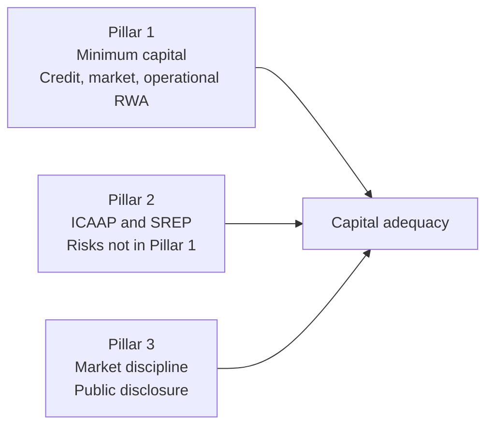

## 1. Why capital exists

A bank funds long, illiquid, credit-risky assets with short, redeemable liabilities. Capital is the layer of funding that absorbs losses without triggering default to depositors — permanent, subordinated, and able to take a hit while the bank continues operating.

$$
\text{Loss distribution} \;\rightarrow\;
\underbrace{\text{Expected loss}}_{\text{provisions, priced into margin}}
\;+\;
\underbrace{\text{Unexpected loss}}_{\text{capital}}
\;+\;
\underbrace{\text{Catastrophic}}_{\text{beyond the confidence level}}
$$

| Layer | Absorbed by | Framework |
|---|---|---|
| Expected loss | Provisions and net interest margin | Ind AS 109 ECL |
| Unexpected loss | Regulatory capital | Basel |
| Catastrophic loss | Resolution, bail-in, failure | Recovery and resolution planning |

**The division of labour is the thing to hold onto.** Provisions cover what you expect to lose; capital covers how much worse than expected it can get at a stated confidence level. Basel's IRB framework sets that confidence at 99.9% over one year — a once-in-a-thousand-years annual loss.

:::mental-model
Capital is not a pot of money sitting in a vault. It is a statement about the *composition of the liability side* — how much of the funding is loss-absorbing rather than repayable. A bank with a 15% capital ratio has not set aside 15%; it has funded 15% of its risk-weighted assets with claims that rank behind depositors.
:::

## 2. Basel evolution

| Accord | Year | Core change | Weakness exposed |
|---|---|---|---|
| Basel I | 1988 | First risk weighting — four crude buckets; 8% minimum | Arbitrage: all corporates at 100% regardless of quality |
| Basel II | 2004 | Three pillars; SA using external ratings; IRB using internal models; operational risk added | Model risk; procyclicality; too little capital of adequate quality |
| Basel II.5 | 2009 | Stressed VaR, securitisation charges, IRC | Emergency patch to the trading book |
| Basel III | 2010–11 | Quality and quantity of capital raised; buffers; leverage ratio; LCR and NSFR | Excessive RWA variability across banks |
| Basel III finalisation | 2017 | Revised SA, constrained IRB, SMA for operational risk, **output floor**, revised CVA | Implementation timing across jurisdictions |

The 2017 package is widely called "Basel IV" by the industry and "the finalisation of Basel III" by the Committee. The naming argument matters because the substance is large: it constrains internal models heavily and puts a floor under modelled RWA.

**The arc across forty years** runs in one direction — from crude buckets, to trusting banks' own models, to distrusting those models and fencing them in. Basel II said *your model knows your risk best*. The finalisation says *your model may not go below 72.5% of what the standardised approach would give*.

## 3. The three pillars

| Pillar | Content | Who acts |
|---|---|---|
| 1 | Formula-driven minimum for credit, market and operational risk | Bank computes, supervisor prescribes |
| 2 | Bank's own assessment of all material risks — ICAAP; supervisor's review — SREP | Bank assesses, supervisor challenges and may add capital |
| 3 | Standardised public disclosure of risk and capital | Bank discloses, market disciplines |

Pillar 1 is deliberately incomplete. Concentration risk, interest rate risk in the banking book, strategic risk, reputational risk, pension risk and model risk carry no Pillar 1 charge — they live in Pillar 2. A bank whose capital planning stops at the Pillar 1 minimum has not done capital planning.

## 4. The capital ratio

$$
\text{Capital ratio} = \frac{\text{Eligible regulatory capital}}{\text{Risk-weighted assets}}
$$

$$
\text{RWA} = \text{Credit RWA} + \text{Market RWA} + \text{Operational RWA}
$$

Market and operational risk are expressed as capital charges first, then grossed into RWA:

$$
\text{RWA}_{\text{market, op}} = \text{Capital charge} \times 12.5
\qquad \text{since } \frac{1}{0.08} = 12.5
$$

| Ratio | Numerator |
|---|---|
| CET1 ratio | CET1 capital |
| Tier 1 ratio | CET1 + AT1 |
| Total capital ratio (CRAR) | CET1 + AT1 + Tier 2 |

The denominator is where most of the work sits. Credit RWA typically dominates a commercial bank's total — often 75–85% — which is why the credit sections of this document carry the most weight.

## 5. Scope of application

| Level | Basis | Purpose |
|---|---|---|
| Solo | The bank alone | Protects depositors of the legal entity |
| Consolidated | Bank plus subsidiaries | Captures group-wide risk |
| Sub-consolidated | Intermediate holding levels | Large groups |

| Entity type | Treatment |
|---|---|
| Banking and financial subsidiaries | Consolidated line by line |
| Insurance subsidiaries | Generally deducted, not consolidated |
| Significant minority investments in financials | Threshold deduction |
| Commercial subsidiaries | Deducted or risk-weighted above threshold |

Double counting of capital across a group is the concern the rules exist to prevent — the same rupee of equity supporting risk in a parent and again in a subsidiary.

## 6. The capital stack

<svg viewBox="0 0 620 300" xmlns="http://www.w3.org/2000/svg">
  <rect x="120" y="30" width="380" height="70" stroke="currentColor" stroke-width="1.6" fill="none"/>
  <text x="310" y="60" fill="currentColor" font-size="14" text-anchor="middle">Tier 2</text>
  <text x="310" y="82" fill="currentColor" font-size="11" text-anchor="middle">gone-concern — absorbs loss in liquidation</text>
  <rect x="120" y="105" width="380" height="70" stroke="currentColor" stroke-width="1.6" fill="none"/>
  <text x="310" y="135" fill="currentColor" font-size="14" text-anchor="middle">Additional Tier 1</text>
  <text x="310" y="157" fill="currentColor" font-size="11" text-anchor="middle">going-concern — perpetual, discretionary coupon</text>
  <rect x="120" y="180" width="380" height="90" stroke="currentColor" stroke-width="2.4" fill="none"/>
  <text x="310" y="215" fill="currentColor" font-size="14" text-anchor="middle">Common Equity Tier 1</text>
  <text x="310" y="237" fill="currentColor" font-size="11" text-anchor="middle">highest quality — equity and reserves</text>
  <text x="310" y="256" fill="currentColor" font-size="11" text-anchor="middle">absorbs loss first, permanently</text>
  <line x1="60" y1="270" x2="60" y2="30" stroke="currentColor" stroke-width="1.4"/>
  <text x="34" y="150" fill="currentColor" font-size="12" text-anchor="middle" transform="rotate(-90 34 150)">loss absorption</text>
  <path d="M 60 30 l -5 8 l 10 0 z" fill="currentColor"/>
</svg>

The ordering is a loss-absorption hierarchy. CET1 takes losses first, continuously, while the bank operates. AT1 takes losses at a trigger point but still on a going-concern basis. Tier 2 absorbs only in liquidation or at the point of non-viability.

## 7. Common Equity Tier 1

| Component | Note |
|---|---|
| Paid-up ordinary share capital | Must be the most subordinated claim |
| Share premium on those shares | |
| Statutory reserves | India: Section 17 Banking Regulation Act transfer |
| Capital reserves | From sale of assets |
| Revenue and other disclosed reserves | Retained earnings |
| Accumulated OCI | Subject to prudential filters |
| Minority interest in consolidated banking subsidiaries | Only the portion supporting subsidiary risk |

**Fourteen criteria** define CET1, but three carry the weight: the claim is the most subordinated in liquidation, the principal is perpetual with no repayment expectation, and distributions are fully discretionary and non-cumulative — no obligation ever crystallises.

Interim profits count only when reviewed or audited and net of foreseeable dividends and charges. Proposed dividends are deducted even before approval, because the capital is not genuinely available if it is on its way out.

## 8. Additional Tier 1

| Feature | Requirement |
|---|---|
| Maturity | Perpetual — no maturity date |
| Call | Earliest at 5 years, supervisor approval, no expectation created |
| Coupon | Fully discretionary, non-cumulative; cancellation is not default |
| Loss absorption | Write-down or conversion at a **CET1 trigger** (commonly 5.125%) |
| PONV | Write-down or conversion at the **point of non-viability**, at supervisor discretion |
| Step-ups | Prohibited |
| Distributions payable from | Distributable items; blocked if buffers are breached |

Two loss-absorption mechanisms operate independently. The **CET1 trigger** fires mechanically when the ratio falls below the contractual level. The **PONV clause** fires when the supervisor determines the bank is non-viable without a write-off — no ratio needs to be breached.

**The Indian AT1 experience is essential context and a likely interview probe.** In the 2020 YES Bank reconstruction, AT1 bonds were written down in full while equity holders retained a residual interest. The resulting litigation and the RBI's subsequent tightening of AT1 valuation and distribution norms for mutual funds made the Indian AT1 market materially more cautious. The technical lesson: AT1 is going-concern loss-absorbing capital, and investors who priced it as a high-yield bond mispriced the instrument.

## 9. Tier 2

| Feature | Requirement |
|---|---|
| Maturity | Minimum 5 years original |
| Amortisation | Straight-line in the final 5 years for capital recognition |
| Call | Earliest at 5 years, supervisor approval |
| Coupon | Not discretionary; cumulative permitted |
| Subordination | To depositors and general creditors |
| PONV | Required |

| Eligible item | Note |
|---|---|
| Subordinated debt meeting the criteria | The main component |
| General provisions / loan-loss reserves | **Capped**: 1.25% of credit RWA under SA |
| Excess of provisions over IRB expected loss | Capped at 0.6% of credit IRB RWA |
| Revaluation reserves | Subject to discount where applicable |

The amortisation rule matters commercially: a 10-year Tier 2 bond counts fully for five years, then loses 20% of recognition each year. Treasury teams plan refinancing around that cliff, not around the legal maturity.

## 10. Regulatory adjustments and deductions

Applied almost entirely to CET1, which is the point — they remove items that would not absorb loss in practice.

| Deduction | Rationale |
|---|---|
| Goodwill and other intangibles | No realisable value in stress |
| Deferred tax assets relying on future profitability | Worthless precisely when needed |
| Cash flow hedge reserve | Artificial volatility on items not fair-valued |
| Shortfall of provisions to IRB expected loss | Under-provisioning is a capital hole |
| Gain on sale from securitisation | Unearned |
| Own-credit gains on fair-valued liabilities | Profit from your own deterioration |
| Defined benefit pension fund net assets | Not freely available to the bank |
| Investments in own shares | Circular capital |
| Reciprocal cross-holdings in financials | Double counting across the system |
| Non-significant investments in financials | Above 10% of CET1 |

**Threshold deductions.** Three items receive limited recognition rather than full deduction: significant investments in the common shares of unconsolidated financials, mortgage servicing rights, and DTAs from temporary differences. Each is deducted above 10% of CET1 individually, and the aggregate is deducted above 15% of CET1. Amounts retained below the thresholds are risk-weighted at 250%.

DTA treatment splits by origin, and this is examined: DTAs arising from **carry-forward losses** are deducted in full, while DTAs from **temporary differences** get threshold treatment. Indian banks carrying large accumulated losses have found the first category a meaningful drag on CET1.

## 11. Minimum ratios and the full requirement

| Requirement | Basel III | RBI |
|---|---|---|
| CET1 minimum | 4.5% | **5.5%** |
| Tier 1 minimum | 6.0% | **7.0%** |
| Total capital minimum | 8.0% | **9.0%** |
| Capital conservation buffer (CET1) | 2.5% | 2.5% |
| CET1 including CCB | 7.0% | **8.0%** |
| Total capital including CCB | 10.5% | **11.5%** |

India runs one percentage point above Basel minimums on CET1 and total capital. This is one of the most cited RBI divergences and is worth stating precisely, with the reason: a deliberately more conservative stance given the structure of the Indian banking system.

$$
\text{AT1 headroom} = \text{Tier 1 min} - \text{CET1 min}
\qquad
\text{Tier 2 headroom} = \text{Total min} - \text{Tier 1 min}
$$

Under RBI minimums that is 1.5% for AT1 and 2.0% for Tier 2. A bank may fill those slots with cheaper instruments — but only those slots. CET1 shortfalls cannot be filled with anything else.

## 12. Buffers

| Buffer | Range | Purpose | Held in |
|---|---|---|---|
| Capital conservation (CCB) | 2.5% | Absorb stress without breaching minimums | CET1 |
| Countercyclical (CCyB) | 0–2.5% | Lean against credit booms | CET1 |
| D-SIB surcharge | Bucketed | Systemic importance, domestic | CET1 |
| G-SIB surcharge | 1.0–3.5% | Systemic importance, global | CET1 |

**CCyB** is set by the national authority based on credit-to-GDP gap and other indicators, and applies to exposures in that jurisdiction. A bank's requirement is the weighted average across the jurisdictions where its private-sector credit exposures sit. The RBI has retained the framework with the rate set at zero for extended periods — the framework being active is not the same as the rate being positive.

**D-SIBs in India** are identified annually by the RBI and placed in buckets carrying an additional CET1 surcharge. The identified institutions have been State Bank of India, ICICI Bank and HDFC Bank, with bucket allocation and surcharge published each year. Confirm the current bucket allocation before quoting a number.

## 13. The capital conservation constraint

Buffers are not minimums — they are a usable layer, but using them restricts distributions. The bank keeps operating; it stops paying out.

| CET1 within the CCB range | Minimum earnings retention |
|---|---|
| First quartile of the buffer | 100% |
| Second quartile | 80% |
| Third quartile | 60% |
| Fourth quartile | 40% |
| Above the buffer | 0% |

Restrictions apply to dividends, share buybacks, discretionary bonuses **and AT1 coupons**. That last item is the link between capital planning and the AT1 market: a bank operating close to its buffer creates real coupon-cancellation risk for AT1 holders, which repricesing the instrument long before any trigger is approached.

$$
\text{Maximum distributable amount} = \text{Eligible earnings} \times (1 - \text{retention factor})
$$

:::mental-model
The buffer is designed to be spent. A bank that refuses to dip into it during stress — deleveraging instead to protect the ratio — is doing exactly what the framework was built to prevent. The constraint on distributions is the price of using it, and that price is intentional.
:::

## 14. Credit RWA — the two approaches

| | Standardised (SA) | Internal Ratings Based (IRB) |
|---|---|---|
| Risk weights from | Regulatory tables, external ratings | Bank's own PD, and LGD/EAD under A-IRB |
| Approval needed | No | Yes, supervisory approval |
| Data requirements | Modest | Extensive, multi-year |
| Risk sensitivity | Low to moderate | High |
| Typical outcome | Higher RWA | Lower RWA — the incentive to adopt |
| Constrained by | — | Input floors and the output floor |

$$
\text{RWA}_{\text{SA}} = \text{Exposure} \times \text{Risk weight}
\qquad
\text{RWA}_{\text{IRB}} = K \times 12.5 \times \text{EAD}
$$

**F-IRB** — the bank supplies PD; the supervisor prescribes LGD, EAD and maturity. **A-IRB** — the bank supplies PD, LGD, EAD and effective maturity.

The Basel III finalisation restricts A-IRB substantially: it is no longer available for exposures to banks and other financial institutions, or to large corporates above a revenue threshold, and equity exposures move to the standardised approach entirely. The direction is unambiguous — modelling is being pushed back toward portfolios where data is genuinely abundant, meaning retail.

**Indian position.** RBI has kept scheduled commercial banks on the standardised approach for credit risk; IRB approval was opened for application but has not become the operating norm. Do not assume an Indian bank is on IRB. Confirm the current supervisory position before asserting it in an interview.

## 15. Standardised approach — exposure classes and risk weights

| Exposure class | Indicative risk weight |
|---|---|
| Sovereign — domestic currency, own sovereign | 0% |
| Sovereign — foreign, by rating | 0% to 150% |
| Banks | By rating or by SCRA grade |
| Corporates — rated | 20% to 150% |
| Corporates — unrated | 100% |
| Corporate SME | Preferential treatment where criteria met |
| Regulatory retail | 75% |
| Residential mortgage | By loan-to-value; lower for low LTV |
| Commercial real estate | Higher, LTV-dependent |
| Past due, unsecured portion | 100% to 150% by provision coverage |
| Consumer credit / unsecured personal | Elevated in India — see below |
| Equity | 250% and above |
| Other assets | 100% |

**Regulatory retail** requires four conditions together: an individual or small business counterparty, a qualifying product type, granularity (no single exposure above a specified share of the pool), and an absolute size cap. Fail any one and the exposure leaves the 75% bucket.

**The Indian overlay to know.** In November 2023 the RBI raised risk weights on unsecured consumer credit — personal loans and credit card receivables — above the standard level, and increased the weight on bank exposures to NBFCs where the externally rated weight was below 100%. Part of that NBFC increase was subsequently restored in 2025. Both the direction and the partial reversal should be confirmed against current RBI circulars before use; the underlying point stands regardless — **RBI actively uses risk weights as a macroprudential lever**, not only as a risk-sensitivity device.

## 16. External ratings and ECAI mapping

| Element | Position |
|---|---|
| Eligible rating agencies | Accredited by the supervisor; in India, RBI-recognised ECAIs |
| Mapping | Agency scales mapped to standard risk-weight buckets |
| Solicited vs unsolicited | Unsolicited ratings generally not usable |
| Multiple ratings | Two ratings: the higher risk weight. Three or more: the higher of the best two |
| Issue vs issuer rating | Specific issue rating preferred; strict rules on inference |
| Rating of a senior claim | Cannot be applied to a subordinated claim |
| Cliff effects | A downgrade can jump the weight several buckets |

The Basel III finalisation adds **due diligence**: a bank may not simply take the external rating. It must perform its own assessment, and where that assessment indicates higher risk than the rating implies, it must apply the higher risk weight. The rating is a ceiling on optimism, not a substitute for analysis.

For jurisdictions that do not permit external ratings, the finalisation provides a **Standardised Credit Risk Assessment Approach (SCRA)** for bank exposures — Grades A, B and C based on published capital ratios and buffers rather than ratings.

## 17. Credit risk mitigation

| Technique | Effect |
|---|---|
| Eligible financial collateral | Reduces exposure |
| Guarantees | Substitutes the guarantor's risk weight |
| Credit derivatives | Substitutes the protection seller's risk weight |
| On-balance-sheet netting | Reduces exposure where enforceable |

**Two collateral methods.**

*Simple approach* — substitute the collateral's risk weight for the covered portion, subject to a 20% floor in most cases.

*Comprehensive approach* — adjust both exposure and collateral for volatility:

$$
E^{*} = \max\Big\{0,\; E(1 + H_e) - C(1 - H_c - H_{fx})\Big\}
$$

| Symbol | Meaning |
|---|---|
| $E$ | Current exposure |
| $C$ | Collateral value |
| $H_e$ | Haircut on the exposure |
| $H_c$ | Haircut on the collateral |
| $H_{fx}$ | Currency mismatch haircut |

Haircuts scale with volatility, residual maturity, and the holding period assumed for close-out. A maturity mismatch — collateral or protection maturing before the exposure — receives only partial recognition, and no recognition at all where the residual maturity is under one year.

**Operational requirements are as binding as the arithmetic.** Legal enforceability of the security, absence of material positive correlation between collateral value and obligor quality, timely liquidation rights, and documented valuation. Collateral that fails any of these is worth zero for capital regardless of its market value — a routine finding in Indian implementations where documentation and perfection are incomplete.

## 18. Off-balance-sheet exposures

$$
\text{Credit equivalent} = \text{Notional} \times \text{CCF}
$$

| Item | Indicative CCF |
|---|---|
| Direct credit substitutes — financial guarantees, standby LCs | 100% |
| Sale and repurchase agreements | 100% |
| Transaction-related contingents — performance bonds | 50% |
| Trade-related contingents — documentary LCs | 20% |
| Commitments, above one year | 50% |
| Commitments, up to one year | 20% |
| Unconditionally cancellable commitments | 0% under Basel II; **raised under the finalisation** |

The move on unconditionally cancellable commitments is one of the more expensive changes in the finalisation package. Credit card limits and similar facilities sat at 0% on the argument that they can be withdrawn at will — the same argument that ECL rejects in section 15 of the ECL document, on the same evidence: banks do not in fact cancel on first deterioration.

:::mental-model
Note the symmetry. Accounting says *you are exposed for the behavioural life, so provide for it*. Capital now says *you are exposed on the undrawn limit, so hold capital against it*. Two frameworks, independently, reached the same conclusion about the same commercial reality.
:::

## 19. IRB — structure and adoption

| Requirement | Content |
|---|---|
| Rating system | Meaningful differentiation, minimum grades, annual review |
| Data history | Five years for PD; seven for LGD and EAD under A-IRB |
| Use test | The ratings must drive actual credit decisions, not just capital |
| Independent validation | Ongoing, with governance |
| Roll-out plan | Sequential adoption across portfolios |
| Permanent partial use | Limited immaterial portfolios may remain on SA |

**The use test is the provision that fails implementations.** A rating system built solely to compute capital, while credit officers decide on other grounds, does not qualify. Supervisors examine whether limits, pricing, provisioning and MI actually use the model output.

| Portfolio | Post-finalisation approach |
|---|---|
| Large corporates above the revenue threshold | F-IRB only |
| Banks and financial institutions | F-IRB only |
| Equities | SA only |
| Mid-corporate, SME, retail | A-IRB permitted |
| Specialised lending | IRB or supervisory slotting |

Input floors also apply — a PD floor of 0.05%, and LGD floors that vary by collateral type — so even a permitted model cannot produce arbitrarily low inputs.

## 20. The IRB risk-weight function

The function converts PD, LGD and maturity into a capital requirement per unit of exposure. It is a single-factor Vasicek model evaluated at the 99.9th percentile, with expected loss removed.

**Correlation** — how sensitive the exposure is to the common systematic factor:

$$
R = 0.12\,\frac{1 - e^{-50\,\text{PD}}}{1 - e^{-50}} \;+\; 0.24\left(1 - \frac{1 - e^{-50\,\text{PD}}}{1 - e^{-50}}\right)
$$

**Maturity adjustment:**

$$
b = \big(0.11852 - 0.05478\,\ln(\text{PD})\big)^{2}
$$

**Capital requirement per unit of EAD:**

$$
K = \left[\text{LGD}\cdot N\!\left(\frac{G(\text{PD})}{\sqrt{1-R}} + \sqrt{\frac{R}{1-R}}\;G(0.999)\right) - \text{PD}\cdot\text{LGD}\right] \times \frac{1 + (M - 2.5)\,b}{1 - 1.5\,b}
$$

$$
\text{RWA} = K \times 12.5 \times \text{EAD}
$$

| Element | Reading |
|---|---|
| $N(\cdot)$, $G(\cdot)$ | Standard normal CDF and its inverse |
| $G(0.999) = 3.09023$ | The 99.9% confidence level — the whole regulatory stance in one constant |
| $-\,\text{PD}\cdot\text{LGD}$ | **Subtracts expected loss** — capital covers unexpected loss only |
| Maturity term | Longer exposures carry more migration risk |

| Portfolio | Correlation $R$ |
|---|---|
| Corporate, sovereign, bank | 0.12 to 0.24, declining with PD |
| Large financial institutions | Multiplied by 1.25 |
| SME | Size adjustment reduces $R$ by up to 0.04 |
| Residential mortgage | 0.15 fixed |
| Qualifying revolving retail | 0.04 fixed |
| Other retail | 0.03 to 0.16, declining with PD |
| Retail | **No maturity adjustment** |

**Correlation falls as PD rises**, which is counterintuitive until stated properly: a weak borrower's default is driven mostly by its own circumstances, while a strong borrower defaults mainly when the whole economy does. Systematic risk, not total risk, drives the capital charge.

## 21. Expected loss, unexpected loss, and the provision comparison

$$
\text{EL} = \text{PD} \times \text{LGD} \times \text{EAD}
$$

The IRB formula subtracts EL because provisions are meant to cover it. The framework then checks whether they actually do:

| Comparison | Treatment |
|---|---|
| Eligible provisions **<** IRB EL | Shortfall deducted **100% from CET1** |
| Eligible provisions **>** IRB EL | Excess added to Tier 2, capped at 0.6% of credit IRB RWA |

The comparison is between accounting provisions and a **Basel EL built on TTC PD and downturn LGD**. Those parameters are calibrated differently from the ECL parameters (see the ECL document, section 4), so the two figures will not agree — and the difference lands in capital.

This is the exact junction between the ECL document and this one, and a favourite interview question. State it as a chain: ECL sets the provision → the provision is compared to Basel EL → any shortfall is a CET1 deduction → CET1 is the numerator of the ratio.

## 22. Worked RWA — SA against IRB

A corporate term exposure. EAD ₹100 crore. PD 1.00%, LGD 45%, effective maturity 2.5 years.

**Standardised approach**

| Rating | Risk weight | RWA |
|---|---|---|
| AAA to AA | 20% | ₹20.00 crore |
| A | 50% | ₹50.00 crore |
| BBB to BB | 100% | ₹100.00 crore |
| Unrated | 100% | ₹100.00 crore |
| Below B | 150% | ₹150.00 crore |

**IRB (F-IRB), step by step**

Correlation:

$$
\frac{1 - e^{-0.5}}{1 - e^{-50}} = \frac{0.393469}{1.000000} = 0.393469
$$

$$
R = 0.12(0.393469) + 0.24(0.606531) = 0.047216 + 0.145567 = 0.192784
$$

Maturity adjustment, with $\ln(0.01) = -4.60517$:

$$
b = \big(0.11852 + 0.252271\big)^{2} = (0.370791)^{2} = 0.137486
$$

$$
\frac{1 + (2.5 - 2.5)b}{1 - 1.5(0.137486)} = \frac{1}{0.793771} = 1.259807
$$

Conditional default probability, with $G(0.01) = -2.32635$ and $G(0.999) = 3.09023$:

$$
\frac{-2.32635}{\sqrt{0.807216}} + \sqrt{\frac{0.192784}{0.807216}} \times 3.09023
= -2.58929 + 1.51019 = -1.07910
$$

$$
N(-1.07910) = 0.14027
$$

Capital requirement:

$$
K = \big[0.45(0.14027) - 0.01(0.45)\big] \times 1.259807
= (0.063122 - 0.004500) \times 1.259807 = 0.073852
$$

$$
\text{RWA} = 0.073852 \times 12.5 \times 100 = \textbf{₹92.32 crore}
\qquad
\text{Risk weight} = \textbf{92.32\%}
$$

| Approach | RWA | Capital at 9% |
|---|---|---|
| SA, unrated | ₹100.00 crore | ₹9.00 crore |
| IRB | ₹92.32 crore | ₹8.31 crore |

**Read the comparison carefully.** At PD 1% the IRB saving is modest. The saving is large on *high-quality* exposures — an AAA corporate at PD 0.03% produces an IRB risk weight in the mid-teens against 20% on SA, and a strong retail mortgage book far below its SA weight. That asymmetry, aggregated across a balance sheet, is precisely what the output floor exists to cap.

## 23. Counterparty credit risk — SA-CCR

Derivatives create exposure that is bilateral and moves with the market. SA-CCR replaced the older current exposure method.

$$
\text{EAD} = 1.4 \times (\text{RC} + \text{PFE})
$$

| Component | Meaning |
|---|---|
| RC — replacement cost | Current mark-to-market, net of eligible collateral |
| PFE — potential future exposure | Add-on for future movement, by asset class, with netting recognition |
| 1.4 | Alpha factor — calibration for model risk and correlation |

Add-ons are computed per asset class — interest rate, FX, credit, equity, commodity — with hedging set recognition inside each class and limited offset across them. Margined netting sets use a shorter margin period of risk, which reduces PFE materially and is a direct capital incentive to clear and to margin.

**Wrong-way risk** — exposure rising as the counterparty's credit deteriorates — receives specific treatment. The textbook case is buying credit protection on an entity from a counterparty in the same group or sector.

## 24. CVA capital

Credit valuation adjustment is the mark-to-market loss from deterioration in a derivative counterparty's credit quality, short of default. Two thirds of counterparty credit losses in the 2008 crisis came from CVA rather than actual defaults, which is why a standalone charge exists.

| Approach | Availability |
|---|---|
| Basic Approach (BA-CVA) | Default; reduced and full versions |
| Standardised (SA-CVA) | Requires supervisory approval; sensitivities-based |
| Materiality exemption | Small derivative books may be exempt |

Centrally cleared transactions are exempt from the CVA charge, another deliberate incentive toward central clearing.

## 25. Market risk

| Approach | Content |
|---|---|
| Standardised — sensitivities-based | Delta, vega and curvature charges across risk classes |
| Default risk charge | Jump-to-default in the trading book |
| Residual risk add-on | Exotic and non-linear instruments |
| Internal models approach | Expected shortfall, P&L attribution, desk-level approval |

The finalisation package (FRTB) redraws the **trading book / banking book boundary** to stop the arbitrage of holding an instrument in whichever book gives the lower charge, and makes reclassification between the books extremely difficult once assigned.

Market risk is typically a small share of a commercial bank's total RWA — the dominant components are credit and operational. Treat this section as orientation; a trading-focused role would need a document of its own.

## 26. Operational risk — SMA

The finalisation replaced BIA, TSA and AMA with a single **Standardised Measurement Approach**.

$$
\text{Operational risk capital} = \text{BIC} \times \text{ILM}
$$

**Business Indicator Component.** The Business Indicator sums three parts — the interest, leases and dividend component, the services component, and the financial component — and marginal coefficients apply by bucket:

| Bucket | Business Indicator | Marginal coefficient |
|---|---|---|
| 1 | Up to €1 bn | 12% |
| 2 | €1 bn to €30 bn | 15% |
| 3 | Above €30 bn | 18% |

**Internal Loss Multiplier**, where the Loss Component is 15 times average annual operational losses over ten years:

$$
\text{ILM} = \ln\!\left(e^{1} - 1 + \left(\frac{\text{LC}}{\text{BIC}}\right)^{0.8}\right)
$$

| Condition | ILM |
|---|---|
| LC = BIC | 1 — losses in line with size |
| LC > BIC | Above 1 — worse loss history increases capital |
| LC < BIC | Below 1 |
| Bucket 1, or supervisor sets ILM = 1 | 1 |

The design reintroduces loss sensitivity without permitting internal modelling: size drives the base, and the bank's own ten-year loss history scales it. National discretion allows supervisors to set ILM to 1 for all banks, which removes loss sensitivity entirely — confirm the RBI's election before assuming it applies.

## 27. Securitisation

| Approach | Hierarchy |
|---|---|
| SEC-IRBA | Where the bank has IRB models for the underlying pool |
| SEC-ERBA | External-ratings based |
| SEC-SA | Standardised, using the pool's SA capital |
| 1250% risk weight | Where none can be applied |

A 1250% risk weight is capital deduction expressed as a weight: $1250\% \times 8\% = 100\%$.

**Significant risk transfer** is the gate. A securitisation only reduces capital if risk has genuinely left the bank — retained tranches, implicit support, or clean-up calls that in substance return the risk defeat the treatment. The post-crisis rules also added a floor and a non-neutrality factor, so securitising a pool now costs more capital in aggregate than holding it, deliberately.

## 28. Leverage ratio

$$
\text{Leverage ratio} = \frac{\text{Tier 1 capital}}{\text{Exposure measure}} \;\geq\; 3\%
$$

| Exposure measure component | Treatment |
|---|---|
| On-balance-sheet assets | Accounting value, net of specific provisions |
| Derivatives | SA-CCR based, limited netting |
| Securities financing transactions | Gross with limited netting |
| Off-balance-sheet items | Notional × CCF, minimum 10% |
| Deductions from Tier 1 | Removed from the exposure measure |

**Non-risk-based by design.** No risk weights appear anywhere. It is a backstop against a bank accumulating a very large book of low-risk-weight assets — sovereign bonds, high-quality mortgages, repo — and reporting a healthy capital ratio on an enormous balance sheet.

| Constraint | Binds when |
|---|---|
| Risk-based ratio | Assets carry high average risk weights |
| Leverage ratio | Assets carry low average risk weights |

**RBI's calibration is higher than Basel's** — a minimum of 4% for domestic systemically important banks and 3.5% for other banks. Confirm the current figures before quoting.

## 29. The output floor

$$
\text{RWA}_{\text{final}} = \max\Big(\text{RWA}_{\text{internal models}},\; 72.5\% \times \text{RWA}_{\text{full standardised}}\Big)
$$

The single most consequential change in the finalisation package. A bank using internal models must also compute RWA under the standardised approach across all risk types, and its floor is 72.5% of that number, phased in over several years.

| Consequence | Detail |
|---|---|
| Caps modelled benefit | Maximum 27.5% RWA reduction versus SA |
| Dual computation | SA must be run in full even by model banks |
| Bites hardest on | Low-risk-weight portfolios — prime mortgages, high-grade corporates |
| Comparability | Restores a common denominator across banks |
| Data burden | Two complete RWA calculations, reconciled, every reporting cycle |

For an Indian bank on the standardised approach the floor is not binding — SA *is* the calculation. It matters for internationally active groups, for any future IRB migration, and for understanding why global peers' RWA density has converged.

## 30. Pillar 2 and ICAAP

The Internal Capital Adequacy Assessment Process is the bank's own answer to *how much capital do we actually need*, covering risks Pillar 1 ignores.

| Risk not in Pillar 1 | Assessed in ICAAP |
|---|---|
| Credit concentration — single name, sector, geography | Yes |
| Interest rate risk in the banking book (IRRBB) | Yes |
| Liquidity risk | Yes, qualitatively and via buffers |
| Strategic and business risk | Yes |
| Reputational risk | Yes |
| Pension obligation risk | Yes |
| Model risk | Yes |
| Residual risk in credit mitigation | Yes |

| ICAAP component | Content |
|---|---|
| Risk identification and materiality assessment | The risk inventory |
| Quantification | Economic capital or scenario-based |
| Capital planning | Three-year forward projection |
| Stress testing | Severe but plausible scenarios |
| Governance | Board approval and ownership |
| Use in decision-making | Limits, pricing, planning |

**Regulatory capital versus economic capital.** Regulatory capital is prescribed, comparable and conservative. Economic capital is the bank's own estimate, at its own confidence level aligned to its target rating, capturing diversification and concentration properly. Where economic capital exceeds regulatory, the bank should hold to the higher number — and explain, in ICAAP, why.

## 31. Supervisory review

| Element | Content |
|---|---|
| Review of ICAAP | Challenge on methodology, assumptions and governance |
| Risk assessment | Supervisor's own view of the risk profile |
| Additional capital requirement | Pillar 2 add-on where the supervisor is not satisfied |
| Capital guidance | Forward-looking, often stress-test driven |
| Other measures | Restrictions on growth, dividends, or business lines |

The RBI operates this through its **Supervisory Review and Evaluation Process**, with the risk-based supervision framework as the assessment vehicle. The outcome is not merely advisory: a supervisor can require capital above the Pillar 1 minimum and above the buffers, and that requirement is binding.

## 32. Stress testing and capital planning

$$
\text{Post-stress CET1} = \frac{\text{CET1}_0 - \text{Cumulative stressed losses} + \text{Retained earnings}}{\text{RWA}_{\text{stressed}}}
$$

Both terms move adversely under stress, which is the point that gets missed: losses reduce the numerator while risk migration inflates the denominator.

| Driver in stress | Direction |
|---|---|
| Credit losses / ECL charge | Numerator down |
| Pre-provision operating profit | Numerator up, but compressed |
| Rating downgrades and stage migration | RWA up |
| Defaulted exposures | RWA up sharply |
| Balance sheet growth or contraction | RWA either way |
| AT1 coupon cancellation | Numerator preserved |

| Scenario type | Purpose |
|---|---|
| Baseline | Business plan consistency |
| Adverse | Supervisory or internal severe-but-plausible |
| Reverse stress test | What breaks the bank — solve backwards from failure |

Capital planning ties this together over a three-to-five-year horizon: projected growth by portfolio, RWA trajectory, earnings retention, planned issuance of AT1 and Tier 2, dividend policy, and management actions available under stress with explicit assessment of whether they are credible when everyone attempts them simultaneously.

## 33. Pillar 3 disclosure

| Template family | Content |
|---|---|
| Key metrics (KM1) | Ratios, capital, RWA, leverage, LCR, NSFR |
| Overview of RWA (OV1) | RWA and minimum capital by risk type |
| Composition of capital (CC1, CC2) | Full stack, reconciled to the balance sheet |
| Credit risk quality (CR1 onward) | Exposures, provisions, mitigation, SA and IRB detail |
| Counterparty credit risk (CCR) | Methods, exposures, CVA |
| Market risk (MR) | Approach and charges |
| Operational risk (OR) | BI components and losses |
| Leverage ratio (LR1, LR2) | Reconciliation and detail |
| Remuneration | Governance and quantitative |

Frequency varies by template — quarterly, semi-annual or annual — and disclosures must be published alongside financial statements with a stated policy and internal control over their preparation.

**The reconciliation requirement (CC2) is where implementations fail.** Every regulatory capital component must tie back to a line in the published balance sheet. That means the reporting chain has to hold from source system through capital engine to disclosure, which is precisely the BCBS 239 problem and the subject of the next document.

## 34. Worked capital ratios

A bank at year end. All amounts in ₹ crore.

**Capital**

| Component | Amount |
|---|---|
| Paid-up equity and reserves | 8,600 |
| Less: goodwill and intangibles | (400) |
| Less: DTA on carry-forward losses | (200) |
| **CET1** | **8,000** |
| AT1 instruments | 1,200 |
| **Tier 1** | **9,200** |
| Tier 2 subordinated debt | 1,600 |
| General provisions (within the 1.25% cap) | 400 |
| **Total capital** | **11,200** |

**RWA**

| Risk type | RWA |
|---|---|
| Credit | 70,000 |
| Market | 8,000 |
| Operational | 12,000 |
| **Total** | **90,000** |

**Ratios**

$$
\text{CET1} = \frac{8{,}000}{90{,}000} = 8.89\%
\qquad
\text{Tier 1} = \frac{9{,}200}{90{,}000} = 10.22\%
\qquad
\text{Total} = \frac{11{,}200}{90{,}000} = 12.44\%
$$

**Against RBI requirements including the CCB**

| Ratio | Actual | Required | Headroom |
|---|---|---|---|
| CET1 | 8.89% | 8.00% | 0.89 pp |
| Tier 1 | 10.22% | 9.50% | 0.72 pp |
| Total | 12.44% | 11.50% | 0.94 pp |

CET1 headroom in rupees: $0.89\% \times 90{,}000 = $ **₹801 crore**. That is the loss the bank can absorb before distribution restrictions begin — not before it fails, which is a different and much larger number.

**Check the general provision cap.** The Tier 2 limit under SA is 1.25% of credit RWA: $1.25\% \times 70{,}000 = ₹875$ crore. The ₹400 crore included is within the cap, so it counts in full.

**Sensitivity.** If credit RWA rises 10% to ₹77,000 crore, total RWA becomes ₹97,000 crore and CET1 falls to $8{,}000 / 97{,}000 = 8.25\%$ — still above 8.00%, but headroom collapses from ₹801 crore to ₹243 crore, on no change in capital whatsoever. **The denominator is a risk in its own right**, and RWA growth is a capital event even when the balance sheet looks flat.

## 35. RBI implementation — the divergences

| Item | Basel | RBI |
|---|---|---|
| CET1 minimum | 4.5% | 5.5% |
| Total capital minimum | 8.0% | 9.0% |
| Leverage ratio | 3.0% | 4.0% D-SIB / 3.5% other |
| Credit risk approach | SA or IRB | SA in practice for scheduled commercial banks |
| Operational risk | SMA | Confirm current adoption status |
| CCyB | 0–2.5% | Framework in place, rate historically at zero |
| Consumer credit risk weights | Standard | Elevated by macroprudential action |

> The specific figures and adoption status in this section are the highest-risk content in this document and change with circulars. Confirm against the current RBI Master Circular on Basel III Capital Regulations before relying on any of them.

The pattern is consistent and worth articulating as a view rather than a list: **the RBI implements Basel conservatively, adopts advanced approaches slowly, and uses risk weights actively as a macroprudential instrument.** That combination is unusual and explains several features of Indian bank balance sheets, including comparatively high reported capital ratios against a relatively unsophisticated RWA calculation.

## 36. Indian capital instruments in practice

| Instrument | Position |
|---|---|
| Equity | Public sector banks recapitalised periodically by the government |
| AT1 (Basel III compliant perpetual bonds) | Active market, repriced after 2020 |
| Tier 2 subordinated bonds | Regular issuance, well understood |
| Recapitalisation bonds | Government mechanism for PSU banks |

The **2020 AT1 write-down** in the YES Bank reconstruction remains the defining event. Its consequences: heightened attention to the PONV clause, regulatory tightening of mutual fund exposure and valuation norms for AT1, wider spreads, and a durable investor focus on the issuer's distance from its CET1 trigger and its buffer position.

For a capital-focused role, the connected chain to be able to state fluently is: **buffer position → distribution restrictions → AT1 coupon cancellation risk → AT1 pricing and issuance capacity → the bank's ability to fill its 1.5% Tier 1 slot cheaply.** Capital structure and market access are not separate topics.

## 37. RWA data and reporting — where it goes wrong

| Failure | Consequence |
|---|---|
| Exposure classification errors | Wrong risk weight bucket applied |
| Missing or stale external ratings | Default to unrated 100% |
| Collateral failing eligibility documentation | CRM benefit lost entirely |
| Off-balance-sheet items not captured | RWA understated |
| Netting agreements not evidenced | Gross exposure used |
| Inconsistent counterparty identifiers across systems | Groups not aggregated; concentration missed |
| Manual adjustments outside the engine | Unreconcilable, unauditable |
| No reconciliation to the general ledger | Disclosure cannot be signed |

**Most RWA errors are data errors, not calculation errors.** The formulas are published and testable; the difficulty is asserting that every exposure has been captured once, classified correctly, and matched to eligible mitigation with enforceable documentation. This is the ground the next document covers, and it is where the majority of regulatory-reporting change roles actually spend their time.

## 38. The capital calculation chain

```mermaid
flowchart TD
    A[Source systems — lending, treasury, trade finance] --> B[Exposure staging and classification]
    B --> C[Enrichment — ratings, collateral, netting, guarantees]
    C --> D[Risk weight or IRB parameter assignment]
    D --> E[CRM application and off-balance-sheet conversion]
    E --> F[Credit RWA]
    F --> I[Total RWA]
    G[Market risk engine] --> I
    H[Operational risk — BIC and ILM] --> I
    I --> J[Capital ratios against requirements]
    K[Capital stack and deductions] --> J
    J --> L[Pillar 3 disclosure and regulatory returns]
    J --> M[ICAAP, stress testing, capital plan]
```

Each arrow is a reconciliation point and a control. The chain is what a regulatory reporting change programme actually modifies — a new risk weight circular, a new exposure class, a new disclosure template propagates through every box downstream of where it lands.

## 39. Capital as a management constraint

| Decision | Capital dimension |
|---|---|
| Loan pricing | Must earn a return on the capital consumed |
| Portfolio mix | Shift toward lower risk weight per unit of return |
| Growth planning | RWA growth requires capital growth |
| Dividend policy | Constrained by buffer position |
| Securitisation and risk transfer | Releases capital if risk genuinely transfers |
| Acquisition | Goodwill is a direct CET1 deduction |

$$
\text{RAROC} = \frac{\text{Revenue} - \text{Costs} - \text{Expected loss}}{\text{Capital allocated}}
$$

RAROC is the mechanism by which capital reaches the front line. An exposure that clears the credit committee but returns below the cost of the capital it consumes destroys value however it performs. Note that **expected loss is a cost line and capital is the denominator** — ECL and Basel meeting again, in a pricing formula.

## 40. Defensible under questioning

| Question | The answer that lands |
|---|---|
| Why does IRB subtract PD × LGD? | Capital covers unexpected loss; provisions cover expected loss |
| Why does correlation fall as PD rises? | Weak credits default idiosyncratically; strong credits default with the economy |
| What is 12.5? | The reciprocal of 8% — converts a capital charge into RWA |
| Where does the 99.9% come from? | $G(0.999) = 3.09$ inside the IRB formula; a one-in-a-thousand-year annual loss |
| What happens if provisions are below IRB EL? | The shortfall is deducted from CET1 in full |
| Why an output floor? | RWA variability across banks on identical portfolios; caps modelled benefit at 27.5% |
| Is the buffer a minimum? | No — usable, but using it restricts dividends, buybacks and AT1 coupons |
| Why a leverage ratio if we have risk weights? | Backstop against large books of low-risk-weight assets and model error |
| How does India differ? | CET1 5.5% and total 9% versus 4.5% and 8%; SA in practice; higher leverage minimum; active use of risk weights |
| What is Pillar 2 for? | Risks Pillar 1 ignores — concentration, IRRBB, strategic, model, pension |
| What is the alpha of 1.4 in SA-CCR? | Calibration add-on for model risk and correlation in counterparty exposure |
| How do ECL and capital connect? | Provision → compared to Basel EL → shortfall deducted from CET1 → affects the ratio |

**Three things to be able to draw without notes:** the capital stack with the loss-absorption ordering, the SA-versus-IRB comparison on one exposure, and the calculation chain from source system to ratio. Those three carry a capital-focused interview, and the third is the one that signals you have run the process rather than only studied it.
