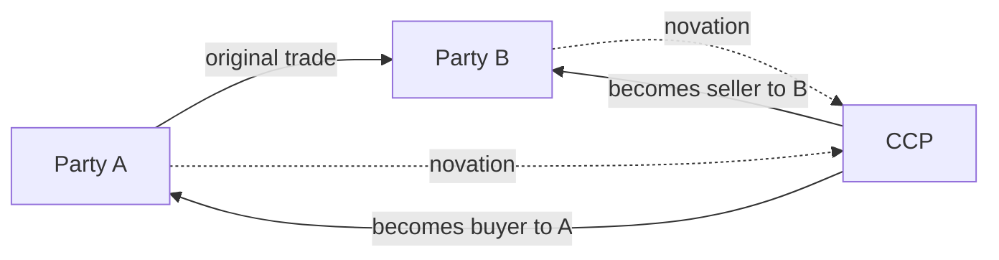
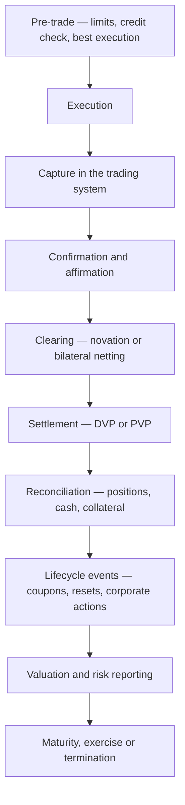

## 1. Why a risk professional needs product knowledge

Risk roles rarely require pricing a swaption. They constantly require knowing what a product *is*, what can go wrong with it, and which exposure it creates — because every capital, liquidity and provisioning treatment starts with a classification decision about the instrument.

| Task | Product knowledge required |
|---|---|
| Assign a Basel exposure class | What the instrument is, and who the counterparty is |
| Compute counterparty EAD | Whether it is margined, cleared, netted |
| Classify for HQLA | Issuer type, rating, market depth, encumbrance |
| Decide trading book or banking book | Intent, and whether the boundary rules permit it |
| Interpret a limit breach | What actually moved and why |
| Speak credibly to the front office | All of the above |

:::mental-model
The depth needed here is *recognition and consequence*, not construction. You should be able to hear a product name, state what it is in one sentence, and name the exposures it creates. Building the pricing model is someone else's job.
:::

## 2. Market structure

| Dimension | Options |
|---|---|
| Primary vs secondary | Issuance of new securities vs trading of existing ones |
| Exchange vs OTC | Standardised, centrally cleared vs bilateral, negotiated |
| Cash vs derivative | Direct ownership vs a contract referencing something else |
| Funded vs unfunded | Cash paid up front vs exposure with no initial principal |

| | Exchange-traded | OTC |
|---|---|---|
| Terms | Standardised contracts | Negotiated, bespoke |
| Counterparty | Central counterparty | The other party, or a CCP if mandated |
| Credit risk | Mutualised, margined daily | Bilateral, mitigated by CSA |
| Transparency | Public prices | Limited, improving with reporting mandates |
| Liquidity | Generally deeper | Varies enormously |
| Capital treatment | Favourable | Higher, unless cleared |

Post-crisis reform pushed standardised OTC derivatives toward central clearing, with explicit capital incentives — a cleared trade attracts a small exposure to the CCP instead of a full bilateral counterparty charge, and is exempt from the CVA capital charge.

## 3. Equities

| Instrument | Description | Holder's position |
|---|---|---|
| Ordinary shares | Residual ownership claim | Last in liquidation, unlimited upside |
| Preference shares | Priority dividend, usually no vote | Between debt and equity |
| Depositary receipts (ADR, GDR) | Foreign-listed claim on domestic shares | Cross-border access |
| Rights issue | Right to subscribe new shares at a discount | Dilution protection |
| Convertible bonds | Debt convertible into equity | Debt downside, equity upside |
| ETFs | Fund tracking an index or basket | Diversified exposure, exchange-traded |
| Index futures and options | Derivative on an index | Leverage, hedging |

**Valuation shorthand.** Market capitalisation is price times shares outstanding. Enterprise value adds net debt, which is what an acquirer actually pays for. P/E, price-to-book and dividend yield are the standard comparators; book value matters more for banks than for most sectors because the balance sheet is the business.

**Corporate actions** change the terms of what is held and are a permanent source of operational risk: dividends, bonus issues, stock splits, rights issues, buybacks, mergers, demergers. Each requires position and price adjustment across trading, settlement and risk systems on the correct date, and a missed adjustment produces a wrong position rather than a small error.

## 4. Fixed income — the instrument set

| Instrument | Issuer | Feature |
|---|---|---|
| Government securities (G-Secs) | Sovereign | Benchmark risk-free curve in domestic currency |
| Treasury bills | Sovereign | Discount instruments, under one year |
| State development loans | State governments | Small spread over G-Secs |
| Corporate bonds | Companies | Credit spread over the sovereign |
| Commercial paper | Companies | Unsecured short-term discount paper |
| Certificates of deposit | Banks | Short-term negotiable deposit |
| Floating rate notes | Various | Coupon resets against a benchmark |
| Zero coupon bonds | Various | No coupon; return is the discount |
| Perpetual bonds | Banks (AT1), corporates | No maturity |
| Covered bonds | Banks | Dual recourse — issuer plus a ring-fenced pool |
| Asset-backed / MBS | SPVs | Cash flows from a pool of assets |

| Structural feature | Effect |
|---|---|
| Callable | Issuer may redeem early — caps upside for the holder |
| Puttable | Holder may sell back early — protects the holder |
| Sinking fund | Scheduled partial redemption |
| Subordination | Ranks behind senior creditors |
| Secured | Backed by specific collateral |
| Step-up coupon | Rises on a trigger, often a downgrade |

## 5. Bond pricing and yield

$$
P = \sum_{t=1}^{n}\frac{C}{(1+y)^{t}} + \frac{F}{(1+y)^{n}}
$$

| Measure | Meaning |
|---|---|
| Current yield | Coupon ÷ price — ignores capital gain or loss |
| Yield to maturity (YTM) | Discount rate equating price to the present value of all cash flows |
| Yield to call | YTM computed to the first call date |
| Clean price | Quoted price, excluding accrued interest |
| Dirty price | What settles — clean plus accrued |

$$
\text{Accrued interest} = C \times \frac{\text{days since last coupon}}{\text{days in the coupon period}}
$$

| Relationship | Always true |
|---|---|
| Price and yield | Inverse |
| Coupon > YTM | Bond trades at a premium |
| Coupon = YTM | Bond trades at par |
| Coupon < YTM | Bond trades at a discount |
| At maturity | Price converges to par — the "pull to par" |

**YTM's assumptions** limit it: it assumes every coupon is reinvested at the YTM itself, and that the bond is held to maturity. Neither generally holds, which is why total return analysis over a horizon is used for actual investment decisions.

## 6. Duration and convexity

**Macaulay duration** — the weighted average time to receive cash flows:

$$
D_{\text{Mac}} = \frac{\sum_{t} t \cdot \dfrac{CF_t}{(1+y)^t}}{P}
$$

**Modified duration** — the price sensitivity to yield:

$$
D_{\text{mod}} = \frac{D_{\text{Mac}}}{1+y}
\qquad
\frac{\Delta P}{P} \approx -D_{\text{mod}} \times \Delta y
$$

**Second order, with convexity:**

$$
\frac{\Delta P}{P} \approx -D_{\text{mod}}\,\Delta y + \tfrac{1}{2}\,C\,(\Delta y)^{2}
$$

**Worked.** A 5-year bond, 7% annual coupon, YTM 7%, face 100. Price = 100.

| $t$ | Cash flow | DF at 7% | PV | $t \times$ PV |
|---|---|---|---|---|
| 1 | 7 | 0.934579 | 6.5421 | 6.5421 |
| 2 | 7 | 0.873439 | 6.1141 | 12.2281 |
| 3 | 7 | 0.816298 | 5.7141 | 17.1423 |
| 4 | 7 | 0.762895 | 5.3403 | 21.3611 |
| 5 | 107 | 0.712986 | 76.2893 | 381.4463 |
| | | **100.00** | | **438.7199** |

$$
D_{\text{Mac}} = \frac{438.7199}{100} = 4.3872 \text{ years}
\qquad
D_{\text{mod}} = \frac{4.3872}{1.07} = 4.1002
$$

For a 100 bp rise in yield, duration predicts $-4.1002\%$, giving a price of 95.90. The actual repriced value at 8% is **96.007**. The 0.107 difference is convexity — duration is a straight line tangent to a curve.

<svg viewBox="0 0 660 300" xmlns="http://www.w3.org/2000/svg">
  <line x1="70" y1="250" x2="620" y2="250" stroke="currentColor" stroke-width="1.4"/>
  <line x1="70" y1="30" x2="70" y2="250" stroke="currentColor" stroke-width="1.4"/>
  <text x="345" y="285" fill="currentColor" font-size="13" text-anchor="middle">Yield</text>
  <text x="36" y="140" fill="currentColor" font-size="13" text-anchor="middle" transform="rotate(-90 36 140)">Price</text>
  <path d="M 95 60 C 200 140 300 190 610 235" stroke="currentColor" stroke-width="2.5" fill="none"/>
  <text x="470" y="215" fill="currentColor" font-size="12">actual price–yield curve</text>
  <line x1="120" y1="55" x2="500" y2="255" stroke="currentColor" stroke-width="1.4" stroke-dasharray="6 4"/>
  <text x="380" y="255" fill="currentColor" font-size="12">duration (tangent)</text>
  <circle cx="270" cy="168" r="5" fill="currentColor"/>
  <text x="255" y="158" fill="currentColor" font-size="11">y₀</text>
  <text x="120" y="105" fill="currentColor" font-size="11">duration understates the gain</text>
  <text x="430" y="140" fill="currentColor" font-size="11">duration overstates the loss</text>
</svg>

**Convexity is an asset to the holder.** The curve lies above the tangent on both sides: prices rise more than duration predicts when yields fall, and fall less when yields rise. Bonds with higher convexity command a price premium for that asymmetry.

$$
\text{DV01} = P \times D_{\text{mod}} \times 0.0001
$$

On ₹100 crore face of this bond, DV01 is approximately **₹4.10 lakh** per basis point — the standard unit in which fixed income risk is limited and reported.

| Driver | Duration |
|---|---|
| Longer maturity | Higher |
| Lower coupon | Higher |
| Lower yield | Higher |
| Zero coupon | Duration = maturity, exactly |
| Callable | Lower, and negative convexity near the call |

## 7. The yield curve

| Shape | Appearance | Typical reading |
|---|---|---|
| Normal | Upward sloping | Growth expected; term premium positive |
| Flat | Little slope | Transition or uncertainty |
| Inverted | Downward sloping | Rate cuts expected; historically a recession signal |
| Humped | Peak in the middle | Mixed expectations |

| Curve concept | Definition |
|---|---|
| Spot rate | Zero-coupon yield for a single maturity |
| Par yield | Coupon that prices a bond at par for that maturity |
| Forward rate | Rate implied between two future dates |
| Bootstrapping | Deriving the zero curve from observed par instruments |

$$
(1+s_2)^2 = (1+s_1)(1+f_{1,2})
$$

| Curve movement | Description | Portfolio impact |
|---|---|---|
| Parallel shift | All tenors move together | Duration captures it |
| Steepening | Long end rises relative to short | Hurts long positions |
| Flattening | Long end falls relative to short | Helps long positions |
| Butterfly | Belly moves against the wings | Needs key-rate durations |

Duration measures only the parallel case. Non-parallel moves require **key rate duration** — sensitivity to each segment of the curve separately — which is why a portfolio can be duration-neutral and still lose on a steepening.

## 8. Credit spreads

$$
\text{Yield}_{\text{corporate}} = \text{Risk-free rate} + \text{Credit spread}
$$

| Spread measure | Definition |
|---|---|
| Nominal spread | Simple yield difference over a benchmark |
| G-spread | Spread over the interpolated government curve |
| Z-spread | Constant spread added to the zero curve that reprices the bond |
| Option-adjusted spread | Z-spread with embedded optionality removed |
| Asset swap spread | Spread over the floating benchmark after swapping to floating |

| Spread driver | Effect |
|---|---|
| Default probability | Primary |
| Expected recovery | Higher recovery, tighter spread |
| Liquidity premium | Thin issues trade wider |
| Market risk appetite | Spreads widen across the board in stress |
| Supply and demand technicals | Issuance calendars move spreads |

**Spread widening produces mark-to-market loss without any default**, which is the single most important point for a risk audience. A held-to-maturity book is insulated from that; a fair-valued book is not, and the CVA charge in the capital framework exists precisely because deterioration short of default is a real loss.

## 9. Money markets and repo

| Instrument | Tenor | Feature |
|---|---|---|
| Call money | Overnight | Uncollateralised interbank |
| Notice money | 2 to 14 days | Uncollateralised |
| Term money | Up to one year | Uncollateralised |
| Treasury bills | 91, 182, 364 days | Sovereign discount paper |
| Commercial paper | 7 days to one year | Corporate discount paper |
| Certificates of deposit | 7 days to one year | Bank issued, negotiable |
| Repo | Overnight to term | Collateralised borrowing |
| Tri-party repo | Overnight to term | Agent manages collateral |

**Repo mechanics.** A sale of securities with an agreement to repurchase at a fixed price on a fixed date. Economically it is secured borrowing; legally it is a sale and repurchase, which is what makes it robust in a counterparty default.

$$
\text{Repurchase price} = \text{Sale price} \times \left(1 + \text{repo rate} \times \frac{\text{days}}{360 \text{ or } 365}\right)
$$

| Term | Meaning |
|---|---|
| Haircut / initial margin | Collateral value exceeds cash lent |
| Repo | Borrowing cash against securities |
| Reverse repo | Lending cash against securities |
| General collateral | Any acceptable security |
| Special | A specific security in demand; rate falls below GC |
| Rehypothecation | Reuse of received collateral |

**Repo is the plumbing of the fixed income market**, and it is where liquidity crises transmit. A widening haircut is a funding withdrawal without any headline announcement: the same collateral raises less cash, and a leveraged holder must sell to fill the gap.

## 10. Foreign exchange

| Product | Description | Settlement |
|---|---|---|
| Spot | Exchange at the current rate | Usually T+2; T+1 for some pairs |
| Outright forward | Exchange at a future date, rate fixed today | On the forward date |
| FX swap | Spot leg plus a reversing forward leg | Two legs |
| Currency swap | Exchange of principal and interest in two currencies | Over the life |
| NDF | Cash-settled forward for restricted currencies | Net difference only |
| Currency options | Right to exchange at a strike | On exercise |

**Covered interest parity** determines the forward, not a view on the currency:

$$
F = S \times \frac{1 + i_{\text{domestic}}}{1 + i_{\text{foreign}}}
$$

The forward points reflect the interest rate differential. A currency with higher rates trades at a forward discount. **A forward rate is not a forecast** — it is arbitrage arithmetic, and treating it as a prediction is a common and expensive misunderstanding.

| Risk | Description |
|---|---|
| Transaction risk | Known future flows in foreign currency |
| Translation risk | Consolidating foreign subsidiaries |
| Economic risk | Competitive position affected by currency levels |
| **Settlement (Herstatt) risk** | Paying one leg before receiving the other, across time zones |

Herstatt risk is the reason CLS and payment-versus-payment settlement exist — the exposure is the full principal, not a mark-to-market difference, for the hours between the two legs.

## 11. Forwards and futures

| | Forward | Future |
|---|---|---|
| Venue | OTC, bilateral | Exchange |
| Terms | Bespoke | Standardised |
| Credit risk | Counterparty | CCP, margined |
| Cash flow | At maturity only | Daily variation margin |
| Settlement | Physical or cash | Usually cash |
| Unwind | Negotiate with the counterparty | Trade out on the exchange |

$$
F_0 = S_0\,e^{(r - q)T}
$$

where $q$ is the income yield on the underlying — dividends for equities, the foreign rate for FX, and negative for storage costs on commodities.

| Term | Meaning |
|---|---|
| Basis | Spot minus futures |
| Contango | Futures above spot |
| Backwardation | Futures below spot |
| Roll | Closing a near contract and opening the next |
| Basis risk | Hedge and exposure do not move together |

**Daily margining changes the risk profile entirely.** A forward accumulates a single large exposure to maturity; a future settles daily, so the exposure is one day's move plus the margin period of risk. That difference is why SA-CCR treats margined and unmargined netting sets differently, and why cleared trades consume far less capital.

## 12. Swaps

**Interest rate swap** — exchange of fixed for floating on a notional principal. The notional is never exchanged; only net interest flows are.

| Element | Detail |
|---|---|
| Fixed leg | Agreed rate, fixed for the term |
| Floating leg | Resets against a benchmark |
| Net settlement | Only the difference changes hands |
| Value at inception | Zero — the fixed rate is set to make it so |
| Subsequent value | Moves with the curve |

$$
V_{\text{payer swap}} = \text{PV(floating leg)} - \text{PV(fixed leg)}
$$

| Use | Mechanism |
|---|---|
| Fix a floating liability | Pay fixed, receive floating |
| Create floating from fixed | Receive fixed, pay floating |
| Manage IRRBB | Adjust the repricing profile without touching the book |
| Express a curve view | Trade the fixed rate |

| Other swap types | Description |
|---|---|
| Overnight index swap (OIS) | Floating leg is a compounded overnight rate |
| Basis swap | Floating against floating, different benchmarks |
| Cross-currency swap | Two currencies, principal usually exchanged at both ends |
| Total return swap | One leg pays the total return of an asset |
| Credit default swap | Protection against a credit event on a reference entity |

**A CDS is credit risk transfer, and it creates new counterparty risk.** Buying protection replaces exposure to the reference entity with exposure to the protection seller — a substitution, not an elimination. Wrong-way risk arises when the two are correlated, which is exactly the structure that failed in 2008.

## 13. Options — payoffs

| Position | Right or obligation | Maximum gain | Maximum loss |
|---|---|---|---|
| Long call | Right to buy | Unlimited | Premium |
| Long put | Right to sell | Strike less premium | Premium |
| Short call | Obligation to sell | Premium | **Unlimited** |
| Short put | Obligation to buy | Premium | Strike less premium |

<svg viewBox="0 0 680 250" xmlns="http://www.w3.org/2000/svg">
  <g>
    <line x1="40" y1="170" x2="300" y2="170" stroke="currentColor" stroke-width="1.2"/>
    <line x1="140" y1="40" x2="140" y2="215" stroke="currentColor" stroke-width="1.2"/>
    <path d="M 45 195 L 175 195 L 285 60" stroke="currentColor" stroke-width="2.5" fill="none"/>
    <line x1="175" y1="170" x2="175" y2="195" stroke="currentColor" stroke-width="1" stroke-dasharray="3 3"/>
    <text x="178" y="212" fill="currentColor" font-size="11">breakeven</text>
    <text x="132" y="232" fill="currentColor" font-size="11">K</text>
    <text x="170" y="30" fill="currentColor" font-size="13" text-anchor="middle">Long call</text>
  </g>
  <g>
    <line x1="380" y1="170" x2="640" y2="170" stroke="currentColor" stroke-width="1.2"/>
    <line x1="510" y1="40" x2="510" y2="215" stroke="currentColor" stroke-width="1.2"/>
    <path d="M 390 60 L 480 195 L 635 195" stroke="currentColor" stroke-width="2.5" fill="none"/>
    <line x1="480" y1="170" x2="480" y2="195" stroke="currentColor" stroke-width="1" stroke-dasharray="3 3"/>
    <text x="420" y="212" fill="currentColor" font-size="11">breakeven</text>
    <text x="503" y="232" fill="currentColor" font-size="11">K</text>
    <text x="510" y="30" fill="currentColor" font-size="13" text-anchor="middle">Long put</text>
  </g>
</svg>

$$
\text{Call payoff} = \max(S_T - K,\, 0)
\qquad
\text{Put payoff} = \max(K - S_T,\, 0)
$$

**Put-call parity** ties the four positions together and is the sanity check on any option relationship:

$$
C - P = S - K e^{-rT}
$$

| Term | Meaning |
|---|---|
| Intrinsic value | Payoff if exercised now |
| Time value | Premium less intrinsic value |
| In the money | Positive intrinsic value |
| European | Exercisable at expiry only |
| American | Exercisable any time |

**Selling options is the asymmetric position.** A short call has bounded gain and unbounded loss. Every options blow-up in market history is a variation on the same structure: collecting small, regular premiums against an exposure that appears rarely and arrives all at once.

## 14. The Greeks

| Greek | Measures | Sign for a long call |
|---|---|---|
| **Delta** ($\Delta$) | Change in option value per unit change in the underlying | 0 to +1 |
| **Gamma** ($\Gamma$) | Change in delta per unit change in the underlying | Positive |
| **Vega** ($\nu$) | Sensitivity to implied volatility | Positive |
| **Theta** ($\Theta$) | Time decay per day | Negative |
| **Rho** ($\rho$) | Sensitivity to interest rates | Positive |

| Practical reading | Consequence |
|---|---|
| Delta | Hedge ratio — how much underlying to hold against the option |
| Gamma | How fast the hedge goes stale; high near the strike, near expiry |
| Vega | Volatility is a traded quantity in its own right |
| Theta | The cost of holding optionality; the seller's income |

**Long options are long gamma and short theta.** You pay time decay every day in exchange for benefiting from large moves in either direction. Short options reverse both: steady income, sudden loss. That trade-off is the whole of options risk management in one sentence.

**Implied volatility** is the volatility that makes a pricing model return the observed market price — a quoted variable, not an estimate. The **volatility smile** (implied vol varying by strike) is the market's statement that returns are not lognormal and tails are fatter than the model assumes.

## 15. Clearing, CCPs and margin

**Novation** replaces one bilateral contract with two contracts facing the CCP. Each party's counterparty exposure becomes exposure to the CCP.

| CCP protection layer | Order of use |
|---|---|
| Defaulter's initial margin | First |
| Defaulter's default fund contribution | Second |
| CCP's own capital ("skin in the game") | Third |
| Surviving members' default fund contributions | Fourth — mutualised |
| Assessment rights / recovery tools | Last |

| Margin type | Purpose |
|---|---|
| **Initial margin** | Covers potential future exposure over the close-out period |
| **Variation margin** | Settles the daily mark-to-market move |
| Additional margins | Concentration, liquidity, wrong-way risk add-ons |

| | Cleared | Bilateral with CSA |
|---|---|---|
| Counterparty | CCP | The other party |
| Margin | Mandatory, both directions | Per the CSA terms |
| Netting | Multilateral | Bilateral only |
| Capital charge | Very low | Full counterparty charge plus CVA |
| Default management | Auction process | Bilateral close-out |

**The liquidity consequence of clearing is easily missed.** Central clearing converts credit risk into liquidity risk. Variation margin must be paid in cash, daily, whatever the market does — so a large adverse move creates an immediate cash requirement. Several institutional stress events since 2020 have been margin-call liquidity events rather than credit events.

## 16. Settlement and the trade lifecycle

| Concept | Definition |
|---|---|
| Delivery versus payment (DVP) | Securities and cash move simultaneously |
| Payment versus payment (PVP) | Both currency legs move simultaneously |
| Settlement cycle | T+1 or T+2 for most cash markets |
| Failed trade | Delivery not made on the settlement date |
| Buy-in | Forced purchase to remedy a persistent fail |

| Operational risk point | Consequence |
|---|---|
| Trade captured incorrectly | Wrong position, wrong risk, wrong P&L |
| Confirmation not matched | Dispute discovered at settlement |
| Static data wrong | Settlement fails, cash goes astray |
| Corporate action missed | Position and valuation both wrong |
| Reconciliation break unresolved | Errors accumulate silently |

**Shortening settlement cycles compresses the window for error correction.** A move from T+2 to T+1 halves the time available for matching, funding and fixing breaks, which raises the operational standard required rather than lowering the risk automatically.

## 17. Where each product creates exposure

The mapping that connects this document to every other one in the corpus.

| Product | Credit / counterparty | Market | Liquidity | Operational |
|---|---|---|---|---|
| Equity holding | Issuer, indirectly | Price | Market depth on exit | Corporate actions |
| Government bond | Sovereign | Rates | High — usually HQLA | Low |
| Corporate bond | Issuer | Rates and spread | Often thin | Coupon processing |
| Loan | Borrower | Limited if amortised cost | Illiquid; high RSF | Documentation, collateral |
| Repo (cash lender) | Counterparty, net of collateral | Collateral value | Funding source | Collateral management |
| FX spot | Settlement risk, full principal | Currency | Deep in majors | Time-zone settlement |
| FX forward | Counterparty, over the life | Currency and rates | Rollover requirement | Confirmation |
| Interest rate swap | Counterparty, bilateral or CCP | Rates | Margin calls | Reset processing |
| CDS (protection buyer) | Protection seller | Spread | Margin calls | Credit event determination |
| Exchange future | CCP, minimal | Underlying | **Daily variation margin in cash** | Roll management |
| Option (bought) | Writer, if OTC | Underlying, vol, time | Premium paid up front | Exercise processing |
| Option (written) | Limited | **Unbounded on the short call** | Margin calls | Assignment |
| Undrawn commitment | Borrower, on drawdown | Limited | **Drawdown risk in stress** | Limit monitoring |

:::mental-model
Read the table by column, not by row. The same product appears in the capital calculation, the LCR, the NSFR and the operational risk loss data — each framework looking at a different column. A product is not "a credit product" or "a market product"; it is a bundle of exposures that different rulebooks pick up separately.
:::

## 18. Indian market infrastructure

| Market | Venue / platform | Clearing |
|---|---|---|
| Equities | NSE, BSE | Exchange clearing corporations |
| Government securities | NDS-OM and OTC | CCIL |
| Repo and tri-party repo | CCIL platforms | CCIL |
| Corporate bonds | Exchange reporting platforms, OTC | Exchange clearing |
| Currency derivatives | Exchange-traded segments | Exchange clearing |
| OTC rupee derivatives | Bilateral, with reporting | CCIL for eligible trades |
| Depositories | NSDL, CDSL | — |

| Regulator | Remit |
|---|---|
| RBI | Money market, government securities, FX, OTC rupee derivatives, banks |
| SEBI | Securities markets, exchanges, listed products, intermediaries |

| Benchmark | Use |
|---|---|
| Repo rate | Policy rate |
| MIBOR / overnight benchmark | OIS floating leg |
| Treasury bill yields | Short-end curve |
| G-Sec yields | Benchmark term structure |
| External benchmark linked lending rates | Retail and MSME loan pricing |

**CCIL's role is the structural feature to know**: it acts as central counterparty for government securities, repo and forex settlement, which means a very large share of Indian wholesale market exposure is concentrated in a single infrastructure. Equity settlement has moved to a shortened cycle, with the market having transitioned to T+1 and optional shorter settlement introduced subsequently.

> Settlement cycles, platform names and benchmark arrangements change. Confirm current market practice before relying on specifics.

## 19. Netting, CSAs and collateral

| Mechanism | Effect |
|---|---|
| Close-out netting | On default, all trades collapse to a single net amount |
| Payment netting | Same-day flows in the same currency are netted |
| Credit support annex (CSA) | Governs collateral posting against exposure |
| Threshold | Exposure tolerated before collateral is called |
| Minimum transfer amount | Avoids operationally trivial calls |
| Independent amount | Initial margin equivalent in bilateral trades |

$$
\text{Collateral call} = \max\Big(0,\; \text{Exposure} - \text{Threshold} - \text{Collateral held}\Big)
\;\;\text{if} \geq \text{MTA}
$$

**Enforceability is the whole value.** Netting reduces regulatory exposure only where a legal opinion supports enforceability in the relevant jurisdictions on insolvency. Without that opinion, gross exposure applies for capital purposes regardless of what the contract says — one of the clearest cases in the framework where a legal document, not a number, determines the capital charge.

**Collateral quality and eligibility** determine how much protection is real: cash in the trade currency is best; government securities require haircuts; anything correlated with the counterparty is close to worthless in the state where it matters.

## 20. Defensible under questioning

| Question | The answer that lands |
|---|---|
| Why does price fall when yield rises? | The cash flows are fixed; a higher discount rate lowers their present value |
| What does duration actually measure? | Price sensitivity to a parallel yield shift; it is a tangent, so convexity corrects it |
| Why is convexity valuable? | Prices rise more than duration predicts and fall less — asymmetry in the holder's favour |
| Is a forward FX rate a forecast? | No — it is the interest rate differential, arbitrage arithmetic |
| What is Herstatt risk? | Settlement risk on the full principal between the two legs of an FX trade across time zones |
| Is a swap notional exchanged? | Not on an interest rate swap — only net interest. Cross-currency swaps usually do exchange principal |
| Does buying a CDS remove credit risk? | It substitutes it — you now hold protection-seller risk, with wrong-way risk if they are correlated |
| Why do cleared trades attract less capital? | Exposure faces the CCP, is margined daily, is multilaterally netted, and is CVA-exempt |
| What does clearing do to liquidity risk? | Raises it — variation margin must be paid in cash, daily, whatever the market does |
| What is repo, legally and economically? | Legally a sale and repurchase; economically secured borrowing. The legal form is what protects on default |
| Why do widening repo haircuts matter? | The same collateral raises less cash — a funding withdrawal with no announcement |
| What makes netting count for capital? | An enforceable legal opinion in the relevant insolvency jurisdictions; without it, gross applies |
| Long options versus short options? | Long is long gamma, short theta — pay decay, benefit from large moves. Short reverses both |

**Three things to be able to draw without notes:** the price-yield curve with the duration tangent and the convexity gap, the four option payoff diagrams, and the novation diagram showing a bilateral trade becoming two trades facing a CCP.
