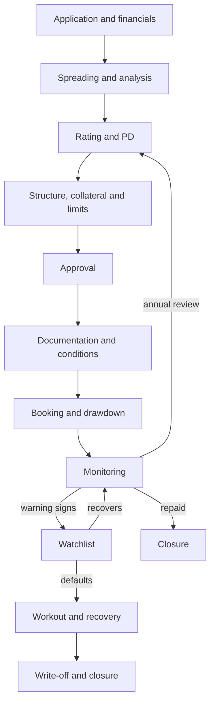

## Part 0 — The bank, the client, and your seat

Everything in this volume happens to one company and one bank, over three years. Every concept is met on that company, at the moment it first matters.

### The bank

The bank is headquartered in the United Kingdom and has a branch in India. The branch lends to mid-sized Indian companies and sells them the derivatives they use to manage interest-rate and currency risk.

Every exposure the branch holds is measured under three rulebooks at once.

| Rulebook | The question it asks | Why it applies here |
|---|---|---|
| IFRS 9 | How much of this loan should already be counted as lost? | The group's accounts are prepared under IFRS |
| Basel 3.1, as implemented in the UK | How much of the bank's own capital must stand behind it? | The group is supervised by the UK's Prudential Regulation Authority |
| The Reserve Bank of India's rules | Both questions again, India's way | The branch is licensed and supervised in India |

Volume 2 works through all three. This volume builds the numbers they all start from.

### The same client, anywhere

Nothing about how credit risk works changes at a border. The chance that a borrower fails to pay — its probability of default, or PD — means the same in London, Frankfurt, New York and Mumbai. What changes is the rulebook — which numbers a regulator demands, the parameters it fixes, and the date it starts. These are the four a credit risk analyst meets most.

| | UK | EU | US | India |
|---|---|---|---|---|
| Loan-loss accounting | IFRS 9: twelve months of expected loss, rising to the loan's whole life once credit risk has increased significantly | IFRS 9, as in the UK | CECL (current expected credit loss), under US GAAP, the US accounting rules: expected loss over the loan's whole life from day one | Banks move to expected credit loss from 1 April 2027 [verify]; non-bank lenders already apply Ind AS 109, India's version of IFRS 9 |
| Capital rules | Basel 3.1, from 1 January 2027 [verify] | CRR3 — the EU's Capital Requirements Regulation, third edition — from 1 January 2025 [verify] | Current Basel III rules; the final Basel reforms were re-proposed in March 2026 and are not yet final [verify] | The Reserve Bank of India's (RBI's) Basel III rules, with revised standardised weights planned [verify] |
| Internal models in credit risk capital | Permitted, within limits | Permitted, within limits | The re-proposal would remove them for the largest banks [verify] | No bank uses them yet [verify] |
| Supervisors | Prudential Regulation Authority | The European Central Bank (ECB) for the largest euro-area banks, national supervisors for the rest; the European Banking Authority (EBA) writes the technical standards | Federal Reserve; Office of the Comptroller of the Currency (OCC); Federal Deposit Insurance Corporation (FDIC) | Reserve Bank of India |

In the US, a bank's PD and LGD (loss given default) models do their heaviest lifting in CECL and in the Federal Reserve's annual stress tests, rather than in the capital ratio itself. Wherever a rule in this volume differs by jurisdiction, the part sets all four side by side.

None of this table needs to make sense yet. Every idea in it — loss given default, capital, internal models — is built from zero in this volume or the next. It is here so that you can see from the first page that one set of ideas travels to four places. The acronyms list at the end of each volume expands every abbreviation.

### Your seat

You are a business analyst in the bank's risk change team, at its India centre. Your programme is moving the India book onto the group's credit risk platform, and it is up against three dates.

| Date | What changes |
|---|---|
| 1 January 2027 [verify] | Basel 3.1 capital rules take effect in the UK |
| 1 April 2027 [verify] | Indian banks move to expected credit loss provisioning |
| 1 April 2027, proposed [verify] | The RBI replaces its method for measuring derivative exposure with SA-CCR, the standardised approach Part 6 explains |

The platform does four things. It collects every fact about every borrower, facility, piece of collateral and trade. It computes risk numbers from those facts. It checks the numbers against limits. And it feeds them into provisions, capital and reports.

A requirement written for a machine whose numbers you cannot produce yourself is a guess. So this volume produces every number the machine will compute about one client — by hand, in the order the machine needs them.

### The client

A mid-sized manufacturer of auto components: gear assemblies and castings sold to vehicle makers. Revenue of ₹800 crore last year. A solid, unremarkable, cyclical business — when people buy fewer vehicles, it sells fewer parts.

On day one it signs three things with the bank.

| Facility | Size | Terms | What the manufacturer uses it for |
|---|---|---|---|
| Term loan | ₹100 crore | Five years. All principal repaid at the end. Interest paid quarterly at the benchmark rate plus 2.50%; the benchmark resets once a year | Repaying ₹100 crore it owes another bank, at a better price |
| Revolving credit facility (RCF) | ₹50 crore limit, ₹20 crore drawn on day one | For five years it can draw, repay and draw again at will. Interest on the drawn amount only, at benchmark plus 2.50%, added to the balance | Paying suppliers and wages before its own customers pay |
| Interest rate swap | ₹100 crore notional | Five years. Once a year the manufacturer pays a fixed 7.50% on ₹100 crore and receives the benchmark rate on ₹100 crore | Fixing the cost of its floating-rate term loan |

The benchmark is 7.50% on day one, so the term loan costs 10.00%. The swap is why that 10.00% never changes, whatever rates do.

| Per year, % of ₹100 crore | The manufacturer |
|---|---|
| Term loan interest | pays benchmark + 2.50 |
| Swap, fixed side | pays 7.50 |
| Swap, floating side | receives benchmark |
| **Net cost** | **pays 10.00, whatever the benchmark does** |

The two benchmark lines cancel. For the manufacturer, the swap is a hedge. For the bank, it is a second and quite different kind of exposure to the same company — Part 6 is about it. In year two a fourth item arrives: a currency forward.

### The book

The manufacturer is one of 20 borrowers in the branch's mid-corporate book, spread across 17 sectors. Four of the 20 are in the auto sector. Part 7 lays out the whole book.

### Four dates

| | When | What happens |
|---|---|---|
| T0 | Day one | Facilities signed; ₹20 crore of the RCF drawn; benchmark 7.50% |
| T1 | End of year 1 | Annual review; results in line; benchmark 7.00% |
| T2 | End of year 2 | Vehicle demand falls; sales down 10%; covenants breached; downgraded — with every payment still on time; benchmark 6.50% |
| T3 | End of year 3 | Interest unpaid for more than 90 days: default; benchmark 6.00% |
| After | Years 4 and 5 | The collateral is sold and the real loss is counted |

### How the volume runs

Parts 1 to 6 build the numbers on the manufacturer at T0 and T2: what credit risk is (Part 1), what its financial statements say (Part 2), how likely it is to default (Part 3), how much it would owe (Part 4), how much of that would be lost (Part 5), and the swap, whose exposure moves with markets (Part 6). Part 7 multiplies them into expected and unexpected loss and widens out to the whole book. Part 8 is how the bank runs the book — appetite, limits, approvals and early warning. Part 9 is the default, and the real bill.

Each part closes with **On your desk** — the data, rules and decisions the concept creates for a business analyst — and three checks.

All amounts are ₹ crore unless stated. One crore is ten million; one lakh is one hundred thousand; ₹1 crore is ₹100 lakh.

---

## Part 1 — What credit risk is

### A loan is a promise

A bank lends ₹100 crore today. The borrower promises to pay interest every quarter and the ₹100 crore back at the end. From that moment, what the bank owns is not money. It owns a promise to pay money.

**Credit risk** is the risk that the promise is not kept — not in full, or not on time.

The interest rate on a loan pays for three things: what the money costs the bank, what running the loan costs the bank, and the chance the promise breaks. This subject is the third.

### Two ways to lose

**Default.** The borrower stops paying. The bank then collects what it can — by selling the collateral, by claiming in the insolvency — and the gap between what was owed and what comes back is the loss. This is the manufacturer at T3.

**Deterioration.** The borrower has missed nothing, but its chance of failing has risen. The loan now carries more risk at the same price, so it is worth less than on the day it was made. The bank must set more aside against it and hold more capital behind it, and both hit results before a single payment is missed. This is the manufacturer at T2.

Most of the work in credit risk happens between those two: seeing deterioration early enough to act before it becomes default.

### The forms it takes

| Form | What it is | Where it shows on the manufacturer |
|---|---|---|
| Default risk | The borrower fails to pay | All three facilities at T3 |
| Migration risk | The borrower's quality slides | Downgraded three grades at T2 (Part 3) |
| Exposure risk | How much will be owed at default is not known in advance | The RCF, drawn harder as trouble grows (Part 4) |
| Recovery risk | Collateral fetches less, and later, than planned | The plant and machinery (Parts 5 and 9) |
| Counterparty risk | A derivative's value turns into a claim on the client | The swap (Part 6) |
| Settlement risk | The bank pays and the other side does not deliver | The currency forward's settlement day (Part 6) |
| Wrong-way risk | Exposure grows as the borrower weakens | Rates fall in downturns, so the swap gains value for the bank just as the manufacturer weakens (Part 6) |
| Concentration risk | Too much riding on one name, sector or cause | The auto sector at its limit (Parts 7 and 8) |
| Country and transfer risk | A state stops money leaving the country | Absent here — a local borrower paying in rupees |

### The loss equation

If the manufacturer defaults, the bank loses what is owed at that moment, less whatever it later recovers, counted in today's money.

$$
\text{Loss} = EAD \times LGD
$$

where

- **EAD**, exposure at default, is the amount owed at the moment of default
- **LGD**, loss given default, is the share of that amount not recovered, after costs and after the delay in getting it

Default is not certain, so weight that loss by its likelihood.

$$
EL = PD \times LGD \times EAD
$$

where

- **EL**, expected loss, is the loss to expect on average over a year
- **PD**, probability of default, is the chance of default within the next twelve months

A toy example: a ₹10 crore loan, PD 2%, LGD 40%.

$$
EL = 0.02 \times 0.40 \times 10 = 0.08
$$

Expected loss is ₹0.08 crore, or ₹8 lakh, a year. Lend to 100 borrowers like this and about two default, each losing ₹4 crore: ₹8 crore across 100 loans, ₹0.08 crore each.

No single loan ever loses ₹8 lakh. Each one loses nothing, or ₹4 crore. Expected loss is an average that never happens to any actual loan, and the gap between the average and what does happen is **unexpected loss** — what a bank's capital exists to absorb (Part 7).

Parts 3, 4 and 5 derive the manufacturer's PD, EAD and LGD. Part 7 multiplies them.

### The life of a credit

Every exposure the bank holds travels the same loop, from application to closure or to recovery.

Each step creates data that a later number depends on, and each piece of data lives in a particular system.

| Step | What happens | Where it lives | What it produces |
|---|---|---|---|
| Application and spreading | Financial statements keyed into the bank's template | Loan origination system | Statements, ratios |
| Rating | A scorecard turns ratios and judgement into a grade | Rating system | Grade, PD, rating date |
| Structuring | Collateral taken and valued; limits sized | Collateral management system; limits system | Collateral values, charges, limits |
| Approval | Someone with enough authority signs | Credit workflow | Approver, conditions |
| Booking | Loans and trades recorded | Core banking system; treasury system for derivatives | Balances, interest, trades, market values |
| Monitoring | Covenants tested, warning signs watched, annual review | Monitoring and watchlist tools | Breach flags, watchlist status |
| Default and recovery | Arrears counted, collateral sold, balances written off | Collections and recovery system | Days past due, default date, recoveries |
| Measurement and reporting | EAD, PD, LGD, EL, provisions, capital | Credit risk platform and risk data warehouse | Every number in this volume |

### On your desk

The last row consumes every row above it. Most defects in a credit risk programme are not wrong formulas. They are right formulas fed a number from the wrong system, as at the wrong date, or under the wrong definition.

So the first artefact of any credit risk programme is this map, filled in for real: which step creates each fact, which system holds it, which date it is true at, and who owns it. Volume 3 builds it properly. Every part of this volume adds rows to it.

### Check yourself

1. At T2 the manufacturer has missed no payment. Name two ways the bank is already worse off.
2. A ₹50 crore loan has a PD of 1% and an LGD of 50%. What is its expected loss, and what will it actually lose next year?
3. The LGD of a loan depends on facts created at two different steps of the lifecycle. Which two?

Answers

1. Its probability of default has risen, so the bank must set more aside against the loan (a charge against profit) and hold more capital behind it. And the loan now earns a price that was set for a safer borrower, so it is worth less than when it was made.
2. EL = 0.01 × 0.50 × 50 = ₹0.25 crore. What it will actually lose is either nothing (a 99% chance) or ₹25 crore (a 1% chance) — never ₹0.25 crore.
3. Structuring, where collateral is taken, valued and charged; and default and recovery, where it is actually sold and the cash and costs are recorded.

---

## Part 2 — Reading the client

A bank lends against a company's ability to pay, and its financial statements are where that ability is written down. There are three of them, and each answers a different question.

### Three statements, from zero

**The income statement** is a film of one year: what the company sold, what that cost, and what was left over.

| ₹ crore | Year 0 | Year 2 | What the line means |
|---|---:|---:|---|
| Revenue | 800 | 720 | Sales |
| Operating costs | (704) | (660) | Materials, wages, power, rent |
| **EBITDA** | **96** | **60** | Operating profit before interest, tax, depreciation and amortisation |
| Depreciation | (24) | (26) | Machines wearing out, spread over their life; no cash leaves |
| EBIT | 72 | 34 | Operating profit |
| Interest | (24) | (23) | The cost of its debt |
| Profit before tax | 48 | 11 | |
| Tax | (12) | (3) | |
| **Profit after tax** | **36** | **8** | What belongs to the shareholders |

Brackets mean a deduction. Year 0 is the year just ended when the facilities are signed; Year 2 ends at T2.

**EBITDA** is the line lenders watch most. It is operating profit before the one cost that does not leave as cash this year (depreciation) and before the costs that depend on how the company is financed and taxed. It is the closest single number to the cash the business generates to pay its lenders.

**The balance sheet** is a photograph on one day: what the company owns, and who paid for it — lenders or owners.

| ₹ crore | Year 0 | Year 2 |
|---|---:|---:|
| Land and buildings | 140 | 137 |
| Plant and machinery | 170 | 164 |
| Inventory | 60 | 85 |
| Trade receivables — money customers owe it | 80 | 110 |
| Cash | 24 | 10 |
| **Total assets** | **474** | **506** |
| Borrowings — the bank's term loan | 100 | 100 |
| Borrowings — the bank's RCF | 20 | 44 |
| Borrowings — other lenders | 120 | 80 |
| Trade payables — money it owes suppliers | 50 | 70 |
| Equity | 184 | 212 |
| **Total liabilities and equity** | **474** | **506** |

The Year 0 column is shown on day one, after the term loan has repaid the old bank. The other lenders' ₹120 crore is secured on the land and buildings and is repaid at ₹20 crore a year.

Everything owned was paid for by someone, so total assets always equal liabilities plus equity. **Equity** is the owners' stake. It absorbs losses first, which is why lenders like a lot of it beneath them.

**The cash flow statement** shows where the cash actually went. Profit and cash are not the same thing, and in Year 2 the difference between them is the whole story.

| ₹ crore | Year 0 | Year 2 |
|---|---:|---:|
| EBITDA | 96 | 60 |
| Tax paid | (12) | (3) |
| Increase in working capital | (8) | (27) |
| **Cash from operations** | **76** | **30** |
| Capital expenditure | (24) | (20) |
| **Free cash flow** | **52** | **10** |
| Interest paid | (24) | (23) |
| Principal repaid to other lenders | (20) | (20) |
| Dividends | (4) | 0 |
| **Surplus or (shortfall)** | **4** | **(33)** |
| Drawn from the bank's RCF | 0 | 19 |
| Change in cash balance | +4 | (14) |

Read Year 2 from the top. Operations produced ₹60 crore of EBITDA, but ₹27 crore of it was swallowed by **working capital** — cash tied up in stock not yet sold and in invoices not yet paid — so only ₹30 crore arrived as cash. After ₹20 crore spent on equipment, ₹10 crore was free to pay lenders, against ₹43 crore falling due. The ₹33 crore gap was covered by drawing ₹19 crore more from the bank's RCF and running cash down by ₹14 crore.

A company that reports a profit of ₹8 crore and burns through ₹33 crore of cash to stay current: that is what distress looks like from the inside. And the RCF balance is where it first shows at the bank.

### The ratios

**Net debt** is borrowings less cash: 240 − 24 = 216 in Year 0, and 224 − 10 = 214 in Year 2. **Current liabilities** — what falls due within a year — are trade payables, the RCF and the other lenders' ₹20 crore instalment: 50 + 20 + 20 = 90 in Year 0, and 70 + 44 + 20 = 134 in Year 2.

| Ratio | Formula | Year 0 | Year 2 | What it reads |
|---|---|---:|---:|---|
| Leverage | Net debt ÷ EBITDA | 2.25x | 3.57x | Years of operating profit it would take to repay the debt |
| Interest cover | EBITDA ÷ interest | 4.00x | 2.61x | Times over that profit covers interest |
| Debt service cover (DSCR) | (EBITDA − tax) ÷ (interest + principal due) | 1.91x | 1.33x | Cash available per rupee of debt service due |
| EBITDA margin | EBITDA ÷ revenue | 12.0% | 8.3% | Operating profit per rupee of sales |
| Gearing | Borrowings ÷ equity | 1.30x | 1.06x | Lenders' money per rupee of owners' money |
| Current ratio | Current assets ÷ current liabilities | 1.82x | 1.53x | Short-term assets per rupee of short-term obligations |

Two of those Year 2 numbers need the working: DSCR is (60 − 3) ÷ (23 + 20) = 57 ÷ 43 = 1.33x; the current ratio is (85 + 110 + 10) ÷ 134 = 1.53x.

Two things stand out.

**The flows collapsed while the stocks improved.** Leverage, interest cover and debt service cover all worsened sharply. Gearing *improved*, from 1.30x to 1.06x, because the other lenders were repaid on schedule and retained profit added to equity. Balance-sheet ratios describe a position on a day. Cash-flow ratios describe the ability to pay. When they disagree, the flows tell the truth first.

**The squeeze is in working capital.**

| Days | Formula | Year 0 | Year 2 |
|---|---|---:|---:|
| Receivable days | Receivables ÷ revenue × 365 | 36.5 | 55.8 |
| Inventory days | Inventory ÷ revenue × 365 | 27.4 | 43.1 |
| Payable days | Payables ÷ revenue × 365 | 22.8 | 35.5 |
| **Cash conversion cycle** | Receivable + inventory − payable days | **41.1** | **63.4** |

Inventory and payable days are properly measured against the cost of goods; revenue is used here to keep a single base.

Customers took 19 days longer to pay. Unsold stock grew by 16 days of sales. The manufacturer in turn made its own suppliers wait 13 days longer. The gap between paying for inputs and being paid for outputs stretched by 22 days, and every one of those days had to be financed by someone — in the end, by the bank's RCF.

### Covenants

The loan agreement contains two **financial covenants** — promises about ratios, tested on each year's audited statements:

- leverage (net debt ÷ EBITDA) no higher than 3.00x
- interest cover (EBITDA ÷ interest) no lower than 3.00x

**Headroom** is how far EBITDA can fall before a covenant breaks. With Year 0's net debt and interest held fixed:

$$
\text{EBITDA at which leverage breaks} = \frac{216}{3.00} = 72
$$

$$
\text{EBITDA at which interest cover breaks} = 24 \times 3.00 = 72
$$

Both break at the same point. EBITDA can fall from ₹96 crore to ₹72 crore — 25% — before either is breached. That was deliberate structuring: the two covenants were set to trip together, a quarter below the case the loan was underwritten on.

In Year 2 EBITDA was ₹60 crore. Leverage was 3.57x against a maximum of 3.00x; interest cover 2.61x against a minimum of 3.00x. Both broken.

A covenant breach is an **event of default** under the loan agreement. Not a payment default — every payment was on time — but a contractual one that gives the bank the right to demand its money back. What the bank did with that right is in Part 8.

### Judgement around the numbers

Credit officers organise what numbers cannot capture under the **five Cs**.

| C | The question | For the manufacturer | Where it lands |
|---|---|---|---|
| Character | Will they pay if they can? | Twenty years in business and a clean repayment record with every lender | Management score (Part 3) |
| Capacity | Can they pay from cash flow? | DSCR 1.91x, falling to 1.33x | Financial scores (Part 3) |
| Capital | How much of the owners' money is at stake? | Equity of ₹184 crore under ₹240 crore of debt | Gearing |
| Collateral | What if they can't? | Plant, stock and receivables | LGD (Part 5) |
| Conditions | What around them could change? | A cyclical sector with few, powerful customers | Industry score (Part 3) |

### On your desk

- **Spreading.** Statements arrive as PDFs in each company's own format and are keyed — spread — into the bank's standard template. Each company line has to be mapped to a template line. Is "other income" inside EBITDA? Is a lease payment interest? Those mappings are transformation rules, and they decide every ratio downstream.
- **Covenant definitions come from the contract, not the accounting standard.** "EBITDA" in one loan agreement excludes one-off gains; in another it adds back restructuring costs. The system has to hold, per facility, the covenant type, the threshold, the test frequency and the definition it refers to — and compute covenant ratios by that definition, not by the spread's.
- **Provenance.** Audited annual, unaudited quarterly, or management accounts; the period end; the date received. Statements arriving late is itself a warning sign (Part 8).
- **Checks before use.** The balance sheet balances. The cash flow reconciles to the change in cash. Ratios are computed by the system, never keyed by hand.

### Check yourself

1. EBITDA falls to ₹80 crore with Year 0's net debt and interest unchanged. Is either covenant breached?
2. The manufacturer made ₹8 crore of profit in Year 2 yet drew ₹19 crore more from the RCF. Where did the cash go?
3. Gearing improved between Year 0 and Year 2. Why does that not mean the credit improved?

Answers

1. Leverage is 216 ÷ 80 = 2.70x against a 3.00x maximum; interest cover is 80 ÷ 24 = 3.33x against a 3.00x minimum. Neither is breached — EBITDA has fallen 16.7%, inside the 25% headroom.
2. ₹27 crore went into working capital — slower-paying customers and unsold stock — leaving ₹30 crore of operating cash. Capex of ₹20 crore left ₹10 crore against ₹43 crore of interest and principal due. The ₹33 crore gap was filled by the RCF (₹19 crore) and the cash balance (₹14 crore).
3. Gearing is a stock ratio. Debt fell because other lenders were repaid on schedule, and equity rose with retained profit. It says nothing about whether this year's cash covers this year's obligations — and debt service cover fell from 1.91x to 1.33x.

---

## Part 3 — How likely is default: the rating

### What a rating is

A **rating** is a grade that sorts borrowers by how likely they are to default. The bank's **internal rating** is its own view, produced by its own model and its own credit officers. An **external rating** from an agency such as S&P, Moody's or CRISIL is a second opinion the bank may use as one input. The internal grade is the one that drives pricing, limits, approvals, provisions and capital, so it is the one that matters here.

### The scorecard

The bank rates mid-sized companies with a **scorecard**: each factor earns points by band, and the points add up to a score out of 100.

| Factor | Maximum | Bands and points |
|---|---:|---|
| Net debt ÷ EBITDA | 25 | Up to 1.5x: 25 · 1.5x–2.5x: 19 · 2.5x–3.5x: 12 · 3.5x–4.5x: 6 · above 4.5x: 0 |
| Interest cover | 20 | 6x and above: 20 · 4x–6x: 15 · 3x–4x: 10 · 2x–3x: 5 · below 2x: 0 |
| EBITDA margin | 10 | 15% and above: 10 · 10%–15%: 7 · 6%–10%: 4 · below 6%: 1 |
| Debt service cover | 15 | 2.0x and above: 15 · 1.5x–2.0x: 11 · 1.2x–1.5x: 6 · below 1.2x: 0 |
| Management quality | 10 | Assessed by the credit officer, 0 to 10 |
| Industry outlook | 10 | Assessed by the credit officer, 0 to 10 |
| Market position | 10 | Assessed by the credit officer, 0 to 10 |

A value on a boundary takes the better band: interest cover of exactly 4.00x scores 15, not 10.

The manufacturer, on Year 0 and Year 2 figures from Part 2:

| Factor | Year 0 value | Points | Year 2 value | Points |
|---|---:|---:|---:|---:|
| Net debt ÷ EBITDA | 2.25x | 19 | 3.57x | 6 |
| Interest cover | 4.00x | 15 | 2.61x | 5 |
| EBITDA margin | 12.0% | 7 | 8.3% | 4 |
| Debt service cover | 1.91x | 11 | 1.33x | 6 |
| Management quality | | 7 | | 6 |
| Industry outlook | | 6 | | 3 |
| Market position | | 7 | | 6 |
| **Score** | | **72** | | **36** |

### From score to grade to PD

The score maps to a grade, and the grade maps to a PD through the bank's **master scale** — one table of grades and PDs used for every borrower type.

| Score | Grade |
|---|---:|
| 90 to 100 | 1 |
| 80 to 89 | 2 |
| 75 to 79 | 3 |
| 65 to 74 | 4 |
| 55 to 64 | 5 |
| 45 to 54 | 6 |
| 35 to 44 | 7 |
| 25 to 34 | 8 |
| 0 to 24 | 9 |

Grade 10 means "in default". No score produces it; the default definition does (below).

| Grade | One-year PD | Rough external equivalent | Group |
|---|---:|---|---|
| 1 | 0.05% | AA and above | Strong |
| 2 | 0.10% | A | Strong |
| 3 | 0.20% | BBB+ | Strong |
| 4 | 0.40% | BBB | Satisfactory |
| 5 | 0.80% | BBB− | Satisfactory |
| 6 | 1.60% | BB+ to BB | Satisfactory |
| 7 | 3.20% | BB− | Weak |
| 8 | 6.40% | B | Weak |
| 9 | 12.80% | CCC | Weak |
| 10 | 100% | D | Default |

Each grade doubles the PD. Grade 1's 0.05% is also the lowest PD that UK and EU capital rules allow for any corporate borrower [verify] — no company is treated as safer than that. The US re-proposal would take internal PDs out of capital altogether for its largest banks [verify], and no Indian bank yet uses them for capital [verify].

The manufacturer scored 72 on day one: **grade 4, a one-year PD of 0.40%**. Of a thousand companies like it, about four default within a year.

At T2 it scored 36: **grade 7, a PD of 3.20%** — about 32 in a thousand. Three grades down, three doublings, the PD multiplied by eight, and not one payment missed.

### Where the PDs come from

The master scale's PDs are measured, not chosen. The bank looks back over many years, counts how many borrowers in each grade defaulted within the following twelve months, and sets each grade's PD from those counts, adjusted so it holds across good years and bad. Volume 2 builds a PD model from data.

A PD set as a long-run average across the economic cycle is **through-the-cycle (TTC)**: it moves when the borrower changes, not when the economy does. A PD that reflects this year's economy is **point-in-time (PIT)**: it rises for every borrower at once in a downturn. Capital rules lean on the first. IFRS 9 demands the second — and over the loan's whole remaining life rather than one year (Volume 2).

### Who decides the grade

The scorecard proposes; people decide.

- **Model grade and final grade are stored separately.** A credit officer may **override** the model — usually by at most one grade — with a written reason, and the override is reported and reviewed.
- **Four eyes.** The person who proposes the grade does not approve it.
- **Qualitative inputs are overrides in disguise.** Moving the management score from 6 to 9 moves the total by 3 points without anyone calling it an override. Banks require evidence for qualitative scores for exactly this reason.
- **Every grade is dated.** It is renewed at least once a year, and immediately on a **trigger event**: a covenant breach, a missed payment, major adverse news.

At T2 the covenant breach triggered a re-rating. The model produced grade 7. The relationship manager asked for grade 6, citing new contracts in the pipeline. The credit officer declined: no signed contracts, no evidence. Final grade: 7.

### Ratings move

A grade is not a fixed property of a borrower. Each year some borrowers improve, most stay, some slide and a few default. The bank measures how often, by grade group, in a **migration matrix**: the share of borrowers starting the year in each row who end it in each column.

| From ↓ · To → | Strong | Satisfactory | Weak | Default |
|---|---:|---:|---:|---:|
| Strong (grades 1–3) | 92.4% | 6.5% | 1.0% | 0.1% |
| Satisfactory (grades 4–6) | 4.0% | 87.2% | 8.0% | 0.8% |
| Weak (grades 7–9) | 0.5% | 11.5% | 80.0% | 8.0% |
| Default | 0% | 0% | 0% | 100% |

Each row adds to 100%. The Default column is each group's average one-year PD across the grades inside it. The manufacturer's move from grade 4 to grade 7 is a Satisfactory-to-Weak migration: an 8.0% event in any given year. Not rare.

The matrix answers a question the master scale cannot: what is the chance of default within **two** years? Default in year two needs the borrower to survive year one in some group, then default from wherever it landed. Starting from Satisfactory:

$$
PD_{2y} = 0.8\% + (4.0\% \times 0.1\%) + (87.2\% \times 0.8\%) + (8.0\% \times 8.0\%) = 2.14\%
$$

where

- 0.8% defaults in year one directly
- the other three terms are the borrowers who moved to Strong, stayed Satisfactory, or slid to Weak in year one, each multiplied by the default rate of where they landed

Year two adds 1.34 percentage points, not 0.8. Of those, 0.64 came from the 8% of borrowers who slid to Weak first. Migration is where most of a good borrower's longer-term default risk hides — exactly the manufacturer's path.

### When is it default?

Grade 10 is set by the **default definition**, not by the scorecard.

| | UK | EU | US | India |
|---|---|---|---|---|
| Past-due test | More than 90 days past due on a material amount | More than 90 days past due on a material amount | No single prudential definition for most banks. A loan 90 days past due goes on **nonaccrual** — its interest no longer recognised — unless well secured and in the process of collection | More than 90 days overdue: a **non-performing asset (NPA)** |
| Materiality, companies | 1% of the exposure and the sterling equivalent of €500 [verify] | 1% and €500 [verify] | None | None — any overdue amount counts [verify] |
| Materiality, individuals | None — any amount counts [verify] | 1% and €100, set by the supervisor [verify] | None | None |
| Before default | Arrears buckets, by the bank's own practice | Arrears buckets, by the bank's own practice | Reported as 30–89 and 90+ days past due in the quarterly Call Report | Special mention accounts: SMA-0 at 1–30 days overdue, SMA-1 at 31–60, SMA-2 at 61–90 [verify] |
| Without any arrears | **Unlikeliness to pay**: insolvency filing, distressed restructuring, a specific provision, sale of the debt at a material loss | The same, under EBA guidelines | Nonaccrual when full payment is not expected; charge-off; bankruptcy | Restructuring for financial difficulty; fraud; insolvency |
| Leaving default | Arrears cleared, then at least three months' probation [verify] | At least three months' probation; a year after a distressed restructuring [verify] | Back to accrual after sustained repayment, typically six months [verify] | Upgraded once all arrears are paid |

The same missed payment is a default in London and Frankfurt, a nonaccrual in New York and an NPA in Mumbai. A platform serving all four derives each status from one days-past-due counter and four sets of rules.

Three counting rules decide more defaults than any formula.

- **Days past due count from the oldest unpaid amount.** A payment that clears the newest instalment but not the oldest does not reset the clock.
- **Default is decided per borrower, not per facility**, for companies. One facility past 90 days puts every facility of that borrower in default.
- **Unlikeliness to pay can come first.** A borrower that files for insolvency is in default that day, with zero days past due.

### On your desk

- **Rating record.** Model score, model grade, override grade, final grade, override reason code, rater, approver, rating date, next review date — each a field, each needed by someone downstream.
- **Reference data.** The scorecard bands, the score-to-grade table and the master scale are centrally controlled reference data: versioned, effective-dated, changed only through model governance. A PD is always "the PD under master scale version *n*".
- **History, not just the latest value.** Provisions and capital are reported as at a date. The platform must be able to answer "what was this borrower's grade on 31 March?" long after it has changed — so ratings are stored with effective dates, never overwritten.
- **The days-past-due engine.** Oldest-first allocation of payments, materiality thresholds by jurisdiction, obligor-level contagion, cure and probation rules. Written as requirements, these are some of the most tested lines in any credit platform.

### Check yourself

1. A borrower scores 64. The credit officer then raises its management score from 7 to 9, citing a new chief executive. What happens to its grade and PD?
2. A grade 6 borrower is downgraded to grade 8. By what factor has its PD risen?
3. From the migration matrix, what is the chance that a Satisfactory borrower is Weak two years from now?

Answers

1. The score goes from 64 to 66: grade 5 becomes grade 4, and the PD halves from 0.80% to 0.40%. Two points of judgement moved the PD as much as a full grade — which is why qualitative inputs need evidence and a second pair of eyes.
2. From 1.60% to 6.40% — four times. Two grades, two doublings.
3. Add the three routes into Weak: via Strong 4.0% × 1.0% = 0.04%; staying Satisfactory then sliding 87.2% × 8.0% = 6.98%; sliding in year one and staying 8.0% × 80.0% = 6.40%. Total 13.42%.

---

## Part 4 — How much would be owed: exposure at default

### The term loan

For a loan, **exposure at default** is everything the borrower would owe on the day of default: the principal outstanding, plus interest accrued or overdue, plus any fees due.

At T0 and at T2 the manufacturer has just paid its quarterly interest and owes nothing overdue. Its term loan EAD is **₹100 crore** on both dates. Part 9 shows what arrears add by the time default actually arrives.

### The RCF — exposure that moves

The RCF is harder. On day one the manufacturer has drawn ₹20 crore of a ₹50 crore limit. What will it owe if it defaults?

Not ₹20 crore. A committed line is a promise by the bank to lend on demand, and a company heading for trouble uses it. Part 2 showed exactly this: a working-capital squeeze produced a cash shortfall, and the RCF filled it. Borrowers draw hardest in the months before they default, because that is when they need cash and cannot get it anywhere else.

So the bank counts part of the undrawn amount as exposure already:

$$
EAD_{RCF} = \text{Drawn} + CCF \times \text{Undrawn}
$$

where

- **Undrawn** is the limit less the drawn balance
- **CCF**, the credit conversion factor, is the share of today's undrawn amount the bank expects to have been drawn by the time of default

The bank's own estimate for committed revolving facilities is **75%**. It comes from its default history: across past defaults on lines like this, borrowers had drawn, by the day of default, an average of 75% of what was undrawn a year earlier.

| ₹ crore | T0 | T1 | T2 |
|---|---:|---:|---:|
| Limit | 50.00 | 50.00 | 50.00 |
| Drawn | 20.00 | 25.00 | 44.00 |
| Undrawn | 30.00 | 25.00 | 6.00 |
| **EAD at the bank's 75% CCF** | **42.50** | **43.75** | **48.50** |
| EAD at the standardised 40% CCF [verify] | 32.00 | 35.00 | 46.40 |

At T0: 20.00 + 0.75 × 30.00 = 42.50. At T2: 44.00 + 0.75 × 6.00 = 48.50.

Between T0 and T2 the drawn balance rose by ₹24 crore, but EAD rose by only ₹6 crore. That is the CCF doing its job: it counted most of the drawdown on day one, before it happened.

The last row is the conversion factor the standardised capital rules apply to most commitments. It is a regulatory convention, not an estimate for this borrower, and for a revolving line to a company that later fails it counts too little early on. Which CCF feeds which calculation — the bank's own, or the rulebook's — is a Volume 2 question. Note only that both exist, and that they differ.

### The vocabulary of a limit

The same RCF at T2 produces six different "exposure" numbers, and each is the right answer to a different question.

| Term | At T2 | Meaning |
|---|---:|---|
| Limit | 50.00 | The most the bank has promised to lend |
| Drawn, or utilised | 44.00 | What is actually lent today |
| Available, or headroom | 6.00 | What can still be drawn |
| Utilisation | 88% | Drawn ÷ limit |
| EAD | 48.50 | What the bank expects to be owed if default comes |
| Exposure for limit checks | Bank's choice | Some banks measure limits on drawn balances, some on EAD, some on the full limit |

### Committed, uncommitted, cancellable

What the bank can refuse matters as much as what has been drawn.

| Type | Can the bank refuse a drawing? | Consequence |
|---|---|---|
| Committed | Only after an event of default | Full CCF — the manufacturer's RCF |
| Uncommitted | Yes, at any time | Lower CCF, but banks rarely refuse in practice |
| Unconditionally cancellable | Yes, and can cancel the line without notice | The lowest standardised CCF — 10% [verify] |

The covenant breach at T2 was an event of default, so the bank could have frozen the manufacturer's remaining ₹6 crore of headroom. It chose not to (Part 8).

### The same RCF under four rulebooks

Standardised conversion factors are where the jurisdictions differ most visibly on an undrawn line.

| Standardised CCF | UK | EU | US | India |
|---|---|---|---|---|
| A committed line like the manufacturer's | 50% over a year, 20% up to a year; 40% for both from 1 January 2027 [verify] | 40% since 2025 [verify] | 50% over a year, 20% up to a year; 40% for both proposed [verify] | 50% over a year, 20% up to a year [verify] |
| Unconditionally cancellable | 0%; 10% from 1 January 2027 [verify] | 10%, phased in — 0% until 2029, in full from 2033 [verify] | 0%; 10% proposed [verify] | 0% [verify] |
| The bank's own CCF in capital | Only for revolving lines to companies with group sales up to £440 million, floored at half the standardised factor [verify] | The same, up to €500 million of sales [verify] | Not permitted [verify] | Not permitted [verify] |

With sales of ₹800 crore, the manufacturer is far below those size thresholds, so in the UK and EU the bank could seek permission to use its own 75% in capital. In the US and India the capital number is always the rulebook's. Everywhere, the bank's own 75% still drives its limits, its pricing, and the expected-loss allowance on the undrawn line — under IFRS 9, CECL and India's ECL alike.

### Off the balance sheet

Some exposures are not loans at all until something goes wrong.

| Product | What it is | Why its conversion factor differs |
|---|---|---|
| Financial guarantee | The bank promises to repay a client's debt to someone else | If called, the bank pays in full: 100% [verify] |
| Performance guarantee | The bank pays if the client fails to complete a contract | Called less often and for less: 50% [verify] |
| Trade letter of credit | The bank pays an exporter on the client's behalf, against shipping documents | Short, and secured by the goods: 20% [verify] |

The manufacturer has none of these. A real mid-corporate client usually has several, and each is an exposure the platform has to find, convert and count.

### The swap is different

A loan's exposure is the amount lent. A swap has no amount lent, and its exposure depends on where interest rates go. That needs its own method — Part 6.

### On your desk

- **Fields.** Limit, drawn balance, accrued interest, overdue principal, overdue interest, fees due, the committed or cancellable flag, and the product type that selects the CCF.
- **The CCF is reference data.** A table of conversion factors by product and commitment type, one version for the bank's own estimates and one for each regulator, effective-dated.
- **Same date, same snapshot.** The limit comes from the limits system and the balance from core banking. If they are taken on different days, undrawn amounts come out wrong — sometimes negative.
- **Negative undrawn.** When the drawn balance exceeds the limit — a timing excess, or interest debited on a full line — undrawn is floored at zero and EAD is the drawn balance. That rule has to be written down, or someone will multiply a negative number by 75%.
- **In India** a revolving working-capital line is usually a cash credit or overdraft account, and drawings are capped by a monthly **drawing power** calculation (Part 5).

### Check yourself

1. At T1 undrawn is ₹25 crore. What would EAD be at a 100% CCF, and why does no bank apply 100% to a healthy client?
2. At a month-end the manufacturer's RCF shows ₹52 crore drawn against its ₹50 crore limit. What is undrawn, and what is EAD?
3. Between T0 and T2 the drawn balance rose by ₹24 crore but EAD by only ₹6 crore. Where did the other ₹18 crore go?

Answers

1. 25 + 1.00 × 25 = ₹50 crore — the full limit. Healthy borrowers do not, on average, draw everything; a 100% factor would overstate exposure and the capital held against it on every line in the book.
2. Undrawn is floored at zero, so EAD is the drawn balance, ₹52 crore.
3. Nowhere — it had already been counted. At T0 the CCF included 75% of the ₹30 crore undrawn, ₹22.50 crore, in EAD. As the manufacturer drew, exposure moved from the "expected drawings" part of the formula to the "drawn" part.

---

## Part 5 — How much would be lost: collateral and LGD

### What happens after default

When a borrower defaults, the bank does not lose everything it is owed. It recovers some of it — mostly by selling the **collateral**, the assets the borrower pledged when the loan was made, and sometimes by claiming a share of whatever is left in the insolvency. Recoveries take time and cost money: lawyers, valuers, auctioneers, the months or years the process takes.

LGD is the share of the exposure the bank does not get back, with everything counted in money as at the default date:

$$
LGD = 1 - \frac{\text{PV of recoveries} - \text{PV of recovery costs}}{EAD}
$$

where **PV**, present value, is a future amount discounted back to the default date — because ₹100 received two years from now is worth less than ₹100 received today.

That is how a *realised* LGD is measured, after the event (Part 9). Before the event, the bank has to estimate it.

### Collateral, and what the bank assumes it will fetch

The bank's LGD policy assigns each type of collateral a **haircut**: the share of today's market value it assumes it will not get, allowing for a forced sale, a fall in value before the sale, and the costs of selling.

| Collateral | Haircut | Why | In this story |
|---|---:|---|---|
| Cash deposited with the bank | 0% | Already the bank's money | — |
| Listed shares | 25% | Prices fall, but they sell in minutes | — |
| Residential property | 25% | A deep market, a slow legal process | — |
| Commercial property | 35% | Fewer buyers | The other lenders' land and buildings |
| Plant and machinery | 40% | Specialised, few buyers, falls with its own industry | The term loan |
| Trade receivables | 40% | Customers dispute, delay, or fail too | The RCF |
| Inventory | 50% | Goes obsolete, spoils, sells at clearance prices | The RCF |
| **Unsecured claim** | **LGD 60%** | Shares what is left after secured creditors are paid | The swap; any shortfall |

The last row is the policy's assumption for anything not covered by collateral: a 40% recovery from the insolvency, so a 60% loss.

### Who gets what: charges

A **charge** is the legal right to sell a specific asset and take the proceeds first. A **first charge** is paid before a second. An **exclusive** charge belongs to one lender; a **pari passu** charge is shared between several lenders in proportion to what each is owed. A charge must be registered, or it may not stand against a liquidator — and where and how, like the insolvency process that eventually tests it, depends on the jurisdiction.

| | UK | EU | US | India |
|---|---|---|---|---|
| Registering security over a company's assets | Companies House, within 21 days [verify] | Each member state's own registers | A UCC-1 financing statement, filed in the borrower's state [verify] | The Registrar of Companies within 30 days, and CERSAI [verify] |
| Main insolvency routes | Administration, which can sell the business as a going concern; liquidation | National regimes, partly aligned by the EU restructuring directive [verify] | Chapter 11 reorganisation; Chapter 7 liquidation | The Insolvency and Bankruptcy Code (IBC); SARFAESI, which lets secured lenders enforce without a court [verify] |
| What it does to recoveries | Secured lenders usually influence the timetable | Recovery times and rates differ widely by country | An automatic stay freezes all enforcement the day a petition is filed | Resolution has an outer limit of 330 days that cases have often exceeded [verify] |

Because enforcement speed and creditor rights differ this much, LGD is estimated and stored by jurisdiction — never pooled across them.

The manufacturer's package:

| Facility | Security | Value at T0 |
|---|---|---|
| Term loan | Exclusive first charge over the plant and machinery | Valuer's market value ₹110 crore; book value ₹170 crore |
| RCF | Exclusive first charge over inventory and receivables | Book value ₹140 crore (inventory 60, receivables 80) |
| Swap | None — the security documents cover the loans only | — |

The machinery's book value is what the manufacturer paid for it, less depreciation. The market value is what a buyer would pay for specialised castings equipment — and there are not many buyers. The valuer's ₹110 crore is where the LGD starts.

### Drawing power — how the RCF is policed

A line secured on stock and receivables should never exceed what the stock and receivables are worth. So each month the manufacturer submits a **stock statement**, and the bank recomputes the most it may draw:

$$
\text{Drawing power} = (\text{Inventory} + \text{Receivables} - \text{Payables}) \times (1 - \text{margin})
$$

With the bank's 25% margin at T0:

$$
(60 + 80 - 50) \times 0.75 = 67.50
$$

The manufacturer may draw up to the lower of its limit (₹50 crore) and its drawing power (₹67.50 crore): ₹50 crore. Indian banks call this drawing power; outside India the same idea is a **borrowing base**. Suppliers are subtracted because they have not yet been paid for the stock — it is not fully the borrower's to pledge.

### The bank's LGD estimate at T0

The policy estimate is three steps: value the collateral after its haircut, set that against the exposure, and apply the unsecured LGD to whatever is left uncovered.

$$
\text{Covered} = \min\big(EAD,\ \text{Collateral value} \times (1 - \text{haircut})\big)
$$

$$
LGD = \frac{(EAD - \text{Covered}) \times 60\%}{EAD}
$$

The policy also sets a **floor**: no secured facility gets an LGD below 10%, because recoveries always cost something and never go perfectly.

| ₹ crore | Term loan | RCF | Swap |
|---|---:|---:|---:|
| EAD (Part 4) | 100.00 | 42.50 | Part 6 |
| Collateral after haircut | 110 × 0.60 = 66.00 | 60 × 0.50 + 80 × 0.60 = 78.00 | — |
| Covered | 66.00 | 42.50 | 0 |
| Uncovered | 34.00 | 0 | all |
| Loss on uncovered part at 60% | 20.40 | 0 | |
| **LGD** | **20.4%** | **10.0%** (floor) | **60.0%** |

The RCF is more than fully covered — ₹78 crore of haircut collateral against ₹42.50 crore of exposure — so it sits at the floor.

### The estimate at T2

A downgrade puts a borrower on the watchlist, and the watchlist triggers a fresh valuation. At T2 the valuer marks the plant and machinery down to ₹90 crore: the auto sector is in a downturn, and so is the market for auto-sector machines.

- **Term loan:** 90 × 0.60 = 54.00 covered; 46.00 uncovered; 46.00 × 0.60 = 27.60; **LGD 27.6%**.
- **RCF:** stock of 85 × 0.50 = 42.50 plus receivables of 110 × 0.60 = 66.00 gives 108.50 against an EAD of 48.50 — still more than covered; **LGD 10.0%**.
- **Swap:** unsecured; **LGD 60.0%**.

The term loan's LGD rose by a third because the collateral fell with the borrower. They fell together because they share a cause: fewer vehicles sold. That is the core problem of LGD. The time a bank needs its collateral most is the time the collateral is worth least — so a sound LGD is estimated for a **downturn**, not for an average year. Part 9 shows how far even the T2 estimate turned out to be from the truth.

### When one asset secures two loans

Suppose, instead, the plant charge had secured *both* loans — an "all monies" charge — and the stock and receivables had secured nothing. The ₹66 crore of haircut value would have to be divided between the two facilities, and the policy must say how.

| ₹ crore at T0 | Rule A: pro rata to EAD | Rule B: term loan first |
|---|---:|---:|
| Covered — term loan | 66 × 100 ÷ 142.5 = 46.32 | 66.00 |
| Covered — RCF | 66 × 42.5 ÷ 142.5 = 19.68 | 0.00 |
| LGD — term loan | 32.2% | 20.4% |
| LGD — RCF | 32.2% | 60.0% |
| Total loss if default | 32.21 + 13.69 = 45.90 | 20.40 + 25.50 = 45.90 |

The borrower's total loss is identical under both rules; only its split between facilities changes. But provisions, capital and pricing are all computed per facility, so the allocation rule changes every one of them. It is a policy decision, and it is a requirement.

### Guarantees

A **guarantee** from a stronger party — a parent company, a government body, another bank — lets the bank treat the guaranteed part of the exposure as if it were lent to the guarantor, provided the guarantee is legally solid and unconditional. This is the **substitution** approach. Promoters' personal guarantees are common in Indian corporate lending; they discipline the borrower, but are rarely strong enough to count as risk mitigation in the calculations. The manufacturer has none.

### On your desk

- **The collateral data model.** A collateral item (identifier, type, owner, location); its valuations (amount, date, valuer, method — never overwritten); the charge (rank, exclusive or shared, registration reference and date); and a link table between facilities and collateral, because the relationship is many-to-many. Volume 3 draws it as a class diagram.
- **Reference data.** Haircuts by collateral type, the unsecured LGD, the floor, the drawing-power margin — versioned and owned by the LGD policy.
- **Allocation rules.** Written, not assumed: pro rata, by priority, or by charge rank.
- **Controls.** Valuations older than the policy allows; charges not registered; insurance on pledged assets expired; stock statements overdue — each a report someone has to receive and act on.

### Check yourself

1. At T2 the plant is valued at ₹90 crore. What valuation would bring the term loan's LGD down to the 10% floor?
2. Why does inventory take a heavier haircut than receivables?
3. Under Rule A and Rule B the borrower's total loss is ₹45.90 crore either way. Why does the choice still matter?

Answers

1. LGD of 10% needs a loss of ₹10 crore, which at 60% on the uncovered part means ₹16.67 crore uncovered and ₹83.33 crore covered. Before the 40% haircut that is 83.33 ÷ 0.60 = ₹138.89 crore of market value.
2. A receivable is a customer's legal promise to pay a fixed amount; stock has to be found, moved and sold, often to buyers who know it is a distressed sale — and it may have spoiled or gone out of date.
3. Provisions, capital and pricing are all computed per facility. The rule changes each facility's LGD, and so each facility's numbers, even when the borrower's total is the same.

---

## Part 6 — The swap: counterparty credit risk

### What the swap is, in cash

Each year, on ₹100 crore, the manufacturer owes the bank a fixed 7.50% and the bank owes the manufacturer the benchmark rate for that year. Only the difference changes hands.

| Year | Benchmark, set at the start of the year | Manufacturer pays | Bank pays | Net, manufacturer to bank (₹ crore) |
|---|---:|---:|---:|---:|
| 1 | 7.50% at T0 | 7.50 | 7.50 | 0.00 |
| 2 | 7.00% at T1 | 7.50 | 7.00 | 0.50 |
| 3 | 6.50% at T2 | 7.50 | 6.50 | 1.00 |
| 4 and 5 | Not yet known | 7.50 | ? | ? |

Settling once a year keeps the arithmetic readable; real swaps usually settle on the loan's own quarterly dates.

No money was lent. The ₹100 crore **notional** is only the amount the percentages are applied to. So what, exactly, is the bank exposed to?

### What the swap is worth

The swap's value to the bank is the present value of the net payments still to come. If the rate for the remaining years is *S*, and the swap's fixed rate is *K*:

$$
V = N \times (K - S) \times A
$$

where

- **N** is the notional, ₹100 crore
- **K** is the fixed rate, 7.50%
- **S** is today's market rate for the remaining years
- **A**, the annuity factor, is what ₹1 paid on each remaining yearly date is worth today

$$
A = \sum_{k=1}^{n} \frac{1}{(1 + S)^k}
$$

where **n** is the number of yearly payments left.

To keep this to one line, one rate — the benchmark — stands for every maturity. Real yield curves slope, and real valuations use the whole curve; the logic is identical.

| | T0 | T1 | T2 |
|---|---:|---:|---:|
| Market rate S | 7.50% | 7.00% | 6.50% |
| Payments left n | 5 | 4 | 3 |
| Annuity factor A | — | 3.3872 | 2.6485 |
| K − S | 0.00% | 0.50% | 1.00% |
| **Value to the bank V** | **0.00** | **1.69** | **2.65** |

At T1: 100 × 0.50% × 3.3872 = 1.69. At T2: 100 × 1.00% × 2.6485 = 2.65.

The value is positive for the bank because it is receiving 7.50% for years in which the market pays only 6.50%.

### Why value is exposure

The bank does not want to bet on interest rates, so its trading desk offset this swap on day one with an opposite swap in the market. Its net position in rates is flat, and it earns a small margin for standing in the middle.

Now suppose the manufacturer defaults at T2. The swap with the manufacturer is terminated. The offsetting market swap is not — so the bank has to replace the manufacturer's side with a new swap at today's rate. Receiving 7.50% for three years is worth ₹2.65 crore more than receiving 6.50%, so the replacement costs ₹2.65 crore. That is the loss.

$$
\text{Current exposure} = \max(V,\ 0)
$$

If V were negative — rates up instead of down — the bank would owe the value to the manufacturer's estate and lose nothing from the default. So the bank's exposure is zero or positive, never negative.

That makes counterparty risk **bilateral**, unlike a loan. When V is negative for the bank, it is positive for the manufacturer: the manufacturer is exposed to the bank. A loan only ever runs one way.

### Exposure in the future: the hump

On day one V is zero and current exposure is zero. The bank is not unexposed; it is exposed to where rates might go.

How big could the exposure get? Suppose the benchmark wanders randomly, with a typical one-year move of 1.00% — its standard deviation, the usual size of a move either way. After *t* years, the typical move is 1.00% × √*t*: uncertainty grows with the square root of time. The swap's value moves with the rate, multiplied by the payments still to come. So the spread of possible values at *t* is:

$$
\sigma_V(t) = N \times 1.00\% \times \sqrt{t} \times A(t)
$$

where **A(t)** is the annuity factor for the payments left after *t*, at 7.50%.

Two numbers are read off that spread. **Expected exposure (EE)** is the average of max(V, 0) — for a value centred on zero, 0.3989 × σ. **Potential future exposure (PFE)** at 95% is a bad but plausible exposure, exceeded only one time in twenty — 1.645 × σ.

Both constants come from the bell-shaped **normal distribution**, which describes values that cluster around a centre and thin out evenly on both sides. For such values centred on zero, the average of the positive side is 0.3989 standard deviations, and only one outcome in twenty lies more than 1.645 standard deviations above the centre.

| Years from T0 | Payments left | A(t) | σ_V | EE | PFE (95%) |
|---:|---:|---:|---:|---:|---:|
| 0 | 5 | — | 0.00 | 0.00 | 0.00 |
| 1 | 4 | 3.3493 | 3.35 | 1.34 | 5.51 |
| 2 | 3 | 2.6005 | 3.68 | 1.47 | 6.05 |
| 3 | 2 | 1.7956 | 3.11 | 1.24 | 5.12 |
| 4 | 1 | 0.9302 | 1.86 | 0.74 | 3.06 |
| 5 | 0 | — | 0.00 | 0.00 | 0.00 |

At year 2, for example: 100 × 1.00% × √2 × 2.6005 = 3.68; EE = 0.3989 × 3.68 = 1.47; PFE = 1.645 × 3.68 = 6.05.

<svg viewBox="0 0 640 360" xmlns="http://www.w3.org/2000/svg" role="img" aria-label="Exposure profile of the swap: potential future exposure and expected exposure both rise to a peak around year two and fall back to zero at maturity" style="width:100%;max-width:640px;height:auto;display:block;margin:1rem auto">
<g font-family="system-ui, -apple-system, 'Segoe UI', Roboto, sans-serif" font-size="13" fill="#1f2937">
<line x1="70" y1="300" x2="600" y2="300" stroke="#9ca3af" stroke-width="1"/>
<line x1="70" y1="220" x2="600" y2="220" stroke="#e5e7eb" stroke-width="1"/>
<line x1="70" y1="140" x2="600" y2="140" stroke="#e5e7eb" stroke-width="1"/>
<line x1="70" y1="60" x2="600" y2="60" stroke="#e5e7eb" stroke-width="1"/>
<line x1="70" y1="40" x2="70" y2="300" stroke="#9ca3af" stroke-width="1"/>
<text x="60" y="304" text-anchor="end">0</text>
<text x="60" y="224" text-anchor="end">2</text>
<text x="60" y="144" text-anchor="end">4</text>
<text x="60" y="64" text-anchor="end">6</text>
<text x="70" y="320" text-anchor="middle">0</text>
<text x="174" y="320" text-anchor="middle">1</text>
<text x="278" y="320" text-anchor="middle">2</text>
<text x="382" y="320" text-anchor="middle">3</text>
<text x="486" y="320" text-anchor="middle">4</text>
<text x="590" y="320" text-anchor="middle">5</text>
<text x="330" y="345" text-anchor="middle">Years from T0</text>
<text x="20" y="30">₹ crore</text>
<polyline points="70,300 174,79.6 278,58 382,95.4 486,177.6 590,300" fill="none" stroke="#1d4ed8" stroke-width="2.5"/>
<polyline points="70,300 174,246.6 278,241.3 382,250.4 486,270.3 590,300" fill="none" stroke="#0f766e" stroke-width="2.5" stroke-dasharray="6 4"/>
<circle cx="278" cy="58" r="4" fill="#1d4ed8"/>
<text x="290" y="54">PFE (95%) peaks at 6.05</text>
<text x="290" y="236">EE peaks at 1.47</text>
<line x1="430" y1="30" x2="460" y2="30" stroke="#1d4ed8" stroke-width="2.5"/>
<text x="466" y="34">PFE (95%)</text>
<line x1="430" y1="50" x2="460" y2="50" stroke="#0f766e" stroke-width="2.5" stroke-dasharray="6 4"/>
<text x="466" y="54">Expected exposure</text>
</g>
</svg>

The profile rises, because rates have longer to move, and then falls, because each payment made leaves fewer payments for a rate move to act on. It peaks around year two, roughly 40% of the way through the swap's life, and reaches zero at maturity.

That hump is why a swap's exposure can be read from neither its notional (₹100 crore) nor its value today (zero). A loan's exposure is the amount lent. A swap's is a distribution of possible futures.

Averaging EE across the life gives **expected positive exposure (EPE)**, with the two zero ends counted at half weight:

$$
EPE = \frac{1}{5}\left(\frac{0}{2} + 1.34 + 1.47 + 1.24 + 0.74 + \frac{0}{2}\right) = 0.96
$$

EPE is the swap's closest analogue to a loan balance: the exposure it carries on average, over its life.

### Wrong-way risk

Look at why the swap gained value. Rates fell because the economy slowed; the economy slowing is why vehicle sales fell; vehicle sales falling is why the manufacturer weakened. The swap moved in the bank's favour for exactly the reason the manufacturer moved against it.

That is **general wrong-way risk**: exposure and default probability rising together because they share a cause. **Specific wrong-way risk** is when the link is built into the deal — a loan secured on the borrower's own shares, say, which lose value precisely when the borrower does. Measuring exposure and PD separately, as if they were unrelated, understates both kinds.

### A second trade, and netting

Six months before T2, the manufacturer — which exports part of its output and is paid in dollars — books a **currency forward** with the bank: in one year's time it will sell the bank USD 5 million at ₹85.00 per dollar.

At T2, the market rate for dollars on that same future date is ₹83.00. The bank has agreed to pay ₹85.00 for dollars worth ₹83.00:

$$
V_{\text{forward}} = 5{,}000{,}000 \times (83.00 - 85.00) = -10{,}000{,}000
$$

That is minus ₹1.00 crore, a small discounting effect ignored. At T2 the bank holds +₹2.65 crore on the swap and −₹1.00 crore on the forward.

What happens in a default depends on the paperwork.

| | Exposure at T2 (₹ crore) | What happens in default |
|---|---:|---|
| No netting agreement | 2.65 | The bank pays the estate the ₹1.00 crore it owes on the forward, then claims ₹2.65 crore on the swap as an unsecured creditor |
| Netting agreement | 1.65 | Both trades are closed out into one net amount: 2.65 − 1.00 |

Both trades sit under an **ISDA Master Agreement** — the industry-standard contract for over-the-counter derivatives — which provides for **close-out netting**. Netting cut the exposure by 38%. The trades that net together form a **netting set**.

Whether netting survives a counterparty's insolvency is a question of that country's insolvency law, which banks answer with legal opinions, country by country. The four jurisdictions are compared at the end of the SA-CCR section below.

### Settlement risk

On the forward's maturity day, six months after T2, the manufacturer delivers USD 5 million and the bank pays 5,000,000 × ₹85.00 = ₹42.50 crore. If the bank pays first and the dollars never arrive, the bank loses the full ₹42.50 crore — not a market value, the whole amount.

That risk lasts hours or days, but it is large, so it gets a limit of its own: a **settlement limit**. Payment-versus-payment arrangements, where neither side's payment completes unless both do, remove it. In this story the forward settles normally.

### Collateral for derivatives

Between banks, derivative exposure is collateralised under a **Credit Support Annex (CSA)** to the ISDA.

| Term | What it means |
|---|---|
| Variation margin | Collateral exchanged daily so that it tracks the current net value |
| Threshold | Exposure allowed before any collateral is called |
| Minimum transfer amount | The smallest call worth making |
| Initial margin | Extra collateral covering how far the value could move while a defaulted counterparty's trades are being closed out |
| Margin period of risk | That close-out window, typically ten business days |

Had the manufacturer signed a CSA with a ₹1.00 crore threshold and a ₹0.25 crore minimum transfer amount, then at T2 the bank would call 1.65 − 1.00 = ₹0.65 crore of collateral (above the minimum, so it is called), and its uncollateralised exposure would be the ₹1.00 crore threshold.

Companies like the manufacturer rarely sign CSAs — they do not keep spare cash to post every day — so the bank carries the exposure unsecured and manages it with limits and pricing.

### The regulator's number: SA-CCR

Capital rules need a single EAD for each netting set, computed the same way by every bank. The **standardised approach for counterparty credit risk (SA-CCR)** gives it:

$$
EAD = \alpha \times (RC + PFE)
$$

where

- **α** is fixed at 1.4 [verify], a deliberate margin of conservatism
- **RC**, replacement cost, is max(V − C, 0), with C the collateral held
- **PFE** is the regulator's potential future exposure: a multiplier times an **add-on**

For an interest rate trade, the add-on is the notional scaled by a **supervisory duration** and a **supervisory factor**:

$$
SD = \frac{1 - e^{-0.05 \times M}}{0.05}
$$

$$
\text{Add-on} = SF \times N \times SD
$$

where

- **M** is the remaining maturity in years
- **SF**, the supervisory factor, is 0.5% for interest rates and 4% for currencies [verify]

The **multiplier** is 1 when the netting set's value is at or above the collateral held. When the value is negative, it falls below 1, because a trade that is out of the money needs a large move before it becomes an exposure at all:

$$
\text{Multiplier} = \min\left(1,\ 0.05 + 0.95 \times e^{\frac{V - C}{2 \times 0.95 \times \text{Add-on}}}\right)
$$

The swap, at three dates:

| | T0 | T1 | T2 |
|---|---:|---:|---:|
| Remaining maturity M | 5 | 4 | 3 |
| Supervisory duration SD | 4.4240 | 3.6254 | 2.7858 |
| Add-on: 0.5% × 100 × SD | 2.2120 | 1.8127 | 1.3929 |
| Replacement cost | 0.00 | 1.69 | 2.65 |
| Multiplier | 1 | 1 | 1 |
| **EAD: 1.4 × (RC + add-on)** | **3.10** | **4.90** | **5.66** |

At T0 the working is:

$$
SD = \frac{1 - e^{-0.05 \times 5}}{0.05} = 4.4240
$$

The add-on is 0.005 × 100 × 4.4240 = 2.2120, and EAD = 1.4 × (0 + 2.2120) = 3.10. The swap is worth nothing today, yet it carries ₹3.10 crore of regulatory exposure — because of where it might go.

The forward at T2, on its own: its add-on is 4% of the dollar leg in rupees (5,000,000 × ₹83.00 = ₹41.50 crore), scaled by a maturity factor of √0.5 = 0.7071 for its six months to run: 0.04 × 41.50 × 0.7071 = 1.1738. Its value is −1.00, so RC is 0 and the multiplier drops below 1:

$$
\text{Multiplier} = 0.05 + 0.95 \times e^{\frac{-1.00}{2 \times 0.95 \times 1.1738}} = 0.6567
$$

So its EAD = 1.4 × (0 + 0.6567 × 1.1738) = 1.08.

Both trades in one netting set: V = 1.65, so RC = 1.65; add-ons from different asset classes are summed, 1.3929 + 1.1738 = 2.5667; the multiplier is 1.

$$
EAD = 1.4 \times (1.65 + 2.5667) = 5.90
$$

| At T2 (₹ crore) | RC | PFE | EAD |
|---|---:|---:|---:|
| Swap alone | 2.65 | 1.39 | 5.66 |
| Forward alone | 0.00 | 0.77 | 1.08 |
| Two separate netting sets | | | 6.74 |
| **One netting set** | **1.65** | **2.57** | **5.90** |

Netting saves ₹0.84 crore of EAD. And SA-CCR is an envelope, not a forecast: at T0 it charges ₹3.10 crore where the swap's expected positive exposure is ₹0.96 crore. The 1.4 alpha alone adds 40%.

The rules around counterparty exposure, four ways:

| | UK | EU | US | India |
|---|---|---|---|---|
| Regulatory exposure method | SA-CCR, since January 2022 [verify] | SA-CCR, since June 2021 [verify] | SA-CCR, mandatory for the largest banks since January 2022; others may keep the older method [verify] | The older **current exposure method**; SA-CCR proposed from 1 April 2027 [verify] |
| SA-CCR alpha for non-financial companies | 1.4 today; 1.0 from 1 January 2027 [verify] | 1.4 [verify] | 1.4 [verify] | Not applicable under the current exposure method |
| Close-out netting in insolvency | Enforceable, backed by legal opinions [verify] | Enforceable, backed by EU law and legal opinions [verify] | Protected by the Bankruptcy Code's safe harbours for swaps [verify] | Enforceable since the Bilateral Netting of Qualified Financial Contracts Act, 2020 [verify] |
| Margin on uncleared derivatives | Mandatory between larger financial firms; most non-financial companies exempt [verify] | The same [verify] | The same [verify] | Under RBI directions issued in 2024 [verify] |

For this bank, the same swap is reported under SA-CCR to the PRA and — until the RBI switches — under the current exposure method in India: one netting set, two regulatory EADs. From 2027 the UK figure itself falls: with an alpha of 1.0, the swap's T0 EAD would be ₹2.21 crore rather than ₹3.10 crore. This volume keeps Basel's 1.4 throughout.

### CVA — pricing the counterparty's credit

A swap valued as if the counterparty could never default is worth V. A real counterparty might, so the bank deducts the expected loss from that possibility. That deduction is the **credit valuation adjustment (CVA)**. A serviceable shortcut:

$$
CVA \approx LGD \times EPE \times PD \times T
$$

where **T** is the remaining life in years, PD the one-year PD, and LGD the unsecured 60% from Part 5.

At T0: 0.60 × 0.96 × 0.40% × 5 = 0.0115 — about **₹1.15 lakh**.

At T2 the PD is 3.20% and three years remain. Running the same exposure calculation forward from T2's starting value of +₹2.65 crore, instead of from zero, gives an EPE of about ₹1.76 crore over those three years. So 0.60 × 1.76 × 3.20% × 3 = 0.1014 — about **₹10.14 lakh**.

The swap's contract did not change, and the manufacturer had missed nothing. Yet the bank's books lost about ₹9 lakh on the swap between T0 and T2, because CVA is a fair-value adjustment that moves with both halves of the problem: with market rates, through the exposure, and with the counterparty's credit, through the PD. This is where credit risk and market risk meet. A CVA desk manages it, and Basel 3.1 carries a separate capital charge for CVA risk (Volume 2).

### Limits for derivatives

Derivative exposure is limited before it exists. At T0 the bank sized a **pre-settlement limit** on the swap's peak PFE of ₹6.05 crore and approved ₹7.00 crore. Each day the limit's utilisation is the current exposure plus a potential add-on for the remaining life — so the same limit absorbs both market moves and new trades. The forward needed its own ₹42.50 crore **settlement limit** for its maturity day.

### On your desk

- **Trade data**, from the treasury system: trade identifier, product, notional and currency, start and maturity dates, fixed rate, payment dates, current value and its valuation timestamp, netting agreement and CSA references.
- **Agreement data**: which trades belong to which netting set, the CSA terms, collateral balances by date, and the legal opinion that says whether netting holds in the counterparty's country.
- **Market data**: the rates and exchange rates the values were computed from, captured at the same moment as the values.
- **Reconciliation**: the front office's value for each trade against the risk system's. Two numbers for one trade is the most common derivatives data break there is.
- **Method as a parameter**: the same netting set feeds SA-CCR for the regulator, EPE for internal limits and CVA for the accounts. Which engine produced which number has to be recorded with it.

### Check yourself

1. At T2 rates rise to 8.50% instead of falling. What is the swap worth to the bank, and what is its current exposure?
2. Why does a swap's exposure profile fall towards maturity while a bullet loan's does not?
3. Under netting, the bank's T2 exposure is ₹1.65 crore. What would it be if the forward were worth −₹3.00 crore to the bank?

Answers

1. A at 8.50% for three years is 0.9217 + 0.8495 + 0.7829 = 2.5541, so V = 100 × (7.50% − 8.50%) × 2.5541 = −2.55. Current exposure is max(−2.55, 0) = 0. The bank is not exposed — the manufacturer is exposed to the bank.
2. A bullet loan owes the full principal until the last day. A swap's value is the remaining net payments, and each payment made leaves fewer for a rate move to act on; at maturity nothing is left to be worth anything.
3. max(2.65 − 3.00, 0) = 0. The net value would be −₹0.35 crore to the bank — so in a default the bank would owe the manufacturer's estate ₹0.35 crore, and have no credit exposure at all.

---

## Part 7 — Expected loss, unexpected loss, and the book

### The manufacturer's expected loss

Everything is now in place to multiply: PD from Part 3, EAD from Parts 4 and 6, LGD from Part 5.

At T0:

| ₹ crore | PD | LGD | EAD | EL |
|---|---:|---:|---:|---:|
| Term loan | 0.40% | 20.4% | 100.00 | 0.0816 |
| RCF | 0.40% | 10.0% | 42.50 | 0.0170 |
| Derivatives | 0.40% | 60.0% | 3.10 | 0.0074 |
| **Total** | | | **145.60** | **0.1060** |

An expected loss of ₹0.1060 crore — about ₹10.6 lakh a year — on ₹145.60 crore of exposure.

At T1 only the RCF and the swap had moved: 0.40% × (20.40 + 0.10 × 43.75 + 0.60 × 4.90) = **0.1109**.

At T2:

| ₹ crore | PD | LGD | EAD | EL |
|---|---:|---:|---:|---:|
| Term loan | 3.20% | 27.6% | 100.00 | 0.8832 |
| RCF | 3.20% | 10.0% | 48.50 | 0.1552 |
| Derivatives | 3.20% | 60.0% | 5.90 | 0.1133 |
| **Total** | | | **154.40** | **1.1517** |

Expected loss rose almost elevenfold, from ₹10.6 lakh to ₹1.15 crore, with no payment missed. PD did most of it (×8). The term loan's LGD added a third (20.4% to 27.6%, from the plant revaluation). EAD added 6%.

For the derivatives, SA-CCR's EAD keeps one exposure number per netting set, consistent with capital. The market's own price for the same risk is the CVA from Part 6.

### What expected loss is for

Expected loss is not a risk. It is a **cost**: predictable across a book the way breakage is predictable across a warehouse. The bank recovers it through the loan's margin (Part 8), and the accounts carry an allowance against it (Volume 2). Nobody needs capital for a cost they have already priced.

### Unexpected loss

What the bank cannot price is the swing around the average. For a single facility, the loss is either nothing or EAD × LGD, and the size of the swing — its standard deviation — is:

$$
UL = EAD \times LGD \times \sqrt{PD \times (1 - PD)}
$$

For the term loan at T0:

$$
UL = 100 \times 0.204 \times \sqrt{0.004 \times 0.996} = 20.40 \times 0.0631 = 1.29
$$

Expected loss ₹0.08 crore; unexpected loss ₹1.29 crore — sixteen times larger. For a good loan the average is tiny, but the outcome is all or nothing: nothing with 99.6% probability, ₹20.40 crore with 0.4%.

All three facilities default together, so for the manufacturer as a whole the loss if it defaults is the sum of EAD × LGD:

| ₹ crore | T0 | T2 |
|---|---:|---:|
| Loss if default: term loan | 20.40 | 27.60 |
| Loss if default: RCF | 4.25 | 4.85 |
| Loss if default: derivatives | 1.86 | 3.54 |
| **Loss if default, total** | **26.51** | **35.99** |
| √(PD × (1 − PD)) | 0.0631 | 0.1760 |
| **Unexpected loss** | **1.67** | **6.33** |

### Two loans, and why correlation is everything

Two ₹10 crore loans, each with a PD of 10% and an LGD of 100%. Each has an expected loss of ₹1 crore; together, ₹2 crore. Now compare two worlds.

| Outcome | Loss (₹ crore) | Loans default independently | Loans default together or not at all |
|---|---:|---:|---:|
| Neither defaults | 0 | 81% | 90% |
| One defaults | 10 | 18% | 0% |
| Both default | 20 | 1% | 10% |
| **Expected loss** | | **2** | **2** |

Same expected loss. But the chance of losing everything is 1% in one world and 10% in the other. **Correlation changes nothing about the average and everything about the tail** — and the tail is what breaks banks.

### The book

The manufacturer is one of twenty. Each borrower's EAD comes from its own facilities, as in Parts 4 and 6; its LGD from its own security, as in Part 5; its PD from its grade.

| # | Borrower | Grade | PD | EAD | LGD | EL | UL |
|---:|---|---:|---:|---:|---:|---:|---:|
| 1 | The manufacturer (auto components) | 4 | 0.40% | 145.60 | 18.2% | 0.106 | 1.67 |
| 2 | Tyre maker (auto) | 3 | 0.20% | 150.00 | 35.0% | 0.105 | 2.35 |
| 3 | Vehicle dealer group (auto) | 6 | 1.60% | 60.00 | 40.0% | 0.384 | 3.01 |
| 4 | Forging supplier (auto) | 5 | 0.80% | 44.40 | 35.0% | 0.124 | 1.38 |
| 5 | Pharmaceuticals | 3 | 0.20% | 120.00 | 40.0% | 0.096 | 2.14 |
| 6 | IT services | 2 | 0.10% | 90.00 | 45.0% | 0.041 | 1.28 |
| 7 | Cement | 4 | 0.40% | 130.00 | 35.0% | 0.182 | 2.87 |
| 8 | Steel | 6 | 1.60% | 110.00 | 40.0% | 0.704 | 5.52 |
| 9 | Textile exporter | 6 | 1.60% | 70.00 | 45.0% | 0.504 | 3.95 |
| 10 | Non-bank lender | 3 | 0.20% | 150.00 | 45.0% | 0.135 | 3.02 |
| 11 | Real estate developer | 7 | 3.20% | 80.00 | 30.0% | 0.768 | 4.22 |
| 12 | Hotels | 6 | 1.60% | 60.00 | 35.0% | 0.336 | 2.63 |
| 13 | Consumer goods | 2 | 0.10% | 100.00 | 40.0% | 0.040 | 1.26 |
| 14 | Power distribution | 5 | 0.80% | 120.00 | 35.0% | 0.336 | 3.74 |
| 15 | Logistics | 5 | 0.80% | 70.00 | 40.0% | 0.224 | 2.49 |
| 16 | Chemicals | 4 | 0.40% | 100.00 | 35.0% | 0.140 | 2.21 |
| 17 | Telecom towers | 4 | 0.40% | 140.00 | 30.0% | 0.168 | 2.65 |
| 18 | Retail chain | 5 | 0.80% | 80.00 | 45.0% | 0.288 | 3.21 |
| 19 | Construction contractor | 6 | 1.60% | 120.00 | 40.0% | 0.768 | 6.02 |
| 20 | Food processing | 5 | 0.80% | 60.00 | 40.0% | 0.192 | 2.14 |
| | **Book, at T0** | | | **2,000.00** | | **5.641** | |

The manufacturer's LGD here is its blended figure: loss if default ÷ EAD = 26.51 ÷ 145.60 = 18.2%.

Expected loss on the book is ₹5.64 crore a year — 0.28% of exposure. It adds up borrower by borrower, because averages always add.

Unexpected loss does not add up so simply. It depends on how the borrowers default together:

$$
UL_{\text{book}} = \sum_i UL_i = 57.79 \quad \text{if every borrower defaults together or not at all}
$$

$$
UL_{\text{book}} = \sqrt{\sum_i UL_i^2} = 14.09 \quad \text{if each borrower defaults independently}
$$

Neither world is real. Borrowers share an economy, and the four auto names share a sector, so the truth sits between the two — nearer the first for the auto names, nearer the second across unrelated sectors. Working out where, and holding enough capital to survive a year far out in the tail, is what the capital model does (Volume 2).

<svg viewBox="0 0 640 320" xmlns="http://www.w3.org/2000/svg" role="img" aria-label="Loss distribution of a loan book: most years lose close to the expected loss; a long tail to the right holds the rare years of heavy loss, and capital covers the distance from expected loss to the 99.9th percentile" style="width:100%;max-width:640px;height:auto;display:block;margin:1rem auto">
<g font-family="system-ui, -apple-system, 'Segoe UI', Roboto, sans-serif" font-size="13" fill="#1f2937">
<path d="M60,270 C80,270 95,80 125,76 C160,72 190,140 240,190 C300,236 380,258 460,265 C520,268 570,269 600,270 Z" fill="#dbeafe" stroke="none"/>
<path d="M60,270 C80,270 95,80 125,76 C160,72 190,140 240,190 C300,236 380,258 460,265 C520,268 570,269 600,270" fill="none" stroke="#1d4ed8" stroke-width="2.5"/>
<line x1="60" y1="270" x2="610" y2="270" stroke="#9ca3af" stroke-width="1"/>
<line x1="170" y1="60" x2="170" y2="270" stroke="#0f766e" stroke-width="2" stroke-dasharray="5 4"/>
<line x1="520" y1="60" x2="520" y2="270" stroke="#b91c1c" stroke-width="2" stroke-dasharray="5 4"/>
<text x="170" y="50" text-anchor="middle">Expected loss</text>
<text x="520" y="50" text-anchor="middle">99.9th percentile</text>
<line x1="176" y1="120" x2="514" y2="120" stroke="#1f2937" stroke-width="1.5"/>
<polygon points="176,120 186,115 186,125" fill="#1f2937"/>
<polygon points="514,120 504,115 504,125" fill="#1f2937"/>
<text x="345" y="110" text-anchor="middle">Unexpected loss — covered by capital</text>
<text x="100" y="292" text-anchor="middle">Priced and provided</text>
<text x="570" y="292" text-anchor="middle">Beyond capital</text>
<text x="335" y="312" text-anchor="middle">Loss in a year →</text>
</g>
</svg>

Most years lose close to the expected loss, which is priced into margins and provided for. Some years lose far more. Capital is sized to cover the distance from the expected loss out to a very bad year — conventionally the worst in a thousand. Beyond that, the bank fails.

### Concentration

A book of twenty borrowers is only as diversified as its exposures are even. The standard measure is the **Herfindahl–Hirschman index (HHI)**: the sum of every borrower's squared share of the book.

$$
HHI = \sum_i s_i^2 \qquad N_{\text{eff}} = \frac{1}{HHI}
$$

where

- **s** is each borrower's EAD as a share of the book's total EAD
- **N**, the effective number of names, is how many equal-sized borrowers would give the same concentration

For this book HHI is 0.0554, so N is 18.1: twenty borrowers behave like 18.1 equal ones. The largest are the tyre maker and the non-bank lender at 7.5% each, then the manufacturer at 7.28%.

Name concentration is modest. Sector concentration is not.

| Sector | Borrowers | EAD | Share of book |
|---|---:|---:|---:|
| **Auto** | **4** | **400.00** | **20.0%** |
| Financial | 1 | 150.00 | 7.5% |
| Telecom | 1 | 140.00 | 7.0% |
| Cement | 1 | 130.00 | 6.5% |
| Pharma, power, construction | 3 | 360.00 | 18.0% |
| Ten other sectors | 10 | 820.00 | 41.0% |
| **Total** | **20** | **2,000.00** | **100%** |

One fifth of the book rides on vehicle sales. The four auto names are not four independent risks; the same downturn that hit the manufacturer reaches the tyre maker, the forging supplier and the dealer group in the same year.

By grade, the book is centred on grades 3 to 6, with one weak name:

| Grade | 2 | 3 | 4 | 5 | 6 | 7 |
|---|---:|---:|---:|---:|---:|---:|
| EAD | 190.00 | 420.00 | 515.60 | 374.40 | 420.00 | 80.00 |
| Share | 9.5% | 21.0% | 25.8% | 18.7% | 21.0% | 4.0% |

Weighting each grade's PD by its EAD gives an average PD for the book of 0.77%.

### On your desk

- **Granularity.** Expected loss is computed per facility, default is decided per borrower, and limits are checked per **group of connected clients** — a parent and every subsidiary it controls. The platform needs the ownership tree to aggregate correctly, and that tree is data someone must maintain.
- **Reconciliation.** The sum of drawn balances in the risk system must agree with loans in the general ledger. A book that does not reconcile does not get reported.
- **One definition per column.** "EAD" in this table means the bank's own CCF for loans and SA-CCR for derivatives. A dashboard that silently mixes definitions produces totals that no one can reproduce.
- **The practice dataset.** This table — borrower, sector, grade, PD, EAD, LGD, EL — is the dataset Volume 3 queries with SQL and turns into dashboards.

### Check yourself

1. The manufacturer's term loan has an LGD of 20.4%, yet the book table shows 18.2%. Why?
2. The steel borrower is downgraded from grade 6 to grade 7. What is the book's new expected loss?
3. If all twenty borrowers had ₹100 crore of EAD each, what would HHI and the effective number of names be?

Answers

1. The book shows one blended LGD per borrower: the RCF at 10% and the derivatives at 60% sit alongside the term loan, so the manufacturer's loss if default, ₹26.51 crore, is 18.2% of its ₹145.60 crore of EAD.
2. Steel's PD doubles from 1.60% to 3.20%, so its EL doubles from 0.704 to 110 × 40% × 3.20% = 1.408. The book rises by 0.704, from 5.641 to ₹6.345 crore.
3. Each share is 5%, so HHI = 20 × 0.05² = 0.05 and N = 20. Equal sizes are the most diversified a twenty-name book can be.

---

## Part 8 — Running the book

Measuring risk is half the job. The other half is deciding how much of it to hold, who may add to it, and what to do when it moves.

### Risk appetite

The board states how much credit risk the bank is willing to hold, and turns that statement into **risk appetite metrics**, each with a limit and an earlier **amber trigger** that forces attention before the limit is reached.

To see what one borrower does to a book, hold the other nineteen still and move only the manufacturer from its T0 position to its T2 position: EAD from 145.60 to 154.40, expected loss from 0.1060 to 1.1517, grade from 4 to 7.

- Book EAD: 2,000.00 + 8.80 = 2,008.80
- Book expected loss: 5.641 + 1.046 = 6.687
- Auto sector: 400.00 + 8.80 = 408.80
- EAD in grades 7 to 9: 80.00 at T0; 80.00 + 154.40 = 234.40 at T2

| Metric | Limit | Amber from | T0 | Status | T2 | Status |
|---|---:|---:|---:|---|---:|---|
| Expected loss ÷ EAD | 0.35% | 0.30% | 0.28% | Green | 0.33% | Amber |
| Largest sector ÷ book | 20% | 18% | 20.0% | Amber | 20.35% | **Red** |
| EAD in grades 7–9 ÷ book | 10% | 8% | 4.0% | Green | 11.67% | **Red** |
| Borrowers above their single-name limit | 0 | — | 0 | Green | 1 | **Red** |

One borrower, 7.7% of the book, moved every metric — three of them to red — without making a single late payment. And the sector metric was already amber on day one: the manufacturer's facilities were approved into a sector sitting at its limit.

### Limits

Appetite reaches a credit officer's desk as **limits**. The bank caps exposure to any single borrower by grade, because a weaker borrower deserves a smaller share of the bank.

| Grade | Most EAD to one borrower (₹ crore) |
|---|---:|
| 1–2 | 250 |
| 3–4 | 175 |
| 5 | 150 |
| 6 | 125 |
| 7 | 90 |
| 8–9 | 40 |

| | T0 | T1 | T2 |
|---|---:|---:|---:|
| Grade | 4 | 4 | 7 |
| Limit | 175.00 | 175.00 | 90.00 |
| Manufacturer's EAD | 145.60 | 148.65 | 154.40 |
| **Utilisation** | **83.2%** | **84.9%** | **171.6%** |

At T2 the manufacturer is ₹64.40 crore over its limit. Nothing was lent; the limit moved underneath the exposure. This is a **passive breach** — caused by a downgrade, not by new lending — and it cannot be fixed quickly, because the term loan cannot be shrunk before maturity unless the borrower repays. What the bank can do is stop adding, cap the RCF, and record an approved excess with a plan.

A sector limit works the same way: auto may not exceed 20% of the book. At T2 it is 20.35%.

### Who may approve

A **delegated authority** matrix says who may approve what, by grade and by size. The weaker the borrower and the larger the exposure, the more senior the approver.

| Grade | Up to ₹75 crore | Up to ₹200 crore | Above ₹200 crore |
|---|---|---|---|
| 1–4 | Senior credit officer | Chief credit officer | Credit committee |
| 5–6 | Chief credit officer | Credit committee | Board risk committee |
| 7–9 | Credit committee | Board risk committee | Not permitted |

Approvals are sized on limits, not balances. At T0 the manufacturer asked for ₹157 crore of limits — term loan 100, RCF 50, and a ₹7 crore pre-settlement line for the swap (Part 6). Grade 4, up to ₹200 crore: the **chief credit officer** approved.

At T2, the covenant waiver for a grade 7 borrower with the same ₹157 crore of limits went to the **board risk committee**. The rule routed it; nobody chose.

### The waiver decision

The covenant breach gave the bank the right to demand repayment. It had three options.

| Option | What it means | Likely result |
|---|---|---|
| Accelerate | Demand all ₹144 crore of loans back now | The manufacturer cannot refinance in a downturn; insolvency, with the bank forcing it |
| Waive, with conditions | Forgive the breach, for a price and tighter control | Time for the business to recover, with the bank watching more closely |
| Restructure | Change the loan's terms — tenor, rate, repayment — because the borrower cannot meet them | Accounting and regulatory consequences of their own (Volume 2) |

The bank waived, with conditions: a waiver fee of ₹0.50 crore; monthly management accounts and stock statements instead of quarterly; no dividends; covenants reset for one year to leverage of no more than 4.00x and interest cover of at least 2.25x; and no new facilities without board risk committee approval. The loans themselves were unchanged — the waiver sets a new test, it does not forgive a payment.

### Pricing for risk

The term loan and RCF earn a margin of 2.50% over the benchmark. Expected loss is a cost that comes out of that margin before anything else.

- At T0: 0.1060 ÷ 145.60 = 0.07% of EAD a year — about 3% of the margin.
- At T2: 1.1517 ÷ 154.40 = 0.75% — about 30% of the margin, on an unchanged contract.

Capital costs money too, and a weaker borrower needs more of it, so the true erosion at T2 is larger still. Volume 2 adds the capital and prices it.

### Early warning

Arrears are the last signal, not the first. The bank watches **early warning indicators (EWIs)**, each with a trigger set as reference data.

| Indicator | Trigger | T0 | T1 | T2 |
|---|---|---:|---:|---:|
| RCF utilisation | Above 80% | 40% | 50% | **88%** |
| Financial covenants | Headroom below 10% | 25% | In line | **Breached** |
| Receivable days | Above 50 | 36.5 | In line | **55.8** |
| Financial statements received | More than 30 days late | On time | On time | **45 days late** |
| Internal grade | Down two grades or more | 4 | 4 | **7** |
| Sector outlook | Turns negative | Stable | Stable | **Negative** |
| External signals | Agency outlook cut; suppliers complaining | None | None | **Agency outlook negative** |
| Days past due | Any | 0 | 0 | 0 |

At T2 every indicator fired except the one most people watch — days past due. That is the point of early warning: arrears arrive after every other signal, when the options have narrowed to recovery.

### The watchlist

An indicator firing moves a borrower onto the **watchlist**, a set of states with rules for entering, leaving and acting.

| State | Meaning | Review | Actions |
|---|---|---|---|
| Standard | No concerns | Annual | Normal limits |
| Watch | A concern worth tracking | Quarterly | No increases without senior approval |
| Reduce | The bank wants less exposure | Monthly | Cap undrawn lines, no new lending, seek more security, plan the exit |
| Workout | Default likely or arrived | Continuous | Transferred to the recovery team |

At T2 the manufacturer went straight from Standard to **Reduce**.

### Regulatory limits and credit data, four ways

The same book is policed by regulatory limits as well as the bank's own, and reported into central credit datasets.

| | UK | EU | US | India |
|---|---|---|---|---|
| Large exposure limit | 25% of Tier 1 to one counterparty or connected group [verify] | 25% of Tier 1 [verify] | Single-counterparty credit limits for the largest banks: 25% of Tier 1 [verify] | 20% of Tier 1 to one counterparty, 25% to a group [verify] |
| Between systemic banks | 15% [verify] | 15% [verify] | 15% between the largest banks and their major counterparties [verify] | — |
| Reporting threshold | 10% of Tier 1 [verify] | 10% of Tier 1 [verify] | — | 10% of Tier 1 [verify] |
| Central credit data | No public register; lenders share data through credit reference agencies | AnaCredit: loan-by-loan data on lending to companies across the euro area [verify] | The Shared National Credit programme for large syndicated loans; loan-level data from large banks for stress tests [verify] | CRILC: every lender reports large borrowers and their SMA status, so each can see the others' view [verify] |

The manufacturer is far below any regulatory large-exposure limit — those are measured against the whole bank's capital. The bank's own grade-based limits bite long before the regulator's. The central datasets matter more to a business analyst than the limits do: each is a regulatory feed, with its own fields, definitions and deadlines, drawn from the same platform.

### On your desk

- **The limit engine.** Which exposure measure each limit uses; recalculation on every re-rating, so passive breaches are caught the day the grade moves; aggregation across connected clients.
- **The excess workflow.** Who is told about a breach, within how long, who may approve a temporary excess, and until when. A workflow with states and transitions — Volume 3 models it.
- **Parameters, not code.** Appetite limits, amber triggers, grade-based limits, EWI thresholds and the delegated authority matrix are all reference data. When the board changes appetite, no one should need a software release.
- **The dashboard.** The appetite table above, refreshed monthly with its colours, is the core of a credit risk dashboard. Specifying one means specifying each metric's formula, source, refresh date and owner.

### Check yourself

1. At T2 the manufacturer is over its single-name limit. How much must go to clear the breach, and which facilities can actually shrink?
2. Holding everything else constant, by how much must auto-sector exposure fall to bring the sector back to 20% of the book?
3. Which indicators would have fired first, and why do days past due come last?

Answers

1. ₹64.40 crore (154.40 − 90.00). The term loan is fixed until maturity unless the manufacturer repays early; only the RCF and the derivatives can shrink, and the RCF only if the bank freezes it and the manufacturer repays drawings. So the breach is approved as an excess with a reduction plan, not cleared.
2. Solve (408.80 − x) ÷ (2,008.80 − x) = 20%: 408.80 − x = 401.76 − 0.2x, so 0.8x = 7.04 and x = ₹8.80 crore — because cutting auto exposure also shrinks the book it is measured against.
3. RCF utilisation and receivable days, which move with working capital month by month; then the financial statements and covenants; then the grade. Days past due come last because a company in trouble pays its bank for as long as it possibly can — by drawing on the bank's own RCF.

---

## Part 9 — Default, and what it actually cost

### The slide into default

Year three. The waiver bought time, but vehicle demand did not come back. The manufacturer pays its quarterly interest in months 27 and 30, then stops.

The term loan's benchmark reset at T2 to 6.50%, so year three's rate is 6.50% + 2.50% = 9.00%, and each quarter's interest is 100 × 9.00% ÷ 4 = ₹2.25 crore.

| When | Event | Days past due | India status |
|---|---|---:|---|
| Month 33 | Quarterly interest of ₹2.25 crore unpaid | 1 | SMA-0 |
| Month 34 | Still unpaid | 31 | SMA-1 |
| Month 35 | Still unpaid | 61 | SMA-2 |
| **Month 36 — T3** | **The next ₹2.25 crore also falls due and is unpaid; the oldest arrears pass 90 days** | **91** | **NPA** |

Read under the other rulebooks, the same clock gives the same answer. The arrears are material under any UK or EU threshold, so it is a default there too; a US bank would put the loans on nonaccrual that day, since they are neither well secured nor in the process of collection.

At T3 the manufacturer is in default — and because default is decided per borrower, so is every facility it has. The bank freezes the last ₹1 crore of RCF headroom. Under the ISDA, a failure to pay is an event of default, and the bank terminates the swap.

The currency forward is not part of this: it matured in month 30 and settled normally.

### Exposure at default, actually

| ₹ crore | Estimated at T2 | At default | What moved it |
|---|---:|---:|---|
| Term loan | 100.00 | 104.50 | Principal 100 plus two quarters of unpaid interest, 2 × 2.25 |
| RCF | 48.50 | 49.00 | Drew ₹5 crore of its last ₹6 crore of headroom |
| Derivatives | 5.90 | 3.75 | Close-out amount (below) |
| **Total** | **154.40** | **157.25** | |

**The RCF.** Twelve months before default the manufacturer had ₹6 crore undrawn. By default it had drawn ₹5 crore of it. The **realised CCF** — the observation this default adds to the bank's CCF data:

$$
CCF_{\text{realised}} = \frac{EAD - \text{Drawn 12 months earlier}}{\text{Undrawn 12 months earlier}} = \frac{49.00 - 44.00}{6.00} = 83.3\%
$$

Above the 75% the bank assumed. Borrowers who fail draw more than the average borrower does, which is exactly why CCFs are estimated from defaults.

**The swap.** The close-out amount has two parts. The year-three settlement, due at T3 and unpaid: 7.50% − 6.50% on ₹100 crore, ₹1.00 crore. And the replacement value of the two years left, at today's rate of 6.00%:

$$
V = 100 \times (7.50\% - 6.00\%) \times 1.8334 = 2.75
$$

where 1.8334 is the annuity factor for two years at 6.00%.

The bank's claim on the swap is 1.00 + 2.75 = **₹3.75 crore**. SA-CCR had carried ₹5.90 crore at T2. It was not wrong — it is a conservative envelope sized for a bad path, and it included the forward that has since settled. The realised value is one path out of many.

### The workout

Restructuring talks among the lenders fail. The lenders take the manufacturer into a court-supervised insolvency under India's IBC — the equivalent of administration in the UK, Chapter 11 or Chapter 7 in the US, or a national proceeding in an EU country — and its assets are sold.

| ₹ crore | At T0 | At T2 | At default | Sold for | Costs | Net | Received |
|---|---:|---:|---:|---:|---:|---:|---|
| Plant and machinery | 110 | 90 | 75 | 70 | 6 | **64** | 2 years after default |
| Inventory and receivables, book value | 140 | 195 | 95 | 33 | 2 | **31** | 1 year after default |
| Unsecured claims | | | | 0 | | **0** | |

The plant's market fell with its industry: ₹110 crore at sanction, ₹90 crore at T2, ₹75 crore at default, sold for ₹70 crore two years later. The working-capital collateral did something worse. It shrank from ₹195 crore at T2 to ₹95 crore by default — the company sold its stock and collected its receivables to pay wages and suppliers in its last year, which is to say the RCF's collateral was spent funding the losses. What was left fetched ₹33 crore, 35% of book value: disputed invoices, obsolete castings.

The secured lenders took everything the assets fetched. The unsecured creditors — including the bank's swap claim, and the parts of both loans the collateral did not cover — received nothing.

### Loss given default, actually

The bank's LGD policy discounts recoveries to the default date at 10% a year.

$$
PV = \frac{\text{Net recovery}}{(1 + 10\%)^{\text{years after default}}}
$$

| ₹ crore | Term loan | RCF | Swap |
|---|---:|---:|---:|
| EAD | 104.50 | 49.00 | 3.75 |
| Net recovery | 64.00 | 31.00 | 0.00 |
| Received after | 2 years | 1 year | — |
| PV of recovery | 64 ÷ 1.21 = 52.89 | 31 ÷ 1.10 = 28.18 | 0.00 |
| **Loss** | **51.61** | **20.82** | **3.75** |
| **Realised LGD** | **49.4%** | **42.5%** | **100%** |
| LGD without discounting | 38.8% | 36.7% | 100% |

Total loss: 51.61 + 20.82 + 3.75 = **₹76.18 crore**, 48.4% of ₹157.25 crore of exposure.

### The estimate against the truth

At T2 the bank's own numbers said that if the manufacturer defaulted, it would lose ₹35.99 crore (Part 7). It lost ₹76.18 crore — more than twice as much.

| ₹ crore | Expected at T2, if default | Realised | What drove the gap |
|---|---:|---:|---|
| Term loan | 27.60 | 51.61 | The policy assumed a 40% recovery on the ₹46 crore not covered by collateral — ₹18.40 crore. It got nothing. Unpaid interest added ₹4.50 crore of exposure. |
| RCF | 4.85 | 20.82 | Stock and receivables of ₹195 crore at T2 — ₹108.50 crore after haircuts, twice the exposure — had shrunk to ₹95 crore by default and realised ₹33 crore |
| Derivatives | 3.54 | 3.75 | Close to the estimate |
| **Total** | **35.99** | **76.18** | |

For the term loan, the ₹24.01 crore gap splits exactly: 18.40 of unsecured recovery that never came, 4.50 of extra exposure, and 1.11 on the plant itself (a haircut value of 54.00 against a discounted recovery of 52.89). The 40% haircut on the plant did its job; the assumptions around it did not.

Four lessons, each one a reason models are built the way they are:

1. **Exposure grows into default.** Interest arrears and drawdowns add to EAD after the last healthy snapshot.
2. **Collateral tied to the business shrinks with the business.** Stock and receivables fund the losses before they secure the loan.
3. **Assumed unsecured recoveries rarely arrive** when secured creditors take all the assets.
4. **Time costs money.** Waiting two years for the plant cost 64.00 − 52.89 = ₹11.11 crore; waiting one year for the stock cost ₹2.82 crore.

### Write-off

Once recoveries are complete, the bank **writes off** what it will never collect — removing it from the balance sheet.

| ₹ crore | Owed at default | Recovered | Written off |
|---|---:|---:|---:|
| Term loan | 104.50 | 64.00 | 40.50 |
| RCF | 49.00 | 31.00 | 18.00 |
| Swap | 3.75 | 0.00 | 3.75 |
| **Total** | **157.25** | **95.00** | **62.25** |

The ledger writes off ₹62.25 crore. The economic loss is ₹76.18 crore. The ₹13.93 crore between them is the cost of waiting — money that was never written off anywhere, because it is the value of time. How provisions build towards the write-off before it happens is Volume 2.

### The default becomes data

This default is now one observation in three datasets. The PD model gains a grade 7 default. The LGD model gains two realised LGDs, 49.4% and 42.5%. The CCF model gains a realised 83.3%. Next year's estimates learn from it — but only if the default date, the balances twelve months earlier, every recovery cash flow with its date and source, and every cost were captured when they happened. None of that is automatic. Someone has to have written it down as a requirement.

### On your desk

- **The default event.** Default date, trigger (days past due or unlikeliness to pay), the facilities it spread to, and the cure date if one ever comes.
- **The snapshot twelve months before default.** Drawn, limit and undrawn at that date, retained so the realised CCF can be computed — a record that must survive every archive policy.
- **The recovery ledger.** Each cash flow with its date, amount, source (which collateral, which process) and each cost, so realised LGD can be recomputed at any time under any discount rate.
- **Close-out records.** Unpaid amounts and replacement values per terminated trade, and the netting set they were closed out in.
- **Write-offs** — the gross amount, date and approval — kept separate from recoveries that may still arrive afterwards.

### Check yourself

1. Suppose the plant had sold one year after default instead of two, for the same ₹64 crore net. What would the term loan's realised LGD have been?
2. Measured from T0 rather than twelve months before default, the RCF's realised CCF is (49 − 20) ÷ 30 = 96.7%. Which one belongs in the CCF model, and why does it matter?
3. SA-CCR carried ₹5.90 crore for the derivatives at T2; the actual claim was ₹3.75 crore. Should the bank switch to using expected values for capital?

Answers

1. PV = 64 ÷ 1.10 = 58.18, so LGD = 1 − 58.18 ÷ 104.50 = 44.3%. One year of court time is worth about five points of LGD here.
2. The model uses one fixed reference point for every default — commonly twelve months before — so that observations are comparable. Mixing horizons would blend long-horizon factors like 96.7% with short-horizon ones like 83.3% and produce a CCF that fits no horizon at all.
3. No. Capital exists for the bad path, not the average one; SA-CCR's add-on and its 1.4 multiplier are there to cover paths worse than the one that happened. Expected values belong in pricing and CVA, not in capital.

---

## The whole thing, on one table

One manufacturer, four dates.

| | T0 | T1 | T2 | T3 |
|---|---:|---:|---:|---:|
| Benchmark rate | 7.50% | 7.00% | 6.50% | 6.00% |
| Grade and PD | 4 · 0.40% | 4 · 0.40% | 7 · 3.20% | 10 · default |
| Covenants | Pass | Pass | Both breached | — |
| Days past due | 0 | 0 | 0 | 91 |
| RCF drawn | 20.00 | 25.00 | 44.00 | 49.00 |
| Term loan EAD | 100.00 | 100.00 | 100.00 | 104.50 |
| RCF EAD | 42.50 | 43.75 | 48.50 | 49.00 |
| Derivatives, net value to the bank | 0.00 | 1.69 | 1.65 | 3.75 |
| Derivatives EAD | 3.10 | 4.90 | 5.90 | 3.75 |
| **Total EAD** | **145.60** | **148.65** | **154.40** | **157.25** |
| Term loan LGD | 20.4% | 20.4% | 27.6% | 49.4% realised |
| Expected loss | 0.1060 | 0.1109 | 1.1517 | — |
| Loss | — | — | — | 76.18 |
| Single-name limit used | 83.2% | 84.9% | 171.6% | — |
| Status | Performing | Performing | Watchlist: reduce | Default |

₹ crore unless a percentage. At T2 the derivatives' value is the netted figure, 2.65 on the swap less 1.00 on the forward; at T3 it is the swap's close-out amount.

Read down a column and you have the bank's whole view of one client on one day. Read along a row and you have how it moved. And read T2 against T3: the bank saw almost everything coming — the grade, the covenants, the limits, the drawdown — a full year before a payment was missed. What it did not see coming was how much it would lose.

---

## One client, four jurisdictions

The manufacturer's story, as each rulebook would record it.

| On the manufacturer | UK | EU | US | India |
|---|---|---|---|---|
| Allowance basis at T0 | Twelve months of expected loss | Twelve months of expected loss | Lifetime expected loss from day one | Expected credit loss from April 2027; rule-based provisioning before that |
| Status at T3 | Default | Default | Nonaccrual | NPA |
| Standardised CCF on the RCF | 40% from 2027 | 40% | 50% today; 40% proposed | 50% |
| Regulatory EAD for the swap | SA-CCR | SA-CCR | SA-CCR at the largest banks | Current exposure method; SA-CCR proposed for 2027 |
| Taking and enforcing the security | Companies House; administration | National registers and insolvency | UCC-1 filing; Chapter 11 or 7 | ROC and CERSAI; IBC or SARFAESI |
| Regulatory single-name limit | 25% of Tier 1 | 25% of Tier 1 | 25% of Tier 1, largest banks only | 20% of Tier 1 |
| Central credit data | Credit reference agencies | AnaCredit, in the euro area | Shared National Credit; stress-test data | CRILC |

Each of these parameters carries a [verify] where it appears in the parts above. What never changes across the four columns is the arithmetic: PD × LGD × EAD, a conversion factor on an undrawn line, a replacement cost and an add-on for a swap.

---

## Reference numbers

| Figure | Value | Part |
|---|---:|---|
| Revenue, Year 0 and Year 2 | ₹800 / ₹720 crore | 2 |
| EBITDA, Year 0 and Year 2 | ₹96 / ₹60 crore | 2 |
| Leverage, net debt ÷ EBITDA | 2.25x / 3.57x | 2 |
| Interest cover | 4.00x / 2.61x | 2 |
| Debt service cover | 1.91x / 1.33x | 2 |
| EBITDA at which both covenants break | ₹72 crore, 25% headroom | 2 |
| Cash conversion cycle | 41.1 / 63.4 days | 2 |
| Scorecard total | 72 / 36 | 3 |
| Grade and one-year PD | 4 at 0.40% / 7 at 3.20% | 3 |
| Two-year PD from Satisfactory | 2.14% | 3 |
| Corporate PD floor | 0.05% [verify] | 3 |
| CCF — bank's own / standardised | 75% / 40% [verify] | 4 |
| RCF EAD at T0, T1, T2 | 42.50 / 43.75 / 48.50 | 4 |
| Drawing power at T0 | ₹67.50 crore | 5 |
| Term loan LGD estimate at T0 and T2 | 20.4% / 27.6% | 5 |
| Swap value to the bank at T1 and T2 | 1.69 / 2.65 | 6 |
| Peak PFE at 95% | ₹6.05 crore, year 2 | 6 |
| Expected positive exposure over the life | ₹0.96 crore | 6 |
| Forward value at T2 | −₹1.00 crore | 6 |
| SA-CCR EAD at T0, T1, T2 | 3.10 / 4.90 / 5.90 | 6 |
| SA-CCR EAD at T2 without netting | 6.74 | 6 |
| CVA at T0 and T2 | ₹1.15 lakh / ₹10.14 lakh | 6 |
| Manufacturer's EL at T0, T1, T2 | 0.1060 / 0.1109 / 1.1517 | 7 |
| Term loan UL at T0 | ₹1.29 crore | 7 |
| Manufacturer's UL at T0 and T2 | 1.67 / 6.33 | 7 |
| Book EAD and EL at T0 | ₹2,000.00 crore; ₹5.641 crore, 0.28% | 7 |
| Book UL, independent / perfectly correlated | 14.09 / 57.79 | 7 |
| HHI and effective number of names | 0.0554; 18.1 | 7 |
| Auto sector share at T0 and T2 | 20.0% / 20.35% | 7, 8 |
| Single-name excess at T2 | ₹64.40 crore | 8 |
| EAD at default | ₹157.25 crore | 9 |
| Realised CCF | 83.3% | 9 |
| Realised LGD — term loan, RCF, swap | 49.4% / 42.5% / 100% | 9 |
| Loss expected at T2 if default, and realised | ₹35.99 / ₹76.18 crore | 9 |
| Written off; cost of waiting | ₹62.25 / ₹13.93 crore | 9 |

Regulatory parameters, thresholds and effective dates are subject to change and are marked **[verify]** where they appear.

---

## Acronyms

| Term | Expansion |
|---|---|
| AnaCredit | Analytical credit datasets (euro area) |
| CCF | Credit conversion factor |
| CECL | Current expected credit loss (US GAAP) |
| CERSAI | Central Registry of Securitisation Asset Reconstruction and Security Interest of India |
| CRILC | Central Repository of Information on Large Credits |
| CRR3 | Capital Requirements Regulation, third revision (EU) |
| CSA | Credit Support Annex |
| CVA | Credit valuation adjustment |
| DSCR | Debt service cover ratio |
| EAD | Exposure at default |
| EBA | European Banking Authority |
| EBITDA | Earnings before interest, tax, depreciation and amortisation |
| ECB | European Central Bank |
| EE | Expected exposure |
| EL | Expected loss |
| EPE | Expected positive exposure |
| EWI | Early warning indicator |
| FDIC | Federal Deposit Insurance Corporation |
| GAAP | Generally accepted accounting principles |
| HHI | Herfindahl–Hirschman index |
| IBC | Insolvency and Bankruptcy Code (India) |
| IFRS | International Financial Reporting Standards |
| ISDA | International Swaps and Derivatives Association |
| LGD | Loss given default |
| NPA | Non-performing asset |
| OCC | Office of the Comptroller of the Currency |
| PD | Probability of default |
| PFE | Potential future exposure |
| PIT | Point-in-time |
| PRA | Prudential Regulation Authority |
| PV | Present value |
| RBI | Reserve Bank of India |
| RC | Replacement cost |
| RCF | Revolving credit facility |
| ROC | Registrar of Companies (India) |
| SA-CCR | Standardised approach for counterparty credit risk |
| SARFAESI | Securitisation and Reconstruction of Financial Assets and Enforcement of Security Interest Act (India) |
| SD | Supervisory duration |
| SF | Supervisory factor |
| SMA | Special mention account |
| TTC | Through-the-cycle |
| UCC | Uniform Commercial Code (US) |
| UL | Unexpected loss |

---

## The compression

A bank's asset is a promise. Credit risk is the chance the promise breaks — outright, in default, or slowly, as the borrower weakens and the promise becomes worth less than the price it was made at.

Three numbers price that chance. **PD**, how likely default is, read from a rating built on the borrower's cash flows rather than its balance sheet. **EAD**, how much would be owed — which for a revolving line means what a weakening borrower will have drawn by then, and for a derivative means where markets might have carried its value. **LGD**, how much of that stays lost once the collateral is sold, the costs are paid and the years of waiting are discounted. Their product is expected loss: a cost, priced into the margin and provided for in the accounts. The swing around it is unexpected loss, which capital exists to absorb, and which depends less on any one borrower than on how many fail together.

One manufacturer carried all of it. Graded 4 on day one, with covenants set to trip together at a 25% fall in EBITDA. Two years later EBITDA had fallen 37.5%. The covenants broke; the grade fell to 7 and the PD rose eightfold; the RCF filled up to fund a working-capital squeeze; falling rates turned the swap into a claim on a weakening client. Three appetite metrics went red. Expected loss rose almost elevenfold. And every payment was still on time.

A year later it defaulted, and the bank learned the difference between an estimate and a recovery. It had expected to lose ₹35.99 crore if default came. It lost ₹76.18 crore. Exposure grew into default through arrears and drawdowns. The working-capital collateral was spent keeping the business alive. The unsecured recoveries it had assumed never came. And the waiting alone cost ₹13.93 crore.

Every number in that story was produced by some system, from some field, as at some date, under some definition. The default itself becomes data — a count for the PD model, a realised LGD, a realised conversion factor — and the models learn only if someone specified, in advance, that it be captured. That is the business analyst's part of credit risk: knowing what each number means well enough to say exactly where it must come from. And the same numbers travel under four rulebooks — the UK's, the EU's, the US's and India's — which differ in their parameters and their dates, never in what a PD, an EAD or an LGD is.

Volume 2 takes these numbers into the rulebooks, all four of them. IFRS 9 turns PD, LGD and EAD into an allowance and moves the manufacturer through its stages, where CECL would have taken its whole lifetime loss on day one and India's ECL adds prudential floors; Basel 3.1, CRR3, the US rules and the RBI's turn the same numbers into risk-weighted assets and capital; and the PD model behind the master scale is built and validated. Volume 3 builds the machine that computes all of it.
