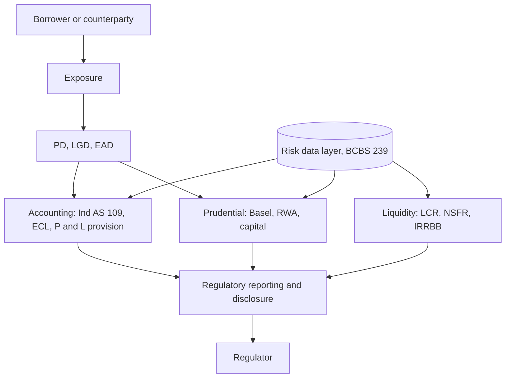
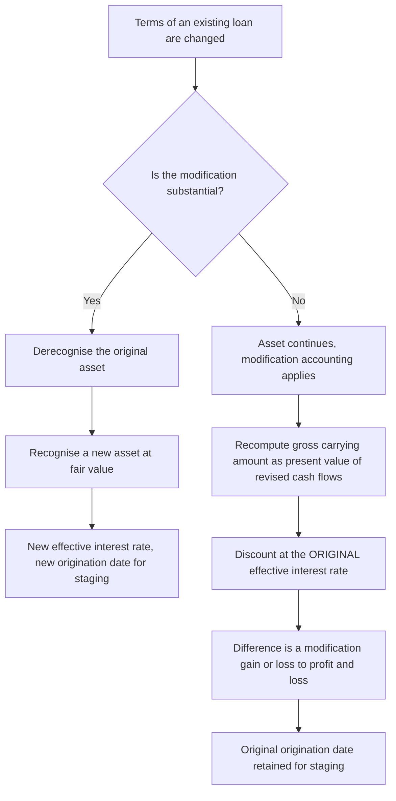
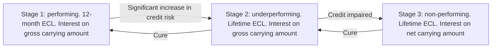
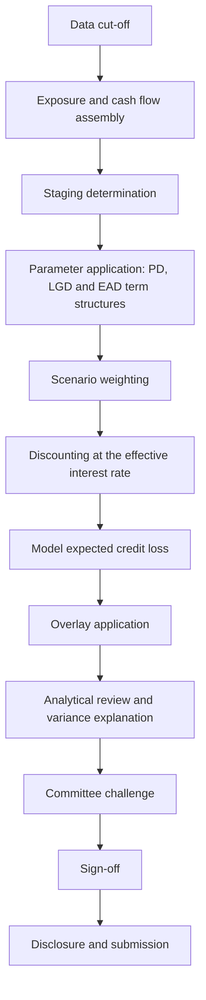
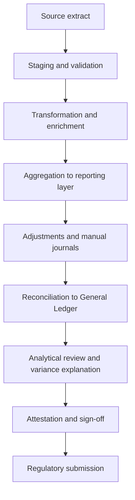
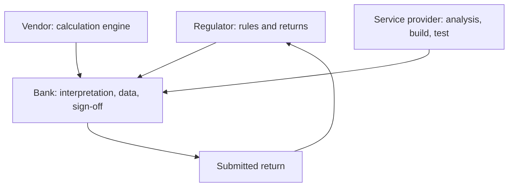
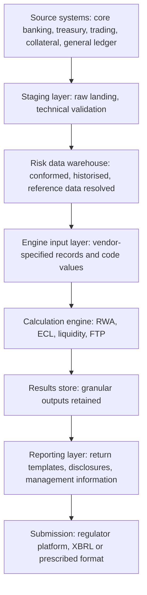
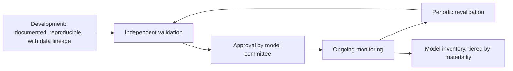

A bank lends money, and from that single act everything else follows. The loan may not be repaid, so a loss must be estimated — that is credit risk. The estimate must be charged to profit, which is accounting. A buffer must be held against the estimate being wrong, which is regulation. The cash must arrive on the day it is promised, which is liquidity. Every one of those numbers must be produced from the same underlying record, which is data. And the whole apparatus must be assembled, tested and submitted on a fixed date, which is delivery.

The order below is the argument. Each part earns the next.

**Expected loss is provisioned. Unexpected loss is capitalised. Every other rule in this document hangs off that sentence.**



> [!caution]
> Figures marked **[verify]** are time-sensitive regulatory specifics that have not been independently verified. The principle is settled; the precise figure is provisional.

---

## Part 0 — The map

Everything below hangs off one structure.

A bank lends. That lending creates an **exposure** — an amount of money at risk with a named counterparty. Each exposure is characterised by three parameters: the chance the counterparty fails, the fraction lost when it fails, and the amount outstanding at the moment it fails. Those three parameters then feed two entirely separate consumers who ask different questions of the same numbers.

| Consumer | Governed by | Question it asks | What it produces |
|---|---|---|---|
| **Accounting** | Ind AS 109 | What loss do I expect? | A provision — a charge to profit and loss |
| **Prudential regulation** | Basel, as adopted by RBI | What loss could surprise me? | Capital — a balance sheet buffer |

Expected loss is a cost of doing business, so it is priced into the interest rate and provisioned through profit. Unexpected loss cannot be priced away, because by definition it is the part nobody saw coming, so it is absorbed by shareholders' capital.

Sitting underneath both is a **data layer** that must produce the same exposure, the same counterparty and the same number to both consumers. That requirement is what BCBS 239 exists to enforce. Sitting beside both is **liquidity**, which is not about losses at all but about whether cash arrives when it is needed.

Every later part is a zoom into one box of that diagram.

---

## Part 1 — Credit risk foundations

### What credit risk is

The risk that a counterparty fails to meet its obligations in full and on time.

Not only default. Deterioration counts, because deterioration changes what the claim is worth and, under Ind AS 109, changes the provision immediately rather than at the moment of failure. Credit risk decomposes into three sub-risks, and the distinction matters because different parts of the framework attack different ones.

| Sub-risk | What it is | Where it is handled |
|---|---|---|
| **Default risk** | The obligor fails to pay | Provisions and Pillar 1 capital |
| **Migration risk** | The obligor's credit quality deteriorates without defaulting, so the claim falls in value and the provision rises | Ind AS 109 staging; mark-to-market on traded credit |
| **Concentration risk** | Losses arrive together because exposures are not independent — one name, one sector, one geography | Pillar 2 and the Large Exposures Framework |

### The vocabulary of an exposure

Before any measurement, the objects.

| Term | Meaning |
|---|---|
| **Obligor** | The legal entity that owes the money |
| **Facility** | A specific lending arrangement with that obligor — a term loan, an overdraft, a guarantee |
| **Limit** | The maximum the obligor may draw under the facility |
| **Drawn** | The amount actually outstanding today |
| **Undrawn** | Limit less drawn — committed but not yet taken |
| **Tenor** | Contractual time to final repayment |
| **Seniority** | Rank in the queue of claims if the obligor is wound up |
| **Collateral** | An asset the lender may seize and sell on default |
| **Covenant** | A contractual condition the obligor must maintain, breach of which gives the lender rights |
| **Days past due (DPD)** | Days elapsed since a contractual payment was missed |

One obligor may hold many facilities. Default is usually declared at obligor level and pulls every facility with it, which is why counterparty identity — not account identity — is the anchor of every risk system.

### Expected and unexpected loss

$$
EL = PD \times LGD \times EAD
$$

where **PD** is the probability of default, **LGD** the loss given default as a fraction, and **EAD** the exposure at default in currency.

Expected loss is the mean of the loss distribution. Unexpected loss is the distance from that mean out to a high percentile of the same distribution — Basel uses the 99.9th percentile over one year, meaning a severity expected to be exceeded once in a thousand years.

<svg viewBox="0 0 600 300" width="100%" role="img" aria-labelledby="ldTitle ldDesc" xmlns="http://www.w3.org/2000/svg" style="max-width:600px;display:block;margin:0 auto">
<title id="ldTitle">The credit loss distribution</title>
<desc id="ldDesc">A right-skewed loss distribution. Expected loss sits near the peak and is covered by provisions. The shaded region between expected loss and the 99.9th percentile is unexpected loss, covered by capital. Beyond the 99.9th percentile the tail is uncovered.</desc>
<defs><clipPath id="ldArea"><path d="M56 236 C 96 236 126 96 166 84 C 206 72 236 136 286 171 C 346 206 416 226 476 232 C 516 235 541 236 556 236 L 556 236 L 56 236 Z"/></clipPath></defs>
<rect x="186" y="40" width="284" height="196" fill="currentColor" opacity="0.10" clip-path="url(#ldArea)"/>
<rect x="56" y="40" width="130" height="196" fill="currentColor" opacity="0.22" clip-path="url(#ldArea)"/>
<path d="M56 236 C 96 236 126 96 166 84 C 206 72 236 136 286 171 C 346 206 416 226 476 232 C 516 235 541 236 556 236" fill="none" stroke="currentColor" stroke-width="1.6"/>
<line x1="56" y1="236" x2="580" y2="236" stroke="currentColor" stroke-width="1"/>
<path d="M574 232 L582 236 L574 240" fill="none" stroke="currentColor" stroke-width="1"/>
<line x1="186" y1="88" x2="186" y2="236" stroke="currentColor" stroke-width="1.2" stroke-dasharray="4 3"/>
<line x1="470" y1="196" x2="470" y2="236" stroke="currentColor" stroke-width="1.2" stroke-dasharray="4 3"/>
<g font-family="ui-sans-serif,system-ui,-apple-system,Segoe UI,Helvetica,Arial,sans-serif" fill="currentColor">
<text x="186" y="78" text-anchor="middle" font-size="13" font-weight="500">EL</text>
<text x="470" y="186" text-anchor="middle" font-size="13" font-weight="500">99.9th percentile</text>
<text x="586" y="252" text-anchor="end" font-size="13" opacity="0.75">Loss</text>
<text x="121" y="268" text-anchor="middle" font-size="12.5" opacity="0.8">Provisions</text>
<text x="328" y="268" text-anchor="middle" font-size="12.5" opacity="0.8">Capital &#8212; unexpected loss</text>
<text x="524" y="268" text-anchor="middle" font-size="12.5" opacity="0.8">Uncovered tail</text>
<text x="121" y="286" text-anchor="middle" font-size="11.5" opacity="0.55">expected, priced in</text>
<text x="328" y="286" text-anchor="middle" font-size="11.5" opacity="0.55">cannot be priced away</text>
<text x="524" y="286" text-anchor="middle" font-size="11.5" opacity="0.55">beyond the standard</text>
</g>
<line x1="56" y1="246" x2="186" y2="246" stroke="currentColor" stroke-width="1" opacity="0.45"/>
<line x1="190" y1="246" x2="466" y2="246" stroke="currentColor" stroke-width="1" opacity="0.45"/>
<line x1="474" y1="246" x2="574" y2="246" stroke="currentColor" stroke-width="1" opacity="0.45"/>
</svg>

The distribution is right-skewed because most years produce losses near the average and a rare year produces losses far above it. Symmetry would make capital unnecessary.

### Probability of default

The chance the obligor defaults over a stated horizon, expressed as a percentage. Two flavours exist because two consumers want different things from the same word.

| Flavour | Behaviour | Used by | Reason |
|---|---|---|---|
| **Through-the-cycle (TTC)** | Averaged across good and bad economic conditions; moves slowly | Basel internal ratings based capital | Capital requirements should not swing violently with the cycle and force lending to contract in a downturn |
| **Point-in-time (PIT)** | Reflects conditions today; moves with the cycle | Ind AS 109 expected credit loss | Accounting wants today's best estimate, not a long-run average |

The same borrower therefore carries two different PDs at the same moment, legitimately, and a reporting system must hold both.

Default under Basel has two limbs and either one is sufficient: the obligor is **90 days past due** on a material obligation, **or** the bank judges the obligor **unlikely to pay** without recourse to actions such as realising security. The second limb is judgemental and is where definitions diverge between banks, which is why supervisors examine it.

### Loss given default

The share of exposure not recovered after default, net of the costs of recovering it.

$$
LGD = 1 - \text{Recovery Rate}
$$

Recovery depends on collateral, seniority, legal enforceability and — decisively — time. A recovery of one rupee three years after default is not worth one rupee, so recoveries are discounted back to the default date. Basel requires **downturn LGD**: LGD estimated under stressed conditions, because collateral values fall exactly when defaults rise. Property is worth less in the year everyone is trying to sell property. That correlation between the two parameters is the reason the requirement exists.

### Exposure at default

The amount outstanding at the moment default occurs, which is not the amount outstanding today.

$$
EAD = \text{Drawn} + CCF \times \text{Undrawn}
$$

where **CCF** is the credit conversion factor — the fraction of the undrawn limit assumed to be drawn by the time of default.

The conversion factor exists because deteriorating borrowers draw down every line available to them before they fail. A revolving facility sitting at 40% utilisation today will not be at 40% at default. For a fully drawn term loan the undrawn term is zero and EAD is simply the outstanding balance; the parameter earns its keep on revolving and committed facilities.

### Rating systems

Two ratings, two purposes, and they must not be conflated.

- **Obligor rating** drives PD. It is a judgement about the borrower — financials, sector, management, group support.
- **Facility rating** drives LGD. It is a judgement about the structure — collateral, seniority, covenants, guarantees.

An excellent borrower on an unsecured subordinated facility carries a strong obligor rating and a weak facility rating simultaneously.

Corporate exposures are rated individually by credit officers against a rating grid. Retail exposures are too numerous for that, so they are scored: **application scorecards** at origination, **behavioural scorecards** on existing accounts using repayment conduct, and **collections scorecards** to prioritise recovery effort. The governance points on any rating system are its philosophy (point-in-time or through-the-cycle), its calibration to a long-run observed default rate, and its **override rate** — how often the credit officer disagrees with the model, which if high means the model is not being used.

### Rating migration

A **transition matrix** records how obligors move between rating grades over a period, usually one year. It is built by taking every rated obligor at the start of the year, observing its grade at the end, and counting. Rows are the starting grade, columns the ending grade, and each cell is the probability of that move. The rightmost column, **D**, is default — the one state that cannot be left.

An illustrative one-year corporate matrix, in per cent:

| From \ To | AAA | AA | A | BBB | BB | B | CCC | D |
|---|---:|---:|---:|---:|---:|---:|---:|---:|
| **AAA** | 90.8 | 8.3 | 0.7 | 0.1 | 0.1 | 0.0 | 0.0 | 0.00 |
| **AA** | 0.7 | 90.7 | 7.8 | 0.6 | 0.1 | 0.1 | 0.0 | 0.00 |
| **A** | 0.1 | 2.3 | 91.0 | 5.5 | 0.7 | 0.3 | 0.0 | 0.06 |
| **BBB** | 0.0 | 0.3 | 5.9 | 87.5 | 5.0 | 1.0 | 0.1 | 0.18 |
| **BB** | 0.0 | 0.1 | 0.6 | 7.7 | 81.2 | 8.8 | 1.0 | 1.06 |
| **B** | 0.0 | 0.1 | 0.2 | 0.5 | 6.5 | 83.5 | 4.1 | 5.20 |
| **CCC** | 0.2 | 0.0 | 0.3 | 1.0 | 2.4 | 11.2 | 64.9 | 19.79 |

**How to read it.** Each row sums to 100 — every obligor ends the year somewhere. The diagonal is stability: 87.5% of BBB names are still BBB in a year. Everything to the left of the diagonal is upgrade, everything to the right is downgrade, and the final column is failure. Reading down the D column gives the one-year PD for each grade, and the shape of that column is the whole point of ratings: PD rises slowly through investment grade and then explodes, from 0.18% at BBB to 19.79% at CCC.

Reading across a row gives migration risk. A BBB obligor is roughly thirty-three times more likely to be downgraded to BB than to default outright in the year. That matters because under Ind AS 109 a downgrade alone, with no missed payment, can move the exposure to lifetime provisioning.

**What the matrix is used for.** Three things, and they are separate.

| Use | How the matrix is used |
|---|---|
| **Building a PD term structure** | Multiplying the matrix by itself gives multi-year default probabilities, which is what lifetime expected credit loss requires |
| **Detecting deterioration** | A ratings downgrade beyond a defined threshold is a qualitative trigger for a significant increase in credit risk |
| **Portfolio reporting** | The observed migration of the actual book, period on period, is a standard risk committee report — it shows whether quality is drifting before any default appears |

**Chaining to a term structure.** If the one-year matrix is $M$, then the $n$-year matrix is the matrix power $M^n$, and the cumulative probability of having defaulted by year $n$ is the default column of $M^n$. The mechanism is simply that to default in year two, an obligor must first be in some grade at the end of year one, and each of those paths carries its own probability.

Taking the BBB row and computing the two-year cumulative default probability by summing over every intermediate grade:

```
Year 1 default, BBB direct                        = 0.180%

Year 2, via each surviving grade:
  via A     0.059 x 0.0006                        = 0.004%
  via BBB   0.875 x 0.0018                        = 0.158%
  via BB    0.050 x 0.0106                        = 0.053%
  via B     0.010 x 0.0520                        = 0.052%
  via CCC   0.001 x 0.1979                        = 0.020%
  via AAA, AA  (default probability zero)         = 0.000%
                                                   -------
Year 2 marginal PD                                 = 0.287%

Two-year cumulative PD  = 0.180 + 0.287           = 0.467%
Year 2 conditional PD   = 0.287 / (100 - 0.180)   = 0.288%
```

Three numbers come out of that arithmetic and they are not the same thing. **Cumulative** is the chance of having failed at any point by the end of year two. **Marginal** is the chance of failing during year two specifically, measured from the start. **Conditional** is the chance of failing during year two given survival through year one. Part 2 uses all three, and using the wrong one double-counts the provision.

Notice also that the year-two marginal probability exceeds the year-one probability. That is the ageing effect: a BBB name has had a year to drift downward, and some of the mass that started at BBB is now sitting at BB and B where default is far more likely.

**The two assumptions underneath.** Both are known to be false, and both are named rather than hidden because they determine where the model may be trusted.

The process is assumed **Markov** — the probability of the next move depends only on the current grade, not on how the obligor arrived there. A name downgraded from A to BBB last year is treated identically to a name that has sat at BBB for a decade. In observed data it is not identical: recently downgraded names default at materially higher rates than long-standing peers of the same grade, an effect called ratings momentum or downgrade drift. The consequence is that a plain matrix understates risk in the deteriorating part of the book, which is precisely the part that matters.

The process is assumed **time-homogeneous** — the same matrix applies to every future year, so year five is governed by the same probabilities as year one. In reality matrices are strongly cycle-dependent: in a recession the diagonal thins, downgrades and the default column swell, and upgrades nearly vanish. A matrix estimated across 2015 to 2019 does not describe 2020.

Both assumptions are why the two consumers treat the matrix differently. Basel capital deliberately uses a matrix averaged across the cycle, accepting the assumption in exchange for stability. Expected credit loss cannot accept it, so it conditions the matrix on a forecast economic state, producing a different matrix for each scenario and each year.

:::confuse
A transition matrix and a PD term structure are not the same object. The matrix is a one-period object describing movement between grades. The term structure is the multi-period default curve for one grade, derived from the matrix by repeated multiplication. Confusing them produces a lifetime ECL that uses a one-year probability at every point in the life.
:::

### Credit risk mitigation

Mitigation reduces the capital requirement and the provision, but only where it is legally enforceable in the relevant jurisdiction and operationally real — documented, perfected, valued and monitored. An unregistered charge is not mitigation.

| Technique | Effect |
|---|---|
| **Eligible financial collateral** | Reduces exposure. The *simple approach* substitutes the collateral's risk weight for the obligor's on the covered portion; the *comprehensive approach* reduces exposure at default after haircuts |
| **Guarantees and credit derivatives** | Substitution — the protection provider's risk weight replaces the obligor's, for the covered portion |
| **On-balance-sheet netting** | Loans and deposits with the same counterparty netted, where legally enforceable |
| **Physical collateral** | Recognised under the internal ratings based approach, not under the standardised approach |

Three haircuts apply in the comprehensive approach: one on the exposure, because it may grow before default; one on the collateral, because its market value may fall; and one for currency mismatch where exposure and collateral are in different currencies. Where the protection matures before the exposure does, recognition is reduced proportionately for the **maturity mismatch**, because protection that expires first is not protection.

### Concentration and large exposures

Concentration is the failure of independence. Two exposures of ₹50 crore to unrelated borrowers are safer than one exposure of ₹100 crore, because the first pair can fail separately and the second cannot fail by halves.

The standard measure is the **Herfindahl-Hirschman Index**, the sum of squared exposure shares:

$$
HHI = \sum_{i=1}^{n} w_i^2
$$

where $w_i$ is exposure $i$ as a fraction of the total portfolio.

Squaring is what makes it work. A share of 0.5 contributes 0.25 while a share of 0.05 contributes 0.0025 — a hundredth as much — so large positions dominate the index and small ones barely register. The index runs from $1/n$ for a perfectly even portfolio up to 1 for a portfolio holding a single name. Its most useful reading is the reciprocal: $1/HHI$ is the **effective number of equal-sized exposures** the portfolio behaves like.

Two portfolios of ten borrowers, same total exposure of ₹1,000 crore:

```
Even portfolio: ten exposures of Rs 100 crore each
  w = 0.10 each
  HHI  = 10 x 0.10^2                    = 0.100
  1/HHI                                  = 10.0 effective names

Concentrated: one of Rs 500 crore, nine of Rs 55.6 crore
  w = 0.500, and 0.0556 for each of nine
  HHI  = 0.500^2 + 9 x 0.0556^2
       = 0.2500 + 0.0278                 = 0.278
  1/HHI                                  = 3.6 effective names
```

Ten borrowers on the register; the portfolio behaves like three and a half. The count of names says nothing, which is why the index is reported instead of the count.

**Why this sits outside the capital formula.** The Basel internal ratings based formula assumes an infinitely granular portfolio in which no single name can move the result. Under that assumption concentration cannot exist, so no charge for it appears in Pillar 1. Real portfolios are not granular, so the gap is closed twice over: a concentration add-on is assessed by the bank in its own capital adequacy assessment under Pillar 2, and a hard cap is imposed by the **Large Exposures Framework**.

The framework limits exposure to a single counterparty or a connected group to a percentage of **Tier 1 capital** — commonly 20% for a single counterparty and 25% for a group of connected counterparties, with a tighter limit between global systemically important banks. **[verify]**

The operational difficulty is not the limit but the word *connected*. Connection is defined by control or by economic interdependence — one borrower's failure would drag the other down regardless of shareholding. Applying that definition requires a maintained counterparty hierarchy that knows every legal entity's parent, and keeping that hierarchy correct across jurisdictions is one of the standing data problems in any bank.

### The lending lifecycle


### India: IRAC classification

RBI's **Income Recognition and Asset Classification** norms are a rule-based prudential regime that runs in parallel to accounting. They decide when an account stops being treated as performing, when interest may no longer be booked as income, and what minimum provision must be held.

| Class | Trigger |
|---|---|
| **SMA-0** | Principal or interest overdue 1 to 30 days |
| **SMA-1** | Overdue 31 to 60 days |
| **SMA-2** | Overdue 61 to 90 days |
| **NPA — Sub-standard** | Non-performing for up to 12 months |
| **NPA — Doubtful** | Sub-standard for more than 12 months, sub-divided D1, D2 and D3 by age |
| **NPA — Loss** | Identified as uncollectible, though not yet written off |

**SMA** is a Special Mention Account: not yet non-performing, but showing the first signs of stress. The three sub-categories exist so that deterioration is visible in weeks rather than at the ninety-day cliff.

An account becomes a **non-performing asset** at 90 days past due for a term loan. For cash credit and overdraft facilities there is no instalment to miss, so the test is whether the account is **out of order** — continuously in excess of the sanctioned limit or drawing power, or with no credits sufficient to cover the interest debited during the period. Once non-performing, interest may no longer be recognised in income unless actually realised, which is the income recognition half of the norms.

Upgrade out of non-performing status requires the **entire** overdue amount — principal and interest across all facilities of that borrower — to be cleared. A part payment that brings the account under ninety days does not upgrade it.

### CRILC and system-wide visibility

Classification inside one bank is not enough, because a borrower under stress will service one lender while defaulting on another. The **Central Repository of Information on Large Credits (CRILC)** closes that gap: banks report borrower-level exposure and classification to RBI, which redistributes the picture so every lender sees the borrower's status across the system.

| Element | Substance |
|---|---|
| **Threshold** | Borrowers with aggregate exposure at or above ₹5 crore **[verify]** |
| **Periodic return** | Exposure, classification, and current status, submitted on a defined cycle **[verify]** |
| **SMA reporting** | Special mention status reported at higher frequency, so that stress becomes visible system-wide before it becomes default **[verify]** |
| **Purpose** | Ends the information asymmetry that let a stressed borrower refinance quietly at a second lender, and provides the trigger population for coordinated resolution |

The return is a data problem before it is a credit problem. It requires one consistent identity for the borrower across every lender in the country, which is why permanent account number, corporate identity number and legal entity identifier discipline is enforced on it, and why identity mismatches are the most common rejection.

### IRAC and ECL side by side

| | IRAC | Ind AS 109 ECL |
|---|---|---|
| **Basis** | Rule-based | Model-based |
| **Direction** | Backward-looking — what has already gone wrong | Forward-looking — what is expected to go wrong |
| **Driver** | Days past due and asset class | Probability of default, loss given default, exposure, discounted, over scenarios |
| **Provision** | A prescribed percentage by class and age | A computed expected loss |
| **Judgement** | Minimal by design | Extensive, and governed |

They coexist rather than compete. The higher of the two applies, so an entity computing expected credit loss still cannot provision below the IRAC minimum.

### Stressed asset resolution in India

Classification records that an account has gone wrong. Resolution is the separate track that decides what happens next, and it is time-bound by regulation rather than left to negotiation.

RBI's **Prudential Framework for Resolution of Stressed Assets**, dated 7 June 2019, sets the spine.

| Step | What happens |
|---|---|
| **Recognition** | The lender recognises default immediately on non-payment |
| **Review period** | A 30-day window from default to review the borrower and decide on a strategy **[verify]** |
| **Inter-Creditor Agreement (ICA)** | Where multiple lenders are involved, they sign an agreement binding all to a plan approved by a defined majority, so a single dissenting lender cannot block resolution **[verify]** |
| **Resolution plan** | Restructuring, change of ownership, sale of the exposure, or recovery, to be implemented within prescribed timelines |
| **Enforcement** | Failure to implement within the timeline triggers **additional provisioning** — the cost of delay is charged to profit, which is what makes the deadline real |

Where resolution fails, the case moves to the **Insolvency and Bankruptcy Code (IBC)** — a time-bound corporate insolvency resolution process. On admission, a moratorium suspends enforcement by individual creditors, control passes from the promoters to a resolution professional, and a **committee of creditors** of financial lenders votes on resolution plans. If no plan is approved within the statutory period, the company goes to liquidation and proceeds are distributed down a prescribed **waterfall** in which insolvency costs and secured creditors rank ahead of unsecured lenders, and equity ranks last. **[verify]**

The alternative exit is sale to an **Asset Reconstruction Company (ARC)**. The lender sells the stressed exposure, receiving cash and **security receipts** — instruments whose eventual value depends on what the reconstruction company actually recovers. The credit risk is not fully extinguished; it changes form, and the security receipts must themselves be valued and provisioned.

### Restructuring and modification accounting

Restructuring changes the terms of a loan to make it payable — extending the tenor, cutting the rate, granting a moratorium, converting arrears into principal. It does not remove credit risk. It re-times the cash flows of a borrower who has already demonstrated an inability to meet the original ones.

Under Ind AS 109 the accounting turns on a single question: has the change been substantial enough that the original asset no longer exists?



**Non-substantial modification**, which is the common case. The asset stays on the books. The revised contractual cash flows are discounted at the **original effective interest rate** — the rate fixed when the loan was first recognised, not a current market rate and not a new rate. The resulting present value becomes the new gross carrying amount, and the difference against the old carrying amount goes straight to profit and loss as a modification loss.

Holding the original rate constant is what makes the loss appear. A concession granted to a distressed borrower reduces the future cash flows; discounting smaller cash flows at the unchanged original rate necessarily produces a smaller present value; that reduction is the economic cost of the concession, recognised at once rather than spread across the extended life.

**Substantial modification** derecognises the old asset and recognises a new one at fair value with a fresh effective interest rate. That also resets the origination-date credit quality against which future deterioration is measured, which is why the substantiality test is a governed accounting policy rather than a case-by-case judgement.

Two consequences carry beyond the accounting. A restructured exposure does not return to performing status merely because payments have resumed — a monitoring or cure period applies, and under Ind AS 109 restructuring is itself a qualitative trigger for significant increase in credit risk. And the exposure carries a **forbearance** flag into disclosure, so the volume of concessions granted is visible to the market and the supervisor even where no loss has yet crystallised.

:::trap
Discounting revised cash flows at a current market rate rather than the original effective interest rate. It produces a smaller loss, or none, and it is wrong. The original rate is retained precisely so the concession cannot be hidden inside a change of discount rate.
:::

### Portfolio metrics

The vocabulary used to describe the quality of a lending book, all of which appear in results disclosure and supervisory returns.

| Metric | Definition | What it tells |
|---|---|---|
| **GNPA ratio** | Gross non-performing assets ÷ gross advances | How much of the book has already failed |
| **NNPA ratio** | (Gross NPA − provisions held) ÷ (gross advances − provisions held) | How much of that failure is still uncovered |
| **Provision Coverage Ratio (PCR)** | Provisions held ÷ gross NPA | How much of the failed book is already absorbed |
| **Slippage ratio** | Fresh additions to NPA in the period ÷ opening standard advances | The rate at which new failure is arriving |
| **Credit cost** | Provisions charged to profit and loss ÷ average advances | What credit risk cost the profit statement this period |
| **RWA density** | Risk-weighted assets ÷ total exposure | How risky the book looks once weighted |

Slippage is the forward-looking one of the group. Gross non-performing assets can fall while slippage rises, if write-offs and recoveries are clearing the stock faster than new failures arrive — a book improving on the surface and deteriorating underneath.

A **write-off** removes an asset from the balance sheet where there is no reasonable expectation of recovery. A **technical write-off** removes it from the books while recovery efforts continue, which flatters the gross non-performing ratio without any economic event occurring. Coverage is therefore quoted both with and without technical write-offs, and the gap between the two figures is the disclosure worth reading.

### Pricing: MCLR and EBLR

Lending rates in India are not set freely. RBI prescribes the benchmark a floating-rate loan must be priced against, and the history of those benchmarks is a history of one problem: when the policy rate fell, lending rates did not follow.

| Regime | Basis | Failure that ended it |
|---|---|---|
| **Benchmark Prime Lending Rate** | Bank-determined | Opaque; loans priced below it at discretion |
| **Base Rate** | Average cost of funds, bank-computed | Moved slowly and asymmetrically |
| **MCLR**, from 2016 | Marginal cost of funds, bank-computed | Still internal, so still slow to pass on cuts |
| **EBLR**, from 1 October 2019 | An external benchmark outside the bank's control | Current regime for new floating retail and micro and small enterprise loans **[verify]** |

**MCLR — Marginal Cost of Funds based Lending Rate.** Internal, and computed from four components: the marginal cost of funds — what the next rupee of deposits and borrowing actually costs, weighted by source; the negative carry on the cash reserve ratio, since reserves held with RBI earn nothing; operating costs; and a tenor premium for the term of the loan. Because it is internal and computed on the bank's own funding, it moved when the bank's funding costs moved, which was slower and less completely than the policy rate.

**EBLR — External Benchmark Lending Rate.** The benchmark is outside the bank: the RBI **policy repo rate** in most cases, or a Treasury bill yield. The rate must be reset at least once every three months, so a policy change reaches the borrower within a quarter. The bank's discretion moves entirely into the spread.

The repo rate itself is the rate at which RBI lends overnight to banks against government securities. It stood at **5.25%** following the August 2026 policy meeting, with the standing deposit facility at 5.00% forming the floor of the corridor. **[verify — changes at each bi-monthly policy meeting]**

**How a lending rate is built.** The benchmark is only the base.

```
Benchmark (repo rate or MCLR)          the cost of the money
+ Credit risk premium                   expected loss on this borrower
+ Operating cost                        origination, servicing, collection
+ Cost of capital                       return on the capital held against it
+ Business margin                       profit
= Lending rate to the borrower
```

The credit risk premium is where expected loss re-enters as a business input rather than an accounting output. The same $PD \times LGD \times EAD$ that produces the provision at the back end produces the spread at the front end — the loan is priced so that, across a portfolio of similar borrowers, the premium collected covers the losses expected.

:::insight
Pricing and provisioning are the same calculation used twice. If a portfolio's realised credit cost persistently exceeds the credit risk premium priced into it, the failure is at origination, not in the provisioning model. The provision is only reporting what the pricing already got wrong.
:::

---

## Part 2 — Expected credit loss

### Where it applies in India

Ind AS 109 replaced an incurred-loss model, under which a provision waited for evidence that a loss had already happened, with an expected-loss model that provides from the day of origination.

Non-banking financial companies and housing finance companies have applied it **since FY2019-20**. Banks have remained on IRAC. RBI issued final **expected credit loss Directions on 27 April 2026, effective 1 April 2027**, with a glide path for the transitional capital impact running to **31 March 2031**. **[verify — the most date-sensitive block in this document]**

### Gross carrying amount, net carrying amount and the effective interest rate

Three definitions carry the whole of the rest of this part, and every later formula assumes them.

| Term | Definition |
|---|---|
| **Gross carrying amount** | The amortised cost of the asset **before** deducting the loss allowance |
| **Loss allowance** | The accumulated expected credit loss held against the asset |
| **Net carrying amount** | Gross carrying amount **less** the loss allowance — the figure that appears on the balance sheet |

The **effective interest rate (EIR)** is the rate that exactly discounts the estimated future cash receipts through the expected life of the asset to its gross carrying amount at initial recognition. It is not the coupon rate. It absorbs processing fees that are integral to the lending, transaction costs, and any premium or discount, spreading them across the life instead of recognising them on day one.

```
Term loan, one year, bullet repayment
  Principal disbursed                       Rs 100.00 lakh
  Processing fee collected upfront          Rs   2.00 lakh
  Net cash outflow at origination           Rs  98.00 lakh
  Contractual coupon 10%
  Cash received at maturity                 Rs 110.00 lakh

  EIR  = (110.00 / 98.00) - 1              = 12.24%
```

The contractual rate is 10%; the effective rate is 12.24%. Every discounting operation in expected credit loss uses the second number, and it is fixed at initial recognition and not revised for changes in credit risk.

### The three-stage model

The model asks one question at every reporting date: how much has credit risk changed **since this exposure was first recognised**? The answer places the exposure in one of three stages, and the stage determines both the size of the provision and how interest is earned.



| | Stage 1 | Stage 2 | Stage 3 |
|---|---|---|---|
| **Condition** | No significant increase in credit risk since origination | Significant increase in credit risk, but not yet impaired | Credit-impaired or defaulted |
| **Loss allowance** | 12-month expected credit loss | Lifetime expected credit loss | Lifetime expected credit loss |
| **Interest revenue** | EIR × **gross** carrying amount | EIR × **gross** carrying amount | EIR × **net** carrying amount |

**12-month expected credit loss** is not the loss expected over the next twelve months. It is the **lifetime** loss on the exposure, weighted by the probability that a default occurs within the next twelve months. The distinction matters for a long-dated loan: a default in month eleven of a fifteen-year mortgage causes a loss stretching far beyond month twelve, and that whole loss is captured.

**The big step is Stage 1 to Stage 2.** The allowance jumps from twelve months of default probability to the whole remaining life, which on a long asset can multiply the provision several times over on a single reporting date, with no payment missed. The size of that step is why the trigger for it is the most scrutinised judgement in the standard.

### The interest recognition switch

At Stage 3 interest stops being calculated on the gross carrying amount and is calculated on the net.

```
Exposure with EIR 10%
  Gross carrying amount                     Rs 100.00 lakh
  Loss allowance                            Rs  30.00 lakh
  Net carrying amount                       Rs  70.00 lakh

  Interest revenue at Stage 1 or 2   10% x 100.00  = Rs 10.00 lakh
  Interest revenue at Stage 3        10% x  70.00  = Rs  7.00 lakh
```

The logic is that once an asset is credit-impaired, ₹30 lakh of it is not expected to be collected, and revenue may not be accrued on money that will never arrive. Recognising the full ₹10 lakh would book income that is already known to be uncollectible, and the same effect is achieved on the IRAC side by the rule that interest on a non-performing asset is recognised only when realised.

The switch is asymmetric: it happens on entry to Stage 3 and reverses on cure. It applies to interest **revenue** only, not to the discounting inside the expected credit loss calculation, which continues to use the original effective interest rate throughout.

### Significant increase in credit risk

The standard defines no bright line, deliberately, so that the test adapts to the portfolio. Implementations therefore build the trigger from three limbs, any of which is sufficient.

| Limb | Content |
|---|---|
| **Quantitative** | A change in **lifetime** probability of default since initial recognition, measured **relative** rather than absolute |
| **Qualitative** | Watchlist entry, forbearance, covenant breach, restructuring, or a ratings downgrade beyond a defined number of notches |
| **Backstop** | **30 days past due** is a rebuttable presumption of significant increase. Rebutting it requires evidence, not assertion |

The relative measurement is the part most often mis-implemented. A move in lifetime probability of default from 0.5% to 1.5% is a tripling and is significant; a move from 8.0% to 9.0% is a larger absolute change and is not. Relative thresholds are usually paired with an absolute floor so that a trivial exposure tripling from 0.01% to 0.03% does not trigger.

Two structural consequences follow.

**The comparison is lifetime against lifetime.** Current lifetime probability of default is compared with the lifetime probability of default that was expected at origination for that point in the asset's life — not against the twelve-month figure, and not against a portfolio average. A loan naturally becomes riskier as it ages through the peak of its default curve; comparing today's lifetime probability against the origination-date figure without allowing for that ageing would move healthy loans to Stage 2 by the passage of time alone.

**Origination-date credit quality must be retained for the entire life of every exposure.** That single requirement is what breaks most existing data architectures, because core banking systems were built to hold the current state of an account and overwrite the previous one. Retaining a rating, a probability of default and a scenario-conditioned curve as at a date years in the past, for an account that has since been restructured, renewed and repriced, is a data problem rather than a modelling one.

The standard also permits a **low credit risk exemption**, under which exposures of investment-grade equivalent quality may be left in Stage 1 without the full comparison. Its use is a scrutinised policy choice rather than a convenience.

Movement back is symmetrical in principle but governed in practice: an exposure returns to Stage 1 when the trigger no longer applies, subject to a defined **cure period** so that a single month of good conduct does not reverse the provision.

### PD vocabulary

Four related quantities, all derived from the same term structure, and using the wrong one is the standard implementation error.

| Term | Meaning | Relationship |
|---|---|---|
| **Cumulative PD** $F(t)$ | Probability of having defaulted at any point up to time $t$ | Rises monotonically towards 1 |
| **Survival function** $S(t)$ | Probability of surviving to $t$ without defaulting | $S(t) = 1 - F(t)$ |
| **Marginal PD** | Probability of defaulting **in** period $t$, measured from origination | $S(t-1) - S(t)$ |
| **Conditional PD**, or hazard rate | Probability of defaulting in period $t$ **given** survival to $t-1$ | $\dfrac{S(t-1) - S(t)}{S(t-1)}$ |

Carrying the BBB figures computed from the transition matrix in Part 1 through the definitions:

```
Cumulative PD    F(1) = 0.180%      F(2) = 0.467%
Survival         S(1) = 99.820%     S(2) = 99.533%

Marginal PD, year 2      = S(1) - S(2)
                         = 99.820 - 99.533        = 0.287%

Conditional PD, year 2   = 0.287 / 99.820         = 0.288%
```

Marginal and conditional are close here only because survival is close to 1. On a CCC name with a first-year default probability near 20% they diverge sharply, and substituting one for the other misstates every later period.

The expected credit loss summation needs the **marginal** probability, because each period's loss must be weighted by the probability of the default happening in that period and not in an earlier one. Summing cumulative probabilities across periods counts the same default several times.

Lifetime probability of default is built by chaining these quantities into a **PD term structure**, obtained either from a transition matrix raised to successive powers, as in Part 1, or from survival analysis fitted directly to the loan book.

### Measurement

$$
ECL = \sum_{t=1}^{T} \frac{PD_t^{\text{marginal}} \times LGD_t \times EAD_t}{(1 + EIR)^t}
$$

where $T$ is the remaining life for a Stage 2 or Stage 3 exposure, or twelve months for Stage 1.

Each period of the asset's remaining life is treated as a separate small calculation: the chance of failing in that period, multiplied by the fraction lost if it does, multiplied by the amount outstanding at that point, discounted back to today. Summing across periods gives the expected loss over the whole horizon.

Three things the formula encodes.

- **Marginal, not cumulative, probability of default.** Each period's weight is the probability of defaulting in that period having survived to it, so no default is counted twice.
- **Discounting at the effective interest rate**, not a market rate and not the contractual rate. The rate is fixed at initial recognition and used unchanged for the life of the asset.
- **Time-varying loss given default and exposure at default.** Amortisation, prepayment and drawdown all move the exposure across the life, and recovery expectations differ by the point in the cycle at which default occurs.

Undrawn commitments need care. For a revolving facility with no fixed term the exposure period is not the contractual notice period but the period over which the entity is actually exposed to credit risk, which may be considerably longer, because a credit card line is not cancelled the day the borrower's conduct deteriorates.

Two exceptions sit outside the three-stage model entirely. **Purchased or originated credit-impaired (POCI)** assets never enter Stage 1: they are recognised with a credit-adjusted effective interest rate that already prices the expected loss, and only subsequent *changes* in lifetime expected credit loss are recognised. **Trade receivables, contract assets and lease receivables** may use the **simplified approach**, recognising lifetime expected credit loss from the outset through a provision matrix by ageing bucket, with no staging at all.

### Forward-looking information

The standard requires a **probability-weighted** amount, determined by evaluating a range of possible outcomes and incorporating reasonable and supportable forecasts of future economic conditions.

In practice that means three scenarios — base, upside, downside — each with a set of projected macroeconomic variables such as gross domestic product growth, unemployment, inflation, house prices and the policy rate; a **satellite model** that translates those variables into a shift in probability of default and loss given default; and a set of scenario weights summing to one. Expected credit loss is computed under each scenario and the results are weighted.

Running the base case alone and calling it the average is not equivalent, because **expected credit loss is a convex function of the macroeconomic drivers**. By Jensen's inequality, for a convex function $f$:

$$
\mathbb{E}[f(X)] \geq f(\mathbb{E}[X])
$$

The expected value of the function exceeds the function of the expected value. Translated: the average of the losses across scenarios is greater than the loss computed at the average scenario. The downside case hurts more than the upside case helps, because default probabilities rise faster in a bad economy than they fall in a good one. That asymmetry is the entire justification for multi-scenario modelling, and running a single scenario systematically understates the provision.

Scenario weights are themselves a governed judgement, disclosed, and among the first assumptions a supervisor tests.

### Overlays

Management adjustments applied on top of model output where the model is known to be blind — a risk with no history in the data, a known data quality defect, a model limitation awaiting remediation.

Governance expects four things of every overlay: a stated rationale, a quantification basis, a named owner, and a **sunset plan** describing what must happen for it to be removed. An overlay carried without a sunset plan becomes a permanent unexplained difference between the model and the reported number, and is an audit finding.

### The prudential floor

Provision recognised is the **higher of** expected credit loss and the IRAC-mandated provision. Accounting does not lower a regulatory minimum, and the two calculations therefore run in parallel with a comparison at the end.

### Worked example — two periods, one exposure

A term loan, gross carrying amount ₹100.00 lakh at origination, effective interest rate 10%.

**Period 1 — Stage 1.** No significant increase in credit risk. Twelve-month probability of default 2%, loss given default 40%, exposure at default ₹100.00 lakh.

$$
ECL_1 = \frac{0.02 \times 0.40 \times 100.00}{1.10} = 0.727
$$

Rounded, **₹0.73 lakh**. The loss allowance is created at ₹0.73 lakh and the charge to profit and loss for the period is ₹0.73 lakh.

**Period 2 — 45 days past due.** The backstop presumption is triggered, no evidence rebuts it, and the exposure moves to Stage 2. The allowance must now cover the remaining life, which is two years. Marginal probabilities of default 6% and 5%; loss given default raised to 45% on a downturn view; exposure at default ₹92.00 lakh in year one and ₹80.00 lakh in year two after scheduled amortisation.

$$
ECL_2 = \frac{0.06 \times 0.45 \times 92.00}{1.10} + \frac{0.05 \times 0.45 \times 80.00}{1.10^2} = 2.258 + 1.488 = 3.75
$$

A management overlay of **₹0.50 lakh** is applied for a sector stress not present in the model's development data.

**Allowance walk:**

| Line | ₹ lakh |
|---|---:|
| Opening allowance | 0.73 |
| Stage transfer 1 → 2 and remeasurement | +3.02 |
| Model expected credit loss, closing | 3.75 |
| Management overlay | +0.50 |
| **Closing allowance** | **4.25** |
| Charge to profit and loss for the period | 3.52 |

The charge to profit is the movement in the allowance, 4.25 less 0.73, not the closing balance. The overlay is added **once**, at the walk, and is not also embedded in the model output — double-counting the overlay is the classic implementation error, and it is invisible unless the walk reconciles line by line.

:::model
Three numbers describe any expected credit loss position and they answer different questions. The **closing allowance** is what is held on the balance sheet. The **charge** is what hit profit this period. The **walk** is why the two differ. A movement analysis that only proves the closing balance has proved nothing about the charge.
:::

### The run cycle



Two controls anchor the cycle. **Movement analysis** explains the allowance walk line by line rather than only proving the closing balance. **Stage migration reporting** shows how many accounts and how much exposure moved between stages during the period and why, which is the earliest visible signal of portfolio deterioration and the number a risk committee reads first.

### Disclosure

Ind AS 107 drives what must be published: a reconciliation of gross carrying amount and of loss allowance, by stage, from opening to closing; a credit quality analysis of the book; the inputs, assumptions and estimation techniques used, including the macroeconomic scenarios and their weights; the sensitivity of expected credit loss to those assumptions; and the effect of modification and write-off during the period.

The sensitivity disclosure is the one that constrains modelling choices, because it requires the reported number to be re-run under alternative weights and the result published.

---

## Part 3 — Basel capital

### What capital is

Capital is not cash and it is not a reserve set aside somewhere. It is the portion of the bank's assets funded by shareholders rather than by depositors and lenders — the part of the balance sheet that can absorb a loss without anyone being left unpaid.

A bank funded entirely by deposits that loses ₹1 crore has failed its depositors by ₹1 crore. The same bank with ₹10 crore of shareholders' funds has lost a tenth of its shareholders' money and its depositors are untouched. Capital regulation is the specification of how much of that cushion must exist, expressed as a ratio to how risky the assets are.

### The three pillars

| Pillar | Content |
|---|---|
| **Pillar 1** | Minimum capital requirements, computed by prescribed formula — credit risk, market risk and operational risk |
| **Pillar 2** | Supervisory review — the bank's own assessment of capital adequacy including risks Pillar 1 does not capture, and the supervisor's response to it |
| **Pillar 3** | Market discipline — public disclosure of capital, risk exposures and remuneration on prescribed templates, so that counterparties and investors can price the bank |

Pillar 1 is a floor computed by rule. Pillar 2 is where everything the rule misses is caught. Pillar 3 makes both visible.

### The capital stack

Capital is ranked by how readily it absorbs loss while the bank is still operating.

| Tier | Instruments | Absorbs loss |
|---|---|---|
| **Common Equity Tier 1 (CET1)** | Ordinary shares, retained earnings, disclosed reserves, less regulatory deductions | Going concern, first and without limit |
| **Additional Tier 1 (AT1)** | Perpetual, non-cumulative instruments with a write-down or equity-conversion trigger | Going concern, on breach of the trigger |
| **Tier 2** | Subordinated debt with original maturity of at least five years, amortised over the final five | Gone concern — only in liquidation |

**Going concern** means the instrument absorbs loss while the bank continues to trade. **Gone concern** means it only ranks below depositors once the bank has failed, which protects depositors but does not keep the bank alive. That distinction is why the minimum ratios tighten as the tier narrows: total capital may be met partly with Tier 2, but the common equity ratio may not.

Key deductions from CET1: goodwill and other intangibles; deferred tax assets that depend on future profitability; defined benefit pension fund surplus; investments in own shares; and significant investments in unconsolidated financial entities above thresholds. Each removes an asset whose value would evaporate precisely in the stress the capital exists for.

### Minimum ratios

$$
CRAR = \frac{\text{Eligible regulatory capital}}{RWA_{\text{credit}} + RWA_{\text{market}} + RWA_{\text{operational}}}
$$

**Risk-weighted assets (RWA)** are exposures scaled by how risky they are, so that ₹100 crore of government securities and ₹100 crore of unsecured corporate lending do not attract the same capital.

| Ratio | Basel III | RBI (India) |
|---|---:|---:|
| Common Equity Tier 1 | 4.5% | 5.5% |
| Tier 1 | 6.0% | 7.0% |
| Total capital | 8.0% | 9.0% |
| Capital conservation buffer, in CET1 | +2.5% | +2.5% |
| **Effective total minimum** | **10.5%** | **11.5%** |
| Countercyclical buffer | 0 to 2.5% CET1 | Framework in place, not activated |
| Surcharge for domestic systemically important banks | 1.0 to 3.5% | Bucketed and published annually |

**[verify — the RBI figures above]**

India requires more capital than the Basel minimum at every tier, and naming that divergence is usually more useful than either number alone.

Breaching a **buffer** does not close a bank. The capital conservation buffer works by restricting distributions — dividends, buybacks and discretionary bonus — on a ladder that tightens as the shortfall deepens, so the bank rebuilds capital out of retained earnings rather than being resolved. Breaching the **minimum** underneath the buffer is a different matter and triggers supervisory intervention.

### RWA — credit risk

Two approaches, and the choice between them is a supervisory permission rather than a preference.

**Standardised approach.** Risk weights are prescribed by exposure class and, where available, external credit rating. Unrated corporate exposures take a flat weight; qualifying retail exposures take a preferential weight; residential mortgages are weighted by loan-to-value ratio under the revised standardised approach. Risk-weighted assets are exposure multiplied by risk weight, after recognised credit risk mitigation.

**Internal ratings based (IRB) approach.** The bank uses its own parameter estimates, subject to approval.

| | Bank supplies | Supervisor prescribes |
|---|---|---|
| **Foundation IRB** | PD | LGD, EAD, maturity |
| **Advanced IRB** | PD, LGD, EAD, maturity | — |

The internal ratings based risk weight function encodes the theory of Part 0 in three steps.

Asset correlation, decreasing in probability of default:

$$
R = 0.12 \cdot \frac{1 - e^{-50 \cdot PD}}{1 - e^{-50}} + 0.24 \cdot \left(1 - \frac{1 - e^{-50 \cdot PD}}{1 - e^{-50}}\right)
$$

Conditional probability of default, evaluated at the 99.9th percentile of the systematic factor:

$$
PD_{\text{cond}} = \Phi\!\left(\frac{\Phi^{-1}(PD) + \sqrt{R}\,\Phi^{-1}(0.999)}{\sqrt{1-R}}\right)
$$

Capital requirement per unit of exposure, net of expected loss, with a maturity adjustment $b(PD)$:

$$
K = \left[LGD \cdot PD_{\text{cond}} - PD \cdot LGD\right] \cdot \frac{1 + (M - 2.5)\,b(PD)}{1 - 1.5\,b(PD)}
$$

$$
RWA = K \times 12.5 \times EAD
$$

What the formula is saying, term by term:

- It computes loss at a **99.9% confidence level over one year** — the severity exceeded once in a thousand years.
- It **subtracts expected loss**, because expected loss is already provisioned. Capital covers unexpected loss only. This is the Part 0 sentence made mechanical.
- The factor **12.5** is $1 / 0.08$, converting a capital requirement back into risk-weighted assets under an 8% minimum.
- **Correlation falls as probability of default rises.** High-risk borrowers fail for their own idiosyncratic reasons; low-risk borrowers fail together, when the system fails. Counter-intuitive, and it means a portfolio of weak names is less systematically correlated than a portfolio of strong ones.
- The model is a **single systematic factor, asymptotic single risk factor** construction assuming an infinitely granular portfolio, which is exactly why concentration is pushed to Pillar 2.

**Worked figure.** A corporate exposure of ₹100 crore, probability of default 1%, loss given default 45%, maturity 2.5 years. Correlation computes to roughly 0.20, conditional probability of default to roughly 12%, and $K$ to roughly 0.09, giving risk-weighted assets of approximately 0.09 × 12.5 × 100 = **₹112.5 crore** — a risk weight near 112% — and capital at the Indian 9% minimum of approximately **₹10.1 crore**.

**The expected loss and provision comparison.** Under the internal ratings based approach, total eligible provisions are compared against regulatory expected loss. A shortfall is deducted from CET1; an excess may be added to Tier 2 within a cap. This is the formal bridge between the accounting number produced in Part 2 and the capital number produced here, and it is the only place the two frameworks meet arithmetically.

### Securitisation and transfer of assets

Where a pool of exposures is transferred into a vehicle and tranched into notes of different seniority, capital follows the tranche retained rather than the underlying loans. The hierarchy of approaches runs from an internal ratings based method, through an external ratings based method, to a standardised fallback, with a floor risk weight on senior positions and punitive treatment of positions below the attachment point.

**Significant risk transfer** is the gating test. If risk has not genuinely left the originator — because it retained the first-loss piece, or provides implicit support — the originator keeps the capital regardless of the legal transfer.

In India the same economics appear through **direct assignment** and the securitisation directions, and through **co-lending**, where origination and retention are shared between a bank and a non-banking financial company. **Priority sector lending** obligations drive a large share of this activity, since shortfalls carry consequences and qualifying assets are traded through certificates.

### The output floor

Basel III finalisation caps the benefit a bank can obtain from its own models. Total risk-weighted assets cannot fall below **72.5%** of what the standardised approaches would have produced, phased in over time.

The purpose is to reduce unwarranted variation: two banks holding materially identical portfolios were producing risk-weighted assets that differed by a wide margin, and the difference was traceable to modelling choices rather than to risk.

### Leverage ratio

$$
\text{Leverage ratio} = \frac{\text{Tier 1 capital}}{\text{Exposure measure}}
$$

Deliberately non-risk-based. The exposure measure includes on-balance-sheet assets, derivative exposures, securities financing transactions and off-balance-sheet items converted at credit conversion factors, and it is **not** netted the way risk-weighted assets are.

Basel minimum 3%; RBI applies **4% for domestic systemically important banks and 3.5% for other banks**. **[verify]**

It exists as a backstop. If the risk weights are wrong — because a model is mis-specified or an asset class is mis-classified as safe — the leverage ratio still binds, because it does not care what the risk weight says.

### Market risk

Market risk is the risk of loss from movements in market prices on positions the bank holds, rather than from a borrower failing to pay. Four principal risk factor classes: **interest rate**, **equity**, **foreign exchange** and **commodity**, with **credit spread** risk treated alongside them for traded credit instruments.

**The trading book and banking book boundary.** Market risk capital applies to the trading book; credit risk capital applies to the banking book. The boundary is therefore a capital boundary before it is an accounting one.

| | Trading book | Banking book |
|---|---|---|
| **Intent** | Held for short-term resale, to profit from price movement, or to hedge such positions | Held to collect contractual cash flows |
| **Typical contents** | Market-making inventory, proprietary positions, most derivatives | Loans, advances, held-to-maturity securities, deposits |
| **Measurement** | Fair value, marked daily | Amortised cost, with expected credit loss |
| **Capital charge** | Market risk | Credit risk, plus interest rate risk in the banking book under Pillar 2 |

The boundary is policed because it is arbitrageable. In 2008 positions were moved into whichever book carried the lower charge, so the rules now require designation at inception, documented policy for each instrument type, and supervisory approval for any reclassification, with any capital benefit from a switch disallowed.

**How market risk is measured.** Two statistics, and the replacement of one by the other is the substance of the current framework.

| Measure | Definition | Weakness |
|---|---|---|
| **Value at Risk (VaR)** | The loss that will not be exceeded over a holding period at a given confidence level — for example, a one-day 99% VaR of ₹5 crore means a worse day is expected once in a hundred | Says nothing about **how bad** the exceedances are. Two portfolios with identical VaR can have entirely different tails. It is also not sub-additive, so it can report that splitting a portfolio reduces risk |
| **Expected Shortfall (ES)** | The **average** loss in the cases where VaR is exceeded | Captures tail severity and is sub-additive; harder to backtest, because the events being averaged are by construction rare |

**FRTB — the Fundamental Review of the Trading Book** replaced the older framework with a revised standardised approach built from a **sensitivities-based method** (delta, vega and curvature charges by risk factor), a **default risk charge** for issuer default in traded credit, and a **residual risk add-on** for exotic exposures; and an internal models approach using **expected shortfall** in place of value at risk, with **liquidity horizons** varying by risk factor so that positions which cannot be exited in ten days are not capitalised as if they could, and with model approval granted **at desk level** rather than firm-wide, so a failing desk falls back to the standardised approach without contaminating the rest.

Where a legacy framework is still in force, the market risk capital charge multiplied by 12.5 gives market risk-weighted assets, reversing the same 8% conversion used for credit.

### Operational risk

The risk of loss from **inadequate or failed internal processes, people and systems, or from external events**. It explicitly includes legal risk and explicitly excludes strategic and reputational risk.

It is the residual category, and it is the one that produces the largest single losses in practice: mis-selling redress, rogue trading, sanctions penalties, systems failure, external fraud, and settlement error.

The **Standardised Measurement Approach** replaced both the advanced measurement approach and the earlier indicator approaches, on the grounds that internal modelling of rare, heavy-tailed events could not be validated or compared across banks. Capital is now built from two components.

| Component | What it is |
|---|---|
| **Business Indicator (BI)** | A size proxy built from three parts — the interest, leases and dividend component; the services component of fees and commissions; and the financial component of trading and banking book profit and loss |
| **Business Indicator Component (BIC)** | The business indicator passed through a progressive bucketed scale, so that larger banks attract a higher marginal rate |
| **Internal Loss Multiplier (ILM)** | A multiplier derived from the bank's own operational loss history, generally over ten years, which raises the requirement for a bank that has actually been losing money this way and lowers it for one that has not |

The design intent is that size drives the base requirement and loss experience adjusts it, with no room for a model to argue the requirement down.

### ICAAP, stress testing and emerging risks

**ICAAP — the Internal Capital Adequacy Assessment Process** — is the bank's own documented view of how much capital it needs, prepared annually and submitted to the supervisor. It is not a recomputation of Pillar 1.

| Step | Content |
|---|---|
| **Risk identification** | A complete inventory of material risks, including those Pillar 1 does not charge — concentration, interest rate risk in the banking book, strategic, reputational, model, pension, climate |
| **Measurement** | A quantification of each material risk, by whatever method is defensible for it |
| **Capital planning** | Projected capital supply and demand across a forward horizon, against the business plan |
| **Stress testing** | The same projection under severe but plausible adverse scenarios |
| **Conclusion** | A statement of adequate capital, with the buffer the board considers appropriate above the regulatory minimum, and the actions available if it erodes |

The supervisor reviews it through the **Supervisory Review and Evaluation Process** and may impose an additional capital requirement above Pillar 1 where the assessment is unconvincing or a risk is inadequately covered.

**Stress testing** is the machinery inside it. A macroeconomic scenario — a growth contraction, a rate shock, a currency depreciation, a sector collapse — is translated into migration of probability of default and loss given default, then into provisions, then into profit and loss, then into capital ratios, and the question asked is whether the bank remains above its minimum throughout the scenario, and if not, when it breaches and what management action closes the gap.

The same scenario apparatus serves both expected credit loss and stress testing, which is why the two functions increasingly share infrastructure and why scenario governance sits above both rather than inside either.

**Climate risk** enters through the same door rather than through Pillar 1. It is split into **physical risk** — borrowers and secured assets exposed to acute hazards such as flood and cyclone, and to chronic shifts such as heat and water stress — and **transition risk** — borrowers exposed to policy change, carbon pricing, technology substitution and demand shifts as the economy decarbonises. Both are assessed over horizons far longer than the one-year capital window, through scenario analysis rather than a formula, and are disclosed under emerging frameworks rather than capitalised.

:::rule
Pillar 1 is a floor, not an answer. Every risk the formula cannot see — concentration, interest rate risk in the banking book, model risk, climate — is capitalised through Pillar 2 or not at all.
:::

---

## Part 4 — Liquidity, ALM and interest rate risk

Liquidity is not a loss problem. A bank can be entirely solvent — every loan performing, capital comfortably above the minimum — and still fail, because the cash it owes today is locked up in loans that repay over five years. Losses destroy banks slowly; liquidity destroys them in a week.

The framework answers three separate questions: can the bank survive a month of acute stress, is its funding structurally sound over a year, and what does a change in interest rates do to its earnings and its value.

### LCR — Liquidity Coverage Ratio

$$
LCR = \frac{\text{High Quality Liquid Assets}}{\text{Net cash outflows over 30 calendar days}} \geq 100\%
$$

A survival test over **30 days of acute stress**: a ratings downgrade, partial loss of deposits, loss of wholesale funding, and increased collateral calls, all at once.

**High quality liquid assets (HQLA)** are assets that can be converted to cash quickly and without significant loss of value, even in stress. They are tiered, with haircuts and caps that fall harder the less reliable the asset is.

| Level | Examples | Haircut | Cap |
|---|---|---:|---|
| **Level 1** | Cash, central bank reserves, sovereign debt of the home jurisdiction | 0% | No cap |
| **Level 2A** | High-rated corporate and covered bonds, certain other sovereigns | 15% | Level 2 total not more than 40% of HQLA |
| **Level 2B** | Lower-rated corporate bonds, some equities, residential mortgage-backed securities | 25 to 50% | Not more than 15% of HQLA |

Net cash outflows are stressed outflows less capped inflows, and **inflows are capped at 75% of outflows**, so a bank cannot claim to be liquid because it expects to be repaid — it must hold assets, not expectations. Outflow rates are prescribed by funding type and rise with flightiness: stable insured retail deposits lowest, less stable retail higher, operational wholesale balances moderate, and non-operational wholesale and financial institution funding highest, because a treasurer at another bank moves money in minutes and a retail depositor generally does not.

In India, RBI has consulted on an **outflow add-on for retail deposits with internet and mobile banking access**, on the evidence that digitally mobile deposits leave far faster than the historic assumptions allowed for. **[verify current status]**

### NSFR — Net Stable Funding Ratio

$$
NSFR = \frac{\text{Available Stable Funding}}{\text{Required Stable Funding}} \geq 100\%
$$

A **structural test over one year**, attacking maturity transformation directly rather than testing survival.

**Available stable funding** weights liabilities and capital by how likely they are to remain in place for a year: regulatory capital and long-term debt at 100%, stable retail deposits at 90 to 95%, short-dated wholesale funding at 0 to 50%.

**Required stable funding** weights assets by how difficult they would be to monetise and therefore how much stable funding they need behind them: cash at 0%, short-dated liquid securities low, long-dated loans and illiquid assets high.

The ratio therefore states a single instruction: fund long assets with long money.

:::confuse
The liquidity coverage ratio and the net stable funding ratio are not two versions of the same test. The first asks whether the bank survives thirty days of a run and is answered by holding a stock of liquid assets. The second asks whether the balance sheet's funding structure is sustainable over a year and is answered by changing the composition of liabilities. A bank can pass one and fail the other.
:::

### The structural liquidity statement and time buckets

Both ratios are single numbers. Neither shows *when* the cash gaps fall, so alongside them the bank prepares a **structural liquidity statement**: every asset and liability slotted into a time bucket by residual maturity, with the gap and the cumulative gap computed for each.

RBI's bucket structure runs from overnight out to beyond five years, tightening at the near end where the risk is: 1 day; 2 to 7 days; 8 to 14 days; 15 to 30 days; 31 days to 2 months; 2 to 3 months; 3 to 6 months; 6 months to 1 year; 1 to 3 years; 3 to 5 years; over 5 years. **[verify]**

The gap in a bucket is inflows less outflows falling in it. The **cumulative** gap is what matters, because a shortfall in week one is not cured by a surplus in year three. RBI prescribes tolerance limits on the cumulative negative gap in the first four buckets, commonly cited as **5%, 10%, 15% and 20%** of cumulative cash outflows. **[verify]**

Bucketing is also the common apparatus underneath everything in this part: the same slotting drives the liquidity gap, the repricing gap and the interest rate sensitivity calculations that follow.

### Behavioural assumptions

Contractual maturity and actual behaviour diverge, and the divergence is where analysis actually happens.

| Item | Contractual | Behavioural |
|---|---|---|
| **Savings and current deposits** | Repayable on demand, so overnight | Largely stable for years; split into a **core** portion slotted long and a **volatile** portion slotted short |
| **Term deposits** | Mature on a date | Carry a premature withdrawal option, exercised more when rates rise |
| **Loans** | Amortise on a schedule | Carry prepayment, exercised more when rates fall |
| **Undrawn commitments** | No outflow until drawn | Drawn faster in stress, exactly when funding is scarce |

Every one of those adjustments is a modelled assumption, evidenced by a **behavioural study** on the bank's own history, approved by the asset-liability committee, and re-estimated periodically. The core-versus-volatile split of non-maturity deposits is the single largest judgement on the balance sheet: moving it changes the liquidity gap, the economic value of equity and the funds transfer price simultaneously.

### The yield curve

Interest rate risk cannot be described without it. The **yield curve** plots the interest rate available on an instrument against its maturity, at a single moment. It is the price of money by term.

<svg viewBox="0 0 600 260" width="100%" role="img" aria-labelledby="ycTitle ycDesc" xmlns="http://www.w3.org/2000/svg" style="max-width:600px;display:block;margin:0 auto">
<title id="ycTitle">Yield curve shapes</title>
<desc id="ycDesc">Three curves plotted against maturity: an upward sloping normal curve, a flat curve, and a downward sloping inverted curve.</desc>
<line x1="56" y1="210" x2="576" y2="210" stroke="currentColor" stroke-width="1"/>
<line x1="56" y1="210" x2="56" y2="26" stroke="currentColor" stroke-width="1"/>
<path d="M56 176 C 156 132 276 106 396 96 C 456 92 516 90 566 89" fill="none" stroke="currentColor" stroke-width="1.8"/>
<path d="M56 140 L566 136" fill="none" stroke="currentColor" stroke-width="1.4" stroke-dasharray="6 4"/>
<path d="M56 74 C 156 96 276 122 396 138 C 456 145 516 150 566 152" fill="none" stroke="currentColor" stroke-width="1.4" stroke-dasharray="2 4"/>
<g font-family="ui-sans-serif,system-ui,-apple-system,Segoe UI,Helvetica,Arial,sans-serif" fill="currentColor">
<text x="574" y="84" text-anchor="end" font-size="12.5">Normal</text>
<text x="574" y="130" text-anchor="end" font-size="12.5">Flat</text>
<text x="574" y="168" text-anchor="end" font-size="12.5">Inverted</text>
<text x="46" y="34" text-anchor="end" font-size="12.5" opacity="0.8">Yield</text>
<text x="576" y="232" text-anchor="end" font-size="12.5" opacity="0.8">Maturity</text>
</g>
</svg>

A **normal** curve slopes upward, because lenders demand more to part with money for longer. A **flat** curve pays the same for one year and ten. An **inverted** curve pays more at the short end, which happens when the market expects rates to fall.

A bank funds short and lends long, so it earns the slope of that curve. That earning is the reward for taking the risk that the curve moves, and the whole of interest rate risk in the banking book is the measurement of that risk.

Three ways the curve moves, and each does something different to a bank:

- **Parallel shift** — the whole curve rises or falls. Affects everything at once.
- **Steepening or flattening** — the gap between short and long rates widens or narrows. Attacks the margin between funding cost and lending yield directly.
- **Twist** — short and long ends move in opposite directions, which no single-rate measure detects.

### IRRBB — interest rate risk in the banking book

Market risk covers the trading book. Interest rate risk on the **banking book** — the loans and deposits — is not charged under Pillar 1 and is instead measured, limited and reviewed under Pillar 2.

Four sources, and a bank usually has all four:

| Source | What it is |
|---|---|
| **Repricing risk** | Assets and liabilities reprice at different times. A five-year fixed loan funded by a three-month deposit reprices the funding four times before the asset moves once |
| **Yield curve risk** | The curve changes shape rather than level, so short and long positions are affected differently |
| **Basis risk** | Two floating positions reference different benchmarks that do not move together — a repo-linked loan funded by a market-linked borrowing |
| **Optionality** | Embedded options exercised against the bank: prepayment when rates fall, premature deposit withdrawal when rates rise, caps and floors |

Optionality is asymmetric by construction. Every embedded option is held by the customer and exercised when it hurts the bank, never when it helps.

**Two measures, two horizons, and both are required** because either one alone can be gamed.

| | Economic Value of Equity (EVE) | Net Interest Income (NII) |
|---|---|---|
| **What it measures** | The present value of all banking book cash flows, assets less liabilities | Interest income less interest expense over a forward period |
| **Horizon** | The full remaining life of the balance sheet | Typically one to two years |
| **Perspective** | Value — what the balance sheet is worth today | Earnings — what it will pay next year |
| **Sensitive to** | Long-dated positions, through discounting | Positions repricing inside the horizon |

A bank can protect earnings for the next year while destroying long-term value, or the reverse. Measuring both is what prevents the trade.

### Measuring net interest income sensitivity

The earnings measure starts from the **repricing gap** in each time bucket: rate-sensitive assets less rate-sensitive liabilities repricing in that period. An item is rate-sensitive in a bucket if it matures, reprices or is contractually reset within it.

```
Repricing bucket: 0 to 12 months
  Rate-sensitive assets       Rs  40 crore   (floating loans, maturing investments)
  Rate-sensitive liabilities  Rs  75 crore   (short deposits, borrowings)
  Repricing gap               Rs -35 crore   liability-sensitive

  Shock: +200 basis points across the curve
  Change in net interest income  =  gap x rate change
                                 =  -35 x 0.02
                                 =  Rs -0.70 crore over the year
```

A **negative gap** means more liabilities than assets reprice in the period, so rising rates raise funding cost faster than asset yield and net interest income falls. A **positive gap** behaves the opposite way. Neither is right; the position is set deliberately against the bank's rate view and constrained by a board limit.

The refinement is that a full projection does not apply one shock to a static gap. It reprices each instrument on its own contractual or behavioural date, applies the new curve from that date, assumes a balance sheet that either runs off or is replaced at new rates, and adds the earnings effect of options being exercised. The gap calculation is the intuition; the projection is the number that is reported.

### Measuring economic value of equity sensitivity

The value measure discounts every banking book cash flow at the current curve, then again at the shocked curve, and reports the difference in the net figure.

The intuition is carried by **duration** — the weighted average time to receipt of an instrument's cash flows, and simultaneously its price sensitivity to a change in rates. A longer duration means a larger price fall for the same rate rise.

```
Banking book, simplified
  Assets       Rs 100 crore, duration 4.2 years
  Liabilities  Rs  92 crore, duration 0.9 years

  Duration gap = (D_assets x Assets) - (D_liabs x Liabilities)
               = (4.2 x 100) - (0.9 x 92)
               = 420.0 - 82.8              = 337.2

  Shock: +200 basis points
  Change in EVE  =  -337.2 x 0.02          = Rs -6.74 crore
```

Rates up, value down, because the assets are long and the liabilities are short — the bank has been earning the slope of the curve and this is the price of that position. The larger the duration gap, the more violently value moves.

The framework prescribes **six standardised shocks** so that results are comparable across banks rather than dependent on each bank's own rate view: parallel up, parallel down, steepener, flattener, short rate up, and short rate down. Economic value of equity is evaluated under all six.

A decline in economic value of equity exceeding **15% of Tier 1 capital** under any of the six prescribed shocks makes the bank a **supervisory outlier**, triggering scrutiny and potentially a capital add-on under Pillar 2. **[verify]**

:::trap
Reporting only net interest income sensitivity because it is the number the business understands. It sees nothing beyond the projection horizon, so a long-dated fixed-rate position funded short can look harmless for two years while the economic value of equity measure shows the loss already embedded in the balance sheet.
:::

### Funds transfer pricing

The measures above are computed for the bank as a whole, but the positions are created by individual business lines — a branch taking a five-year deposit, a desk writing a ten-year loan. **Funds transfer pricing (FTP)** is the internal mechanism that moves those positions to Treasury and charges each business for what it created.

The mechanism is a set of internal prices. Every asset is charged for the funds it uses; every liability is credited for the funds it supplies; the difference accrues to a central book.

| Component | What it prices |
|---|---|
| **Base rate** | The cost of money for that term, taken from the internal transfer curve |
| **Liquidity premium** | The cost of holding liquid assets and stable funding against the position, so the liquidity coverage and net stable funding ratios have a price |
| **Term or tenor premium** | The cost of committing funding for the contractual or behavioural life |
| **Option cost** | The cost of prepayment and early withdrawal optionality embedded in the product |

The governing principle is **matched maturity**: an asset is priced against the transfer rate for its own repricing tenor, not against an average cost of funds. A ten-year fixed loan is charged the ten-year rate. The consequence is that the business line earns a clean credit spread and nothing else, while all the interest rate and liquidity mismatch — and the profit or loss from it — sits in Treasury, where it is measured and managed under a single limit framework.

Three things follow. Product profitability becomes comparable across the bank, because every product is measured after a consistent funding charge. Behaviour changes, because a deposit that is behaviourally sticky earns a higher credit than one that is not. And the transfer curve itself becomes a governed artefact, since the choice of curve and the treatment of non-maturity deposits determines which business unit is profitable.

Funds transfer pricing is also where the data problem concentrates: the computation needs product-level cash flows, repricing dates, behavioural profiles and a transfer curve, mapped consistently from source systems that were never built to supply them together.

### Everything else on the liquidity page

**Intraday liquidity** — the cash needed at specific moments during the day to meet settlement obligations, which no end-of-day ratio detects. **Funding concentration** — dependence on a small number of counterparties, instruments or currencies. **Currency-wise liquidity coverage**, since liquid assets in one currency do not necessarily cover outflows in another. **Asset encumbrance** — the share of the balance sheet already pledged and therefore unavailable in stress. And the **contingency funding plan**, with defined early warning indicators, escalation triggers, named actions and the order in which they would be taken.

In India, the **cash reserve ratio** and **statutory liquidity ratio** sit alongside the Basel ratios. Statutory liquidity ratio securities are eligible as high quality liquid assets within limits, which connects monetary policy instruments directly to the liquidity framework: a change in either ratio changes both the bank's cost of funds and its reported liquidity coverage.

---

## Part 5 — Capital markets products

Every instrument below sits in one of the two books defined in Part 3, and that placement decides which capital charge it attracts. The products themselves divide into **cash** instruments, where the full principal changes hands, and **derivatives**, where it does not.

### Equities

- A residual ownership claim on a company: paid last, after every creditor, and unlimited on the upside.
- No maturity and no contractual cash flow. Dividends are discretionary.
- Value moves with earnings expectations and with the discount rate applied to them.
- Held in the trading book as inventory or position; equity held in the banking book as a strategic investment is deducted or risk-weighted rather than charged as market risk.

### Bonds

- A debt claim: a schedule of contractual coupon payments and a principal repayment on a fixed date.
- **Price and yield move inversely.** The cash flows are fixed, so if the market demands a higher return the only variable left to move is the price paid for them.
- **Duration** — the weighted average time to receipt of the cash flows, and simultaneously the first-order sensitivity of price to a change in yield. Longer duration, larger price move.
- **DV01** — the change in price for a one basis point move in yield, stated in currency. The form in which rate risk is actually limited and reported on a desk.
- **Convexity** — the second-order effect. Price does not fall as fast as duration predicts when yields rise, and rises faster than duration predicts when yields fall, so positive convexity is worth paying for.
- **Clean and dirty price** — quoted price excludes accrued interest, settlement price includes it. The difference is a settlement and reconciliation issue, not an economic one, and it is a standard source of breaks between systems.
- **Credit spread** — the yield above the risk-free curve, compensating for the issuer's credit risk. A spread widening produces a loss with no default and no missed payment, which is migration risk expressed in a traded price.

### Repo

A **repurchase agreement** is the sale of a security with a simultaneous agreement to buy it back at a fixed price on a fixed date.

- Economically it is **secured borrowing**: the cash borrower posts securities as collateral and pays the difference between the two prices as interest.
- Legally it is a **sale and repurchase**, which is why it interacts with the leverage ratio, the net stable funding ratio and encumbrance reporting differently from a secured loan.
- A **haircut** is applied so the collateral is worth more than the cash advanced, protecting the lender against a fall in the security's price.
- A **reverse repo** is the same transaction from the cash lender's side.
- The rate paid is the **repo rate** for that transaction, which is a market price and distinct from the RBI **policy repo rate** referenced in Part 1, which is the rate at which the central bank lends to banks.

Repo is the plumbing of the government securities market: it is how banks fund bond positions, how the central bank injects and absorbs liquidity, and how collateral circulates between institutions.

### The Indian money market

The short end, where liquidity management actually happens.

| Instrument | What it is |
|---|---|
| **Call money** | Uncollateralised interbank lending, overnight |
| **Notice and term money** | The same, for periods beyond overnight |
| **TREPS** | Triparty repo, cleared and collateralised, now the dominant overnight venue |
| **Treasury bills** | Government paper issued at a discount for 91, 182 and 364 days |
| **Certificates of deposit** | Negotiable bank deposits |
| **Commercial paper** | Unsecured short-term corporate borrowing |
| **Government securities** | Dated central and state government bonds, eligible for the statutory liquidity ratio and as high quality liquid assets |

### Derivatives

A contract whose value derives from an underlying price. The notional amount is a reference for computing payments, and it is not the amount at risk.

| Product | What it is |
|---|---|
| **Forward** | Over-the-counter agreement to transact at a future date at a price agreed today. Bilateral, customisable, no daily settlement |
| **Future** | The same economics, exchange-traded and standardised, with daily margining so gains and losses settle each day |
| **Interest rate swap** | Exchange of a fixed rate for a floating rate on a notional amount. Only the net interest difference is paid; no principal is exchanged |
| **Cross-currency swap** | The same across two currencies, with principal usually exchanged at start and end, so it carries currency risk as well as rate risk |
| **Option** | The right, without the obligation, to transact. The buyer pays a premium and can lose no more; the seller receives the premium and carries open-ended risk |

Option sensitivities, each measuring the value response to one variable: **delta** to the underlying price, **gamma** to delta itself, **vega** to volatility, **theta** to the passage of time, **rho** to interest rates.

:::confuse
Notional is not exposure. A ₹500 crore interest rate swap exchanges only the difference between two interest streams; the amount actually at risk is the replacement cost of the contract plus what it could become, which is a small fraction of the notional. Reporting notional as exposure overstates the position by an order of magnitude; reporting mark-to-market alone understates it by ignoring what tomorrow's price could do.
:::

### Counterparty credit risk

A loan's exposure is known: it is the outstanding balance. A derivative's exposure **changes with the market**, and can move from zero to a large positive number without either party doing anything. That is what distinguishes counterparty credit risk from ordinary credit risk.

**SA-CCR — the standardised approach for counterparty credit risk** — replaced the current exposure method:

$$
EAD = 1.4 \times (RC + PFE)
$$

where **RC**, replacement cost, is the current mark-to-market value floored at zero and net of collateral held — what it would cost to replace the trade today if the counterparty vanished — and **PFE**, potential future exposure, is an add-on by asset class and maturity representing how much worse that could get before the position is closed out. The **1.4 alpha** is a supervisory multiplier covering model risk and correlation effects the formula does not capture.

**Wrong-way risk** is the case where exposure rises exactly as the counterparty's credit quality falls. The classic instance is taking a counterparty's own shares, or shares of its parent, as collateral: the collateral becomes worthless in precisely the scenario where it is needed.

**Credit valuation adjustment (CVA)** is the market value of counterparty credit risk — the amount by which a derivative is worth less than its risk-free value because the counterparty might fail. It carries its own capital charge, because in 2008 losses from CVA moving against banks exceeded losses from counterparties actually defaulting.

### Market infrastructure

- **Exchange-traded versus over-the-counter** — standardised and centrally cleared, against bilateral and negotiated.
- **Central counterparty (CCP)** — interposes itself between the two sides, so each faces the clearing house rather than the other, and collects **initial margin** against future exposure and **variation margin** against daily price moves.
- **ISDA master agreement** — the standard contract governing bilateral over-the-counter trades, with a **credit support annex** setting out collateral terms.
- **Close-out netting** — on default, all trades under the master agreement are terminated and reduced to a single net amount. Its legal enforceability in the relevant jurisdiction is what permits net rather than gross exposure to be reported and capitalised.
- **Settlement risk** — the risk of paying one leg and not receiving the other, historically called Herstatt risk, mitigated by payment-versus-payment and delivery-versus-payment mechanisms.

Trade lifecycle: execution → confirmation → clearing → settlement → reconciliation → reporting.

### Why this connects back

These products drive market risk-weighted assets, counterparty credit risk-weighted assets, the large exposure calculation, the leverage ratio exposure measure and a disproportionate share of reporting complexity. A loan has one balance; a derivative has a notional, a mark-to-market, a collateral position, a netting set and a potential future exposure, all of which must reconcile.

Trade-level data quality is where regulatory reporting programmes most often break, and the break is usually reference data — two systems disagreeing about which legal entity the counterparty is, or which netting set the trade belongs to.

---

## Part 6 — Risk data and regulatory reporting

Every number in the preceding parts is only as good as the data that produced it, and supervisors now examine the data with the same seriousness as the number. A correct answer produced by an uncontrolled process is treated as an accident.

### BCBS 239

**Principles for effective risk data aggregation and risk reporting.** Fourteen principles in four blocks.

| Block | Principles | Substance |
|---|---|---|
| **Governance and infrastructure** | 1 to 2 | Board accountability for data; architecture and technology that support aggregation in normal *and* stressed conditions |
| **Risk data aggregation capabilities** | 3 to 6 | Accuracy and integrity, completeness, timeliness, adaptability |
| **Risk reporting practices** | 7 to 11 | Accuracy, comprehensiveness, clarity and usefulness, frequency, distribution |
| **Supervisory review** | 12 to 14 | Supervisory review, remedial action and sanctions, home-host cooperation |

The four aggregation capabilities are the operative core.

- **Accuracy and integrity** — the number is right, and it was produced by a controlled process rather than assembled by hand.
- **Completeness** — every material exposure is captured, across every entity, business line and legal jurisdiction. Partial coverage with a footnote is a failure of this principle.
- **Timeliness** — the number is available within the window in which a decision can still be taken, which in stress is far shorter than the reporting deadline.
- **Adaptability** — a question the supervisor has not asked yet can be answered quickly, without a project.

Adaptability is the demanding one, and the one that fails. A reporting stack built to produce a fixed set of returns can produce those returns beautifully and cannot answer *what is our total exposure to this sector across all entities, by tomorrow morning*. Adaptability requires granular data retained at a level below the report, which is a design decision made years before the question arrives.

**Data lineage** is the specific constraint this places on architecture: the traceable path from the source system, through every transformation, to the figure on the submitted return. Reconstructing that path by reconciliation after the fact is not lineage; lineage is documented and machine-traceable, and where it is broken the number cannot be defended even if it is correct.

### Data governance

- **Golden source** — one authoritative source per data element. Everything downstream is a copy, and copies are not permitted to disagree.
- **Ownership** — a **data owner** accountable for the element's definition and quality, a **data steward** operating the controls day to day, and a chief data officer owning the framework itself.
- **Critical data elements (CDEs)** — the elements that materially drive reported figures, formally designated and controlled to a higher standard. Everything cannot be controlled equally, so the designation is what makes the control affordable.
- **Data quality dimensions** — completeness, accuracy, consistency, timeliness, validity, uniqueness. Rules are written per dimension per critical element, with a threshold, an exception report and a remediation log.
- **Reference data** — counterparty master, legal entity hierarchy and **legal entity identifier**, product taxonomy, rating scales, currency and calendar.

Aggregation fails on reference data far more often than on transaction data. Two systems disagreeing about the amount of a trade produce a break that can be investigated; two systems disagreeing about *who the counterparty is* produce a break that cannot be reconciled at all, because there is nothing to match on.

### The production and sign-off cycle



The stages are abstract until a cycle actually runs. Taking a liquidity coverage ratio return for a quarter ending 30 September, with a submission deadline some working days later, the same nine stages look like this.

| Stage | What runs | How it fails, and what catches it |
|---|---|---|
| **Source extract** | Balances pulled from core banking, treasury, the securities system and the collateral system, all as at close of business on 30 September | The treasury feed arrives late because its own month-end close overran. The **cut-off control** flags a missing feed rather than letting the run proceed on stale data — a run on yesterday's treasury position would produce a ratio that reconciles to nothing |
| **Staging and validation** | Technical checks: record counts against the source, mandatory fields populated, dates and currencies valid, no duplicates | A tranche of securities arrives with a blank issuer classification. The **completeness rule** rejects them into an exception queue instead of defaulting them to a value |
| **Transformation and enrichment** | Deposits classified by counterparty type and stability; securities assigned a high quality liquid asset level; outflow and inflow rates applied | The blank issuer classification, once fixed, moves a block of securities from Level 2B to Level 2A, which changes the haircut from 50% to 15%. **Lineage** is what allows that change to be traced to its cause |
| **Aggregation** | Stock of liquid assets, stressed outflows and capped inflows assembled at entity and currency level | The inflow cap at 75% of outflows binds. Aggregating before applying the cap gives a different answer from applying it after; the **calculation specification** fixes the order |
| **Adjustments and manual journals** | A known system gap is corrected by journal — an entity whose deposits are not yet on the strategic feed | The journal has no expiry date and has been repeated for eleven cycles. The **manual adjustments log** exposes it as a standing workaround rather than a correction |
| **Reconciliation to the general ledger** | Liquid asset holdings and deposit balances tied back to finance's numbers | A ₹40 crore difference appears. Investigation shows a timing difference on trades executed on 30 September and settling on 2 October — a **standing, explained difference**, documented once and re-proved each cycle rather than re-investigated |
| **Analytical review** | The ratio compared with the prior period, movement explained by driver | The ratio has moved from 128% to 119%. The explanation must attribute the fall to identified drivers — wholesale deposits maturing, a securities sale reducing Level 1 stock — not merely observe it. An unexplained movement blocks sign-off |
| **Attestation and sign-off** | Preparer, reviewer and approver sign in sequence, against a documented delegation | The approver is unavailable and the return is signed by a deputy. The **sign-off matrix** determines whether that delegation exists in advance; it is not decided on the day |
| **Submission** | The return is filed in the prescribed format on the prescribed platform | A validation rule at the regulator's end rejects the file for a taxonomy mismatch. **Pre-submission validation** against the published schema catches it before the deadline rather than after |

Five controls hold the cycle together across every one of those stages.

- **Reconciliation to the general ledger.** Risk and finance numbers must tie. Where they cannot tie by definition — different scope, different valuation basis — the difference is a documented standing item, proved each cycle, not rediscovered each cycle.
- **Variance analysis.** Every material period-on-period movement explained by driver.
- **Manual adjustments log.** Every journal outside the automated flow, with rationale, approver and an expiry date. Adjustments without expiry dates become permanent architecture.
- **Four eyes and a sign-off matrix.** Preparer, reviewer, approver, with delegated authority documented in advance.
- **Late data and restatement policy.** What happens when a source arrives after cut-off, and what happens when a submitted return must be corrected.

:::insight
The controls are not checks on the number. They are the evidence that the number was produced by a process, and that evidence is what is examined in a supervisory review. A correct figure with no lineage, no reconciliation and an undated manual journal behind it is a finding, and the finding is not withdrawn by demonstrating that the figure was right.
:::

### The returns

**India.**

- **Automated Data Flow (ADF)** — RBI's requirement that returns be generated straight from source systems without manual intervention, which is a requirement about the *process*, not the number.
- **CRILC** — large credit exposures with special mention account status, as covered in Part 1.
- **DSB and risk-based supervision returns** — the supervisory data submissions under RBI's risk based supervision framework.
- **Capital adequacy returns** — capital, risk-weighted assets and the ratios of Part 3.
- **ALM and liquidity returns** — the structural liquidity statement and liquidity ratios of Part 4.
- Many are filed in **XBRL**, so the taxonomy is part of the specification and a taxonomy change is a code change. **[verify — names and frequencies shift]**

**Europe**, which sets the vocabulary used in most global banks.

| Return | Domain | Contents |
|---|---|---|
| **COREP** | Prudential | Own funds, capital requirements by risk type, large exposures, leverage ratio, liquidity |
| **FINREP** | Financial | Balance sheet, profit and loss, forbearance and non-performing exposures, on an IFRS basis |
| **AnaCredit** | Granular credit | Loan-by-loan and counterparty-by-counterparty credit data, rather than aggregates |

Both prudential and financial reporting are produced from the same underlying data. Divergence between them — the same exposure reported at different values on the two returns — is therefore itself a supervisory finding, regardless of which one is right.

### Regulatory change delivery


**Interpretation is the step where programmes fail.** A regulatory text is not a specification: it is written to cover every institution and therefore specifies none of them. Establishing an agreed, documented and defensible interpretation — with legal, risk and finance aligned, and with the supervisor consulted where the text is genuinely ambiguous — must precede any build. A build against an unagreed interpretation produces working software that computes the wrong thing.

### Waterfall, agile and what actually happens

The deadline is fixed by the regulator. The scope is fixed by the text. Both sit badly with pure agile, which protects time by flexing scope, because neither variable is available.

What runs in practice is a hybrid, and the split is along a clean line.

- **Waterfall governs the programme spine** — regulatory milestones, parallel run dates, submission dates, external dependencies, formal stage gates and the audit evidence each gate produces.
- **Agile governs the build** — delivery teams work in sprints against a prioritised backlog and demonstrate working reporting output early rather than at the end.

Prioritisation is by **regulatory materiality** rather than business value. The mandatory minimum submission is the minimum viable product; everything that makes it easier to operate queues behind it. Traceability from regulatory clause to requirement to test case to evidence is non-negotiable however the build is organised, because it is the artefact the supervisor asks for.

### Requirements and traceability

| Artefact | What it holds |
|---|---|
| **Interpretation paper** | What the clause means for this institution, agreed by legal, risk and finance, with the supervisor where needed |
| **Business requirements document (BRD)** | What must be produced, in business language, each requirement traced to a clause |
| **Functional specification** | How the system produces it — sources, transformations, calculations, outputs |
| **Data mapping specification** | Each target field: its source system and field, the transformation rule, permitted values, default treatment, and the owner |
| **Data dictionary** | Every field: definition, source, permitted values, owner |
| **Requirements traceability matrix (RTM)** | Clause → requirement → design → test case → evidence, traversable in both directions |

Both directions of the traceability matrix matter and they catch different failures. Every clause must reach a test, or the institution has an untested obligation. Every test must trace back to a clause, or the programme is building something nobody asked for. Requirements with no clause behind them are scope creep; clauses with no test behind them are exposure.

### Test stages

| Stage | The question it answers |
|---|---|
| **Unit** | Does each component compute what it was specified to compute? |
| **System integration (SIT)** | Do the components work together end to end, from source through to submission file? |
| **Data reconciliation** | Does the output tie back to the general ledger and to the source systems? |
| **Regression** | Did this change break a return that was already working? |
| **User acceptance (UAT)** | Does the business accept the output as correct and usable, and can it explain it? |
| **Parallel run** | Does the new process produce the same answer as the old one, and where it differs, is the difference explained and expected? |

**Parallel run is the stage that distinguishes regulatory change from ordinary delivery.** Differences are not defects by default — the new rule is *meant* to change the number, and a parallel run showing no difference usually means the new rule has not been implemented. Every variance is therefore classified: expected and explained by the rule change, or a genuine defect. An unexplained variance blocks go-live regardless of its size, because an unexplained variance means the model of the change is incomplete.

**Dual running** goes further than parallel testing: both old and new processes are operated after go-live, for a defined period, with the results reconciled or both submitted.

### Cutover and handover

Cutover is planned as its own workstream, not as the last day of the build.

- **Cutover plan** — sequenced tasks with owners, durations and dependencies, rehearsed against the clock at least once before the real event.
- **Go and no-go criteria** — defined in advance and agreed at a decision forum, so the decision is taken against a standard rather than under deadline pressure.
- **Rollback** — what happens if the first live submission fails. Against a fixed regulatory date, rollback usually means reverting to the old process, which is only possible if the old process was deliberately kept alive.
- **BAU handover** — runbooks, control ownership, the sign-off matrix, the support model and a defined hypercare period. A regulatory build that is never handed over becomes a permanent project, and the project team becomes the control.

### Governance artefacts

| Artefact | Purpose |
|---|---|
| **RAID log** | Risks, assumptions, issues and dependencies, each with an owner and a date |
| **RACI** | Who is responsible, accountable, consulted and informed, per deliverable |
| **Milestone plan** | Anchored backwards from the regulatory date, with the critical path named |
| **Stage gates** | Formal entry and exit criteria per phase, with evidence retained |
| **Steering committee** | The decision forum for scope, cost and escalated risk |
| **Change control** | How a scope change is raised, assessed for regulatory impact, and approved |

Assumptions are the entry in the log that deserves the most attention. On a regulatory programme the largest risks are rarely technical: they are assumptions about interpretation that nobody has challenged, sitting unowned until a supervisor disagrees and the build turns out to be wrong.

---

## Part 7 — How the work is actually delivered

The preceding parts describe what must be computed. This part describes who computes it, on what, and where the analysis work sits inside that arrangement.

### The three parties

Almost no bank builds its own regulatory calculation engine, and almost no bank staffs its own change programmes entirely. The result is a standing three-cornered arrangement.

| Party | What it supplies | What it is accountable for |
|---|---|---|
| **The bank** | The data, the interpretation of the rules, and the signature on the return | Everything. Accountability to the regulator cannot be outsourced |
| **The vendor** | A calculation engine implementing the regulatory rules, maintained as those rules change | That the engine computes the standard correctly, given correct inputs |
| **The service provider** | Change capability — business analysts, testers, developers, project management — on a defined engagement | Delivering the change to specification, on the regulatory date |



**Why a bank buys an engine rather than building one.** The regulatory calculation is not a competitive differentiator — every bank must compute the same standardised approach the same way — and the rules change continuously. A vendor amortises the cost of tracking those changes across every client, ships a new version when a standard is revised, and carries the interpretation in its documentation. Building the same logic in-house means re-implementing every revision, at the same deadline, alone.

**What the engine does not do.** It does not know the bank's data. The engine defines an input layer — a specified set of records, fields, code values and hierarchies it requires — and it computes correctly once fed correctly. The bank's source systems were built for lending, trading and accounting, not for that input layer. The distance between the two is the work, and it is almost the whole of the work.

### The layered architecture



Each layer exists for one reason.

- **Staging** exists so that a bad source feed is caught before it contaminates anything, and so the raw record as received is retained for lineage.
- **The risk data warehouse** exists because sources disagree. It is where one counterparty identity is resolved across systems, where the legal entity hierarchy is applied, where product codes are conformed to a single taxonomy, and where history is retained — including the origination-date credit quality that Part 2 requires.
- **The engine input layer** exists because the vendor's specification is fixed and the bank's data is not. It is a translation, and the mapping that defines it is the central analysis artefact.
- **The results store** exists because the return is an aggregate and the questions are granular. Adaptability under BCBS 239 depends on retaining the calculation at exposure level, not only the reported total.

### Where Oracle sits

Oracle is the relational database underneath the staging layer, the warehouse and usually the engine's own schema. Its relevance to analysis is not administration but a handful of properties that shape what the data can be asked.

- **Partitioning by reporting date.** Risk tables are snapshots — the entire book as at each month-end — so they grow by a full copy every cycle. Partitioning is what makes a single cycle readable without scanning years of history.
- **Point-in-time retention.** Regulatory work is inherently as-at-a-date. Restating a prior period, running a parallel comparison, or answering a supervisory question about last March all require that March still exists exactly as it was reported.
- **Materialised views** for pre-aggregated reporting layers, which is why a reported figure may be one refresh behind its source.
- **Referential integrity and reference tables**, which is where the counterparty hierarchy and product taxonomy physically live.

### What SQL is for in this work

Not development. The engine is configured and the pipelines are built by developers; the analysis role uses the database to establish facts.

| Purpose | What it establishes |
|---|---|
| **Source profiling** | What is actually in the field before a mapping is written — the real distribution of values, the proportion null, the codes in use that are not in the code list |
| **Proving a mapping** | That the rule proposed produces the target values it claims to, across the whole population rather than a sample |
| **Reconciliation** | That the engine's output ties back to the source, at total and at breakdown level |
| **Break investigation** | Which records account for a difference, and what they have in common |
| **Test evidence** | The extracted result set that supports a test case as passed, retained as audit evidence |
| **Data quality analysis** | The size and the pattern of a defect, which is what determines whether it is fixed at source or worked around |
| **Extract validation** | That a downstream extract contains what was specified, with the counts and totals to prove it |

The constructs that carry most of that work are aggregation and grouping, joins including anti-joins to find what is missing, common table expressions for readable multi-step logic, window functions for anything comparing a record to itself across periods, and date handling for as-at logic. The mechanics belong in their own document.

:::rule
Profile the source before writing the mapping. A mapping written from a data dictionary describes what the field was supposed to contain. Only a query describes what it contains.
:::

### The data mapping specification

The artefact that converts the engine's input specification into something the bank's systems can be made to produce. Every target field the engine requires gets one row.

| Column | Content |
|---|---|
| **Target field** | The engine's field name and its permitted values |
| **Source system and field** | Where the value comes from, named precisely |
| **Transformation rule** | The logic converting source to target — a code translation, a derivation, an aggregation, a currency conversion |
| **Default and null treatment** | What happens when the source is absent, which is a policy decision rather than a technical one |
| **Data quality rule** | The check applied, its threshold, and what happens when it fails |
| **Owner** | Who is accountable for the source data, and who signs the rule |

Null treatment is the row that causes the most damage when it is filled in casually. Defaulting a missing collateral value to zero is conservative and defensible. Defaulting a missing rating to the portfolio average is neither, and it will be found.

### Funds transfer pricing as the worked instance

Funds transfer pricing, defined in Part 4, is a clean example of why the mapping is the difficulty rather than the calculation. The computation itself is arithmetic: apply a transfer rate to a balance for a term. The inputs are the problem.

| Input required | Why sourcing it is hard |
|---|---|
| **Product-level balances** | Held in several systems on different product taxonomies that must be conformed before they can be priced consistently |
| **Repricing and maturity dates** | Present for term products; absent for non-maturity deposits, where a behavioural profile must be substituted |
| **Behavioural profiles** | Not a source field at all. They are model output, which must be versioned, approved and joined to the balance at the right level |
| **The transfer curve** | Owned by Treasury, changing daily, and requiring a defined as-at convention so that a rerun of a prior period uses the curve of that period |
| **Product-to-curve mapping** | A business rule, not a data attribute — which curve applies to which product is a governed decision |

The consequence is that a funds transfer pricing requirement is elicited from Treasury and Finance rather than read from a specification, and the resulting mapping document is where the agreed answers are recorded and signed. The same pattern holds for every calculation in this document: the formula is public, the inputs are the engagement.

### Change and run

Two distinct modes exist alongside each other, and confusing them is a common source of failure.

- **Change** delivers a new or amended calculation against a regulatory date, through the lifecycle in Part 6, and ends at handover.
- **Business as usual** runs the cycle every period, investigates breaks, explains variances and submits, and never ends.

Work is frequently distributed across locations and time zones, with the analysis and coordination close to the business stakeholders and the build and testing capacity elsewhere. That distribution is why written specification quality is load-bearing rather than a formality: an ambiguous requirement resolved by a conversation in one location becomes a defect discovered a cycle later in another.

---

## Part 8 — Modelling and machine learning

### Where models sit

| Use | Typical model | Why |
|---|---|---|
| Application and behavioural scorecards | Logistic regression on variables binned by weight of evidence | Interpretable, stable, accepted by supervisors, straightforward to monitor |
| Probability of default term structure | Survival models, rating migration matrices | Produces the time-varying probability that expected credit loss requires |
| Challenger models and early warning | Gradient boosting — XGBoost, LightGBM, CatBoost | Higher discrimination, used to challenge the incumbent rather than to decide |
| Collections prioritisation | Gradient boosting, uplift models | A ranking problem where interpretability binds less tightly |
| Document and text extraction | Transformer models | The input is unstructured |

Neural networks are rare in regulated credit decisioning. Not because they cannot predict, but because an adverse decision must be explainable to the customer and to the supervisor, stability must be evidenced over time, and the model must survive independent validation — three constraints that a high-capacity model satisfies with difficulty and a logistic regression satisfies by construction.

### Metrics

| Metric | Meaning | Used for |
|---|---|---|
| **AUC**, area under the receiver operating characteristic curve | The probability that a randomly chosen defaulter scores worse than a randomly chosen non-defaulter | Discrimination |
| **Gini** | $2 \times AUC - 1$ | The same information, in the figure the industry quotes |
| **KS**, Kolmogorov-Smirnov statistic | Maximum separation between the cumulative distributions of good and bad accounts | Discrimination, and cut-off selection |
| **PSI**, population stability index | Distribution shift against the development sample | Monitoring: below 0.10 stable, 0.10 to 0.25 watch, above 0.25 investigate |
| **Precision and recall** | Of predicted positives, how many are right; of actual positives, how many are caught | Imbalanced problems |
| **Brier score and calibration plot** | Whether predicted probabilities are right in **level**, not only in rank order | Wherever an absolute probability feeds a currency amount |

The last row carries the distinction that matters most in this domain. A scorecard needs **discrimination** — it must rank borrowers correctly, and the cut-off does the rest. An expected credit loss model needs **calibration** — the predicted probability of default is multiplied by loss given default and exposure to produce a rupee provision, so being right about the order is worthless if the level is wrong. A model with excellent Gini and poor calibration produces a perfectly ordered book and an incorrect provision.

### Practical discipline

- **Class imbalance.** Default rates are low, so a model predicting no defaults is accurate and useless. Remedies are class weights, undersampling, and synthetic oversampling. All of them distort the predicted probability level, so recalibration afterwards is mandatory wherever the absolute probability matters.
- **Validation splits.** Train, test and **out-of-time**. Out-of-time is the decisive split in credit, because the real risk is not that the model fails on unseen rows but that the relationship itself changes over time.
- **Cross-validation** for hyperparameter selection, never tuned on the out-of-time sample, which must remain unseen to mean anything.
- **Overfitting** — the model has learnt the sample rather than the phenomenon. The signal is strong in-sample performance with weak out-of-time performance.
- **Feature engineering** — weight of evidence and information value for binning, correlation and variance inflation checks for multicollinearity, exclusion of variables not available at decision time, and exclusion of prohibited attributes.

**Leakage** deserves its own line. A variable that would not have been known at the moment of decision — a collections flag, a post-default write-off code — produces a model that predicts the past. It is the most common cause of a scorecard that performs superbly in development and collapses in production.

### Model risk management



Independent validation covers conceptual soundness, data quality and representativeness, implementation testing against the specification, outcomes analysis on observed performance, and benchmarking against a challenger. Independence is structural: the validator does not report to the developer.

Ongoing monitoring tracks discrimination, calibration, population stability and override rates. A rising override rate means the business has stopped believing the model, which is a model risk finding even while every statistical metric holds.

**Explainability** — Shapley values, partial dependence, and reason codes attached to an adverse decision. **Fairness** — excluding prohibited attributes is necessary and not sufficient, because correlated proxies reproduce the excluded attribute without naming it.

Any model used in a regulated process, including one built on a general-purpose language model, enters the model inventory. It is tiered by materiality, validated, monitored, and a named human remains accountable for its output. The technology does not change who signs.

---

## Reference numbers

| Item | Figure |
|---|---|
| Basel CET1 minimum | 4.5% |
| Basel Tier 1 minimum | 6.0% |
| Basel total capital minimum | 8.0% |
| Capital conservation buffer | 2.5% CET1 |
| Basel effective total minimum | 10.5% |
| RBI CET1 / Tier 1 / total **[verify]** | 5.5% / 7.0% / 9.0% |
| RBI effective total with conservation buffer **[verify]** | 11.5% |
| Countercyclical buffer range | 0 to 2.5% CET1 |
| Output floor | 72.5% of standardised RWA |
| Leverage ratio, Basel | 3% |
| Leverage ratio, RBI D-SIB / others **[verify]** | 4% / 3.5% |
| Large exposure limit, single / group **[verify]** | 20% / 25% of Tier 1 |
| RWA multiplier in IRB | 12.5, being 1 / 0.08 |
| IRB confidence level | 99.9%, one year |
| IRB asset correlation range, corporate | 0.12 to 0.24 |
| SA-CCR alpha | 1.4 |
| LCR minimum / horizon | 100% / 30 calendar days |
| HQLA Level 2 cap / Level 2B cap | 40% / 15% of HQLA |
| HQLA haircut, Level 2A / Level 2B | 15% / 25 to 50% |
| LCR inflow cap | 75% of outflows |
| NSFR minimum / horizon | 100% / one year |
| Structural liquidity cumulative negative gap, first four buckets **[verify]** | 5% / 10% / 15% / 20% |
| IRRBB standardised shocks | Six: parallel up and down, steepener, flattener, short up and down |
| IRRBB outlier test, ΔEVE against Tier 1 **[verify]** | 15% |
| RBI policy repo rate, August 2026 **[verify]** | 5.25% |
| Standing deposit facility rate **[verify]** | 5.00% |
| One-year PD, investment grade, illustrative | Under 0.2% |
| One-year PD, CCC, illustrative | Around 20% |
| Default definition, days past due | 90 |
| SICR backstop presumption | 30 days past due, rebuttable |
| NPA recognition, term loans | 90 days past due |
| SMA-0 / SMA-1 / SMA-2 | 1 to 30 / 31 to 60 / 61 to 90 days overdue |
| Sub-standard to doubtful | After 12 months as NPA |
| Stressed asset review period **[verify]** | 30 days from default |
| CRILC reporting threshold **[verify]** | Aggregate exposure ₹5 crore and above |
| EBLR regime effective **[verify]** | 1 October 2019 |
| EBLR reset frequency **[verify]** | At least once in three months |
| Ind AS 109 for NBFCs and HFCs | Since FY2019-20 |
| RBI final ECL Directions issued **[verify]** | 27 April 2026 |
| ECL effective date **[verify]** | 1 April 2027 |
| ECL glide path ends **[verify]** | 31 March 2031 |
| HHI range | $1/n$ to 1; $1/HHI$ is the effective number of names |
| Gini from AUC | $2 \times AUC - 1$ |
| PSI thresholds | Below 0.10 stable, 0.10 to 0.25 watch, above 0.25 investigate |
| BCBS 239 | 14 principles, 4 aggregation capabilities |

---

## Acronyms

Every abbreviation used above, expanded at first use in the body and collected here for lookup.

| | | | |
|---|---|---|---|
| **ADF** Automated Data Flow | **ALM** Asset Liability Management | **ARC** Asset Reconstruction Company | **ASF** Available Stable Funding |
| **ASRF** Asymptotic Single Risk Factor | **AT1** Additional Tier 1 | **AUC** Area Under the Curve | **BI / BIC** Business Indicator / Business Indicator Component |
| **BRD** Business Requirements Document | **CCF** Credit Conversion Factor | **CCP** Central Counterparty | **CCyB** Countercyclical Buffer |
| **CDE** Critical Data Element | **CET1** Common Equity Tier 1 | **COREP** Common Reporting | **CRAR** Capital to Risk-weighted Assets Ratio |
| **CRILC** Central Repository of Information on Large Credits | **CRR** Cash Reserve Ratio | **CSA** Credit Support Annex | **CVA** Credit Valuation Adjustment |
| **DPD** Days Past Due | **D-SIB** Domestic Systemically Important Bank | **DV01** Dollar Value of One Basis Point | **EAD** Exposure at Default |
| **EBLR** External Benchmark Lending Rate | **ECL** Expected Credit Loss | **EIR** Effective Interest Rate | **EL / UL** Expected / Unexpected Loss |
| **ES** Expected Shortfall | **EVE** Economic Value of Equity | **FINREP** Financial Reporting | **FRTB** Fundamental Review of the Trading Book |
| **FTP** Funds Transfer Pricing | **GNPA / NNPA** Gross / Net Non-Performing Assets | **HHI** Herfindahl-Hirschman Index | **HQLA** High Quality Liquid Assets |
| **IBC** Insolvency and Bankruptcy Code | **ICA** Inter-Creditor Agreement | **ICAAP** Internal Capital Adequacy Assessment Process | **ILM** Internal Loss Multiplier |
| **IRAC** Income Recognition and Asset Classification | **IRB** Internal Ratings Based | **IRRBB** Interest Rate Risk in the Banking Book | **KS** Kolmogorov-Smirnov |
| **LCR** Liquidity Coverage Ratio | **LEI** Legal Entity Identifier | **LGD** Loss Given Default | **MCLR** Marginal Cost of Funds based Lending Rate |
| **NII** Net Interest Income | **NPA** Non-Performing Asset | **NSFR** Net Stable Funding Ratio | **PCR** Provision Coverage Ratio |
| **PD** Probability of Default | **PFE** Potential Future Exposure | **PIT / TTC** Point-in-Time / Through-the-Cycle | **POCI** Purchased or Originated Credit-Impaired |
| **PSI** Population Stability Index | **PSL** Priority Sector Lending | **RAID** Risks, Assumptions, Issues, Dependencies | **RC** Replacement Cost |
| **RSF** Required Stable Funding | **RTM** Requirements Traceability Matrix | **RWA** Risk Weighted Assets | **SA** Standardised Approach |
| **SA-CCR** Standardised Approach for Counterparty Credit Risk | **SICR** Significant Increase in Credit Risk | **SIT** System Integration Testing | **SLR** Statutory Liquidity Ratio |
| **SMA** Special Mention Account | **SREP** Supervisory Review and Evaluation Process | **TREPS** Triparty Repo | **UAT** User Acceptance Testing |
| **VaR** Value at Risk | **WOE** Weight of Evidence | **XBRL** eXtensible Business Reporting Language | |

---

## Recall check

Thirteen structures. Each compresses one part of this document, and each can be reproduced from memory on a blank page.

1. The **map** — exposure, then the three parameters, then the split into accounting and prudential, with the data layer underneath and liquidity beside.
2. The **loss distribution**, with expected loss under provisions and unexpected loss under capital.
3. A **rating migration matrix** in outline, with the default column marked, the chaining rule beside it, and the two assumptions named.
4. The **PD vocabulary** — cumulative, survival, marginal, conditional — with the relationship between them.
5. The **three-stage model**, with the interest recognition switch marked at Stage 3.
6. The **expected credit loss summation**, with marginal probability and discounting at the effective interest rate.
7. The **allowance walk** — opening, transfer and remeasurement, overlay, closing, and the charge as the movement.
8. The **capital stack** — CET1, AT1, Tier 2 — with RBI minimums beside Basel minimums.
9. The **CRAR ratio**, with all three risk-weighted asset components in the denominator.
10. The **IRB shape** — correlation falling with probability of default, conditional probability at 99.9%, less expected loss, times 12.5.
11. The **LCR and NSFR ratios**, with what sits in each numerator and denominator.
12. The **duration gap and repricing gap**, and which of economic value of equity and net interest income each one drives.
13. The **reporting production cycle**, from source extract to submission, with reconciliation, variance explanation and sign-off marked.

---

## The compression

Expected loss is provisioned; unexpected loss is capitalised. Probability of default, loss given default and exposure at default feed both, and the same data must serve both without disagreeing.

Ind AS 109 is forward-looking and stage-based, IRAC is rule-based and backward-looking, and in India both apply with the higher provision winning. Basel sets capital against a 99.9% loss net of what is already provisioned, with India requiring more than the global minimum at every tier, and everything the formula cannot see is caught in Pillar 2 or not at all.

Liquidity is a separate question about the timing of cash, answered over thirty days by the liquidity coverage ratio and over a year by the net stable funding ratio, while interest rate risk in the banking book is answered twice — once for value and once for earnings — because either measure alone can be satisfied at the other's expense.

BCBS 239 exists because none of the above is credible if the data cannot be aggregated accurately, completely, on time and adaptably; and the controls around the number are examined as closely as the number.

The formula is public and the inputs are the work. Models must be not only discriminating but calibrated. And every model has a human who signs.

Everything else is detail hanging off those sentences.
