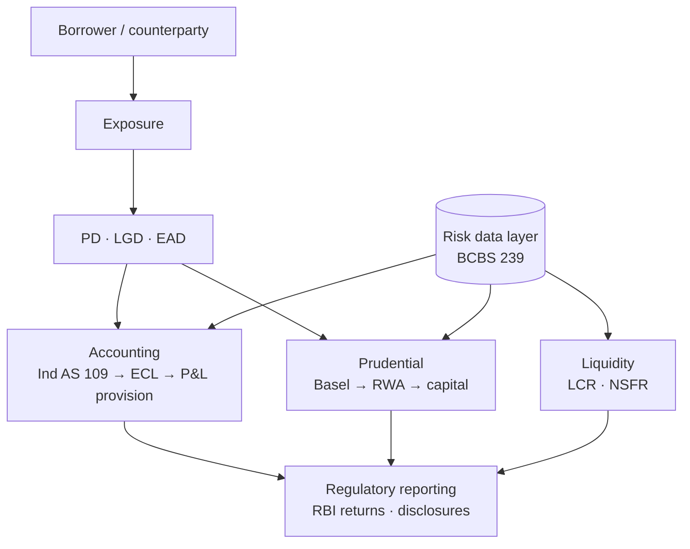
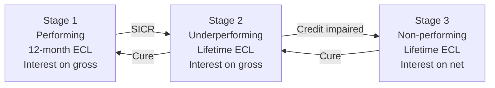
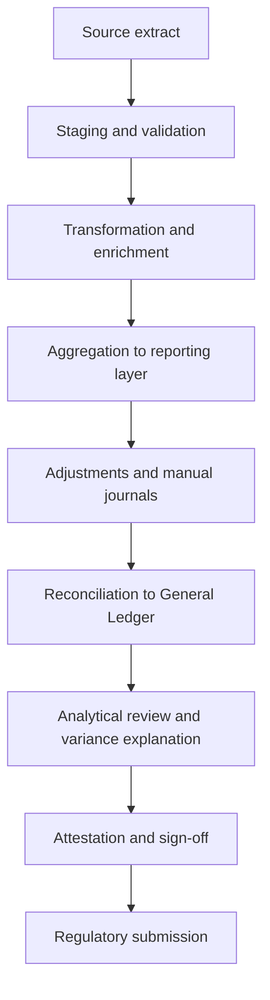

A single continuous pass over the domain: how a bank measures credit risk, what accounting does with that measurement, what prudential regulation does with the same measurement, how liquidity sits beside both, what data infrastructure holds it all up, and what the modelling and technology layers underneath look like.

The order is the argument. Each part earns the next.

> [!caution]
> Figures marked **[verify]** are time-sensitive regulatory specifics that have not been independently verified. Treat the principle as settled and the precise figure as provisional.

---

## Part 0 — The map

Everything below hangs off one structure. A bank lends. That lending creates exposure. Exposure is characterised by three parameters — the chance of default, the loss if default happens, and the amount at risk when it happens. Those three parameters then feed **two entirely separate consumers**:

- **Accounting** takes them and produces a *provision* — a charge to the profit and loss account, governed by Ind AS 109, answering "what loss do I expect?"
- **Prudential regulation** takes them and produces *capital* — a balance sheet buffer, governed by Basel, answering "what loss could surprise me?"

Expected loss is provisioned. Unexpected loss is capitalised. That single sentence is the spine of the entire domain.

Sitting underneath both is a **data layer** that must produce the same exposure, the same counterparty and the same number to both consumers — which is what BCBS 239 exists to enforce. Sitting beside both is **liquidity**, which is not about losses at all but about whether cash arrives when it is needed.



Every later section is a zoom into one box.

---

## Part 1 — Credit risk foundations

### What credit risk is

The risk that a counterparty fails to meet its obligations in full and on time. Not just default — deterioration counts, because deterioration changes the value of the claim and, under Ind AS 109, changes the provision immediately.

Credit risk decomposes into three sub-risks:

| Sub-risk | What it is |
|---|---|
| **Default risk** | The obligor fails to pay |
| **Migration risk** | The obligor's rating deteriorates without defaulting — value falls, provision rises |
| **Concentration risk** | Losses correlate because exposures are not independent — single name, sector, geography |

### Expected and unexpected loss

$$
EL = PD \times LGD \times EAD
$$

Expected loss is the mean of the loss distribution. It is a **cost of doing business** — priced into the spread, provisioned through P&L. Unexpected loss is the distance from that mean out to a high percentile of the same distribution (Basel uses 99.9% over one year). It cannot be priced away, so it is **absorbed by capital**.

```
Loss distribution
│
│      ╭──╮
│     ╱    ╲
│    ╱      ╲___
│   ╱           ╲______
└──┴───┴─────────┴──────────► Loss
   EL  ↑         ↑
       │         99.9th percentile
   Provisions    ────────────────
                 Capital covers this gap
                 (= Unexpected Loss)
```

### The three parameters

**PD — Probability of Default.** The chance the obligor defaults over a stated horizon. Two flavours:

- **Through-the-cycle (TTC)** — averaged across economic conditions, stable, used for Basel IRB capital so that requirements do not swing violently with the cycle.
- **Point-in-time (PIT)** — reflects current conditions, moves with the cycle, used for Ind AS 109 ECL because accounting wants today's best estimate.

Definition of default under Basel has two limbs: **90 days past due**, *or* **unlikeliness to pay**. Both count.

**LGD — Loss Given Default.** The share of exposure not recovered.

$$
LGD = 1 - \text{Recovery Rate}
$$

Recovery depends on collateral, seniority, legal enforceability and time to recover. Discounting matters: a recovery three years out is worth less than the same rupee today. Basel requires **downturn LGD** — LGD estimated under stressed conditions, because recoveries fall exactly when defaults rise. That correlation is the point.

**EAD — Exposure at Default.** The amount outstanding when default occurs.

$$
EAD = \text{Drawn} + CCF \times \text{Undrawn}
$$

The credit conversion factor exists because borrowers draw down committed lines as they deteriorate. A revolving facility at 40% utilisation today will not be at 40% at default.

### Rating systems

Two ratings, two purposes:

- **Obligor rating** → drives PD. It is about the borrower.
- **Facility rating** → drives LGD. It is about the structure — collateral, seniority, covenants.

Scorecards are the retail equivalent: application scorecards at origination, behavioural scorecards for existing accounts, collections scorecards for recovery prioritisation. Rating philosophy, calibration to a long-run default rate, and override rates are the governance points.

### Rating migration

A one-year transition matrix records how obligors move between grades over a
year. Rows are the starting grade, columns the ending grade, cells the
probability of that move. An illustrative corporate matrix, in per cent:

| From \ To | AAA | AA | A | BBB | BB | B | CCC | D |
|---|---:|---:|---:|---:|---:|---:|---:|---:|
| **AAA** | 90.8 | 8.3 | 0.7 | 0.1 | 0.1 | 0.0 | 0.0 | 0.00 |
| **AA** | 0.7 | 90.7 | 7.8 | 0.6 | 0.1 | 0.1 | 0.0 | 0.00 |
| **A** | 0.1 | 2.3 | 91.0 | 5.5 | 0.7 | 0.3 | 0.0 | 0.06 |
| **BBB** | 0.0 | 0.3 | 5.9 | 87.5 | 5.0 | 1.0 | 0.1 | 0.18 |
| **BB** | 0.0 | 0.1 | 0.6 | 7.7 | 81.2 | 8.8 | 1.0 | 1.06 |
| **B** | 0.0 | 0.1 | 0.2 | 0.5 | 6.5 | 83.5 | 4.1 | 5.20 |
| **CCC** | 0.2 | 0.0 | 0.3 | 1.0 | 2.4 | 11.2 | 64.9 | 19.79 |

Read the last column as the one-year PD for each grade. Read across a row to see
migration risk: a BBB obligor is far more likely to be downgraded than to
default, and under Ind AS 109 that downgrade alone may trigger SICR.

**Chaining to a term structure.** If the matrix is $M$, the n-year matrix is
$M^n$, and the cumulative PD to year $n$ is the default column of $M^n$.
Marginal and conditional PDs follow from the definitions in Part 2.

Two assumptions sit underneath, both known to be false and both worth naming:
the process is **Markov** — where the obligor came from does not matter, though
downgraded names in fact default more than same-grade peers — and it is
**time-homogeneous**, though matrices are strongly cycle-dependent. This is
exactly why capital uses matrices averaged across the cycle while ECL conditions
them on the macroeconomic state.

### Credit risk mitigation

Mitigation reduces the capital and provision requirement, but only where it is legally enforceable and operationally real.

| Technique | Effect |
|---|---|
| **Eligible financial collateral** | Reduces exposure. Two treatments: the *simple approach* substitutes the collateral's risk weight; the *comprehensive approach* reduces EAD after supervisory or own-estimate haircuts |
| **Guarantees and credit derivatives** | Substitution — the protection provider's risk weight replaces the obligor's, for the covered portion |
| **On-balance-sheet netting** | Loans and deposits with the same counterparty, netted where legally enforceable |
| **Physical collateral** | Recognised under IRB, not under the standardised approach |

Three haircuts apply in the comprehensive approach: on the exposure (it may grow), on the collateral (its value may fall), and for currency mismatch. Maturity mismatch between exposure and protection reduces recognition proportionately.

### Concentration and large exposures

$$
HHI = \sum_{i=1}^{n} w_i^2
$$

where $w_i$ is exposure share. Higher means more concentrated. Basel's IRB formula assumes an infinitely granular portfolio, so single-name concentration is a **Pillar 2** matter rather than a Pillar 1 charge.

The **Large Exposures Framework** caps it directly: exposure to a single counterparty or connected group is limited to a percentage of **Tier 1 capital** — commonly 20% for a single counterparty and 25% for a group of connected counterparties, with a tighter limit between global systemically important banks. Connected counterparty definition — control and economic interdependence — is where the operational difficulty sits, because it requires a maintained counterparty hierarchy. **[verify]**

### The lending lifecycle

Origination → underwriting → disbursal → monitoring → early warning → classification → resolution or recovery.

### India: IRAC classification

RBI's Income Recognition and Asset Classification norms are the prudential floor and run in parallel to accounting.

| Stage | Trigger |
|---|---|
| **SMA-0** | Principal or interest overdue 1–30 days |
| **SMA-1** | Overdue 31–60 days |
| **SMA-2** | Overdue 61–90 days |
| **NPA — Sub-standard** | NPA for up to 12 months |
| **NPA — Doubtful** | Sub-standard for more than 12 months (D1/D2/D3 by age) |
| **NPA — Loss** | Identified as uncollectible |

NPA at **90 days past due** for term loans; for cash credit and overdraft, the account is out of order — continuously in excess of the sanctioned limit or drawing power, or no credits sufficient to cover interest. Upgrade from NPA requires the **entire** overdue amount to be cleared, not a part payment. Special mention accounts feed CRILC reporting and early warning. **[verify]**

### IRAC and ECL side by side

IRAC provisioning is **rule-based and backward-looking** — a fixed percentage by asset class and ageing bucket. ECL is **model-based and forward-looking** — expected loss over a horizon, incorporating macroeconomic scenarios. They coexist: the higher of the two applies, so an entity computing ECL still cannot provision below IRAC.

### Stressed asset resolution in India

Beyond classification, there is a resolution track. RBI's **Prudential Framework for Resolution of Stressed Assets (7 June 2019)** requires lenders to recognise default and undertake a **review within 30 days**, after which an **Inter-Creditor Agreement** governs a resolution plan among lenders. Failure to implement within prescribed timelines triggers **additional provisioning**, which is the enforcement mechanism. Unresolved cases go to the **Insolvency and Bankruptcy Code** — a time-bound corporate insolvency resolution process with a moratorium, a resolution professional, a committee of creditors and a waterfall of claims on liquidation. Assets may also be sold to **Asset Reconstruction Companies** against security receipts. **[verify]**

Restructuring itself does not remove credit risk. Under Ind AS 109 a restructured exposure is typically a **modification**, and unless the modification is substantial enough to derecognise the original asset, the gross carrying amount is recomputed by discounting revised cash flows at the **original EIR**, with the difference to P&L. Forbearance flags carry into disclosure.

### Portfolio metrics

The vocabulary used to describe book quality:

| Metric | Definition |
|---|---|
| **GNPA ratio** | Gross NPA ÷ gross advances |
| **NNPA ratio** | (Gross NPA − provisions held) ÷ (gross advances − provisions held) |
| **Provision Coverage Ratio (PCR)** | Provisions held ÷ gross NPA; often quoted with and without technical write-offs |
| **Slippage ratio** | Fresh accretion to NPA during the period ÷ opening standard advances |
| **Credit cost** | Provisions charged to P&L ÷ average advances |
| **RWA density** | RWA ÷ total exposure — how risky the book looks after weighting |

**Write-off** removes the asset from the balance sheet where there is no reasonable expectation of recovery; a **technical write-off** removes it from the books while recovery efforts continue, which is why PCR is quoted both ways.

### Pricing and benchmarks

Lending rates in India are linked to an external benchmark for most retail and small business floating-rate loans — the **EBLR** regime, typically referencing the repo rate — while other loans price off the **MCLR**, an internal marginal cost of funds based rate. The spread over the benchmark carries expected loss, capital cost, operating cost and margin. This is where EL re-enters as a business input rather than an accounting output.

---

## Part 2 — Expected Credit Loss

### Where it applies in India

NBFCs and HFCs have been on **Ind AS 109 since FY2019-20**. Banks have remained on IRAC. RBI issued final **ECL Directions on 27 April 2026, effective 1 April 2027**, with a glide path running to **31 March 2031** for the transitional impact on capital. **[verify — the most date-sensitive block in this document]**

### The three-stage model

Ind AS 109 replaced the incurred-loss model with a forward-looking one. Credit deterioration, not just default, triggers a bigger provision.



| | Stage 1 | Stage 2 | Stage 3 |
|---|---|---|---|
| **Condition** | No significant increase in credit risk since origination | Significant increase in credit risk (SICR) | Credit-impaired / defaulted |
| **Loss allowance** | 12-month ECL | Lifetime ECL | Lifetime ECL |
| **Interest revenue** | EIR × **gross** carrying amount | EIR × **gross** carrying amount | EIR × **net** carrying amount |

The interest recognition switch at Stage 3 follows from the logic: once an asset is credit-impaired, interest stops accruing on money that is not expected to be collected, so the effective interest rate is applied to amortised cost **net** of the allowance.

Two exceptions to the three-stage model. **Purchased or originated credit-impaired (POCI)** assets never enter Stage 1 — they carry a credit-adjusted EIR and only *changes* in lifetime ECL are recognised. **Trade receivables, contract assets and lease receivables** may use the **simplified approach**, recognising lifetime ECL from the outset via a provision matrix, with no staging at all.

### SICR

There is no bright line in the standard by design. Implementations use three limbs:

1. **Quantitative** — a change in lifetime PD since initial recognition, measured **relative** rather than absolute. A move from 0.5% to 1.5% is a tripling; a move from 8% to 9% is not. Relative thresholds usually carry an absolute floor so trivial migrations do not trigger.
2. **Qualitative** — watchlist, forbearance, covenant breach, restructuring, rating downgrade beyond a threshold.
3. **Backstop** — **30 days past due** is a rebuttable presumption of SICR. Rebutting it requires evidence.

Note the asymmetry: SICR compares **current** lifetime PD against lifetime PD **at origination**. That means origination-date credit quality must be retained for every exposure for its entire life. That single requirement is what breaks most data architectures.

The standard also permits a **low credit risk exemption** — investment-grade-equivalent exposures may be left in Stage 1 — though its use is a scrutinised policy choice.

### Measurement

$$
ECL = \sum_{t=1}^{T} \frac{PD_t^{\text{marginal}} \times LGD_t \times EAD_t}{(1 + EIR)^t}
$$

Three things this formula encodes:

- **Marginal, not cumulative PD.** You need the probability of defaulting *in* period $t$ having survived to $t$, otherwise you double-count.
- **Discounting at the EIR**, not a market rate. The effective interest rate is the rate that exactly discounts estimated cash flows to the gross carrying amount at initial recognition.
- **Time-varying EAD** — amortisation, prepayment and drawdown all move the exposure across the life.

For 12-month ECL, the same formula runs with $T$ capped at 12 months, or the remaining life if shorter.

Undrawn commitments need care: for a revolving facility with no fixed term, ECL is measured over the period the entity is exposed to credit risk, which may exceed the contractual notice period.

### PD vocabulary

| Term | Meaning |
|---|---|
| **Cumulative PD** $F(t)$ | Probability of default at any point up to time $t$ |
| **Survival function** $S(t)$ | $1 - F(t)$ — probability of surviving to $t$ |
| **Marginal PD** | Probability of default *in* period $t$, unconditional: $S(t-1) - S(t)$ |
| **Conditional PD** (hazard) | Probability of default in period $t$ *given* survival to $t-1$: $\dfrac{S(t-1) - S(t)}{S(t-1)}$ |

Lifetime PD is built by chaining conditional PDs through a **PD term structure**, typically from a rating migration matrix raised to successive powers, or from survival analysis on the loan book.

### Forward-looking information

The standard requires **probability-weighted** outcomes incorporating reasonable and supportable forecasts. In practice: three scenarios (base, upside, downside), macroeconomic variables (GDP growth, unemployment, inflation, house prices, policy rate), a satellite model linking macro variables to PD, and scenario weights.

Running only the base case is not equivalent, because **ECL is a convex function of the macroeconomic drivers**. By Jensen's inequality, the expected value of a convex function exceeds the function of the expected value:

$$
\mathbb{E}[f(X)] \geq f(\mathbb{E}[X])
$$

So the average scenario **understates** ECL. The downside hurts more than the upside helps, and that asymmetry is the justification for multi-scenario modelling.

### Overlays

Management adjustments applied on top of model output where the model is known to be blind — a new risk not in the historical data, a data quality issue, a model limitation pending remediation. Governance expects every overlay to carry a stated rationale, a quantification basis, an owner and a **sunset plan**. Unexplained, perpetual overlays are an audit finding.

### The prudential floor

Provision recognised = **higher of** ECL and IRAC-mandated provisioning. Accounting does not lower the regulatory minimum.

### Worked example — two periods, one exposure

A term loan, gross carrying amount ₹100.00 lakh at origination, EIR 10%.

**Period 1 — Stage 1.** 12-month PD 2%, LGD 40%, EAD ₹100.00 lakh.

$$
ECL_1 = \frac{0.02 \times 0.40 \times 100.00}{1.10} = ₹0.727 \text{ lakh}
$$

Round to **₹0.73 lakh**. P&L charge ₹0.73 lakh.

**Period 2 — 45 days past due, SICR triggered, moves to Stage 2.** Lifetime now two remaining years. Marginal PDs 6% and 5%; LGD 45% on a downturn view; EAD ₹92.00 lakh then ₹80.00 lakh.

$$
ECL_2 = \frac{0.06 \times 0.45 \times 92.00}{1.10} + \frac{0.05 \times 0.45 \times 80.00}{1.10^2} = 2.258 + 1.488 = ₹3.75 \text{ lakh}
$$

A management overlay of **₹0.50 lakh** is applied for a sector stress not captured in the model.

**Allowance walk:**

| Line | ₹ lakh |
|---|---:|
| Opening allowance | 0.73 |
| Stage transfer 1 → 2 and remeasurement | +3.02 |
| Model ECL closing | 3.75 |
| Management overlay | +0.50 |
| **Closing allowance** | **4.25** |
| P&L charge for the period | 3.52 |

The overlay is added **once**, at the walk — not embedded in the model number and again in the walk. Double-counting the overlay is the classic implementation error.

### The run cycle

Data cut-off → exposure and cash flow assembly → staging determination → parameter application (PD/LGD/EAD term structures) → discounting → model ECL → overlay application → analytical review and variance explanation → committee challenge → sign-off → disclosure and submission.

Two controls anchor it: **movement analysis**, explaining the allowance walk line by line rather than only the closing balance, and **stage migration reporting**, showing how many accounts and how much exposure moved between stages and why.

### Disclosure

Ind AS 107 drives it: reconciliation of gross carrying amount and loss allowance by stage, credit quality analysis, inputs and assumptions including scenario weights, sensitivity of ECL to those assumptions, and the effect of modification and write-off.

---

## Part 3 — Basel capital

### The three pillars

| Pillar | Content |
|---|---|
| **Pillar 1** | Minimum capital requirements — credit, market, operational risk |
| **Pillar 2** | Supervisory review — ICAAP, risks not captured in Pillar 1 (concentration, IRRBB, reputational, strategic, climate), stress testing, SREP |
| **Pillar 3** | Market discipline — public disclosure of capital, risk and remuneration on prescribed templates |

### The capital stack

Capital is ranked by how readily it absorbs loss while the bank is a going concern.

| Tier | Instruments | Absorbs loss |
|---|---|---|
| **CET1** | Ordinary shares, retained earnings, disclosed reserves, less regulatory deductions | Going concern, first |
| **AT1** | Perpetual non-cumulative instruments with a write-down or conversion trigger | Going concern, on trigger |
| **Tier 2** | Subordinated debt with original maturity ≥ 5 years, amortised over the final 5 years | Gone concern |

Key CET1 deductions: goodwill and intangibles, deferred tax assets relying on future profitability, defined benefit pension surplus, investments in own shares, significant investments in financial entities above thresholds.

### Minimum ratios

$$
CRAR = \frac{\text{Eligible regulatory capital}}{RWA_{\text{credit}} + RWA_{\text{market}} + RWA_{\text{operational}}}
$$

| Ratio | Basel III | RBI (India) |
|---|---:|---:|
| CET1 | 4.5% | 5.5% |
| Tier 1 | 6.0% | 7.0% |
| Total capital (CRAR) | 8.0% | 9.0% |
| Capital conservation buffer (CET1) | +2.5% | +2.5% |
| **Effective total minimum** | **10.5%** | **11.5%** |
| Countercyclical buffer | 0–2.5% CET1 | Framework in place, not activated |
| D-SIB surcharge | 1.0–3.5% | Bucketed, published annually |

**[verify — the RBI divergence figures above]**

India requires **more** capital than the Basel minimum at every tier. Breaching a buffer does not close a bank — it restricts distributions (dividends, buybacks, discretionary bonus) through the capital conservation ladder, tightening as the shortfall deepens.

### RWA — credit risk

**Standardised Approach (SA).** Risk weights from external ratings and exposure class. Unrated corporate exposures take a flat weight; regulatory retail takes a preferential weight; residential mortgages are weighted by loan-to-value under the revised SA. RWA = exposure × risk weight, after credit risk mitigation.

**Internal Ratings Based (IRB).**

| | Bank supplies | Supervisor supplies |
|---|---|---|
| **Foundation IRB** | PD | LGD, EAD, maturity |
| **Advanced IRB** | PD, LGD, EAD, maturity | — |

The IRB risk weight function encodes the theory.

Asset correlation, decreasing in PD:

$$
R = 0.12 \cdot \frac{1 - e^{-50 \cdot PD}}{1 - e^{-50}} + 0.24 \cdot \left(1 - \frac{1 - e^{-50 \cdot PD}}{1 - e^{-50}}\right)
$$

Conditional PD at the 99.9th percentile of the systematic factor:

$$
PD_{\text{cond}} = \Phi\!\left(\frac{\Phi^{-1}(PD) + \sqrt{R}\,\Phi^{-1}(0.999)}{\sqrt{1-R}}\right)
$$

Capital requirement per unit of exposure, net of expected loss, with a maturity adjustment $b(PD)$:

$$
K = \left[LGD \cdot PD_{\text{cond}} - PD \cdot LGD\right] \cdot \frac{1 + (M - 2.5)\,b(PD)}{1 - 1.5\,b(PD)}
$$

$$
RWA = K \times 12.5 \times EAD
$$

What the formula is saying:

- It computes loss at a **99.9% confidence level** over one year — a one-in-a-thousand-year outcome.
- It subtracts EL, because EL is already provisioned. **Capital covers UL only** — the same distinction from Part 0, now mechanical.
- The $12.5$ is $1/0.08$ — it converts a capital requirement back into risk-weighted assets under an 8% minimum.
- Correlation **falls** as PD rises: high-PD borrowers default for idiosyncratic reasons, low-PD borrowers default together when the system fails.
- The model is a **single systematic factor, asymptotic single risk factor (ASRF)** model assuming infinite granularity, which is why concentration moves to Pillar 2.

**Worked figure.** Corporate exposure ₹100 crore, PD 1%, LGD 45%, M 2.5 years. R computes to roughly 0.20; conditional PD to roughly 12%; $K$ to roughly 0.09; so RWA ≈ 0.09 × 12.5 × 100 = **₹112.5 crore**, a risk weight of about 112%, and capital at 9% ≈ **₹10.1 crore**.

**The EL–provision comparison.** Under IRB, total eligible provisions are compared with regulatory expected loss. A shortfall is deducted from CET1; an excess may be added to Tier 2 within a cap. This is the formal bridge between the accounting number and the capital number.

### Securitisation and transfer of assets

Where a pool of exposures is transferred and tranched, capital follows the retained tranche rather than the underlying. The hierarchy of approaches runs from an internal-ratings-based method, through an external-ratings-based method, to a standardised fallback, with a floor risk weight on senior positions and punitive treatment below the attachment point. **Significant risk transfer** is the gating test: if risk has not genuinely left, the originator keeps the capital.

In India the same economics appear through **direct assignment** and the securitisation directions, and through **co-lending** arrangements where origination and retention are shared. **Priority sector lending** obligations drive much of this activity, since shortfalls carry consequences and PSL assets are traded through certificates.

### The output floor

Basel III finalisation caps the benefit of internal models. Total RWA cannot fall below **72.5%** of what the standardised approaches would produce, phased in. The purpose is to reduce unwarranted variability in RWA across banks with similar portfolios.

### Leverage ratio

$$
\text{Leverage ratio} = \frac{\text{Tier 1 capital}}{\text{Exposure measure}}
$$

Non-risk-based by design. The exposure measure includes on-balance-sheet assets, derivative exposures, securities financing transactions and off-balance-sheet items at credit conversion factors — it is **not** netted the way RWA is. Basel minimum 3%; RBI applies **4% for D-SIBs and 3.5% for other banks**. **[verify]**

It exists as a backstop: if the risk weights are wrong, the leverage ratio still binds.

### Market and operational risk

**Market risk.** FRTB replaced the older framework: a revised standardised approach (sensitivities-based method, default risk charge, residual risk add-on) and an internal models approach using **expected shortfall** rather than VaR, with liquidity horizons, desk-level model approval and a strict trading book / banking book boundary. Where a legacy framework is still in use, market risk capital charge × 12.5 gives market RWA.

**Operational risk.** The Standardised Measurement Approach replaced AMA and the earlier indicator approaches. Capital is driven by a **Business Indicator** — a size proxy from interest, services and financial components — scaled into a Business Indicator Component and multiplied by an **Internal Loss Multiplier** based on ten years of internal loss history.

### ICAAP, stress testing and emerging risks

ICAAP is the bank's own view of capital adequacy — Pillar 1 risks plus everything Pillar 1 misses, over a forward planning horizon, under baseline and stress. The supervisor reviews it and can impose an add-on. Stress testing links a macroeconomic scenario to PD and LGD migration, to provisions, to P&L, to capital ratios, and asks whether the bank stays above minimum. The same scenario machinery serves ECL and stress testing, which is why the two functions increasingly share infrastructure.

**Climate risk** now enters through the same door: physical risk (assets and borrowers exposed to acute and chronic hazards) and transition risk (borrowers exposed to policy, technology and demand shifts), assessed through long-horizon scenario analysis and disclosed under emerging frameworks rather than capitalised under Pillar 1.

---

## Part 4 — Liquidity and ALM

Liquidity is not a loss problem. A bank can be solvent and still fail because cash did not arrive on the day it was needed. Two ratios, two horizons.

### LCR — Liquidity Coverage Ratio

$$
LCR = \frac{\text{High Quality Liquid Assets}}{\text{Net cash outflows over 30 calendar days}} \geq 100\%
$$

A **30-day acute stress** survival test. HQLA is tiered:

| Level | Examples | Haircut | Cap |
|---|---|---:|---|
| **Level 1** | Cash, central bank reserves, sovereign debt | 0% | No cap |
| **Level 2A** | High-rated corporate and covered bonds, certain sovereigns | 15% | Level 2 total ≤ 40% of HQLA |
| **Level 2B** | Lower-rated corporates, some equities, RMBS | 25–50% | ≤ 15% of HQLA |

Net outflows = stressed outflows − capped inflows, where **inflows are capped at 75% of outflows** so a bank cannot claim liquidity it merely expects to receive. Outflow rates run by deposit type: stable retail lowest, less stable retail higher, operational wholesale moderate, non-operational wholesale and financial institution funding highest.

India: RBI has consulted on an **outflow add-on for retail deposits with internet and mobile banking access**, reflecting how quickly digitally-mobile deposits can leave. **[verify current status]**

### NSFR — Net Stable Funding Ratio

$$
NSFR = \frac{\text{Available Stable Funding}}{\text{Required Stable Funding}} \geq 100\%
$$

A **one-year structural** test. ASF weights liabilities by how likely they are to stay: capital and long-term debt 100%, stable retail deposits 90–95%, short wholesale 0–50%. RSF weights assets by how hard they are to monetise: cash 0%, short-dated liquid securities low, long-dated loans and illiquid assets high. It attacks maturity transformation directly — fund long assets with long money.

### ALM and structural liquidity

The **Structural Liquidity Statement** buckets all assets and liabilities by residual maturity and computes gaps. RBI prescribes cumulative negative gap tolerances on the first four buckets, commonly cited as **5%, 10%, 15% and 20%** of cumulative outflows. **[verify]**

Behavioural assumptions do the real work: savings deposits are contractually overnight but behaviourally sticky; term deposits carry premature withdrawal; loans carry prepayment. The behavioural study is where ALM teams spend their time.

### IRRBB

Interest rate risk in the banking book, measured two ways:

- **Economic Value of Equity (EVE)** — the present value effect of rate shocks across the balance sheet. Long-run, value-based.
- **Net Interest Income (NII)** — the earnings effect over a one to two year horizon. Short-run, earnings-based.

Standardised shocks: parallel up and down, steepener, flattener, short rate up and down. A material EVE decline against Tier 1 capital under any prescribed shock is a supervisory outlier trigger.

### Everything else on the liquidity page

Intraday liquidity, funding concentration by counterparty and instrument, currency-wise LCR, asset encumbrance, and the **contingency funding plan** with defined early warning indicators and escalation triggers. In India, CRR and SLR sit alongside — SLR securities are HQLA-eligible within limits, which links monetary policy instruments to the liquidity framework. **Transfer pricing** closes the loop: funds transfer pricing charges business lines for the liquidity and term risk they create, so the ratios influence behaviour rather than merely measuring it.

---

## Part 5 — Capital markets products

### Cash products

**Equities** — ownership, residual claim. **Bonds** — debt claim priced off yield; the key sensitivities are duration (first-order rate sensitivity) and convexity (second-order). **Repo** — sale with agreed repurchase; economically secured funding, legally a sale, which is why it interacts with the leverage ratio and NSFR.

### Derivatives

| Product | What it is |
|---|---|
| **Forward** | OTC agreement to transact at a future date at an agreed price |
| **Future** | Exchange-traded, standardised, margined daily |
| **Interest rate swap** | Exchange fixed for floating on a notional; no principal exchange |
| **Cross-currency swap** | As above in two currencies, principal usually exchanged |
| **Option** | Right without obligation; buyer pays premium, seller carries open-ended risk |

Option sensitivities: **delta** to spot, **gamma** to delta, **vega** to volatility, **theta** to time, **rho** to rates.

### Counterparty credit risk

Derivatives create credit exposure that **changes with market moves**, which is what distinguishes them from a loan where exposure is known.

**SA-CCR** replaced the Current Exposure Method:

$$
EAD = 1.4 \times (RC + PFE)
$$

where $RC$ is replacement cost — current mark-to-market floored at zero, net of collateral — and $PFE$ is potential future exposure by asset class and maturity. The 1.4 alpha is a supervisory multiplier for model risk and wrong-way risk.

**Wrong-way risk** — exposure rises exactly as counterparty credit quality falls; the classic case is taking collateral correlated to the counterparty. **CVA** — credit valuation adjustment, the market value of counterparty credit risk, carrying its own capital charge because CVA losses in 2008 exceeded outright default losses.

### Market infrastructure

OTC versus exchange-traded; **central clearing** through a CCP with initial and variation margin; bilateral trades under an **ISDA master agreement** with a **CSA** governing collateral; close-out netting; settlement risk (Herstatt risk) mitigated by payment-versus-payment and CLS.

Trade lifecycle: execution → confirmation → clearing → settlement → reconciliation → reporting.

### Why this connects back

These products drive market risk RWA, counterparty credit RWA, large exposure calculation and a significant share of reporting complexity. Trade-level data quality is where reporting programmes usually break.

---

## Part 6 — Risk data and regulatory reporting

Every number above is only as good as the data that produced it, and supervisors now examine the data as seriously as the number.

### BCBS 239

Principles for effective risk data aggregation and risk reporting. Fourteen principles in four blocks:

| Block | Principles | Substance |
|---|---|---|
| **Governance and infrastructure** | 1–2 | Board accountability, architecture and IT that supports aggregation in normal and stressed conditions |
| **Risk data aggregation capabilities** | 3–6 | **Accuracy and integrity, completeness, timeliness, adaptability** |
| **Risk reporting practices** | 7–11 | Accuracy, comprehensiveness, clarity and usefulness, frequency, distribution |
| **Supervisory review** | 12–14 | Review, remedial action, home–host cooperation |

The four aggregation capabilities are **accuracy, completeness, timeliness, adaptability**. Adaptability is the demanding one: it means answering a question the supervisor has not asked yet, quickly, on demand.

### Data governance

- **Golden source** — one authoritative source per data element; everything else is a copy, and copies do not get to disagree.
- **Data lineage** — the traceable path from source system through every transformation to the reported figure. Manual reconciliation is not a substitute.
- **Ownership** — data owners accountable for the element, data stewards operating the controls, with a Chief Data Officer owning the framework.
- **Data quality dimensions** — completeness, accuracy, consistency, timeliness, validity, uniqueness. DQ rules are written per dimension per critical element, with thresholds, exception reporting and a remediation log.
- **Critical Data Elements (CDEs)** — the elements that drive material reported figures, formally designated and controlled to a higher standard, because everything cannot be controlled equally.
- **Reference data** — counterparty master, legal entity hierarchy and **LEI**, product taxonomy, rating scales, currency and calendar. Aggregation fails on reference data far more often than on transaction data, because two systems disagreeing about who the counterparty is cannot be reconciled downstream.

### The production and sign-off cycle



The controls that hold it together:

- **Reconciliation to the GL** — risk and finance numbers must tie. Where they cannot tie by definition, the difference is standing and explained, not rediscovered each cycle.
- **Variance analysis** — period-on-period movement explained by driver, not merely observed.
- **Manual adjustments log** — every journal outside the automated flow, with rationale, approver and an expiry date.
- **Four-eyes and a sign-off matrix** — preparer, reviewer, approver, with delegated authority documented.
- **Late data and restatement policy** — what happens when a source arrives after cut-off, and when a submitted return must be corrected.

### The returns

**India.** **ADF — Automated Data Flow** is RBI's requirement that returns be generated straight from source systems without manual intervention. Returns are filed through RBI's platforms, many in **XBRL**. Key submissions include **CRILC** for large credit exposures with SMA reporting, **DSB / RBS returns** under Risk Based Supervision, capital adequacy returns, and ALM and liquidity returns. **[verify — names and frequencies shift]**

**Europe, as reference.** **COREP** is prudential — own funds, capital requirements, large exposures, leverage, liquidity. **FINREP** is financial — balance sheet, P&L, forbearance and non-performing exposures on an IFRS basis. **AnaCredit** is granular loan-level credit data. Both COREP and FINREP come off the same underlying data, which is why divergence between them is itself a finding.

### Regulatory change delivery

Horizon scanning → impact assessment → **interpretation** → requirements → build → test including **parallel run** → **dual reporting**, where old and new are produced together → cutover → post-implementation review.

Interpretation is the step where programmes fail. A regulatory text is not a specification. Establishing an agreed, documented, defensible interpretation — with legal, risk and finance aligned, and with the supervisor where necessary — precedes any build.

### Waterfall, agile and what actually happens

The deadline is fixed by the regulator. The scope is fixed by the text. Both sit badly with pure agile, which flexes scope to protect time.

What runs in practice is a **hybrid**:

- **Waterfall governs the programme spine** — regulatory milestones, parallel run dates, submission dates, external dependencies, formal stage gates and audit evidence.
- **Agile governs the build** — delivery teams work in sprints against a prioritised backlog and demonstrate working reporting output early rather than at the end.

Prioritisation is by **regulatory materiality** rather than business value: the mandatory minimum submission is the minimum viable product and enhancements queue behind it. Traceability from regulatory clause → requirement → test case → evidence is non-negotiable however the build is organised.

### Requirements and traceability

The regulatory text is not a specification, so a chain of artefacts converts it
into something buildable and auditable.

| Artefact | Holds |
|---|---|
| **Interpretation paper** | What the clause means for this institution, agreed by legal, risk and finance, with the supervisor where needed |
| **Business requirements (BRD)** | What must be produced, in business language, traced to the clause |
| **Functional specification** | How the system produces it — sources, transformations, calculations, outputs |
| **Data dictionary** | Every field: definition, source, permitted values, owner |
| **Requirements traceability matrix** | Clause → requirement → design → test case → evidence, both directions |

The traceability matrix is the artefact a regulator or an internal auditor asks
for. Both directions matter: every clause reaches a test, and every test traces
back to a clause. Requirements with no clause behind them are scope creep;
clauses with no test behind them are exposure.

### Test stages

| Stage | Question it answers |
|---|---|
| **Unit** | Does each component compute what it was specified to compute? |
| **System integration (SIT)** | Do the components work together end to end, source through submission? |
| **Data reconciliation** | Does the output tie to the general ledger and to the source systems? |
| **Regression** | Did this change break an existing return? |
| **User acceptance (UAT)** | Does the business accept the output as correct and usable? |
| **Parallel run** | Does the new process produce the same answer as the old one, and where it differs, is the difference explained and expected? |

Parallel run is the stage that distinguishes regulatory change from ordinary
delivery. Differences are not defects by default — the new rule is *meant* to
change the number. Every variance is classified as expected, explained by the
rule change, or a genuine defect. An unexplained variance blocks go-live.

**Dual running** goes further: both old and new are produced and submitted, or
produced and reconciled, for a defined period after go-live.

### Cutover and handover

Cutover is planned as its own workstream, not as the last day of the build.

- **Cutover plan** — sequenced tasks with owners, durations and dependencies, run
  as a timed rehearsal at least once before the real event.
- **Go / no-go criteria** — defined in advance and agreed at a decision forum, so
  the decision is made against a standard rather than under pressure.
- **Rollback** — what happens if the first live submission fails. For a fixed
  regulatory date, rollback usually means reverting to the old process, which is
  only possible if the old process was kept alive.
- **BAU handover** — runbooks, control ownership, the sign-off matrix, the
  support model, and a defined hypercare period. A regulatory build that is not
  handed over becomes a permanent project.

### Governance artefacts

| Artefact | Purpose |
|---|---|
| **RAID log** | Risks, assumptions, issues, dependencies — each owned and dated |
| **RACI** | Who is responsible, accountable, consulted, informed, per deliverable |
| **Milestone plan** | Anchored backwards from the regulatory date, with the critical path named |
| **Stage gates** | Formal entry and exit criteria per phase, with evidence retained |
| **Steering committee** | Decision forum for scope, cost, and escalated risk |
| **Change control** | How a scope change is raised, assessed for regulatory impact, and approved |

Assumptions deserve particular attention. On a regulatory programme the largest
risks are usually assumptions about interpretation that nobody has challenged —
they sit in the log unowned until a supervisor disagrees and the build is wrong.

---

## Part 7 — SQL and Oracle

### The patterns this work uses

**Window functions** carry most risk analytics, because almost every question is how an exposure changed relative to itself over time.

```sql
-- Stage migration: prior stage vs current stage per account
SELECT
    account_id,
    reporting_date,
    stage,
    LAG(stage) OVER (PARTITION BY account_id ORDER BY reporting_date) AS prior_stage
FROM ecl_staging;
```

```sql
-- Deduplicate to the latest record per account
SELECT * FROM (
    SELECT t.*,
           ROW_NUMBER() OVER (PARTITION BY account_id
                              ORDER BY load_timestamp DESC) AS rn
    FROM exposure_stg t
) WHERE rn = 1;
```

```sql
-- Stage migration matrix by count and exposure
SELECT prior_stage,
       stage,
       COUNT(*)                  AS accounts,
       SUM(exposure_amt)/100000  AS exposure_lakh
FROM   stage_movement
WHERE  reporting_date = DATE '2026-09-30'
GROUP BY prior_stage, stage
ORDER BY prior_stage, stage;
```

```sql
-- Reconciliation: source vs reported, flagging breaks
WITH src AS (SELECT cob_date, SUM(amt) AS src_amt FROM source_exposure   GROUP BY cob_date),
     rpt AS (SELECT cob_date, SUM(amt) AS rpt_amt FROM reported_exposure GROUP BY cob_date)
SELECT s.cob_date, s.src_amt, r.rpt_amt,
       s.src_amt - r.rpt_amt AS variance,
       CASE WHEN ABS(s.src_amt - r.rpt_amt) > 100000 THEN 'BREAK' ELSE 'OK' END AS status
FROM   src s JOIN rpt r ON s.cob_date = r.cob_date;
```

```sql
-- DPD bucketing with a running exposure share
SELECT CASE WHEN dpd = 0            THEN 'Current'
            WHEN dpd BETWEEN 1  AND 30 THEN 'SMA-0'
            WHEN dpd BETWEEN 31 AND 60 THEN 'SMA-1'
            WHEN dpd BETWEEN 61 AND 90 THEN 'SMA-2'
            ELSE 'NPA' END                              AS bucket,
       SUM(exposure_amt)                                AS exposure,
       RATIO_TO_REPORT(SUM(exposure_amt)) OVER ()       AS share
FROM   loan_book
GROUP BY CASE WHEN dpd = 0            THEN 'Current'
              WHEN dpd BETWEEN 1  AND 30 THEN 'SMA-0'
              WHEN dpd BETWEEN 31 AND 60 THEN 'SMA-1'
              WHEN dpd BETWEEN 61 AND 90 THEN 'SMA-2'
              ELSE 'NPA' END;
```

### Core recall

| Concept | Note |
|---|---|
| Join types | INNER, LEFT, RIGHT, FULL OUTER, CROSS. Anti-join via `NOT EXISTS` — safer than `NOT IN` with nulls |
| `WHERE` vs `HAVING` | `WHERE` filters rows before aggregation, `HAVING` filters groups after |
| Execution order | FROM → WHERE → GROUP BY → HAVING → SELECT → ORDER BY. Explains why a SELECT alias is unusable in WHERE |
| CTEs | `WITH` for readability and reuse; recursive CTEs for hierarchies |
| Window vs aggregate | Aggregate collapses rows; window keeps them and adds a computed column |
| `RANK` / `DENSE_RANK` / `ROW_NUMBER` | Gaps on ties / no gaps on ties / arbitrary unique sequence |
| Nulls | `NULL` equals nothing, including itself; use `IS NULL`, `COALESCE`, `NVL` |
| Set operators | `UNION` deduplicates and sorts, `UNION ALL` does not — use `UNION ALL` unless duplicates matter |

### Oracle specifics

`NVL`, `NVL2` and `DECODE` for conditional logic; `TO_DATE` and `TO_CHAR` with explicit format masks rather than relying on session NLS settings; `MERGE` for upserts; `CONNECT BY PRIOR` for hierarchy traversal; analytic functions with `KEEP (DENSE_RANK FIRST/LAST)`; `ROWNUM` versus `ROW_NUMBER()`, and why filtering on `ROWNUM` before ordering is a common bug.

Performance and design: table **partitioning** by reporting date, essential for month-end risk tables; local versus global indexes; bitmap indexes on low-cardinality flags; **materialised views** for pre-aggregated reporting layers; `EXPLAIN PLAN` and gathering optimiser statistics; and bulk operations (`BULK COLLECT`, `FORALL`) in PL/SQL rather than row-by-row loops.

---

## Part 8 — Modelling and machine learning

### Where models sit

| Use | Typical model | Why |
|---|---|---|
| Application and behavioural scorecards | Logistic regression on WOE-binned variables | Interpretable, stable, accepted by supervisors, easy to monitor |
| PD term structure | Survival models, rating migration matrices | Produces the time-varying PD that ECL needs |
| Challenger and early warning | Gradient boosting — XGBoost, LightGBM, CatBoost | Higher discrimination, used to challenge the champion |
| Collections prioritisation | Gradient boosting, uplift models | A ranking problem where interpretability binds less |
| Document and text extraction | Transformer models | Unstructured inputs |

Neural networks are rare in regulated credit decisioning — not because they cannot predict, but because an adverse decision must be explainable, stability must be evidenced, and the model must survive independent validation.

### Metrics

| Metric | Meaning | Use |
|---|---|---|
| **AUC / ROC** | Probability a random defaulter scores worse than a random non-defaulter | Discrimination |
| **Gini** | $2 \times AUC - 1$ | The same information, in the number the industry quotes |
| **KS statistic** | Maximum separation between cumulative good and bad distributions | Discrimination, cut-off selection |
| **PSI** | Population Stability Index — distribution shift versus development sample | Monitoring: <0.10 stable, 0.10–0.25 watch, >0.25 investigate |
| **Precision / Recall** | Of predicted positives, how many are right / of actual positives, how many caught | Imbalanced problems |
| **Brier score, calibration plot** | Whether predicted probabilities are right in **level**, not only in rank | Essential wherever the absolute PD feeds a rupee number |

The last row carries the distinction: a scorecard needs **discrimination** (ranking), an ECL model needs **calibration** (level). A model with excellent Gini and poor calibration produces a wrong provision.

### Practical discipline

- **Class imbalance.** Default rates are low. Options are class weights, undersampling, and SMOTE and its variants. Resampling distorts the predicted probability level, so recalibrate afterwards wherever the absolute PD matters.
- **Validation split.** Train, test and **out-of-time**. Out-of-time is the decisive one in credit, because the real risk is that the relationship changes over time rather than across rows.
- **Cross-validation** for hyperparameter selection; never tune on the out-of-time sample.
- **Overfitting** — the model has learnt the sample rather than the phenomenon. Signal: strong in-sample performance, weak out-of-time.
- **Feature engineering** — WOE and information value for binning, correlation and VIF checks, and exclusion of variables unavailable at decision time (leakage) and of prohibited variables.

### Model risk management

**Development**, documented and reproducible with data lineage → **independent validation** covering conceptual soundness, data, implementation testing, outcomes analysis and benchmarking against a challenger → **approval by a model committee** → **ongoing monitoring** of discrimination, calibration, PSI and override rates → **periodic revalidation** → a **model inventory** with tiering by materiality.

Explainability: SHAP values, partial dependence, reason codes for adverse action. Fairness: excluding prohibited attributes is necessary but not sufficient, because proxies exist.

---

## Part 9 — The AI stack

Current to September 2026.

### The layers

| Layer | Content |
|---|---|
| **Compute** | GPUs and accelerators, cloud regions, inference versus training cost profiles |
| **Foundation models** | Pre-trained transformers, open-weight and closed, sized for capability against latency and cost |
| **Adaptation** | Prompting, few-shot, retrieval augmentation, fine-tuning, distillation |
| **Data and retrieval** | Embeddings, vector stores, chunking, hybrid search, re-ranking |
| **Orchestration** | Tool and function calling, agents, multi-step workflows, MCP-style tool interfaces |
| **Evaluation and control** | Evals, guardrails, observability, human-in-the-loop, cost and latency monitoring |

### Concepts

**Transformer** — attention-based architecture where every token attends to every other, which is why context is expensive. **Tokens** — sub-word units; cost and limits are counted in these. **Context window** — how much the model can see at once. **Embeddings** — text as vectors, so similarity becomes distance. **RAG** — retrieve relevant documents, place them in context, then answer; the default approach for factual grounding and for keeping proprietary data out of training. **Fine-tuning** — changing weights, suited to form and behaviour rather than facts. **Function and tool calling** — the model emits a structured call, the system executes it, the result returns to context. **Agent** — a model in a loop with tools and a goal. **Evals** — a test suite for a non-deterministic system; without them there is no regression protection. **Hallucination** — fluent, confident and wrong, which is why human review sits on anything that leaves the building.

### Where it lands in a risk function

Document and covenant extraction from credit agreements; early warning from unstructured news and filings; drafting and maintaining model documentation; regulatory text change detection and impact triage; reconciliation break investigation; legacy code translation during platform migration; and first-draft report commentary under human sign-off.

Any AI inside a regulated process is **a model**. It enters the model inventory, is tiered, validated and monitored, and a named human remains accountable for the output. The technology does not change who signs.

---

## Part 10 — Reference numbers

| Item | Figure |
|---|---|
| Basel CET1 minimum | 4.5% |
| Basel Tier 1 minimum | 6.0% |
| Basel total capital minimum | 8.0% |
| Capital conservation buffer | 2.5% CET1 |
| Basel effective total minimum | 10.5% |
| RBI CET1 / Tier 1 / Total **[verify]** | 5.5% / 7.0% / 9.0% |
| RBI effective total with CCB **[verify]** | 11.5% |
| Countercyclical buffer range | 0–2.5% CET1 |
| Output floor | 72.5% of standardised RWA |
| Leverage ratio — Basel | 3% |
| Leverage ratio — RBI D-SIB / others **[verify]** | 4% / 3.5% |
| Large exposure limit — single / group **[verify]** | 20% / 25% of Tier 1 |
| RWA multiplier in IRB | 12.5 (= 1 / 0.08) |
| IRB confidence level | 99.9%, one year |
| IRB asset correlation range, corporate | 0.12 to 0.24 |
| SA-CCR alpha | 1.4 |
| LCR minimum / horizon | 100% / 30 calendar days |
| HQLA Level 2 cap / Level 2B cap | 40% / 15% of HQLA |
| HQLA haircut, Level 2A / 2B | 15% / 25–50% |
| LCR inflow cap | 75% of outflows |
| NSFR minimum / horizon | 100% / one year |
| One-year PD, investment grade (illustrative) | under 0.2% |
| One-year PD, CCC (illustrative) | around 20% |
| Default definition — days past due | 90 |
| SICR backstop presumption | 30 days past due, rebuttable |
| NPA recognition, term loans | 90 days past due |
| SMA-0 / SMA-1 / SMA-2 | 1–30 / 31–60 / 61–90 days overdue |
| Sub-standard → doubtful | After 12 months as NPA |
| Stressed asset review period **[verify]** | 30 days from default |
| Ind AS 109 for NBFCs and HFCs | Since FY2019-20 |
| RBI final ECL Directions issued **[verify]** | 27 April 2026 |
| ECL effective date **[verify]** | 1 April 2027 |
| ECL glide path ends **[verify]** | 31 March 2031 |
| Gini from AUC | $2 \times AUC - 1$ |
| PSI thresholds | <0.10 stable, 0.10–0.25 watch, >0.25 investigate |
| BCBS 239 | 14 principles; 4 aggregation capabilities |

---

## Part 11 — Acronyms

| | | | |
|---|---|---|---|
| **ADF** Automated Data Flow | **ALM** Asset Liability Management | **ARC** Asset Reconstruction Company | **ASF** Available Stable Funding |
| **ASRF** Asymptotic Single Risk Factor | **AT1** Additional Tier 1 | **BIC** Business Indicator Component | **CCF** Credit Conversion Factor |
| **CCP** Central Counterparty | **CCyB** Countercyclical Buffer | **CDE** Critical Data Element | **CET1** Common Equity Tier 1 |
| **COREP** Common Reporting | **CRAR** Capital to Risk-weighted Assets Ratio | **CRILC** Central Repository of Information on Large Credits | **CRM** Credit Risk Mitigation |
| **CSA** Credit Support Annex | **CVA** Credit Valuation Adjustment | **DPD** Days Past Due | **D-SIB** Domestic Systemically Important Bank |
| **EAD** Exposure at Default | **EBLR** External Benchmark Lending Rate | **ECL** Expected Credit Loss | **EIR** Effective Interest Rate |
| **EL / UL** Expected / Unexpected Loss | **EVE** Economic Value of Equity | **FINREP** Financial Reporting | **FRTB** Fundamental Review of the Trading Book |
| **GNPA / NNPA** Gross / Net NPA | **HQLA** High Quality Liquid Assets | **IBC** Insolvency and Bankruptcy Code | **ICAAP** Internal Capital Adequacy Assessment Process |
| **ICA** Inter-Creditor Agreement | **ILM** Internal Loss Multiplier | **IRAC** Income Recognition and Asset Classification | **IRB** Internal Ratings Based |
| **IRRBB** Interest Rate Risk in the Banking Book | **KS** Kolmogorov–Smirnov | **LCR** Liquidity Coverage Ratio | **LEI** Legal Entity Identifier |
| **LGD** Loss Given Default | **MCLR** Marginal Cost of Funds based Lending Rate | **NII** Net Interest Income | **NSFR** Net Stable Funding Ratio |
| **PCR** Provision Coverage Ratio | **PD** Probability of Default | **PFE** Potential Future Exposure | **PIT / TTC** Point-in-Time / Through-the-Cycle |
| **POCI** Purchased or Originated Credit-Impaired | **PSI** Population Stability Index | **PSL** Priority Sector Lending | **RSF** Required Stable Funding |
| **RAID** Risks, Assumptions, Issues, Dependencies | **RTM** Requirements Traceability Matrix | | |
| **RWA** Risk Weighted Assets | **SA** Standardised Approach | **SA-CCR** Standardised Approach for Counterparty Credit Risk | **SICR** Significant Increase in Credit Risk |
| **SIT** System Integration Testing | **SMA** Special Mention Account | **SMA (op risk)** Standardised Measurement Approach | **SREP** Supervisory Review and Evaluation Process |
| **UAT** User Acceptance Testing | **WOE** Weight of Evidence | | |

---

## Part 12 — Recall check

Reproduce these eleven from memory on a blank page. Each one compresses a part of the document.

1. The **Part 0 map** — exposure → PD/LGD/EAD → accounting and prudential, with the data layer underneath.
2. The **loss distribution**, with EL under provisions and UL under capital.
3. The **three-stage ECL model**, with the interest recognition switch marked at Stage 3.
4. The **ECL summation formula**, with marginal PD and EIR discounting.
5. The **allowance walk** — opening, transfers, remeasurement, overlay, closing.
6. The **capital stack** — CET1, AT1, Tier 2, with RBI minimums beside Basel minimums.
7. The **CRAR ratio**, with all three RWA components in the denominator.
8. The **IRB shape** — correlation falling with PD, conditional PD at 99.9%, minus EL, times 12.5.
9. The **LCR and NSFR ratios**, with what sits in each numerator and denominator.
10. The **reporting production cycle**, from source extract to submission, with reconciliation and sign-off marked.
11. The **model lifecycle** — development, independent validation, approval, monitoring, revalidation.
12. A **rating migration matrix** in outline, with the default column marked and the chaining rule beside it.
13. The **test stages** from unit through parallel run, with the question each one answers.

---

## The compression

Expected loss is provisioned; unexpected loss is capitalised. PD, LGD and EAD feed both, and the same data must serve both. Ind AS 109 is forward-looking and stage-based, IRAC is rule-based and backward-looking, and in India both apply with the higher provision winning. Basel sets capital against a 99.9% loss net of what is already provisioned, with India requiring more than the global minimum at every tier. Liquidity is a separate question about the timing of cash, answered over thirty days by LCR and over a year by NSFR. BCBS 239 exists because none of the above is credible if the data cannot be aggregated accurately, completely, on time and adaptably. Models must be not only discriminating but calibrated. And every model, AI included, has a human who signs.

Everything else is detail hanging off those seven sentences.
