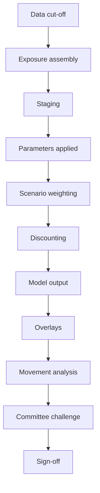
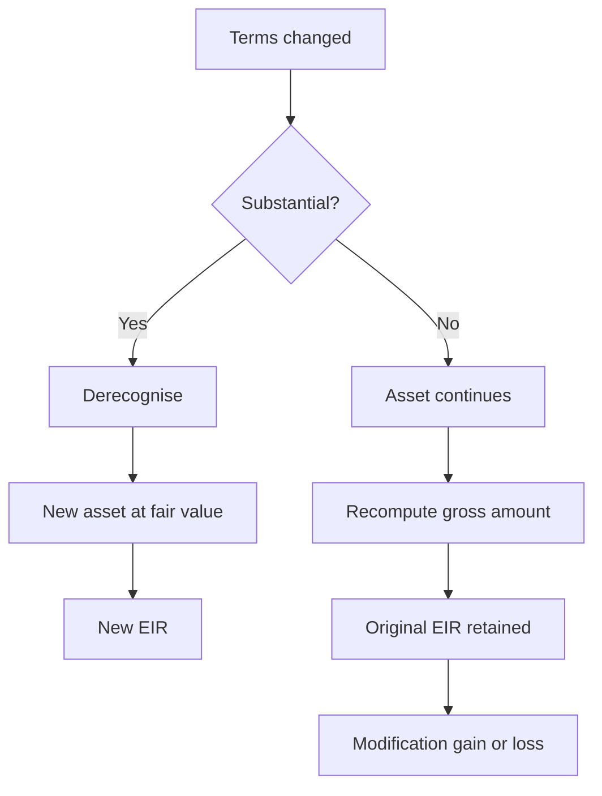

## Part 0 — The bank

Everything in this document happens inside one institution. It is a mid-sized Indian bank, and this is its balance sheet.

| Assets | ₹ crore | Liabilities and equity | ₹ crore |
|---|---:|---|---:|
| Cash and balances with RBI | 130 | Deposits — retail | 900 |
| Investments | 520 | Deposits — wholesale | 400 |
| Advances, net of allowance | 978 | Borrowings | 200 |
| Fixed and other assets | 72 | Other liabilities | 50 |
| | | Equity capital and reserves | 150 |
| **Total** | **1,700** | **Total** | **1,700** |

Two things on that sheet do the work of this volume. **Advances** is the loan book — ₹1,000 crore lent out, less an allowance of ₹22 crore against losses not yet realised. **Equity capital and reserves** is ₹150 crore of the owners' money, sitting last in the queue to be repaid, which is precisely what makes it capital.

The ratio between them is the whole subject. The bank has lent ₹1,000 crore and has ₹150 crore of its own money behind it. Depositors supplied the other ₹1,300 crore and expect it back in full. If the loan book loses more than ₹150 crore, the deposits start absorbing losses, and at that point the bank has failed.

So the question that organises everything is: **how much can this book lose, how much of that should we already have set aside, and how much capital must stand behind the rest?**

### The book

The ₹1,000 crore of advances is spread across ten corporate borrowers.

| # | Borrower sector | Exposure ₹ crore | Share | Rating |
|---|---|---:|---:|---|
| 1 | Steel manufacturing | 100 | 10.0% | BBB |
| 2 | Cement | 150 | 15.0% | A |
| 3 | Textiles | 80 | 8.0% | BB |
| 4 | Road construction | 200 | 20.0% | BBB |
| 5 | Pharmaceuticals | 60 | 6.0% | A |
| 6 | Non-banking financial company | 120 | 12.0% | AA |
| 7 | Hotels | 70 | 7.0% | BB |
| 8 | Auto components | 90 | 9.0% | BBB |
| 9 | Power distribution | 90 | 9.0% | BBB |
| 10 | Information technology services | 40 | 4.0% | AA |
| | **Total** | **1,000** | **100%** | |

Those are drawn amounts — money actually out of the door and sitting in advances. The bank has also sanctioned ₹180 crore of cash credit limits to the same ten borrowers, of which ₹72 crore is drawn and already inside the ₹1,000 crore. The remaining **₹108 crore is undrawn and appears nowhere on the balance sheet**, which will turn out to matter a great deal.

Borrower 1, the steel manufacturer, is the one to watch. Over the next four years it will be downgraded, fall past due, be classified non-performing, and default. Following that single ₹100 crore facility from disbursement to write-down is how this volume is built, because every concept in credit risk shows up somewhere along that path.

### How to read this

Each part stands on one line of the balance sheet above.

| Part | Balance sheet line | Question it answers |
|---|---|---|
| 1 | Advances, gross | What is a loan actually worth on the books? |
| 2 | — | What can go wrong, and how is that size measured? |
| 3 | — | How does a borrower's quality change over time? |
| 4 | Advances, the whole book | Why is a book riskier than the sum of its loans? |
| 5 | The allowance between gross and net | What do we set aside, and when? |
| 6 | The allowance, Indian rules | What does RBI require on top of the accounting? |
| 7 | Equity capital and reserves | How much of the owners' money must stand behind it? |

Volume 2 reads the rest of the sheet — deposits, borrowings, investments, and the reporting machine that assembles all of it into returns.

---

## Part 1 — What a loan is worth

### The money out is not the asset

On 1 April, the bank disburses ₹100 crore to the steel manufacturer. A five-year term loan, interest at 10% paid annually, the whole principal repaid at the end of year five. At the same time the bank collects a ₹2 crore processing fee from the borrower.

So ₹100 crore left the bank and ₹2 crore came back. Net cash out of the door on day one: **₹98 crore**.

Now: what should the loan appear as in advances?

The naive answer is ₹100 crore, because that is the principal. The naive answer is wrong, and seeing why is the foundation of everything that follows. The bank did not part with ₹100 crore. It parted with ₹98 crore, and in return it will receive ₹10 crore a year for five years plus ₹100 crore at the end. The asset is worth what was actually invested in it, and the return on it is whatever rate makes those future receipts equal ₹98 crore today.

That rate is not 10%.

### The effective interest rate

The **effective interest rate (EIR)** is the rate that exactly discounts all estimated future cash receipts over the expected life of the asset back to what was actually paid out at origination.

$$
\text{Net cash out} = \sum_{t=1}^{n} \frac{CF_t}{(1 + \text{EIR})^t}
$$

Solving for our loan gives 10.54%. The check:

| Year | Cash received ₹ crore | Discount factor at 10.54% | Present value ₹ crore |
|---|---:|---:|---:|
| 1 | 10.00 | 0.9047 | 9.05 |
| 2 | 10.00 | 0.8184 | 8.18 |
| 3 | 10.00 | 0.7405 | 7.40 |
| 4 | 10.00 | 0.6699 | 6.70 |
| 5 | 110.00 | 0.6060 | 66.66 |
| | | **Total** | **97.99** |

Which is ₹98 crore, the money that actually left. The contractual rate is 10%; the effective rate is 10.54%. The fee did not disappear into fee income on day one — it was folded into the yield and will be released across five years.

Two consequences follow immediately, and both bite later:

- **The fee cannot be booked upfront.** A bank that recognises ₹2 crore of fee income in year one is overstating that year's profit and understating the next four.
- **The EIR is fixed at initial recognition and never revised for changes in credit risk.** When this borrower deteriorates in year three, every discounting operation in the impairment calculation will still use 10.54%. The rate is a property of the original bargain, not of the borrower's current condition.

The uplift is smaller than it looks because the loan is long. The same ₹2 crore fee on a one-year loan would have lifted the rate from 10% to over 12%, because there is only one year to spread it over. Fee-heavy short-tenor lending carries a much larger gap between the coupon the customer thinks they are paying and the yield the bank is actually earning.

### The three numbers that describe the asset

From this point the loan is described by three figures, and confusing them is the single most common source of error in impairment work.

| Figure | What it is | Where it comes from |
|---|---|---|
| **Gross carrying amount** | The amortised cost of the loan before deducting anything for expected losses | Grows at the EIR, falls by cash received |
| **Loss allowance** | The accumulated provision held against expected losses on that loan | Recalculated at every reporting date |
| **Net carrying amount** | Gross carrying amount less the loss allowance | What actually appears in advances on the balance sheet |

They are not three definitions to memorise. They are three columns of one ledger, and the whole of Part 5 is watching them move.

### How the gross carrying amount moves

At every year end, the gross carrying amount grows by interest at the effective rate and falls by the cash actually received.

$$
GCA_t = GCA_{t-1} \times (1 + \text{EIR}) - \text{Cash received}_t
$$

| Year | Opening GCA | Interest at 10.54% | Cash received | Closing GCA |
|---|---:|---:|---:|---:|
| 1 | 98.00 | 10.33 | 10.00 | 98.33 |
| 2 | 98.33 | 10.36 | 10.00 | 98.69 |
| 3 | 98.69 | 10.40 | 10.00 | 99.09 |
| 4 | 99.09 | 10.45 | 10.00 | 99.54 |
| 5 | 99.54 | 10.49 | 110.00 | 0.00 |

All figures ₹ crore.

The asset starts at ₹98 crore, climbs to ₹100 crore by maturity, and is extinguished by the final payment. That climb is the ₹2 crore fee being released a little at a time, and it is why interest income in year one is ₹10.33 crore rather than the ₹10.00 crore of cash that arrived. The extra ₹0.33 crore is fee, earned.

Note what happens to income recognition. The bank reports **₹10.33 crore of interest revenue** in year one and receives ₹10.00 crore of cash. Revenue and cash are different numbers, deliberately, and reconciling them is a standing task in the finance function.

---

## Part 2 — What can go wrong

### A default, and the loss it causes

Skip forward. In year three the steel manufacturer stops paying, and the bank moves to enforce its security — the factory land and building, valued at ₹70 crore when the loan was sanctioned.

Here is what actually happens.

The gross carrying amount at the point of default is ₹99.09 crore. The property, revalued, is worth ₹52 crore, because steel demand has collapsed and so has the market for steel plants. Enforcement takes three years through the tribunal. The asset eventually sells for ₹48 crore. Legal, valuation and enforcement costs come to ₹4 crore. Net cash into the bank: **₹44 crore, three years after the default date**.

Is the loss ₹99.09 − ₹44.00 = ₹55.09 crore?

No, and this is the point most people miss. The ₹44 crore arrives three years late. Discounted back at the effective interest rate of 10.54%:

$$
PV = 44.00 \times \frac{1}{1.1054^3} = 44.00 \times 0.7405 = 32.58
$$

The recovery is worth **₹32.58 crore** at the default date. The loss is ₹99.09 − ₹32.58 = **₹66.51 crore**.

Time cost the bank ₹11.42 crore. Nothing changed about the property, the borrower or the security. The tribunal simply took three years, and three years at 10.54% destroys a quarter of the recovery.

### The three parameters

Now the loss can be decomposed, and only now does the vocabulary earn its place.

| Parameter | What it measured above | Value here |
|---|---|---:|
| **Exposure at default (EAD)** | How much was owed when it failed | ₹99.09 crore |
| **Loss given default (LGD)** | Share of that not recovered, discounted, net of costs | 67% |
| **Probability of default (PD)** | Chance of this happening at all, per year | 0.50% at origination |

$$
\text{Expected loss} = PD \times LGD \times EAD
$$

LGD is derived, not assumed:

$$
LGD = 1 - \frac{\text{PV of net recoveries}}{EAD} = 1 - \frac{32.58}{99.09} = 67.1\%
$$

Compare that with the number a careless analyst would report. Undiscounted, ₹44 crore recovered on ₹99 crore owed is a 44% recovery rate and an LGD of 56%. Discounting the delay moves LGD from 56% to 67% — eleven percentage points of loss created entirely by court time.

That is why LGD estimation is a question about legal systems and enforcement calendars as much as about collateral values. A jurisdiction where security is realised in eighteen months and one where it takes five years will produce completely different LGDs from identical collateral.

### Why LGD must be estimated for bad years, not average ones

The property was worth ₹70 crore at sanction and fetched ₹48 crore at sale. That is not bad luck. Steel plants become hard to sell in exactly the conditions that cause steel companies to fail. The collateral and the borrower are driven by the same thing.

Basel therefore requires **downturn LGD** — LGD estimated under stressed conditions rather than averaged across the cycle. An LGD calibrated on recoveries from benign years will be systematically optimistic at the moment it is needed, because the average year contains few defaults and the bad year contains most of them. Property is worth least in the year everyone is trying to sell property.

The same logic runs through every collateral type: shares pledged by a promoter fall when the promoter's company is in trouble; receivables assigned by a distressed firm are owed by customers who have stopped paying it.

### Exposure at default, and why today's balance is the wrong number

Borrower 8, the auto components manufacturer, has a ₹90 crore relationship: a ₹60 crore term loan and a ₹30 crore cash credit limit against which it has drawn ₹12 crore. Utilisation on the revolving line is 40%.

If that borrower defaults, will the cash credit still be at ₹12 crore?

It will not. A company heading towards failure draws every rupee available to it, because the alternative is stopping operations. Historically this borrower's peer group draws to roughly 80% of the remaining headroom before failing. So:

$$
EAD = \text{Drawn} + CCF \times \text{Undrawn}
$$

| Component | ₹ crore |
|---|---:|
| Drawn today | 12.00 |
| Undrawn headroom (30 − 12) | 18.00 |
| Credit conversion factor applied | 80% |
| Additional drawing assumed | 14.40 |
| **Exposure at default** | **26.40** |

The **credit conversion factor (CCF)** is that 80%: the fraction of undrawn limit assumed to be drawn by the time default occurs. It is estimated from the bank's own history of what defaulted borrowers actually did to their limits in the months before failing.

For the steel term loan, EAD is simply the gross carrying amount, because there is nothing undrawn. The parameter earns its keep entirely on revolving and committed facilities — which is exactly why the ₹108 crore of undrawn limits that appears nowhere on the balance sheet is a real exposure the bank must measure and capitalise.

### Probability of default

PD is the chance the borrower fails within a stated horizon, usually one year. Our steel borrower was rated BBB at origination, and the bank's rating scale attaches a one-year PD of 0.50% to BBB.

**What counts as default** has two limbs, and either alone is sufficient:

| Limb | Test | Character |
|---|---|---|
| **Days past due** | 90 days past due on a material obligation | Objective, mechanical |
| **Unlikely to pay** | The bank judges the obligor unlikely to meet obligations in full without recourse to actions such as realising security | Judgemental |

The second limb is where banks diverge, and it is the first thing a supervisor examines. A bank with a narrow unlikely-to-pay policy will report fewer defaults, lower PDs, lower capital requirements and lower provisions than an identical bank with a wide one, with no difference in the underlying book. Indicators that ordinarily trigger it include restructuring at a loss to the bank, sale of the exposure at a material credit-related discount, and the borrower entering insolvency proceedings.

### The same borrower has two PDs, legitimately

This confuses people and it should not, because the two numbers answer different questions.

| Flavour | Behaviour | Used for | Why |
|---|---|---|---|
| **Through-the-cycle (TTC)** | Averaged across good and bad years; moves slowly | Basel capital | Capital requirements should not swing violently with the cycle and force banks to cut lending in a downturn, deepening it |
| **Point-in-time (PIT)** | Reflects conditions today; moves with the cycle | Ind AS 109 expected credit loss | Accounting wants today's best estimate, not a long-run average |

Our steel borrower carries a TTC PD of 0.50% for capital and a PIT PD that was around 0.35% in the boom year and rose to 2.8% when steel prices collapsed. Both are correct. A risk system that cannot hold both, tagged and reconciled, will produce numbers that fail one framework or the other.

### Expected loss and unexpected loss

Apply the parameters across the whole ten-borrower book, using a 45% LGD and the PD attached to each grade.

| Rating | One-year PD | Exposure ₹ crore | Expected loss ₹ crore |
|---|---:|---:|---:|
| AA | 0.10% | 160 | 0.07 |
| A | 0.20% | 210 | 0.19 |
| BBB | 0.50% | 480 | 1.08 |
| BB | 2.30% | 150 | 1.55 |
| | | **1,000** | **2.89** |

The bank expects to lose about **₹2.89 crore a year** on this book. That is 0.29% of advances, and it is not a disaster — it is a cost of doing business, priced into the loans and provided against as it accrues.

Now compare it with what actually happened in year three, when the steel borrower failed: an impairment charge of **₹62.77 crore** in a single year.

That gap is the entire subject of bank capital.

- **Expected loss** is the average. It is a cost. It is priced into loan spreads and carried as a provision, which reduces profit.
- **Unexpected loss** is the distance between the average year and the bad year. It cannot be provided for, because you do not know which year it is. It is absorbed by capital, which reduces equity.

<svg viewBox="0 0 700 320" xmlns="http://www.w3.org/2000/svg" role="img" aria-label="Loss distribution showing expected loss at the mean and unexpected loss as the distance to the 99.9th percentile">
  <path d="M 200 260 L 200 100 C 240 128 262 162 300 190 C 360 224 440 246 520 254 L 520 260 Z" fill="#ececec"/>
  <path d="M 60 260 C 100 260 132 96 180 96 C 228 96 250 156 300 190 C 360 224 430 244 510 253 C 560 258 604 260 650 260" fill="none" stroke="#000" stroke-width="1.6"/>
  <line x1="60" y1="260" x2="660" y2="260" stroke="#000" stroke-width="1"/>
  <line x1="200" y1="100" x2="200" y2="260" stroke="#000" stroke-width="1.2" stroke-dasharray="4 3"/>
  <line x1="520" y1="200" x2="520" y2="260" stroke="#000" stroke-width="1.2" stroke-dasharray="4 3"/>
  <line x1="200" y1="292" x2="520" y2="292" stroke="#000" stroke-width="1"/>
  <path d="M 200 292 l 7 -4 l 0 8 Z" fill="#000"/>
  <path d="M 520 292 l -7 -4 l 0 8 Z" fill="#000"/>
  <text x="200" y="88" text-anchor="middle" font-size="13" fill="#000">Expected loss</text>
  <text x="200" y="72" text-anchor="middle" font-size="13" fill="#000">₹2.89 crore</text>
  <text x="520" y="190" text-anchor="middle" font-size="13" fill="#000">99.9th percentile</text>
  <text x="360" y="285" text-anchor="middle" font-size="13" fill="#000">Unexpected loss — absorbed by capital</text>
  <text x="360" y="312" text-anchor="middle" font-size="13" fill="#000">Annual loss on the book →</text>
</svg>

The provision covers the shaded region's left edge. Capital covers its width. Beyond the right edge, the bank fails — and the regulator's choice of where to draw that line, at the 99.9th percentile of one year's losses, is a statement that a supervised bank should fail no more than once in a thousand years.

Parts 5 and 6 build the provision. Part 7 builds the capital.

---

## Part 3 — Ratings and migration

### Two ratings, two jobs

The steel borrower was rated BBB. That rating is about the **borrower** — its financials, its sector, its management, whatever support a parent group might provide. It drives PD, and it is the same for every facility the bank has with that borrower.

The ₹100 crore term loan also carries a **facility rating**, which is about the transaction — its security, its seniority, its structure. It drives LGD, and it differs facility by facility.

Conflating them produces a specific and costly error: a well-secured loan to a weak borrower gets treated as low risk, when in fact the probability of having to enforce is high and only the severity is contained. The bank will be in court; it will simply recover more when it gets there.

### Ratings move

A rating is not a permanent label. Every year, some BBB borrowers become BB, some become A, and a few default. The bank measures this with a **transition matrix**: each row is a starting grade, each column an ending grade one year later, and the cells are probabilities.

| From ↓ / To → | AA | A | BBB | BB | B | Default |
|---|---:|---:|---:|---:|---:|---:|
| **AA** | 92.0 | 6.5 | 1.0 | 0.3 | 0.1 | 0.10 |
| **A** | 2.0 | 90.0 | 6.5 | 1.0 | 0.3 | 0.20 |
| **BBB** | 0.3 | 5.0 | 88.0 | 5.0 | 1.2 | 0.50 |
| **BB** | 0.1 | 0.6 | 6.0 | 84.0 | 7.0 | 2.30 |
| **B** | 0.0 | 0.2 | 0.8 | 7.0 | 84.0 | 8.00 |
| **Default** | 0 | 0 | 0 | 0 | 0 | 100 |

All figures per cent. Rows sum to 100. Default is an **absorbing state** — nothing leaves it, which is a modelling convention rather than a claim that defaulted borrowers never recover.

Read the BBB row for our steel borrower. Over one year: 88% chance it is still BBB, 5% chance it slips to BB, 1.2% chance it falls to B, 5% chance it improves to A, and 0.50% chance it defaults. That 0.50% is exactly the one-year PD used in Part 2. **The PD is a cell in this matrix.**

### From one year to several

The bank does not only need a one-year PD. Ind AS 109 will shortly demand the probability of default over the loan's whole remaining life. That comes from applying the matrix repeatedly.

What is the chance our BBB borrower has defaulted by the end of year two? It can happen two ways: it defaults in year one, or it survives year one in some grade and defaults from that grade in year two.

| Where it is after year 1 | Probability | One-year PD from there | Contribution to year-2 default |
|---|---:|---:|---:|
| Still BBB | 88.0% | 0.50% | 0.4400% |
| Downgraded to BB | 5.0% | 2.30% | 0.1150% |
| Downgraded to B | 1.2% | 8.00% | 0.0960% |
| Upgraded to A | 5.0% | 0.20% | 0.0100% |
| Upgraded to AA | 0.3% | 0.10% | 0.0003% |
| Defaulted in year 1 | 0.5% | — | — |
| | | **Defaults during year 2** | **0.6613%** |

So the two-year cumulative probability of default is:

$$
F(2) = 0.5000\% + 0.6613\% = 1.1613\%
$$

Repeat the operation for year three, year four, year five, and you have the **PD term structure** for a BBB borrower — the input Ind AS 109 needs.

Notice where the year-two default probability came from. Only two-thirds of it (0.44%) is the borrower staying BBB and failing anyway. The rest comes from it being somewhere worse by then. **Multi-period credit risk is mostly migration risk.**

### The four quantities everyone confuses

All four come from the same term structure, and using the wrong one is the standard implementation error.

| Term | Meaning | Relationship | BBB, year 2 |
|---|---|---|---:|
| **Cumulative PD** $F(t)$ | Probability of having defaulted at any point up to time $t$ | Rises towards 1 | 1.1613% |
| **Survival** $S(t)$ | Probability of reaching $t$ without defaulting | $S(t) = 1 - F(t)$ | 98.8387% |
| **Marginal PD** | Probability of defaulting *in* period $t$, measured from origination | $S(t-1) - S(t)$ | 0.6613% |
| **Conditional PD** | Probability of defaulting in period $t$ *given* survival to $t-1$ | $\dfrac{S(t-1) - S(t)}{S(t-1)}$ | 0.6646% |

Marginal and conditional look almost identical here — 0.6613% against 0.6646% — only because survival is close to 1. On a B-rated borrower with an 8% first-year default probability they diverge sharply, and substituting one for the other misstates every subsequent period.

The rule for lifetime ECL: **marginal PD is the correct input**, because each period's expected loss must be weighted by the unconditional probability of that period's default as seen from today, not by a probability that assumes survival the calculation has already accounted for elsewhere.

### Two assumptions inside the matrix, both false

Repeated multiplication of a transition matrix carries two assumptions worth naming, because supervisors will ask about them.

**Markov.** The chance of migrating depends only on the current grade, not on how the borrower got there. In reality a borrower recently downgraded from A to BBB is materially more likely to fall again than one that has sat at BBB for five years. Downgrade momentum is real and the matrix does not see it.

**Time-homogeneous.** The same matrix applies in every year. In reality migration matrices are strongly cyclical — downgrade probabilities in a recession are several times those in an expansion. Using an average matrix to project a five-year term structure produces a curve that is too flat: too pessimistic in good years, far too optimistic in bad ones.

Both failures push the same way. They understate the risk of a portfolio that is already deteriorating, which is the portfolio you most need the numbers for. Banks compensate with scenario-weighted matrices and with overlays, both of which appear in Part 5.

---

## Part 4 — The book, not the loan

### Why a book is riskier than its loans

Ten borrowers, ₹1,000 crore, expected loss ₹2.89 crore a year. That number assumed each borrower fails independently of the others.

They do not. The steel manufacturer, the auto components maker and the power distributor are all exposed to industrial demand and to the same input costs. When one fails, the others are more likely to fail in the same year — not because of any contractual link, but because the thing that killed the first is still in the air.

Concentration is the failure of independence, and it works at three levels:

| Level | What clusters | Example in this book |
|---|---|---|
| **Single-name** | One borrower is too large a share | Road construction at ₹200 crore, 20% of the book |
| **Sector** | Several borrowers share a demand driver | Steel, auto components and power — ₹280 crore of correlated industrial exposure |
| **Geographic or factor** | Common region, currency or commodity | Borrowers concentrated in one state's industrial belt |

Two exposures of ₹50 crore to unrelated borrowers are safer than one exposure of ₹100 crore, because the pair can fail separately while the single name cannot fail by halves.

### Measuring it

The standard measure is the **Herfindahl-Hirschman Index** — the sum of squared exposure shares.

$$
HHI = \sum_{i=1}^{n} w_i^2
$$

where $w_i$ is exposure $i$ as a fraction of the total book.

Squaring is what makes it work. A 20% share contributes 0.0400; a 4% share contributes 0.0016 — one twenty-fifth as much, for one fifth the size. Large positions dominate the index and small ones barely register, which is exactly the behaviour you want from a concentration measure.

Our book:

| Borrower | Exposure ₹ crore | Share $w_i$ | $w_i^2$ |
|---|---:|---:|---:|
| Road construction | 200 | 0.20 | 0.0400 |
| Cement | 150 | 0.15 | 0.0225 |
| Non-banking financial company | 120 | 0.12 | 0.0144 |
| Steel | 100 | 0.10 | 0.0100 |
| Auto components | 90 | 0.09 | 0.0081 |
| Power distribution | 90 | 0.09 | 0.0081 |
| Textiles | 80 | 0.08 | 0.0064 |
| Hotels | 70 | 0.07 | 0.0049 |
| Pharmaceuticals | 60 | 0.06 | 0.0036 |
| Information technology | 40 | 0.04 | 0.0016 |
| **Total** | **1,000** | **1.00** | **0.1196** |

The index alone means little. Its reciprocal is what you report:

$$
\frac{1}{HHI} = \frac{1}{0.1196} = 8.4
$$

**The book behaves like 8.4 equal-sized exposures**, not ten. A perfectly even ten-borrower book would score $HHI = 0.10$ and read as exactly 10.0 effective names. The bank has, in effect, already given up 1.6 names to lumpiness.

### The test that matters

The credit committee is asked to approve an additional ₹100 crore to the road construction borrower, taking it to ₹300 crore and the book to ₹1,100 crore. The borrower is BBB, has paid on time for six years, and the pricing is good.

| | Before | After |
|---|---:|---:|
| Total book ₹ crore | 1,000 | 1,100 |
| Largest exposure ₹ crore | 200 | 300 |
| Largest share | 20.0% | 27.3% |
| HHI | 0.1196 | 0.1402 |
| **Effective number of names** | **8.4** | **7.1** |

The book grew 10% and its effective diversification fell by 1.3 names. Every individual credit assessment was satisfied. Nothing about the borrower changed. The book got larger and less safe at the same time, and the only instrument that shows this is a portfolio measure, because no single-name analysis can see it.

This is why **large exposure limits** exist as hard caps rather than as inputs to a judgement. RBI's framework caps a bank's exposure to a single counterparty at 20% of eligible Tier 1 capital, extendable to 25% in specified cases, and to a group of connected counterparties at 25%. [verify]

Apply that here. Tier 1 capital is ₹150 crore, so the single-name cap is ₹30 crore. **Every exposure in this book breaches it.** That is deliberate — a bank with ₹150 crore of capital has no business holding ten ₹100 crore corporate exposures, and the arithmetic of Part 7 will show exactly why. Real banks of this size lend in far smaller tickets or hold far more capital.

### Reducing the risk: what mitigation actually is

The steel loan was secured on factory land and building worth ₹70 crore at sanction. Does that ₹70 crore reduce the bank's risk?

Only to the extent it is **legally enforceable and operationally real**. The tests are sequential and failing any one of them makes the security worthless for risk purposes:

- **Documented** — a charge agreement exists and is signed
- **Perfected** — the charge is registered with the Registrar of Companies and CERSAI, so it binds third parties and establishes priority
- **Valued** — an independent valuation exists and is refreshed at a stated frequency
- **Monitored** — someone checks the asset still exists, is insured, and has not been charged to another lender

An unregistered charge is not mitigation. It is a piece of paper that will lose to any registered lender in the queue.

### The forms mitigation takes

| Technique | Mechanism | What it changes |
|---|---|---|
| **Eligible financial collateral** | Cash, deposits, government securities, listed shares pledged to the bank | Reduces exposure at default |
| **Guarantees and credit derivatives** | A third party promises to pay if the borrower does not | Substitutes the guarantor's credit quality for the borrower's, on the covered portion |
| **On-balance-sheet netting** | Loans and deposits with the same counterparty offset | Reduces exposure at default, where enforceable in insolvency |
| **Physical collateral** | Property, plant, receivables | Reduces loss given default; recognised for capital only under the internal ratings based approach |

Note which column each sits in. Financial collateral and netting reduce **EAD**. Guarantees swap out the **PD**. Physical property reduces **LGD**. Three different levers on the same loss identity, and a system that treats them all as "security value" will compute the wrong number.

### Haircuts, and why the steel collateral was worth less than ₹70 crore

Where collateral is recognised by reducing exposure, its value is not taken at face. Three haircuts apply, and each one is a specific thing that went wrong in our default:

| Haircut | Reason | What happened here |
|---|---|---|
| **On the exposure** | The amount owed may grow between now and default | Gross carrying amount rose from ₹98.00 crore to ₹99.09 crore |
| **On the collateral** | Its market value may fall before it can be sold | Property fell from ₹70 crore to a ₹48 crore realisation |
| **For currency mismatch** | Exposure and collateral in different currencies | Not applicable — both in rupees |

A fourth adjustment applies where the protection matures before the exposure does. A three-year guarantee on a five-year loan does not cover years four and five, and recognition is reduced proportionately for the **maturity mismatch**. Protection that expires first is not protection.

Run the haircuts on the steel loan at sanction and the ₹70 crore of security supports perhaps ₹45 crore of covered exposure, not ₹70 crore. The bank's realised recovery of ₹32.58 crore discounted — against ₹45 crore of haircut value — shows the haircuts were still not conservative enough, because they did not price the three-year enforcement delay.

---

## Part 5 — Provisioning: expected credit loss

### The two systems running in parallel

Indian banks classify and provide under RBI's **income recognition, asset classification and provisioning (IRAC)** norms — a rules-based regime built on days past due. Indian NBFCs, and the consolidated accounts of groups reporting under Ind AS, apply **Ind AS 109**, which is a forward-looking expected credit loss model. Banks' own adoption of Ind AS has been deferred. [verify]

Which means a bank of any size runs both. IRAC for the regulatory returns and the statutory accounts; ECL for the group consolidation, for any Ind AS subsidiary, for overseas branches reporting under IFRS 9, and increasingly for internal risk management because it is simply the better measure. The two produce different numbers on the same exposure, and reconciling them is a monthly production task, not an academic exercise.

This part builds ECL. Part 6 builds IRAC and sets them side by side on our borrower.

### The one question

Expected credit loss asks a single question at every reporting date:

**How much has this exposure's credit risk changed since the day it was first recognised?**

Not "is it bad?" — "has it got worse, relative to what we expected when we wrote it?" A loan booked as BB and still BB is behaving exactly as underwritten. A loan booked as AA and now BBB has deteriorated sharply even though BBB is a perfectly respectable grade. The standard cares about the second, not the first.

The answer places the exposure in one of three stages, and the stage decides two things: how much provision to hold, and how to recognise interest.

| | Stage 1 | Stage 2 | Stage 3 |
|---|---|---|---|
| **Condition** | No significant increase in credit risk since origination | Significant increase in credit risk, but not credit-impaired | Credit-impaired |
| **Loss allowance** | 12-month expected credit loss | Lifetime expected credit loss | Lifetime expected credit loss |
| **Interest revenue** | EIR × **gross** carrying amount | EIR × **gross** carrying amount | EIR × **net** carrying amount |

An exposure moves back down the stages if it recovers. The staging is symmetric; the interest treatment reverses on cure.

**A trap in the name.** "12-month expected credit loss" is not the loss expected during the next twelve months. It is the **lifetime** loss on the exposure, weighted by the probability that a default occurs within the next twelve months. On a fifteen-year mortgage, a default in month eleven causes losses stretching for years afterwards, and the whole of that loss is captured in the Stage 1 number. What the twelve months restricts is *when the default happens*, not *when the loss lands*.

### The ledger

Here is the steel loan across four reporting dates. Every subsequent section explains one column of this table.

| | T0 | T1 | T2 | T3 |
|---|---:|---:|---:|---:|
| **Date** | 1 Apr Y1 | 31 Mar Y2 | 31 Mar Y3 | 31 Mar Y4 |
| **Event** | Disbursed | No change | Rating BBB→BB, 40 days past due | 95 days past due, credit-impaired |
| **Stage** | 1 | 1 | 2 | 3 |
| Gross carrying amount | 98.00 | 98.33 | 98.69 | 99.09 |
| Loss allowance | 0.20 | 0.20 | 3.74 | 66.51 |
| **Net carrying amount** | **97.80** | **98.13** | **94.95** | **32.58** |
| Interest revenue for the year | — | 10.33 | 10.36 | 10.40 |
| Impairment charge to P&L | 0.20 | 0.00 | 3.54 | 62.77 |

All figures ₹ crore. Gross carrying amount is from the amortisation table in Part 1 and never changes because of credit — it is a function of the EIR and the cash received, nothing else.

Three relationships hold at every column and are worth checking as you read:

- Net carrying amount = gross carrying amount − loss allowance
- Impairment charge = closing allowance − opening allowance
- Total of all four charges (0.20 + 0.00 + 3.54 + 62.77) = ₹66.51 crore = the closing allowance

That last identity is what a movement analysis proves, and it is the control that catches almost every impairment error.

### T0 — origination

The loan is written. The borrower is BBB, there has been no change in credit risk since origination because origination *is* now, so it is Stage 1 and the allowance is a 12-month ECL.

| Input | Value | Source |
|---|---:|---|
| 12-month PD, BBB | 0.50% | Transition matrix, Part 3 |
| LGD, secured, downturn view | 45% | Collateral analysis, Part 2 |
| EAD — gross carrying amount at end of year 1 | ₹98.33 crore | Amortisation table, Part 1 |
| Discount factor, 1 year at 10.54% | 0.9047 | EIR, Part 1 |

$$
ECL_{T0} = 0.0050 \times 0.45 \times 98.33 \times 0.9047 = 0.20
$$

The allowance is **₹0.20 crore** and the same amount is charged to profit. The bank has booked a ₹98 crore asset and, on the same day, recognised a ₹0.20 crore loss on it — a **day-one loss**, which surprises people the first time they see it and is entirely intentional. Some fraction of every loan written will not come back, and the standard requires that to be recognised immediately rather than when it becomes obvious.

Note that the loss is discounted. Default is assumed to occur at the end of year one, so the loss it causes is a year away and is worth less than its face value today. Every ECL figure in this document is a present value at the effective interest rate.

### T1 — a year passes, nothing happens

The borrower pays ₹10 crore of interest on time. It is still BBB. Nothing in its financials or the steel market has moved materially.

The calculation is the same with the window rolled forward: 12-month PD still 0.50%, LGD still 45%, EAD now the gross carrying amount at the end of year two, ₹98.69 crore.

$$
ECL_{T1} = 0.0050 \times 0.45 \times 98.69 \times 0.9047 = 0.20
$$

The allowance stays at ₹0.20 crore and the impairment charge for the year is **nil** — not because nothing was provided, but because the closing allowance equals the opening one. The bank held ₹0.20 crore, it still needs ₹0.20 crore, and nothing passes through profit.

Meanwhile ₹10.33 crore of interest revenue was recognised on a gross carrying amount of ₹98.00 crore. Stage 1 interest is on gross, so the allowance plays no part in the income statement's revenue line.

### T2 — the step

In year two, Chinese steel imports surge, domestic prices fall, and the borrower's cash generation deteriorates. The bank's annual review downgrades it from BBB to BB. It is also 40 days past due on its interest payment.

Neither of those things is a default. Forty days is nowhere near ninety. The loan is still classified Standard under IRAC. And yet:

**Has credit risk increased significantly since origination?** Yes. A two-notch downgrade taking the one-year PD from 0.50% to 2.30% — a 4.6× increase — is significant on any reasonable reading. The exposure moves to **Stage 2**, and the allowance must now cover the **whole remaining life**, which is three years.

| Year from T2 | Marginal PD (BB) | LGD | EAD ₹ crore | Discount factor | ECL ₹ crore |
|---:|---:|---:|---:|---:|---:|
| 1 | 2.30% | 55% | 99.09 | 0.9047 | 1.134 |
| 2 | 2.52% | 55% | 99.54 | 0.8184 | 1.129 |
| 3 | 2.65% | 55% | 100.00 | 0.7405 | 1.079 |
| | | | | **Model ECL** | **3.342** |

Each row is $PD \times LGD \times EAD \times DF$. The marginal PDs come from applying the transition matrix to the BB row repeatedly, exactly as Part 3 did for BBB. LGD has risen from 45% to 55% because the collateral is a steel plant and steel plant values are falling with the sector.

A **management overlay of ₹0.40 crore** is added on top, for a sector stress that is visible in the market but not yet in the model's development data. Overlays are covered below.

| | ₹ crore |
|---|---:|
| Opening allowance | 0.20 |
| Model ECL, closing | 3.34 |
| Management overlay | 0.40 |
| **Closing allowance** | **3.74** |
| **Charge to profit for the year** | **3.54** |

**The allowance rose eighteen-fold in one reporting date, on a loan that is 40 days past due and still classified Standard.** No payment has been permanently missed. No security has been enforced. The borrower may well recover. And yet the bank has taken a ₹3.54 crore hit to profit.

That step is the single most consequential mechanic in the standard, and it is why the trigger for it is the most scrutinised judgement in impairment work. Move too many exposures to Stage 2 and profit collapses; move too few and the provision is inadequate when the losses arrive.

### What triggers the step

**Significant increase in credit risk (SICR)** is assessed on three tiers, and any one is sufficient.

| Tier | Trigger | Character |
|---|---|---|
| **Quantitative** | Lifetime PD at the reporting date has risen materially against the lifetime PD expected at origination for this point in the life | Primary; requires PD at origination to have been stored |
| **Qualitative** | Watch-list placement, covenant breach, forbearance granted, adverse sector or management developments | Catches deterioration before the model does |
| **Backstop** | More than 30 days past due | Rebuttable presumption; a floor, not the test |

Three things about this are worth holding on to.

**The comparison is against origination, not against an absolute threshold.** A loan written at BB and still BB stays in Stage 1. A loan written at AA and now A may move to Stage 2 despite A being a better grade than the first loan ever had. This requires the bank to have stored the PD at origination for every exposure, forever — an obligation that is trivial to state and a serious data problem in practice, particularly for loans written before the system existed.

**Thirty days is a backstop, not the test.** If the bank waits for 30 days past due it has failed the standard, because the qualitative and quantitative triggers should have fired first. Our borrower was downgraded *and* 40 days past due; the downgrade alone was sufficient.

**Relative, not absolute.** A move from 0.10% to 0.50% PD is a five-fold increase on a very safe asset. A move from 4.00% to 4.50% is a much smaller relative change on a much riskier one. The first is more likely to be significant than the second, which is counterintuitive until you remember the question is about *change since origination*, not about current risk.

### T3 — credit-impaired

In year three the borrower stops paying altogether. At 31 March it is 95 days past due, it has publicly announced it is seeking to restructure its debt, and the bank's credit committee concludes it is unlikely to pay in full without enforcing security.

The exposure is **credit-impaired** and moves to **Stage 3**. Two things change.

**First, the measurement method changes.** Below Stage 3 the loss is $PD \times LGD \times EAD$ because default is a possibility. In Stage 3 default has effectively occurred, so PD is 1 and the calculation collapses to something more direct: the shortfall between what is owed and what is expected to be recovered, discounted.

$$
ECL_{T3} = GCA - PV(\text{expected cash flows})
$$

| | ₹ crore |
|---|---:|
| Gross carrying amount | 99.09 |
| Expected gross realisation from security | 48.00 |
| Less enforcement, legal and valuation costs | (4.00) |
| Net expected recovery | 44.00 |
| Discounted 3 years at 10.54% (factor 0.7405) | 32.58 |
| **Loss allowance required** | **66.51** |
| Net carrying amount | 32.58 |

The closing identity is worth pausing on. **The net carrying amount equals the present value of what the bank actually expects to collect.** That is what the whole apparatus of gross, allowance and net exists to produce: a balance sheet number that is the bank's honest estimate of the asset's worth. Everything upstream — the EIR, the amortisation, the staging, the parameters — is machinery for getting to ₹32.58 crore.

The impairment charge for the year is 66.51 − 3.74 = **₹62.77 crore**. On a book with an annual expected loss of ₹2.89 crore, one borrower has produced twenty-two years' worth of expected losses in a single year. That is the unexpected loss of Part 2, and Part 7 shows what it does to the capital ratio.

### The interest switch

The second thing that changes at Stage 3 is interest recognition. Up to and including Stage 2, interest revenue is the effective rate applied to the **gross** carrying amount. From Stage 3, it is applied to the **net**.

| Basis | Calculation | Interest revenue for year 4 |
|---|---|---:|
| Stage 1 or 2 — on gross | 10.54% × 99.09 | ₹10.45 crore |
| Stage 3 — on net | 10.54% × 32.58 | ₹3.43 crore |

The logic is exact. Once the asset is impaired, ₹66.51 crore of it is not expected to arrive, and revenue may not be accrued on money that will never be collected. Recognising the full ₹10.45 crore would book income the bank already knows to be uncollectible — and would then require it to be provided against, so the same amount would appear as revenue in one line and impairment in another, inflating both. The switch removes the round trip.

Two boundaries are commonly got wrong:

- The switch applies to **interest revenue only**. The discounting *inside* the ECL calculation continues to use the original effective interest rate on the original gross amounts throughout. Two different uses of the same rate; only one of them changes.
- The switch **reverses on cure**. If the borrower recovers and returns to Stage 2, interest goes back onto gross. The mechanic is symmetric even though the credit event that caused it was not.

The IRAC regime achieves the same outcome by a different route, which Part 6 covers: interest on a non-performing asset is recognised only when it is actually received.

### Forward-looking information

Everything above used a single set of PDs. The standard requires the estimate to reflect **a range of possible outcomes, probability-weighted** — because expected loss is a mathematical expectation, and the expectation of a convex function is not the function of the expectation.

In practice, three scenarios:

| Scenario | Weight | Steel sector assumption | Lifetime ECL ₹ crore |
|---|---:|---|---:|
| Base | 60% | Prices stabilise at current levels | 3.10 |
| Downside | 30% | Import pressure continues, further 15% price fall | 3.95 |
| Upside | 10% | Safeguard duty imposed, prices recover | 2.65 |
| | | **Probability-weighted ECL** | **3.34** |

Check: $0.60 \times 3.10 + 0.30 \times 3.95 + 0.10 \times 2.65 = 1.86 + 1.185 + 0.265 = 3.31$, rounding to the ₹3.34 crore used in the ledger.

The weighted figure is higher than the base case alone. That is the point — losses are asymmetric, the downside scenario hurts more than the upside helps, and a single-scenario estimate systematically understates the provision.

The scenarios themselves come from the bank's economics function and must be the *same* scenarios used elsewhere in the bank, notably in stress testing and in the ICAAP. A bank running an optimistic scenario for impairment and a pessimistic one for capital planning is telling two different stories about the same future, and both auditors and supervisors look for exactly that inconsistency.

### Overlays

The ₹0.40 crore added at T2 was a **management overlay** — a post-model adjustment for something real that the model cannot see. Legitimate reasons are narrow:

- A risk that has emerged since the model's development data ended
- A known model limitation, quantified
- Data quality issues in a specific segment

Overlays are supervised closely because they are a discretionary line in a number that determines reported profit. Three disciplines make them defensible: each overlay is documented with its trigger, quantified with a stated method, and given a **release condition** — the observable event on which it will be reversed. An overlay with no release condition becomes permanent, and a permanent overlay is a model correction that has not been made.

The classic implementation error is **double counting**: the overlay is added at the allowance walk *and* embedded in the model parameters. It is invisible unless the movement analysis reconciles line by line, which is why the walk is a control and not a presentation.

### The production cycle

Every reporting date, the same sequence runs.

Two controls anchor it, and they answer different questions.

**Movement analysis** explains the allowance walk line by line — opening balance, new exposures, derecognitions, stage transfers, remeasurement within stage, overlay, closing balance. Proving the closing balance alone proves nothing about the charge, and the charge is what hits profit.

**Stage migration reporting** shows how many accounts and how much exposure moved between stages during the period, and why. It is the earliest visible signal of portfolio deterioration and the first number a risk committee reads, because a wave of Stage 1 to Stage 2 migration this quarter is next year's Stage 3.

---

## Part 6 — India's regime

### Classification by the calendar

Where Ind AS 109 asks a judgement question — has risk increased significantly? — RBI's IRAC norms ask a clerical one: **how many days overdue?** The answer determines classification, and classification determines provisioning, with almost no discretion in between.

That design is deliberate. A rules-based regime is harder to game, easier to supervise across hundreds of banks, and produces numbers that are comparable between institutions. What it gives up is timeliness: it cannot act until the borrower actually misses payments.

The ladder, and where our steel borrower sat at each reporting date:

| Days past due | IRAC status | Our borrower | ECL stage |
|---|---|---|---:|
| 0 | Standard | T0, T1 | 1 |
| 1–30 | Standard, flagged **SMA-0** | — | 1 |
| 31–60 | Standard, flagged **SMA-1** | **T2 — 40 days** | **2** |
| 61–90 | Standard, flagged **SMA-2** | — | 2 |
| Over 90 | **Sub-standard** — a non-performing asset | **T3 — 95 days** | **3** |
| 12 months as sub-standard | Doubtful | Year 5 | 3 |
| Loss identified, not written off | Loss | — | 3 |

**SMA** is a *special mention account* — not a classification but an early-warning flag, reported to RBI and used to force attention before an asset turns. [verify]

Read the two right-hand columns together. At T2 the accounting had already moved the exposure to Stage 2 and taken a ₹3.54 crore charge, while IRAC still called it Standard and required nothing beyond the general provision. **The accounting saw it a full year before the classification did.** That lag is the single strongest argument for expected loss provisioning, and it is exactly what the 2008 crisis exposed in the incurred-loss regimes that preceded it.

### Provisioning norms

IRAC provisions are percentages of outstanding, fixed by rule.

| Classification | Secured portion | Unsecured portion |
|---|---:|---:|
| Standard — general provision | 0.25% to 1.00% by sector | — |
| Sub-standard | 15% | 25% |
| Doubtful, up to 1 year | 25% | 100% |
| Doubtful, 1 to 3 years | 40% | 100% |
| Doubtful, over 3 years | 100% | 100% |
| Loss | 100% | 100% |

All figures indicative and subject to change. [verify]

Two mechanics worth noting. Provisions **escalate with time**, not with any new information — an asset sitting in doubtful for three years attracts 100% whether or not recovery prospects have changed, which forces resolution rather than indefinite carrying. And **unsecured exposure is punished heavily** from the first day of doubtful, which is why security documentation and perfection (Part 4) has a direct and immediate capital cost when it is defective.

### The two systems on one exposure

At T3 the steel loan is 95 days past due. Both regimes apply, and they disagree.

| | IRAC | Ind AS 109 |
|---|---:|---:|
| Basis of the balance | Contractual outstanding | Amortised cost at EIR |
| Amount | ₹100.00 crore | ₹99.09 crore |
| Classification | Sub-standard | Stage 3 |
| Provision rule | 15% of secured outstanding | Gross less PV of expected recoveries |
| **Provision** | **₹15.00 crore** | **₹66.51 crore** |
| Interest on the asset | Recognised only when received | EIR × net carrying amount |

A gap of ₹51.51 crore on the same loan on the same day.

The difference is not error. IRAC applies a flat 15% because the asset has only just turned; it will escalate to 25%, then 40%, then 100% over the following years. ECL has jumped straight to the bank's actual estimate of the shortfall, because the standard asks what will be recovered rather than how long it has been bad. **IRAC provisions on elapsed time; ECL provisions on expected cash.** IRAC will get to a similar number eventually. ECL gets there now.

Where an entity applies Ind AS and the IRAC requirement is *higher* than its ECL, the shortfall is transferred to an **impairment reserve** appropriated from net profit — a prudential floor ensuring the accounting can never provide less than the regulator demands. [verify] Here ECL is higher, so no reserve arises. On a large book of well-secured retail loans the reverse is common, and the reserve is real.

The two also treat income differently, to the same end. IRAC stops interest accrual on a non-performing asset entirely — it is recognised only on receipt. Ind AS 109 continues to accrue but on the net carrying amount. Different mechanics, the same refusal to book income the bank does not expect to collect.

### CRILC and system-wide visibility

Our borrower has facilities with three other banks. Each of them sees only its own exposure, its own days past due, and its own security. If the borrower pays this bank and defaults elsewhere, this bank learns nothing — until the failure arrives whole.

The **Central Repository of Information on Large Credits (CRILC)** closes that gap. Banks report every borrower with aggregate exposure at or above ₹5 crore, on a defined cycle, including classification and SMA status. Accounts flagged SMA-2 are reported weekly. The data is returned to the system, so every lender sees every other lender's view of a shared borrower. [verify]

The consequence for our borrower is that the day it went SMA-1 with us, its other lenders knew. And if it had gone SMA-2 with one of them first, we would have known — and Stage 2 would have been triggered by the qualitative limb before our own payment record showed anything at all.

CRILC is therefore not just a supervisory return. It is a **credit risk input**, and a bank that treats it as a reporting obligation rather than a monitoring feed is throwing away the earliest signal it has.

### Restructuring: when changing the terms changes the asset

At T3 the borrower proposes a restructuring: cut the interest rate from 10% to 7%, and extend the maturity by two years.

The accounting question is not whether this is a good idea. It is: **has the change been substantial enough that the original asset no longer exists?**

The test is quantitative: discount the **original** remaining cash flows and the **modified** cash flows, both at the **original** effective interest rate, and compare.

| | Cash flows | PV at 10.54% ₹ crore |
|---|---|---:|
| **Original** | ₹10 crore in year 4; ₹110 crore in year 5 | 99.07 |
| **Modified** | ₹7 crore in years 4–6; ₹107 crore in year 7 | 88.93 |
| | **Change** | **10.14** |

$$
\frac{10.14}{99.07} = 10.2\%
$$

Above the 10% threshold, so the modification is substantial: the original asset is **derecognised** and a new one recognised at fair value with a fresh EIR.

Note how close that is to the line. Had the rate been cut to 7.5% instead of 7%, the change would have fallen just under 10% and the accounting would have gone the other way — the asset would have continued, the gross carrying amount would have been recomputed as ₹88.93 crore, and the ₹10.16 crore difference booked immediately as a **modification loss**. Same commercial deal, materially different accounting, decided by a mechanical threshold. This is exactly the kind of boundary where restructuring terms get negotiated to land on a preferred side, and exactly why auditors test it.

Three points that catch people:

- **Discounting always uses the original EIR** where the asset is not derecognised. The whole purpose of retaining the old rate is to make the loss visible; discounting at a new market rate would conceal it.
- **Restructuring a stressed borrower is itself evidence of credit impairment.** It cannot leave the exposure in Stage 1. Under IRAC, restructuring a standard account for financial difficulty downgrades it to sub-standard.
- **Derecognition does not reset the credit history.** The new asset is recognised in Stage 3 if the borrower is still impaired, not in Stage 1 because it is "new".

### Resolution

Where restructuring is not enough, India provides an escalating set of routes.

| Route | What it is | When it is used |
|---|---|---|
| **Prudential Framework** | RBI's stressed asset framework — review period on default, inter-creditor agreement, resolution plan within a deadline, additional provisions if the deadline slips | First response on any default by a large borrower |
| **SARFAESI** | Secured creditor enforces security directly, without a court, after notice | Where security is registered and perfected |
| **DRT** | Debt Recovery Tribunal — adjudicates recovery suits | Unsecured or contested claims |
| **IBC / NCLT** | Insolvency and Bankruptcy Code — time-bound corporate insolvency resolution, resolution plan or liquidation | Where the enterprise, not just the debt, needs resolving |

All subject to change. [verify]

The framework's key lever is that **provisions escalate if resolution is not achieved within the prescribed timelines**, which converts delay into an immediate cost to the bank's profit. That is a deliberate design: left alone, lenders prefer to wait rather than crystallise a loss, and the resulting inaction is what allowed stressed assets to accumulate in the Indian system before the framework existed.

Our three-year enforcement timeline in Part 2 — the one that turned a 56% LGD into a 67% LGD — is the reason all of this machinery exists, and the reason LGD estimation in India is materially higher than in jurisdictions with faster enforcement.

---

## Part 7 — The capital behind it

### What capital is for

Part 2 left a gap: expected loss on the book is ₹2.89 crore a year, and year three produced a ₹62.77 crore charge. Provisions cover the first. **Capital covers the second.**

Capital is not a reserve fund sitting somewhere. It is a description of *who absorbs losses first*. Equity capital and reserves — the ₹150 crore on the right-hand side of Part 0's balance sheet — is money whose owners have agreed to be paid last. When the loan book loses value, that loss reduces equity. Only when equity is exhausted do depositors begin to lose, and that point is failure.

So the regulatory question is: **how much equity is enough, given what this particular book could lose in a bad year?** Not a flat percentage of assets, because ₹100 crore lent to a AA-rated IT company and ₹100 crore lent to a BB-rated hotel are not the same risk. The answer scales the requirement to the risk.

### The stack

Not all capital absorbs losses equally, so it is tiered by how reliably it does so.

| Tier | Instruments | Loss absorption |
|---|---|---|
| **Common equity Tier 1 (CET1)** | Paid-up equity, retained earnings, disclosed reserves, less regulatory deductions | Absorbs first, immediately, with no trigger required |
| **Additional Tier 1 (AT1)** | Perpetual instruments with fully discretionary coupons and a write-down or conversion trigger | Absorbs while the bank is a going concern, once triggered |
| **Tier 2** | Subordinated debt with at least five years' original maturity, amortised in its final five years | Absorbs in liquidation — gone concern |

CET1 is the only tier that absorbs losses without anything having to happen first. That is why it carries the strictest definition, the largest deductions, and the ratio supervisors actually watch. Goodwill, deferred tax assets that depend on future profitability, and investments in the capital of other financial institutions are deducted precisely because they will not be worth anything in the circumstances where capital is needed.

Our bank's capital: **CET1 ₹150 crore**, no AT1, and **₹40 crore of Tier 2** subordinated debt sitting inside the ₹200 crore of borrowings on the balance sheet. Total regulatory capital ₹190 crore.

### Risk-weighted assets

The denominator scales each exposure by its riskiness. Under the **standardised approach**, the weights come from external ratings.

| Rating | Risk weight |
|---|---:|
| AAA | 20% |
| AA | 30% |
| A | 50% |
| BBB | 100% |
| BB and below | 150% |
| Unrated | 100% |

Indicative; subject to change. [verify]

Applied to the book:

| Borrower | Exposure ₹ crore | Rating | Weight | RWA ₹ crore |
|---|---:|---|---:|---:|
| Road construction | 200 | BBB | 100% | 200 |
| Cement | 150 | A | 50% | 75 |
| Non-banking financial company | 120 | AA | 30% | 36 |
| Steel | 100 | BBB | 100% | 100 |
| Auto components | 90 | BBB | 100% | 90 |
| Power distribution | 90 | BBB | 100% | 90 |
| Textiles | 80 | BB | 150% | 120 |
| Hotels | 70 | BB | 150% | 105 |
| Pharmaceuticals | 60 | A | 50% | 30 |
| Information technology | 40 | AA | 30% | 12 |
| **Advances** | **1,000** | | | **858** |

Then everything else on the balance sheet, plus the exposures that are not on it:

| Item | Exposure ₹ crore | Treatment | RWA ₹ crore |
|---|---:|---|---:|
| Advances, from above | 1,000 | | 858 |
| Undrawn cash credit limits | 108 | 50% credit conversion, then 100% weight | 54 |
| Cash and balances with RBI | 130 | 0% | 0 |
| Investments — government securities | 400 | 0% | 0 |
| Investments — corporate | 120 | 100% | 120 |
| Fixed and other assets | 72 | 100% | 72 |
| **Credit risk RWA** | | | **1,104** |
| Market risk | | Trading book — Volume 2 | 40 |
| Operational risk | | Business indicator based | 90 |
| **Total RWA** | | | **1,234** |

**The ₹108 crore of undrawn limits produced ₹54 crore of RWA.** They appear nowhere in the balance sheet in Part 0, cost the bank nothing in funding, and are genuinely available to the borrowers who would draw them at exactly the wrong moment. This is the same exposure the credit conversion factor in Part 2 was built to measure, and it is why off-balance-sheet items are the first thing a supervisor asks about.

### The ratios

$$
\text{Capital ratio} = \frac{\text{Regulatory capital}}{\text{Risk-weighted assets}}
$$

| Ratio | Our bank | Minimum | Minimum + buffer |
|---|---:|---:|---:|
| CET1 | 12.16% | 5.5% | 8.0% |
| Tier 1 | 12.16% | 7.0% | 9.5% |
| Total capital | 15.40% | 9.0% | 11.5% |

Indian minima including the 2.5% capital conservation buffer; subject to change. [verify]

The bank is comfortable. CET1 of 12.16% against an 8% requirement is over ₹51 crore of headroom.

The **capital conservation buffer** is not a minimum in the usual sense. Falling into it does not make the bank non-compliant — it restricts what the bank may distribute. Dividends, share buybacks and discretionary bonuses are constrained progressively as the ratio falls through the buffer, on the reasoning that a bank running low on capital should be rebuilding it rather than paying it out. Two further buffers may apply: a **countercyclical buffer** switched on by the regulator when system-wide credit growth looks excessive, and a **D-SIB surcharge** on banks whose failure would be systemic.

### What one borrower does to the ratio

Now run the ledger from Part 5 through the capital calculation. Three states of the same bank.

**T1 — everything is fine.** Steel is BBB, weighted 100%, contributing ₹100 crore of RWA. CET1 ₹150 crore, RWA ₹1,234 crore.

**T2 — the borrower is downgraded to BB.** Two things happen at once, and this is the mechanic worth internalising.

- The **denominator rises**: the risk weight goes from 100% to 150%, so the steel exposure's RWA goes from ₹100 crore to ₹150 crore. Total RWA becomes ₹1,284 crore.
- The **numerator falls**: the ₹3.54 crore impairment charge goes through profit and loss, reducing retained earnings. CET1 becomes ₹146.46 crore.

**T3 — the borrower defaults.** The charge is ₹62.77 crore, taking CET1 to ₹83.69 crore. The risk weight on a non-performing asset depends on provision coverage: at 67% coverage, well above the 50% threshold, the weight drops to 50%. [verify] Steel's RWA falls to about ₹50 crore and total RWA to ₹1,184 crore.

| | T1 | T2 | T3 |
|---|---:|---:|---:|
| Event | Performing | Downgraded, Stage 2 | Defaulted, Stage 3 |
| CET1 capital ₹ crore | 150.00 | 146.46 | 83.69 |
| Total RWA ₹ crore | 1,234 | 1,284 | 1,184 |
| **CET1 ratio** | **12.16%** | **11.41%** | **7.07%** |
| Total capital ratio | 15.40% | 14.52% | 10.45% |
| Position | Comfortable | Comfortable | **Inside the buffer** |

Three things fall out of that table, and they are the point of this entire volume.

**A downgrade costs capital before any default.** Between T1 and T2 the bank lost 75 basis points of CET1 on a loan that was still classified Standard and still paying, eventually. Nothing had been lost; the risk had merely become visible.

**The two effects compound.** The provision reduces the numerator and the migration raises the denominator simultaneously. A framework that modelled only one of them would understate the impact by roughly half.

**Concentration is not an abstraction.** A single exposure of 10% of the book took CET1 from 12.16% to 7.07% — through the buffer, into distribution restrictions, and requiring a capital raise. This is the arithmetic behind the large exposure limit in Part 4 that capped single-name exposure at ₹30 crore. Had the steel exposure been ₹30 crore rather than ₹100 crore, the same default would have cost roughly ₹19 crore and CET1 would have ended near 10.6% — bruised but inside the buffer.

Note also that RWA *fell* at T3. A heavily provided non-performing asset attracts a lower weight than a performing sub-investment-grade one, because most of the loss has already been taken through capital. The denominator improving does not mean the bank improved.

### Internal ratings: the same idea, self-estimated

Under the **internal ratings based (IRB) approach**, a bank estimates its own parameters and feeds them into a supervisory formula rather than reading weights off a table.

| Approach | Bank estimates | Supervisor prescribes |
|---|---|---|
| **Foundation IRB** | PD | LGD, EAD, maturity |
| **Advanced IRB** | PD, LGD, EAD | The risk weight function itself |

The formula converts the parameters into a capital requirement at a **99.9% confidence level over a one-year horizon** — the once-in-a-thousand-years standard from the loss distribution in Part 2. Two features of it matter more than its algebra:

- It capitalises **unexpected loss only**. Expected loss is deducted, because it is already covered by provisions. The framework's whole architecture assumes provisions and capital are doing different jobs, which is exactly what Part 2 established and Part 5 built.
- It contains an **asset correlation** parameter, supervisor-set by asset class, which represents how much borrowers fail together. This is where the concentration of Part 4 enters the capital calculation — though only as a broad average, which is why supervisors add a concentration charge under Pillar 2 on top.

An **output floor** caps the benefit: total RWA under internal models may not fall below a set percentage of what the standardised approach would produce. [verify] Its purpose is to bound how far model choice can drive capital, after a period in which two banks with near-identical books reported materially different requirements.

### The three pillars, and what each catches

| Pillar | Content | What it catches that the others do not |
|---|---|---|
| **1 — Minimum requirements** | Credit, market and operational risk capital by prescribed rules | Comparable, mechanical, auditable |
| **2 — Supervisory review** | ICAAP, stress testing, risks not captured in Pillar 1 | Concentration, interest rate risk in the banking book, strategic and reputational risk |
| **3 — Market discipline** | Public disclosure of risk and capital position | Lets funding markets price the bank's risk themselves |

Pillar 2 exists because Pillar 1 is deliberately incomplete. Our bank's concentration — 8.4 effective names against a ₹150 crore capital base — is barely visible in the Pillar 1 arithmetic and is precisely what destroyed the ratio at T3. The **ICAAP** is where the bank must state its own view of how much capital it needs, run its own stress scenarios, and defend the answer.

A useful stress test for this bank writes itself: what if the *three* industrial borrowers — steel, auto components and power, ₹280 crore of correlated exposure — deteriorate together? The answer is that CET1 does not survive it, and the ICAAP either produces a capital add-on or a lending limit. That is the test doing its job.

### The leverage ratio backstop

$$
\text{Leverage ratio} = \frac{\text{Tier 1 capital}}{\text{Total exposure measure}}
$$

The exposure measure is unweighted — on-balance-sheet assets plus off-balance-sheet items at conversion factors, with no risk weighting at all. Our bank: ₹150 crore against roughly ₹1,754 crore of exposure, giving 8.55% against a minimum of 3.5% for a non-systemic bank. [verify]

Comfortable, and that is the point of the contrast. A bank stuffed with government securities and residential mortgages can show a magnificent risk-based ratio while holding very little capital against a very large balance sheet, because those assets are weighted at or near zero. The leverage ratio is deliberately blind to risk weighting so that it cannot be optimised the same way. The two constraints bind different banks: risk-based ratios bind banks with risky books, leverage binds banks with large low-weight ones.

---

## Reference numbers

| Figure | Value | Where it appears |
|---|---:|---|
| Bank balance sheet total | ₹1,700 crore | Part 0 |
| Gross advances | ₹1,000 crore | Part 0 |
| Undrawn commitments, off balance sheet | ₹108 crore | Part 0, Part 7 |
| Equity capital and reserves | ₹150 crore | Part 0, Part 7 |
| Steel loan, principal | ₹100 crore | Part 1 |
| Steel loan, net cash disbursed | ₹98 crore | Part 1 |
| Contractual rate | 10.00% | Part 1 |
| Effective interest rate | 10.54% | Part 1 |
| Expected loss on the book, annual | ₹2.89 crore | Part 2 |
| LGD, discounted | 67% | Part 2 |
| LGD, undiscounted | 56% | Part 2 |
| Credit conversion factor, revolving | 80% | Part 2 |
| BBB one-year PD | 0.50% | Part 3 |
| BBB two-year cumulative PD | 1.16% | Part 3 |
| BB one-year PD | 2.30% | Part 3 |
| HHI | 0.1196 | Part 4 |
| Effective number of names | 8.4 | Part 4 |
| Allowance at T0 | ₹0.20 crore | Part 5 |
| Allowance at T2 | ₹3.74 crore | Part 5 |
| Allowance at T3 | ₹66.51 crore | Part 5 |
| Impairment charge, year 3 | ₹62.77 crore | Part 5 |
| IRAC provision at T3 | ₹15.00 crore | Part 6 |
| Modification test threshold | 10% | Part 6 |
| Total risk-weighted assets | ₹1,234 crore | Part 7 |
| CET1 ratio, T1 | 12.16% | Part 7 |
| CET1 ratio, T3 | 7.07% | Part 7 |

Regulatory minima, risk weights, provisioning percentages and reporting thresholds are all subject to change and are marked **[verify]** where they appear.

---

## Acronyms

| Term | Expansion |
|---|---|
| AT1 | Additional Tier 1 capital |
| CCF | Credit conversion factor |
| CET1 | Common equity Tier 1 |
| CRILC | Central Repository of Information on Large Credits |
| DRT | Debt Recovery Tribunal |
| EAD | Exposure at default |
| ECL | Expected credit loss |
| EIR | Effective interest rate |
| GCA | Gross carrying amount |
| HHI | Herfindahl-Hirschman Index |
| IBC | Insolvency and Bankruptcy Code |
| ICAAP | Internal capital adequacy assessment process |
| IRAC | Income recognition, asset classification and provisioning |
| IRB | Internal ratings based approach |
| LGD | Loss given default |
| NPA | Non-performing asset |
| PD | Probability of default |
| PIT | Point-in-time |
| RWA | Risk-weighted assets |
| SARFAESI | Securitisation and Reconstruction of Financial Assets and Enforcement of Security Interest Act |
| SICR | Significant increase in credit risk |
| SMA | Special mention account |
| TTC | Through-the-cycle |

---

## Recall check

1. The bank disbursed ₹100 crore and collected a ₹2 crore fee. Why does the asset go on the books at ₹98 crore, and what happens to the missing ₹2 crore?
2. Why does the gross carrying amount rise from ₹98.00 crore to ₹100.00 crore over five years when no additional money is lent?
3. Net recoveries of ₹44 crore on ₹99.09 crore of exposure. Why is LGD 67% and not 56%?
4. A borrower's cash credit line is 40% drawn today. Why is that not the exposure at default, and what number is?
5. The same borrower has a TTC PD of 0.50% and a PIT PD of 2.8% on the same day. Explain why both are correct.
6. Two-thirds of a BBB borrower's second-year default probability does not come from it staying BBB. Where does the rest come from?
7. Ten borrowers, HHI 0.1196. What does 8.4 mean, and why does adding ₹100 crore to a good borrower make the book worse?
8. At T2 the allowance rose from ₹0.20 crore to ₹3.74 crore on a loan classified Standard and 40 days past due. What caused the step, and why is it that large?
9. At T3 the net carrying amount is ₹32.58 crore. What is that number, precisely?
10. Why does interest revenue drop from ₹10.45 crore to ₹3.43 crore at Stage 3, and what does *not* change with it?
11. IRAC says ₹15 crore, ECL says ₹66.51 crore, on the same loan on the same day. Which is wrong?
12. The steel borrower's downgrade cost 75 basis points of CET1 before any default occurred. Through which two channels?
13. RWA fell between T2 and T3 while the bank lost ₹62.77 crore. Explain.

---

## The compression

A bank lends money it mostly does not own. Its own money — capital — is what stands between a loss and a depositor.

A loan is worth what was actually paid out, and it earns the rate that reconciles that outlay to its future receipts. Fees are part of the yield, not of day one's profit.

Every loan has an expected loss: how likely it is to fail, how much would be owed when it did, and how little would come back after the courts had finished. That number is small, predictable, priced in, and provided against. It is a cost.

What cannot be provided against is the year the average does not hold — the year one borrower in a concentrated book fails and takes twenty years of expected losses at once. That is what capital is for, and how much of it is required depends on how risky the book is, which is what risk weighting measures.

Between the two sits the provision, and the whole of modern impairment accounting is an argument about when to take it. The rules-based answer waits for missed payments. The forward-looking answer moves the moment risk deteriorates relative to what was underwritten, which is a year earlier and several times larger. Both run in India, on the same exposures, producing different numbers that must be reconciled every month.

Follow one borrower and all of it connects. It is written at ₹98 crore, provided at ₹0.20 crore, downgraded and provided at ₹3.74 crore while still classified Standard, defaulted and provided at ₹66.51 crore, and the bank's capital ratio falls from 12.16% to 7.07% — through the numerator, because the provision hit profit, and through the denominator, because a worse borrower carries more weight.

[Volume 2](/credit-risk-volume-2) turns to the other side of the balance sheet: where the ₹1,300 crore of funding comes from, what happens when it wants to leave, how the two sides reprice against each other, and how all of it is assembled into the returns that go to the regulator.
