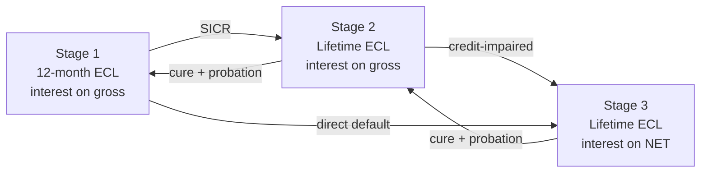
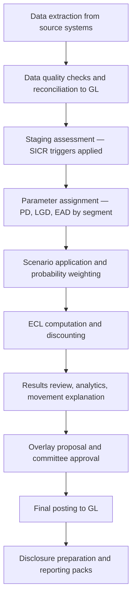

## 1. What ECL is, and why incurred loss failed

ECL is a probability-weighted estimate of credit losses over the life of a financial instrument, recognised **before** any loss event occurs, discounted to present value.

The predecessor regime (IAS 39, and IRACP in India) recognised impairment only once objective evidence of loss existed. Two structural failures followed:

| Failure | Mechanism | Consequence |
|---|---|---|
| Too little, too late | Provision waits for a trigger event | Losses land in one lump after the cycle turns |
| Procyclicality | Provisions lowest at the peak, highest in the trough | Capital erodes exactly when lending should continue |
| Day-one profit | Interest booked from day 1, loss recognised in year 3 | Revenue and its cost sit in different periods |

ECL fixes the matching. On origination you immediately recognise the loss you expect to suffer on that portfolio, and you update it every reporting date as the credit view changes.

:::mental-model
Incurred loss asks *has something gone wrong?* ECL asks *what is this exposure expected to cost me, given everything I know today, including my view of the future?* The second question has an answer on day one. The first does not.
:::

## 2. Perimeter — what is in scope

| In scope | Out of scope |
|---|---|
| Loans and advances at amortised cost | Assets at FVTPL |
| Debt securities at amortised cost | Equity instruments (always) |
| Debt securities at FVOCI | Derivatives |
| Trade receivables, lease receivables | Investments in subsidiaries/associates |
| Loan commitments (undrawn) | Assets already deducted from capital |
| Financial guarantees issued | |
| Contract assets under Ind AS 115 | |

Two frequently missed inclusions: **undrawn commitments and financial guarantees**. Neither sits on the balance sheet as an asset, yet both carry ECL, recognised as a liability (provision). Portfolios that ignore the undrawn book understate ECL materially on revolving products.

For FVOCI debt, the asset is carried at fair value but ECL is still computed and charged to P&L, with the offset in OCI. The balance sheet number does not change; the P&L number does.

## 3. Three regimes side by side

| | Ind AS 109 (IFRS 9) | RBI ECL Directions | IRACP |
|---|---|---|---|
| Basis | Accounting standard | Prudential regulation | Prudential regulation |
| Approach | Expected loss | Expected loss | Rule-based, ageing |
| Applies to | Ind AS reporters — NBFCs, HFCs since FY2019-20 | Scheduled commercial banks (on transition) | Banks, pre-transition |
| Forward-looking | Yes, mandatory | Yes | No |
| Judgement | Extensive | Constrained by floors and guardrails | Minimal |
| Output | Accounting provision | Regulatory provision | Regulatory provision |

The Indian position is genuinely two-track, and the distinction is examined constantly in interviews: **NBFCs and HFCs have been running Ind AS 109 ECL since FY2019-20**, while scheduled commercial banks have continued on IRACP and are moving to an ECL framework under the RBI Directions. A candidate who conflates the two loses credibility immediately.

## 4. ECL parameters vs Basel parameters

Same three letters, different definitions. This table is the single highest-yield item in the document.

| Dimension | Basel IRB | Ind AS 109 ECL |
|---|---|---|
| PD horizon | 12 months, always | 12 months (Stage 1) or lifetime (Stage 2/3) |
| PD cycle | Through-the-cycle (TTC) | Point-in-time (PIT), forward-looking |
| LGD | **Downturn** LGD, floored | Unbiased expected LGD, no conservatism |
| LGD discounting | At a risk-adjusted rate | At the **original EIR** |
| EAD | Regulatory CCFs, floored at drawn | Expected balance at default, behavioural |
| Conservatism | Deliberate, add-ons required | **Prohibited** — must be a neutral estimate |
| Scenarios | Single downturn view | Probability-weighted multiple scenarios |
| Purpose | Unexpected loss → capital | Expected loss → provision |

:::mental-model
Basel parameters are deliberately conservative because they feed a capital buffer against the unexpected. Accounting parameters must be deliberately neutral because they feed an estimate of the expected. Reusing a Basel LGD in ECL without adjustment is not prudent — under the accounting standard it is wrong.
:::

Reuse is still the practical starting point. Most institutions build ECL models off the Basel infrastructure, then apply documented adjustments: strip downturn conservatism from LGD, convert TTC PD to PIT, replace regulatory CCFs with behavioural ones, and extend the 12-month PD to a term structure.

## 5. Classification gate — business model and SPPI

Measurement category is determined before impairment, and it decides whether ECL applies at all.

**Test 1 — business model.** How is the portfolio managed?

**Test 2 — SPPI.** Are contractual cash flows *solely payments of principal and interest* on the principal outstanding?

| Business model | SPPI met | Category | ECL applies |
|---|---|---|---|
| Hold to collect | Yes | Amortised cost | Yes |
| Hold to collect and sell | Yes | FVOCI (debt) | Yes |
| Other / trading | Yes | FVTPL | No |
| Any | **No** | FVTPL | No |

Common SPPI failures: leverage, equity-linked or profit-share returns, conversion features, and non-recourse structures where repayment depends on asset performance rather than the borrower's obligation. A prepayment penalty that is reasonable compensation does not break SPPI; one that is punitive can.

## 6. General model, simplified approach, POCI

| Approach | Applies to | Staging | Measurement |
|---|---|---|---|
| General | Loans, debt securities, commitments, guarantees | Three stages | 12-month or lifetime |
| Simplified | Trade receivables and contract assets without a financing component | **No staging** | Lifetime, always |
| Policy choice — simplified | Lease receivables, trade receivables with financing | Optional | Lifetime, always |
| POCI | Purchased or originated credit-impaired | Outside staging | Lifetime, from inception |

The simplified approach exists to spare corporates the machinery of SICR assessment on short-dated receivables. It is normally operated through a **provision matrix** — ageing buckets crossed with historical loss rates, adjusted for a forward-looking view.

POCI assets are the genuine oddity: they never enter Stage 1, lifetime ECL is recognised from day one, and only *changes* in lifetime ECL after acquisition go to P&L — because the initial expected loss is already priced into the purchase consideration.

## 7. The three stages

| | Stage 1 | Stage 2 | Stage 3 |
|---|---|---|---|
| Condition | No significant increase in credit risk | SICR since initial recognition | Credit-impaired |
| ECL horizon | 12-month | Lifetime | Lifetime |
| Interest income on | **Gross** carrying amount | **Gross** carrying amount | **Net** carrying amount |
| Typical trigger | Origination | 30 DPD backstop, rating downgrade | 90 DPD backstop, default definition |
| Common name | Performing | Underperforming / watch | Non-performing |

Movement is symmetric in principle — assets can improve back down the stages — but cure is subject to probation, and the standard does not permit an automatic snap-back on a single payment.

The interest recognition switch at Stage 3 is the most commonly botched mechanic in implementation, and section 35 treats it in full.

## 8. SICR — the concept

SICR is a **relative** assessment. The question is not *is this exposure risky?* but *has its lifetime default risk increased significantly since the date it was first recognised?*

$$
\text{SICR} \iff \text{PD}^{\text{lifetime}}_{\text{reporting date}} \;\gg\; \text{PD}^{\text{lifetime}}_{\text{origination, for the same remaining term}}
$$

Three consequences follow, and each one catches people out:

| Consequence | Explanation |
|---|---|
| A high-risk loan can be Stage 1 | Originated at that risk level and unchanged since |
| A low-risk loan can be Stage 2 | Small absolute PD, large relative deterioration |
| Origination PD must be retained | You cannot assess SICR without the day-one benchmark |

That last row is a data problem, not a modelling one. Institutions that did not store origination-date risk grade for the back book are forced into proxies — origination vintage averages, or the earliest available grade — and must disclose the approach.

**Lifetime, not 12-month.** The comparison must be of lifetime PD, or of a 12-month PD only where it is a reasonable proxy for lifetime movement. It is not a reasonable proxy where risk is back-loaded — long-dated, bullet, or moratorium-bearing exposures.

## 9. Triggers — quantitative, qualitative, backstop

A defensible SICR framework runs all three in parallel. Any one firing moves the exposure.

| Layer | Examples | Nature |
|---|---|---|
| Quantitative | Lifetime PD ratio above threshold; absolute PD increase; rating notch downgrade | Model-driven |
| Qualitative | Watchlist, restructuring, forbearance, covenant breach, sector stress, management judgement | Expert |
| Backstop | **30 days past due** | Rebuttable presumption |

**Threshold design.** Two families, usually used together:

$$
\text{Relative: } \frac{\text{PD}^{LT}_{t}}{\text{PD}^{LT}_{0}} > \theta_{\text{rel}}
\qquad
\text{Absolute: } \text{PD}^{LT}_{t} - \text{PD}^{LT}_{0} > \theta_{\text{abs}}
$$

A pure relative test over-triggers on high-quality exposures — a PD moving from 0.05% to 0.15% is a tripling with no economic significance. A pure absolute test under-triggers on the same book. Thresholds are therefore set by risk grade or segment, calibrated so that stage migration is stable and explicable, and validated by backtesting whether Stage 2 exposures actually default more than Stage 1.

Thresholds are a **governance artefact**, not just a model output. They must be documented, approved, and consistently applied — retuning them to manage the provision number is exactly the abuse regulators look for.

## 10. The 30 DPD and 90 DPD presumptions

| Presumption | Direction | Rebuttable |
|---|---|---|
| 30 DPD → SICR → Stage 2 | Floor | Yes, with reasonable and supportable evidence |
| 90 DPD → default → Stage 3 | Floor | Yes, but only with a higher evidential bar |

Both are **backstops, not triggers of first resort**. If an institution's SICR framework routinely does nothing until 30 DPD, the framework is not forward-looking and the presumption has become the model.

Legitimate rebuttal cases are narrow and administrative: a documented billing error, a disputed instalment, a payment in transit, or an operational delay in a government-sponsored scheme. "The borrower is well known to us" is not evidence.

**Days past due counting.** Definition consistency matters more than the number. A common defect is one DPD convention in the collections system, another in the ECL engine, and a third in regulatory reporting — producing three different Stage 2 populations from the same book.

## 11. Low credit risk exemption

An optional simplification: if an instrument has low credit risk at the reporting date, you may assume no SICR and keep it in Stage 1 without comparing against origination.

| Point | Position |
|---|---|
| Practical benchmark | Investment grade equivalent |
| Assessment basis | Absolute credit quality at reporting date, not relative movement |
| "Low risk relative to the portfolio" | **Not** an acceptable basis |
| Typical use | Sovereign and high-grade corporate securities |
| Typical prohibition | Retail lending books; most supervisors discourage it there |

Applying the exemption across a retail book is a red flag — it effectively disables SICR for the segment where forward-looking assessment matters most.

## 12. Stage movement, cure and probation

Movement down the stages requires evidence of sustained improvement, not a single event.

| Transition | Typical condition |
|---|---|
| 3 → 2 | Default condition no longer met; all arrears cleared |
| 2 → 1 | Original SICR trigger reversed **and** probation served |
| Probation period | Commonly 3 to 12 months of performance; longer for restructured exposures |
| Restructured / forborne | Extended probation; often a floor at Stage 2 for a defined window |

Without probation, ECL becomes unstable — an exposure oscillating around a threshold flips between 12-month and lifetime measurement each month, whipsawing the P&L. Probation is a deliberate asymmetry: quick to deteriorate, slow to recover.

**Restructuring** is the sharpest case. A modification granted because of financial difficulty is direct evidence of SICR. Even where the modification restores contractual performance immediately, the exposure does not return to Stage 1 on that basis alone.

## 13. Instrument or counterparty, individual or collective

| Question | Answer |
|---|---|
| Assessment unit | The **instrument** — staging is per exposure, not per borrower |
| Practical exception | Wholesale, where counterparty-level assessment is applied consistently |
| Cross-default | Where contractual, deterioration on one facility propagates |

**Collective assessment** is required when SICR is not yet observable at instrument level but is present in a shared characteristic — a sector, geography, vintage, or product cohort.

| Segmentation driver | Example |
|---|---|
| Product | Home loan, auto, personal, gold, LAP |
| Vintage | Origination cohort |
| Geography | State, urban/rural |
| Channel | Direct, DSA, digital |
| Borrower type | Salaried, self-employed, MSME |

Segments must be homogeneous in credit behaviour and stable enough to estimate on. Too coarse and you mask deterioration; too granular and the estimates are noise. This tension is permanent — it is managed, not solved.

## 14. The ECL equation

For a single exposure over $T$ periods:

$$
\text{ECL} \;=\; \sum_{t=1}^{T} \text{PD}^{\text{marginal}}_{t} \times \text{LGD}_{t} \times \text{EAD}_{t} \times \text{DF}_{t}
$$

$$
\text{DF}_{t} = \frac{1}{(1 + \text{EIR})^{t}}
$$

| Stage | Summation range |
|---|---|
| Stage 1 | $t = 1$ to 12 months only |
| Stage 2 | $t = 1$ to remaining lifetime |
| Stage 3 | $t = 1$ to remaining lifetime, PD = 1 |

**The 12-month ECL is not the loss expected over 12 months.** It is the portion of *lifetime* ECL attributable to default events occurring within the next 12 months. The distinction matters when a default in month 8 produces a shortfall that is recovered in year 3 — that full shortfall belongs in the 12-month figure.

For Stage 3, PD collapses to 1 and the equation reduces to discounted expected shortfall:

$$
\text{ECL}_{\text{Stage 3}} = \text{EAD} - \sum_{t} \frac{\text{expected recovery}_{t}}{(1+\text{EIR})^{t}}
$$

## 15. Lifetime, behavioural life, revolving facilities

| Instrument | Lifetime used |
|---|---|
| Term loan | Remaining contractual term, adjusted for expected prepayment |
| Amortising retail loan | Behavioural life from prepayment curves |
| Loan commitment | Contractual period of exposure to credit risk |
| **Revolving facility** (credit card, overdraft) | **Behavioural period**, which exceeds the contractual notice period |

The revolving exception is a deliberate departure from contractual terms. A credit card is cancellable on notice, so the contractual exposure period is days — yet lenders demonstrably do not cancel on first deterioration, and exposure persists for years. The standard requires the period over which the entity is *actually* exposed.

| Evidence for the behavioural period | Source |
|---|---|
| Historical account closure and attrition | Portfolio data |
| Credit action lag between deterioration and limit cut | Collections and risk MI |
| Limit management practice | Policy documents |

Typical outcomes fall in the two-to-five-year range for cards, but the number must be estimated from the institution's own behaviour and revalidated, not imported.

## 16. Cash shortfall, defined precisely

$$
\text{Cash shortfall} = \text{contractual cash flows due} - \text{cash flows expected to be received}
$$

| Include in expected cash flows | Note |
|---|---|
| Scheduled principal and interest | Contractual |
| Expected prepayments | Behavioural |
| Collateral realisation proceeds | **Net of costs to sell** |
| Credit enhancements integral to the contract | Guarantees, insurance |
| Recoveries after write-off | Yes, if expected |

| Exclude | Reason |
|---|---|
| Collateral not integral to the contract | Separate asset |
| Future originations | Not this instrument |
| Costs of running the collections function | Operating cost, not shortfall |

**Timing is part of the loss.** A full recovery of ₹100 lakh two years late is not a zero loss — discounting at the EIR converts the delay into a real economic cost. This is why a "we always recover eventually" argument does not defeat ECL on a distressed exposure.

## 17. Discounting at the original EIR

$$
\text{EIR} = \text{rate that exactly discounts estimated future cash flows to the gross carrying amount at initial recognition}
$$

| Instrument type | Discount rate |
|---|---|
| Fixed rate | Original EIR, fixed for life |
| Floating rate | Current EIR (moves with the benchmark) |
| POCI | Credit-adjusted EIR |
| Loan commitment (undrawn) | EIR of the resulting asset, or an approximation |
| Financial guarantee | Rate reflecting risks of the cash flows |

Using a current market rate, a cost-of-funds rate, or a risk-free rate is a common and material error. The original EIR is generally the highest of these on a credit-risky asset, which means an incorrect lower rate **understates** the discount and **overstates** ECL — or the reverse, depending on direction. Either way the number is wrong and the audit finding is straightforward.

EIR incorporates transaction costs and fees integral to the yield, so it is not the contractual coupon. On a book with meaningful processing fees, the gap is real.

## 18. Credit-adjusted EIR and POCI

For POCI assets, the EIR is computed by discounting expected cash flows **including expected credit losses** back to the purchase price.

$$
\text{Purchase price} = \sum_{t} \frac{\text{expected cash flows (net of ECL)}_{t}}{(1 + \text{CA-EIR})^{t}}
$$

| Feature | POCI treatment |
|---|---|
| Stage | Outside the three-stage model |
| Initial allowance | **Nil** — the loss is in the price |
| Subsequent P&L | Only *changes* in lifetime ECL since acquisition |
| Favourable change | Recognised as a **gain**, without limit |
| Interest recognised on | Amortised cost, using CA-EIR |

The unlimited gain is unique to POCI. Everywhere else in the standard, a reversal is capped at previously recognised losses.

POCI matters commercially in India for acquired distressed portfolios and ARC transactions, where the acquisition price already embeds a deep credit view.

## 19. Modifications and derecognition

The first question on any modification is whether the change is **substantial**.

| Outcome | Test | Accounting |
|---|---|---|
| Substantial | Terms differ substantially — quantitative (commonly a 10% PV test) or qualitative (currency change, equity conversion, change of obligor) | **Derecognise** old asset, recognise new one at fair value; new EIR; new origination date for SICR |
| Non-substantial | Everything else | Retain the asset; recompute gross carrying amount at the **original EIR**; difference to P&L as a modification gain/loss |

$$
\text{Modification adjustment} = \sum_t \frac{\text{new cash flows}_t}{(1+\text{EIR}_{\text{original}})^t} \;-\; \text{current gross carrying amount}
$$

**The trap.** Derecognition resets the SICR clock, because the new asset has a new origination date. A distressed exposure restructured into a "new" facility could therefore land in Stage 1 with a 12-month ECL. Supervisors scrutinise this pattern closely, and forbearance-driven modifications are generally treated as non-substantial and held at Stage 2 or worse regardless.

## 20. Write-off and recovery

Write-off is required when there is **no reasonable expectation of recovery**, in whole or in part. It is a derecognition event, not a provisioning policy lever.

| Point | Position |
|---|---|
| Trigger | No reasonable expectation of recovery |
| P&L impact if fully provided | Nil — it is a balance sheet reclassification |
| Legal claim | Survives; write-off is accounting, not waiver |
| Partial write-off | Permitted for the portion with no expectation |
| Subsequent recovery | Credited to P&L as an impairment reversal when received |

Where an institution has a policy of writing off at, say, 24 months past due, that policy must reflect genuine recovery expectations, not a target for the NPA ratio. Expected post-write-off recoveries must already be inside the LGD, or the loss is double-counted — recognised once through ECL and again through a recovery credit.

## 21. Data foundation and segmentation — preconditions

Parameter estimation is downstream of data. Attempting it before these are settled produces models that cannot be rebuilt or defended.

| Requirement | Why |
|---|---|
| Default flag, consistently defined across systems | Every PD depends on it |
| Origination-date risk grade retained | SICR is impossible without it |
| Complete recovery cash flows with dates | LGD needs timing, not just amounts |
| Collateral values with valuation dates | Haircuts and realisation lags |
| Limit and utilisation history | EAD and CCF |
| Full history through at least one downturn | Otherwise the model has never seen stress |
| Stable segment definitions across time | Prevents structural breaks |

**Minimum history.** A single economic cycle is the aspiration; in practice institutions work with what exists and disclose the limitation. A model estimated only on benign years will systematically understate ECL and will fail its first real backtest.

Segmentation must satisfy three properties simultaneously: homogeneous risk behaviour within, meaningful separation between, and enough defaults per segment to estimate on. Where the third fails, segments are pooled and the pooling is documented.

## 22. PD vocabulary — the four terms

Confused constantly. Fix them once.

| Term | Definition | Question answered |
|---|---|---|
| **Conditional (hazard) PD** | $q_t$ — probability of default in period $t$ *given survival to* $t-1$ | "Given it is alive now, does it fail this year?" |
| **Marginal PD** | Probability of defaulting in period $t$, viewed from today | "What is the chance it fails specifically in year $t$?" |
| **Cumulative PD** | Probability of defaulting at any point up to $t$ | "What is the chance it fails by year $t$?" |
| **Survival probability** | $S_t$ — probability of surviving to $t$ | "What is the chance it is still alive at year $t$?" |

The relationships:

$$
S_t = \prod_{k=1}^{t}(1 - q_k)
\qquad
\text{PD}^{\text{marg}}_t = S_{t-1}\, q_t
\qquad
\text{PD}^{\text{cum}}_t = 1 - S_t = \sum_{k=1}^{t}\text{PD}^{\text{marg}}_k
$$

**Only marginal PD goes into the ECL equation.** Using conditional PD directly double-counts, because it ignores that the exposure had to survive to reach period $t$. Using cumulative PD in every period is worse still.

Worked, with $q_1 = 6\%$, $q_2 = 5\%$, $q_3 = 4\%$:

| $t$ | $q_t$ | $S_{t-1}$ | Marginal $= S_{t-1}q_t$ | $S_t$ | Cumulative |
|---|---|---|---|---|---|
| 1 | 6.00% | 100.00% | 6.00% | 94.00% | 6.00% |
| 2 | 5.00% | 94.00% | 4.70% | 89.30% | 10.70% |
| 3 | 4.00% | 89.30% | 3.57% | 85.73% | 14.27% |

Note that the conditional rate falls while cumulative PD keeps rising — a pattern people misread as improvement when it is simply survivorship.

## 23. Building the PD term structure

<svg viewBox="0 0 660 300" xmlns="http://www.w3.org/2000/svg">
  <line x1="70" y1="250" x2="620" y2="250" stroke="currentColor" stroke-width="1.4"/>
  <line x1="70" y1="30" x2="70" y2="250" stroke="currentColor" stroke-width="1.4"/>
  <text x="345" y="285" fill="currentColor" font-size="13" text-anchor="middle">Years since origination</text>
  <text x="34" y="140" fill="currentColor" font-size="13" text-anchor="middle" transform="rotate(-90 34 140)">PD</text>
  <path d="M 70 250 C 160 190 250 130 350 105 C 440 85 530 72 615 65" stroke="currentColor" stroke-width="2.5" fill="none"/>
  <text x="430" y="60" fill="currentColor" font-size="12">cumulative PD</text>
  <path d="M 70 245 C 120 150 160 135 210 140 C 300 150 400 205 615 235" stroke="currentColor" stroke-width="2" fill="none" stroke-dasharray="6 4"/>
  <text x="215" y="128" fill="currentColor" font-size="12">marginal PD — seasoning peak</text>
  <line x1="210" y1="140" x2="210" y2="250" stroke="currentColor" stroke-width="1" stroke-dasharray="3 3"/>
  <text x="210" y="266" fill="currentColor" font-size="11" text-anchor="middle">yr 2</text>
</svg>

Retail marginal PD is rarely flat. It rises through a seasoning period, peaks, then declines as the surviving population self-selects toward better credits.

| Method | Mechanism | Best for |
|---|---|---|
| Vintage / cohort analysis | Track default rates by origination cohort and age | Retail, homogeneous pools |
| Survival analysis (Cox, Kaplan-Meier) | Model the hazard rate directly | Retail with covariates and censoring |
| Rating transition matrices | Multiply matrices forward | Wholesale, rated exposures |
| Extrapolation from 12-month PD | Scale using a term shape | Weak fallback; document it |

**Two structural effects to keep separate.** *Seasoning* is the age effect — how risk evolves with time on book. *Vintage quality* is the cohort effect — whether loans written in a given year were better or worse. Mixing them produces a term structure that is really a record of underwriting standards.

## 24. TTC to PIT conversion

Basel PD is TTC — a long-run average across the cycle. ECL requires PIT — the probability given current and forecast conditions.

The standard mechanism is a one-factor Vasicek shift, moving the default threshold by a systematic factor $Z$:

$$
\text{PD}^{\text{PIT}} = \Phi\!\left(\frac{\Phi^{-1}(\text{PD}^{\text{TTC}}) - \sqrt{\rho}\; Z}{\sqrt{1 - \rho}}\right)
$$

| Symbol | Meaning |
|---|---|
| $\Phi$ | Standard normal CDF |
| $\rho$ | Asset correlation — sensitivity to the systematic factor |
| $Z$ | Systematic factor; positive = benign, negative = stress |

| $Z$ | Economy | Effect on PD |
|---|---|---|
| $> 0$ | Better than average | PD falls below TTC |
| $= 0$ | Average conditions | PD = TTC |
| $< 0$ | Stress | PD rises above TTC |

$Z$ is itself linked to observable macro variables through a regression, which is how the macro scenarios of section 29 enter the PD.

**The alternative** is a scalar approach: estimate a PIT-to-TTC ratio from observed default rates and apply it as a multiplier by segment. Cruder, far more transparent, and widely used where the Vasicek parameters cannot be estimated credibly.

## 25. Transition matrices and the Markov extension

For rated portfolios, a one-year transition matrix gives the probability of moving between grades.

| From \ To | A | B | C | Default |
|---|---|---|---|---|
| **A** | 0.92 | 0.06 | 0.015 | 0.005 |
| **B** | 0.05 | 0.85 | 0.08 | 0.020 |
| **C** | 0.01 | 0.10 | 0.79 | 0.100 |
| **Default** | 0 | 0 | 0 | 1.00 |

Multi-year cumulative PD comes from raising the matrix to the $n$-th power, with Default as an absorbing state:

$$
M^{(n)} = M^{n}, \qquad \text{PD}^{\text{cum}}_{n}(\text{grade } i) = M^{n}[i, \text{Default}]
$$

| Assumption | Reality | Consequence |
|---|---|---|
| Markov — next move depends only on current grade | Rating momentum exists; downgraded credits keep downgrading | Understates multi-year risk for downgraded names |
| Time-homogeneous — the matrix is stable | Matrices are strongly cyclical | Needs PIT adjustment per scenario |
| Well-populated cells | Sparse at investment grade | Smoothing or pooling required |

Practical fixes: estimate separate matrices for benign and stressed states and interpolate, or adjust the matrix per macro scenario before powering it up.

## 26. LGD — the workout method

$$
\text{LGD} = 1 - \frac{\sum_{t}\dfrac{\text{recovery}_t - \text{cost}_t}{(1 + r)^{t}}}{\text{EAD at default}}
$$

Build it in four components:

| Component | Definition |
|---|---|
| Cure rate | Proportion of defaults that recover fully without loss |
| Recovery rate on non-cured | Realisation as a fraction of EAD |
| Time to recovery | Months from default to cash |
| Direct costs | Legal, enforcement, valuation, sale costs |

$$
\text{LGD} = (1 - \text{cure rate}) \times \big(1 - \text{net discounted recovery rate}\big)
$$

**Cure rates are the most under-modelled component in Indian portfolios** and are frequently large — a substantial share of 90 DPD accounts in retail regularise without any loss. Ignoring cures overstates LGD, and therefore ECL, materially.

**Collateral.** Realisable value, not book value:

$$
\text{Realisable} = \text{Market value} \times (1 - \text{haircut}) - \text{costs to sell}
$$

| Collateral | Typical haircut driver |
|---|---|
| Residential property | Distress sale discount, market liquidity |
| Commercial property | Higher volatility, longer sale period |
| Gold | Low haircut; short realisation |
| Vehicle | Rapid depreciation, repossession friction |
| Plant and machinery | Specialised, thin market |
| Unsecured | LGD driven entirely by cash recoveries |

Time to realisation is the hidden driver. In India, enforcement timelines under SARFAESI and the IBC differ sharply by asset class and jurisdiction, and a two-year realisation lag at a 12% EIR destroys roughly a fifth of the recovery in present value terms before any haircut is applied.

**Downward bias from incomplete workouts.** Recent defaults still in recovery are censored. Excluding them biases LGD; including them at zero recovery biases it the other way. Handle explicitly with a workout-completion adjustment.

## 27. Downturn LGD vs unbiased LGD

| | Basel | Ind AS 109 |
|---|---|---|
| Objective | Capital adequacy under stress | Neutral expectation |
| Estimate | Downturn conditions | Probability-weighted across scenarios |
| Floors | Regulatory floors apply | None |
| Conservatism | Required | **Not permitted** |
| Discount rate | Risk-adjusted | Original EIR |

Converting a Basel LGD for ECL use requires stripping the downturn add-on, removing regulatory floors, re-discounting recovery cash flows at the EIR, and reintroducing scenario sensitivity so that LGD varies with the macro state.

**LGD must be forward-looking too.** This is regularly missed — institutions build elaborate macro-conditioned PD models and leave LGD as a static long-run average. Collateral values and recovery rates are strongly procyclical, so a scenario framework that moves PD but not LGD understates the downside scenario significantly.

## 28. EAD and CCF

For a fully drawn term loan, EAD is the amortising balance profile. For anything with an undrawn component:

$$
\text{EAD} = \text{Drawn} + \text{CCF} \times \text{Undrawn}
$$

$$
\text{CCF} = \frac{\text{Drawn}_{\text{at default}} - \text{Drawn}_{\text{observation}}}{\text{Limit}_{\text{observation}} - \text{Drawn}_{\text{observation}}}
$$

| Point | Position |
|---|---|
| Basis | Behavioural, estimated from own data |
| Regulatory CCFs | Not appropriate for ECL without adjustment |
| Observed behaviour | Borrowers draw down as they deteriorate |
| Estimation window | 12-month fixed horizon or cohort approach |
| Can exceed 100% | Yes — limit increases or over-limit tolerance before default |
| Revolvers | Requires the behavioural life from section 15 |

The economic story is simple and should be stated that way in an interview: a borrower heading for default draws whatever remains available. A model that assumes utilisation stays flat will understate EAD precisely on the accounts that go on to default.

For amortising loans, the EAD profile must follow the contractual schedule adjusted for prepayment — using the current balance for every future period materially overstates ECL on a long-dated book.

## 29. Macroeconomic models and scenario design

Forward-looking information is mandatory, not optional. The link runs from macro variables to parameters:

$$
Z_t = \beta_0 + \beta_1 \,\text{GDP growth}_t + \beta_2 \,\text{Inflation}_t + \beta_3 \,\text{Unemployment}_t + \dots + \varepsilon_t
$$

| Variable | Typical relevance in India |
|---|---|
| Real GDP growth | Broad driver across segments |
| Inflation / CPI | Household stress, real income |
| Policy rate / lending rates | Debt service burden on floating loans |
| Unemployment / employment indices | Retail unsecured |
| House price index | LGD on mortgages |
| Sectoral IIP, commodity prices | Corporate and MSME segments |
| Rainfall / agri output | Agricultural and rural portfolios |
| Exchange rate | Exporters, unhedged FX borrowers |

| Design rule | Reason |
|---|---|
| Few variables, economically justified | Overfitted macro models fail out of sample |
| Correct sign, always | A model where higher unemployment lowers PD is rejected on sight |
| Segment-specific drivers | Gold loans and unsecured personal loans do not share drivers |
| Documented source for forecasts | Internal economics, RBI projections, external vendors |
| Scenario horizon then reversion | Forecast 2 to 3 years, then revert to long-run average |

**Reversion is required.** No credible framework forecasts macro variables over the full life of a 20-year mortgage. Beyond the forecast horizon, parameters revert to the long-run mean, and the reversion path is itself a documented assumption.

## 30. Scenario weighting and non-linearity

A minimum of three scenarios is standard practice: base, upside, downside.

| Scenario | Indicative weight | Purpose |
|---|---|---|
| Base | 50–60% | Central planning view; consistent with budget |
| Upside | 15–25% | Recovery case |
| Downside | 20–30% | Stress case, calibrated to real severity |

**Weight the ECL outputs, not the input parameters.**

$$
\text{ECL} = \sum_{s} w_s \times \text{ECL}(s)
\qquad \neq \qquad
\text{ECL}\left(\sum_{s} w_s \times \text{parameters}(s)\right)
$$

The two differ because ECL is a convex function of PD. By Jensen's inequality the correctly weighted result is **higher**, and the gap widens as scenario severity increases. Section 44 demonstrates it numerically.

:::mental-model
If your framework produces the same answer whether you weight scenarios or weight parameters, your downside scenario is not severe enough to be doing any work. The gap between the two numbers is a direct measure of how much non-linearity your scenarios actually capture.
:::

The base scenario should be consistent with the institution's own business plan and budget. A budget assuming strong growth alongside an ECL base case assuming stagnation is an internal contradiction that auditors will find.

## 31. Overlays and post-model adjustments

An overlay is a manual adjustment to model output for risk the model cannot capture.

| Legitimate use | Illegitimate use |
|---|---|
| Emerging risk with no history (new regulation, pandemic, sector shock) | Smoothing the P&L |
| Known model limitation pending remediation | Hitting a provision target |
| Data gap in a segment | Compensating for a failed model no one wants to rebuild |
| Late-breaking information after the model run | Permanent structural top-up |

Discipline requirements:

| Control | Requirement |
|---|---|
| Quantification | Methodology documented, not a round number |
| Governance | Approved at committee, with challenge recorded |
| Direction | Both increases and releases considered |
| Sunset | Defined trigger and date for removal |
| Disclosure | Quantum and rationale disclosed |
| Monitoring | Tracked; a permanent overlay is a model defect |

Post-COVID, supervisors globally sharpened scrutiny of overlays that were raised quickly and released slowly. The question to expect: *what evidence would cause you to release this, and when did you last test for it?*

## 32. The production run cycle

| Stage | Typical owner | Frequency |
|---|---|---|
| Extraction and DQ | Data / IT | Monthly or quarterly |
| Staging and computation | Risk | Monthly or quarterly |
| Review and analytics | Risk + Finance | Each run |
| Overlay approval | Provisioning committee | Each run |
| Posting | Finance | Each run |
| Model monitoring | Model risk / validation | Quarterly to annually |
| Full revalidation | Independent validation | Annually |

The cycle is a **close process** with a hard deadline, not a modelling exercise. Institutions that treat it as research discover at the first quarter-end that a five-day run cannot fit a two-day close window.

## 33. Data feeds, reconciliation and controls

| Control | Purpose |
|---|---|
| GL reconciliation | Total exposure in the ECL engine ties to the general ledger |
| Record count controls | No silent row loss between systems |
| Completeness by segment | Every product in scope has a population |
| Staleness checks | Collateral valuations, ratings within tolerance |
| Default flag consistency | Same population as collections and reg reporting |
| Parameter range checks | PD, LGD, CCF within plausible bounds |
| Movement analytics | Every material change explained before sign-off |

**Reconciliation to the general ledger is non-negotiable.** If the ECL engine's gross exposure does not tie to the GL, the provision cannot be posted with confidence, and the audit finding is fundamental rather than technical.

The most frequent operational failure is not a wrong model — it is a feed that silently drops a product, a branch, or a portfolio during a system change, so ECL falls and nobody can explain why. Movement analytics exist to catch exactly this before the number leaves the building.

## 34. The allowance roll-forward

The roll-forward is the primary review artefact and the primary disclosure. Every material change must have a named cause.

| Line | Meaning |
|---|---|
| Opening allowance | Prior period close |
| New assets originated | Day-one ECL on new business |
| Assets derecognised / repaid | Release on exit |
| Transfers to Stage 2 | Remeasurement 12-month → lifetime |
| Transfers to Stage 3 | Remeasurement to credit-impaired |
| Transfers back to Stage 1 | Release on cure |
| Changes in risk parameters | Model inputs moved |
| Changes in macro scenarios | Forecast or weights revised |
| Overlays raised / released | Manual adjustments |
| Write-offs | Utilisation of allowance |
| FX and other | Translation |
| **Closing allowance** | **Sums to the balance sheet** |

Two disciplines make the walk useful. First, **stage transfers are measured at the start-of-period parameters**, so transfer effects and parameter effects do not contaminate each other. Second, the walk is prepared by stage and by segment, not just in total — a stable total can conceal a large Stage 1 release offsetting a large Stage 3 build.

## 35. Income recognition on Stage 3 assets

The single most commonly implemented-wrong mechanic in the standard.

| Stage | Interest computed on | Formula |
|---|---|---|
| 1 and 2 | **Gross** carrying amount | $\text{Interest} = \text{Gross} \times \text{EIR}$ |
| 3 | **Net** carrying amount | $\text{Interest} = (\text{Gross} - \text{allowance}) \times \text{EIR}$ |
| POCI | Amortised cost | $\text{Interest} = \text{Amortised cost} \times \text{CA-EIR}$ |

Worked. Gross exposure ₹40.00 lakh, lifetime allowance ₹16.00 lakh, EIR 12%.

| Basis | Calculation | Interest for the year |
|---|---|---|
| Gross (wrong at Stage 3) | $40.00 \times 12\%$ | ₹4.80 lakh |
| **Net (correct)** | $(40.00 - 16.00) \times 12\%$ | **₹2.88 lakh** |

The overstatement is ₹1.92 lakh on a single exposure — and it is not a timing difference, because interest accrued on the impaired portion would simply have to be provided against immediately, grossing up both income and impairment charge.

**Consequences to state in an interview:** stage transfers change reported revenue, not just impairment; the switch must happen in the same period as the stage move; the net-basis calculation uses the **opening** allowance for the period; and on cure back to Stage 2, recognition reverts to gross.

## 36. Model validation and monitoring

| Layer | Owner | Focus |
|---|---|---|
| Development testing | Model developer | Fit, stability, sensitivity |
| Independent validation | Model risk / validation | Conceptual soundness, data, outcomes, use |
| Ongoing monitoring | Risk | Drift, override rates, population stability |
| Internal audit | Audit | Framework, controls, governance |
| External audit | Auditor | Financial statement assertion |
| Supervisory review | RBI | Prudential adequacy |

| Test | Measures |
|---|---|
| Discriminatory power — AUC, Gini, KS | Does the model rank risk? |
| Calibration — predicted vs actual default rate | Are the levels right? |
| Population stability index (PSI) | Has the applied population drifted? |
| Characteristic stability | Have input distributions shifted? |
| Sensitivity analysis | Which assumption moves ECL most? |
| Benchmarking | Comparison against an alternative approach |

$$
\text{PSI} = \sum_i (\text{actual}_i - \text{expected}_i)\ln\!\left(\frac{\text{actual}_i}{\text{expected}_i}\right)
$$

| PSI | Reading |
|---|---|
| < 0.10 | Stable |
| 0.10 – 0.25 | Investigate |
| > 0.25 | Significant shift — recalibration likely |

Ranking and calibration are independent properties. A model can rank borrowers perfectly and still predict a 2% default rate on a segment that runs at 6%. ECL depends on the level, so calibration failure is the more serious of the two here — unlike in a pure origination scorecard, where ranking dominates.

## 37. Backtesting ECL

Genuinely hard, because ECL is an expectation over scenarios and you observe exactly one realised path. A single year's outcome cannot confirm or refute a probability-weighted estimate.

| Testable component | Method |
|---|---|
| PD | Predicted vs realised default rates by segment and grade |
| LGD | Predicted vs realised workout losses on completed recoveries |
| EAD / CCF | Predicted vs actual exposure at the default date |
| Staging | Do Stage 2 exposures default more than Stage 1? |
| Scenarios | Did realised macro fall within the scenario range? |
| Overall ECL | Multi-year comparison of cumulative ECL against cumulative realised loss |

| Constraint | Handling |
|---|---|
| Only one realised path | Test parameters separately; assess ECL over multiple years |
| Completed workouts only for LGD | Long lag; adjust for censoring |
| Portfolio composition changes | Test on stable cohorts |
| Overlays distort the total | Backtest model output before overlay, and the overlay separately |

The honest interview answer is that ECL is validated **component by component and over multiple periods**, with the aggregate assessed for directional reasonableness rather than point accuracy. Claiming a clean single-year backtest of total ECL signals a misunderstanding of what the number is.

## 38. Governance

| Body | Role |
|---|---|
| Board / Risk Committee | Approves the ECL framework and policy |
| Audit Committee | Oversees the provision as a financial statement estimate |
| Provisioning / ECL Committee | Approves each period's ECL, overlays, and scenario weights |
| ALCO | Consistency with the business plan and macro view |
| Model Risk Committee | Model approval, validation findings, remediation |
| CRO and CFO | Joint ownership — risk owns parameters, finance owns the posting |

| Documented artefact | Refreshed |
|---|---|
| ECL policy | Annually |
| SICR thresholds and rationale | Annually, or on material change |
| Scenario narratives and weights | Each run |
| Model inventory and tiering | Continuously |
| Overlay register with sunset dates | Each run |
| Validation reports and findings tracker | Per cycle |

**Joint ownership between risk and finance is the structural feature to name.** ECL sits precisely at the boundary: risk owns the models and parameters, finance owns the accounting outcome, disclosure and audit relationship. Institutions that leave it wholly to one function produce either a model nobody can post or a number nobody can defend.

## 39. Disclosure under Ind AS 107

| Disclosure | Content |
|---|---|
| Credit risk management practices | How SICR is determined; default definition; write-off policy |
| Reconciliation of allowance | The roll-forward of section 34, by stage |
| Reconciliation of gross carrying amount | Movement in exposures by stage |
| Credit risk exposure by grade and stage | The staging matrix |
| Forward-looking information | Scenarios, key macro assumptions, weights |
| Sensitivity | Effect of changing scenario weights or key assumptions |
| Collateral held | Effect on ECL, for credit-impaired especially |
| Modified assets | Gross amounts and modification gains/losses |
| Overlays | Quantum and rationale |

The **sensitivity disclosure** attracts the most analyst attention: what would ECL be under 100% downside weighting? It reveals both the severity of the scenario set and the convexity of the portfolio, and a suspiciously small sensitivity invites the conclusion that the scenarios are not doing any work.

Disclosure is not a reporting afterthought. Several items — the staging matrix, the gross exposure walk, the sensitivity run — must be produced by the ECL engine itself, so they belong in the design, not bolted on at year-end.

## 40. Interaction with regulatory capital

Accounting provisions and regulatory capital connect, but not one-for-one.

| Concept | Treatment |
|---|---|
| Specific provisions | Reduce the exposure; reduce RWA |
| General provisions | Added back to Tier 2, subject to a cap |
| **IRB expected loss (EL)** | Compared with eligible provisions |
| EL > provisions (shortfall) | **Deducted from CET1** |
| Provisions > EL (excess) | Added to Tier 2, capped at 0.6% of credit RWA |
| Transitional arrangements | Phase-in of the day-one ECL capital impact |

$$
\text{EL} = \text{PD}^{\text{TTC}} \times \text{LGD}^{\text{downturn}} \times \text{EAD}
$$

The comparison is between the **Basel EL** and the **accounting provision**. Because the two are built on differently calibrated parameters (section 4), they will not agree, and the difference lands directly in capital — as a CET1 deduction if provisions fall short.

**Day-one impact.** Moving from an incurred-loss regime to ECL produces a step increase in provisions, hitting retained earnings and therefore CET1 immediately. Transitional arrangements exist precisely to phase this in, which is the entire rationale for the glide path described next.

## 41. The RBI ECL Directions and the transition timeline

> The dated regulatory specifics in this section and the next are the highest-risk content in this document and should be confirmed against the RBI's published Directions before being relied upon or quoted.

| Item | Position |
|---|---|
| Framework | RBI Directions moving scheduled commercial banks from IRACP to an expected credit loss basis |
| Issued | Final Directions issued 27 April 2026 |
| Effective date | 1 April 2027 |
| Glide path for the transitional capital impact | To 31 March 2031 |
| NBFCs and HFCs | Already on Ind AS 109 ECL since FY2019-20 |
| Approach | Broadly aligned to the expected-loss architecture, with prudential guardrails |

The **glide path** exists to spread the day-one CET1 impact of the higher provision over several years rather than absorbing it in one reporting period. Its practical consequence is that reported capital ratios during the phase-in are not directly comparable across institutions with different transition profiles, and disclosures must state where an institution sits on the path.

Reading the timeline commercially: banks preparing during the run-up need parallel runs, model builds, and data remediation to complete well before the effective date, because the first live close under a new provisioning basis is not the place to discover a feed problem.

## 42. The IRACP floor

The RBI framework retains a prudential floor. Provisions cannot fall below what the IRACP rules would have required.

$$
\text{Provision recognised} = \max\big(\text{ECL},\; \text{IRACP-based provision}\big)
$$

| Consequence | Explanation |
|---|---|
| ECL becomes the *higher of* two computations | Both must be run every period |
| Dual-track data and reporting | IRACP asset classification survives alongside staging |
| The floor binds unevenly | More likely to bind on well-secured, long-dated NPAs |
| Any shortfall is disclosed | Where ECL sits below the floor |

The economic rationale is straightforward — the supervisor is unwilling to let a modelled, judgement-heavy estimate release provisions below an established rule-based minimum during transition. The operational rationale for candidates is equally straightforward: **do not assume IRACP goes away.** Asset classification, ageing buckets, and the associated reporting continue in parallel, and roles in this space are frequently about running both and reconciling them.

## 43. The transition programme

| Workstream | Content |
|---|---|
| Data | Origination-grade history, recovery cash flows, collateral, limit history; remediation of gaps |
| Models | PD term structures, PIT conversion, LGD, EAD/CCF, macro models; build, validate, approve |
| Staging framework | SICR thresholds, qualitative triggers, cure and probation rules |
| Systems | ECL engine, feeds, GL interfaces, reporting layer |
| Accounting policy | Classification and measurement, EIR, modification, write-off |
| Capital | Day-one impact quantification, glide path election, ICAAP update |
| Governance | Committee structures, delegated authorities, overlay framework |
| Parallel run | Multiple cycles under both bases before go-live |
| Disclosure | Ind AS 107 templates, sensitivity, transition disclosures |
| Change management | Training, stakeholder communication, external analyst briefing |

| Common failure | Symptom |
|---|---|
| Data started too late | Model build blocked; proxies everywhere |
| No parallel run | First live close breaks |
| Origination grades never captured | SICR unimplementable on the back book |
| Finance not involved until posting | Number cannot be reconciled or explained |
| Overlays used to plug model gaps at go-live | Permanent overlays with no sunset |
| Disclosure designed at year-end | Engine cannot produce required cuts |

**Data is always the critical path.** In every implementation the modelling is tractable and the data is not — history that was never retained cannot be recreated, and the mitigation (documented proxies, disclosed limitations, a remediation roadmap) has to be designed in from the start rather than discovered at parallel run.

## 44. Worked example — one exposure, two periods

A term loan. EIR 12%. Original tenor 3 years. All amounts in ₹ lakh.

### Period 1 — 31 March, Year 1. Stage 1.

Outstanding ₹100.00 lakh. No SICR. 12-month ECL applies. Default assumed at end of year 1, so one year of discounting: $\text{DF}_1 = 1/1.12 = 0.8929$.

| Scenario | Weight | 12m PD | LGD | EAD | Undiscounted | × DF | ECL |
|---|---|---|---|---|---|---|---|
| Upside | 20% | 1.20% | 40% | 100.00 | 0.4800 | 0.8929 | 0.4286 |
| Base | 60% | 2.00% | 40% | 100.00 | 0.8000 | 0.8929 | 0.7143 |
| Downside | 20% | 5.00% | 45% | 100.00 | 2.2500 | 0.8929 | 2.0089 |

$$
\text{ECL}_{\text{weighted}} = 0.20(0.4286) + 0.60(0.7143) + 0.20(2.0089) = \mathbf{0.9161}
$$

**Closing allowance, Year 1 = ₹0.92 lakh.**

*Non-linearity check.* Weighting the parameters first instead: weighted PD $= 0.20(1.20) + 0.60(2.00) + 0.20(5.00) = 2.44\%$; weighted LGD $= 0.20(40) + 0.60(40) + 0.20(45) = 41\%$.

$$
100.00 \times 2.44\% \times 41\% \times 0.8929 = 0.8933
$$

The correct method gives ₹0.9161 lakh against ₹0.8933 lakh — **₹0.023 lakh higher**, on one exposure with a mild downside. Scale that across a book and widen the downside, and the gap becomes material. This is Jensen's inequality from section 30, made arithmetic.

### Period 2 — 31 March, Year 2. SICR triggered. Stage 2.

The borrower's sector deteriorates; the internal grade falls three notches and the relative PD threshold is breached. Lifetime ECL now applies over the remaining 2 years. Scheduled repayment has reduced the balance to ₹70.00 lakh, amortising to ₹40.00 lakh by the end of year 2.

Conditional (hazard) PDs: $q_1 = 6.00\%$, $q_2 = 5.00\%$. Applying section 22:

| $t$ | $q_t$ | $S_{t-1}$ | Marginal PD | EAD | LGD | DF at 12% | ECL |
|---|---|---|---|---|---|---|---|
| 1 | 6.00% | 100.00% | 6.00% | 70.00 | 40% | 0.8929 | 1.5000 |
| 2 | 5.00% | 94.00% | 4.70% | 40.00 | 40% | 0.7972 | 0.5995 |
| | | | | | | **Lifetime ECL** | **2.0995** |

Check on period 1: $70.00 \times 6.00\% \times 40\% = 1.6800$; $1.6800 \times 0.8929 = 1.5000$.
Check on period 2: $40.00 \times 4.70\% \times 40\% = 0.7520$; $0.7520 \times 0.7972 = 0.5995$.

An overlay of ₹0.40 lakh is approved for sector-wide stress not yet captured in the macro model, with a defined sunset at the next scenario refresh.

**Closing allowance, Year 2 = 2.0995 + 0.40 = ₹2.50 lakh** (2.4995, rounded).

### Allowance walk, Year 2

| Line | ₹ lakh |
|---|---|
| Opening allowance (Stage 1) | 0.92 |
| Repayment / EAD reduction | (0.18) |
| Transfer to Stage 2 — remeasurement to lifetime | 1.36 |
| Overlay raised | 0.40 |
| **Closing allowance (Stage 2)** | **2.50** |

$$
0.92 - 0.18 + 1.36 + 0.40 = 2.50 \;\checkmark
$$

### If it had migrated to Stage 3

Gross ₹40.00 lakh, lifetime allowance ₹16.00 lakh, net carrying amount ₹24.00 lakh. Interest for the following year is computed on the **net** amount (section 35):

$$
24.00 \times 12\% = \textbf{₹2.88 lakh} \quad\text{not}\quad 40.00 \times 12\% = ₹4.80\ \text{lakh}
$$

## 45. Defensible under questioning

The questions that separate someone who has read about ECL from someone who has run it.

| Question | The answer that lands |
|---|---|
| Is SICR absolute or relative? | Relative to origination — a high-risk loan can sit in Stage 1 |
| Why can't I use my Basel LGD? | It is downturn and floored; the standard requires an unbiased estimate discounted at EIR |
| What is 12-month ECL? | Lifetime losses from defaults occurring in the next 12 months — not losses over 12 months |
| Which PD goes into the equation? | Marginal. Conditional double-counts; cumulative is worse |
| Why not weight the parameters? | ECL is convex in PD; weighting outputs is higher and correct |
| What changes at Stage 3? | Interest moves to the net carrying amount |
| What discount rate? | Original EIR — not cost of funds, not a market rate |
| Do revolvers use the contractual term? | No — behavioural period, because limits are not cut on first deterioration |
| When can an overlay stay? | Only with quantification, approval, disclosure and a sunset trigger |
| Does IRACP disappear? | No — provisions are the higher of ECL and the IRACP floor |
| How do you backtest ECL? | Component by component over multiple periods; one realised path cannot validate an expectation |
| Where does ECL hit capital? | Through retained earnings, and via the EL-versus-provision comparison in the IRB stack |

**Three things to be able to draw on a whiteboard without notes:** the three-stage diagram with the interest-recognition switch, the marginal-PD survival table, and the allowance roll-forward. Those three carry most of a technical interview.
