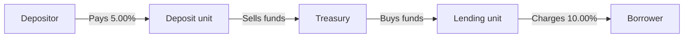

## Part 0 — The question, and how this note works

Volume 2 established that the bank earns ₹50.1 crore of net interest income by lending long and funding short, and it stated the FTP idea in a paragraph: treasury sits in the middle, buys funds from the deposit unit and sells them to the lending unit, and the spread splits three ways.

This note builds the machinery underneath that paragraph, from nothing.

| Part | Question | Produces |
|---|---|---|
| **1** | Who earned the ₹5 crore spread on one loan? | The problem FTP exists to solve |
| **2** | What is a transfer pricing curve, physically? | The rate table every charge is read off |
| **3** | Which point on the curve does a product get? | Tenor assignment — the whole game |
| **4** | What else is in the charge besides the base rate? | Liquidity premium, contingent liquidity, optionality |
| **5** | Run it across the whole balance sheet | Every unit's profit, reconciling to ₹50.1 crore |
| **6** | How is it gamed and broken? | Six failure modes, quantified |
| **7** | What data does the computation need? | The data requirements and a filled mapping specification |

No prior knowledge is assumed beyond the balance sheet: **₹1,000 crore of advances, ₹1,300 crore of deposits and borrowings, ₹150 crore of equity, ₹50.1 crore of net interest income.**

---

## Part 1 — Who earned the spread

The branch lent ₹100 crore to the steel manufacturer at 10%. The retail network raised the deposits funding it at 5%. The bank earned 5%, or **₹5 crore a year**, and both units would like the credit.

Try the three obvious answers.

| Answer | What happens next |
|---|---|
| Give it all to lending | Deposit-gathering shows no profit. Nobody raises deposits. The bank funds itself in the wholesale market — the funding that ran 100% in the April Y4 stress |
| Give it all to deposits | Lending shows no profit. Nobody lends. The bank has funding and no asset to put it against |
| Split it in half | Both units are paid for something neither did |

The third is the interesting failure, because it *sounds* fair. It is not, and the reason is the whole subject.

**A large part of that 5% was not earned by lending, and was not earned by deposit-taking.** It was earned by funding a five-year asset with six-month money — by taking the risk that when the deposit matures and has to be replaced, it can be replaced at a similar rate. That is a **risk position**, not a customer relationship. If short rates rise 200 basis points before the deposit rolls, the replacement costs 8.5% while the loan still pays 10%, and the spread that looked like ₹5 crore becomes ₹1.5 crore.

Neither the branch nor the retail network took that risk, can measure it, or can hedge it. So neither should be paid for it.

**Funds transfer pricing** is the internal mechanism that separates the three. Treasury becomes an internal counterparty sitting between every asset and every liability in the bank.

The deposit unit does not fund the loan. It **sells** its money to treasury and is paid an internal rate for it — the **FTP credit**. The lending unit does not use the deposit. It **buys** money from treasury and pays an internal rate for it — the **FTP charge**. No cash moves; these are book entries in the management accounts.

Two rules make the whole thing work, and everything else is detail:

- **The FTP rate is matched to the tenor of the item being priced.** A five-year loan is charged the five-year rate. Overnight money is credited the overnight rate.
- **Treasury keeps whatever is left**, which is exactly the compensation for the mismatch it now owns and can hedge.

The units are now insulated. **The lending unit's margin no longer moves when interest rates move**, because its charge was fixed at origination against a five-year funding cost. Its margin is compensation for one thing only: the borrower's credit risk. Which means it can finally be compared with the expected credit loss on that borrower — the ₹0.20 crore day-one allowance from Volume 1 — and the comparison means something.

---

## Part 2 — The transfer pricing curve

### What it physically is

A table. One row per tenor, one rate per row, republished on a stated frequency by treasury under a governed policy.

| Tenor | Transfer rate |
|---|---:|
| Overnight | 5.50% |
| 1 month | 5.65% |
| 3 months | 5.90% |
| 6 months | 6.15% |
| 1 year | 6.40% |
| 2 years | 6.80% |
| 3 years | 7.10% |
| 5 years | **7.50%** |
| 10 years | 8.00% |

Illustrative; a real curve is refreshed at least monthly and often daily. [verify]

That is the entire artefact. Everything in this note reads a number off that table.

<svg viewBox="0 0 520 372" xmlns="http://www.w3.org/2000/svg" role="img" aria-label="Transfer pricing curve rising from 5.50 percent overnight to 8.00 percent at ten years, with the five-year lending charge and the blended deposit credit marked">
  <line x1="70" y1="300" x2="440" y2="300" stroke="#000" stroke-width="1"/>
  <line x1="70" y1="300" x2="70" y2="55" stroke="#000" stroke-width="1"/>
  <line x1="70" y1="100" x2="352" y2="100" stroke="#000" stroke-width="1" stroke-dasharray="4 3"/>
  <line x1="70" y1="174" x2="240" y2="174" stroke="#000" stroke-width="1" stroke-dasharray="4 3"/>
  <polyline points="70,260 117,228 164,208 211,188 258,156 305,132 352,100 399,60" fill="none" stroke="#000" stroke-width="1.8"/>
  <circle cx="352" cy="100" r="4" fill="#000"/>
  <circle cx="240" cy="174" r="4" fill="#ececec" stroke="#000" stroke-width="1.5"/>
  <line x1="462" y1="100" x2="462" y2="174" stroke="#000" stroke-width="1.2"/>
  <path d="M 462 100 l -4 7 l 8 0 Z" fill="#000"/>
  <path d="M 462 174 l -4 -7 l 8 0 Z" fill="#000"/>
  <text x="470" y="132" font-size="12" fill="#000">0.92%</text>
  <text x="470" y="148" font-size="12" fill="#000">to treasury</text>
  <text x="358" y="92" font-size="12" fill="#000">Lending charge 7.50%</text>
  <text x="76" y="168" font-size="12" fill="#000">Deposit credit 6.58%</text>
  <text x="70" y="318" font-size="11" fill="#000" text-anchor="middle">ON</text>
  <text x="117" y="318" font-size="11" fill="#000" text-anchor="middle">3m</text>
  <text x="164" y="318" font-size="11" fill="#000" text-anchor="middle">6m</text>
  <text x="211" y="318" font-size="11" fill="#000" text-anchor="middle">1y</text>
  <text x="258" y="318" font-size="11" fill="#000" text-anchor="middle">2y</text>
  <text x="305" y="318" font-size="11" fill="#000" text-anchor="middle">3y</text>
  <text x="352" y="318" font-size="11" fill="#000" text-anchor="middle">5y</text>
  <text x="399" y="318" font-size="11" fill="#000" text-anchor="middle">10y</text>
  <text x="64" y="304" font-size="11" fill="#000" text-anchor="end">5.0</text>
  <text x="64" y="64" font-size="11" fill="#000" text-anchor="end">8.0</text>
  <text x="255" y="342" font-size="12" fill="#000" text-anchor="middle">Tenor</text>
  <text x="24" y="180" font-size="12" fill="#000" text-anchor="middle" transform="rotate(-90 24 180)">Transfer rate %</text>
</svg>

### What the curve is built from

The rate must represent **what it would cost the bank to raise money of that tenor in the market today.** Not the average cost of the deposits it already has — the *marginal* cost of the next rupee.

That distinction is the single most common error, so it is worth stating in reverse: a bank whose existing deposits average 5.00% must still charge a five-year loan 7.50%, because if it writes another five-year loan it will have to raise five-year money at 7.50% to fund it. Pricing off the historic average would make every new loan look ₹2.50 more profitable than it is.

The curve is usually assembled in two layers.

| Layer | What it represents | Where it comes from |
|---|---|---|
| **Base rate** | The pure time value of money at that tenor, with no credit or liquidity content | The interest rate swap or OIS curve, observable in the market |
| **Funding spread** | What *this bank* pays above that, for money of that tenor | The bank's own issuance levels, wholesale deposit rates, and secondary spreads on its own paper |

Splitting them is not cosmetic. **The base layer transfers interest rate risk to treasury; the spread layer transfers funding and liquidity risk.** Banks that report the two separately can tell the difference between a treasury that made money on rates and one that made money because the bank's own credit spread tightened — which are different things and reflect on different people.

### Two policy decisions to be aware of

**Is the rate fixed at origination or reset with the curve?** For a fixed-rate loan it must be **fixed at origination** and carried for the loan's life — matched-funded. Otherwise the lending unit's margin swings every month with a curve it cannot pass on to a borrower whose rate cannot change. For a floating-rate loan the FTP rate **resets** alongside the customer rate, on the same dates. Get this wrong in the specification and a book of fixed-rate lending shows phantom profits and losses forever.

**How often is the curve refreshed, and which vintage applies?** New business is priced off today's curve. Existing fixed-rate business keeps its origination-date curve. Which means the system must store, per account, the curve identifier and the curve date that applied at origination — a field that is trivially easy to omit and impossible to reconstruct later.

---

## Part 3 — Which point on the curve does a product get?

This is where FTP is won or lost. The curve is arithmetic; the tenor assignment is judgement, and it moves real money between units.

### Contractual is not behavioural

Start with what the contract says, then ask what actually happens.

| Product | Contractual maturity | What actually happens | Assigned FTP tenor | Evidence needed |
|---|---|---|---|---|
| 5-year bullet term loan | 5 years | Principal repaid once, at the end | **5 years** | The contract |
| 5-year amortising loan | 5 years | Principal returns steadily throughout | **Weighted average life**, about 2.9 years | The amortisation schedule |
| Cash credit / overdraft | On demand | Balances revolve but a core never clears | **Core portion at 1 year, volatile portion overnight** | Balance history per account |
| Savings and current accounts | On demand | ₹380 crore of ₹500 crore has never left | **Core at 3 years, volatile overnight** | Six years of balance data |
| 1-year term deposit | 1 year | Mostly rolls; a fraction breaks early | **1 year**, adjusted for the premature withdrawal rate | Rollover and break history |
| Credit card revolver | On demand | Persistent balances, high churn of individuals | **Behavioural**, from balance history | Balance history |
| Prepayable retail loan | 5 years | A fraction refinances when rates fall | **Prepayment-adjusted life**, shorter than contractual | Prepayment history by vintage |

**The rule: the FTP tenor is the behavioural life, not the contractual one.**

Two of those rows deserve unpacking because they carry most of the money.

**Why an amortising loan is not five-year money.** A ₹100 crore bullet loan has ₹100 crore outstanding for five years. A ₹100 crore amortising loan has ₹100 crore outstanding on day one and almost nothing in year five, so on average far less money is tied up for far less time. Funding it as though it were five-year money over-charges the lending unit and hands treasury a profit it did not earn. The weighted average life is the honest answer.

**Why ₹500 crore of on-demand deposits are mostly three-year money.** Every rupee of savings and current account balance is contractually repayable today. Slot it that way and the deposit unit is credited the overnight rate of 5.50% on all ₹500 crore. But aggregate balances at this bank have not fallen below ₹380 crore in six years through two rate cycles. Individual customers come and go; the aggregate does not move. That ₹380 crore behaves like three-year money and is credited as such.

### The connection that matters most

That ₹380 crore is not a new number. It is the **core deposit assumption** from Volume 2 — the same figure that decided which time bucket ₹500 crore of on-demand deposits landed in on the structural liquidity statement, and the same figure feeding the liability duration of 1.5 years behind the ₹17.5 crore EVE sensitivity.

**It must be one number, from one model, under one governance.** If FTP assumes a three-year behavioural life and ALM assumes four, the bank is pricing on one view of its own deposits and measuring risk on another. Every unit's reported profit and every reported interest rate risk number then rest on inconsistent foundations, and no reconciliation between them is possible because there is nothing to reconcile to.

This is the single most useful sentence in the note for a requirements conversation: **behavioural life is a shared input, not an FTP input.** The specification must name the source model, not restate the assumption.

### Working the blended deposit credit

The deposit unit holds the ₹900 crore retail book, costing ₹45.0 crore a year, an average of 5.00%. Slot it and read the curve.

| Slice | ₹ crore | Assigned tenor | Curve rate | Weighted contribution |
|---|---:|---|---:|---:|
| Core savings and current | 380 | 3 years | 7.10% | 2,698 |
| Volatile savings and current | 120 | Overnight | 5.50% | 660 |
| Term deposits, average residual | 400 | 1 year | 6.40% | 2,560 |
| **Total** | **900** | | | **5,918** |

$$
\text{Blended FTP credit} = \frac{5{,}918}{900} = 6.58\%
$$

Now the three-way split on the steel loan falls out with nothing left over.

| Component | Working | Rate | Who bears the risk |
|---|---|---:|---|
| **Credit spread** — lending unit | 10.00% received − 7.50% charged | **2.50%** | Lending unit |
| **Deposit spread** — deposit unit | 6.58% credited − 5.00% paid | **1.58%** | Deposit unit |
| **Maturity transformation** — treasury | 7.50% charged − 6.58% credited | **0.92%** | Treasury |
| | | **5.00%** | |

Volume 2 gave this split as 2.50 / 1.00 / 1.50 using a single assumed tenor on each side. The credit spread is unchanged — the five-year point genuinely is 7.50% — but once the deposit book is slotted behaviourally rather than treated as short money, **₹0.58 of every ₹100 moves from treasury to the deposit unit.** That shift is the entire economic content of behavioural slotting, and it is why the deposit unit cares intensely about a model it does not own.

---

## Part 4 — What else is in the charge

The base rate covers the time value of money. Two other things cost the bank real money and must be charged to whoever causes them, or they are free and the business will consume them without limit.

### Term liquidity premium

Already inside the curve above, but worth separating because it is often reported on its own line. It is the difference between the pure base rate at a tenor and what this bank pays at that tenor — the price of *committing* funding for that long rather than the price of the time value.

A bank with a wide funding spread has a steep liquidity premium and should be writing shorter, more granular assets. A bank with a narrow one can afford duration. **The premium is the mechanism by which a bank's own creditworthiness reaches the price it quotes a borrower** — which is why it is a treasury policy input, refreshed with the bank's own market levels, and not a fixed number in a spreadsheet.

### Contingent liquidity charge

The ₹108 crore of undrawn commitments has now appeared three times in the two volumes: **₹54 crore of risk-weighted assets** in Volume 1, and **₹32.4 crore of assumed thirty-day outflow** in the liquidity coverage ratio. It appears here a fourth time, and this is the appearance that changes behaviour.

Because the LCR assumes 30% of those limits are drawn in a stress, the bank must hold liquid assets against them. Those assets sit in short government paper yielding less than the stable funding that carries them, and the difference is a real annual cost.

| Step | Working | Value |
|---|---|---:|
| Undrawn commitments | Volume 1, off balance sheet | ₹108.0 crore |
| HQLA required, at the 30% LCR run-off rate | 108.0 × 30% | ₹32.4 crore |
| Cost of carry — 1-year stable funding less short G-sec yield | 6.40% − 6.00% | 0.40% |
| **Annual cost** | 32.4 × 0.40% | **₹0.13 crore** |
| **Charged as a fee on the undrawn limit** | 0.13 ÷ 108 | **12 basis points** |

Twelve basis points a year on undrawn limits. **That is what a commitment fee is** — not an arbitrary charge, but the recovery of a liquidity cost the customer imposes by holding an option to draw. A bank that does not charge it is giving away liquidity insurance for nothing, and its relationship managers will grant enormous headroom because headroom is free and customers like it.

Then the borrower deteriorates and draws it, as distressed borrowers do, and the ₹108 crore becomes exposure at default — the credit conversion factor from Volume 1, arriving as a real balance.

### Optionality charge

A borrower who may repay at par without penalty holds a free option. If rates fall, they refinance elsewhere, the asset disappears, and treasury is left holding a five-year funding position against nothing. The bank loses precisely when it can least afford to.

Two ways to price it: charge the estimated option cost as a spread, or assign the **prepayment-adjusted behavioural life** rather than the contractual one, which shortens the tenor and lowers the charge to reflect what the asset really is. The second is more common because it uses machinery the bank already has.

The mirror image sits on the liability side. A term depositor who may break early with a modest penalty holds the same kind of option, and the premature withdrawal rate is the same kind of input.

### The all-in charge

| Component | On the steel loan | Source |
|---|---:|---|
| Base rate at 5 years | 7.50% | The curve, Part 2 |
| Contingent liquidity | — | No undrawn limit on this facility |
| Optionality | — | Bullet loan, no prepayment right |
| **All-in FTP charge** | **7.50%** | |

Deliberately simple, so the components are visible. On a five-year facility with a ₹30 crore undrawn line and a prepayment right, all three lines would be populated and the all-in charge would exceed the curve point.

---

## Part 5 — Run it across the balance sheet

One curve, one set of tenor assignments, applied to everything. Each unit's margin is what it receives less what it pays, counting FTP as a real cash flow.

| Unit | Balance ₹ crore | Receives | Pays | Margin ₹ crore |
|---|---:|---|---|---:|
| **Lending** | 1,000 advances | ₹98.0 crore from borrowers at 9.80% | FTP charge at a blended 7.25% = ₹72.5 crore | **25.50** |
| **Retail deposits** | 900 | FTP credit at 6.58% = ₹59.2 crore | ₹45.0 crore to depositors at 5.00% | **14.18** |
| **Wholesale deposits** | 400 | FTP credit at 3 months, 5.90% = ₹23.6 crore | ₹26.0 crore to depositors at 6.50% | **−2.40** |
| **Borrowings** | 200 | FTP credit at 2 years, 6.80% = ₹13.6 crore | ₹15.6 crore at 7.80% | **−2.00** |
| **Treasury** | | FTP charges ₹72.5 crore, plus ₹34.3 crore investments and ₹4.4 crore RBI balances | FTP credits of ₹59.2 + ₹23.6 + ₹13.6 crore | **14.82** |
| | | | **Net interest income** | **50.10** |

**It reconciles exactly to the ₹50.1 crore of net interest income.** That is the control on any FTP implementation: the sum of the units' margins must equal the bank's actual NII to the rupee. Every internal charge appears twice, once as a cost and once as income, so they must cancel. A residual means a tenor was assigned on one side and not the other, or a balance was priced twice, or one was missed entirely.

Three things fall out of that table, and they are the reason the exercise is worth doing.

**Wholesale funding loses money.** The ₹400 crore of corporate and financial-institution deposits costs 6.50% and is credited 5.90%, so it runs at **−₹2.40 crore**. Nothing has gone wrong. Short wholesale money is genuinely worth less than it costs, because it cannot fund anything long. It exists for balance-sheet management, not as a profit line — and it is the same ₹150 crore of financial-institution money that ran 100% in the April Y4 stress and dominated the ₹312.4 crore of assumed outflows. **FTP prices it as what it is,** and a bank that reports it as profitable is hiding both the cost and the risk.

**Borrowings look the same way** for the same reason, at −₹2.00 crore.

**Treasury's ₹14.82 crore is not all maturity transformation.** Part of it is the benefit of ₹200 crore of funding that costs nothing at all — ₹150 crore of equity and ₹50 crore of other liabilities. That benefit has to be credited somewhere, and the convention chosen decides how treasury looks.

| Equity credited at | Value of free funding | Leaves as transformation |
|---|---:|---:|
| Overnight, 5.50% | ₹11.00 crore | **₹3.82 crore** |
| 5 years, 7.50% | ₹15.00 crore | **−₹0.18 crore** |

**The same treasury, the same balance sheet, profitable or loss-making depending on a policy convention.** Which is why the equity credit rate is a governed decision written into FTP policy, disclosed, and changed only deliberately — and why the first question to ask of any FTP result is what rate equity was credited at.

---

## Part 6 — How it breaks

Six failure modes. Each one is a real design choice made badly, and each has a number attached.

| # | Failure | What it looks like | What it costs |
|---:|---|---|---|
| 1 | **Overnight FTP on long assets** | The lending unit is charged 5.50% instead of a blended 7.25% | Lending margin appears as **₹43.0 crore instead of ₹25.5 crore**. Long-dated lending looks 69% more profitable than it is, the bank writes more of it, and the transformation risk accumulates in treasury unpriced |
| 2 | **A single pooled rate** | Every product charged the bank's average cost of funds, 5.60% | No tenor signal at all. A one-month loan and a ten-year loan cost the same internally. The balance sheet lengthens invisibly |
| 3 | **FTP tenor ≠ ALM behavioural tenor** | FTP uses 3 years for core deposits, ALM uses 4 | Pricing rests on one view of the deposit book, the ₹17.5 crore EVE sensitivity on another. Neither can be reconciled to the other |
| 4 | **No contingent liquidity charge** | Undrawn limits are free to the business | Headroom proliferates because it costs nothing, then reappears as ₹54 crore of RWA, ₹32.4 crore of LCR outflow, and exposure at default when borrowers draw it |
| 5 | **Stale curve** | The curve is refreshed quarterly while funding costs move weekly | New business is priced off last quarter's cost of funds. In a rising market every loan written is underpriced from the day it is booked |
| 6 | **FTP as a negotiation** | Business units lobby for a lower charge to hit their targets | The rate stops being a measurement and becomes an outcome. Once one exception is granted the number means nothing anywhere |

The sixth is the one that decides whether the other five stay fixed. **FTP has to be a governed, published rate with a documented change process and no exceptions**, owned by treasury or ALCO rather than by the units it prices, for the same reason the model validation function in Volume 2 has to report independently: the value of the number lies entirely in nobody being able to negotiate it.

---

## Part 7 — What the computation needs

The FTP engine takes a balance and returns a charge. Everything it needs to do that has to arrive from somewhere, defined, on a schedule. This is the elicitation.

### Data requirements by domain

| Domain | Fields | Source | What it decides |
|---|---|---|---|
| **Instrument** | Account ID, product code, currency, principal, contractual maturity date, amortisation type, rate type (fixed or floating), customer rate | Core banking | Which curve, which tenor bucket, fixed or resetting |
| **Behavioural** | Assigned behavioural life, core/volatile split, prepayment rate, premature withdrawal rate | **ALM model output** — not re-derived here | Overrides contractual tenor. Must be the same values the liquidity buckets and EVE use |
| **Balance** | Daily or month-end balance, accrued interest, undrawn limit | Core banking, general ledger | The charge is balance × rate × day count |
| **Curve** | Curve ID, curve date, tenor point, base rate, funding spread | Treasury / market data | The rate itself, and which vintage applies |
| **Add-on rates** | Contingent liquidity rate, optionality spread, equity credit rate | Treasury FTP policy | The components beyond the base rate |
| **Organisation** | Business unit, cost centre, product hierarchy, booking entity | Reference data | Where each margin lands |
| **Dates and conventions** | Origination date, next reset date, reporting date, day count basis | Core banking | Which curve vintage, and how many days of accrual |

Two of those rows carry the risk.

**The behavioural row is a dependency, not a calculation.** The specification must name the upstream model and its output table, not restate the ₹380 crore. If it restates it, the number will be updated in one place and not the other, and the bank will discover it during a variance investigation two years later.

**The dates row decides whether the answer is stable.** Origination date plus curve ID plus curve date is what lets a fixed-rate loan keep its original charge for five years. Omit any of the three and the charge silently becomes a moving number on an asset whose customer rate cannot move.

### The mapping specification

Three rows, filled the way the deliverable actually looks.

| | Row 1 — the hard one | Row 2 — the base rate | Row 3 — the add-on |
|---|---|---|---|
| **Source system** | ALM behavioural model output; core banking | Treasury curve store; FTP reference data | Core banking; treasury FTP policy |
| **Source field** | `BEHAV_LIFE_MTHS`, `CORE_PCT`; `PROD_CODE`, `MAT_DT`, `AMORT_TYPE` | `CURVE_ID`, `CURVE_DT`, `TENOR_PT`, `BASE_RATE`, `FUND_SPRD` | `UNDRAWN_LIMIT_AMT`; `CONTINGENT_LIQ_BPS` |
| **Target field** | `ftp_assigned_tenor_months` | `ftp_base_rate_pct` | `ftp_contingent_charge_amt` |
| **Transformation** | For non-maturity products, take `BEHAV_LIFE_MTHS` from the ALM model, applied separately to the core and volatile portions using `CORE_PCT`. For amortising products, compute weighted average life from the contractual schedule. For bullet products, use `MAT_DT` less `ORIG_DT` | Read the curve point at `ftp_assigned_tenor_months`, interpolating linearly between published tenors. For fixed-rate instruments use the curve where `CURVE_DT` = `ORIG_DT`; for floating-rate use the latest `CURVE_DT` on or before the reset date | `UNDRAWN_LIMIT_AMT` × `CONTINGENT_LIQ_BPS` ÷ 10,000, accrued daily on actual/365 |
| **Null and default handling** | Null `BEHAV_LIFE_MTHS` on a non-maturity product **rejects the record to the exception queue** — it must never default to overnight, which would silently transfer margin from the deposit unit to treasury | Null or missing curve for the required `CURVE_DT` rejects the record. Never fall back to today's curve on a fixed-rate instrument | Null `UNDRAWN_LIMIT_AMT` defaults to zero. Null `CONTINGENT_LIQ_BPS` rejects |
| **Owner** | Head of ALM | Head of treasury | Head of treasury |
| **Reference** | FTP policy — tenor assignment; ALM behavioural model documentation | FTP policy — curve construction and vintage | FTP policy — contingent liquidity; LCR run-off assumption |

**Look at what the three null-handling cells actually decide.** Each is a rule that changes reported profit, written as a data rule. Defaulting a missing behavioural life to overnight would move margin from the deposit unit to treasury on every affected account, permanently and invisibly. Falling back to today's curve on a fixed-rate loan would make the lending unit's margin swing with rates it cannot pass on. Neither would ever produce an error message.

**And the last two columns are the ones dropped under time pressure and the ones that matter in two years,** when the person who wrote the rule has left and someone asks why the deposit unit's margin changed. Owner and reference are what make an answer possible.

### The questions to ask before writing any of it

| Question | Why it decides the design |
|---|---|
| Is the rate fixed at origination or does it reset? | Determines whether curve vintage must be stored per account, forever |
| Where does behavioural life come from, and who owns it? | Determines whether FTP is consistent with the liquidity and EVE numbers |
| What is the equity credit rate? | Determines whether treasury reports a profit or a loss |
| Is FTP computed on daily balances or month-end? | Determines the data volume by roughly thirty times, and the accuracy on revolving products |
| Are undrawn limits charged? | Determines whether commitment growth is visible |
| What is the exception process when a rate is disputed? | Determines whether the number survives contact with the business |
| Does the sum of unit margins tie to reported NII? | The reconciliation control. If it is not designed in, it will not exist |

---

## Reference numbers

| Figure | Value |
|---|---:|
| Curve — overnight | 5.50% |
| Curve — 1 year | 6.40% |
| Curve — 3 years | 7.10% |
| Curve — 5 years | 7.50% |
| Core deposits, behavioural | ₹380 crore of ₹500 crore, 3-year life |
| Blended retail FTP credit | 6.58% |
| Steel loan — credit spread | 2.50% |
| Steel loan — deposit spread | 1.58% |
| Steel loan — maturity transformation | 0.92% |
| Lending unit margin | ₹25.50 crore |
| Retail deposit unit margin | ₹14.18 crore |
| Wholesale deposit unit margin | −₹2.40 crore |
| Borrowings margin | −₹2.00 crore |
| Treasury margin | ₹14.82 crore |
| **Total, reconciling to net interest income** | **₹50.10 crore** |
| Equity credit at overnight vs 5 years | ₹11.00 crore vs ₹15.00 crore |
| Contingent liquidity charge on undrawn | 12 basis points, ₹0.13 crore |
| Lending margin if charged overnight | ₹43.0 crore instead of ₹25.5 crore |

Curve levels, run-off rates and the cost of carry are illustrative and subject to change; marked **[verify]** where they appear.

---

## Acronyms

| Term | Expansion |
|---|---|
| ALCO | Asset and liability committee |
| ALM | Asset and liability management |
| EVE | Economic value of equity |
| FTP | Funds transfer pricing |
| HQLA | High quality liquid assets |
| LCR | Liquidity coverage ratio |
| NII | Net interest income |
| OIS | Overnight indexed swap |
| WAL | Weighted average life |

---

## Recall check

1. The bank earns 5% on the steel loan. Why is splitting it in half between lending and deposits wrong, and what is the third thing that earned part of it?
2. The bank's existing deposits average 5.00%. Why must a new five-year loan still be charged 7.50%?
3. What does the lending unit's margin do when interest rates move, and why is that the point of the whole exercise?
4. A ₹100 crore five-year amortising loan and a ₹100 crore five-year bullet loan. Which gets a shorter FTP tenor, and why?
5. ₹500 crore of savings accounts are contractually repayable today. What tenor do they get, on what evidence, and where else in the two volumes does that same number appear?
6. Slotting the retail book behaviourally moved 0.58% from one unit to another. Which way, and why does that unit care about a model it does not own?
7. The wholesale deposit unit runs at −₹2.40 crore. Has something gone wrong?
8. Treasury shows ₹14.82 crore. What single policy choice can turn that into a loss without anything on the balance sheet changing?
9. Twelve basis points on undrawn limits. Derive it, and name the other two places in Volume 1 and Volume 2 where the same ₹108 crore appeared.
10. A fixed-rate loan is charged off the latest curve rather than its origination curve. What happens to the lending unit's margin, and why is that wrong?
11. Null behavioural life defaults to overnight. Who gains, who loses, and would anyone notice?
12. What is the one reconciliation control that proves an FTP implementation is complete?

---

## The compression

A bank's spread is not one thing. Part of it is compensation for a borrower's credit risk, part is the value of raising money below market, and part is payment for funding a long asset with short money — which is a risk position, not a customer relationship, and belongs to whoever can hedge it.

Funds transfer pricing separates them by putting treasury in the middle as an internal counterparty. Deposit units sell money to treasury and are credited; lending units buy money from treasury and are charged; the rate is read off a published curve at the tenor of the item being priced. Nothing moves but book entries, and the effect is that a lending unit's margin stops responding to interest rates and starts meaning only one thing.

The curve is the easy part. The tenor is where the money is. Contractual maturity is a starting point and rarely the answer — an amortising loan is shorter than it looks, on-demand deposits are far longer, and the behavioural life that settles it must be the same number the liquidity buckets and the economic value calculation already use. One model, one governance, three consumers.

Beyond the base rate, anything the business consumes that costs the bank liquidity has to be charged, or it is free and will be consumed without limit. Undrawn commitments force a liquid asset buffer, the buffer costs money to carry, and recovering it is what a commitment fee is.

Run it across the whole balance sheet and the units' margins must sum to the bank's actual net interest income to the rupee. When they do, the picture is often uncomfortable: short wholesale funding loses money, and treasury's apparent profit turns out to depend on the rate at which equity is credited. Both of those are true before FTP is implemented. Implementing it only makes them visible.

Which is also why it is gamed. An overnight charge on five-year lending makes that lending look 69% more profitable than it is, and a bank that grants one exception has a number that means nothing anywhere. FTP is worth exactly as much as its refusal to be negotiated.
