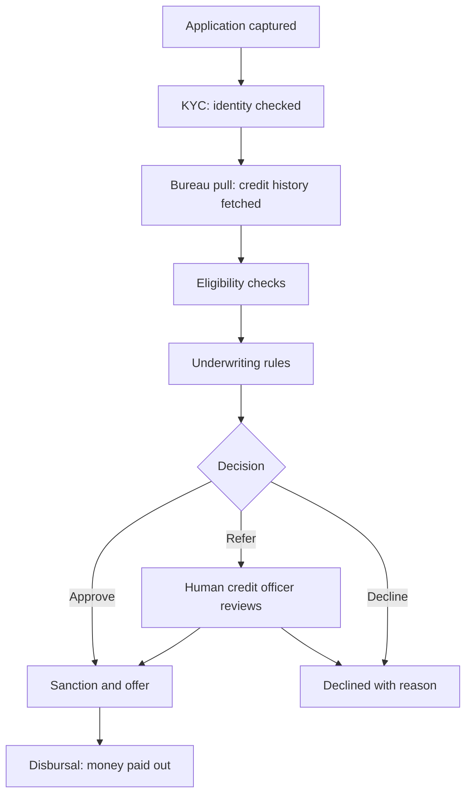
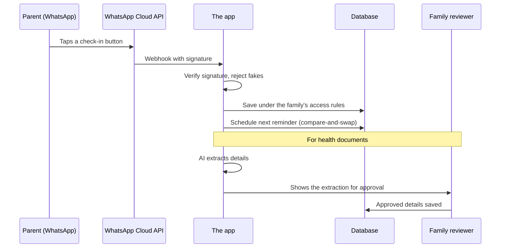
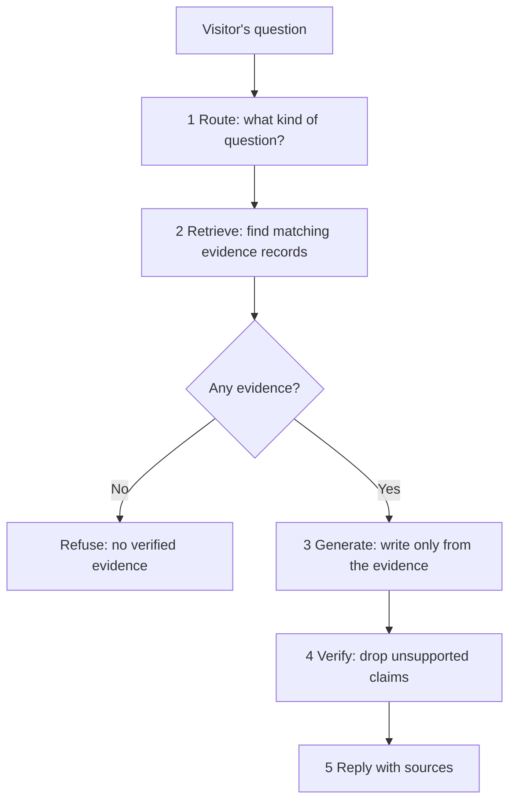
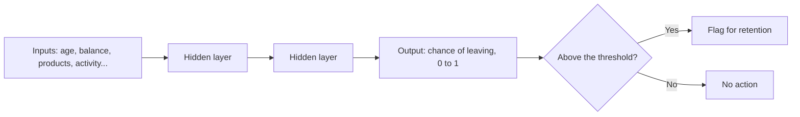
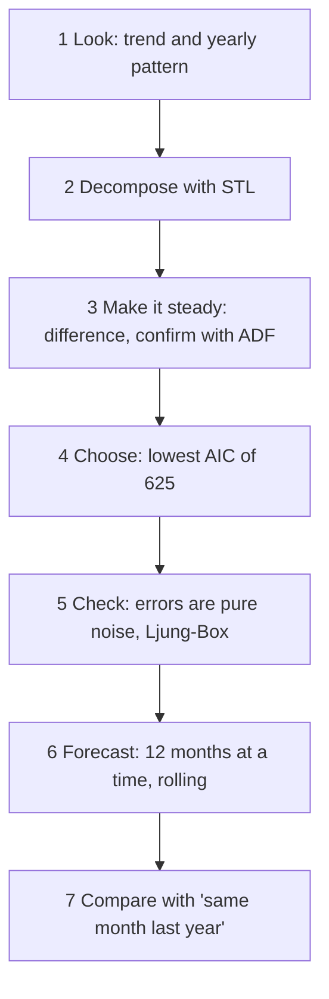
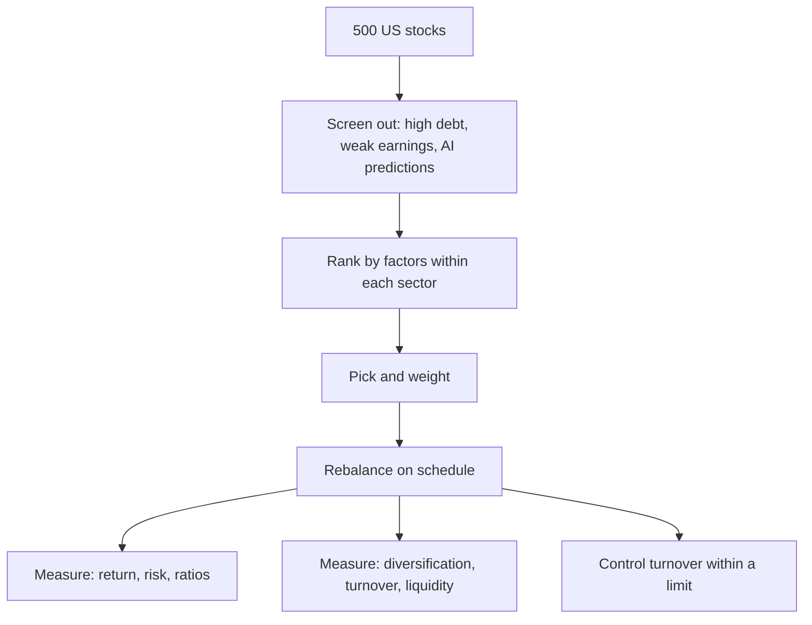

## At a glance

<svg viewBox="0 0 400 592" width="400" xmlns="http://www.w3.org/2000/svg" role="img" aria-label="My work on one page: six projects and two roles, each with its one-line point" style="width:100%;max-width:400px;height:auto;display:block;margin:1rem auto">
<g font-family="system-ui, -apple-system, 'Segoe UI', Roboto, sans-serif" font-size="15" fill="#1f2937">
<text x="200.0" y="26.0" text-anchor="middle" font-size="16" font-weight="700">My work on one page</text>
<rect x="12.0" y="44.0" width="376.0" height="60.0" rx="8" fill="#f3f4f6" stroke="#6b7280" stroke-width="1.5"/>
<circle cx="36.0" cy="74.0" r="15" fill="#6b7280"/>
<text x="36.0" y="79.5" text-anchor="middle" font-weight="700" fill="#ffffff">L</text>
<text x="62.0" y="68.0" font-weight="700" fill="#374151">Lentra AI</text>
<text x="62.0" y="89.0">Lending policy → specs → tested system</text>
<rect x="12.0" y="112.0" width="376.0" height="60.0" rx="8" fill="#f3f4f6" stroke="#6b7280" stroke-width="1.5"/>
<circle cx="36.0" cy="142.0" r="15" fill="#6b7280"/>
<text x="36.0" y="147.5" text-anchor="middle" font-weight="700" fill="#ffffff">J</text>
<text x="62.0" y="136.0" font-weight="700" fill="#374151">Jana Small Finance Bank</text>
<text x="62.0" y="157.0">Portfolio reporting, automated in SQL</text>
<rect x="12.0" y="180.0" width="376.0" height="60.0" rx="8" fill="#eff6ff" stroke="#3b82f6" stroke-width="1.5"/>
<circle cx="36.0" cy="210.0" r="15" fill="#3b82f6"/>
<text x="36.0" y="215.5" text-anchor="middle" font-weight="700" fill="#ffffff">1</text>
<text x="62.0" y="204.0" font-weight="700" fill="#1d4ed8">Retail credit risk system</text>
<text x="62.0" y="225.0">Who defaults, what it costs, what to hold</text>
<rect x="12.0" y="248.0" width="376.0" height="60.0" rx="8" fill="#ecfdf5" stroke="#10b981" stroke-width="1.5"/>
<circle cx="36.0" cy="278.0" r="15" fill="#10b981"/>
<text x="36.0" y="283.5" text-anchor="middle" font-weight="700" fill="#ffffff">2</text>
<text x="62.0" y="272.0" font-weight="700" fill="#047857">Parents Health OS</text>
<text x="62.0" y="293.0">A secure family care console</text>
<rect x="12.0" y="316.0" width="376.0" height="60.0" rx="8" fill="#f5f3ff" stroke="#8b5cf6" stroke-width="1.5"/>
<circle cx="36.0" cy="346.0" r="15" fill="#8b5cf6"/>
<text x="36.0" y="351.5" text-anchor="middle" font-weight="700" fill="#ffffff">3</text>
<text x="62.0" y="340.0" font-weight="700" fill="#6d28d9">Evidence-grounded AI agent</text>
<text x="62.0" y="361.0">Answers only from verified evidence</text>
<rect x="12.0" y="384.0" width="376.0" height="60.0" rx="8" fill="#f0fdfa" stroke="#14b8a6" stroke-width="1.5"/>
<circle cx="36.0" cy="414.0" r="15" fill="#14b8a6"/>
<text x="36.0" y="419.5" text-anchor="middle" font-weight="700" fill="#ffffff">4</text>
<text x="62.0" y="408.0" font-weight="700" fill="#0f766e">Bank churn model</text>
<text x="62.0" y="429.0">Who will leave the bank</text>
<rect x="12.0" y="452.0" width="376.0" height="60.0" rx="8" fill="#fffbeb" stroke="#f59e0b" stroke-width="1.5"/>
<circle cx="36.0" cy="482.0" r="15" fill="#f59e0b"/>
<text x="36.0" y="487.5" text-anchor="middle" font-weight="700" fill="#ffffff">5</text>
<text x="62.0" y="476.0" font-weight="700" fill="#b45309">SARIMA forecasting</text>
<text x="62.0" y="497.0">Next months of drug prescriptions</text>
<rect x="12.0" y="520.0" width="376.0" height="60.0" rx="8" fill="#fff1f2" stroke="#f43f5e" stroke-width="1.5"/>
<circle cx="36.0" cy="550.0" r="15" fill="#f43f5e"/>
<text x="36.0" y="555.5" text-anchor="middle" font-weight="700" fill="#ffffff">6</text>
<text x="62.0" y="544.0" font-weight="700" fill="#be123c">Client equity strategies</text>
<text x="62.0" y="565.0">Backtests for stock-picking strategies</text>
</g>
</svg>

**How to read this note:** every section opens with one line and a summary table. That is the cheatsheet layer. Under it, "How it works" teaches the idea properly, and the harder ideas get a worked example with real numbers. Every term is explained the first time it appears, so you never need to leave the page.

| Part | What it covers |
|---|---|
| The thread | How the two roles and six projects connect into one story |
| Part A — The lending chain | Lentra AI, Jana Small Finance Bank, Project 1: a loan from application to capital |
| Part B — AI under control | Project 2 and Project 3: AI that is secure, grounded and checked |
| Part C — The quant toolkit | Projects 4, 5 and 6: classification, forecasting and backtesting |
| Part D — Skills | Every skill on my resume, in plain words, with where I used it |
| Reference | Key numbers, glossary, one-screen summary |

## The thread — how it all connects

**In one line:** my work follows one loan through its whole life — how it is approved, how it is reported, how its risk is measured — and then shows the building skills (AI and quantitative models) around that chain.

<svg viewBox="0 0 400 470" width="400" xmlns="http://www.w3.org/2000/svg" role="img" aria-label="How my work connects: a loan is approved at Lentra, reported at Jana, and measured in Project 1; AI and quant projects support the chain" style="width:100%;max-width:400px;height:auto;display:block;margin:1rem auto">
<defs><marker id="ar1" viewBox="0 0 10 10" refX="8" refY="5" markerWidth="7" markerHeight="7" orient="auto"><path d="M0,0 L10,5 L0,10 z" fill="#6b7280"/></marker></defs>
<g font-family="system-ui, -apple-system, 'Segoe UI', Roboto, sans-serif" font-size="14" fill="#1f2937">
<text x="200" y="24" text-anchor="middle" font-size="16" font-weight="700">One loan, one story</text>
<rect x="20" y="40" width="360" height="62" rx="10" fill="#f3f4f6" stroke="#6b7280" stroke-width="1.5"/>
<text x="36" y="64" font-weight="700" fill="#374151">1. The loan is approved</text>
<text x="36" y="86">Lentra AI: policy turned into a working system</text>
<line x1="200" y1="102" x2="200" y2="124" stroke="#6b7280" stroke-width="2" marker-end="url(#ar1)"/>
<rect x="20" y="128" width="360" height="62" rx="10" fill="#f3f4f6" stroke="#6b7280" stroke-width="1.5"/>
<text x="36" y="152" font-weight="700" fill="#374151">2. The loan is reported</text>
<text x="36" y="174">Jana: the book measured one agreed way</text>
<line x1="200" y1="190" x2="200" y2="212" stroke="#6b7280" stroke-width="2" marker-end="url(#ar1)"/>
<rect x="20" y="216" width="360" height="62" rx="10" fill="#eff6ff" stroke="#3b82f6" stroke-width="1.5"/>
<text x="36" y="240" font-weight="700" fill="#1d4ed8">3. The loan's risk is measured</text>
<text x="36" y="262">Project 1: default, loss, provision, capital</text>
<rect x="20" y="304" width="174" height="84" rx="10" fill="#f5f3ff" stroke="#8b5cf6" stroke-width="1.5"/>
<text x="107" y="328" text-anchor="middle" font-weight="700" fill="#6d28d9">AI under control</text>
<text x="107" y="350" text-anchor="middle">Projects 2 and 3</text>
<text x="107" y="370" text-anchor="middle" font-size="13">secure, grounded, tested</text>
<rect x="206" y="304" width="174" height="84" rx="10" fill="#fffbeb" stroke="#f59e0b" stroke-width="1.5"/>
<text x="293" y="328" text-anchor="middle" font-weight="700" fill="#b45309">Quant toolkit</text>
<text x="293" y="350" text-anchor="middle">Projects 4, 5, 6</text>
<text x="293" y="370" text-anchor="middle" font-size="13">classify, forecast, test</text>
<line x1="107" y1="304" x2="150" y2="282" stroke="#8b5cf6" stroke-width="1.5" stroke-dasharray="4 3"/>
<line x1="293" y1="304" x2="250" y2="282" stroke="#f59e0b" stroke-width="1.5" stroke-dasharray="4 3"/>
<rect x="20" y="404" width="360" height="52" rx="10" fill="#ecfdf5" stroke="#10b981" stroke-width="1.5"/>
<text x="200" y="427" text-anchor="middle" font-weight="700" fill="#047857">The common skill</text>
<text x="200" y="447" text-anchor="middle">Turn a rule into something built, then prove it works</text>
</g>
</svg>

| Piece | Where it sits in the story | The skill it proves |
|---|---|---|
| Lentra AI | The loan is born: application to decision | Turning lending policy into exact specifications and testing them |
| Jana Small Finance Bank | The loan lives in the book: reported every month | One definition per number, automated in SQL, reconciled across systems |
| Project 1 | The loan's risk is measured | The whole credit risk chain: PD → LGD → EAD → ECL → capital |
| Projects 2 and 3 | Around the chain: building with AI | AI kept secure, grounded in evidence and under human control |
| Projects 4, 5, 6 | Around the chain: quantitative models | Classification, forecasting and backtesting done with discipline |

**The one pattern across everything:** a rule is written down (a lending policy, a metric definition, a model, a strategy), it is built into something that runs, and then it is tested against answers worked out in advance. Every section below shows that pattern once.

---

## Part A — The lending chain

**In one line:** a loan is approved (Lentra), reported (Jana) and its risk is measured (Project 1).

## Lentra AI

**Business Analyst (Product Management) — B2B lending platform · Pune · April to October 2021**

**In one line:** I turned banks' lending policies into precise specifications for a loan system, then tested that what was built matched them.

| What I did | In plain words |
|---|---|
| Mapped end-to-end workflows for a loan origination platform | Drew every step a loan goes through, from application to decision, across bank clients, product and engineering |
| Turned lending policy, eligibility and calculations into functional specifications | Wrote exactly how the system must apply each rule and calculation, plus the data and connections it needs |
| Ran UAT and loan calculation checks before go-live | Built test packs with the right answers worked out in advance, tracked defects with engineering until fixed, and got sign-off |

### How it works — the business setting

Lentra sells software to banks. The software is a **loan origination system (LOS)**: the system a bank uses to take a loan from application to approval. **B2B SaaS** means software sold to businesses (here, banks) and used online, rather than installed on each bank's own machines.

Every bank has a **lending policy**: a written document that says who may borrow, how much, at what price, and on what conditions. The policy is written for people. A computer cannot read it. The business analyst's job is to be the translator between the two.

| Who | What they have | What they need |
|---|---|---|
| The bank (client) | A lending policy in plain words | A system that applies it exactly, every time |
| Product | A platform that can be configured | To know exactly what to configure |
| Engineering | Code | Rules precise enough to build, with no guessing |
| The business analyst | Sits in the middle | Turns the first column into something the third can build |

### How it works — a loan's journey through the LOS



This is a typical LOS journey. Each box is a step I would map, with who does it, what data it needs and what it hands to the next step.

| Term | Plain meaning |
|---|---|
| KYC, know your customer | Checking the borrower is who they say they are |
| Credit bureau | A company that keeps everyone's borrowing history (in India, for example, CIBIL) |
| Bureau pull | The system fetching the applicant's credit report and score |
| Eligibility criteria | The conditions a borrower must meet, such as minimum income |
| Underwriting rule layer | The logic that approves, refers or declines each application |
| Refer | Neither approve nor decline automatically; send to a person to decide |
| Sanction | The bank formally agreeing to lend a stated amount on stated terms |
| Disbursal | Paying the loan money out |

### Worked example — from policy line to test case

This example is illustrative, to show the method. It is not any client's actual policy.

**Step 1: the policy says, in plain words:** "The applicant's total monthly loan repayments, including the new loan, must not exceed half of their net monthly income."

**Step 2: turn it into a precise rule.** This ratio has a name in Indian lending: **FOIR, fixed obligations to income ratio**.

$$
\text{FOIR} = \frac{\text{existing EMIs} + \text{new EMI}}{\text{net monthly income}} \le 50\%
$$

- **EMI, equated monthly instalment:** the fixed amount paid every month on a loan
- **Net monthly income:** take-home pay after tax

**Step 3: specify every calculation the rule depends on.** The new EMI is not given; the system must calculate it:

$$
\text{EMI} = \frac{P \times r \times (1+r)^n}{(1+r)^n - 1}
$$

- **P:** the loan amount
- **r:** the monthly interest rate (annual rate ÷ 12)
- **n:** the number of months

**Step 4: work the right answer out in advance.** Applicant: net income ₹80,000 a month, existing EMIs ₹15,000, asking for ₹5,00,000 at 12% a year over 36 months.

| Calculation | Value |
|---|---|
| Monthly rate r | 12% ÷ 12 = 1% |
| New EMI | ₹16,607 |
| Total EMIs | ₹15,000 + ₹16,607 = ₹31,607 |
| FOIR | ₹31,607 ÷ ₹80,000 = 39.5% |
| Rule | 39.5% ≤ 50% → passes |

**Step 5: write the specification line.** A good specification leaves nothing to guess:

| Specification item | What it must say |
|---|---|
| Inputs | Net monthly income (from which document), existing EMIs (from the bureau report or declared, and which wins if they differ) |
| Calculation | The EMI formula above, the rounding rule (to the rupee, rounded up or to nearest) |
| Rule | FOIR ≤ 50% passes; above it declines or refers (the policy decides which) |
| Edge cases | Income missing, zero existing loans, joint applicants |
| Output | Pass or fail, the FOIR value, and the reason code shown to the credit officer |

**Step 6: the test pack.** Test cases are written *before* testing, with the expected result already worked out:

| Case | Income | Existing EMIs | New EMI | Expected FOIR | Expected result |
|---|---|---|---|---|---|
| Clear pass | ₹80,000 | ₹15,000 | ₹16,607 | 39.5% | Pass |
| Exactly on the line | ₹80,000 | ₹23,393 | ₹16,607 | 50.0% | Pass (≤ includes equal) |
| Just over | ₹80,000 | ₹23,500 | ₹16,607 | 50.1% | Fail |
| Missing income | — | ₹15,000 | ₹16,607 | — | Refer, reason "income not verified" |

The "exactly on the line" case matters most. Systems often get boundaries wrong: the policy says "must not exceed" (≤) and a developer writes "less than" (<). The case at exactly 50% catches it.

**Step 7: defects.** If the system returns "Fail" for the 50.0% case, that is a **defect**: the system does something different from the specification. It is logged, fixed by engineering, and the case is run again until it passes.

### How it works — UAT and go-live

| Term | Plain meaning |
|---|---|
| Functional specification (FSD) | A document stating exactly how the system must behave |
| BRD, business requirements document | What the business needs, before deciding how the system does it |
| UAT, user acceptance testing | The business testing the system on realistic cases before it goes live |
| Test pack | A set of test cases with expected results written beforehand |
| Defect | Something the system does differently from the specification |
| Sign-off | The client formally agreeing the system is ready |
| Go-live | The day a client starts using the system for real |

**Why expected results must be written first:** if you work out the answer after seeing what the system produced, you tend to accept whatever it produced. Writing the answer first makes the test honest.

**Why it matters:** this is the start of every loan. If the policy is translated wrongly, every loan the system approves afterwards carries that mistake.

---

## Jana Small Finance Bank

**Manager — Loan Product and Portfolio Analytics · Bengaluru · November 2021 to March 2022**

**In one line:** I automated the retail lending book's reporting and made every team measure the same metric the same way.

| What I did | In plain words |
|---|---|
| Automated portfolio reporting for the retail lending book in SQL | Reports that were built by hand from manual extracts now run automatically on a schedule, and turnaround fell by 30% |
| Worked across retail and SME teams to turn credit policy into consistent reporting definitions | Agreed one definition for each metric, taken from the lending policy |
| Reconciled a metric computed differently across sources | Found why two systems gave different numbers for the same thing, and fixed it |

### How it works — what "portfolio reporting" means

Once loans are disbursed, they sit in the bank's **portfolio**: all the loans a bank has given out, viewed together. Management needs to know every month how that portfolio is behaving.

| Term | Plain meaning |
|---|---|
| Portfolio (the book) | All the loans a bank has given out, viewed together |
| Retail and SME | Loans to individuals; loans to small and medium businesses |
| Outstanding | How much is still owed on a loan today |
| DPD, days past due | How many days a payment is overdue |
| SMA, special mention account | RBI's early-warning labels for overdue loans before they turn bad |
| NPA, non-performing asset | A loan more than 90 days overdue, in RBI's rules |
| GNPA ratio | Bad loans (NPAs) as a share of all loans outstanding |

The Indian overdue buckets are the backbone of most portfolio reports:

| Bucket | Days past due | What it signals |
|---|---|---|
| Regular | 0 | Paying on time |
| SMA-0 | 1–30 | Slipped, often a one-off |
| SMA-1 | 31–60 | A pattern starting |
| SMA-2 | 61–90 | Close to default |
| NPA | More than 90 | Non-performing: the loan has gone bad |

### How it works — why definitions matter

A number like "GNPA ratio" sounds exact. It is not, until someone writes down every choice behind it.

| Choice hidden inside one metric | Option A | Option B |
|---|---|---|
| Which date? | Month-end | The day the report was run |
| Counted how? | Per loan account | Per customer (one customer may have three loans) |
| Written-off loans? | Included | Excluded |
| Which amount? | Principal only | Principal plus unpaid interest |
| Which loans? | All retail | Retail excluding staff loans |

Each choice changes the answer. If the retail team picks A and the SME team picks B, both are "right", and the two numbers still disagree in front of management. A **reporting definition** fixes every choice, taken from the credit policy, so everyone gets the same answer.

### Worked example — a reconciliation

This example is illustrative, to show the method. It is not the actual metric or figures.

Two sources report the NPA book for the same month: the dashboard says ₹42 crore, the core banking extract says ₹45 crore. A **reconciliation** checks that two numbers that should match really do, and explains every rupee of the gap.

| Step | Finding | Gap explained | Gap left |
|---|---|---|---|
| Start | Dashboard ₹42 crore vs extract ₹45 crore | — | ₹3.0 crore |
| 1 Align the date | Dashboard used the run date; three loans were paid up between month-end and the run | ₹1.2 crore | ₹1.8 crore |
| 2 Align the amount | Extract included unpaid interest; dashboard used principal only | ₹1.5 crore | ₹0.3 crore |
| 3 Align the scope | Extract included staff loans the policy excludes | ₹0.3 crore | ₹0 |

The gap is fully explained. The fix is not to pick one number; it is to agree the definition (month-end, principal, staff loans excluded) and make both sources compute it that way.

### How it works — automating it in SQL

**SQL** is the language used to pull and summarise data from databases. A manual report means someone extracts data, pastes it into a spreadsheet and rebuilds the same tables each month. An automated report is a query that applies the agreed definition and runs by itself.

A simplified illustration of what one definition looks like as SQL:

```sql
-- NPA book by product, at month-end, principal only, staff loans excluded
SELECT
    product,
    SUM(principal_outstanding)                                   AS book,
    SUM(CASE WHEN dpd > 90 THEN principal_outstanding ELSE 0 END) AS npa_book,
    SUM(CASE WHEN dpd > 90 THEN principal_outstanding ELSE 0 END)
        / SUM(principal_outstanding)                             AS gnpa_ratio
FROM loan_snapshot
WHERE snapshot_date = '2022-01-31'
  AND is_staff_loan = 0
GROUP BY product;
```

Every choice from the definition table is visible in the code: the date, the amount, the scope, the 90-day line. That is the point: the definition is written once and applied the same way every month.

| Term | Plain meaning |
|---|---|
| Scheduled workflow | A report that runs by itself at set times |
| Reporting definition | The exact rule for calculating a number, so everyone gets the same answer |
| Reconciliation | Checking that two numbers that should match really do, and explaining any gap |
| Data lineage | Tracing each number back to the source system it came from |
| Turnaround time | How long it takes from month-end to the report being ready |

**Why it matters:** a bank's decisions are only as good as its numbers. One definition, automated and reconciled, means management argues about what to do, not about which number is right.

---
## Project 1 — Retail credit risk system

**In one line:** I took one public book of 466,285 loans through the whole chain a bank runs: who will default, what a default costs, how much to set aside, and how much capital to hold.

| Question | Answer |
|---|---|
| Data | 466,285 personal loans from LendingClub, a US lending platform that made its loan records public; issued 2007 to 2014 |
| "Default" means | The loan was written off, or was more than 30 days late and heading there. 3.44% of loans defaulted |
| Built | PD scorecard, LGD, EAD, IFRS 9-style ECL staging, Basel III IRB capital, validation and portfolio monitoring |
| Status | Live |

### The chain in one picture

<svg viewBox="0 0 400 520" width="400" xmlns="http://www.w3.org/2000/svg" role="img" aria-label="The credit risk chain: data, PD, scorecard, test, LGD and EAD, expected loss, IFRS 9 provision, Basel capital, monitoring" style="width:100%;max-width:400px;height:auto;display:block;margin:1rem auto">
<defs><marker id="ar2" viewBox="0 0 10 10" refX="8" refY="5" markerWidth="6" markerHeight="6" orient="auto"><path d="M0,0 L10,5 L0,10 z" fill="#3b82f6"/></marker></defs>
<g font-family="system-ui, -apple-system, 'Segoe UI', Roboto, sans-serif" font-size="14" fill="#1f2937">
<text x="200" y="24" text-anchor="middle" font-size="16" font-weight="700">From loan data to capital</text>
<rect x="20" y="40" width="360" height="44" rx="8" fill="#eff6ff" stroke="#3b82f6"/><text x="34" y="67"><tspan font-weight="700" fill="#1d4ed8">1 Group</tspan>  inputs into bands (WoE)</text>
<line x1="200" y1="84" x2="200" y2="96" stroke="#3b82f6" stroke-width="2" marker-end="url(#ar2)"/>
<rect x="20" y="98" width="360" height="44" rx="8" fill="#eff6ff" stroke="#3b82f6"/><text x="34" y="125"><tspan font-weight="700" fill="#1d4ed8">2 Predict</tspan>  PD with logistic regression</text>
<line x1="200" y1="142" x2="200" y2="154" stroke="#3b82f6" stroke-width="2" marker-end="url(#ar2)"/>
<rect x="20" y="156" width="360" height="44" rx="8" fill="#eff6ff" stroke="#3b82f6"/><text x="34" y="183"><tspan font-weight="700" fill="#1d4ed8">3 Score</tspan>  turn the model into points</text>
<line x1="200" y1="200" x2="200" y2="212" stroke="#3b82f6" stroke-width="2" marker-end="url(#ar2)"/>
<rect x="20" y="214" width="360" height="44" rx="8" fill="#fffbeb" stroke="#f59e0b"/><text x="34" y="241"><tspan font-weight="700" fill="#b45309">4 Test</tspan>  rank, calibration, stability</text>
<line x1="200" y1="258" x2="200" y2="270" stroke="#3b82f6" stroke-width="2" marker-end="url(#ar2)"/>
<rect x="20" y="272" width="360" height="44" rx="8" fill="#ecfdf5" stroke="#10b981"/><text x="34" y="299"><tspan font-weight="700" fill="#047857">5 Price the loss</tspan>  EL = PD × LGD × EAD</text>
<line x1="200" y1="316" x2="200" y2="328" stroke="#3b82f6" stroke-width="2" marker-end="url(#ar2)"/>
<rect x="20" y="330" width="360" height="44" rx="8" fill="#ecfdf5" stroke="#10b981"/><text x="34" y="357"><tspan font-weight="700" fill="#047857">6 Provide</tspan>  IFRS 9 stages and ECL</text>
<line x1="200" y1="374" x2="200" y2="386" stroke="#3b82f6" stroke-width="2" marker-end="url(#ar2)"/>
<rect x="20" y="388" width="360" height="44" rx="8" fill="#f5f3ff" stroke="#8b5cf6"/><text x="34" y="415"><tspan font-weight="700" fill="#6d28d9">7 Hold capital</tspan>  Basel IRB formula</text>
<line x1="200" y1="432" x2="200" y2="444" stroke="#3b82f6" stroke-width="2" marker-end="url(#ar2)"/>
<rect x="20" y="446" width="360" height="44" rx="8" fill="#f3f4f6" stroke="#6b7280"/><text x="34" y="473"><tspan font-weight="700" fill="#374151">8 Watch</tspan>  vintages and dashboard</text>
<text x="200" y="510" text-anchor="middle" font-size="12" fill="#6b7280">Blue: the model · Amber: proof · Green: accounting · Violet: regulation</text>
</g>
</svg>

| Term | Plain meaning |
|---|---|
| PD, probability of default | The chance a borrower stops paying within a year |
| LGD, loss given default | The share of the loan lost if they do default |
| EAD, exposure at default | How much is owed when they default |
| EL, expected loss | PD × LGD × EAD: the loss expected on average |
| ECL, expected credit loss | The accounting version of expected loss, which a bank sets aside in advance (a provision) |
| Provision | Money set aside today for losses expected later |
| Capital | The bank's own money, held to survive a bad year, not an average one |

**The key idea behind the whole chain:** expected loss is the average cost of lending, so it is priced in and provided for. Capital covers the *unexpected* loss: the bad year. Provisions and capital answer two different questions.

| | Provision (ECL) | Capital |
|---|---|---|
| Covers | The average loss | The loss in a bad year, beyond the average |
| Rulebook | Accounting: IFRS 9 (India: Ind AS 109) | Banking regulation: Basel |
| Where it shows | Charged against profit | Held as a buffer on the balance sheet |

### Step 1 — Group the data: weight of evidence

**In one line:** each input is cut into bands, and each band gets a number saying how strongly it points to good or bad borrowers.

The model needs inputs (income, loan purpose, grade and so on). Raw inputs are messy: income runs from tiny to huge, with outliers, and the link to default is rarely a straight line. So each input is split into **bands** (called bins), and each band is scored with its **weight of evidence (WoE)**:

$$
\text{WoE} = \ln\left(\frac{\%\ \text{of all goods in this band}}{\%\ \text{of all bads in this band}}\right)
$$

- **Goods:** borrowers who repaid
- **Bads:** borrowers who defaulted
- **ln:** the natural logarithm; it makes "twice as likely" and "half as likely" symmetric around zero

**Worked example (illustrative):** a book of 40,000 goods and 1,500 bads.

| Band | Goods | % of goods | Bads | % of bads | WoE | Reads as |
|---|---|---|---|---|---|---|
| Band A | 2,000 | 5.0% | 150 | 10.0% | ln(0.5) = −0.69 | Holds twice its share of bads: risky |
| Band B | 10,000 | 25.0% | 100 | 6.7% | ln(3.75) = +1.32 | Holds far fewer bads: safe |

Positive WoE means safer than average, negative means riskier, zero means the band tells you nothing.

**Information value (IV)** adds the bands up to say how useful the whole input is:

$$
\text{IV} = \sum_{\text{bands}} (\%\ \text{goods} - \%\ \text{bads}) \times \text{WoE}
$$

| IV | Rule-of-thumb reading |
|---|---|
| Below 0.02 | Useless |
| 0.02 – 0.1 | Weak |
| 0.1 – 0.3 | Medium |
| Above 0.3 | Strong (and above 0.5, check it is not too good to be true) |

**Why banks do this:** WoE bands handle outliers and missing values, make the risk move in one clear direction, and make every input explainable to a credit committee and a regulator.

### Step 2 — Predict default: logistic regression

**In one line:** logistic regression adds up the evidence, then squashes the total into a probability between 0 and 1.

$$
z = b_0 + b_1 \cdot \text{WoE}_1 + b_2 \cdot \text{WoE}_2 + \dots
$$

$$
\text{PD} = \frac{1}{1 + e^{\,z}}
$$

- **b values:** weights the model learns from past loans, one per input
- **z:** the total evidence, a score of how good the borrower looks; it can be any number
- **The second formula:** turns z into a probability between 0 and 1 (with this sign, more good evidence means lower PD)

**Worked example (illustrative):** a borrower whose evidence adds up to z = 3.2 gets PD = 1 ÷ (1 + e<sup>3.2</sup>) = 1 ÷ 25.5 ≈ 3.9%.

**Why logistic regression, not a fancier model:** in credit, every decision must be explained ("declined mainly because of high utilisation"). A logistic regression on WoE inputs can be read line by line. That is why it is still the standard for scorecards.

### Step 3 — The scorecard: points

**In one line:** the model is rescaled into points, so a higher score means safer, and every fixed number of points doubles the odds of being good.

Banks set two anchors: a score at a chosen odds, and **PDO, points to double the odds**.

$$
\text{Score} = \text{Offset} + \text{Factor} \times \ln(\text{odds of good})
$$

$$
\text{Factor} = \frac{\text{PDO}}{\ln 2}
$$

- **Odds of good:** goods per bad, for example 50 : 1
- **Offset:** a constant that puts the chosen anchor at the chosen score

**Worked example (illustrative):** anchor 600 points at odds of 50 : 1, with PDO = 20. Then Factor = 20 ÷ 0.693 = 28.85.

| Odds of good | Score |
|---|---|
| 25 : 1 | 580 |
| 50 : 1 | 600 |
| 100 : 1 | 620 |

Every 20 points, the odds double. The total is then split across inputs, so each answer earns its own points, and the points add up to the score. That table of points is the scorecard.

### Step 4 — Test it: does the model work?

**In one line:** a model must rank well (separate good from bad), be calibrated (its PDs match reality) and be stable (today's borrowers still look like the ones it learned from).

| Check | Question it answers | Measure |
|---|---|---|
| Rank ordering | Does it put defaulters above good borrowers? | AUC, Gini, KS |
| Calibration | When it says 4%, do about 4% default? | Hosmer–Lemeshow test, predicted vs actual by grade |
| Stability | Has the population shifted? | PSI |
| Out-of-time | Does it work on later loans it never saw? | All of the above, on 2014 loans |

**AUC and Gini.** Take one defaulter and one good borrower at random. **AUC** is the chance the model gives the defaulter the higher risk. 0.5 is a coin toss; 1 is perfect. **Gini** is the same idea rescaled so 0 is random and 1 is perfect:

$$
\text{Gini} = 2 \times \text{AUC} - 1
$$

With AUC 0.69: Gini = 2 × 0.69 − 1 = 0.38.

**KS, Kolmogorov–Smirnov:** the widest gap between the share of bads and the share of goods caught as you move down the score list. Bigger is better separation.

**PSI, population stability index:** compares today's spread of scores with the spread the model was built on.

$$
\text{PSI} = \sum_{\text{bands}} (\text{actual}\% - \text{expected}\%) \times \ln\left(\frac{\text{actual}\%}{\text{expected}\%}\right)
$$

**Worked example (illustrative):** a score band held 25% of borrowers at build time and 30% now: (0.30 − 0.25) × ln(1.2) = 0.009. Another fell from 25% to 20%: 0.011. Add every band's contribution.

| PSI | Reading |
|---|---|
| Below 0.1 | Stable |
| 0.1 – 0.25 | Watch it |
| Above 0.25 | Population has shifted; review the model |

**Out-of-time test:** the model is built on earlier years and tested on 2014 loans it never saw, as happens in real life. A model that only works on the years it learned from is useless.

### Step 5 — Price the loss: expected loss

**In one line:** multiply the chance of default, the share lost and the amount owed.

$$
\text{EL} = \text{PD} \times \text{LGD} \times \text{EAD}
$$

**Worked example (illustrative):** a USD 10,000 loan with PD 3% and LGD 45%: EL = 0.03 × 0.45 × 10,000 = USD 135. Across the whole book, the same sum loan by loan gave USD 58.67 million.

| Piece | How it is estimated, in plain words |
|---|---|
| PD | From the scorecard model (steps 1–3) |
| LGD | From defaulted loans: how much was never recovered, as a share of what was owed |
| EAD | For an instalment loan, what is still owed; it falls as the loan is repaid |

### Step 6 — Provide for it: IFRS 9 staging

**In one line:** healthy loans carry one year of expected loss; loans whose risk has risen significantly carry the loss over their whole remaining life.

| Stage | Meaning | Provision |
|---|---|---|
| Stage 1 | Healthy | 12-month ECL: loss from defaults in the next year |
| Stage 2 | Risk has risen significantly since the loan was given (SICR) | Lifetime ECL: loss from defaults over the whole remaining life |
| Stage 3 | In default | Lifetime ECL on a defaulted loan |

- **SICR, significant increase in credit risk:** the trigger for Stage 2. A common backstop is 30 days past due
- **Ind AS 109:** India's version of IFRS 9
- **CECL:** the US rule, which takes lifetime loss on every loan from day one, with no stages

**Worked example (illustrative) — the cliff effect.** The same USD 10,000 loan, three years left, LGD 45%, yearly PDs of 3%, 4% and 5%.

| | Calculation | Provision |
|---|---|---|
| Stage 1 (12 months) | 3% × 45% × 10,000 | USD 135 |
| Lifetime PD | 1 − (0.97 × 0.96 × 0.95) = 11.5% | — |
| Stage 2 (lifetime) | 11.5% × 45% × 10,000 | about USD 519 |

(Simplified: ignores discounting and the balance falling as the loan is repaid.)

Moving one stage nearly quadruples the provision. That jump is called the **cliff effect**, and it is why the Stage 2 trigger is watched so closely.

### Step 7 — Hold capital: the Basel IRB formula

**In one line:** the formula asks "how bad could defaults get in a 1-in-1,000 bad year?", and the bank holds capital for the gap between that and the average.

Under the **IRB, internal ratings-based approach**, a bank uses its own PD and LGD in the regulator's formula. For retail loans:

$$
K = \text{LGD} \times \left[ N\!\left( \frac{G(\text{PD}) + \sqrt{R}\; G(0.999)}{\sqrt{1-R}} \right) - \text{PD} \right]
$$

$$
\text{RWA} = K \times 12.5 \times \text{EAD}
$$

- **K:** capital needed per rupee (or dollar) of exposure
- **N and G:** the normal distribution and its inverse; they turn a probability into a "how many standard deviations" number and back
- **0.999:** the 1-in-1,000-year confidence level
- **R, correlation:** how much borrowers default together when the economy turns
- **RWA, risk-weighted assets:** the exposure scaled by riskiness; capital is held as a percentage of RWA
- **12.5:** equals 1 ÷ 8%, the base minimum capital ratio

**What the formula is really doing:** N(…) is the PD *in a very bad year*. Subtract the normal PD (that part is already covered by provisions), multiply by the share lost, and you have the capital for the unexpected loss.

**Worked example (illustrative):** "other retail" loan, PD 3%, LGD 45%, EAD USD 10,000.

| Calculation | Value |
|---|---|
| Correlation R (retail formula) | 0.075 |
| Bad-year PD, N(…) | 14.2% |
| K = 45% × (14.2% − 3%) | 5.0% |
| RWA = 5.0% × 12.5 × 10,000 | USD 6,280 (a 63% risk weight) |
| Capital at 8% of RWA | about USD 502 |

So on this loan: provision about USD 135 for the average year, capital about USD 502 for the bad year.

### Step 8 — Watch it: vintages and monitoring

**In one line:** track each batch of loans over time, and watch the model's health every month.

A **vintage** is all the loans issued in the same period (for example, one quarter). A **vintage curve** plots the share of each batch that has defaulted, month by month since issue. If a newer vintage's curve rises faster than older ones, something has changed: the borrowers, the policy or the economy.

| Monitored | What would trigger a review |
|---|---|
| Default rates by vintage | A new vintage running above older ones |
| PSI | Above 0.25 |
| Gini | A material fall from its level at build time |
| Predicted vs actual PD by grade | A grade consistently above or below its prediction |

### The results — and what they mean

| Result | Value | What it means |
|---|---|---|
| AUC on 2014 loans | 0.69 | Picks the defaulter over the good borrower about 69% of the time |
| Gini | 0.36–0.38 | Modest, because LendingClub had already screened out risky applicants |
| The bar to beat | LendingClub's own grade alone: 0.6886 | The platform's pricing already held most of the signal |
| Expected loss | USD 58.67 million, 3.21% of the book | PD × LGD × EAD, added up across every loan |
| Calibration test (Hosmer–Lemeshow) on 2014 loans | p = 0.001 | On a sample this large, even tiny gaps fail the test, so it is read alongside grade-by-grade checks |

**Why the Gini is modest, and why that is honest:** these loans were already approved by LendingClub. The riskiest applicants never got a loan, so they are not in the data. A model built only on approved borrowers has less to separate. Stating that openly is part of good model risk practice.

**Why Hosmer–Lemeshow fails yet the model is usable:** the test asks "is there *any* gap between predicted and actual?" With hundreds of thousands of loans, it detects gaps too small to matter. So the grade-by-grade comparison decides whether the gap is material.

**Why it matters:** it shows the full credit risk chain, end to end, on real data, with the limits stated openly.

---
## Part B — AI under control

**In one line:** two systems that use AI the way a bank would need it — secure by design, grounded in evidence, and never trusted blindly.

| Principle | Project 2 shows it by | Project 3 shows it by |
|---|---|---|
| Security built in, not added later | The database itself enforces who sees what | Rate limits and fixed rules on what it may answer |
| AI suggests, something checks | A person approves every AI-read document | A verifier removes any unsupported claim |
| Proven by tests | A scheduler that cannot double-send | A 22-case test harness |

## Project 2 — Parents Health OS

**In one line:** a family care console for looking after my parents' health. AI helps read documents, but a person approves everything important.

| Question | Answer |
|---|---|
| Problem | Keeping on top of parents' health check-ins, documents and reminders safely, in one place |
| Built on | Next.js (the web app) and Supabase (a hosted PostgreSQL database with sign-in) |
| Key design | 15 database tables protected by row-level security; AI document reading held behind human review; a scheduler that can't double-send |

### How it works — the flow



| Step | What happens |
|---|---|
| 1 Check in | A parent taps a button in WhatsApp |
| 2 Receive | The message reaches the app through a signed webhook, so fakes are rejected |
| 3 Store | It is saved under that family's access rules |
| 4 Schedule | The scheduler plans the next reminder, safely, even if messages arrive twice or out of order |
| 5 Documents | AI extracts details from a health document; nothing is saved until a person approves it |

### How it works — the four safety ideas

**1. Row-level security (RLS): the database guards itself.**

Most apps check permissions in the app code. If one screen forgets the check, data leaks. With **row-level security**, the database itself checks, row by row, who is allowed to see each record. Even a buggy screen cannot read another family's rows.

An illustrative policy, in the style Supabase uses:

```sql
-- A user may read a check-in only if they belong to that check-in's family
CREATE POLICY family_can_read ON check_ins
FOR SELECT
USING (
    family_id IN (
        SELECT family_id FROM family_members WHERE user_id = auth.uid()
    )
);
```

- **auth.uid():** the signed-in user's ID, supplied by Supabase's sign-in
- **The rule in plain words:** show this row only if the person asking is a member of the family it belongs to

**2. Signed webhooks: proving a message is real.**

A **webhook** is a message one system pushes to another when something happens. Anyone on the internet could send a fake one to the app's address. So WhatsApp signs each message with an **HMAC SHA-256 signature**: a code calculated from the message and a secret key that only WhatsApp and the app know.

| Step | Who | What |
|---|---|---|
| 1 | WhatsApp | Calculates code = HMAC(secret, message) and sends it with the message |
| 2 | The app | Recalculates HMAC(secret, message) itself |
| 3 | The app | If the two codes match, the message is real; if not, it is rejected |

A faker does not have the secret, so they cannot produce a matching code. Change one character of the message and the code changes completely.

**3. Compare-and-swap (CAS): jobs never run twice.**

Messages can arrive twice or out of order. Without protection, two copies of the same event could each schedule a reminder, and a parent gets two messages. **Compare-and-swap** means: update a record only if nobody changed it in between.

| Moment | Copy 1 of the event | Copy 2 of the event |
|---|---|---|
| Both read the schedule | Sees version 7 | Sees version 7 |
| Copy 1 writes | "Update if still version 7" → succeeds, now version 8 | — |
| Copy 2 writes | — | "Update if still version 7" → fails, it is version 8 |
| Result | One reminder scheduled | Safely does nothing |

This property, that doing something twice has the same effect as doing it once, is called **idempotency**.

**4. Human review: AI suggests, a person decides.**

AI reads a health document (a prescription, a lab report) and extracts details. Extraction can be wrong, and a wrong medicine dose in a care app is dangerous. So the extraction is shown to a family member, and nothing is saved until they approve it. The AI saves typing; it never has the final word.

| Term | Plain meaning |
|---|---|
| Next.js | A framework for building web apps in React |
| Supabase | A hosted PostgreSQL database with sign-in built in |
| PostgreSQL | A widely used database |
| Row-level security (RLS) | The database itself checks, row by row, who is allowed to see each record |
| WhatsApp Cloud API | Meta's official way for an app to send and receive WhatsApp messages |
| Webhook | A message one system pushes to another when something happens |
| HMAC SHA-256 signature | A code attached to each message that proves it really came from WhatsApp |
| Compare-and-swap (CAS) | Update a record only if nobody changed it in between, so jobs never run twice |
| Idempotency | Doing something twice has the same effect as doing it once |
| Human review | AI suggests; a person decides |

**Why it matters:** it is a working, secure product built end to end, with AI kept under human control.

---

## Project 3 — Evidence-grounded AI agent

**In one line:** a chat assistant on my website that answers questions about my work only from a verified record, shows where each answer came from, and refuses anything it can't back.

| Question | Answer |
|---|---|
| Problem | AI chatbots invent things; this one must never claim what can't be proven |
| Evidence | 15 verified records: my positioning, projects, analytics work, experience, education and skills |
| Tested with | A 22-case test harness |

### How it works — why AI invents things

A large language model (LLM) writes the most likely next words, based on patterns it learned. It has no built-in sense of "I don't actually know this". Asked about a person it has never seen, it will often produce a fluent, confident, invented answer. This is called **hallucination**.

The fix is not to trust the model more. It is to change the job: the model is no longer asked "what do you know?", only "write an answer from *these* facts", and then the answer is checked.

### How it works — the pipeline



| Step | What happens |
|---|---|
| 1 Route | Works out what kind of question it is: a project, experience, skills, education, role fit, limitations or unknown |
| 2 Retrieve | Finds the matching evidence records |
| 3 Generate | Writes the answer from that evidence only, using Google's Gemini 2.5 Flash model (or a fixed local answer if the model is unavailable) |
| 4 Verify | Removes any statement the evidence doesn't support; if nothing matches, it refuses |
| 5 Reply | Streams the answer with its sources |

**Why each step exists:**

| Step | The failure it prevents |
|---|---|
| Route | Searching the wrong kind of evidence for the question |
| Retrieve | The model answering from its memory instead of the record |
| Generate from evidence only | Fluent answers built on nothing |
| Verify | A claim slipping through that the evidence does not say |
| Refuse | Guessing when the honest answer is "I don't know" |
| Fixed local answer | The site breaking if the model service is down |

### Worked example — one answer, one refusal

Illustrative, to show the behaviour.

| | Question about SQL work | Question about something not on record |
|---|---|---|
| Route | Experience | Unknown |
| Retrieve | The experience record for Jana | No matching record |
| Generate | Writes that reporting was automated in SQL, with turnaround down 30% | Skipped |
| Verify | Each sentence checked against the Jana record; all supported | — |
| Reply | The answer, citing the Jana record | "I don't have verified public evidence for that." |

### How it works — the test harness

A **test harness** is a fixed set of questions with the right behaviour written down in advance, run after every change. It is the same idea as a UAT test pack at Lentra, applied to AI.

| Test, 22 cases | Result |
|---|---|
| Found the right evidence | 17 of 17 |
| Refused when it should | 10 of 10 |
| Rejected claims about retired projects | 3 of 3 |
| Citations valid | 17 of 17 |
| Sources relevant | 17 of 17 |

**Why refusal is tested separately:** a system that always answers can score well on answerable questions and still invent things on the rest. Testing that it refuses when it should is what proves it is safe.

| Term | Plain meaning |
|---|---|
| LLM, large language model | An AI model that writes text by predicting likely next words |
| Hallucination | A model stating something false as if it were true |
| Intent routing | Sorting a question into a type before answering it |
| Retrieval | Looking up the relevant facts before writing, instead of relying on the model's memory |
| RAG, retrieval-augmented generation | Retrieve the facts first, then let the model write from them |
| Citation check | Every claim must point to a real evidence record |
| Refusal control | When there's no evidence, it says: "I don't have verified public evidence for that." |
| Test harness | A fixed set of questions with the right behaviour written down in advance, run after every change |
| Streaming | Sending the answer word by word as it is written, so the visitor isn't left waiting |
| Rate limit | At most 10 questions a minute per visitor, to stop abuse |

**Why it matters:** it is AI built the way a bank needs it: grounded, cited, tested, and allowed to say "I don't know".

---
## Part C — The quant toolkit

**In one line:** three projects that show the three core jobs of quantitative work — classify (who will do X?), forecast (what comes next?) and test (would this have worked?).

| Job | Project | The discipline it shows |
|---|---|---|
| Classify | 4 Bank churn | Pick the measure that matches the business cost, and fix imbalance |
| Forecast | 5 SARIMA | Test assumptions, choose by evidence, beat a simple baseline |
| Test | 6 Equity backtests | Turn an idea into reproducible code, and avoid flattering the results |

## Project 4 — Bank churn model

**In one line:** a neural network that predicts which of a bank's 10,000 customers will close their accounts, so the bank can try to keep them.

| Question | Answer |
|---|---|
| Data | 10,000 retail banking customers; about one in five left |
| Model | A neural network built in Keras |
| Measured by | Recall: the share of real leavers the model catches |

### How it works — the neural network, simply

A **neural network** is layers of simple units. Each unit takes numbers in, weights them, adds them up and passes on a signal. Training nudges all the weights, again and again, so the final output gets closer to the right answer (left or stayed) on past customers.



The output is a probability. A **threshold** turns it into a decision: flag anyone above it. Where the threshold sits decides the trade-off between catching leavers and raising false alarms.

### How it works — the four outcomes

Every prediction lands in one of four boxes:

| | Actually left | Actually stayed |
|---|---|---|
| **Flagged** | Caught (true positive) | False alarm (false positive) |
| **Not flagged** | Missed (false negative) | Correctly ignored (true negative) |

$$
\text{Recall} = \frac{\text{caught}}{\text{caught} + \text{missed}}
$$

$$
\text{Precision} = \frac{\text{caught}}{\text{caught} + \text{false alarms}}
$$

- **Recall:** of everyone who actually left, how many the model caught
- **Precision:** of everyone the model flagged, how many actually left

### How it works — the imbalance problem and SMOTE

Only about one customer in five left. A model can score 80% accuracy by predicting "stays" for everyone, and catch nobody. With **imbalanced data**, the rare outcome gets ignored.

**SMOTE, synthetic minority over-sampling technique,** creates new, synthetic examples of the rare group:

$$
x_{\text{new}} = x + \lambda \times (x_{\text{neighbour}} - x)
$$

- **x:** a real customer who left
- **x<sub>neighbour</sub>:** another similar customer who left
- **λ:** a random number between 0 and 1, so the new point sits somewhere on the line between them

**Illustration:** a leaver aged 40 with a balance of 60,000, and a similar leaver aged 50 with a balance of 80,000. With λ = 0.5, SMOTE creates a synthetic leaver aged 45 with a balance of 70,000. The model now sees more leavers and learns their pattern better. SMOTE is applied to the training data only, never the test data, so the test stays honest.

### Worked example — what the results mean in customers

The real results:

| Model | Recall | Precision | AUC |
|---|---|---|---|
| First network | 0.48 | 0.79 | 0.85 |
| **With SMOTE** | **0.75** | 0.51 | 0.85 |

To make them concrete, apply them to an illustrative test group of 2,000 customers, 400 of whom will leave:

| | First network | With SMOTE | Change |
|---|---|---|---|
| Leavers caught (400 × recall) | 192 | 300 | +108 |
| Customers flagged (caught ÷ precision) | 243 | 588 | +345 |
| False alarms (flagged − caught) | 51 | 288 | +237 |
| Leavers missed | 208 | 100 | −108 |

**Why recall:** a missed leaver is a lost customer, while a false alarm only costs a retention offer. SMOTE lifted recall from 0.48 to 0.75; the unchanged AUC shows it moved where the model draws the line, not how well it ranks.

**The trade in one sentence:** about 237 extra retention offers to save 108 more customers. If keeping a customer is worth more than two offers, that is a good trade.

| Term | Plain meaning |
|---|---|
| Churn | A customer leaving the bank |
| Neural network | A model of connected layers that learns patterns from examples |
| Keras | A Python library for building neural networks |
| Threshold | The cut-off probability above which a customer is flagged |
| Recall | Of everyone who actually left, how many the model caught |
| Precision | Of everyone the model flagged, how many actually left |
| AUC | How well the model ranks leavers above stayers: 0.5 is guessing, 1 is perfect |
| Imbalanced data | When one outcome is much rarer, so a model tends to ignore it |
| SMOTE | Creates synthetic examples of the rare group so the model learns it better |

---

## Project 5 — SARIMA forecasting

**In one line:** forecasting how many antidiabetic drug prescriptions Australia will have each month, and proving the model beats a simple rule.

| Question | Answer |
|---|---|
| Data | Monthly prescriptions, July 1991 to June 2008: 204 months |
| Split | Train on the first 168 months, test on the last 36, always in time order |
| Model | SARIMA(2,1,3)(1,1,3)<sub>12</sub>, chosen from 625 candidates |

### How it works — the steps



| Step | What happens |
|---|---|
| 1 Look | Plot the series: a rising trend and a pattern that repeats every year |
| 2 Decompose | STL splits the series into trend, yearly season and leftover noise |
| 3 Make it steady | The ADF test says the series is not steady; subtract last month and last year's same month until it is |
| 4 Choose | Try 625 model settings and keep the one with the lowest AIC |
| 5 Check | The leftover errors must be pure noise (Ljung–Box test passed) |
| 6 Forecast | Forecast 12 months at a time, rolling forward through the test years |
| 7 Compare | Measure against a simple rule: "this month = the same month last year" |

### How it works — reading the model's name

SARIMA(2,1,3)(1,1,3)<sub>12</sub> is a recipe. Each number is one setting:

| Setting | Value | Plain meaning |
|---|---|---|
| p | 2 | Uses the last 2 months' values |
| d | 1 | Differenced once month-to-month, to remove the trend |
| q | 3 | Uses the last 3 months' forecast errors |
| P | 1 | Uses the value from 1 year back |
| D | 1 | Differenced once year-to-year, to remove the season |
| Q | 3 | Uses forecast errors from 1, 2 and 3 years back |
| 12 | 12 | The season repeats every 12 months |

- **AR, autoregressive (p, P):** predicting from the series' own past values
- **MA, moving average (q, Q):** correcting using past forecast errors
- **I, integrated (d, D):** the differencing

### Worked example — differencing

The model needs a **stationary** series: its average and spread don't drift over time. A rising trend breaks that. **Differencing** removes it. Illustrative numbers:

| | Jan last year | Jan this year | Feb this year |
|---|---|---|---|
| Prescriptions (illustrative units) | 12.0 | 13.2 | 12.5 |
| Year-on-year difference (removes the season) | — | 13.2 − 12.0 = 1.2 | — |
| Month-on-month difference (removes the trend) | — | — | 12.5 − 13.2 = −0.7 |

The model learns the pattern in these changes, which are steady, then adds the changes back up to produce a forecast in real numbers.

**ADF, augmented Dickey–Fuller test,** checks whether a series is stationary. **AIC** scores each candidate model: it rewards good fit and penalises complexity, so a model is not chosen just because it has more settings. **Ljung–Box** checks that the leftover errors have no pattern left: if they did, the model missed something.

### Worked example — MAPE and the baseline

**MAPE, mean absolute percentage error,** is the average forecast error as a percentage:

$$
\text{MAPE} = \frac{1}{n} \sum \left| \frac{\text{actual} - \text{forecast}}{\text{actual}} \right| \times 100\%
$$

Illustration: actual 100, forecast 92 → error 8%. Average that across all 36 test months.

| Model | MAPE on the 36 test months |
|---|---|
| Simple rule: same month last year | 12.69% |
| **SARIMA** | **7.90%** |

**Why a baseline:** a sophisticated model is only worth having if it beats a simple one. Here SARIMA cut the error by more than a third compared with "same month last year".

| Term | Plain meaning |
|---|---|
| Time series | Numbers recorded in time order, such as monthly sales |
| Seasonality | A pattern that repeats on a calendar, such as every December |
| SARIMA | A forecasting model that uses the series' own past values, its past errors and the yearly season |
| STL | A method that splits a series into trend, season and leftover noise |
| Stationary | The series' average and spread don't drift over time, which the model needs |
| Differencing | Subtracting the previous value (or last year's) to remove the trend or season |
| ADF test | Checks whether a series is stationary |
| AIC | A score that rewards good fit and penalises complexity; lower is better |
| Ljung–Box test | Checks that the leftover errors have no pattern left |
| MAPE | The average forecast error as a percentage |

**Why it matters:** it shows the full forecasting discipline: check the data, test the assumptions, pick the model by evidence, and beat a baseline.

---

## Project 6 — Client equity strategies

**In one line:** a client designed stock-picking strategies; I built the Python backtest suite that tests how they would have performed, on 500 US stocks over 10 years.

| Question | Answer |
|---|---|
| The strategies | The client's own |
| My part | The Python implementation and the four-part testing suite |
| Universe | 500 US stocks, 10-year backtest |

### How it works — the suite



| Part of the suite | What it does |
|---|---|
| 1 Strategy engine | Screens out stocks (high debt, weak earnings, AI predictions), ranks the rest by factors within each sector, picks and weights them, and rebalances on schedule |
| 2 Performance and robustness | Return, risk, Sharpe and Sortino ratios, worst drop, tracking error, information ratio, rolling 1- and 3-year views, factor regressions |
| 3 Diversification, turnover, liquidity | How much trading each strategy needs, which sectors drive returns, how spread out the portfolio is |
| 4 Turnover control | Adjusts weights as little as possible to stay within a trading limit, comparing two optimisation methods |

### How it works — two ideas that stop results lying

**Sector-neutral ranking.** Cheap stocks cluster in some industries (banks often look cheap; tech rarely does). Ranking all 500 together on "cheapness" would quietly fill the portfolio with one industry. Ranking *within each sector* picks the cheapest bank, the cheapest tech company and so on, so the result reflects the factor, not an accidental industry bet.

**Survivorship bias.** If the test uses only companies that still exist today, every company that went bust or was delisted has vanished from the history. The strategy then looks as if it never picked a loser. The suite includes the ones that dropped out, so the backtest faces the same failures a real investor would have.

### Worked example — the performance measures

Illustrative numbers for one strategy over a year: return 14%, risk-free rate 6%, volatility 16%, downside volatility 10%, benchmark return 12%, tracking error 4%.

$$
\text{Sharpe} = \frac{\text{return} - \text{risk-free rate}}{\text{volatility}}
$$

$$
\text{Information ratio} = \frac{\text{return} - \text{benchmark return}}{\text{tracking error}}
$$

| Measure | Calculation | Value | Reads as |
|---|---|---|---|
| Sharpe ratio | (14% − 6%) ÷ 16% | 0.5 | Extra return per unit of total risk |
| Sortino ratio | (14% − 6%) ÷ 10% | 0.8 | The same, counting only downside swings as risk |
| Information ratio | (14% − 12%) ÷ 4% | 0.5 | Extra return over the index per unit of wandering from it |
| Maximum drawdown | Peak 150 → trough 105 | −30% | The worst fall from a peak before recovering |

- **Risk-free rate:** what you'd earn with no risk, such as a government bill
- **Volatility:** how much returns swing around their average
- **Downside volatility:** the same, measuring only the swings below target

**Turnover control.** Each rebalance trades stocks, and trading costs money. **Turnover** measures how much of the portfolio is traded. The fourth part of the suite finds the smallest change in weights that keeps turnover inside a set limit, trying two optimisation methods and comparing them.

| Term | Plain meaning |
|---|---|
| Backtest | Running a strategy on past data to see how it would have done |
| Factor | A trait used to pick stocks: value (cheap), momentum (rising), quality (strong finances) |
| Sector-neutral | Ranking within each industry, so no industry is overloaded by accident |
| Rebalancing | Resetting the portfolio to its target on a schedule |
| Turnover | How much of the portfolio is traded; more trading means more cost |
| Survivorship bias | Testing only on companies that still exist, which flatters results; the suite includes the ones that dropped out |
| Sharpe ratio | Return earned per unit of risk taken |
| Sortino ratio | Like Sharpe, but only downside swings count as risk |
| Tracking error | How far the strategy's returns wander from its benchmark index |
| Information ratio | Extra return over the benchmark per unit of tracking error |
| Maximum drawdown | The worst fall from a peak before recovering |
| Factor regression | Measuring how much of the returns came from known factors, and how much is left over |
| Optimisation | A method that finds the best choice within set limits |

**Why it matters:** it shows I can turn someone else's investment idea into tested, reproducible code.

---
## Part D — Technical skills

**In one line:** every skill on my resume, in plain words, tied to where I used it.

<svg viewBox="0 0 400 300" width="400" xmlns="http://www.w3.org/2000/svg" role="img" aria-label="Skills map: four skill groups and where each was used" style="width:100%;max-width:400px;height:auto;display:block;margin:1rem auto">
<g font-family="system-ui, -apple-system, 'Segoe UI', Roboto, sans-serif" font-size="14" fill="#1f2937">
<text x="200" y="24" text-anchor="middle" font-size="16" font-weight="700">Four skill groups</text>
<rect x="12" y="40" width="182" height="116" rx="10" fill="#eff6ff" stroke="#3b82f6" stroke-width="1.5"/>
<text x="103" y="66" text-anchor="middle" font-weight="700" fill="#1d4ed8">Credit risk</text>
<text x="103" y="90" text-anchor="middle">PD, LGD, EAD, ECL</text>
<text x="103" y="110" text-anchor="middle">IRB capital, scorecards</text>
<text x="103" y="138" text-anchor="middle" font-size="12" fill="#6b7280">Project 1</text>
<rect x="206" y="40" width="182" height="116" rx="10" fill="#f3f4f6" stroke="#6b7280" stroke-width="1.5"/>
<text x="297" y="66" text-anchor="middle" font-weight="700" fill="#374151">Business analysis</text>
<text x="297" y="90" text-anchor="middle">Specs, workflows</text>
<text x="297" y="110" text-anchor="middle">UAT, stakeholders</text>
<text x="297" y="138" text-anchor="middle" font-size="12" fill="#6b7280">Lentra, Jana</text>
<rect x="12" y="168" width="182" height="116" rx="10" fill="#fffbeb" stroke="#f59e0b" stroke-width="1.5"/>
<text x="103" y="194" text-anchor="middle" font-weight="700" fill="#b45309">Data and engineering</text>
<text x="103" y="218" text-anchor="middle">SQL, Python, APIs</text>
<text x="103" y="238" text-anchor="middle">Next.js, reporting</text>
<text x="103" y="266" text-anchor="middle" font-size="12" fill="#6b7280">Jana, Projects 1–6</text>
<rect x="206" y="168" width="182" height="116" rx="10" fill="#f5f3ff" stroke="#8b5cf6" stroke-width="1.5"/>
<text x="297" y="194" text-anchor="middle" font-weight="700" fill="#6d28d9">Applied AI</text>
<text x="297" y="218" text-anchor="middle">RAG, guardrails</text>
<text x="297" y="238" text-anchor="middle">Evaluation, ML</text>
<text x="297" y="266" text-anchor="middle" font-size="12" fill="#6b7280">Projects 1–4</text>
</g>
</svg>

### Credit risk and regulation

| Skill | Plain meaning | Where I used it |
|---|---|---|
| PD, LGD, EAD | Chance of default; share lost; amount owed at default | Project 1 |
| RWA, risk-weighted assets | Loans scaled by riskiness; capital is held as a percentage of them | Project 1 |
| IFRS 9 and Ind AS 109 ECL | Accounting rules for setting aside expected loan losses; Ind AS 109 is India's version | Project 1 |
| SICR and staging | Moving a loan to Stage 2 when its risk has risen significantly since it was given | Project 1 |
| Basel III IRB capital | Capital calculated from the bank's own risk estimates | Project 1 |
| Scorecards (WoE, IV) | Points-based credit scores; weight of evidence and information value measure how predictive each input is | Project 1 |
| Model validation and monitoring (AUROC, Gini, KS, PSI) | Checks that a model ranks well (AUROC, Gini, KS) and that today's customers still resemble the ones it learned from (PSI) | Project 1 |
| Lifetime PD term structures | The chance of default in each future year of a loan's life | Project 1 |
| Portfolio provisioning | Setting aside money for expected losses across the whole book | Project 1 |

### Business analysis

| Skill | Plain meaning | Where I used it |
|---|---|---|
| BRDs and functional specifications | What the business needs; exactly how the system must behave | Lentra |
| Requirements elicitation | Drawing out what people really need through conversations, workshops and documents | Lentra |
| Data mapping specifications | Which source field feeds which target field, and how it is transformed | Lentra |
| Gap and impact analysis | What's missing today, and what a change will affect | Lentra, Jana |
| Workflow mapping | Drawing each step of a process and who does it | Lentra |
| Rules and decision logic | Writing business rules precisely enough to build | Lentra |
| UAT planning and test packs | Planning business testing with expected results written first | Lentra |
| Release validation | Confirming a release works before and after it goes live | Lentra |
| Stakeholder management | Keeping business, product and engineering aligned | Lentra, Jana |
| Waterfall and agile | Delivering in fixed phases; or in short cycles with regular feedback | Lentra |

**Data mapping, illustrated.** One row of a data mapping specification looks like this (illustrative):

| Source system | Source field | Target field | Transformation |
|---|---|---|---|
| Bureau report | `total_emi_obligations` | `existing_emi` | Monthly amount in rupees; if missing, use the declared figure and flag for review |

**Waterfall vs agile, side by side:**

| | Waterfall | Agile |
|---|---|---|
| Shape | Requirements → design → build → test → release, in order | Short cycles (sprints), each delivering a working piece |
| Change | Expensive once a phase is signed off | Expected; the next sprint adapts |
| Suits | Fixed regulatory scope, heavy sign-off | Evolving products, fast feedback |

### Data and engineering

| Skill | Plain meaning | Where I used it |
|---|---|---|
| SQL | Querying and summarising data in databases | Jana |
| Python | The main language for data work and modelling | Projects 1, 4, 5, 6 |
| REST APIs and integrations | How systems request data from each other over the web | Projects 2, 3 |
| Data sourcing and ETL analysis | Finding data, then extracting, transforming and loading it | Lentra, Jana |
| Data lineage and quality controls | Tracing each number back to its source, and checking it is right | Jana |
| Reporting automation | Reports that build themselves on a schedule | Jana |
| Dashboarding | Visual summaries of key numbers | Jana, Project 1 |
| Next.js, TypeScript | A framework and language for building web apps | Projects 2, 3 |
| GitHub | Where code is stored, versioned and shared | All projects |

**ETL, illustrated:** **extract** loan records from the core banking system → **transform** them (apply the agreed definition, fix formats, drop staff loans) → **load** them into the reporting table the dashboard reads. The reporting query at Jana sits at the end of exactly this chain.

### Applied AI

| Skill | Plain meaning | Where I used it |
|---|---|---|
| LLM integration | Connecting a large language model, such as Gemini, into an app | Projects 2, 3 |
| Retrieval-augmented generation (RAG) | Looking up the facts first, then letting the model write from them | Project 3 |
| Local embeddings and retrieval | Finding relevant text on your own machine, without an outside service | Project 3 |
| Structured output schemas | Making the model answer in a fixed format that code can read | Projects 2, 3 |
| Evaluation harness design | A fixed test set that measures AI behaviour after every change | Project 3 |
| Guardrails and refusal controls | Rules that stop the AI from answering what it shouldn't | Project 3 |
| Citation grounding | Every answer points to its source | Project 3 |
| Machine learning | Models that learn patterns from data | Projects 1, 4 |

**Embeddings, simply.** An **embedding** turns a piece of text into a list of numbers, so that texts with similar meaning get similar numbers. "Automated reporting in SQL" and "scheduled SQL reports" land close together even though the words differ. Retrieval then finds the evidence records whose numbers sit closest to the question's.

**Structured output, simply.** Instead of free text, the model is told to answer in a fixed shape that code can check, for example a field for the answer and a field listing the evidence record IDs it used. If the shape is wrong or an ID doesn't exist, the code rejects it.

---

## Key numbers

| Number | What it is |
|---|---|
| 466,285 | Loans in Project 1 (LendingClub, 2007–2014) |
| 3.44% | Share of those loans that defaulted |
| 0.69 | Project 1 AUC on 2014 loans |
| 0.36–0.38 | Project 1 Gini |
| 0.6886 | AUC of LendingClub's own grade alone: the bar to beat |
| USD 58.67 million | Project 1 expected loss, 3.21% of the book |
| p = 0.001 | Hosmer–Lemeshow result on 2014 loans |
| 15 | Database tables under row-level security (Project 2); also verified evidence records (Project 3) |
| 22 | Test cases in the Project 3 harness, all passed |
| 10 a minute | Project 3 rate limit per visitor |
| 10,000 | Customers in the churn data (Project 4), about one in five left |
| 0.48 → 0.75 | Churn recall before and after SMOTE |
| 0.85 | Churn AUC, unchanged by SMOTE |
| 204 months | SARIMA data, July 1991 to June 2008 (168 train, 36 test) |
| 625 | SARIMA candidates tried |
| 12.69% → 7.90% | MAPE: simple baseline vs SARIMA |
| 500 stocks, 10 years | Project 6 backtest universe |
| 30% | Faster reporting turnaround at Jana |

## Glossary

| Term | Plain meaning |
|---|---|
| ADF test | Checks whether a series is stationary |
| AIC | A model score rewarding fit and penalising complexity; lower is better |
| AUC | The chance a model ranks a random positive above a random negative; 0.5 is guessing, 1 is perfect |
| B2B SaaS | Software sold to businesses and used online |
| Backtest | Running a strategy on past data to see how it would have done |
| Basel III IRB | Capital calculated using the bank's own PD and LGD in the regulator's formula |
| BRD | Business requirements document: what the business needs |
| Bureau | A company that keeps everyone's borrowing history |
| Capital | The bank's own money, held to survive a bad year |
| CECL | The US rule: lifetime expected loss on every loan from day one |
| Churn | A customer leaving |
| Compare-and-swap (CAS) | Update only if nobody changed the record in between |
| Cliff effect | The jump in provision when a loan moves from Stage 1 to Stage 2 |
| Defect | The system doing something different from the specification |
| Differencing | Subtracting an earlier value to remove trend or season |
| DPD | Days past due: how late a payment is |
| EAD | Exposure at default: how much is owed when a borrower defaults |
| ECL | Expected credit loss: the provision for expected losses |
| EL | Expected loss: PD × LGD × EAD |
| Embedding | Text turned into numbers so that similar meanings sit close together |
| EMI | Equated monthly instalment: the fixed monthly loan payment |
| ETL | Extract, transform, load: moving data from source to target |
| Factor | A trait used to pick stocks: value, momentum, quality |
| FOIR | Fixed obligations to income ratio: total EMIs ÷ net monthly income |
| FSD | Functional specification: exactly how the system must behave |
| Gini | 2 × AUC − 1: rank power where 0 is random and 1 is perfect |
| GNPA ratio | Bad loans as a share of all loans outstanding |
| Go-live | The day a system starts being used for real |
| Hallucination | An AI model stating something false as if true |
| HMAC SHA-256 | A code proving a message came from someone holding the shared secret |
| Hosmer–Lemeshow | A test of whether predicted default rates match actual ones |
| Idempotency | Doing something twice has the same effect as doing it once |
| IFRS 9 / Ind AS 109 | The accounting rules for loan loss provisions; Ind AS 109 is India's version |
| Imbalanced data | One outcome much rarer than the other |
| Information ratio | Extra return over the benchmark per unit of tracking error |
| IV | Information value: how predictive an input is overall |
| KS | The widest gap between bads and goods caught down the score list |
| KYC | Know your customer: identity checks |
| LGD | Loss given default: the share lost when a borrower defaults |
| LLM | Large language model |
| LOS | Loan origination system: application to approval |
| Logistic regression | A model that turns weighted evidence into a probability |
| MAPE | Average forecast error as a percentage |
| Maximum drawdown | The worst fall from a peak before recovering |
| Neural network | Layers of simple units that learn patterns from examples |
| NPA | Non-performing asset: more than 90 days overdue |
| Out-of-time test | Testing on later data the model never saw |
| PD | Probability of default within a year |
| PDO | Points to double the odds, in a scorecard |
| Precision | Of those flagged, the share that were right |
| Provision | Money set aside today for losses expected later |
| PSI | Population stability index: how much the population has shifted |
| RAG | Retrieve the facts first, then let the model write from them |
| Rate limit | A cap on requests per visitor per minute |
| Recall | Of all the real cases, the share the model caught |
| Reconciliation | Proving two numbers that should match really do, and explaining any gap |
| Refusal control | The AI saying "I don't know" when there's no evidence |
| RLS | Row-level security: the database checks access row by row |
| RWA | Risk-weighted assets: exposure scaled by riskiness |
| SARIMA | A forecasting model using past values, past errors and the season |
| Scorecard | A points table that turns borrower answers into a credit score |
| Sector-neutral | Ranking within each industry |
| Sharpe ratio | Excess return per unit of total risk |
| SICR | Significant increase in credit risk: the trigger for Stage 2 |
| SMA | Special mention account: RBI's early-warning overdue buckets |
| SMOTE | Creating synthetic examples of the rare group |
| Sortino ratio | Excess return per unit of downside risk |
| Stationary | A series whose average and spread don't drift |
| Survivorship bias | Flattering results by testing only on survivors |
| Test harness / test pack | Fixed test cases with expected results written first |
| Tracking error | How far returns wander from the benchmark |
| Turnover | How much of a portfolio is traded |
| UAT | User acceptance testing: the business tests before go-live |
| Vintage | All loans issued in the same period |
| Webhook | A message one system pushes to another when something happens |
| WoE | Weight of evidence: how strongly a band points to good or bad |

## One-screen summary

| Piece | The one line to remember |
|---|---|
| The thread | One loan's life — approved, reported, measured — plus the AI and quant skills around it |
| Lentra AI | Lending policy → exact specifications → test packs with answers written first → tested system |
| Jana | One definition per number, automated in SQL, reconciled across sources; turnaround down 30% |
| Project 1 | 466,285 loans through PD, LGD, EAD, ECL and IRB capital; AUC 0.69, EL USD 58.67 million, limits stated openly |
| Project 2 | A family care console: database-enforced security, signed webhooks, no double-sends, AI under human review |
| Project 3 | An AI agent that answers only from verified evidence, cites it, refuses otherwise; 22 of 22 tests passed |
| Project 4 | Churn network: SMOTE lifted recall 0.48 → 0.75, AUC unchanged at 0.85 |
| Project 5 | SARIMA beat "same month last year": MAPE 7.90% vs 12.69% |
| Project 6 | A client's strategies, built and backtested on 500 US stocks over 10 years, survivorship bias avoided |
| The common skill | Turn a rule into something built, then prove it works |
