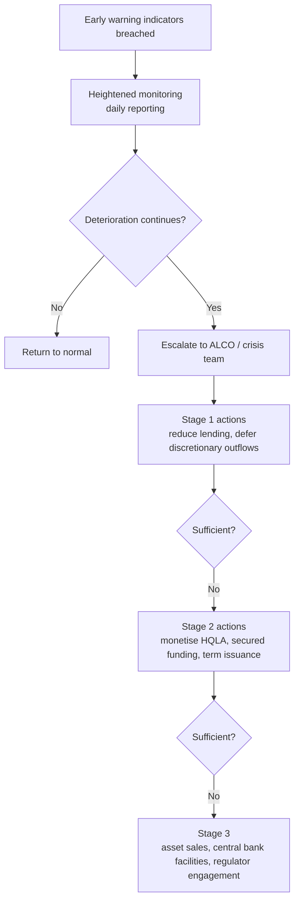

## 1. Liquidity kills faster than credit

A bank can be solvent and still fail on a Tuesday. Credit losses erode capital over quarters; a funding run empties the balance sheet in days.

| | Solvency crisis | Liquidity crisis |
|---|---|---|
| Speed | Quarters to years | Days, sometimes hours |
| Trigger | Losses exceed capital | Funding withdrawn faster than assets can be monetised |
| Visible in | Capital ratios | Cash flow, and then not at all |
| Warning | Rising NPAs, provisions | Often none in the ratios |
| Resolution | Recapitalisation | Central bank support or failure |

The two are connected but not the same. **A solvent bank can fail for lack of liquidity; an insolvent bank always eventually fails for lack of liquidity.** The 2008 crisis produced institutions that were adequately capitalised on the last published ratio and gone within a fortnight, which is why the Basel III package added liquidity standards alongside the capital reforms rather than relying on capital alone.

:::mental-model
Banking is a maturity transformation business by design — borrow short, lend long. That transformation is the source of the profit and the source of the risk. Liquidity regulation does not remove it; it puts a boundary on how much of it a bank may do.
:::

## 2. Funding liquidity and market liquidity

| | Funding liquidity risk | Market liquidity risk |
|---|---|---|
| Definition | Cannot meet obligations as they fall due | Cannot sell an asset near fair value |
| Manifests as | Missed payment, forced borrowing at penal rates | Fire-sale discount on disposal |
| Driver | Depositor and counterparty behaviour | Market depth and stress |
| Managed by | Buffers, funding diversification, term structure | Asset quality, position sizing |

The two amplify each other. A funding shortfall forces asset sales; asset sales into a stressed market realise losses; realised losses damage confidence; damaged confidence accelerates the funding outflow. That loop is why liquidity crises are non-linear — nothing appears wrong until everything is.

**Digital acceleration is the modern amendment.** Deposits that once required a branch visit now move at the speed of an app notification. Several recent bank failures internationally saw outflow rates far above anything embedded in the original Basel calibration, which is the direct reason supervisors, including the RBI, have revisited run-off assumptions for digitally-enabled deposits.

## 3. The Basel III liquidity package

| Standard | Horizon | Question answered |
|---|---|---|
| **LCR** | 30 days, acute stress | Can we survive a month-long run on our own resources? |
| **NSFR** | 1 year, structural | Is our funding structure sustainable against our asset profile? |
| Monitoring tools | Various | What else should the supervisor watch? |

$$
\text{LCR: short-term resilience}
\qquad
\text{NSFR: structural funding}
$$

The pair is deliberate. A bank could pass the LCR by holding a large buffer while funding a twenty-year mortgage book entirely with overnight money — surviving 30 days and remaining structurally unsound. The NSFR closes that. Conversely, a well-termed balance sheet with no liquid assets fails the LCR. Both constraints bind independently.

Supervisory monitoring tools sit alongside: contractual maturity mismatch, funding concentration, available unencumbered assets, LCR by significant currency, and market-related early warning indicators.

## 4. The LCR equation

$$
\text{LCR} = \frac{\text{Stock of high quality liquid assets}}{\text{Total net cash outflows over the next 30 calendar days}} \;\geq\; 100\%
$$

$$
\text{Net cash outflows} = \text{Total expected outflows} - \min\Big(\text{Total expected inflows},\; 75\% \times \text{Total expected outflows}\Big)
$$

| Element | Design intent |
|---|---|
| 30 calendar days | Time for management and supervisors to act |
| Prescribed stress | A combined idiosyncratic and market-wide shock |
| Inflow cap at 75% | Prevents reliance on inflows alone; forces a real buffer |
| 100% minimum | Buffer usable in genuine stress, with supervisory notification |

The **inflow cap** is the provision that catches people out. Even a bank whose contractual inflows fully match its outflows must hold HQLA covering at least 25% of gross outflows. The rationale is that inflows depend on counterparties performing, and in a systemic stress they may not.

The prescribed scenario embeds a partial retail deposit run-off, loss of unsecured wholesale funding, loss of secured funding against lower-quality collateral, increased derivative collateral calls, and drawdown of committed facilities — simultaneously.

## 5. HQLA — composition, haircuts and caps

An asset qualifies as HQLA if it is low risk, easy to value, low-correlated with risky assets, listed on a developed exchange, and traded in an active, deep market with reliable price discovery in stress.

| Level | Assets | Haircut | Cap |
|---|---|---|---|
| **Level 1** | Cash; central bank reserves usable in stress; marketable securities of sovereigns, central banks, PSEs and multilateral banks at 0% risk weight; domestic sovereign debt in domestic currency | 0% | No cap |
| **Level 2A** | Sovereign/PSE securities at 20% risk weight; qualifying corporate debt rated AA− or better; qualifying covered bonds | 15% | Level 2 total ≤ 40% of HQLA |
| **Level 2B** | Qualifying RMBS; corporate debt rated A+ to BBB−; qualifying common equity | 25% to 50% | Level 2B ≤ 15% of HQLA |

$$
\text{HQLA} = \text{L1} + \text{L2A}_{\text{after haircut}} + \text{L2B}_{\text{after haircut}}
$$

subject to

$$
\text{L2A} + \text{L2B} \leq \frac{2}{3}\,\text{L1}
\qquad\text{(equivalent to Level 2} \leq 40\% \text{ of total HQLA)}
$$

$$
\text{L2B} \leq 15\% \times \text{HQLA}
$$

The caps are applied after haircuts, and an adjusted-amount calculation is used to handle the interaction where both bind — unwinding short-term secured funding transactions to test the caps on a like-for-like basis.

## 6. HQLA operational requirements

Eligibility is not only about the instrument. The bank must be able to actually use it.

| Requirement | Meaning |
|---|---|
| Unencumbered | Not pledged, not securing any position |
| Under the control of the liquidity function | Treasury can monetise without asking a business line |
| Periodically monetised | Tested by actual sale or repo, to prove access |
| No legal or operational impediment | Available across entities and jurisdictions where counted |
| Not issued by a financial institution | Except covered bonds and central bank items |
| Diversified | Not concentrated in a single issuer or asset type |

**"Not issued by a financial institution"** is a structural point worth stating: bank paper is exactly what becomes illiquid when banks are under stress, so a buffer of other banks' bonds provides no protection in the scenario the buffer exists for.

**Trapped liquidity** is the cross-border trap. A surplus in a subsidiary that local rules prevent from being upstreamed cannot be counted at group level. Global banks manage this with entity-level buffers and explicit assumptions about transferability.

## 7. Outflows — retail and small business deposits

| Category | Run-off factor |
|---|---|
| Stable retail deposits | 3% (where the higher standard is met) or 5% |
| Less stable retail deposits | 10% or higher, by supervisory categorisation |
| Retail term deposits with residual maturity > 30 days | 0%, if no early withdrawal or a material penalty applies |
| Small business customer deposits — stable | 5% |
| Small business customer deposits — less stable | 10% |

| Stability determinant | Effect |
|---|---|
| Covered by an effective deposit insurance scheme | More stable |
| Held in a transactional or salary account | More stable |
| Established relationship, multiple products | More stable |
| High balance above insurance limit | Less stable |
| Rate-chasing, internet-sourced, brokered | Less stable |
| Foreign currency | Less stable |

**Category assignment is the largest single lever in the whole LCR calculation**, because retail deposits are the biggest number on most commercial bank balance sheets. Moving a large tranche between stable and less stable changes the ratio materially, which is why the categorisation methodology is documented, approved and examined rather than left to judgement at run time.

The digital-channel adjustment — an additional run-off loading on deposits held by customers with internet and mobile banking access — is the live area of change in several jurisdictions including India. Confirm the current calibration before applying it.

## 8. Outflows — wholesale, secured funding and contingent

| Category | Run-off factor |
|---|---|
| Operational deposits (clearing, custody, cash management) | 25% |
| Operational deposits fully covered by deposit insurance | 5% |
| Non-operational deposits from non-financial corporates, sovereigns, PSEs | 40%, or 20% if fully insured |
| Non-operational deposits from financial institutions | 100% |
| Unsecured debt maturing within 30 days | 100% |
| Secured funding against Level 1 collateral | 0% |
| Secured funding against Level 2A collateral | 15% |
| Secured funding against other collateral | 25% to 100% |
| Committed credit facilities to retail | 5% |
| Committed credit facilities to non-financial corporates | 10% credit / 30% liquidity |
| Committed facilities to financial institutions | 40% to 100% |
| Derivative payables, net | 100% |
| Increased collateral needs from a 3-notch downgrade | 100% |
| Market valuation changes on derivative collateral | Look-back approach |
| Trade finance contingents | 0% to 5%, national discretion |

**The operational deposit definition is tightly drawn.** The balance must be needed for the operational service, held in a designated account, priced without an incentive to leave excess, and the excess above what the service requires must be stripped out and treated as non-operational. Banks routinely over-claim this category, and it is a standard supervisory review point.

**Financial institution deposits run off at 100%.** Interbank funding disappears entirely in the scenario. This is the assumption that makes wholesale-funded models expensive under the LCR, and it reflects observed behaviour precisely.

## 9. Inflows and the 75% cap

| Category | Inflow factor |
|---|---|
| Maturing secured lending against Level 1 collateral | 0% |
| Maturing secured lending against Level 2A collateral | 15% |
| Performing loans to retail and small business | 50% |
| Performing loans to non-financial wholesale | 50% |
| Performing loans to financial institutions | 100% |
| Operational deposits held at other banks | 0% |
| Derivative receivables, net | 100% |
| Undrawn facilities available to the bank | **0%** |

| Rule | Reason |
|---|---|
| Only contractual inflows from performing exposures | No assumed rollover failure benefit |
| 50% on non-financial loans | Assumes the bank continues lending — it does not simply stop |
| **Committed lines to the bank count as zero** | You cannot rely on someone else's promise in a systemic stress |
| Cap at 75% of outflows | Forces a minimum buffer regardless of inflow profile |

The zero on undrawn facilities available to the bank is the philosophical core of the standard: **the LCR tests self-sufficiency.** Every source of liquidity that depends on another party choosing to perform is excluded or heavily discounted.

## 10. Worked LCR

A bank at a reporting date. All amounts in ₹ crore.

**Step 1 — HQLA**

| Level | Market value | Haircut | After haircut |
|---|---|---|---|
| Level 1 — cash, reserves, sovereign securities | 35,000 | 0% | 35,000 |
| Level 2A — qualifying corporate and PSE debt | 8,000 | 15% | 6,800 |
| Level 2B — qualifying lower-grade debt | 3,000 | 50% | 1,500 |
| | | **Total** | **43,300** |

Cap tests:

$$
\text{Level 2} = 6{,}800 + 1{,}500 = 8{,}300 \;\leq\; \tfrac{2}{3}(35{,}000) = 23{,}333 \;\checkmark
$$

$$
\text{Level 2B} = 1{,}500 \;\leq\; 15\%(43{,}300) = 6{,}495 \;\checkmark
$$

Neither cap binds. **HQLA = ₹43,300 crore.**

**Step 2 — Outflows**

| Category | Balance | Factor | Outflow |
|---|---|---|---|
| Stable retail deposits | 60,000 | 5% | 3,000 |
| Less stable retail deposits | 40,000 | 10% | 4,000 |
| Small business — stable | 15,000 | 5% | 750 |
| Operational wholesale deposits | 20,000 | 25% | 5,000 |
| Non-operational, non-financial corporate | 25,000 | 40% | 10,000 |
| Financial institution deposits | 10,000 | 100% | 10,000 |
| Undrawn retail facilities | 12,000 | 5% | 600 |
| Undrawn corporate credit facilities | 18,000 | 10% | 1,800 |
| Other contingent obligations | 5,000 | 5% | 250 |
| | | **Total** | **35,400** |

**Step 3 — Inflows**

| Category | Balance | Factor | Inflow |
|---|---|---|---|
| Performing retail loans maturing | 6,000 | 50% | 3,000 |
| Performing wholesale loans maturing | 8,000 | 50% | 4,000 |
| Receivables from financial institutions | 5,000 | 100% | 5,000 |
| | | **Total** | **12,000** |

Inflow cap: $75\% \times 35{,}400 = 26{,}550$. Actual inflows of 12,000 are below the cap, so the full amount is recognised.

**Step 4 — Result**

$$
\text{Net cash outflows} = 35{,}400 - 12{,}000 = ₹23{,}400 \text{ crore}
$$

$$
\text{LCR} = \frac{43{,}300}{23{,}400} = \mathbf{185.0\%}
$$

**Where the cap would bite.** Had inflows been ₹30,000 crore, only ₹26,550 crore would count, net outflows would fall to ₹8,850 crore, and the LCR would read 489%. The cap prevents that outcome from being achieved with inflows alone — the bank still needs ₹8,850 crore of genuine HQLA to pass, which is the 25% floor doing its work.

## 11. The NSFR equation

$$
\text{NSFR} = \frac{\text{Available stable funding (ASF)}}{\text{Required stable funding (RSF)}} \;\geq\; 100\%
$$

| Side | Meaning |
|---|---|
| ASF | The portion of liabilities and capital expected to remain over one year |
| RSF | The funding assets require, based on liquidity and residual maturity |

The logic is symmetrical to the LCR but structural rather than acute. ASF factors rise with the stability and term of the funding; RSF factors rise with the illiquidity and term of the asset. A long, illiquid asset needs long, stable funding.

## 12. ASF factors

| Factor | Liability or capital item |
|---|---|
| **100%** | Regulatory capital (excluding Tier 2 with under one year residual); other liabilities with residual maturity ≥ 1 year |
| **95%** | Stable non-maturity and term retail and small business deposits with residual maturity < 1 year |
| **90%** | Less stable retail and small business deposits < 1 year |
| **50%** | Funding from non-financial corporates, sovereigns, PSEs, multilaterals < 1 year; operational deposits; other funding with residual maturity 6 months to under 1 year |
| **0%** | All other liabilities, including funding from financial institutions with residual maturity under 6 months; derivative payables net; trade date payables |

The ladder encodes an empirical view of stickiness. Retail deposits, though contractually withdrawable on demand, receive 90–95% because they demonstrably stay. Interbank funding under six months receives zero because it demonstrably does not.

**Regulatory capital counts at 100%** — a direct structural link between the capital document and this one. Issuing Tier 2 improves the NSFR as well as the capital ratio, and Tier 2 falling below one year of residual maturity worsens both simultaneously.

## 13. RSF factors

| Factor | Asset item |
|---|---|
| **0%** | Cash; central bank reserves; claims on central banks < 6 months |
| **5%** | Unencumbered Level 1 assets other than cash and reserves |
| **10%** | Unencumbered loans to financial institutions < 6 months secured by Level 1 collateral |
| **15%** | Unencumbered Level 2A assets; other unsecured loans to financial institutions < 6 months |
| **50%** | Level 2B assets; loans to non-financial clients < 1 year; deposits held at other financial institutions for operational purposes |
| **65%** | Unencumbered residential mortgages > 1 year with a risk weight ≤ 35%; other loans > 1 year with a risk weight ≤ 35% |
| **85%** | Other performing loans > 1 year with a risk weight > 35%; exchange-traded equities; physical commodities |
| **100%** | Non-performing assets; assets encumbered > 1 year; fixed assets; intangibles; defaulted securities |
| **5%** | Undrawn committed facilities, off balance sheet |

Two features to note. **Encumbrance is decisive** — an asset pledged for over a year jumps to 100% regardless of its underlying quality, which makes collateral usage a funding decision, not only a market one. And **non-performing assets sit at 100%**, so credit deterioration worsens the NSFR mechanically, connecting asset quality to the funding ratio.

## 14. Worked NSFR

Same bank. All amounts in ₹ crore.

**Available stable funding**

| Item | Amount | Factor | ASF |
|---|---|---|---|
| Regulatory capital (Tier 1 + Tier 2) | 11,200 | 100% | 11,200 |
| Term funding, residual maturity > 1 year | 15,000 | 100% | 15,000 |
| Stable retail deposits < 1 year | 60,000 | 95% | 57,000 |
| Less stable retail deposits < 1 year | 40,000 | 90% | 36,000 |
| Small business deposits < 1 year | 15,000 | 90% | 13,500 |
| Non-financial corporate deposits < 1 year | 25,000 | 50% | 12,500 |
| Operational deposits | 20,000 | 50% | 10,000 |
| Financial institution funding < 6 months | 10,000 | 0% | 0 |
| | | **Total ASF** | **155,200** |

**Required stable funding**

| Item | Amount | Factor | RSF |
|---|---|---|---|
| Cash and central bank reserves | 12,000 | 0% | 0 |
| Level 1 securities, unencumbered | 23,000 | 5% | 1,150 |
| Level 2A securities | 8,000 | 15% | 1,200 |
| Level 2B securities | 3,000 | 50% | 1,500 |
| Unsecured loans to financial institutions < 6 months | 5,000 | 15% | 750 |
| Residential mortgages > 1 year, RW ≤ 35% | 50,000 | 65% | 32,500 |
| Other performing loans > 1 year, RW > 35% | 70,000 | 85% | 59,500 |
| Loans to non-financial clients < 1 year | 20,000 | 50% | 10,000 |
| Non-performing assets | 4,000 | 100% | 4,000 |
| Fixed and other assets | 6,000 | 100% | 6,000 |
| Undrawn committed facilities | 30,000 | 5% | 1,500 |
| | | **Total RSF** | **118,100** |

$$
\text{NSFR} = \frac{155{,}200}{118{,}100} = \mathbf{131.4\%}
$$

**Read where the pressure sits.** The corporate loan book at 85% consumes ₹59,500 crore of the ₹118,100 crore requirement — half the total from a third of the assets. Shifting the asset mix toward mortgages, or lengthening the funding, are the two levers, and they cost different things. Growing the corporate book without adding term funding degrades the ratio directly.

## 15. Intraday liquidity

The LCR and NSFR both measure end-of-day positions. A bank can pass both and still fail to settle at 11 a.m.

| Concept | Definition |
|---|---|
| Daily maximum intraday liquidity usage | Largest net negative position during the day |
| Available intraday liquidity | Reserves, collateral at the central bank, committed lines, unencumbered assets |
| Total payments | Gross value settled |
| Time-specific obligations | Payments that must settle by a fixed time |
| Throughput | Proportion of payments settled by defined times of day |

Intraday risk concentrates in real-time gross settlement systems, correspondent banking, and where a bank provides settlement services to others. A correspondent that reduces or withdraws an intraday credit line can force an immediate funding requirement with no notice at all.

**Monitoring, not a ratio.** Basel prescribes monitoring tools rather than a minimum standard here, but supervisors take the tools seriously and stressed intraday scenarios form part of internal liquidity assessment.

## 16. Monitoring tools

| Tool | What it exposes |
|---|---|
| Contractual maturity mismatch | Raw cash flow gaps by bucket, before behavioural assumptions |
| Concentration of funding | Reliance on single counterparties, products, or currencies |
| Available unencumbered assets | What could be pledged or sold, and where it sits |
| LCR by significant currency | Currency mismatches that the consolidated ratio hides |
| Market-related monitoring | Spreads, CDS levels, equity price, rating outlook, share of funding rolling |

**Concentration thresholds** are typically set at a share of total liabilities for a single counterparty, a product, or a currency. The insight is that a diversified-looking funding base can rest on a handful of decision-makers — twenty corporate depositors managed by the same treasury advisor behave as one.

**Single-currency LCR** matters wherever the balance sheet is multi-currency. A consolidated ratio of 150% can conceal a foreign currency book at 60%, and FX swap markets on which the mismatch relies close precisely in stress.

## 17. Internal stress testing and ILAAP

Regulatory ratios are a floor with a prescribed scenario. Internal assessment asks what would actually happen to this bank.

| Scenario type | Content |
|---|---|
| Idiosyncratic | Rating downgrade, adverse news, loss event; wholesale funding closes, retail attrition rises |
| Market-wide | System stress; asset markets illiquid; secured funding haircuts widen |
| Combined | Both together — the binding case |
| Reverse | What outflow rate would exhaust the buffer, and is it plausible? |

| Assumption to set | Question |
|---|---|
| Deposit run-off by segment and channel | Faster than the regulatory factors? |
| Wholesale rollover rate | Zero, or partial? |
| Drawdown on committed facilities | Corporates draw defensively in stress |
| Collateral haircut widening | How much value does the buffer lose? |
| Franchise obligations | Non-contractual support the bank would provide anyway |
| Survival horizon | Days to buffer exhaustion under each scenario |

**Survival horizon is the metric management actually uses.** Days-to-exhaustion is intuitive, comparable across scenarios, and directly actionable — it converts a ratio into a deadline.

The **ILAAP** is the liquidity counterpart of the ICAAP: the bank's own documented assessment of liquidity adequacy, its framework, risk appetite, stress testing and contingency planning, reviewed by the supervisor.

## 18. Contingency funding plan and early warning indicators

| Indicator category | Examples |
|---|---|
| Internal | Deposit outflow rate, funding cost, rollover rates, buffer utilisation, LCR trend |
| Asset quality | NPA trend, large exposure deterioration |
| Market | Own CDS spread, share price, bond spreads, rating outlook |
| Systemic | Interbank rates, sector-wide stress, peer failures |

| CFP requirement | Detail |
|---|---|
| Named crisis team and delegated authority | Decisions cannot wait for a scheduled committee |
| Quantified actions with realistic timeframes | "Sell securities" is not a plan; how much, in how long, at what discount |
| Communication protocol | Depositors, counterparties, regulator, media, staff |
| Regular testing | A plan never rehearsed will not execute |
| Independence of actions | Actions that all depend on the same open market are one action |

**The credibility test for a CFP is whether the actions still work when every peer attempts them simultaneously.** Selling a corporate bond portfolio is a fine plan in isolation and worthless in a market-wide event. Central bank facilities exist precisely because they are the only source that does not evaporate under correlation.

## 19. ALM and gap analysis

Asset-liability management runs the balance sheet's structural risks — liquidity, interest rate, and to an extent currency — under ALCO governance.

**Liquidity gap** places cash flows into time buckets and measures the mismatch.

$$
\text{Gap}_t = \text{Inflows}_t - \text{Outflows}_t
\qquad
\text{Cumulative gap}_t = \sum_{k \le t}\text{Gap}_k
$$

<svg viewBox="0 0 680 280" xmlns="http://www.w3.org/2000/svg">
  <line x1="60" y1="160" x2="640" y2="160" stroke="currentColor" stroke-width="1.4"/>
  <line x1="60" y1="30" x2="60" y2="250" stroke="currentColor" stroke-width="1.4"/>
  <text x="30" y="140" fill="currentColor" font-size="12" text-anchor="middle" transform="rotate(-90 30 140)">Gap</text>
  <rect x="85" y="110" width="55" height="50" stroke="currentColor" stroke-width="1.4" fill="none"/>
  <rect x="165" y="130" width="55" height="30" stroke="currentColor" stroke-width="1.4" fill="none"/>
  <rect x="245" y="160" width="55" height="45" stroke="currentColor" stroke-width="1.4" fill="none"/>
  <rect x="325" y="160" width="55" height="60" stroke="currentColor" stroke-width="1.4" fill="none"/>
  <rect x="405" y="160" width="55" height="35" stroke="currentColor" stroke-width="1.4" fill="none"/>
  <rect x="485" y="95" width="55" height="65" stroke="currentColor" stroke-width="1.4" fill="none"/>
  <rect x="565" y="70" width="55" height="90" stroke="currentColor" stroke-width="1.4" fill="none"/>
  <text x="112" y="270" fill="currentColor" font-size="10" text-anchor="middle">1d</text>
  <text x="192" y="270" fill="currentColor" font-size="10" text-anchor="middle">2–7d</text>
  <text x="272" y="270" fill="currentColor" font-size="10" text-anchor="middle">8–14d</text>
  <text x="352" y="270" fill="currentColor" font-size="10" text-anchor="middle">15–30d</text>
  <text x="432" y="270" fill="currentColor" font-size="10" text-anchor="middle">1–3m</text>
  <text x="512" y="270" fill="currentColor" font-size="10" text-anchor="middle">3–12m</text>
  <text x="592" y="270" fill="currentColor" font-size="10" text-anchor="middle">&gt;1y</text>
  <text x="640" y="152" fill="currentColor" font-size="11">surplus</text>
  <text x="640" y="180" fill="currentColor" font-size="11">deficit</text>
</svg>

**Behavioural adjustment is the whole craft.** Contractual buckets are misleading in both directions: current and savings accounts are contractually overnight but behaviourally multi-year, while a term loan with a prepayment option is contractually long and behaviourally shorter. ALM models the behaviour — core versus volatile deposit split, prepayment curves, drawdown patterns — and those assumptions are governed and backtested like any other model.

| Cumulative gap | Reading |
|---|---|
| Large negative in short buckets | Refinancing risk; buffer must cover it |
| Persistent positive | Under-deployed; earnings drag |
| Concentrated in one bucket | Cliff risk on a single date |

## 20. IRRBB — economic value and earnings

Interest rate risk in the banking book carries no Pillar 1 charge; it is a Pillar 2 risk measured two complementary ways.

| Measure | Horizon | Question |
|---|---|---|
| **ΔEVE** — economic value of equity | Full remaining life | What is the present value impact on the balance sheet? |
| **ΔNII** — net interest income | 1 to 3 years | What is the earnings impact? |

$$
\Delta \text{EVE} = \text{PV}(\text{assets})_{\text{shocked}} - \text{PV}(\text{liabilities})_{\text{shocked}} \;-\; \big[\text{PV(assets)} - \text{PV(liabilities)}\big]_{\text{base}}
$$

$$
\Delta \text{NII} \approx \text{Cumulative repricing gap} \times \Delta r \times \text{time fraction}
$$

**Six prescribed shock scenarios:** parallel up, parallel down, steepener, flattener, short rate up, short rate down. Reporting the worst outcome across them prevents a bank from optimising against a single assumed move.

| Risk sub-type | Source |
|---|---|
| Gap / repricing risk | Assets and liabilities repricing at different times |
| Basis risk | Different reference rates moving apart |
| Option risk | Prepayment, early withdrawal, caps and floors |

**Outlier test.** A bank is flagged where ΔEVE under the prescribed shocks exceeds 15% of Tier 1 capital, which triggers supervisory attention and potentially additional capital.

:::mental-model
EVE and NII often point in opposite directions and both are correct. Funding long assets with short liabilities looks good on NII while rates are low and stable, and terrible on EVE. Managing to one measure alone is how banks acquire a large hidden exposure that only appears when the curve moves.
:::

## 21. India — the RBI framework

| Element | Position |
|---|---|
| LCR | Introduced from January 2015, phased to 100% |
| NSFR | Introduced from October 2021, minimum 100% |
| Applicability | Scheduled commercial banks, with specified exclusions |
| **SLR** | Statutory Liquidity Ratio — a domestic requirement predating Basel |
| **CRR** | Cash Reserve Ratio, maintained with the RBI |
| FALLCR | Facility permitting a portion of SLR securities to be reckoned as Level 1 HQLA |
| ALM guidelines | Structural liquidity and interest rate sensitivity statements by time bucket |
| Digital deposit run-off | Revised loadings on internet and mobile banking enabled deposits |

> The percentages, dates and facility limits in this section change with circulars, sometimes several times a year. Confirm every figure against the current RBI Master Direction on liquidity risk management and the LCR framework before relying on it.

**The Indian structural feature to understand is the interaction of SLR and LCR.** Indian banks have always held a large mandatory portfolio of government securities for SLR purposes. Those securities are exactly what the LCR counts as Level 1 HQLA — but they are simultaneously encumbered by the SLR requirement. The FALLCR mechanism resolves this by permitting a defined portion to be counted for the LCR, which is why Indian banks generally report comfortable LCRs without having built a buffer from scratch.

The **digital run-off revision** follows international bank failures where app-based withdrawals moved far faster than the original calibration assumed. The direction — higher assumed outflow on digitally-accessible deposits — is the point to know; the exact loading and effective date should be confirmed.

## 22. Defensible under questioning

| Question | The answer that lands |
|---|---|
| Difference between LCR and NSFR? | LCR is 30-day acute survival; NSFR is one-year structural funding sustainability. Both bind independently |
| Why cap inflows at 75%? | Forces a genuine buffer covering at least 25% of gross outflows; inflows depend on counterparties performing |
| Why do committed lines to the bank count as zero inflow? | The standard tests self-sufficiency — you cannot rely on another party's promise in a systemic stress |
| Why exclude financial institution paper from HQLA? | It is precisely what becomes illiquid when banks are stressed |
| What run-off does interbank funding get? | 100% — it disappears entirely in the scenario |
| What makes a deposit "operational"? | Needed for a clearing, custody or cash management service, in a designated account, with excess stripped out |
| Which cap binds on HQLA? | Level 2 at 40% of total, Level 2B at 15%; applied after haircuts |
| Why does an NPA hurt the NSFR? | It carries a 100% RSF factor — credit deterioration mechanically worsens the funding ratio |
| Can a bank pass both ratios and still fail? | Yes — intraday. Both measure end-of-day; settlement happens during the day |
| EVE or NII? | Both — they routinely point in opposite directions, and managing to one hides exposure in the other |
| What is the IRRBB outlier test? | ΔEVE exceeding 15% of Tier 1 under the prescribed shocks |
| How does SLR interact with the LCR in India? | SLR securities are Level 1 quality but encumbered; FALLCR permits a defined portion to count as HQLA |
| What makes a contingency funding plan credible? | Quantified actions with realistic timeframes, independent of each other, that still work when every peer does the same thing |

**Three things to be able to draw without notes:** the LCR structure with its three blocks and the inflow cap, the ASF/RSF ladder showing why long assets need long funding, and the liquidity gap ladder with the contractual-versus-behavioural distinction marked on it.
