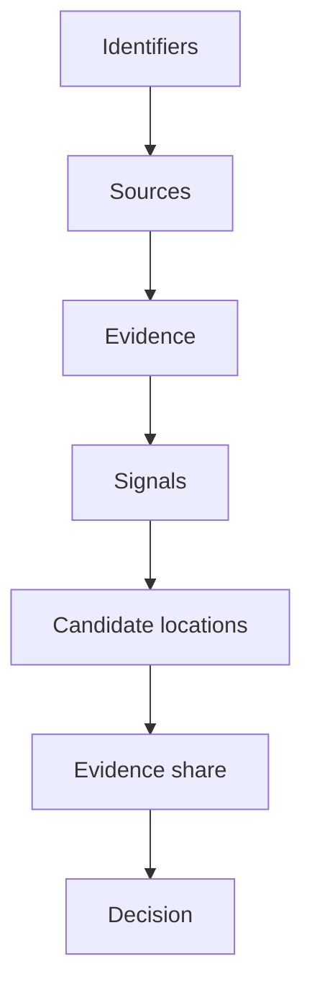

**Lens:** Location is treated as an evidence problem, not a lookup problem. Every observation is asked what it actually proves, what it does not, how fresh it is and where it came from — and the answer is a ranked hypothesis with its reasoning attached, never a probability.

## 1. The problem was not finding a better location source

A customer declares an address. Different systems point to different places. The instinctive response is to look for the one authoritative source that settles it.

There isn't one. A PAN identifies a person and says nothing about where they sleep. A bureau address is real and may be four years stale. An IP resolves to a datacentre in Frankfurt. A telecom circle survives the number but not the move, because portability exists. Each source is genuinely informative and none of them answers the question on its own.

So the project was built on the opposite premise: **stop looking for ground truth and start weighing evidence.** The declared address becomes a claim under test rather than a field to be validated, and the system's job is to say which physical-location hypotheses the available evidence supports, how strongly, and why.

That reframing determines everything downstream — the six-layer model, the weighting, the decision vocabulary, and the refusal to output a probability.

## 2. What each piece of evidence actually proves

The domain rules exist because the failure mode is treating all evidence as the same kind of thing.

| Evidence | What it proves | What it does not |
|---|---|---|
| PAN, Aadhaar | Identity, de-duplication, a key into history | Current residence |
| Email | Entity linkage, reuse across applications | Almost any geography |
| Mobile number | Linkage, contact, a weak original-circle hint | Location — portability breaks the inference |
| Bureau address history | Where an identity has been associated before | Where the person is now |
| Branch geography | Where a banking relationship was sourced or serviced | Where the customer lives |
| Public IP | A network endpoint | A human endpoint |
| Repeated operational behaviour | A pattern strong enough to anchor on | Anything, from a single event |

Two rules follow and both are load-bearing.

**Address mismatch is not fraud.** A declared address can be correct, stale, temporary, operational rather than residential, mistyped, copied, or deliberately false. Five of those six are innocent. A system that treats mismatch as a verdict is wrong most of the time it fires.

**Relationship is not suspicious relationship is not proven fraud.** Two applicants sharing a device, an address, a Wi-Fi network or a proxy endpoint is a linkage observation. It becomes interesting only in context, and the benign household case in Section 9 exists to keep that discipline enforced in code rather than in a comment.

## 3. Six identifiers, chosen for what they can carry

The system starts from six seed identifiers, and the split between them matters more than the list.

| Identifier | Role | Boundary |
|---|---|---|
| `mobile_number` | Linkage, contact, OTP key, original-circle hint | Strong linkage, weak geography |
| `pan` | Identity key in Indian lending; entry to bureau history | Unlocks history, not current presence |
| `aadhaar_number` | Identity and de-duplication | Not a location source |
| `email_id` | Entity linkage and reuse detection | Answers "same entity?", not "same place?" |
| `customer_key` | Internal tokenised key joining events across one relationship | — |
| `case_id` | One specific application, loan or recovery investigation | — |

The last two are the ones people conflate. `customer_key` is the customer relationship; `case_id` is one case within it. Cross-case analysis in the Network Lab depends on that distinction holding.

## 4. Six layers, because provenance has to survive the pipeline

Every observation moves through six typed layers, and the type is what makes the reasoning inspectable at the end.

| Layer | Question it answers | Example |
|---|---|---|
| `IDENTIFIER` | What do we start with? | PAN, mobile, declared pincode |
| `SOURCE` | Which system could produce evidence? | Bureau, IFSC reference, IP intelligence |
| `EVIDENCE` | What raw observation came back? | A bureau address, a branch location, a public IP |
| `SIGNAL` | What does that observation mean here? | Physical-locality support, proxy risk |
| `CANDIDATE_LOCATION` | Which hypotheses does it support? | Competing pincodes with accumulated weight |
| `DECISION` | How does the strongest evidence compare with the claim? | `CONSISTENT`, `REVIEW`, `CONFLICT` |

The separation of `EVIDENCE` from `SIGNAL` is the one that earns its keep. The raw observation "public IP resolves to Frankfurt" is a fact. What it *means* — network location, heavily discounted, risk-relevant — is a separate derived thing. Collapsing the two is how a naive system concludes the applicant lives in Frankfurt.

## 5. Cataloguing the universe before building the engine

The project began as spreadsheet research: mapping identifiers, data fields, APIs and derived signals for Indian retail-credit location work. That research became structured catalogues, and the catalogues became runtime data.

**42 fetched fields**, grouped by family, each family carrying one lesson:

| Family | Fields | Lesson |
|---|---|---|
| Event context | `event_ts`, `event_type`, `source_system` | Evidence without time and provenance is weak |
| Digital location | `public_ip` | Network location is not human location |
| Declared geography | `declared_pincode`, `declared_city`, `declared_state`, `full_address_text` | This is the hypothesis under test |
| Branch geography | `branch_ifsc`, `sourcing_branch_id`, `servicing_branch_id` | Operational anchor, not residence |
| Device and app | `device_id_hash`, `app_instance_id`, `session_id_hash`, `user_agent`, `device_timezone`, `device_language_or_locale` | Stronger for linkage than for location |
| Consented GPS | `gps_lat`, `gps_lon`, `gps_accuracy_meters` | Precision requires permission and an accuracy context |
| Consented network positioning | `wifi_bssid_hashes`, `cell_mcc_mnc_lac_cellid` | Device-side only; unobtainable from a phone number |
| Bank behaviour | `login_event_history`, `repayment_event_history`, `contact_center_events`, `dormant_account_reactivation` | Repeated recent behaviour can beat one stale record |
| Transaction geography | `atm_transaction_location`, `pos_merchant_location`, `upi_merchant_or_vpa_metadata`, `cash_deposit_branch` | Useful, still requires interpretation |
| Collections operations | `field_visit_pincode`, `field_visit_outcome_code`, `returned_mail_pincode`, `courier_delivery_status` | The outcome often matters more than the location |
| Regulated history | `bureau_address_history`, `ckyc_id_or_search_key`, `account_aggregator_consent_token`, `aa_transaction_narrations` | Rich data exists only inside consented workflows |
| Social and public | `consented_social_profile_location`, `public_social_profile_url`, `geotagged_public_posts` | Weak and privacy-sensitive; must never dominate |
| Catalogue-only, unsafe | `leaked_or_breached_data` | Naming a category is not building on it |

**46 sources**, in nine families: geography infrastructure (pincode directories, Nominatim, Geoapify, OpenCage, Overpass, Census, Bhuvan, GADM), IP intelligence (MaxMind, IPinfo, DB-IP, IP2Proxy, AbuseIPDB), phone intelligence (`phonenumbers`, Twilio Lookup, Numverify), bank-branch intelligence (IFSC and MICR references), device-side positioning (browser and Google Geolocation APIs), device and fraud intelligence (SEON, Signzy, FingerprintJS), regulated financial sources (bureaus, CKYC, Account Aggregator), public enrichment, and a deliberate catalogue-only boundary set.

That last family is the interesting one. Covert social tracing, leaked datasets, live phone tracking from a number alone, fake-account scraping and public-photo face recognition are catalogued **as boundaries** — documented so the architecture knows where it will not go, not so it can go there later.

**None of the 46 is called live.** They are architecture and reference data. The UI describing what a provider could return is not evidence that the provider is invoked.

## 6. Weighting: three factors, all visible

Each piece of evidence gets an effective weight from three explicit multipliers.

$$
\text{Effective weight} = \text{base\_weight} \times \text{recency\_factor} \times \text{ip\_trust\_factor}
$$

`base_weight` is default relative reliability — heuristic, explicit, deterministic. It is not a trained coefficient, not an ML parameter, and not a calibrated probability.

`recency_factor` encodes that newer evidence generally deserves more influence. In the current build it is scenario-driven deterministic logic, not a production decay service.

`ip_trust_factor` is the one worth explaining, because it carries the project's central idea.

## 7. The proxy rule

The naive reading: the IP resolves to Frankfurt, so the applicant is in Frankfurt.

The correct reading: the IP resolves to Frankfurt, the endpoint is a hosting proxy, so Frankfurt is a network observation and a poor guide to physical location — while the *masking itself* is risk-relevant and worth keeping.

So the system does three things at once. It preserves the observation. It raises its risk relevance. And it applies a trust factor as low as `0.1` to its physical-location contribution.

**The same fact becomes evidence for one question and is discounted for another.** That is the whole design in one rule: signal meaning matters more than raw value, and a system that only stores values cannot make the distinction.

## 8. Evidence share is not a probability

Candidate locations accumulate support:

$$
W_{\text{candidate}} = \sum \text{effective physical support} + \sum \text{corroborating regional support}
$$

with three signal classes kept separate — `PHYSICAL_LOCALITY` supports a specific locality, `REGIONAL_SCOPE` corroborates broadly without pretending to precision (telecom circle), and `NETWORK_LOCATION` stays visible while being isolated from physical ranking.

Competing candidates are preserved. Real evidence disagrees, and deleting contradictions to produce a clean story destroys the thing the system exists to show.

The output is then normalised into an **evidence share** — the share of the deterministic weighted evidence pool assigned to each candidate. It is not residence probability, fraud probability, statistical confidence, accuracy, or likelihood. Naming it precisely is what keeps the claim defensible.

Normalising raises a small problem with a disproportionate lesson. Raw quotas are fractional; rounding them independently produces shares summing to 99 or 101. The **Hamilton / largest remainder method** fixes it:

$$
q_i = \frac{W_i}{\sum W} \times 100
$$

Floor each quota, compute the fractional remainders, count the percentage points still unallocated, and give them to the largest remainders in order. Whole-number shares that sum to exactly 100.

The reason this is worth the effort: **if the interface promises a share, the arithmetic on screen must honour that promise.** A display that says "share" and sums to 101 has broken its own contract with the user, and largest remainder is a deterministic, transparent and testable way to keep it.

## 9. Three decisions, and why REVIEW is not a failure

| Decision | Meaning |
|---|---|
| `CONSISTENT` | Evidence sufficiently supports the declared location under the deterministic rule set |
| `CONFLICT` | The strongest physical evidence materially points elsewhere |
| `REVIEW` | Evidence is missing, split, insufficient or ambiguous |

`REVIEW` is the product decision that matters. It is an explicit uncertainty state, not a fallback for when the logic fails. Given that a mismatch is innocent most of the time, a system offering only pass and fail forces a verdict it cannot support. Making "I don't know" a first-class output is what allows the other two labels to mean something.

## 10. Three graphs answering three different questions

This is the distinction most easily lost, and the three are genuinely separate systems.

| | Active Investigation Graph | Intelligence / Knowledge Graph | Entity Network / Network Lab |
|---|---|---|---|
| Question | How did *this case* reach this conclusion? | How is the whole domain connected? | What relationships appear across cases? |
| Scope | One case | The ontology | Multiple synthetic applications |
| Content | Six typed layers, per case | 273 nodes | 79 nodes, 61 edges |
| Runtime | Dynamic per case | Static reference | Static synthetic |
| Algorithms | Provenance traversal | BFS shortest path, lineage, components | Components, shared neighbours, overlap, pattern rules |

The knowledge graph's 273 nodes decompose as 6 identifiers, 46 data sources, 42 fetched fields, 77 derived signals and 102 knowledge topics, with 115 explicit non-heuristic edges recorded as direct, normalised or curated.

That word *explicit* is a design position. Where explainability matters, curated mappings beat inferred ones — an edge someone chose and can defend is worth more than an edge a heuristic guessed.

None of the three is a graph database. ReactFlow solves visualisation; a graph database solves persistence and query. The current graphs are small, deterministic and browser-resident, so in-memory structures are sufficient. At cross-case scale, with expensive multi-hop queries, persistence requirements or concurrent investigators, the answer would change — but ReactFlow does not replace Neo4j, and neither claim runs in the other direction.

## 11. Pattern rules, each shipped with its false positives

The Network Lab detects five structures. Every one of them ships with the innocent explanation attached, because a rule without its counterexample is a false-positive generator.

| Pattern | Structure | Why it matters | Innocent explanations |
|---|---|---|---|
| Shared device | Multiple identities on one device | Centralised application behaviour, farming, syndicate activity | Household device, cybercafe, workplace kiosk, assisted application |
| Reused contact attribute | Same phone or email across applicants | Synthetic identity, centralised handling | Family contact, shared billing email, small-business admin |
| Shared proxy endpoint | Several applications through one endpoint | Coordinated masking, automated submission | Common commercial VPN |
| Address concentration | Many applications at one address | Shell address, fake employment, concentration anomaly | Co-working space, hostel, apartment block, shared business address |
| Geographic convergence | Different declared places, operational signals converging on one hub | Shared operational base, coordinated activity | Workplace, campus, service centre, regional hub |

And then the **benign household counterexample** — a deliberately constructed case where two people legitimately share address, Wi-Fi, device and network endpoint. It is evaluated as a contextual relationship rather than an escalation.

It exists so the discipline is enforced by a test rather than by good intentions. A pattern engine that has never been shown a legitimate case will find fraud rings in families.

## 12. Typed counting, because degree is not significance

A subtle piece worth keeping. Network analytics count entities **by type** rather than using raw graph degree.

A person node connected to a session, an app instance, a device, a proxy and an application has degree five. It does not represent five identities. Asking instead *how many distinct `PERSON` nodes* and *how many distinct `APPLICATION` nodes* prevents structural intermediary nodes from inflating business counts.

This is degree leakage, and it is the kind of defect that produces confident nonsense — a "five-identity cluster" that is one person with five kinds of metadata.

## 13. The architecture, and where the brain is

Next.js 16, React 19, TypeScript, Tailwind, `@xyflow/react`, React Context, Radix primitives. Primarily client-side, investigation state held in browser memory.

| File | Responsibility |
|---|---|
| `src/lib/resolver.ts` | **The engine.** Builds the case graph, creates typed nodes, classifies signal geography, computes effective weights, aggregates candidate support, applies the proxy discount, allocates evidence shares, evaluates consistency, synthesises custom deterministic traces |
| `src/lib/knowledgeGraph.ts` | Builds the ontology; BFS traversal and lineage utilities |
| `src/lib/knowledgeGraphCurated.ts` | Explicit curated domain relationships |
| `src/lib/entityNetworkData.ts` | Synthetic multi-case instance data — entity instances, not ontology concepts |
| `src/lib/entityNetworkAnalytics.ts` | Components, shared neighbours, overlap, pattern rules, typed counting, benign handling |
| `src/lib/activeCaseBridge.ts` | Bridge between case runtime state and the static knowledge universe |
| `src/context/AppContext.tsx` | Catalogue loading, scenario loading, current trace, custom trace runs, workspace coordination |
| `src/types/index.ts` | Central domain types |

The type file matters more than it looks. Three distinct graph models coexist here, and strong typing is what stops case-graph nodes, knowledge-graph nodes and entity-network nodes being mixed by accident.

Runtime catalogue data lives in `src/data/data_primary_identifiers.json`, `data_fetched_data_fields.json`, `data_api_universe.json`, `data_demo_cases.json` and `masterclass.json`. Several similarly-named historical JSONs are not runtime truth — the import graph decides, not the filename.

## 14. Documentation compiled into the product

`LOCIQ_MASTERCLASS.md` is parsed by `scripts/parse_masterclass.js` into `src/data/masterclass.json`, which powers contextual deep-dive content inside the application.

The domain documentation is not a README sitting beside the code. It is compiled into structured reference data the product serves, which means the explanation and the implementation cannot drift apart without the build noticing.

## 15. The terminology change was the maturity moment

The project's earlier language was less careful, and correcting it is part of the story rather than an embarrassment in it.

| Was | Became | Why |
|---|---|---|
| Location probability | Deterministic evidence share | A normalised deterministic percentage is not a calibrated probability |
| Confidence score, "95% confidence" | Weighted evidence | Nothing was calibrated against outcomes |
| GREEN / AMBER / RED | `CONSISTENT` / `REVIEW` / `CONFLICT` | Traffic lights imply automated underwriting authority the prototype does not have |
| Fraud detection engine | Address-consistency investigation | Mismatch is not fraud |
| Truth flag | Candidate hypothesis | There is no ground truth to flag |

The same pass tightened the README, removing overclaims about live integrations and ML. **The project became more technically honest as it matured**, and the earlier documents are kept as history rather than quietly deleted.

Historical components tell the same story: `OutputView.tsx` ranked results as GREEN / AMBER / RED and was replaced by `DecisionPanel` with evidence shares; `OverviewTab.tsx`, `InputForm.tsx` and `DataTab.tsx` were folded into the Investigation Workspace, the new-investigation modal and the Reference Library. The `PROJECT_NORTHSTAR_MANUAL.md` detective-pinboard metaphor survives; its "95% confidence" framing does not.

## 16. What the tests actually prove

`scripts/test_engine.ts` reports **131 of 131 assertions passing**, alongside TypeScript no-emit validation and a clean production build.

Coverage includes custom synthetic profiles, missing declared-location handling, the evidence-share total invariant, knowledge-graph counts, entity-network invariants, structural pattern rules and benign household behaviour.

What that proves: the deterministic logic has executable regression checks, and the arithmetic invariants — particularly shares summing to 100 — are enforced rather than asserted.

What it does not prove: anything about real-world performance. These are logic tests over synthetic data.

## 17. Where the system stops

| Boundary | Current state |
|---|---|
| Data | Synthetic and static; no real customer data |
| Integrations | No live bureau, telecom, IP-vendor, bank-core, CKYC or Account Aggregator calls |
| Persistence | None — React Context and in-memory structures; refresh resets the session |
| Weights | Heuristic and illustrative; not empirically calibrated |
| Statistical validation | None — no AUROC, Gini, KS, PSI, calibration curve or lift study |
| Consent | Metadata and catalogue concepts; no runtime enforcement layer |
| Case workflow | No assignment, comments, overrides or investigator lifecycle |
| Security | No production authentication, RBAC or protected case store |
| Provider realism | No modelling of missing, stale, delayed, malformed, rate-limited or contradictory provider responses |

Geographic ambiguity is a permanent limit rather than a gap to close. People move, travel, work elsewhere, share addresses, use VPNs and keep old accounts. No amount of engineering removes that; the system's response is to preserve competing hypotheses and expose the reasoning, not to resolve what cannot be resolved.

## 18. What production would require

Documented as architecture, not as work already done.

| Area | Requirement |
|---|---|
| Ingestion | Authenticated provider adapters, server-side calls, data contracts, schema validation, retries, timeouts, circuit breakers, fallbacks |
| Consent and governance | Lawful basis, explicit consent where required, access-policy enforcement, purpose limitation, retention rules, auditable consent state |
| Persistence | Case store, evidence store, decision history, audit trail |
| Identity | Authentication, RBAC, separation of duties |
| Scoring governance | Versioned weight policy, threshold governance, named owner and approval — or, if statistical: labels, leakage controls, validation, calibration, monitoring, model-risk governance |
| Human review | Investigator workflow, adjudication, escalation, recorded override reasons |
| Reliability | Observability, provider health, freshness checks, degraded-mode behaviour |
| Graph scale | Relational joins, graph database, distributed store or hybrid — chosen from actual query and scale needs |

On the last row specifically: a graph database is one option, not a requirement. The choice follows the query pattern.

And on ML: the deterministic design is a position, not a gap. Explicit rules, visible assumptions, reproducible scenarios, traceable provenance, no performance claims that cannot be supported, and logic a domain expert can challenge directly. A statistical layer could later add anomaly scoring, empirical weight calibration and prioritisation — but it would need real labelled data, governance, validation and calibration first. Not using ML is an honest boundary, stated rather than hidden.

## Reference

| Item | Project value |
|---|---|
| Framework | Next.js 16, React 19, TypeScript |
| Styling | Tailwind CSS, Radix UI primitives |
| Graph rendering | `@xyflow/react` |
| State | React Context, in-memory |
| Engine | `src/lib/resolver.ts` |
| Test harness | `scripts/test_engine.ts` |
| Documentation pipeline | `LOCIQ_MASTERCLASS.md` → `scripts/parse_masterclass.js` → `src/data/masterclass.json` |
| Test status at latest audit | 131 / 131 assertions passing |

## Reference numbers

| Figure | Value | Section |
|---|---:|---:|
| Primary identifiers | 6 | 3 |
| Fetched fields | 42 | 5 |
| Catalogued sources | 46 | 5 |
| Investigation layers | 6 | 4 |
| Knowledge graph nodes | 273 | 10 |
| — identifiers | 6 | 10 |
| — data sources | 46 | 10 |
| — fetched fields | 42 | 10 |
| — derived signals | 77 | 10 |
| — knowledge topics | 102 | 10 |
| Explicit knowledge-graph edges | 115 | 10 |
| Entity network nodes | 79 | 10 |
| Entity network edges | 61 | 10 |
| Network Lab pattern rules | 5 | 11 |
| Proxy trust factor | 0.1 | 7 |
| Decision states | 3 | 9 |
| Test assertions passing | 131 / 131 | 16 |
| Commits reviewed in recovery pass | 15 | 15 |

## Never confuse

| One object | With | Difference |
|---|---|---|
| Evidence share | Probability | Share is a normalised deterministic weighting; probability requires calibration against outcomes |
| Identity evidence | Location evidence | PAN identifies a person; it says nothing about current residence |
| Network location | Physical location | An IP is an endpoint on a network, not a person in a place |
| Address mismatch | Fraud | Most mismatches are stale, temporary, operational or mistyped |
| Relationship | Suspicious relationship | Linkage is a structure; suspicion requires context |
| Active Investigation Graph | Knowledge Graph | One traces a single case; the other maps the domain ontology |
| Knowledge Graph | Entity Network | One connects concepts; the other connects instances across cases |
| ReactFlow | Neo4j | Visualisation versus persistence and graph query |
| 46-source catalogue | 46 live integrations | The catalogue is reference architecture; nothing is called |
| Graph degree | Business significance | Typed counting exists because degree leaks through intermediary nodes |
| `customer_key` | `case_id` | One relationship versus one case within it |
| `REVIEW` | A failure state | It is an explicit uncertainty output |

## Recall check

1. Reproduce the pipeline from identifier to decision, naming all six layers.
2. State what a PAN, an IP and a telecom circle each prove and do not prove.
3. Explain the three weighting factors and where the `0.1` applies.
4. Explain why a proxy observation is kept, raised in risk relevance and discounted for location, all at once.
5. Define evidence share without using the word probability, and explain why largest remainder is used.
6. Distinguish the three graph systems by the question each answers.
7. Reproduce the 273-node breakdown.
8. Name the five Network Lab patterns with an innocent explanation for each.
9. Explain degree leakage and what typed counting fixes.
10. State why `REVIEW` exists as a first-class output.
11. Recount the terminology change and why it was a maturity step rather than copy editing.
12. State what the 131 assertions prove and what they do not.

## Three things to draw without notes

1. The six-layer pipeline from identifier to decision.
2. The three graph systems side by side, with the question each answers.
3. Candidate aggregation and the largest-remainder allocation to whole-number shares.

## What must survive

- Location is an evidence problem; there is no single authoritative source, and the search for one is the mistake the project is built against.
- The declared address is the hypothesis under test, not a field to be validated.
- Evidence share is a normalised deterministic weighting, never a probability, confidence or accuracy figure.
- The proxy rule is the design in miniature: the same observation is risk-relevant and location-weak simultaneously.
- Competing candidates are preserved; contradictions are not deleted to produce a clean answer.
- Every pattern rule ships with its false positives, and the benign household case enforces that in code.
- Typed entity counting exists because graph degree is not business significance.
- The 46 sources are catalogued architecture; none is called live.
- The terminology change from probability and traffic lights to evidence share and consistency states is a technical maturity story.
- Scenario percentages have drifted across versions — memorise the mechanics, read current values from the running application.

## Compression

Loc-IQ starts from a retail-credit investigation problem: a customer declares an address and different systems disagree. Rather than hunting for an authoritative source, it treats location as evidence to be weighed — asking of every observation what it proves, what it does not, how fresh it is, and where it came from.

Six seed identifiers reach conceptual sources, which yield raw observations, which become derived signals classified as physical, regional or network. A deterministic resolver combines base reliability, recency and trust — discounting proxy and hosting endpoints to as little as a tenth — and accumulates support across competing physical-location candidates without deleting the disagreements. Normalised shares are allocated by largest remainder so the arithmetic honours the word on screen. The output is an address-consistency state, not a fraud probability, and `REVIEW` is a first-class answer because most mismatches are innocent.

Three graph systems answer three questions: one case end to end, the 273-node domain ontology, and a synthetic cross-case network whose five pattern rules each carry their innocent explanations and whose benign household case is tested rather than assumed. Everything is synthetic, deterministic and client-side; the 46-source universe is reference architecture rather than live integration. The project's honesty about that boundary — and its documented move away from confidence scores and traffic lights — is as much the work as the engine is.

## Sources

Source citations are withheld while `verified: false`. Independent verification is a separate pass under the Loud Recall contract.

## Verification log

- Restructured: 2026-09-09, from the 2026-09-08 draft.
- Basis: current executable code, forensic sourcepack and final recovery pass, current README, and Git history across 15 commits for historical context.
- Independent factual verification: not yet run.
- Rendering at 360px: not checked in the Loud Recall application.
