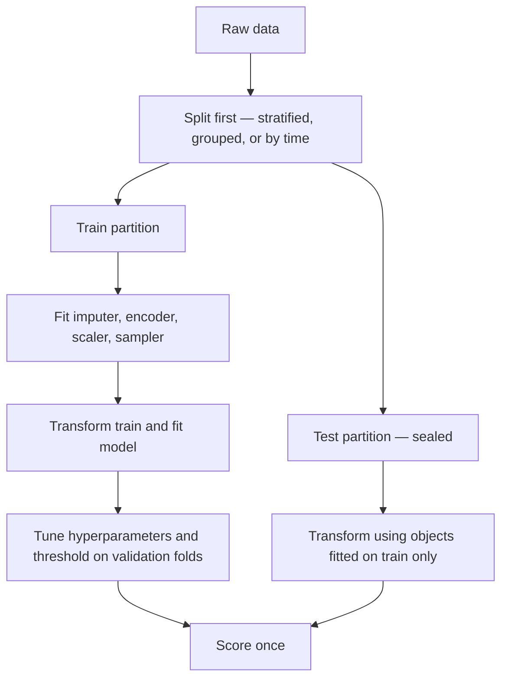
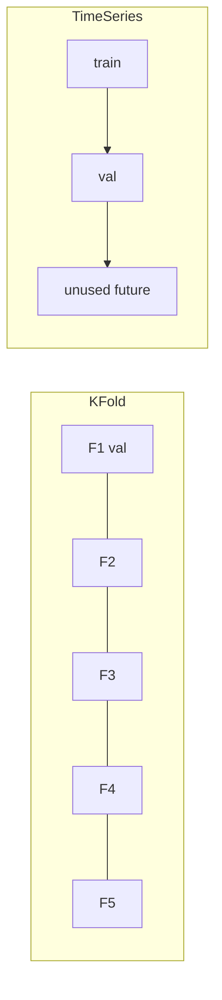
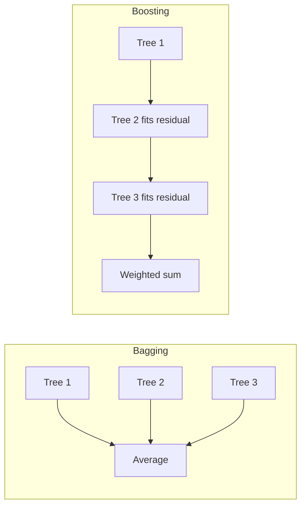

## 35. Scaling, encoding, missing values

**Scaling** — required by anything distance-based or gradient-based; irrelevant to trees.

| Method | Formula | Robust to outliers | Use |
|---|---|---|---|
| Standardisation | $\frac{x - \mu}{\sigma}$ | No | Default; assumes roughly symmetric |
| Min-max | $\frac{x - \min}{\max - \min}$ | No | Bounded inputs, image pixels |
| Robust | $\frac{x - \text{median}}{IQR}$ | Yes | Heavy tails, financial amounts |
| Log / log1p | $\log(1 + x)$ | Yes | Right-skewed positives — income, balances |
| Quantile / power | Rank or Yeo-Johnson | Yes | Forcing near-normality |

| Model | Needs scaling |
|---|---|
| Linear, logistic, ridge, lasso | Yes |
| Gradient descent of any kind | Yes |
| kNN, SVM, k-means, PCA, SMOTE | Yes |
| Decision tree, random forest, boosted trees | **No** |
| Neural networks | Yes, critically |

**Encoding**

| Method | Output width | Best for | Risk |
|---|---|---|---|
| One-hot | $k$ columns | Low cardinality, linear models | Explodes at high cardinality |
| Ordinal | 1 | Genuinely ordered categories | Implies false distance if unordered |
| Target / mean encoding | 1 | High cardinality with trees | **Leaks unless fitted inside the fold** |
| Frequency / count | 1 | High cardinality, tree models | Collides distinct categories |
| Hashing | Fixed $m$ | Very high cardinality, streaming | Collisions, unreadable |
| Native categorical | 0 extra | LightGBM, CatBoost | Library-specific |

**Missing values**

| Strategy | When | Note |
|---|---|---|
| Drop rows | <5% missing, missing at random | Loses data |
| Drop column | >60% missing and uninformative | Check first — missingness may be signal |
| Mean / median | Numeric, small gaps | Median for skew |
| Mode / "Missing" category | Categorical | Explicit category is usually better |
| Iterative / KNN imputer | Structured dependence | Slow; fit on train only |
| Leave as NaN | XGBoost, LightGBM, CatBoost | They learn a default split direction |

Always add a `was_missing` indicator column when missingness is plausibly informative — a blank income field on a loan application is data, not absence of data.

## 36. Leakage — the taxonomy

Leakage is any information in training that will not exist at prediction time. It is the leading cause of models that score brilliantly and fail in production.

| Type | Mechanism | Example |
|---|---|---|
| Preprocessing leakage | Transform fitted on all data | Scaler or imputer fitted before splitting |
| Target leakage | A feature encodes the answer | `days_since_default` when predicting default |
| Temporal leakage | Future information in past rows | Random split on time-series data |
| Duplicate leakage | Same entity in train and test | Repeat customers, near-duplicate rows |
| Group leakage | Correlated rows split apart | Multiple loans of one borrower |
| Resampling leakage | Synthetic rows cross folds | SMOTE applied before CV |
| Metric leakage | Threshold or hyperparameter tuned on test | Repeated peeking |



:::mental-model
Ask of every feature: *would this value exist, with this value, at the moment the prediction is made?* If the honest answer is no, or "only after the outcome is known", it is leakage regardless of how much it improves the score.
:::

A validation score that jumps implausibly after adding one feature is a leakage alarm, not a success.

## 37. Feature engineering and selection

**Engineering** — creating representations the model cannot reach on its own.

| Technique | Example | Helps |
|---|---|---|
| Ratios | debt / income, utilisation | Linear models especially |
| Differences and lags | balance change month on month | Time-aware models |
| Aggregations | mean, max, count per entity | Panel and transaction data |
| Date parts | day of week, month, days since | Everything |
| Binning | age bands | Linear models capturing non-linearity |
| Interactions | $x_1 \times x_2$ | Linear models only — trees find these themselves |
| Polynomials | $x^2, x^3$ | Curved relationships in linear models |

Trees discover interactions and thresholds automatically. Most feature engineering effort pays off on linear models and neural networks, far less on gradient boosting.

**Selection**

| Family | Method | Cost | Note |
|---|---|---|---|
| Filter | Correlation, chi-square, mutual information, variance threshold | Cheap | Model-agnostic, ignores interactions |
| Wrapper | Recursive feature elimination, forward/backward | Expensive | Model-specific, overfits on small data |
| Embedded | Lasso, tree importance, boosting gain | Free with the fit | Best default |

$$
\text{Lasso: } \min_\beta \; \lVert y - X\beta \rVert^2 + \lambda \lVert \beta \rVert_1
\qquad
\text{Ridge: } \min_\beta \; \lVert y - X\beta \rVert^2 + \lambda \lVert \beta \rVert_2^2
$$

$L_1$ has corners at zero, so it sets coefficients exactly to zero and performs selection. $L_2$ shrinks smoothly and keeps everything. Elastic net mixes the two and handles correlated groups better than lasso alone.

**Permutation importance** is the honest measure: shuffle one column in the validation set and observe the drop in score. Unlike tree impurity importance it is not biased toward high-cardinality features, but it splits credit arbitrarily between correlated features.

## 38. Python — Pipeline and ColumnTransformer

```python
import numpy as np
import pandas as pd
from sklearn.compose import ColumnTransformer
from sklearn.pipeline import Pipeline
from sklearn.impute import SimpleImputer
from sklearn.preprocessing import StandardScaler, OneHotEncoder
from sklearn.ensemble import HistGradientBoostingClassifier
from sklearn.model_selection import train_test_split, cross_val_score, StratifiedKFold
from sklearn.metrics import classification_report, roc_auc_score

rng = np.random.default_rng(11)
n = 4000
df = pd.DataFrame({
    "income_lakh": rng.gamma(4.0, 2.5, n),
    "tenure_yrs":  rng.integers(0, 30, n),
    "utilisation": rng.beta(2, 5, n),
    "city_tier":   rng.choice(["tier1", "tier2", "tier3"], n, p=[0.4, 0.35, 0.25]),
    "product":     rng.choice(["personal", "auto", "home", "gold"], n),
})
df.loc[rng.random(n) < 0.08, "income_lakh"] = np.nan          # realistic gaps

z = (-1.0 - 0.15 * df["income_lakh"].fillna(df["income_lakh"].median())
     + 3.0 * df["utilisation"] + (df["city_tier"] == "tier3") * 0.6)
df["default"] = rng.binomial(1, 1 / (1 + np.exp(-z)))

X, y = df.drop(columns="default"), df["default"]
X_tr, X_te, y_tr, y_te = train_test_split(
    X, y, test_size=0.2, stratify=y, random_state=42)

numeric = ["income_lakh", "tenure_yrs", "utilisation"]
categorical = ["city_tier", "product"]

numeric_steps = Pipeline([
    ("impute", SimpleImputer(strategy="median", add_indicator=True)),
    ("scale", StandardScaler()),
])

categorical_steps = Pipeline([
    ("impute", SimpleImputer(strategy="constant", fill_value="missing")),
    ("encode", OneHotEncoder(handle_unknown="ignore", drop="first")),
])

preprocess = ColumnTransformer([
    ("num", numeric_steps, numeric),
    ("cat", categorical_steps, categorical),
])

model = Pipeline([
    ("prep", preprocess),
    ("clf", HistGradientBoostingClassifier(random_state=42)),
])

cv = StratifiedKFold(5, shuffle=True, random_state=42)
print("CV PR-AUC:", cross_val_score(
    model, X_tr, y_tr, cv=cv, scoring="average_precision").mean().round(4))

model.fit(X_tr, y_tr)
proba = model.predict_proba(X_te)[:, 1]
print("test ROC-AUC:", round(roc_auc_score(y_te, proba), 4))
print(classification_report(y_te, (proba >= 0.35).astype(int), digits=3))
```

Everything preprocessing-related lives inside the pipeline. That single discipline eliminates the entire preprocessing-leakage category, because `cross_val_score` refits the transformers on each fold's training portion automatically.

## 39. Cross-validation variants



| Variant | Splits on | Use when |
|---|---|---|
| k-fold | Random rows | Independent rows, balanced classes |
| Stratified k-fold | Preserves class ratio | **Any classification** |
| Group k-fold | Keeps a group whole | Repeat customers, patients, sessions |
| Stratified group | Both at once | Imbalanced and grouped |
| Time-series split | Expanding window, past → future | Any temporal ordering |
| Leave-one-out | $n$ folds | Tiny data; high variance, expensive |
| Repeated k-fold | Several shuffles | Small data, want a stable estimate |
| Purged / embargoed | Gap between train and val | Financial series with overlapping labels |

| $k$ | Bias of estimate | Variance | Cost |
|---|---|---|---|
| 3 | Higher | Lower | Low |
| 5 | Balanced | Balanced | **Default** |
| 10 | Lower | Higher | High |
| $n$ (LOO) | Lowest | Highest | Extreme |

Never use random k-fold on time series. It trains on the future to predict the past, and the score is meaningless.

## 40. Hyperparameter search

| Method | How it explores | Budget efficiency | Use |
|---|---|---|---|
| Grid search | Every combination | Poor beyond 3 parameters | Few parameters, few values |
| Random search | Random draws from distributions | Good | **Default** |
| Bayesian / TPE | Models the score surface, samples where promising | Best per trial | Expensive models |
| Successive halving | Starts many, kills the weak early | Very good | Large search spaces |
| Population-based | Evolves configurations during training | Good | Deep learning |

Random search beats grid search because performance usually depends strongly on a small subset of parameters. Grid wastes trials re-testing the same important-parameter values while varying irrelevant ones; random search gives every trial a distinct value on the parameter that matters.

| Model | Parameters worth tuning, in order |
|---|---|
| Ridge / Lasso | `alpha` |
| Logistic regression | `C`, `penalty`, `class_weight` |
| Random forest | `max_depth`, `min_samples_leaf`, `max_features` |
| Gradient boosting | `learning_rate`, `n_estimators`, `max_depth`, `subsample`, `min_child_weight`, then regularisation |
| Neural network | learning rate, width and depth, dropout, batch size, weight decay |

For boosting, fix a low learning rate (0.05) and let early stopping choose `n_estimators`. Tuning both together wastes most of the budget.

## 41. Nested cross-validation

An ordinary CV score used *after* hyperparameter tuning on the same folds is optimistic — the folds have been seen many times through the selection process.

**Inner loop** selects hyperparameters. **Outer loop** estimates performance of the whole procedure including selection.

$$
\text{Total fits} = k_{\text{outer}} \times k_{\text{inner}} \times (\text{configurations})
$$

| Situation | Nested CV required |
|---|---|
| Comparing model families on small data | Yes |
| Publishing a performance claim | Yes |
| Large data with a held-out test set | No — the sealed test set does the same job |
| Cheap sanity check during iteration | No |

With enough data, a single untouched test set is simpler and cheaper. Nested CV earns its cost when data is scarce enough that a test set would be too small to trust.

## 42. Decision trees — splitting

A tree partitions feature space with axis-aligned cuts, choosing at each node the split that most reduces impurity.

$$
\text{Gini}(S) = 1 - \sum_{k=1}^{K} p_k^2
\qquad
\text{Entropy}(S) = -\sum_{k=1}^{K} p_k \log_2 p_k
$$

$$
\Delta I = I(\text{parent}) - \sum_{c \in \text{children}} \frac{n_c}{n}\, I(c)
$$

**Worked split.** 100 rows, 30 positive.

Parent: $p_1 = 0.30$, $\text{Gini} = 1 - (0.7^2 + 0.3^2) = 0.42$

Candidate split on `utilisation < 0.5`:

| Child | $n$ | Positives | $p_1$ | Gini |
|---|---|---|---|---|
| Left | 60 | 6 | 0.10 | $1 - (0.9^2 + 0.1^2) = 0.180$ |
| Right | 40 | 24 | 0.60 | $1 - (0.4^2 + 0.6^2) = 0.480$ |

$$
\Delta I = 0.42 - \left(\tfrac{60}{100}(0.180) + \tfrac{40}{100}(0.480)\right) = 0.42 - 0.30 = 0.12
$$

The split with the largest $\Delta I$ across all features and all thresholds wins. This is greedy — no lookahead, no backtracking, and no guarantee of the globally optimal tree.

<svg viewBox="0 0 660 290" xmlns="http://www.w3.org/2000/svg">
  <rect x="235" y="20" width="190" height="42" stroke="currentColor" stroke-width="1.4" fill="none"/>
  <text x="330" y="40" fill="currentColor" font-size="12" text-anchor="middle">utilisation &lt; 0.5 ?</text>
  <text x="330" y="55" fill="currentColor" font-size="11" text-anchor="middle">n=100  Gini 0.42</text>
  <line x1="290" y1="62" x2="150" y2="120" stroke="currentColor" stroke-width="1.2"/>
  <line x1="370" y1="62" x2="510" y2="120" stroke="currentColor" stroke-width="1.2"/>
  <text x="200" y="90" fill="currentColor" font-size="11">yes</text>
  <text x="450" y="90" fill="currentColor" font-size="11">no</text>
  <rect x="60" y="120" width="180" height="42" stroke="currentColor" stroke-width="1.4" fill="none"/>
  <text x="150" y="140" fill="currentColor" font-size="12" text-anchor="middle">leaf: predict 0</text>
  <text x="150" y="155" fill="currentColor" font-size="11" text-anchor="middle">n=60  Gini 0.18</text>
  <rect x="420" y="120" width="190" height="42" stroke="currentColor" stroke-width="1.4" fill="none"/>
  <text x="515" y="140" fill="currentColor" font-size="12" text-anchor="middle">income &lt; 5 lakh ?</text>
  <text x="515" y="155" fill="currentColor" font-size="11" text-anchor="middle">n=40  Gini 0.48</text>
  <line x1="470" y1="162" x2="400" y2="215" stroke="currentColor" stroke-width="1.2"/>
  <line x1="560" y1="162" x2="600" y2="215" stroke="currentColor" stroke-width="1.2"/>
  <rect x="310" y="215" width="170" height="42" stroke="currentColor" stroke-width="1.4" fill="none"/>
  <text x="395" y="241" fill="currentColor" font-size="12" text-anchor="middle">leaf: predict 1</text>
  <rect x="520" y="215" width="130" height="42" stroke="currentColor" stroke-width="1.4" fill="none"/>
  <text x="585" y="241" fill="currentColor" font-size="12" text-anchor="middle">leaf: predict 0</text>
</svg>

| Criterion | Behaviour |
|---|---|
| Gini | Slightly faster, favours the larger partition; sklearn default |
| Entropy | Marginally more balanced splits; log is slower |
| Log loss | Same as entropy in sklearn |
| MSE / MAE | Regression trees; leaf predicts the mean or median |

In practice Gini and entropy produce nearly identical trees. This is not a parameter worth tuning.

## 43. Pruning and constraints

An unconstrained tree grows until every leaf is pure — a memoriser with zero training error and terrible generalisation.

| Control | Effect | Typical |
|---|---|---|
| `max_depth` | Hard depth limit | 3–10 |
| `min_samples_split` | Minimum rows to attempt a split | 10–50 |
| `min_samples_leaf` | Minimum rows in any leaf | 5–50 |
| `max_features` | Features considered per split | `sqrt` for forests |
| `max_leaf_nodes` | Total leaf budget | Alternative to depth |
| `ccp_alpha` | Cost-complexity pruning strength | Tune by CV |

**Cost-complexity (post-)pruning** grows the tree fully, then collapses subtrees that do not pay for themselves:

$$
R_\alpha(T) = R(T) + \alpha \, \lvert \tilde{T} \rvert
$$

where $R(T)$ is the tree's error and $\lvert\tilde{T}\rvert$ its number of leaves. Raising $\alpha$ yields a nested sequence of ever-smaller trees; pick $\alpha$ by cross-validation.

| Strength | Weakness |
|---|---|
| No scaling needed | High variance — small data change, different tree |
| Handles mixed types | Axis-aligned only; diagonal boundaries need stairs |
| Missing values handled natively (some libraries) | Poor at smooth or linear relationships |
| Genuinely interpretable when shallow | Cannot extrapolate beyond the training range |
| Finds interactions automatically | Biased toward high-cardinality features |

That high variance is precisely the weakness that bagging and boosting exist to exploit.

## 44. Bagging and the bootstrap

**Bootstrap** — sample $n$ rows *with replacement* from $n$ rows. Each draw omits roughly a third of the data:

$$
P(\text{row excluded}) = \left(1 - \frac{1}{n}\right)^{n} \;\xrightarrow{\;n \to \infty\;}\; e^{-1} \approx 0.368
$$

**Bagging** — fit $B$ models on $B$ bootstrap samples and average them.

$$
\hat{f}_{\text{bag}}(x) = \frac{1}{B}\sum_{b=1}^{B} \hat{f}^{*b}(x)
$$

Why it works. For $B$ estimators each with variance $\sigma^2$ and pairwise correlation $\rho$:

$$
\text{Var}\left(\frac{1}{B}\sum_b \hat{f}_b\right) = \rho\sigma^2 + \frac{1 - \rho}{B}\sigma^2
$$

As $B \to \infty$ the second term vanishes, leaving $\rho\sigma^2$. **The floor is set by correlation between trees, not by their number.** Adding trees past a few hundred buys almost nothing; decorrelating them buys a great deal.

Bagging reduces variance and leaves bias roughly unchanged. It therefore helps unstable, low-bias learners (deep trees) and does almost nothing for stable ones (linear regression).

## 45. Random forest

Bagging plus one addition that attacks $\rho$ directly: **at every split, consider only a random subset of features.**

| Parameter | Meaning | Default |
|---|---|---|
| `n_estimators` | Trees | 100–500; more never hurts accuracy |
| `max_features` | Features per split | $\sqrt{p}$ classification, $p/3$ regression |
| `max_depth` | Depth cap | None — trees grown deep by design |
| `min_samples_leaf` | Leaf size floor | 1–5 |
| `bootstrap` | Sample with replacement | True |

Without feature subsampling, one dominant predictor appears at the top of nearly every tree and all trees look alike — $\rho$ stays high and averaging gains little. Restricting the candidate set forces trees to explore different structure.

**Out-of-bag error** — each row is unused by about 37% of trees, so predicting it with only those trees gives a free validation estimate with no separate holdout.

**Feature importance, two ways**

| Measure | Computation | Bias |
|---|---|---|
| Mean decrease in impurity | Sum of weighted $\Delta I$ across trees | Inflates high-cardinality and continuous features |
| Permutation importance | Score drop when a column is shuffled | Honest; splits credit among correlated features |

Prefer permutation importance on validation data. Impurity importance is computed on training data and rewards features that enabled overfitting.

## 46. Boosting — AdaBoost to gradient boosting

Bagging builds trees **in parallel and independently**. Boosting builds them **sequentially, each correcting the last**. Bagging reduces variance; boosting reduces bias.

**AdaBoost.** Reweight the data after each weak learner so misclassified rows matter more.

1. Initialise $w_i = 1/n$.
2. Fit weak learner $h_m$ on weighted data; compute weighted error $\varepsilon_m$.
3. Learner weight and row update:

$$
\alpha_m = \frac{1}{2}\ln\!\left(\frac{1 - \varepsilon_m}{\varepsilon_m}\right)
\qquad
w_i \leftarrow w_i \, e^{-\alpha_m y_i h_m(x_i)}, \quad y_i \in \{-1, +1\}
$$

4. Normalise $w$, repeat. Final model: $H(x) = \text{sign}\!\left(\sum_m \alpha_m h_m(x)\right)$.

A learner barely better than chance gets $\alpha_m \approx 0$; a strong one gets a large $\alpha_m$. Correctly classified rows have their weight decayed, misclassified rows amplified.

**Gradient boosting** generalises this: instead of reweighting rows, fit each new tree to the **negative gradient of the loss with respect to the current predictions.**

$$
F_0(x) = \arg\min_\gamma \sum_i L(y_i, \gamma)
$$

$$
r_{im} = -\left[\frac{\partial L(y_i, F(x_i))}{\partial F(x_i)}\right]_{F = F_{m-1}}
$$

$$
F_m(x) = F_{m-1}(x) + \nu \, \gamma_m h_m(x)
$$

with learning rate $\nu$ (shrinkage). For squared loss the negative gradient is exactly the residual $y_i - F_{m-1}(x_i)$ — which is why gradient boosting is often taught as "fit the next tree to the residuals". That is the special case, not the definition.

:::mental-model
Gradient descent moves parameters in function space. Gradient boosting moves the *function itself*, one small tree at a time, in the direction that most reduces the loss. Each tree is a step; the learning rate is the step size.
:::



| | Bagging / RF | Boosting |
|---|---|---|
| Trees built | Parallel, independent | Sequential, dependent |
| Base learner | Deep, low bias, high variance | Shallow stumps to depth 6 |
| Attacks | Variance | Bias |
| Overfits with more trees | No | **Yes** — needs early stopping |
| Parallelisable | Fully | Only within a tree |
| Tuning sensitivity | Low | High |
| Typical accuracy on tabular data | Strong | Usually stronger |

## 47. XGBoost, LightGBM, CatBoost

All three are gradient boosting; they differ in how splits are found and how the objective is regularised.

**XGBoost's regularised objective** — the key theoretical addition:

$$
\mathcal{L} = \sum_i L(y_i, \hat{y}_i) + \sum_m \Omega(h_m),
\qquad
\Omega(h) = \gamma T + \tfrac{1}{2}\lambda \lVert w \rVert^2
$$

with $T$ leaves and leaf weights $w$. Using a second-order Taylor expansion with gradients $g_i$ and Hessians $h_i$, the optimal leaf weight and the gain of a split come out in closed form:

$$
w_j^{*} = -\frac{\sum_{i \in I_j} g_i}{\sum_{i \in I_j} h_i + \lambda}
\qquad
\text{Gain} = \tfrac{1}{2}\left[\frac{G_L^2}{H_L + \lambda} + \frac{G_R^2}{H_R + \lambda} - \frac{(G_L + G_R)^2}{H_L + H_R + \lambda}\right] - \gamma
$$

A split is only taken if the gain exceeds $\gamma$ — pruning built into the objective rather than bolted on afterwards.

| | XGBoost | LightGBM | CatBoost |
|---|---|---|---|
| Tree growth | Level-wise (depth-first balanced) | **Leaf-wise** (best gain first) | Symmetric / oblivious |
| Split finding | Pre-sorted + histogram | Histogram + GOSS + EFB | Histogram |
| Categoricals | Manual encoding | Native | **Native, ordered target statistics** |
| Missing values | Learned default direction | Learned | Learned |
| Speed on large data | Fast | **Fastest** | Moderate |
| Small-data overfitting | Moderate | Higher — leaf-wise grows deep | **Lowest** — ordered boosting |
| Best at | General default | Wide data, many rows | High-cardinality categoricals |

**Leaf-wise growth** splits whichever leaf offers the highest gain anywhere in the tree, producing deeper, asymmetric trees. More accurate per tree, more prone to overfit on small data — control it with `num_leaves` rather than `max_depth`.

**CatBoost's ordered boosting** computes target statistics for a row using only rows that precede it in a random permutation, removing the target-leakage bias that plain mean encoding introduces.

| Parameter | XGBoost | LightGBM | Effect |
|---|---|---|---|
| Learning rate | `eta` | `learning_rate` | Lower = more trees, better generalisation |
| Complexity | `max_depth` (3–8) | `num_leaves` (< $2^{\text{depth}}$) | Primary capacity control |
| Row sampling | `subsample` | `bagging_fraction` | 0.6–0.9 adds variance reduction |
| Column sampling | `colsample_bytree` | `feature_fraction` | 0.6–0.9 |
| Leaf floor | `min_child_weight` | `min_data_in_leaf` | Raise on noisy data |
| Regularisation | `lambda`, `alpha`, `gamma` | `lambda_l1/l2` | Raise if train–val gap widens |
| Imbalance | `scale_pos_weight` | `is_unbalance` | Alternative to resampling |

Sane tuning order: fix `learning_rate = 0.05` with early stopping on a validation set → tune depth or `num_leaves` → tune subsampling → tune regularisation → finally lower the learning rate and raise the tree count for the last fraction of a point.

## 48. Perceptron, MLP, and XOR

A single neuron computes a weighted sum and applies a non-linearity:

$$
a = \phi\!\left(\sum_j w_j x_j + b\right)
$$

With a step or sigmoid activation this is a linear classifier — it can only draw a hyperplane. XOR is not linearly separable, and a single perceptron cannot solve it. That result stalled the field for years.

<svg viewBox="0 0 680 250" xmlns="http://www.w3.org/2000/svg">
  <g>
    <rect x="40" y="25" width="200" height="180" stroke="currentColor" stroke-width="1.2" fill="none"/>
    <circle cx="80" cy="165" r="6" fill="none" stroke="currentColor" stroke-width="1.6"/>
    <circle cx="200" cy="65" r="6" fill="none" stroke="currentColor" stroke-width="1.6"/>
    <circle cx="80" cy="65" r="6" fill="currentColor"/>
    <circle cx="200" cy="165" r="6" fill="currentColor"/>
    <text x="60" y="185" fill="currentColor" font-size="11">0,0</text>
    <text x="205" y="185" fill="currentColor" font-size="11">1,0</text>
    <text x="60" y="55" fill="currentColor" font-size="11">0,1</text>
    <text x="205" y="55" fill="currentColor" font-size="11">1,1</text>
    <text x="140" y="230" fill="currentColor" font-size="12" text-anchor="middle">XOR — no line works</text>
  </g>
  <g>
    <circle cx="360" cy="70" r="16" stroke="currentColor" stroke-width="1.4" fill="none"/>
    <circle cx="360" cy="150" r="16" stroke="currentColor" stroke-width="1.4" fill="none"/>
    <text x="330" y="75" fill="currentColor" font-size="12">x₁</text>
    <text x="330" y="155" fill="currentColor" font-size="12">x₂</text>
    <circle cx="480" cy="50" r="16" stroke="currentColor" stroke-width="1.4" fill="none"/>
    <circle cx="480" cy="110" r="16" stroke="currentColor" stroke-width="1.4" fill="none"/>
    <circle cx="480" cy="170" r="16" stroke="currentColor" stroke-width="1.4" fill="none"/>
    <circle cx="600" cy="110" r="16" stroke="currentColor" stroke-width="1.4" fill="none"/>
    <text x="625" y="115" fill="currentColor" font-size="12">ŷ</text>
    <line x1="376" y1="70" x2="464" y2="50" stroke="currentColor" stroke-width="1"/>
    <line x1="376" y1="70" x2="464" y2="110" stroke="currentColor" stroke-width="1"/>
    <line x1="376" y1="70" x2="464" y2="170" stroke="currentColor" stroke-width="1"/>
    <line x1="376" y1="150" x2="464" y2="50" stroke="currentColor" stroke-width="1"/>
    <line x1="376" y1="150" x2="464" y2="110" stroke="currentColor" stroke-width="1"/>
    <line x1="376" y1="150" x2="464" y2="170" stroke="currentColor" stroke-width="1"/>
    <line x1="496" y1="50" x2="584" y2="110" stroke="currentColor" stroke-width="1"/>
    <line x1="496" y1="110" x2="584" y2="110" stroke="currentColor" stroke-width="1"/>
    <line x1="496" y1="170" x2="584" y2="110" stroke="currentColor" stroke-width="1"/>
    <text x="480" y="215" fill="currentColor" font-size="12" text-anchor="middle">one hidden layer solves it</text>
  </g>
</svg>

One hidden layer with a non-linear activation is enough — **universal approximation** says such a network can approximate any continuous function on a compact set to arbitrary accuracy. The theorem says nothing about how wide it must be or whether gradient descent will find the weights, which is why depth is used in practice.

Without a non-linear activation, stacking layers is pointless: $W_2(W_1x) = (W_2W_1)x$ collapses to a single linear map.

## 49. Activations

<svg viewBox="0 0 700 240" xmlns="http://www.w3.org/2000/svg">
  <g>
    <line x1="20" y1="120" x2="160" y2="120" stroke="currentColor" stroke-width="1"/>
    <line x1="90" y1="35" x2="90" y2="200" stroke="currentColor" stroke-width="1"/>
    <path d="M 22 190 C 60 188 78 170 90 120 C 102 70 120 52 158 50" stroke="currentColor" stroke-width="2" fill="none"/>
    <text x="90" y="225" fill="currentColor" font-size="12" text-anchor="middle">sigmoid</text>
  </g>
  <g>
    <line x1="190" y1="120" x2="330" y2="120" stroke="currentColor" stroke-width="1"/>
    <line x1="260" y1="35" x2="260" y2="200" stroke="currentColor" stroke-width="1"/>
    <path d="M 192 196 C 230 194 248 178 260 120 C 272 62 290 46 328 44" stroke="currentColor" stroke-width="2" fill="none"/>
    <text x="260" y="225" fill="currentColor" font-size="12" text-anchor="middle">tanh</text>
  </g>
  <g>
    <line x1="360" y1="120" x2="500" y2="120" stroke="currentColor" stroke-width="1"/>
    <line x1="430" y1="35" x2="430" y2="200" stroke="currentColor" stroke-width="1"/>
    <path d="M 362 120 L 430 120 L 498 45" stroke="currentColor" stroke-width="2" fill="none"/>
    <text x="430" y="225" fill="currentColor" font-size="12" text-anchor="middle">ReLU</text>
  </g>
  <g>
    <line x1="530" y1="120" x2="670" y2="120" stroke="currentColor" stroke-width="1"/>
    <line x1="600" y1="35" x2="600" y2="200" stroke="currentColor" stroke-width="1"/>
    <path d="M 532 145 L 600 120 L 668 45" stroke="currentColor" stroke-width="2" fill="none"/>
    <text x="600" y="225" fill="currentColor" font-size="12" text-anchor="middle">leaky ReLU</text>
  </g>
</svg>

| Activation | Formula | Range | Derivative issue | Use |
|---|---|---|---|---|
| Sigmoid | $\frac{1}{1+e^{-z}}$ | (0,1) | Max 0.25, saturates | Output layer, binary |
| Tanh | $\frac{e^z - e^{-z}}{e^z + e^{-z}}$ | (−1,1) | Max 1.0, saturates | Zero-centred; older RNNs |
| ReLU | $\max(0, z)$ | [0,∞) | Zero for $z<0$ — dying units | **Default hidden layer** |
| Leaky ReLU | $\max(\alpha z, z)$ | (−∞,∞) | Never zero | Fixes dying ReLU |
| ELU / SELU | Exponential below 0 | (−α,∞) | Smooth | Self-normalising nets |
| GELU | $z \cdot \Phi(z)$ | (−∞,∞) | Smooth | Transformers |
| Softmax | $\frac{e^{z_k}}{\sum_j e^{z_j}}$ | Simplex | — | Multiclass output |

**Vanishing gradients.** Backpropagation multiplies derivatives layer by layer. With sigmoid, each factor is at most 0.25, so through ten layers the gradient is scaled by at most $0.25^{10} \approx 10^{-6}$ — early layers stop learning. ReLU's derivative is exactly 1 on the positive side, so the product does not decay. That single property, more than any other, made deep networks trainable.

**Exploding gradients** are the mirror image, addressed by gradient clipping and careful initialisation.

## 50. Backpropagation

Two layers, sigmoid hidden, sigmoid output, binary cross-entropy loss.

**Forward**

$$
z^{[1]} = W^{[1]}x + b^{[1]}, \quad a^{[1]} = \sigma(z^{[1]})
$$
$$
z^{[2]} = W^{[2]}a^{[1]} + b^{[2]}, \quad \hat{y} = a^{[2]} = \sigma(z^{[2]})
$$
$$
L = -\big[y\log \hat{y} + (1-y)\log(1-\hat{y})\big]
$$

**Backward.** Start at the output. The loss derivative and the sigmoid derivative combine and simplify:

$$
\frac{\partial L}{\partial a^{[2]}} = \frac{a^{[2]} - y}{a^{[2]}(1 - a^{[2]})},
\qquad
\frac{\partial a^{[2]}}{\partial z^{[2]}} = a^{[2]}(1 - a^{[2]})
$$

$$
\boxed{\;\delta^{[2]} = \frac{\partial L}{\partial z^{[2]}} = a^{[2]} - y\;}
$$

The denominators cancel exactly. This cancellation is why cross-entropy is paired with sigmoid — with squared loss the $a(1-a)$ term survives and vanishes whenever the network is confidently wrong, stalling learning precisely when it is most needed.

Output layer parameters:

$$
\frac{\partial L}{\partial W^{[2]}} = \delta^{[2]} \big(a^{[1]}\big)^T,
\qquad
\frac{\partial L}{\partial b^{[2]}} = \delta^{[2]}
$$

Propagate back through the weights, then through the hidden activation:

$$
\delta^{[1]} = \big(W^{[2]}\big)^T \delta^{[2]} \;\odot\; \sigma'(z^{[1]}),
\qquad \sigma'(z) = a^{[1]}(1 - a^{[1]})
$$

$$
\frac{\partial L}{\partial W^{[1]}} = \delta^{[1]} x^T,
\qquad
\frac{\partial L}{\partial b^{[1]}} = \delta^{[1]}
$$

**General recursion** for layer $l$:

$$
\delta^{[l]} = \big(W^{[l+1]}\big)^T \delta^{[l+1]} \odot \phi'\!\left(z^{[l]}\right)
$$

Backpropagation is the chain rule with the intermediate results cached. Its cost is roughly one forward pass — computing each layer's gradient numerically instead would cost one forward pass *per parameter*.

:::mental-model
$\delta^{[l]}$ is "how wrong layer $l$'s pre-activation was". It flows backwards, shrinking or growing by the weights it passes through and by the activation's slope. Every training pathology in deep learning is a statement about what happens to that product.
:::

## 51. Making training work

| Technique | Mechanism | Effect |
|---|---|---|
| Xavier/Glorot init | $\text{Var}(W) = \frac{2}{n_{in}+n_{out}}$ | Keeps signal variance stable — sigmoid/tanh |
| He init | $\text{Var}(W) = \frac{2}{n_{in}}$ | Same, for ReLU |
| Batch normalisation | Normalise pre-activations per mini-batch | Faster training, mild regularisation |
| Layer normalisation | Normalise across features per sample | Batch-size independent; transformers |
| Dropout | Randomly zero units with probability $p$ | Prevents co-adaptation; 0.2–0.5 |
| Weight decay ($L_2$) | Penalise large weights | Smoother function |
| Early stopping | Halt when validation stops improving | The cheapest regulariser there is |
| Gradient clipping | Cap gradient norm | Prevents explosion |
| Data augmentation | Label-preserving transforms | More effective data |

**Never initialise weights to zero** — every unit in a layer computes the same thing and receives the same gradient, so they never differentiate. Biases at zero are fine.

**Optimisers**

$$
\text{Momentum:} \quad v_t = \beta v_{t-1} + (1-\beta)\nabla J, \qquad \theta_{t+1} = \theta_t - \eta v_t
$$

$$
\text{RMSProp:} \quad s_t = \beta s_{t-1} + (1-\beta)(\nabla J)^2, \qquad \theta_{t+1} = \theta_t - \frac{\eta}{\sqrt{s_t} + \epsilon}\nabla J
$$

$$
\text{Adam:} \quad \theta_{t+1} = \theta_t - \eta \frac{\hat{m}_t}{\sqrt{\hat{v}_t} + \epsilon}
$$

Adam combines both — momentum on the gradient ($\hat{m}$) and per-parameter scaling by recent gradient magnitude ($\hat{v}$), with bias correction for the early steps. It is the default; SGD with momentum and a tuned schedule sometimes generalises slightly better on vision tasks.

| Symptom | Likely cause | Fix |
|---|---|---|
| Loss NaN | Learning rate too high, or log(0) | Cut LR 10×, clip gradients, add $\epsilon$ |
| Loss flat from step 1 | Dead ReLUs, zero init, LR too small | He init, leaky ReLU, raise LR |
| Train falls, val rises | Overfitting | Dropout, weight decay, early stop, more data |
| Both flat and high | Underfitting | More capacity, train longer, better features |
| Wildly noisy loss | Batch too small, LR too high | Raise batch, lower LR |

## 52. Python — MLP from scratch, then Keras

```python
import numpy as np

# ---------- from scratch: 2-layer MLP, binary cross-entropy ----------
def sigmoid(z):
    return 1.0 / (1.0 + np.exp(-np.clip(z, -500, 500)))

class MLP:
    def __init__(self, n_in, n_hidden, seed=0):
        rng = np.random.default_rng(seed)
        # He-style scaling; never zeros
        self.W1 = rng.normal(0, np.sqrt(2.0 / n_in), (n_hidden, n_in))
        self.b1 = np.zeros((n_hidden, 1))
        self.W2 = rng.normal(0, np.sqrt(2.0 / n_hidden), (1, n_hidden))
        self.b2 = np.zeros((1, 1))

    def forward(self, X):
        self.X = X                                  # (n_in, m)
        self.Z1 = self.W1 @ X + self.b1
        self.A1 = np.maximum(0, self.Z1)            # ReLU
        self.Z2 = self.W2 @ self.A1 + self.b2
        self.A2 = sigmoid(self.Z2)
        return self.A2

    def backward(self, y, lr):
        m = y.shape[1]
        dZ2 = self.A2 - y                           # cancellation from section 50
        dW2 = (dZ2 @ self.A1.T) / m
        db2 = np.sum(dZ2, axis=1, keepdims=True) / m

        dA1 = self.W2.T @ dZ2
        dZ1 = dA1 * (self.Z1 > 0)                   # ReLU derivative
        dW1 = (dZ1 @ self.X.T) / m
        db1 = np.sum(dZ1, axis=1, keepdims=True) / m

        self.W2 -= lr * dW2; self.b2 -= lr * db2
        self.W1 -= lr * dW1; self.b1 -= lr * db1

    def loss(self, y):
        p = np.clip(self.A2, 1e-9, 1 - 1e-9)
        return float(-np.mean(y * np.log(p) + (1 - y) * np.log(1 - p)))

# XOR — the problem a single perceptron cannot solve
X = np.array([[0, 0, 1, 1], [0, 1, 0, 1]], dtype=float)   # (2, 4)
y = np.array([[0, 1, 1, 0]], dtype=float)                  # (1, 4)

net = MLP(n_in=2, n_hidden=8, seed=42)
for epoch in range(5000):
    net.forward(X)
    if epoch % 1000 == 0:
        print(f"epoch {epoch:5d}  loss {net.loss(y):.5f}")
    net.backward(y, lr=0.5)

print("predictions:", np.round(net.forward(X), 3))
print("labels:     ", y)
```

```python
# ---------- same network in Keras ----------
import numpy as np
from tensorflow import keras
from tensorflow.keras import layers

X = np.array([[0, 0], [0, 1], [1, 0], [1, 1]], dtype=float)   # (4, 2)
y = np.array([0, 1, 1, 0], dtype=float)

model = keras.Sequential([
    layers.Input(shape=(2,)),
    layers.Dense(8, activation="relu", kernel_initializer="he_normal"),
    layers.Dense(1, activation="sigmoid"),
])

model.compile(optimizer=keras.optimizers.Adam(0.05),
              loss="binary_crossentropy",
              metrics=["accuracy"])

history = model.fit(X, y, epochs=500, verbose=0)
print("final loss:", round(history.history["loss"][-1], 5))
print("predictions:", model.predict(X, verbose=0).round(3).ravel())
```

Same architecture, same loss, same gradients. The framework supplies autodiff, Adam, and the GPU; the mathematics is section 50 unchanged.

---

## Closing — algorithm selection master table

| Family | Assumptions | Scaling | Interpretable | Handles imbalance | Handles missing | Extrapolates | Typical cost |
|---|---|---|---|---|---|---|---|
| Linear regression | Linear, i.i.d. errors | Yes | High | n/a | No | Yes | Very low |
| Ridge / Lasso | As above + sparsity or shrinkage | Yes | High | n/a | No | Yes | Very low |
| Logistic regression | Linear in log-odds | Yes | High | Class weights | No | Yes | Low |
| Decision tree | None | No | High if shallow | Class weights | Some libraries | **No** | Low |
| Random forest | None | No | Medium | Class weights, balanced bootstrap | Some | No | Medium |
| AdaBoost | None | No | Low | Sensitive to noisy labels | No | No | Medium |
| Gradient boosting | None | No | Low | `scale_pos_weight` | Yes | No | Medium-high |
| XGBoost / LightGBM | None | No | Low | `scale_pos_weight` | Yes | No | Medium-high |
| CatBoost | None | No | Low | Class weights | Yes | No | Medium-high |
| Neural network | Enough data | **Yes** | Very low | Class weights, focal loss | No | Partly | High |

**Default path on tabular data**

1. Baseline — majority class, or the mean.
2. Logistic or linear regression with a proper pipeline. This is the number everything else must beat.
3. Gradient boosting (LightGBM or XGBoost) with early stopping.
4. Tune only if step 3 clears step 2 by a margin worth the complexity.
5. Neural networks only for text, images, audio, or very large data — on ordinary tabular problems, boosted trees usually win.

**Final checklist**

1. Split before anything else; stratify, group, or order by time as the data demands.
2. Every transform inside a pipeline, fitted per fold.
3. Interrogate any feature that improves the score dramatically.
4. Choose the metric from error costs, not habit.
5. Beat a simple baseline before adding complexity.
6. Use early stopping on any boosted or neural model.
7. Check calibration whenever the probability itself is consumed.
8. Report the operating point, not just the AUC.
9. Test set once.
