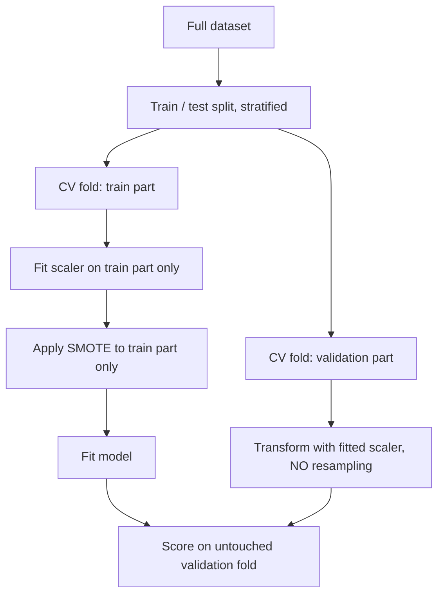

## 1. What learning actually is

A model is a function $f_\theta$ chosen from a hypothesis space $\mathcal{H}$ by minimising error on data. Learning is **compression that generalises**. Memorising is compression that does not.

| | Memorising | Learning |
|---|---|---|
| Train error | ~0 | Low |
| Test error | High | Low |
| What is stored | The rows | The structure behind the rows |
| Adding new data | Table grows | Parameters barely move |

The entire discipline is a fight between two forces: make the function flexible enough to capture the structure, and constrained enough that it cannot capture the noise.

:::mental-model
Every algorithm in this document is one answer to a single question — *how do I restrict the hypothesis space so that fitting the training data forces me to fit the world?*
:::

## 2. Notation and the supervised setup

| Symbol | Meaning | Shape |
|---|---|---|
| $X$ | Feature matrix | $n \times p$ |
| $x_i$ | One observation | $p \times 1$ |
| $y$ | Target vector | $n \times 1$ |
| $\theta$ or $\beta$ | Parameters | $p \times 1$ (+ intercept) |
| $\hat{y} = f_\theta(X)$ | Prediction | $n \times 1$ |
| $n$ | Rows | — |
| $p$ | Features | — |

**Supervised** — labels exist. **Regression** — $y \in \mathbb{R}$. **Classification** — $y$ in a finite set.

The data is assumed drawn i.i.d. from an unknown joint distribution $P(X, Y)$. Every guarantee in machine learning rests on that assumption, and every production failure is that assumption breaking.

## 3. Loss, cost, risk

Three words for three different objects. They are constantly confused.

| Term | Definition | Scope |
|---|---|---|
| Loss $L(y, \hat{y})$ | Error on **one** observation | Point |
| Cost $J(\theta)$ | Average loss over the training set | Dataset |
| True risk $R(\theta)$ | $\mathbb{E}_{P}[L(y, f_\theta(x))]$ | Population |

$$
J(\theta) \;=\; \frac{1}{n}\sum_{i=1}^{n} L\big(y_i,\, f_\theta(x_i)\big)
\qquad
R(\theta) \;=\; \mathbb{E}_{(x,y)\sim P}\big[L(y, f_\theta(x))\big]
$$

$J$ is what you minimise. $R$ is what you care about. **Empirical risk minimisation** is the assumption that minimising the first minimises the second — true only when $n$ is large relative to model flexibility.

| Task | Standard loss | Formula |
|---|---|---|
| Regression | Squared error | $(y - \hat{y})^2$ |
| Regression, robust | Absolute error | $\lvert y - \hat{y} \rvert$ |
| Regression, hybrid | Huber | quadratic near 0, linear in the tails |
| Binary classification | Log loss | $-[y\log\hat{p} + (1-y)\log(1-\hat{p})]$ |
| Multiclass | Cross-entropy | $-\sum_k y_k \log \hat{p}_k$ |

## 4. Train, validation, test

| Split | Purpose | Touched how often |
|---|---|---|
| Train | Fit parameters | Every epoch |
| Validation | Choose hyperparameters, early stopping | Many times |
| Test | Estimate generalisation | **Once** |

Typical split: 60 / 20 / 20, or 80 / 20 with cross-validation replacing the validation set.

**Order matters absolutely.** Split first, then fit every transformation on the training portion only. Scaling before splitting leaks the test set's mean and variance into training. The model looks better than it is, and the gap only appears in production.

:::mental-model
The test set is a single-use instrument. Every time you look at it and change something, you convert it into a validation set, and your reported number becomes optimistic by an amount you cannot measure.
:::

## 5. Bias–variance decomposition

For squared error, expected test error at a point $x$ decomposes exactly:

$$
\mathbb{E}\big[(y - \hat{f}(x))^2\big]
= \underbrace{\big(\mathbb{E}[\hat{f}(x)] - f(x)\big)^2}_{\text{Bias}^2}
+ \underbrace{\mathbb{E}\big[(\hat{f}(x) - \mathbb{E}[\hat{f}(x)])^2\big]}_{\text{Variance}}
+ \underbrace{\sigma^2}_{\text{Irreducible}}
$$

| Term | Meaning | Cause | Cure |
|---|---|---|---|
| Bias² | Wrong on average | Model too simple | More capacity, better features |
| Variance | Unstable across samples | Model too flexible | Regularisation, more data, ensembling |
| $\sigma^2$ | Noise in $y$ itself | Reality | None |

<svg viewBox="0 0 700 320" xmlns="http://www.w3.org/2000/svg">
  <line x1="70" y1="270" x2="650" y2="270" stroke="currentColor" stroke-width="1.5"/>
  <line x1="70" y1="30" x2="70" y2="270" stroke="currentColor" stroke-width="1.5"/>
  <text x="360" y="300" fill="currentColor" font-size="13" text-anchor="middle">Model complexity</text>
  <text x="30" y="150" fill="currentColor" font-size="13" text-anchor="middle" transform="rotate(-90 30 150)">Error</text>
  <path d="M 80 60 Q 250 230 640 260" stroke="currentColor" stroke-width="1.5" fill="none"/>
  <text x="150" y="90" fill="currentColor" font-size="12">Bias²</text>
  <path d="M 80 262 Q 400 250 640 50" stroke="currentColor" stroke-width="1.5" fill="none" stroke-dasharray="5 4"/>
  <text x="590" y="90" fill="currentColor" font-size="12">Variance</text>
  <path d="M 80 75 Q 300 175 400 168 Q 520 160 640 55" stroke="currentColor" stroke-width="2.5" fill="none"/>
  <text x="410" y="145" fill="currentColor" font-size="12">Total test error</text>
  <line x1="400" y1="168" x2="400" y2="270" stroke="currentColor" stroke-width="1" stroke-dasharray="3 3"/>
  <circle cx="400" cy="168" r="4" fill="currentColor"/>
  <text x="400" y="290" fill="currentColor" font-size="12" text-anchor="middle">optimum</text>
  <line x1="80" y1="272" x2="80" y2="266" stroke="currentColor"/>
  <text x="80" y="290" fill="currentColor" font-size="11" text-anchor="middle">simple</text>
  <text x="640" y="290" fill="currentColor" font-size="11" text-anchor="middle">flexible</text>
</svg>

The decomposition is exact for squared loss only. For log loss and 0-1 loss the intuition survives but the algebra does not.

## 6. Overfitting and underfitting — diagnosis

| Symptom | Train error | Val error | Gap | Diagnosis | Action |
|---|---|---|---|---|---|
| High, high | High | High | Small | Underfit | More capacity, better features, train longer |
| Low, high | Low | High | Large | Overfit | Regularise, more data, simplify, early stop |
| Low, low | Low | Low | Small | Fit | Ship |
| High, low | High | Low | Negative | Bug | Leakage, wrong split, or val set too easy |

The last row is not a good result. A validation score better than training almost always means the split is broken or heavy regularisation (dropout, augmentation) is active at train time only.

**Learning curves** separate the two failure modes cleanly: plot train and validation error against training set size. Curves converging at a high value means bias — more data will not help. Curves with a persistent gap means variance — more data will help.

## 7. Linear regression — model and assumptions

$$
y \;=\; \beta_0 + \beta_1 x_1 + \dots + \beta_p x_p + \varepsilon
\;=\; X\beta + \varepsilon
$$

| Assumption | Statement | Violated when | Consequence |
|---|---|---|---|
| Linearity | $\mathbb{E}[y \mid X] = X\beta$ | True relation curves | Biased coefficients |
| Independence | $\varepsilon_i \perp \varepsilon_j$ | Time series, clustered data | Standard errors wrong |
| Homoscedasticity | $\text{Var}(\varepsilon) = \sigma^2 I$ | Spread grows with $\hat{y}$ | Inefficient, wrong SEs |
| Normal errors | $\varepsilon \sim N(0, \sigma^2)$ | Heavy tails | Only affects inference, not fit |
| No perfect collinearity | $X^TX$ invertible | Duplicate features | No unique solution |

**Prediction needs only linearity.** Inference — p-values, confidence intervals — needs all five. Most industrial use is prediction, which is why the assumption list matters less in practice than textbooks imply.

## 8. OLS closed form — derivation

Minimise the residual sum of squares:

$$
J(\beta) = (y - X\beta)^T(y - X\beta)
= y^Ty - 2\beta^TX^Ty + \beta^TX^TX\beta
$$

Differentiate with respect to $\beta$ and set to zero:

$$
\frac{\partial J}{\partial \beta} = -2X^Ty + 2X^TX\beta = 0
$$

$$
\boxed{\;\hat{\beta} = (X^TX)^{-1}X^Ty\;}
$$

The second derivative $2X^TX$ is positive semi-definite, so the stationary point is a global minimum. Cost is $O(p^3)$ for the inversion plus $O(np^2)$ for the product — fine to a few thousand features, hopeless beyond that, which is why gradient descent exists.

| Situation | Fix |
|---|---|
| $X^TX$ singular | Use pseudo-inverse, or ridge: $(X^TX + \lambda I)^{-1}$ |
| $p > n$ | Closed form impossible; regularise |
| Numerically unstable | Solve via QR or SVD, never invert explicitly |

## 9. Geometry of least squares

OLS projects $y$ orthogonally onto the column space of $X$. The residual is what is left over, perpendicular to that space.

$$
\hat{y} = X\hat{\beta} = \underbrace{X(X^TX)^{-1}X^T}_{H,\ \text{hat matrix}}\, y
\qquad
X^T(y - \hat{y}) = 0
$$

<svg viewBox="0 0 640 300" xmlns="http://www.w3.org/2000/svg">
  <path d="M 90 230 L 430 230 L 560 160 L 220 160 Z" stroke="currentColor" stroke-width="1.2" fill="none"/>
  <text x="130" y="222" fill="currentColor" font-size="12">column space of X</text>
  <line x1="250" y1="200" x2="430" y2="60" stroke="currentColor" stroke-width="2"/>
  <text x="440" y="55" fill="currentColor" font-size="13">y</text>
  <line x1="250" y1="200" x2="420" y2="195" stroke="currentColor" stroke-width="2"/>
  <text x="430" y="200" fill="currentColor" font-size="13">ŷ</text>
  <line x1="430" y1="60" x2="420" y2="195" stroke="currentColor" stroke-width="1.5" stroke-dasharray="5 4"/>
  <text x="450" y="130" fill="currentColor" font-size="12">residual</text>
  <path d="M 415 180 L 400 178 L 402 193" stroke="currentColor" stroke-width="1.2" fill="none"/>
  <circle cx="250" cy="200" r="3" fill="currentColor"/>
</svg>

This is why residuals must show no pattern against fitted values — any pattern means signal still lying in a direction the model can reach.

## 10. Residual diagnostics and multicollinearity

| Plot | Looking for | Bad sign means |
|---|---|---|
| Residual vs fitted | Random band around 0 | Curvature → missing non-linearity |
| Scale-location | Flat spread | Funnel → heteroscedasticity |
| Q-Q plot | Points on the line | Heavy tails → outliers |
| Residual vs each feature | No pattern | Pattern → that feature needs a transform |
| Cook's distance | All small | Spike → single row driving the fit |

**Multicollinearity** — features correlated with each other. Coefficients become unstable and un-interpretable; predictions stay fine.

$$
\text{VIF}_j = \frac{1}{1 - R_j^2}
$$

where $R_j^2$ comes from regressing feature $j$ on all the others.

| VIF | Reading |
|---|---|
| 1 | Independent |
| 1–5 | Acceptable |
| 5–10 | Watch |
| > 10 | Serious — drop, combine, or use ridge/PCA |

## 11. Regression metrics

| Metric | Formula | Units | Weakness |
|---|---|---|---|
| MSE | $\frac{1}{n}\sum(y-\hat{y})^2$ | Squared | Outlier-dominated |
| RMSE | $\sqrt{\text{MSE}}$ | Original | Outlier-dominated |
| MAE | $\frac{1}{n}\sum\lvert y-\hat{y}\rvert$ | Original | Ignores magnitude of large misses |
| R² | $1 - \frac{SS_{res}}{SS_{tot}}$ | None | Rises with any added feature |
| Adjusted R² | $1 - \frac{(1-R^2)(n-1)}{n-p-1}$ | None | Penalises useless features |
| MAPE | $\frac{100}{n}\sum\left\lvert\frac{y-\hat{y}}{y}\right\rvert$ | % | Explodes near $y = 0$; asymmetric |

**Where R² lies:** it can be high on a badly specified model, it is meaningless across different targets, and out-of-sample it can go negative — which simply means you did worse than predicting the mean.

RMSE when large errors are disproportionately costly. MAE when they are not.

## 12. Python — OLS from scratch, then sklearn

```python
import numpy as np
from sklearn.linear_model import LinearRegression
from sklearn.model_selection import train_test_split

rng = np.random.default_rng(42)
n, p = 500, 3
X = rng.normal(size=(n, p))
true_beta = np.array([2.0, -1.5, 0.7])
y = X @ true_beta + 4.0 + rng.normal(scale=0.5, size=n)

X_tr, X_te, y_tr, y_te = train_test_split(X, y, test_size=0.2, random_state=42)

# --- closed form, solved not inverted ---
def ols_fit(X, y):
    Xb = np.column_stack([np.ones(len(X)), X])       # intercept column
    beta, *_ = np.linalg.lstsq(Xb, y, rcond=None)     # QR-based, stable
    return beta

def ols_predict(X, beta):
    return np.column_stack([np.ones(len(X)), X]) @ beta

beta = ols_fit(X_tr, y_tr)
pred = ols_predict(X_te, beta)

rmse = np.sqrt(np.mean((y_te - pred) ** 2))
r2 = 1 - np.sum((y_te - pred) ** 2) / np.sum((y_te - y_te.mean()) ** 2)
print("scratch beta:", np.round(beta, 3))
print(f"RMSE {rmse:.4f}   R2 {r2:.4f}")

# --- sklearn, same answer ---
lr = LinearRegression().fit(X_tr, y_tr)
print("sklearn beta:", np.round(np.r_[lr.intercept_, lr.coef_], 3))
print("match:", np.allclose(beta, np.r_[lr.intercept_, lr.coef_]))
```

## 13. Gradient descent — mechanics

$$
\theta_{t+1} = \theta_t - \eta \, \nabla_\theta J(\theta_t)
$$

The gradient points uphill; you step against it by a learning rate $\eta$. For linear regression with MSE:

$$
\nabla_\beta J = -\frac{2}{n} X^T (y - X\beta)
$$

<svg viewBox="0 0 660 300" xmlns="http://www.w3.org/2000/svg">
  <line x1="60" y1="255" x2="620" y2="255" stroke="currentColor" stroke-width="1.5"/>
  <line x1="60" y1="25" x2="60" y2="255" stroke="currentColor" stroke-width="1.5"/>
  <text x="340" y="285" fill="currentColor" font-size="13" text-anchor="middle">θ</text>
  <text x="28" y="140" fill="currentColor" font-size="13" text-anchor="middle" transform="rotate(-90 28 140)">J(θ)</text>
  <path d="M 90 50 Q 340 400 600 50" stroke="currentColor" stroke-width="2" fill="none"/>
  <circle cx="130" cy="130" r="5" fill="currentColor"/>
  <text x="112" y="118" fill="currentColor" font-size="11">θ₀</text>
  <circle cx="200" cy="185" r="5" fill="currentColor"/>
  <text x="188" y="173" fill="currentColor" font-size="11">θ₁</text>
  <circle cx="265" cy="215" r="5" fill="currentColor"/>
  <text x="253" y="203" fill="currentColor" font-size="11">θ₂</text>
  <circle cx="310" cy="227" r="5" fill="currentColor"/>
  <circle cx="340" cy="231" r="5" fill="currentColor"/>
  <line x1="340" y1="231" x2="340" y2="255" stroke="currentColor" stroke-width="1" stroke-dasharray="3 3"/>
  <text x="345" y="248" fill="currentColor" font-size="11">minimum</text>
</svg>

Steps shrink automatically as the gradient flattens near the optimum — no schedule required for that part.

**Always scale features before gradient descent.** Unscaled features produce elongated contours and the path zig-zags; the closed form does not care, gradient descent cares enormously.

## 14. Batch, mini-batch, stochastic

| Variant | Rows per update | Updates per epoch | Gradient quality | Use |
|---|---|---|---|---|
| Batch | $n$ | 1 | Exact | Small data, convex problems |
| Mini-batch | 32–512 | $n/b$ | Noisy but stable | **Default everywhere** |
| Stochastic | 1 | $n$ | Very noisy | Online / streaming |

Noise is not purely a cost. In non-convex landscapes it helps escape shallow minima and saddle points — one reason mini-batch beats full batch on neural networks even when full batch is affordable.

Batch size interacts with learning rate: roughly, scaling batch size by $k$ permits scaling $\eta$ by $\sqrt{k}$ to $k$.

## 15. Learning rate behaviour

<svg viewBox="0 0 700 240" xmlns="http://www.w3.org/2000/svg">
  <g>
    <path d="M 30 190 Q 110 30 190 190" stroke="currentColor" stroke-width="1.5" fill="none"/>
    <circle cx="55" cy="140" r="3.5" fill="currentColor"/>
    <circle cx="68" cy="118" r="3.5" fill="currentColor"/>
    <circle cx="80" cy="100" r="3.5" fill="currentColor"/>
    <circle cx="90" cy="86" r="3.5" fill="currentColor"/>
    <text x="110" y="220" fill="currentColor" font-size="12" text-anchor="middle">η too small</text>
  </g>
  <g>
    <path d="M 255 190 Q 335 30 415 190" stroke="currentColor" stroke-width="1.5" fill="none"/>
    <circle cx="272" cy="150" r="3.5" fill="currentColor"/>
    <circle cx="385" cy="130" r="3.5" fill="currentColor"/>
    <circle cx="305" cy="65" r="3.5" fill="currentColor"/>
    <circle cx="335" cy="40" r="3.5" fill="currentColor"/>
    <text x="335" y="220" fill="currentColor" font-size="12" text-anchor="middle">η well chosen</text>
  </g>
  <g>
    <path d="M 480 190 Q 560 30 640 190" stroke="currentColor" stroke-width="1.5" fill="none"/>
    <circle cx="530" cy="70" r="3.5" fill="currentColor"/>
    <circle cx="600" cy="120" r="3.5" fill="currentColor"/>
    <circle cx="492" cy="170" r="3.5" fill="currentColor"/>
    <circle cx="636" cy="186" r="3.5" fill="currentColor"/>
    <text x="560" y="220" fill="currentColor" font-size="12" text-anchor="middle">η too large</text>
  </g>
</svg>

| Loss curve shape | Cause | Fix |
|---|---|---|
| Falls then flattens high | $\eta$ too small, or underfitting | Raise $\eta$, add capacity |
| Falls smoothly to a floor | Correct | Nothing |
| Oscillates, no trend | $\eta$ slightly too large | Halve $\eta$ |
| Rises to NaN | Divergence | Cut $\eta$ by 10×, check scaling |
| Jagged but descending | Small batch | Fine, or raise batch size |

Standard schedules: step decay, cosine annealing, `ReduceLROnPlateau`, and a short linear warm-up for deep networks.

## 16. Convexity, minima, saddles

| Surface | Guarantee | Examples |
|---|---|---|
| Convex | Any local min is global | Linear regression, logistic regression, SVM, ridge/lasso |
| Non-convex | No guarantee | Neural networks, k-means, most deep models |

$$
\text{Convex} \iff \nabla^2 J(\theta) \succeq 0 \ \ \forall \theta
$$

In high dimensions, bad local minima are rare — the real obstacle is **saddle points**, where the gradient vanishes but the surface curves up in some directions and down in others. Momentum and adaptive methods exist mostly to escape these, not to escape local minima.

:::mental-model
Linear and logistic regression have one valley, so the starting point is irrelevant and the answer is reproducible. Neural networks have a landscape, so initialisation and random seed are part of the model.
:::

## 17. Python — gradient descent on linear regression

```python
import numpy as np

def gradient_descent(X, y, lr=0.1, epochs=200, batch_size=32, seed=0):
    rng = np.random.default_rng(seed)
    n, p = X.shape
    Xb = np.column_stack([np.ones(n), X])
    theta = np.zeros(p + 1)
    history = []

    for _ in range(epochs):
        idx = rng.permutation(n)
        for start in range(0, n, batch_size):
            b = idx[start:start + batch_size]
            residual = Xb[b] @ theta - y[b]
            grad = (2 / len(b)) * Xb[b].T @ residual
            theta -= lr * grad
        history.append(np.mean((Xb @ theta - y) ** 2))

    return theta, np.array(history)

rng = np.random.default_rng(1)
X = rng.normal(size=(800, 3))
y = X @ np.array([1.5, -2.0, 0.5]) + 3.0 + rng.normal(scale=0.3, size=800)

# scaling matters for GD even when features look similar
X = (X - X.mean(axis=0)) / X.std(axis=0)

theta, hist = gradient_descent(X, y, lr=0.05, epochs=100)
print("theta:", np.round(theta, 3))
print(f"MSE epoch 1: {hist[0]:.4f}   epoch 100: {hist[-1]:.4f}")

closed = np.linalg.lstsq(np.column_stack([np.ones(len(X)), X]), y, rcond=None)[0]
print("closed form:", np.round(closed, 3))
```

Plot `hist` before believing anything. The loss curve is the single most informative diagnostic in optimisation.

## 18. Why linear regression fails at classification

| Problem | Consequence |
|---|---|
| Output unbounded | Predicts probabilities below 0 and above 1 |
| Squared loss on 0/1 targets | Non-convex once squashed; penalises confident-correct |
| Errors not homoscedastic | Bernoulli variance is $p(1-p)$, not constant |
| Sensitive to outliers | A far-away positive tilts the whole boundary |

The fix is not a different loss bolted onto the same output. It is to model the **log-odds** as linear, and map that to a probability.

## 19. Sigmoid, odds, logit

$$
\sigma(z) = \frac{1}{1 + e^{-z}}, \qquad z = \beta_0 + \beta^Tx
$$

The chain that makes it interpretable:

$$
p = \sigma(z)
\quad\Longleftrightarrow\quad
\underbrace{\frac{p}{1-p}}_{\text{odds}} = e^{z}
\quad\Longleftrightarrow\quad
\underbrace{\log\frac{p}{1-p}}_{\text{logit}} = \beta_0 + \beta^Tx
$$

<svg viewBox="0 0 640 280" xmlns="http://www.w3.org/2000/svg">
  <line x1="60" y1="140" x2="600" y2="140" stroke="currentColor" stroke-width="1.2"/>
  <line x1="330" y1="30" x2="330" y2="250" stroke="currentColor" stroke-width="1.2"/>
  <line x1="60" y1="45" x2="600" y2="45" stroke="currentColor" stroke-width="1" stroke-dasharray="4 4"/>
  <line x1="60" y1="235" x2="600" y2="235" stroke="currentColor" stroke-width="1" stroke-dasharray="4 4"/>
  <text x="40" y="49" fill="currentColor" font-size="12">1.0</text>
  <text x="40" y="144" fill="currentColor" font-size="12">0.5</text>
  <text x="40" y="239" fill="currentColor" font-size="12">0.0</text>
  <path d="M 70 233 C 200 231 260 220 300 180 C 320 158 340 122 360 100 C 400 60 460 49 590 47" stroke="currentColor" stroke-width="2.5" fill="none"/>
  <circle cx="330" cy="140" r="4" fill="currentColor"/>
  <text x="600" y="160" fill="currentColor" font-size="13">z</text>
  <text x="345" y="165" fill="currentColor" font-size="11">z = 0 → p = 0.5</text>
  <text x="90" y="80" fill="currentColor" font-size="12">σ(z) = 1 / (1 + e⁻ᶻ)</text>
</svg>

| Property | Value |
|---|---|
| Range | $(0, 1)$ |
| $\sigma(0)$ | 0.5 |
| Derivative | $\sigma(z)(1 - \sigma(z))$ |
| Max derivative | 0.25 at $z = 0$ |
| Symmetry | $\sigma(-z) = 1 - \sigma(z)$ |

That maximum derivative of 0.25 is the seed of the vanishing gradient problem in deep networks, covered in Document II.

## 20. Log loss from maximum likelihood

Each observation is Bernoulli with parameter $p_i = \sigma(\beta^Tx_i)$:

$$
P(y_i \mid x_i) = p_i^{\,y_i}(1 - p_i)^{1 - y_i}
$$

Likelihood over an i.i.d. sample, then log:

$$
\ell(\beta) = \sum_{i=1}^{n}\Big[\, y_i \log p_i + (1 - y_i)\log(1 - p_i) \Big]
$$

Negate and average to get the cost:

$$
\boxed{\;J(\beta) = -\frac{1}{n}\sum_{i=1}^{n}\big[y_i \log p_i + (1-y_i)\log(1-p_i)\big]\;}
$$

The gradient is remarkably clean — identical in form to linear regression:

$$
\nabla_\beta J = \frac{1}{n} X^T(\sigma(X\beta) - y)
$$

There is no closed form. Solved by Newton-Raphson (IRLS), L-BFGS, or gradient descent. The cost is convex, so the solution is unique.

**Why log loss and not accuracy:** log loss is differentiable and punishes confident errors severely — predicting 0.99 for a true 0 costs $-\log(0.01) \approx 4.6$. Accuracy is a step function with zero gradient almost everywhere.

## 21. Decision boundary

The boundary is where $z = 0$, i.e. $p = 0.5$. In feature space that is a hyperplane — a line in 2-D, a plane in 3-D.

<svg viewBox="0 0 700 260" xmlns="http://www.w3.org/2000/svg">
  <g>
    <rect x="40" y="25" width="270" height="200" stroke="currentColor" stroke-width="1.2" fill="none"/>
    <line x1="60" y1="215" x2="290" y2="45" stroke="currentColor" stroke-width="2"/>
    <circle cx="95" cy="75" r="5" fill="none" stroke="currentColor" stroke-width="1.5"/>
    <circle cx="130" cy="60" r="5" fill="none" stroke="currentColor" stroke-width="1.5"/>
    <circle cx="120" cy="105" r="5" fill="none" stroke="currentColor" stroke-width="1.5"/>
    <circle cx="170" cy="70" r="5" fill="none" stroke="currentColor" stroke-width="1.5"/>
    <circle cx="215" cy="170" r="5" fill="currentColor"/>
    <circle cx="250" cy="140" r="5" fill="currentColor"/>
    <circle cx="240" cy="195" r="5" fill="currentColor"/>
    <circle cx="190" cy="200" r="5" fill="currentColor"/>
    <text x="175" y="248" fill="currentColor" font-size="12" text-anchor="middle">linearly separable</text>
  </g>
  <g>
    <rect x="390" y="25" width="270" height="200" stroke="currentColor" stroke-width="1.2" fill="none"/>
    <circle cx="525" cy="125" r="52" stroke="currentColor" stroke-width="2" fill="none" stroke-dasharray="6 4"/>
    <circle cx="525" cy="120" r="5" fill="currentColor"/>
    <circle cx="505" cy="140" r="5" fill="currentColor"/>
    <circle cx="545" cy="110" r="5" fill="currentColor"/>
    <circle cx="430" cy="60" r="5" fill="none" stroke="currentColor" stroke-width="1.5"/>
    <circle cx="620" cy="70" r="5" fill="none" stroke="currentColor" stroke-width="1.5"/>
    <circle cx="620" cy="195" r="5" fill="none" stroke="currentColor" stroke-width="1.5"/>
    <circle cx="425" cy="190" r="5" fill="none" stroke="currentColor" stroke-width="1.5"/>
    <text x="525" y="248" fill="currentColor" font-size="12" text-anchor="middle">not linearly separable</text>
  </g>
</svg>

The right panel cannot be solved by a straight line. Three ways out: engineer polynomial or interaction features so the boundary is linear in the expanded space, use a tree ensemble, or use a network. That choice is the subject of Document II.

**Perfect separation** breaks logistic regression — coefficients diverge to infinity as the likelihood keeps improving. Any regularisation ($L_1$ or $L_2$) fixes it, which is why `sklearn` regularises by default.

## 22. Coefficients as odds ratios

$$
\text{odds ratio for } x_j = e^{\beta_j}
$$

A one-unit rise in $x_j$ multiplies the odds by $e^{\beta_j}$, holding all else fixed.

| $\beta_j$ | $e^{\beta_j}$ | Reading |
|---|---|---|
| 0 | 1.00 | No effect |
| 0.10 | 1.11 | Odds up 11% |
| 0.69 | 2.00 | Odds double |
| −0.69 | 0.50 | Odds halve |
| 1.61 | 5.00 | Odds ×5 |

**Odds ratio is not relative risk.** With a base probability of 0.02, doubling the odds moves probability to about 0.039 — nearly double. With a base of 0.5, doubling the odds moves it to 0.667, far from double. The same coefficient means very different things at different base rates.

If features were standardised, coefficients are comparable to each other; if not, they are not. This is the single most common misreading of a logistic model.

## 23. Multiclass

| Approach | Models fitted | Output | Notes |
|---|---|---|---|
| One-vs-rest | $K$ | Independent scores, normalised | Simple; probabilities not coherent |
| One-vs-one | $K(K-1)/2$ | Votes | Expensive; robust to imbalance |
| Softmax (multinomial) | 1 joint | Proper distribution | Default and correct choice |

$$
P(y = k \mid x) = \frac{e^{z_k}}{\sum_{j=1}^{K} e^{z_j}}, \qquad z_k = \beta_k^T x
$$

Cross-entropy generalises log loss:

$$
J = -\frac{1}{n}\sum_{i=1}^{n}\sum_{k=1}^{K} y_{ik}\log \hat{p}_{ik}
$$

Softmax is over-parameterised — subtracting a constant from every $z_k$ leaves the output unchanged, so one class is conventionally fixed as reference or regularisation pins it down.

## 24. Python — logistic regression with odds read-out

```python
import numpy as np
import pandas as pd
from sklearn.linear_model import LogisticRegression
from sklearn.model_selection import train_test_split
from sklearn.preprocessing import StandardScaler
from sklearn.pipeline import Pipeline
from sklearn.metrics import log_loss, roc_auc_score

rng = np.random.default_rng(7)
n = 3000
# a small credit-style frame: amounts in INR lakh
income   = rng.gamma(shape=4.0, scale=2.5, size=n)          # lakh p.a.
tenure   = rng.integers(1, 25, size=n)                       # years employed
util     = rng.beta(2, 5, size=n)                            # credit utilisation
z = -1.2 - 0.18 * income - 0.06 * tenure + 3.4 * util
default = rng.binomial(1, 1 / (1 + np.exp(-z)))

X = pd.DataFrame({"income_lakh": income, "tenure_yrs": tenure, "utilisation": util})
y = default

X_tr, X_te, y_tr, y_te = train_test_split(
    X, y, test_size=0.25, stratify=y, random_state=42
)

pipe = Pipeline([
    ("scale", StandardScaler()),
    ("clf", LogisticRegression(max_iter=1000)),
]).fit(X_tr, y_tr)

proba = pipe.predict_proba(X_te)[:, 1]
print(f"log loss {log_loss(y_te, proba):.4f}   ROC-AUC {roc_auc_score(y_te, proba):.4f}")
print(f"base rate {y.mean():.3f}")

coefs = pipe.named_steps["clf"].coef_[0]
print(pd.DataFrame({
    "feature": X.columns,
    "beta": np.round(coefs, 3),
    "odds_ratio_per_SD": np.round(np.exp(coefs), 3),
}).to_string(index=False))
```

Because the pipeline scales first, each odds ratio is *per standard deviation*, which makes the three features directly comparable.

## 25. Confusion matrix

| | Predicted 0 | Predicted 1 |
|---|---|---|
| **Actual 0** | TN | FP (Type I) |
| **Actual 1** | FN (Type II) | TP |

Everything downstream is four numbers rearranged. Fix the positive class explicitly and state it — half of all metric confusion comes from an unstated positive class.

| Domain | Positive class | FP cost | FN cost |
|---|---|---|---|
| Credit default | Default | Lost good customer | Loss given default |
| Fraud | Fraudulent txn | Blocked genuine customer | Direct loss |
| Cancer screening | Disease present | Anxiety, further tests | Missed diagnosis |
| Spam | Spam | Real mail lost | Nuisance |

## 26. Precision, recall and the trade-off

| Metric | Formula | Question answered |
|---|---|---|
| Accuracy | $\frac{TP+TN}{\text{all}}$ | Overall correctness |
| Precision | $\frac{TP}{TP+FP}$ | Of flagged, how many were real |
| Recall / TPR / Sensitivity | $\frac{TP}{TP+FN}$ | Of real, how many were caught |
| Specificity / TNR | $\frac{TN}{TN+FP}$ | Of negatives, how many were spared |
| FPR | $\frac{FP}{FP+TN}$ | $1 -$ specificity |
| F1 | $\frac{2 \cdot P \cdot R}{P + R}$ | Harmonic balance |
| $F_\beta$ | $\frac{(1+\beta^2)PR}{\beta^2 P + R}$ | $\beta > 1$ favours recall |
| MCC | correlation of prediction and truth | Balanced even under imbalance |

Precision and recall move against each other because both are controlled by the same threshold. Lower the threshold: more flags, recall up, precision down.

**F1 uses the harmonic mean deliberately** — it collapses if either term is near zero, unlike the arithmetic mean. A model with precision 1.0 and recall 0.02 has an arithmetic mean of 0.51 and an F1 of 0.039. The second number is the honest one.

## 27. ROC-AUC versus PR-AUC

<svg viewBox="0 0 700 290" xmlns="http://www.w3.org/2000/svg">
  <g>
    <line x1="60" y1="240" x2="290" y2="240" stroke="currentColor" stroke-width="1.2"/>
    <line x1="60" y1="30" x2="60" y2="240" stroke="currentColor" stroke-width="1.2"/>
    <line x1="60" y1="240" x2="290" y2="30" stroke="currentColor" stroke-width="1" stroke-dasharray="5 4"/>
    <path d="M 60 240 C 90 120 150 60 290 30" stroke="currentColor" stroke-width="2.5" fill="none"/>
    <text x="175" y="265" fill="currentColor" font-size="12" text-anchor="middle">FPR</text>
    <text x="34" y="135" fill="currentColor" font-size="12" text-anchor="middle" transform="rotate(-90 34 135)">TPR</text>
    <text x="200" y="150" fill="currentColor" font-size="11">random</text>
    <text x="175" y="18" fill="currentColor" font-size="13" text-anchor="middle">ROC</text>
  </g>
  <g>
    <line x1="420" y1="240" x2="650" y2="240" stroke="currentColor" stroke-width="1.2"/>
    <line x1="420" y1="30" x2="420" y2="240" stroke="currentColor" stroke-width="1.2"/>
    <line x1="420" y1="215" x2="650" y2="215" stroke="currentColor" stroke-width="1" stroke-dasharray="5 4"/>
    <path d="M 420 55 C 480 70 520 150 650 205" stroke="currentColor" stroke-width="2.5" fill="none"/>
    <text x="535" y="265" fill="currentColor" font-size="12" text-anchor="middle">Recall</text>
    <text x="394" y="135" fill="currentColor" font-size="12" text-anchor="middle" transform="rotate(-90 394 135)">Precision</text>
    <text x="560" y="232" fill="currentColor" font-size="11">baseline = prevalence</text>
    <text x="535" y="18" fill="currentColor" font-size="13" text-anchor="middle">Precision–Recall</text>
  </g>
</svg>

| | ROC-AUC | PR-AUC |
|---|---|---|
| Axes | TPR vs FPR | Precision vs Recall |
| Random baseline | 0.5, always | Prevalence — moves with the data |
| Uses TN | Yes | No |
| Behaviour under 1% positives | Stays flatteringly high | Drops honestly |
| Interpretation | P(random positive ranked above random negative) | Quality of the flagged set |

**Use PR-AUC when positives are rare and you only care about the flagged set.** ROC-AUC's denominator for FPR is the huge negative class, so thousands of false positives barely move it. With 1% prevalence a model can show ROC-AUC 0.95 and precision 0.08 at the operating point.

Report both. ROC-AUC for ranking quality across the whole score range; PR-AUC for the region you will actually operate in.

## 28. Threshold tuning

The default 0.5 is a convention, not a decision. It is optimal only when classes are balanced and errors cost the same — almost never true.

$$
\text{Cost}(t) = C_{FP}\cdot FP(t) + C_{FN}\cdot FN(t)
$$

$$
t^{*} = \frac{C_{FP}}{C_{FP} + C_{FN}} \quad \text{(for a calibrated model)}
$$

If a false negative costs 10× a false positive, the threshold falls to about 0.09.

| Method | Objective |
|---|---|
| Cost minimisation | Lowest expected rupee cost — use when costs are known |
| Max F1 | Balanced P/R with no cost information |
| Fixed precision | "Flag only what we can afford to investigate" |
| Fixed recall | "Catch 95% of fraud, accept the noise" |
| Youden's J | Maximise $TPR - FPR$ |

Tune the threshold on validation data, never on test. It is a hyperparameter like any other.

## 29. Calibration

A model is calibrated when among all cases scored 0.30, roughly 30% are actually positive. Discrimination and calibration are independent: a model can rank perfectly (AUC 0.99) and still be badly calibrated.

<svg viewBox="0 0 460 300" xmlns="http://www.w3.org/2000/svg">
  <line x1="70" y1="250" x2="410" y2="250" stroke="currentColor" stroke-width="1.2"/>
  <line x1="70" y1="30" x2="70" y2="250" stroke="currentColor" stroke-width="1.2"/>
  <line x1="70" y1="250" x2="400" y2="40" stroke="currentColor" stroke-width="1.2" stroke-dasharray="5 4"/>
  <text x="330" y="70" fill="currentColor" font-size="11">perfect</text>
  <path d="M 75 245 C 140 235 190 200 250 150 C 300 110 350 75 398 45" stroke="currentColor" stroke-width="2.5" fill="none"/>
  <text x="180" y="205" fill="currentColor" font-size="11">over-confident</text>
  <text x="240" y="285" fill="currentColor" font-size="12" text-anchor="middle">Mean predicted probability</text>
  <text x="40" y="140" fill="currentColor" font-size="12" text-anchor="middle" transform="rotate(-90 40 140)">Observed frequency</text>
</svg>

| Method | Fits | Best for |
|---|---|---|
| Platt scaling | Sigmoid on the scores | Small validation sets, sigmoid-shaped distortion |
| Isotonic regression | Monotonic step function | Larger sets (>1000), arbitrary distortion |

| Model | Typical distortion |
|---|---|
| Logistic regression | Already calibrated |
| Random forest | Compressed toward the middle |
| Boosted trees | Over-confident at the extremes |
| Naive Bayes | Severely over-confident |
| SVM | Not probabilities at all |

Calibration matters whenever the number itself is used — expected loss, pricing, expected credit loss, capital. It does not matter if you only ever apply a threshold and act on the label.

**Brier score** measures both at once: $\frac{1}{n}\sum(\hat{p}_i - y_i)^2$. Lower is better; it decomposes into calibration plus refinement.

## 30. Imbalance — why accuracy collapses

At 1% positives, predicting "negative" for everything scores 99% accuracy, 0 recall, and undefined precision. Accuracy is not merely a poor metric here — it is actively misleading.

| Prevalence | Trivial accuracy | Realistic difficulty |
|---|---|---|
| 50% | 50% | Standard |
| 10% | 90% | Manageable |
| 1% | 99% | Hard |
| 0.1% | 99.9% | Needs cost-sensitive design |

What actually breaks:

| Layer | Failure |
|---|---|
| Loss | Majority dominates the gradient; minority effectively invisible |
| Threshold | 0.5 sits far above every predicted probability |
| Metrics | Accuracy and ROC-AUC both flatter |
| Splits | A random split can leave a fold with zero positives |
| Trees | Leaves become pure majority; splits stop being informative |

Baseline discipline before reaching for any technique: **stratify the split, drop accuracy, use PR-AUC, and tune the threshold.** A large share of "imbalance problems" disappear at that point without resampling at all.

## 31. Resampling — the classical toolkit

| Method | Action | Gains | Costs |
|---|---|---|---|
| Random oversampling | Duplicate minority rows | Nothing lost | Overfits exact duplicates |
| Random undersampling | Drop majority rows | Fast, smaller data | Discards real information |
| Tomek links | Remove majority row of each nearest-neighbour pair of opposite class | Cleaner boundary | Removes few rows |
| Edited Nearest Neighbours (ENN) | Drop rows misclassified by their k neighbours | Aggressive cleaning | Can delete genuine hard cases |
| NearMiss | Keep majority rows nearest the minority | Focuses the boundary | Sensitive to noise |
| Cluster centroids | Replace majority with cluster centres | Preserves structure | Synthetic majority |

A **Tomek link** is a pair of points from opposite classes that are each other's nearest neighbour — by definition either noise or a boundary case. Removing the majority member sharpens the boundary without touching the minority.

## 32. SMOTE

Synthetic Minority Over-sampling TEchnique. Instead of duplicating minority rows, it creates new ones **along the line segments between a minority point and its minority neighbours.**

**Algorithm**

1. For each minority sample $x_i$, find its $k$ nearest minority neighbours (default $k = 5$).
2. Pick one neighbour $x_{zi}$ at random.
3. Draw $\lambda \sim U(0, 1)$.
4. Create the synthetic point.
5. Repeat until the desired minority count is reached.

$$
x_{\text{new}} = x_i + \lambda\,(x_{zi} - x_i), \qquad \lambda \sim U(0,1)
$$

<svg viewBox="0 0 620 260" xmlns="http://www.w3.org/2000/svg">
  <rect x="30" y="20" width="560" height="200" stroke="currentColor" stroke-width="1.2" fill="none"/>
  <circle cx="150" cy="90" r="6" fill="currentColor"/>
  <text x="128" y="82" fill="currentColor" font-size="11">xᵢ</text>
  <circle cx="330" cy="60" r="6" fill="currentColor"/>
  <text x="340" y="52" fill="currentColor" font-size="11">neighbour 1</text>
  <circle cx="300" cy="180" r="6" fill="currentColor"/>
  <text x="310" y="197" fill="currentColor" font-size="11">neighbour 2</text>
  <circle cx="110" cy="175" r="6" fill="currentColor"/>
  <text x="60" y="188" fill="currentColor" font-size="11">neighbour 3</text>
  <line x1="150" y1="90" x2="330" y2="60" stroke="currentColor" stroke-width="1.2" stroke-dasharray="4 4"/>
  <line x1="150" y1="90" x2="300" y2="180" stroke="currentColor" stroke-width="1.2" stroke-dasharray="4 4"/>
  <line x1="150" y1="90" x2="110" y2="175" stroke="currentColor" stroke-width="1.2" stroke-dasharray="4 4"/>
  <circle cx="240" cy="75" r="4.5" fill="none" stroke="currentColor" stroke-width="1.8"/>
  <circle cx="225" cy="135" r="4.5" fill="none" stroke="currentColor" stroke-width="1.8"/>
  <circle cx="130" cy="133" r="4.5" fill="none" stroke="currentColor" stroke-width="1.8"/>
  <text x="380" y="130" fill="currentColor" font-size="12">● real minority</text>
  <text x="380" y="152" fill="currentColor" font-size="12">○ synthetic, placed on the segment</text>
  <text x="380" y="174" fill="currentColor" font-size="12">x_new = xᵢ + λ(x_z − xᵢ)</text>
</svg>

| Property | Consequence |
|---|---|
| Interpolates, never extrapolates | Synthetic points stay inside the minority convex hull |
| Distance-based | **Features must be scaled first** |
| Blind to the majority class | Will happily synthesise into majority territory |
| Amplifies noise | A mislabelled minority point spawns more like it |
| Assumes local linearity | Weak in high dimensions where neighbours are meaningless |

**SMOTE is not free information.** It re-weights the loss surface in a smoother way than duplication. If the minority class has genuinely too few distinct examples, no interpolation scheme creates the missing signal.

## 33. The SMOTE family

| Variant | What it changes | Use when |
|---|---|---|
| SMOTE | Baseline interpolation | Default starting point |
| Borderline-SMOTE | Only synthesises from minority points near the boundary | Interior points already well modelled |
| ADASYN | Generates more where minority is locally outnumbered | Density varies across the minority class |
| SMOTE-NC | Handles mixed numeric + categorical (majority vote on categoricals) | Tabular data with categories — **the common industrial case** |
| SMOTE-N | All-categorical data, value-difference metric | No numeric features |
| KMeans-SMOTE | Clusters first, oversamples safe clusters | Noisy, multi-modal minority |
| SVM-SMOTE | Uses SVM support vectors to locate the boundary | Well-defined margin |
| SMOTE-Tomek | Oversample, then clean overlapping pairs | Overlapping classes |
| SMOTE-ENN | Oversample, then aggressive neighbour cleaning | Very noisy data |

Selection in practice:

| Situation | Choice |
|---|---|
| Plain numeric, moderate imbalance | SMOTE |
| Categorical features present | SMOTE-NC — plain SMOTE on one-hot columns creates fractional categories that mean nothing |
| Classes overlap heavily | SMOTE-Tomek or SMOTE-ENN |
| Minority density very uneven | ADASYN |
| Extreme imbalance (<0.5%) | Class weights and threshold first; resampling second |

## 34. Class weights, resampling, threshold — and the leakage trap

Three levers for the same problem. They are substitutes, not a stack.

| Lever | Mechanism | Changes data | Changes probabilities |
|---|---|---|---|
| Class weights | Multiplies minority loss by $w$ | No | Yes — decalibrates |
| Resampling | Alters the training distribution | Yes | Yes — decalibrates |
| Threshold shift | Moves the operating point | No | No |

$$
J = -\frac{1}{n}\sum_i \Big[w_1\, y_i \log p_i + w_0\,(1-y_i)\log(1-p_i)\Big],
\qquad w_k = \frac{n}{K \cdot n_k}
$$

**Recommended order.** Threshold tuning first — it is free, reversible, and preserves calibration. Class weights second — one parameter, no synthetic data. Resampling last, and only if the first two leave the minority genuinely unmodelled.

:::mental-model
Resampling and class weights both distort the predicted probabilities away from the true base rate. If your output feeds an expected-loss or pricing calculation, either recalibrate afterwards or avoid both and move the threshold instead.
:::

**The leakage trap — the single most common error in this entire area.**

Resampling before cross-validation places synthetic points derived from a row into a fold that also contains that row. The validation fold is no longer independent, and the reported score is inflated — often by 10 to 20 points of PR-AUC.



Resample **inside** the fold, on the training portion only. Never resample the validation or test data — they must retain the real prevalence, because that is the prevalence production will see.

```python
import numpy as np
from imblearn.over_sampling import SMOTE
from imblearn.pipeline import Pipeline as ImbPipeline
from sklearn.preprocessing import StandardScaler
from sklearn.linear_model import LogisticRegression
from sklearn.model_selection import StratifiedKFold, cross_val_score
from sklearn.datasets import make_classification

X, y = make_classification(
    n_samples=6000, n_features=12, n_informative=6,
    weights=[0.98, 0.02], flip_y=0.01, random_state=42
)
print("prevalence:", y.mean())

cv = StratifiedKFold(n_splits=5, shuffle=True, random_state=42)

# CORRECT — SMOTE lives inside the pipeline, so it runs per fold on train only.
# imblearn's Pipeline applies samplers during fit and skips them during scoring.
correct = ImbPipeline([
    ("scale", StandardScaler()),
    ("smote", SMOTE(k_neighbors=5, random_state=42)),
    ("clf", LogisticRegression(max_iter=1000)),
])
print("correct  PR-AUC:", cross_val_score(
    correct, X, y, cv=cv, scoring="average_precision").mean().round(4))

# WRONG — resampling the whole dataset before CV leaks synthetic twins across folds
X_leaked, y_leaked = SMOTE(random_state=42).fit_resample(
    StandardScaler().fit_transform(X), y)
leaky = LogisticRegression(max_iter=1000)
print("leaked   PR-AUC:", cross_val_score(
    leaky, X_leaked, y_leaked, cv=cv, scoring="average_precision").mean().round(4))

# Alternative with no synthetic data at all
weighted = ImbPipeline([
    ("scale", StandardScaler()),
    ("clf", LogisticRegression(max_iter=1000, class_weight="balanced")),
])
print("weighted PR-AUC:", cross_val_score(
    weighted, X, y, cv=cv, scoring="average_precision").mean().round(4))
```

The leaked figure will look excellent and will not survive contact with production. Treat any resampling that happens outside a fold as a defect, not a shortcut.

---

## Closing — decision table

| Question | Answer |
|---|---|
| Continuous target, need interpretability | Linear regression, check VIF and residuals |
| Binary target, need interpretability and calibrated probabilities | Logistic regression |
| $p > n$, or heavy collinearity | Ridge (keeps all) or Lasso (selects) |
| Data too large for closed form | Mini-batch gradient descent, scale features |
| Boundary is curved | Feature engineering, or move to Document II |
| Rare positives | PR-AUC, threshold tuning, then class weights, then SMOTE |
| Categorical features and imbalance | SMOTE-NC inside the fold |
| Probability feeds a rupee calculation | Preserve calibration — threshold shift over resampling |

**Modelling checklist**

1. Split first, stratified for classification.
2. Fit every transform on train only.
3. Establish a trivial baseline — mean, or majority class.
4. Choose the metric from the cost of errors, before modelling.
5. Fit the simplest model that could work.
6. Read learning curves to diagnose bias versus variance.
7. Tune the threshold on validation.
8. Check calibration if the number is used, not just the label.
9. Touch the test set once.
