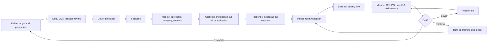

## Part 0 — Where Volume 2 left the lender

Volume 1 framed the problem and built a logistic scorecard. Volume 2 bought new data, tried every classical model family, and chose. This volume asks two last questions: **what do neural networks add**, and **what happens to a model once it is live** — when next year's borrowers are not this year's.

### What Volume 2 handed on

| Figure | Value | Recall hint |
|---|---:|---|
| Features | Volume 1's eight plus card utilisation and NACH bounces | *"high utilisation is alarming only at high FOIR, Volume 2, Part 0"* |
| Champion | Logistic regression with two interaction features, Platt-calibrated | *"the trees did the discovering; the scorecard does the deciding, Volume 2, Part 9"* |
| Champion test AUC | 0.808 | *"ties tuned boosting, Volume 2, Part 12"* |
| Champion cut-off and profit, test quarter | PD 12.0%; ₹1,316.5 lakh | *"new data was worth ₹150 lakh a quarter, Volume 2, Part 12"* |
| Challenger | Monotone gradient boosting | *"never up with bureau score, Volume 2, Part 9"* |
| Economics | 10% margin; 55.25% loss on a bad loan | *"break-even PD 15.33%, Volume 1, Part 10"* |

Every snippet in Parts 1 to 6 assumes Volume 2's setup code — `train2`, `val2`, `test2`, `X2tr` and the rest. Parts 7 to 9 add a 2025 cohort, generated in Part 8.

### How this volume is built

| Part | Question | Produces |
|---|---|---|
| **1** | What is a neuron, and why is one not enough? | Logistic regression as one neuron; an interaction it cannot fit |
| **2** | How does a network compute and learn? | A forward and backward pass by hand for one applicant |
| **3** | Can a network be trained on the loan book from scratch? | A 193-parameter network in NumPy, trained with Adam |
| **4** | What makes training work, or fail? | Initialisation, learning rate, scaling, regularisation |
| **5** | What are embeddings, and where does deep learning really win? | High-cardinality categories, sequences, the bridge to transformers |
| **6** | Does the network beat the scorecard? | Profit with its uncertainty; a decision |
| **7** | How does a model go live? | Batch and real-time scoring, latency, training–serving skew |
| **8** | How do you know it still works, when outcomes take a year? | PSI, CSI and an early-warning indicator on a 2025 cohort |
| **9** | What do you do when it drifts? | Recalibrate, refit, or move the cut-off — and what each is for |
| **10** | Who checks the model, and against what? | Model risk management and validation |
| **11** | What about learning by acting? | A bandit that learns the best collections action |
| **12** | What does the whole lifecycle look like? | The series' decision log, end to end |
| **13** | What is true today, and will change? | Libraries and regulation, refreshed |

---

## Part 1 — A neuron, and why one is not enough

### Logistic regression is one neuron

An artificial **neuron** takes inputs, multiplies each by a **weight**, adds a **bias**, and passes the total through an **activation function**:

$$
\text{output} = g\!\left(\sum_{j} w_j x_j + b\right)
$$

where:

- **xⱼ** — the inputs, such as bureau score and FOIR
- **wⱼ, b** — the weights and bias, learned
- **g** — the activation function

With the sigmoid as g, this is exactly Volume 1, Part 6's logistic regression: the weighted sum is the log-odds, and the sigmoid turns it into a probability. So the champion is already a neural network — of one neuron. Everything in this volume's first half is what happens when neurons are stacked.

### The shape one neuron cannot draw

A single neuron's log-odds are a **sum** of separate effects. Take Volume 2's two-by-two table of utilisation and FOIR, and convert each cell's default rate to log-odds:

| | FOIR ≤ 0.45 | FOIR > 0.45 |
|---|---:|---:|
| **Utilisation ≤ 0.5** | 4.08% → −3.157 | 3.89% → −3.207 |
| **Utilisation 0.5–0.8** | 6.27% → −2.705 | **23.86% → −1.160** |

If the effects simply added, the high–high cell would be the low–low cell plus each effect on its own:

$$
\text{logit}_{HH} = \text{logit}_{HL} + \text{logit}_{LH} - \text{logit}_{LL} = -2.705 - 3.207 + 3.157 = -2.754
$$

where:

- **HL** — high utilisation, low FOIR; **LH** — low utilisation, high FOIR; **LL** — both low

That is a PD of 6.0%. The actual rate is 23.9%. The gap, **1.594 in log-odds**, is the interaction — the part of the risk that exists only when both are high. A single neuron cannot produce it from utilisation and FOIR alone. Volume 2 fixed this by hand, writing `util_x_high_foir` as an extra input. A network fixes it by learning an extra neuron.

**Decision, Part 1:** read the champion as a one-neuron network; the case for more neurons is interactions nobody has written down yet.

---

## Part 2 — A network, by hand

### Stacking neurons

A **multilayer perceptron (MLP)** feeds the inputs into a **hidden layer** of neurons, and feeds their outputs into a final neuron. The hidden layer uses a simpler activation, the **rectified linear unit (ReLU)**:

$$
\text{ReLU}(a) = \max(0, a)
$$

where:

- **a** — a neuron's weighted sum

ReLU passes positive values through and blocks negative ones. That on–off behaviour is what lets a hidden neuron become a detector for a region of the inputs.

### A forward pass

A tiny network: two inputs (utilisation u and FOIR f), two hidden ReLU neurons, one sigmoid output. Weights chosen by hand for illustration:

| Neuron | Weighted sum |
|---|---|
| Hidden 1 | a₁ = 2.0u + 3.0f − 2.5 |
| Hidden 2 | a₂ = −1.0u + 1.0f + 0.2 |
| Output | z = 1.5h₁ − 1.0h₂ − 3.0, with hⱼ = ReLU(aⱼ) and p = σ(z) |

Hidden neuron 1 is positive only when **both** inputs are high. Check it on four applicants:

| u | f | a₁ | h₁ | h₂ | PD |
|---:|---:|---:|---:|---:|---:|
| 0.20 | 0.30 | −1.20 | 0 | 0.30 | 3.6% |
| 0.72 | 0.30 | −0.16 | 0 | 0 | 4.7% |
| 0.20 | 0.55 | −0.45 | 0 | 0.55 | 2.8% |
| **0.72** | **0.55** | **+0.59** | **0.59** | 0.03 | **10.5%** |

The first hidden neuron is an **AND detector** — it switches on only in the high–high corner. That is the interaction, learned as a neuron rather than written as a feature.

The high–high applicant in full, u = 0.72, f = 0.55:

| Step | Working | Value |
|---|---|---:|
| a₁ | 2.0 × 0.72 + 3.0 × 0.55 − 2.5 | 0.59 |
| a₂ | −0.72 + 0.55 + 0.2 | 0.03 |
| h₁, h₂ | ReLU | 0.59, 0.03 |
| z | 1.5 × 0.59 − 1.0 × 0.03 − 3.0 | −2.145 |
| p | σ(−2.145) | **0.1048** |

This applicant defaulted, y = 1. The log loss is −ln 0.1048 = **2.256** — a confident miss.

### Backpropagation

To learn, every weight needs its gradient: how much the loss changes if that weight moves. **Backpropagation** computes all of them in one backward sweep, using the **chain rule** — the gradient of a composition is the product of the gradients along the path.

It starts where Volume 1, Part 6 ended: for a sigmoid output with log loss, the gradient with respect to z is simply prediction minus outcome.

$$
\frac{\partial L}{\partial z} = p - y
$$

where:

- **L** — the log loss for this applicant
- **p − y** — 0.1048 − 1 = −0.8952

Then backwards, one layer at a time:

| Gradient | Rule | Value |
|---|---|---:|
| ∂L/∂z | p − y | −0.8952 |
| ∂L/∂w₂ for h₁, h₂ | ∂L/∂z × hⱼ | −0.5282, −0.0269 |
| ∂L/∂b₂ | ∂L/∂z | −0.8952 |
| ∂L/∂h₁, ∂L/∂h₂ | ∂L/∂z × w₂ⱼ | −1.3428, +0.8952 |
| ∂L/∂a₁, ∂L/∂a₂ | ∂L/∂hⱼ × (1 if aⱼ > 0 else 0) — ReLU passes the gradient only where it was on | −1.3428, +0.8952 |
| ∂L/∂(weights of hidden 1) for u, f | ∂L/∂a₁ × u, × f | −0.9668, −0.7385 |
| ∂L/∂(weights of hidden 2) for u, f | ∂L/∂a₂ × u, × f | +0.6445, +0.4924 |

Every weight then takes one gradient-descent step, learning rate 0.5 — each moves by −0.5 × its gradient:

| | Before | After one step |
|---|---:|---:|
| Hidden 1 weights and bias | 2.0, 3.0, −2.5 | 2.483, 3.369, −1.829 |
| Hidden 2 weights and bias | −1.0, 1.0, 0.2 | −1.322, 0.754, −0.248 |
| Output weights and bias | 1.5, −1.0, −3.0 | 1.764, −0.987, −2.552 |
| **PD for this applicant** | **10.5%** | **65.6%** |
| **Log loss** | **2.256** | **0.422** |

One step on one defaulter made the AND detector stronger — its weights on both inputs rose, its bias fell less negative — and switched off hidden neuron 2 for this applicant. Training is this, repeated over tens of thousands of loans in small batches, so no single loan pulls too hard.

```python
x, y = np.array([0.72, 0.55]), 1.0
W1, b1 = np.array([[2.0, 3.0], [-1.0, 1.0]]), np.array([-2.5, 0.2])
W2, b2 = np.array([1.5, -1.0]), -3.0

a = W1 @ x + b1; h = np.maximum(a, 0); z = W2 @ h + b2; p = 1 / (1 + np.exp(-z))   # forward
dz = p - y                                                                           # backward
dW2, db2 = dz * h, dz
da = dz * W2 * (a > 0)
dW1, db1 = np.outer(da, x), da
```

**Decision, Part 2:** a hidden layer learns interactions as detectors; backpropagation is the chain rule applied in reverse, and it is the only new idea a neural network needs beyond Volume 1's gradient descent.

---

## Part 3 — A network on the loan book

### The network

Eleven standardised inputs — Volume 2's nine features, with the no-score flag and tier 3 as separate columns, and **no hand-written interactions** — into sixteen ReLU neurons, into one sigmoid output.

| Layer | Shape | Parameters |
|---|---|---:|
| Input → hidden | 11 × 16 weights + 16 biases | 192 |
| Hidden → output | 16 weights + 1 bias | 17 |
| **Total** | | **193** |

Set against 37,516 training loans, 193 parameters is small. The output bias starts at the training log-odds, −2.954, so the network begins by predicting the base rate rather than 50%.

### Adam: gradient descent with memory

Plain gradient descent uses one learning rate for every weight. **Adam** — adaptive moment estimation — keeps, for each weight, a running average of its recent gradients (the **momentum**, which smooths noisy steps) and of their squares (which scales each weight's step by how large its gradients usually are). Weights with small, consistent gradients take relatively larger steps. It is the default optimiser for neural networks.

$$
m \leftarrow \beta_1 m + (1 - \beta_1) g \qquad v \leftarrow \beta_2 v + (1 - \beta_2) g^2 \qquad w \leftarrow w - \eta \frac{\hat{m}}{\sqrt{\hat{v}} + \epsilon}
$$

where:

- **g** — the current gradient of one weight
- **m, v** — running averages of the gradient and the squared gradient
- **β₁, β₂** — 0.9 and 0.999, how much history each keeps
- **m̂, v̂** — the averages corrected for starting at zero
- **η** — the learning rate, 0.001; **ε** — a tiny constant, 10⁻⁸, that prevents division by zero

### Trained from scratch

```python
def train_mlp(X, y, hidden=16, epochs=40, lr=1e-3, batch=256, l2=1e-4, seed=0):
    rng = np.random.default_rng(seed)
    W1 = rng.normal(0, np.sqrt(2 / X.shape[1]), (X.shape[1], hidden)); b1 = np.zeros(hidden)
    W2 = rng.normal(0, np.sqrt(1 / hidden), (hidden, 1)); b2 = np.array([np.log(y.mean() / (1 - y.mean()))])
    params = [W1, b1, W2, b2]
    m = [np.zeros_like(p) for p in params]; v = [np.zeros_like(p) for p in params]; t = 0
    for epoch in range(epochs):
        order = rng.permutation(len(y))
        for s in range(0, len(y), batch):
            j = order[s:s + batch]; x, yy = X[j], y[j]
            pre = x @ W1 + b1; h = np.maximum(pre, 0)                    # forward
            out = 1 / (1 + np.exp(-(h @ W2 + b2))).ravel()
            g_z = ((out - yy) / len(j)).reshape(-1, 1)                    # backward
            grads = [x.T @ ((g_z @ W2.T) * (pre > 0)) + l2 * W1, ((g_z @ W2.T) * (pre > 0)).sum(0),
                     h.T @ g_z + l2 * W2, g_z.sum(0)]
            t += 1
            for k, (p, g) in enumerate(zip(params, grads)):             # Adam
                m[k] = 0.9 * m[k] + 0.1 * g; v[k] = 0.999 * v[k] + 0.001 * g * g
                p -= lr * (m[k] / (1 - 0.9 ** t)) / (np.sqrt(v[k] / (1 - 0.999 ** t)) + 1e-8)
    return params
```

An **epoch** is one pass through all training loans; with batches of 256, that is 147 weight updates.

| Epoch | Training log loss | Training AUC | Validation AUC |
|---:|---:|---:|---:|
| 1 | 0.1810 | 0.731 | 0.724 |
| 5 | 0.1696 | 0.775 | 0.769 |
| 10 | 0.1677 | 0.783 | 0.781 |
| 20 | 0.1660 | 0.789 | 0.788 |
| 40 | 0.1650 | 0.793 | **0.791** |

| Model | Validation AUC | Test AUC |
|---|---:|---:|
| Logistic, same eleven inputs, no interactions | 0.762 | 0.789 |
| Logistic + two hand-written interactions — the champion | 0.784 | 0.808 |
| Tuned gradient boosting | 0.781 | 0.808 |
| **Network, 16 hidden neurons, from scratch** | **0.791** | **0.815** |

**The network, given no interactions, found them and more** — a smooth surface rather than boosting's steps or the scorecard's two hand-chosen terms. Whether 0.007 of AUC is worth anything is Part 6's question.

The library version, with early stopping deciding the epochs:

```python
from sklearn.neural_network import MLPClassifier
mlp = MLPClassifier(hidden_layer_sizes=(16,), alpha=1e-3, early_stopping=True,
                    validation_fraction=0.15, n_iter_no_change=10, random_state=0).fit(Z_train, ytr)
```

| scikit-learn `MLPClassifier` | Epochs used | Validation AUC | Test AUC |
|---|---:|---:|---:|
| One hidden layer of 16 | 33 | 0.787 | 0.807 |
| Two hidden layers, 64 and 32 | 23 | 0.787 | 0.811 |

A deeper network adds nothing measurable: eleven inputs and one main interaction do not need depth.

**Decision, Part 3:** a small network is competitive on this tabular book, and slightly ahead on AUC. It goes to Part 6 as a second challenger.

---

## Part 4 — Making training work

Networks fail to train in ways linear models never do. Each row below was run on the same data with one thing changed.

| Change | Result after 10 epochs | Why |
|---|---|---|
| Baseline — He initialisation, learning rate 0.001, standardised inputs | Validation AUC 0.781 | |
| **All weights start at zero** | **AUC 0.500 — nothing learned** | Every hidden neuron computes the same thing and receives the same gradient; they stay identical forever. Random initialisation **breaks the symmetry** |
| Weights start with a standard deviation of 3 — about seven times He's | AUC 0.708 | Large pre-activations; many ReLUs stuck on one side; slow, noisy learning |
| Learning rate 0.1 | AUC 0.768, loss jumping between epochs | Steps overshoot the valley; progress stalls |
| **Unstandardised inputs** | **AUC 0.736** | Bureau score in the hundreds dominates every weighted sum — Volume 1, Part 7's lesson, harsher |

**He initialisation** draws each weight from a normal distribution with variance 2 ÷ (number of inputs to the neuron), which keeps the size of the signal roughly constant from layer to layer when ReLU halves it.

### Overfitting, and the defences

A network with 256 hidden neurons and no penalty, trained for 60 epochs:

| Epoch | Training AUC | Validation AUC |
|---:|---:|---:|
| 10 | 0.794 | 0.786 |
| 30 | 0.808 | 0.785 |
| 60 | **0.826** | **0.785** |

Training keeps improving; validation has stopped. The model is now fitting noise — Volume 1, Part 8's variance, in a model with about 3,300 parameters.

| Defence | How | Recall |
|---|---|---|
| **Weight decay** — L2 | Add λΣw² to the loss; the `l2` term above | Volume 1, Part 8's ridge |
| **Early stopping** | Stop when validation loss stops improving | Volume 2, Part 4's boosting |
| **Dropout** | During training, switch off each hidden neuron at random, say half the time, so no neuron can rely on another; at prediction, use all neurons | Like a random forest's hidden features — a built-in ensemble |
| **Batch normalisation** | Standardise each layer's inputs within every batch | Stabilises deeper networks; allows higher learning rates |
| **Smaller network** | Fewer neurons | The 16-neuron network above does not overfit |

### Frameworks

NumPy is for understanding. Real networks are written in **PyTorch**, **TensorFlow/Keras** or **JAX**, which compute every gradient automatically — **automatic differentiation** — and run on GPUs. The whole of Part 3 in PyTorch is shown below for comparison; it was not run for this volume, so no figure depends on it.

```python
import torch, torch.nn as nn
net = nn.Sequential(nn.Linear(11, 16), nn.ReLU(), nn.Linear(16, 1))
opt = torch.optim.Adam(net.parameters(), lr=1e-3, weight_decay=1e-4)
loss_fn = nn.BCEWithLogitsLoss()
for epoch in range(40):
    for xb, yb in loader:                          # mini-batches of 256
        opt.zero_grad()
        loss = loss_fn(net(xb).squeeze(1), yb)
        loss.backward()                            # backpropagation, automatic
        opt.step()
```

**Decision, Part 4:** He initialisation, standardised inputs, Adam at 0.001, weight decay and early stopping as standard; a small network before a large one.

---

## Part 5 — Embeddings, sequences, and where deep learning really wins

On eleven hand-made features, a network edged out a scorecard by 0.007 of AUC. That is not where neural networks earn their reputation. They win when the inputs are **raw and high-dimensional**: many categories, long sequences, text, images.

### Embeddings: a category becomes a vector

Suppose the lender wanted to use the applicant's **pin code** — about 19,000 values in India — or their employer, one of hundreds of thousands. One-hot encoding, from Volume 1, Part 7, creates one column per value.

| Encoding of 19,000 pin codes into a 16-neuron network | Parameters in the first layer for this feature |
|---|---:|
| One-hot: 19,000 columns × 16 neurons | 304,000 |
| **Embedding of 8 numbers per pin code**, then 8 × 16 | 19,000 × 8 + 8 × 16 = **152,128** |

An **embedding** gives each category a short learned vector — here 8 numbers — looked up from a table and trained with the rest of the network. Pin codes whose borrowers behave alike end up with nearby vectors, so a pin code with few loans borrows strength from similar ones. It is exactly the embedding table of the AI Stack series (*"a token becomes a row of 8,192 learned numbers, AI Stack Volume 1, Part 1"*), with pin codes instead of word fragments. Most of those 19,000 × 8 numbers are learned from very few loans each, so embeddings need heavy regularisation — and a pin code can proxy for community or caste, which puts it under Volume 2, Part 10's fairness review before any use.

### Sequences: the bank statement itself

Volume 2's `nach_bounces_12m` is one number summarising a year of bank transactions. The statement behind it has hundreds of rows: salary credits, EMI debits, card payments, cash withdrawals, each with a date and an amount. Summaries throw away order and timing — *three bounces all in the last month* is not *three spread across the year*.

| Model family | Reads | Good at |
|---|---|---|
| Hand-made features + scorecard or boosting | A few dozen summaries | Tabular data; explainability |
| **Recurrent networks** | The sequence, one step at a time, carrying a memory | Order and timing; now largely superseded |
| **Transformers** | The whole sequence at once, each transaction **attending** to the others | Long sequences, patterns across distant events |

**Attention** — each position taking a weighted average of the others, weighted by learned relevance — is the mechanism derived by hand in the AI Stack series (*"weights 0.401, 0.198, 0.401, AI Stack Volume 1, Part 2"*). A transaction-sequence model applies it to transactions instead of words.

### Where each family wins

| Data | Usually wins | Why |
|---|---|---|
| Tabular, tens of features, tens of thousands of rows | **Gradient boosting or a scorecard with good features** | Trees handle mixed scales and thresholds natively; networks need more data for the same result |
| Tabular with high-cardinality categories | Boosting with target encoding, or a network with embeddings | Either can work; test both |
| Sequences — transactions, repayments, clickstreams | Networks, increasingly transformers | Order and timing matter |
| Text, images, audio | Networks, almost always | No hand-made features compete |

**Decision, Part 5:** for this lender's tabular book, networks are a challenger, not the default. The place they would change the answer is raw bank-statement sequences — a project with its own data, validation and fairness review.

---

## Part 6 — Does the network beat the scorecard?

Same method as Volume 2, Part 12: Platt-calibrate on validation, choose the profit-maximising cut-off on validation, score the test quarter once, bootstrap the difference.

| Model | Validation AUC | Test AUC | Test Brier | Cut-off PD | Approved | Bad rate approved | **Test profit, ₹ lakh** |
|---|---:|---:|---:|---:|---:|---:|---:|
| Champion — logistic + two interactions | 0.784 | 0.808 | 0.0451 | 12.0% | 91.2% | 3.40% | **1,316.5** |
| Network, 16 neurons | **0.791** | **0.815** | **0.0449** | 13.2% | 92.4% | 3.57% | 1,304.9 |

| Comparison, 1,000 bootstrap resamples of the test quarter | Mean | Standard deviation | 95% interval | Resamples favouring the network |
|---|---:|---:|---|---:|
| Network minus champion | −₹11.9 lakh | 10.3 | −33.9 to +7.3 | 12.3% |

**Higher AUC, better Brier score, and slightly less profit — with an interval that straddles zero.** The two models are indistinguishable on money. The same thing happened between boosting and the scorecard in Volume 2: an average ranking gain spread across the whole book says little about the few hundred loans near the cut-off, where the profit is decided.

### What else the decision weighs

| Criterion | Scorecard | Network |
|---|---|---|
| Profit on test | ₹1,316.5 lakh | ₹1,304.9 lakh — not significantly different |
| Explaining a decline | Each coefficient × each input — exact reason codes | SHAP, approximate, needs tooling |
| Monotone in bureau score, utilisation | Guaranteed by the signs | Held on the applicant's sweeps — bureau 640 → 880 gives PD 77.9% → 14.1%, utilisation 0.1 → 1.0 gives 8.0% → 85.4% — but not guaranteed |
| Validation effort | Low: a formula on a page | Higher: architecture, training, seeds, sensitivity |
| Retraining | Seconds, deterministic | Minutes; results vary by random seed |

**Decision, Part 6:** the scorecard stays champion. The network joins monotone boosting as a challenger scored in the shadows. If either beats the champion on profit for two consecutive matured quarters, it is promoted — and a network would first need monotone constraints or a documented monotonicity test across the input range.

---

## Part 7 — Going live

A model in a notebook predicts; a model in production decides, thousands of times a day, on data it has never seen, inside a system with its own failure modes.

### Batch or real time

| Mode | When | For this lender |
|---|---|---|
| **Batch scoring** | Predictions for many cases at once, on a schedule | Pre-approved offers to existing customers; monthly portfolio re-scoring for provisioning |
| **Real-time scoring** | One case, on request, within a latency budget | A live application on the app or at a branch |

Measured on this machine, scoring through each model's full preprocessing path:

| Model | One application | Whole test quarter, 6,154 loans |
|---|---:|---:|
| Champion scorecard | 4.5 ms | 5.9 ms |
| Monotone boosting | 5.2 ms | 172 ms |
| Network | 2.7 ms | 4.7 ms |
| The scorecard's arithmetic alone — twelve multiplications and a sigmoid | 0.0012 ms | |

Every model is fast enough. **The milliseconds are in the plumbing** — building a data frame, preprocessing — not in the model: the scorecard's own arithmetic takes about a microsecond. In a real system the budget goes on fetching the bureau report and the bank-statement analysis, which take seconds. Optimise the data calls, not the model.

### Training–serving skew

The most common production failure is not a bad model but **different features**: the value computed at serving time is not the value the model was trained on.

| How skew happens | Example here | Prevented by |
|---|---|---|
| Two implementations of one feature | FOIR in training includes the new EMI; the application service's FOIR does not | One feature definition, used by both — a **feature store** or a shared library |
| Different data timing | Training used the bureau pull at disbursal; production uses the pull at application, a week earlier | Log the exact inputs scored; train on logged inputs |
| Defaults and missing handling | Production sends 0 for a missing bureau score; training used a missing flag | The fitted pipeline object, from Volume 1, Part 11, travels as one unit |
| Silent upstream change | The bank-statement vendor starts counting NACH retries as bounces | Monitor each input's distribution — Part 8's CSI |

### Packaging and release

| Step | What | Recall |
|---|---|---|
| Serialise the whole pipeline | Preprocessing, model and calibration as one versioned object | Volume 1, Part 11 |
| Record the five pins | Data, seeds, code, library versions, fitted object | Volume 1, Part 11 |
| Wrap in a service | An endpoint that takes an application and returns PD, score, decision and reason codes | — |
| **Shadow** | Score live applications without acting on them; compare with the current model | The challengers in Part 6 run this way permanently |
| **Canary** | Let the new model decide a small share of applications, monitored | AI Stack Volume 2, Part 7's release stages, the same discipline |
| **Kill switch** | One configuration change back to the previous model or to policy rules | Part 10 |

```python
import joblib
from fastapi import FastAPI

app = FastAPI()
model = joblib.load("pd_champion_v2.joblib")           # pipeline + calibration, pinned

@app.post("/score")
def score(application: dict):
    pd_ = float(model.predict_proba(to_frame(application))[:, 1][0])
    return {"pd": pd_, "decision": "approve" if pd_ < 0.12 else "decline",
            "model_version": "pd_champion_v2", "reasons": reason_codes(application)}
```

Illustrative; `to_frame` and `reason_codes` stand for the lender's own feature assembly and Volume 2, Part 9's reason-code logic.

**Decision, Part 7:** real-time scoring through the pinned pipeline object; every scored input and output logged; challengers in shadow; a tested kill switch.

---

## Part 8 — Monitoring, when outcomes take a year

### The problem of the delayed label

A default is only known twelve months after disbursal. A model live from January 2025 has **no outcome for its first applicants until January 2026**. If the world changed in January 2025, waiting for defaults means a year of lending on a wrong model. Monitoring must therefore watch things that move sooner.

| What to watch | Available after | Tells you |
|---|---|---|
| **Input distributions** — CSI per feature | Immediately | The applicants have changed |
| **Score distribution** — PSI | Immediately | The model's view of risk has changed |
| **Early-warning outcomes** — e.g. 30+ days past due at month 3 | Three months | Repayment behaviour has changed |
| **Actual default rate and calibration** | Twelve months | The model is right or wrong |
| **Ranking** — AUC, Gini | Twelve months | Whether it still separates good from bad |

### A 2025 cohort

To have something to monitor, generate the lender's 2025 applications: the **same true risk model** as Volume 1, with the population shifted and conditions worse. The lender widened its reach to more new-to-credit borrowers; enquiry activity rose across the market; and a mild macro shock raised risk for everyone.

| Change for 2025 | Before | 2025 |
|---|---:|---:|
| Share with no bureau score | 8% of applications | 12% |
| Mean bureau score of applicants | 730 | 720 |
| Mean enquiries in 6 months | 1.2 | 1.5 |
| Macro shock to every applicant's log-odds | 0 | +0.10 |

Optional reading — the 2025 generator, a copy of Volume 1's with four parameters:

```python
import numpy as np, pandas as pd
from loanbook import _approved

def make_2025_book(n=12_000, seed=2025, bureau_mean=720, ntc_share=0.12, enquiry_rate=1.5, shock=0.10):
    return _approved(_applications_2025(int(n * 1.7), seed, bureau_mean, ntc_share, enquiry_rate, shock), n)

def _applications_2025(n, seed, bureau_mean, ntc_share, enquiry_rate, shock):
    """The 2025 applications: same true risk model, shifted population, a macro shock."""
    rng = np.random.default_rng(seed)
    month = rng.integers(24, 36, n)                                  # Jan-Dec 2025
    app_date = pd.to_datetime("2025-01-01") + pd.to_timedelta((month - 24) * 30.4 + rng.integers(0, 28, n), unit="D")
    age = rng.integers(21, 61, n)
    employment = np.where(rng.random(n) < 0.72, "salaried", "self_employed")
    city_tier = rng.choice([1, 2, 3], n, p=[0.45, 0.35, 0.20])
    income = np.round(np.exp(rng.normal(np.log(45_000), 0.55, n)) * np.where(city_tier == 1, 1.2, 1.0), -2)
    bureau = np.clip(rng.normal(bureau_mean, 60, n), 300, 900).round()
    ntc = rng.random(n) < ntc_share                                       # new to credit: no bureau score
    bureau = np.where(ntc, np.nan, bureau)
    enquiries = rng.poisson(enquiry_rate, n)
    existing_emi = np.round(income * rng.beta(2, 10, n), -2)
    loan_amount = np.clip(np.round(income * rng.uniform(2, 9, n), -3), 50_000, 1_000_000)
    tenure = rng.choice([12, 24, 36, 48, 60], n, p=[0.1, 0.25, 0.35, 0.2, 0.1])
    score_for_price = np.where(ntc, 700, bureau)
    rate = np.clip(np.round(22 - (score_for_price - 650) * 0.04 + rng.normal(0, 1, n), 1), 11, 24)
    r = rate / 1200
    emi = np.round(loan_amount * r * (1 + r) ** tenure / ((1 + r) ** tenure - 1), 0)
    foir = (existing_emi + emi) / income
    months_employer = rng.integers(1, 180, n)

    z = (-3.55
         - 0.012 * (np.where(ntc, 700, bureau) - 730)
         + 0.55 * ntc
         + 2.2 * np.maximum(foir - 0.35, 0) + 3.5 * np.maximum(foir - 0.60, 0)
         + 0.28 * enquiries
         + 0.35 * (employment == "self_employed")
         + 0.15 * (city_tier == 3)
         - 0.004 * months_employer
         - 0.010 * (age - 35)
         + 0.012 * month + shock)                                              # later cohorts slightly riskier
    p = 1 / (1 + np.exp(-z))
    default = (rng.random(n) < p).astype(int)
    # a post-disbursal field that should never be a feature
    dpd_m3 = np.where(default == 1, rng.choice([0, 30, 60], n, p=[0.35, 0.40, 0.25]),
                      rng.choice([0, 30], n, p=[0.97, 0.03]))
    return pd.DataFrame({
        "loan_id": np.arange(1, n + 1), "application_date": app_date.normalize(),
        "age": age, "employment_type": employment, "city_tier": city_tier,
        "monthly_income": income, "bureau_score": bureau, "enquiries_6m": enquiries,
        "existing_emi": existing_emi, "loan_amount": loan_amount, "tenure_months": tenure,
        "interest_rate": rate, "emi": emi, "months_at_employer": months_employer,
        "dpd_month_3": dpd_m3, "default_12m": default})
```

```python
from drift import make_2025_book
from statements import add_statement_features
b25 = add_statement_features(make_2025_book(), seed=11)
b25["foir"] = (b25.existing_emi + b25.emi) / b25.monthly_income
```

12,000 approved loans across 2025. Their outcomes — known now only because the data is synthetic — average **8.5%**, against 5.44% in the last quarter of 2024. As at September 2026, only loans disbursed in the first half of 2025 have completed their twelve months.

### Population stability index

The **population stability index (PSI)** compares how a population is spread across bins with how a reference population was spread:

$$
\text{PSI} = \sum_{\text{bins}} (a_i - e_i) \ln\!\left(\frac{a_i}{e_i}\right)
$$

where:

- **eᵢ** — the share of the reference population, here the training set, in bin i
- **aᵢ** — the share of the new population in bin i
- **bins** — ten, set at the training set's deciles of predicted PD, so every eᵢ is 10%

| Population | PSI of the champion's PD | Mean predicted PD |
|---|---:|---:|
| Validation, Q3 2024 | 0.001 | 5.25% |
| Test, Q4 2024 | 0.002 | 5.15% |
| Q1 2025 | 0.046 | 6.59% |
| Q2 2025 | 0.042 | 6.43% |
| Q3 2025 | 0.060 | 6.61% |
| Q4 2025 | 0.044 | 6.31% |

In Q1 2025, the lowest-risk decile holds 6.9% of applicants instead of 10%, and the highest holds 15.0%. The conventional reading — below 0.1 stable, 0.1 to 0.25 worth investigating, above 0.25 a significant shift — calls every 2025 quarter **stable**. It is a convention, and here it is too relaxed: the mean PD has risen by a quarter. **Watch the trend and the mean, not only the threshold.**

The **characteristic stability index (CSI)** is the same formula applied to one input feature, and it says *which* inputs moved:

| Feature, Q1 2025 against training | CSI |
|---|---:|
| Enquiries in 6 months | **0.079** |
| Bureau score, including a no-score bin | **0.049** |
| FOIR | 0.002 |
| Card utilisation | 0.001 |
| NACH bounces | 0.000 |

The drift is in the bureau data: more new-to-credit applicants (13.7% against 8.3%) and more credit-hungry ones. Affordability and the bank-statement features have not moved.

### The early-warning indicator

The share of loans 30 or more days past due at month 3 — `dpd_month_3`, the column Volume 1, Part 3 banned as a *feature* because it is known too late — is exactly right as a *monitor*, because it is known in three months.

| Cohort | 30+ DPD at month 3 | Twelve-month default rate |
|---|---:|---:|
| Training, 2023 – mid-2024 | 6.1% | 4.96% |
| Q3 2024 | 6.5% | 5.24% |
| Q4 2024 | 6.4% | 5.44% |
| **Q1 2025** | **8.6%** | **8.35%** |
| Q2 2025 | 7.5% | 7.94% |
| Q3 2025 | 8.8% | 9.24% |
| Q4 2025 | 8.7% | 8.59% |

**The jump was visible from April 2025** and clear by June — three to six months after the first 2025 loans, and nine months before any of them could default by definition. The same column that would have been leakage as a feature is the monitor's most useful signal. What matters is not the data but when it is used.

### What the defaults eventually said

| First half of 2025, matured | Value |
|---|---:|
| AUC | 0.808 — identical to the 2024 test quarter |
| Mean predicted PD | 6.51% |
| Actual default rate | **8.14%** |

The pattern of Volume 1 again, larger: **ranking held; calibration broke.** The model still puts riskier applicants above safer ones — the true risk model did not change — but it under-states everyone's risk by about a fifth.

**Decision, Part 8:** monitor input CSI and score PSI monthly, the month-3 delinquency rate quarterly, and calibration and AUC as cohorts mature. Alert on trends, not only on conventional thresholds.

---

## Part 9 — When it drifts: recalibrate, refit or move the cut-off

### Three kinds of change

| Kind | What changed | Symptom | Here |
|---|---|---|---|
| **Covariate shift** | Who applies | Input distributions move — CSI | More unscored and credit-hungry applicants |
| **Prior shift** | How common default is overall | Calibration breaks; ranking holds | The macro shock |
| **Concept drift** | How features relate to default | Ranking falls | Not present — the true model is unchanged |

The response depends on the kind. Prior shift is repaired by recalibrating; concept drift needs a new model; covariate shift may need nothing if the model extrapolates well, or refitting if it does not.

### Three responses, tested

Decisions are made using Q1 2025, the first matured quarter, and judged on Q2 2025.

| Response | Cut-off PD, chosen on Q1 | Approved, Q2 | Bad rate approved | **Profit, Q2, ₹ lakh** | Brier |
|---|---:|---:|---:|---:|---:|
| Approve everyone | — | 100% | 7.94% | 428.7 | — |
| **A — change nothing**: Volume 2's calibration, cut-off 12.0% | 12.0% | 87.0% | 5.03% | **536.9** | 0.0632 |
| **B — recalibrate** on Q1 2025 | 18.0% | 88.7% | 5.19% | 535.5 | 0.0628 |
| B, at the theoretical break-even of 15.33% | 15.3% | 86.2% | 5.00% | 534.6 | 0.0628 |
| **C — refit** on all of 2023–24, recalibrate on Q1 2025 | 21.0% | 91.1% | 5.48% | 536.7 | 0.0629 |

**The three responses earn the same, to within ₹2.3 lakh.** That is not a coincidence. When ranking is unchanged, recalibration shifts every PD up together, and the profit-maximising cut-off moves up with them — from 12% on the old scale to 18% on the new. The *same applicants* get declined. For approve-or-decline, recalibrating and moving the cut-off are the same decision written two ways. The spread between the 15.3% and 18.0% cut-offs is noise from choosing on 2,923 loans.

### Where calibration really matters

A lender does not only decide; it also **provisions** — sets aside money for expected losses on the loans it already holds, **PD × LGD × EAD** summed over the book, the quantity behind expected-credit-loss accounting.

| Q2 2025 book, ₹ crore | Value |
|---|---:|
| Expected loss using the old calibration | 3.37 |
| Expected loss after recalibrating on Q1 2025 | 4.26 |
| **Actual loss** | **4.21** |

The uncalibrated model under-provisions by **₹0.84 crore on one quarter's loans — a fifth of the true loss**. Profit from approvals was unchanged; the balance sheet was wrong. **Ranking decides who gets a loan; calibration decides what the lender reports.** Pricing, limits and capital all use the probability itself, so calibration is not optional even when the cut-off hides its failure.

### A retraining policy

| Trigger | Response | Evidence |
|---|---|---|
| PSI or CSI trending up for two months, or early-warning delinquency up by a quarter | Investigate: which inputs, which segments; prepare recalibration | Part 8 |
| Matured calibration off by more than a set margin | **Recalibrate** — Platt on the latest matured cohort; re-derive the cut-off | This Part |
| Matured AUC down materially, or a challenger ahead for two quarters | **Refit** or **promote**, through full validation | Part 10 |
| A new data source, product or policy | **Rebuild**, through full validation | Volume 2, Part 0 |

**Decision, Part 9:** recalibrate the champion on Q1 2025 for provisioning and pricing now; keep the approve-or-decline line at the same applicants, now expressed as PD 15.3% on the recalibrated scale; schedule a refit when two more quarters mature.

---

## Part 10 — Model risk management and validation

A model that decides credit is a source of risk in its own right: it can be wrong, misused, or quietly broken. **Model risk management** is the discipline of controlling that risk; **model validation** is its independent check.

### The regulatory frame

The reference framework internationally is the US Federal Reserve and OCC's supervisory guidance **SR 11-7** (2011), which defines model risk and sets out three pillars: sound development, independent validation, and governance. In India, the Reserve Bank released a **draft Guidance on Regulatory Principles for Model Risk Management** on 24 June 2026 for public comment, covering all models — including third-party and AI/ML models — across its regulated entities, following an August 2024 draft on credit models and the August 2025 **FREE-AI** committee report on responsible AI in finance. Its status and details are in Part 13; the principles below are common to all of them.

| Principle | What it asks | This lender's evidence |
|---|---|---|
| **Inventory and tiering** | Every model listed, and ranked by materiality and complexity | The PD scorecard: high materiality — it decides every loan |
| **Board-approved framework** | Roles, risk appetite and controls set at the top | The decision log and cut-off policy, approved |
| **Conceptual soundness** | The method suits the problem, with assumptions stated | Target definition, population, leakage review — Volume 1, Parts 1 to 3 |
| **Data quality** | Inputs are accurate, complete and appropriate | EDA, missing-value treatment, selection bias — Volume 1, Part 2 |
| **Outcome analysis** | Performance on data not used to build it | Out-of-time test; gains; calibration — Volume 1, Part 9 |
| **Benchmarking** | Compared against alternatives | Champion against boosting and network — Volume 2, Part 12; Part 6 |
| **Sensitivity and stability** | Behaviour under changed inputs | Monotone sweeps; PSI; the 2025 cohort — Parts 6, 8 |
| **Explainability** | Decisions can be explained to customers and supervisors | Coefficients and reason codes — Volume 2, Part 9 |
| **Fairness** | No unjustified disparity across groups | Approval and error rates by group — Volume 2, Part 10 |
| **Ongoing monitoring** | Performance tracked with thresholds and actions | Part 8's monitors; Part 9's triggers |
| **Change control and a kill switch** | Changes validated before use; a fast way back | Pinned pipeline; shadow and canary; fallback to policy rules — Part 7 |
| **Third-party models** | The lender is accountable for vendors' models too | The bank-statement analyser's bounce count — Part 7's skew table |

### What a validator actually does

| Test | How | Finding that would stop release |
|---|---|---|
| Replicate | Rebuild the model from the pinned data and code | Numbers do not reproduce |
| Challenge the target and population | Re-derive the default definition; check exclusions | Fraud or cures mixed into the target |
| Hunt leakage | Every feature's timestamp against the decision point | Any feature known after application |
| Re-test out of time | A later matured cohort the developers did not use | AUC or calibration materially worse |
| Stress | Shift inputs — a recession cohort, a new segment | Nonsensical or unstable outputs |
| Benchmark | An independent challenger | The champion clearly beaten |
| Review use | Is the model used only for what it was validated for? | The scorecard used to set limits it was never tested on |

**Decision, Part 10:** the scorecard is tiered as high materiality, validated independently before each release and annually, and governed by a board-approved framework with a kill switch. Everything in this series is its evidence pack.

---

## Part 11 — Learning by acting: reinforcement learning, briefly

Supervised learning learns from outcomes someone already recorded. **Reinforcement learning** learns by acting: an agent chooses actions, observes rewards, and shifts towards the actions that pay. The simplest form, the **multi-armed bandit**, has no state — just a repeated choice among options whose payoffs are unknown.

### The collections choice

When a borrower reaches 30 days past due, the collections team can send an SMS, make a call, or send a field agent. Each has a cost and an unknown chance of curing the borrower — bringing them back to current, avoiding an average ₹20,000 of loss. In this illustration the true values, unknown to the lender, are:

| Action | Cost | Cure rate | Expected reward per case |
|---|---:|---:|---:|
| SMS | ₹5 | 30% | ₹5,995 |
| Call | ₹40 | 41% | ₹8,160 |
| **Field visit** | ₹400 | 45% | **₹8,600** |

Two ways to learn which is best over 3,000 delinquent borrowers:

| Policy | How | Reward per case | **Regret per case** — against always choosing the best | Share of cases sent to each action |
|---|---|---:|---:|---|
| **Fixed three-way test** | A third to each action, throughout | ₹7,590 | ₹1,010 | 33% / 33% / 33% |
| **ε-greedy bandit** | 90% of the time choose the action with the best reward so far; 10% of the time choose at random | ₹8,316 | **₹284** | 4% / 33% / 63% |

Averaged over 50 simulated runs. The bandit shifts cases towards what works *while* learning, and loses a quarter of what the fixed test loses — **₹21.8 lakh more across 3,000 cases.** The 10% exploration keeps testing the others in case the world changes.

```python
CURE, COST, VALUE = np.array([0.30, 0.41, 0.45]), np.array([5, 40, 400]), 20_000   # CURE unknown to the lender

def bandit(n=3000, eps=0.1, seed=0):
    rng = np.random.default_rng(seed)
    pulls, cures = np.zeros(3), np.zeros(3)
    for t in range(n):
        explore = rng.random() < eps or pulls.min() == 0
        a = rng.integers(3) if explore else np.argmax(cures / np.maximum(pulls, 1) * VALUE - COST)
        cured = rng.random() < CURE[a]
        pulls[a] += 1; cures[a] += cured
    return pulls
```

Full reinforcement learning adds **state** — the borrower's history, days past due, response to earlier contact — and **delayed reward**, since an action today affects repayment for months. Two cautions specific to lending: the policy's actions change the data it learns from, so its history must be logged with the probability each action had; and a collections policy touches customers directly, so it falls under fair-practices rules and the model risk framework of Part 10.

**Decision, Part 11:** run collections actions as a logged bandit rather than a fixed split, within fair-practice limits, and review its allocation monthly.

---

## Part 12 — The lifecycle, end to end



### The series' decision log

| Decision | Choice | Evidence | Where |
|---|---|---|---|
| Target | 90+ DPD or write-off in 12 months | Regulatory threshold | Volume 1, Part 1 |
| Population | Approved applicants inside policy | Selection bias | Volume 1, Part 2 |
| Split | Out of time; test once | Drift 4.96% → 5.44% | Volume 1, Part 3 |
| First champion | Logistic, eight features | Within 0.004 AUC of the oracle | Volume 1, Part 6; Volume 2, Part 0 |
| New data | Card utilisation, NACH bounces | +₹150 lakh a quarter | Volume 2, Parts 0 and 12 |
| Champion | Logistic with two interactions found by trees | Best profit; ties on AUC; explainable | Volume 2, Part 12 |
| Challengers | Monotone boosting; 16-neuron network | Indistinguishable on profit | Volume 2, Part 12; this volume, Part 6 |
| Imbalance | No rebalancing; calibrated PD and profit cut-off | Rebalancing broke probabilities | Volume 2, Part 6 |
| Monitoring | CSI, PSI, month-3 delinquency, matured calibration | Q1 2025 jump visible in April | This volume, Part 8 |
| Drift response | Recalibrate on Q1 2025; hold the decision line | Provisioning off by a fifth otherwise | This volume, Part 9 |
| Governance | High tier; independent validation; kill switch | RBI draft guidance; SR 11-7 | This volume, Part 10 |
| Collections | Logged ε-greedy bandit | Regret ₹284 against ₹1,010 per case | This volume, Part 11 |

**Decision, Part 12:** the model is not the scorecard. It is the whole loop above, and every arrow has an owner.

---

## Reference numbers

| Figure | Value | What it tells you | Part |
|---|---:|---|---|
| Interaction in log-odds, high utilisation × high FOIR | Additive −2.754 (6.0%) against actual −1.160 (23.9%); gap 1.594 | What one neuron cannot fit | 1 |
| Worked forward pass | a₁ 0.59; z −2.145; PD 10.5%; log loss 2.256 | A hidden neuron as AND detector | 2 |
| After one backpropagation step | PD 65.6%; log loss 0.422 | The chain rule, applied | 2 |
| Network size | 11 inputs, 16 hidden, 193 parameters | Small against 37,516 loans | 3 |
| Network from scratch, 40 epochs | Validation 0.791; test 0.815 | Found the interactions unaided | 3 |
| scikit-learn MLP, 16 / 64-32 | Test 0.807 / 0.811 | Depth adds nothing here | 3 |
| Zero initialisation | AUC 0.500 | Symmetry must be broken | 4 |
| Unstandardised inputs | AUC 0.736 | Scale first | 4 |
| 256 neurons, no penalty, 60 epochs | Train 0.826; validation 0.785 | Networks overfit | 4 |
| Pin-code encoding, one-hot vs 8-number embedding | 304,000 vs 152,128 parameters | Embeddings compress categories | 5 |
| Network minus champion, test profit | −₹11.9 lakh ± 10.3 | Higher AUC, same money | 6 |
| Scoring latency, one application | 2.7–5.2 ms; the arithmetic itself 0.0012 ms | The plumbing, not the model | 7 |
| 2025 default rate | 8.5%, against 5.44% in Q4 2024 | A worse year | 8 |
| PSI, Q1 2025 | 0.046 | "Stable" by convention, yet mean PD up a quarter | 8 |
| CSI, enquiries / bureau / FOIR | 0.079 / 0.049 / 0.002 | Which inputs moved | 8 |
| 30+ DPD at month 3, Q4 2024 → Q1 2025 | 6.4% → 8.6% | Visible nine months before defaults | 8 |
| H1 2025 matured | AUC 0.808; predicted 6.51% vs actual 8.14% | Ranking held; calibration broke | 8 |
| Q2 2025 profit — no change / recalibrate / refit | ₹536.9 / 535.5 / 536.7 lakh | Recalibrating and moving the cut-off are one decision | 9 |
| Q2 2025 expected loss — old / recalibrated / actual | ₹3.37 / 4.26 / 4.21 crore | Calibration decides provisions | 9 |
| Bandit regret per case — fixed split / ε-greedy | ₹1,010 / ₹284 | Learn while acting | 11 |

All figures come from the synthetic book of Volume 1, Part 2, extended by Volume 2's and this volume's generators, with the library versions in Part 13. Economics and collections values are illustrative.

---

## Glossary

| Term | Plain meaning | In this volume | Part |
|---|---|---|---|
| **Activation function** | The function a neuron applies to its weighted sum | Sigmoid at the output, ReLU in the hidden layer | 1 |
| **Adam** | Gradient descent with running averages of gradients and squared gradients | Learning rate 0.001 | 3 |
| **Backpropagation** | Computing every weight's gradient backwards through the network by the chain rule | One step: PD 10.5% → 65.6% | 2 |
| **Bandit** | Repeatedly choosing among actions with unknown rewards, learning as you go | Collections actions | 11 |
| **Batch scoring** | Scoring many cases on a schedule | Portfolio re-scoring | 7 |
| **Concept drift** | The relationship between features and outcome changes | Absent here; ranking held | 9 |
| **Covariate shift** | The distribution of inputs changes | More unscored applicants | 9 |
| **CSI** | PSI applied to one input feature | Enquiries 0.079 | 8 |
| **Dropout** | Randomly switching off neurons during training | A built-in ensemble | 4 |
| **Embedding** | A short learned vector for each category | 8 numbers per pin code | 5 |
| **Epoch** | One pass through the training data | 40 | 3 |
| **Expected loss** | PD × LGD × EAD, summed | ₹4.26 crore, recalibrated | 9 |
| **Feature store** | One shared definition and source of every feature | Prevents training–serving skew | 7 |
| **He initialisation** | Random starting weights scaled to the number of inputs | Standard for ReLU | 4 |
| **Kill switch** | A fast, tested way back to the previous model or rules | Required by the governance framework | 7, 10 |
| **Model risk management** | Controlling the risk that models are wrong or misused | RBI draft guidance, 2026 | 10 |
| **Multilayer perceptron** | Neurons in layers, each feeding the next | 11 → 16 → 1 | 2 |
| **Neuron** | Weighted sum plus bias, through an activation | Logistic regression is one | 1 |
| **Prior shift** | The overall rate of the outcome changes | The 2025 shock | 9 |
| **PSI** | Population stability index, measuring a distribution's shift | 0.046 in Q1 2025 | 8 |
| **Regret** | Reward lost against always choosing the best action | ₹284 per case | 11 |
| **ReLU** | max(0, a) | Hidden neurons | 2 |
| **Shadow mode** | Scoring live traffic without acting on it | The challengers | 7 |
| **Training–serving skew** | Features computed differently in production than in training | FOIR with or without the new EMI | 7 |
| **Transformer** | A network that processes a whole sequence with attention | Bank-statement sequences | 5 |

---

## Recall check

1. Why is logistic regression a one-neuron network? Write the neuron's formula and name its activation.
2. From the two-by-two table, derive the additive log-odds for high utilisation and high FOIR, and the 1.594 interaction.
3. Trace the worked forward pass: a₁, a₂, h₁, h₂, z and PD. Why does hidden neuron 1 act as an AND detector?
4. Why is ∂L/∂z = p − y for a sigmoid with log loss? Carry the gradient back to hidden neuron 1's weights.
5. Why does the ReLU pass the gradient only where the neuron was on?
6. Count the network's 193 parameters. Why does the output bias start at −2.954?
7. What do Adam's two running averages do? Why is the bias-correction needed?
8. The network scored 0.815 on test without being given any interaction. How?
9. Zero initialisation scored 0.500. Explain the symmetry problem and how He initialisation fixes it.
10. The 256-neuron network reached 0.826 on training and 0.785 on validation. Name four defences.
11. Compare one-hot and embedding parameter counts for 19,000 pin codes. What fairness risk does a pin code carry?
12. Where do neural networks usually win, and where do boosting and scorecards?
13. The network had higher AUC and Brier score but lower profit. How can both be true, and what does the bootstrap say?
14. List what the lender weighs besides profit when choosing between a scorecard and a network.
15. Scoring took milliseconds but the scorecard's arithmetic took a microsecond. Where does the time go, and what should be optimised?
16. Give four causes of training–serving skew and a prevention for each.
17. Why can a credit model not be monitored on defaults alone? Name what to watch and when each becomes available.
18. Compute PSI's contribution of one bin with expected 10% and actual 15%. Why was "stable" too relaxed a verdict in 2025?
19. `dpd_month_3` was banned as a feature in Volume 1 and used as a monitor here. Why is both right?
20. Distinguish covariate shift, prior shift and concept drift. Which happened in 2025, and how do you know?
21. Recalibrating, refitting and changing nothing earned the same profit on Q2 2025. Why?
22. Then why recalibrate? Derive the under-provision of ₹0.84 crore.
23. State the retraining policy's four triggers and responses.
24. Name the three pillars of SR 11-7 and six principles in RBI's draft guidance, with this lender's evidence for each.
25. What does a validator do that the developers did not? Name three findings that would stop a release.
26. Why did the bandit's regret fall from ₹1,010 to ₹284 per case? What must be logged when a policy chooses its own data?

---

## The compression

A neuron is a weighted sum passed through an activation, and logistic regression is one of them. One neuron's log-odds are a sum of separate effects, so it cannot produce risk that exists only when two things are true together — here, high utilisation at high FOIR, worth 1.594 in log-odds. Put neurons in a hidden layer with a ReLU and one of them can become that detector. Backpropagation finds every weight's gradient by carrying prediction-minus-outcome backwards through the chain rule; gradient descent, with Adam's memory of past gradients, does the rest. Written in NumPy, a 193-parameter network found the interactions unaided and reached 0.815 on test. Networks fail in their own ways — symmetric starts, unscaled inputs, oversized layers — and are kept honest by He initialisation, standardisation, weight decay, dropout and early stopping. They win outright on raw sequences, text and images, through embeddings and attention; on a tabular book they are one challenger among several.

Judged on money, the network matched the scorecard, and the scorecard stayed champion because it explains itself exactly and is always monotone.

Then production. The model goes live as one pinned pipeline object, scored in milliseconds that belong to the plumbing, with challengers in shadow and a kill switch. Its most common failure is not a bad model but different features in training and serving. Because defaults take a year to arrive, it is watched through what moves sooner: the inputs' CSI, the score's PSI, and delinquency at month three — the same column that was leakage as a feature and is the best early warning as a monitor. A harder 2025 showed all three moving by mid-year; when the defaults came, ranking had held and calibration had broken. For approve-or-decline, recalibrating and moving the cut-off turned out to be the same decision; for provisioning, the uncalibrated model understated losses by a fifth. Ranking decides who gets a loan; calibration decides what the lender reports.

Around all of it sits model risk management: an inventory, a tier, a board-approved framework, independent validation that replicates, hunts leakage, re-tests out of time and stresses, and ongoing monitoring with triggers — the principles of SR 11-7 and of RBI's 2026 draft. And where the lender acts rather than predicts, as in collections, a bandit learns the best action while acting, at a quarter of a fixed experiment's regret.

Across three volumes the lesson repeats: define the target exactly, respect time, measure what the business pays for, prefer new information to new algorithms, choose on validation and report once, and keep the whole loop — not just the model — under control.

---

## Part 13 — State of play, as at 19 September 2026

Everything in this Part changes on the scale of months. Parts 1 to 12 do not depend on any row here being current. Every row is **[verify]**, as at 19 September 2026, against the linked source before it is relied on. Rows marked *secondary* come from third-party reporting rather than the regulator.

### Regulation and governance

| Fact | Practical consequence | Source |
|---|---|---|
| The Reserve Bank of India released a draft Guidance on Regulatory Principles for Model Risk Management on 24 June 2026, with comments invited until 24 July 2026. It is a draft for consultation, not a final circular, as at this date. [verify] | Part 10's principles; watch for the final version | taxtmi.com; lexology.com |
| The draft covers all models used by RBI-regulated entities — including third-party and AI/ML models — across 11 categories of entity, and is proportionality-based. [verify] | The scorecard, the challengers and the bank-statement vendor's analytics are all in scope | taxtmi.com; corplawupdates.in |
| Reported elements include a board-approved model risk management framework, risk-based model tiering, independent validation, AI-specific controls including kill switches, and accountability for third-party models. [verify, secondary] | Part 10's table; Part 7's kill switch | corplawupdates.in; snrlaw.in; intellectdesign.com |
| It follows RBI's draft Regulatory Principles for Management of Model Risks in Credit of 5 August 2024 and the FREE-AI committee report of 13 August 2025. [verify] | The lineage of the expectations | lexology.com; taxtmi.com |
| FREE-AI — the Framework for Responsible and Ethical Enablement of AI — sets out seven guiding principles, called Sutras, and 26 recommendations across six pillars. [verify, secondary] | The ethical frame around Part 10's controls | cybersigmacs.com |
| SR 11-7, the US Federal Reserve and OCC supervisory guidance on model risk management, was issued in April 2011. [verify] | The international reference for Part 10 | federalreserve.gov |
| PSI thresholds of 0.1 and 0.25 are an industry convention, not a regulatory rule. [verify] | Part 8: alert on trends too | Credit-scoring practice literature |

### Libraries

| Fact | Practical consequence | Source |
|---|---|---|
| Numbers in this volume were produced with NumPy 2.4.4, pandas 3.0.2 and scikit-learn 1.8.0 on Python 3.12; the NumPy network and the bandit need nothing else. [verify] | Pin these to reproduce every figure | Local environment |
| scikit-learn 1.9 is the latest release. [verify] | Nothing here depends on it | scikit-learn.org — release highlights 1.9 |
| The PyTorch snippet in Part 4 was not run for this volume; PyTorch, TensorFlow/Keras and JAX are the main deep-learning frameworks. [verify] | Treat it as a translation of Part 3, not a source of figures | Framework documentation |
| The FastAPI snippet in Part 7 is illustrative and was not run. | A pattern, not a tested service | — |

### Refreshing this Part

| Each quarter | How | Practical note |
|---|---|---|
| Check RBI's press releases for the final model risk guidance | Compare with Part 10's table | Update the principles table; the mechanics stand |
| Re-run the monitoring on the newest matured cohort | Parts 8 and 9 | The retraining triggers may fire |
| Update the as-at date in this heading | | Keep `verified: false` until an independent check |

### Sources consulted for this Part

| Source | Link | Backs |
|---|---|---|
| Lexology — RBI draft guidance on model risk management | https://www.lexology.com/library/detail.aspx?g=3ca3573e-7f9b-4ba3-9aff-97c7073b20bf | Draft date, lineage |
| TaxTMI — RBI draft guidance | https://www.taxtmi.com/news?id=73521 | Scope, comment process |
| CorpLawUpdates — RBI draft guidance | https://www.corplawupdates.in/updates/rbi-draft-guidance-model-risk-management-2026-ai-ml-banks-nbfcs | Entity categories, reported elements |
| S&R Associates — RBI draft guidance | https://www.snrlaw.in/rbis-draft-guidance-on-regulatory-principles-for-model-risk-management/ | Governance, kill switch, lifecycle |
| Intellect Design — understanding the draft | https://www.intellectdesign.com/resources/blog/understanding-rbis-draft-guidance-on-regulatory-principles-for-model-risk-management/ | Board-approved framework |
| CyberSigma — FREE-AI | https://cybersigmacs.com/knowledge-center/rbi-free-ai/ | Sutras, recommendations, pillars |
| scikit-learn — release highlights 1.9 | https://scikit-learn.org/stable/auto_examples/release_highlights/plot_release_highlights_1_9_0.html | Latest release |
