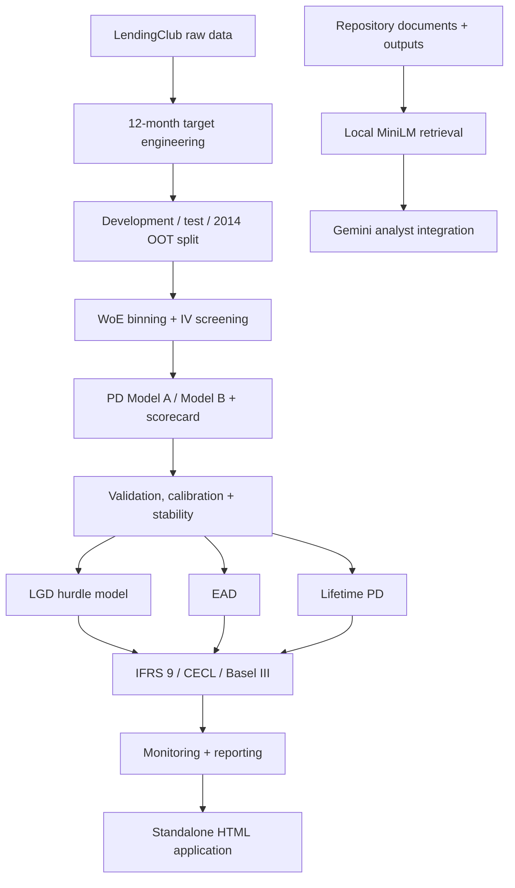
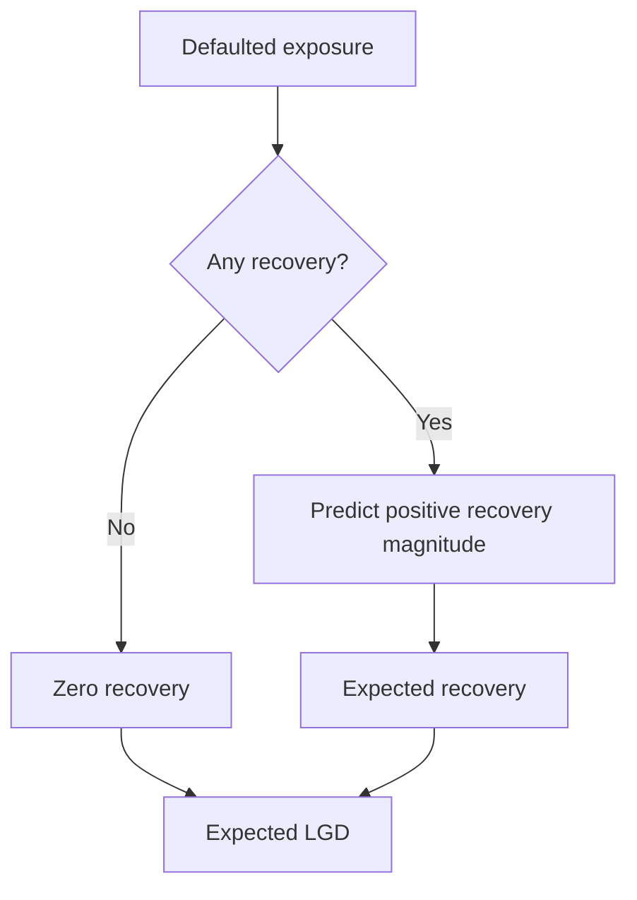
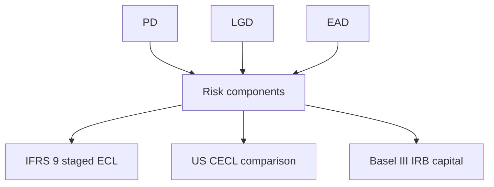

**Lens:** Credit risk is treated as one chain: define default, estimate default probability, estimate loss severity and exposure, validate the estimates, then use them for provision, capital and monitoring.

**A model output is only as real as the data and assumptions behind that specific component.**

The system is a Python retail-credit-risk suite built on 466,285 public LendingClub unsecured term loans from 2007–2014. It creates a 12-month default target, develops two WoE/logistic-regression PD scorecards, estimates LGD with a two-stage hurdle model, derives term-loan EAD, projects lifetime PD, calculates IFRS 9 ECL and a US CECL comparison, computes Basel III IRB capital, monitors model behaviour, generates a standalone HTML risk application, and exposes repository material through a local RAG layer with Gemini integration. The implementation deliberately separates full-data calculations from synthetic demonstrations, test fixtures and cross-sectional proxies.

## 1. The problem was not one model

A PD model answers only one part of a lending problem: the likelihood of default over a defined horizon. The repository is structured around the broader loss chain. Probability of Default determines frequency. Loss Given Default determines severity conditional on default. Exposure At Default determines the balance exposed when default occurs. Expected loss combines the three as `PD × LGD × EAD`.

Those quantities serve different downstream purposes. IFRS 9 uses them for staged expected-credit-loss provisioning; the repository also calculates a US CECL lifetime-provision benchmark. Basel III IRB uses the same risk components inside a supervisory capital function rather than an accounting provision formula. Monitoring then tests population, score and outcome behaviour. Reporting consumes persisted analytical outputs rather than recomputing models in the browser.

## 2. The data determines the boundaries

The raw file contains 466,285 loans and 75 starting attributes. The development cohort uses 2007–2013 vintages; 2014 is held out as the out-of-time cohort. The development sample is stratified into 184,525 training rows and 46,132 test rows, while the 2014 OOT sample contains 235,628 loans. The 12-month default rate is about 3.44%.

Target engineering matters because the raw dataset does not carry a clean default event timestamp. The project infers default timing from available loan-status and payment-date information and applies a three-month DPD lag to construct the 12-month target. Post-origination outcome fields are barred from PD modelling through schema guardrails, preventing fields such as recoveries or received principal from leaking future information into an origination model.

The same dataset creates the largest boundary in the project: it is a cross-sectional loan snapshot rather than a monthly behavioural panel. That is enough for origination PD development, realised recoveries, term-loan EAD, vintage analysis and outcome summaries. It is not enough for true month-to-month delinquency roll-rate matrices or historical account-level score migration. The repository therefore labels those monitoring outputs as proxies rather than presenting them as longitudinal measurements.

## 3. The first decision: transparent scorecard modelling

The PD architecture uses Weight of Evidence binning, Information Value screening and logistic regression. Repository design notes frame this as a scorecard choice: WoE handles non-linear risk relationships through bins, keeps missing-value treatment explicit, and converts attributes into a representation that remains interpretable in a logistic model. Logistic regression then maps those inputs to log-odds, which can be converted directly into scorecard points.

Tree-based methods appear in repository documentation as a contrasting design class around audit transparency. No tracked artefact, script, output or Git diff records an empirical XGBoost, Random Forest, LightGBM or similar PD benchmark. The project therefore records an interpretable scorecard choice, not a measured rejection of tree challengers.

The binning stage is fitted on the training partition rather than the entire dataset. IV is then used to rank predictive strength before the final PD feature sets are assembled. `sub_grade`, `grade` and `int_rate` carry the strongest IV values in the persisted outputs, which becomes the reason for keeping two distinct PD specifications.

## 4. Two PD models instead of one

Model A and Model B were introduced together. Model A isolates borrower fundamentals. Model B adds LendingClub's own risk-pricing outputs. Keeping both makes the incremental information from embedded pricing visible rather than hiding it inside one specification.

| Feature | Model A | Model B |
|---|:---:|:---:|
| `inq_last_6mths` | Yes | Yes |
| `annual_inc` | Yes | Yes |
| `purpose` | Yes | Yes |
| `home_ownership` | Yes | Yes |
| `term` | Yes | Yes |
| `dti` | Yes | Yes |
| `revol_util` | Yes | Yes |
| `grade` | No | Yes |
| `sub_grade` | No | Yes |
| `int_rate` | No | Yes |

On the 2014 OOT sample, Model A produces AUC 0.635725, Gini 0.271451 and KS 0.195517. Model B produces AUC 0.692260, Gini 0.384520 and KS 0.284314. The OOT Gini increase is about 11.3 points. The result is consistent with the information already embedded in `grade`, `sub_grade` and `int_rate`; Model B is not merely adding three ordinary borrower fields.

The repository does not claim that the higher-performing specification proves universal superiority. It records the effect on this portfolio and keeps the lower-information model available as a transparent baseline.

## 5. Turning probabilities into an operational score

Model B is converted from logistic-regression output into a scorecard using a base score of 600 at 50:1 odds and a Points-to-Double-Odds value of 20. Under that scaling, a 20-point increase halves the odds of default. The continuous score is then grouped into an eight-grade master scale.

PD remains the probability used in loss and capital calculations. Score is the additive representation used for risk ordering, while grade is the discrete band used for aggregation and staging proxies. The scaling parameters are documented as reference retail-scorecard conventions rather than empirically optimised values for this dataset.

## 6. Validation is separate from model fitting

The repository validates discrimination with AUC, Gini and KS; calibration with Brier score and Hosmer–Lemeshow; and temporal stability with PSI and CSI. The split between training, test and 2014 OOT matters because a model can fit the development sample while failing when the borrower mix or vintage changes.

Model B's OOT performance remains above Model A's, while score PSI stays low: 0.004643 for Model A and 0.007087 for Model B. Characteristic stability is also calculated across individual inputs. Calibration utilities support intercept adjustment and Platt scaling. Repository history records OOT intercept drift as the reason recalibration support exists.

Discrimination and calibration are separate: a model can rank risk correctly while assigning probabilities that are systematically too high or too low. PSI answers a third question—whether the score population moved.

## 7. LGD needed a different model shape

The LGD sample contains 50,968 defaulted exposures. Mean LGD is 93.01%, and 52.18% of defaulted loans record zero recovery. That recovery distribution is not shaped like a single smooth continuous regression target.

The repository therefore uses a hurdle structure:

Stage 1 is a logistic classifier for whether any recovery occurs. Stage 2 is a `GradientBoostingRegressor` trained only on positive-recovery cases to estimate recovery magnitude. The two pieces are combined into expected recovery, and LGD is one minus that expected recovery rate.

The documented reason for Gradient Boosting in Stage 2 is its ability to model non-linear conditional recovery relationships without imposing a linear shape. No tracked comparison against alternative Stage 2 regressors exists, so the document does not turn that choice into a benchmark claim.

## 8. EAD exposes the product boundary

For the actual LendingClub term loans, EAD is the outstanding principal at default: funded amount less principal already received, floored at zero. That treatment fits a fixed-term product because there is no undrawn revolving commitment to convert.

Credit Conversion Factor belongs to a different product shape. Revolving facilities require an estimate of how much currently undrawn commitment will be drawn before default. LendingClub's term-loan data cannot supply that information. The repository therefore separates the two cases: actual portfolio EAD is calculated from term-loan balances, while CCF is implemented as a synthetic 5,000-account revolving demonstration.

This boundary prevents a methodological example from being presented as empirical evidence. The synthetic CCF module remains useful for showing the mechanics, but it is not a CCF model fitted to LendingClub credit-card behaviour.

## 9. One risk stack, three downstream uses

Expected loss is the common starting relationship: `PD × LGD × EAD`. The repository then routes the risk components into distinct frameworks rather than treating provision and capital as substitutes.

On the 2014 OOT portfolio, total EAD is about $1.827 billion. The staged IFRS 9 calculation produces total ECL of about $278.48 million. The CECL comparison produces about $327.47 million, a provision difference of about $48.99 million. The Basel III IRB engine produces about $2.295 billion of RWA and an average risk weight of 125.63%.

The Basel module implements the supervisory retail correlation and capital function. Its core relationship is:

$$
R = 0.03\frac{1-e^{-35PD}}{1-e^{-35}} + 0.16\left(1-\frac{1-e^{-35PD}}{1-e^{-35}}\right)
$$

$R$ — supervisory asset correlation.

$PD$ — probability of default.

The capital factor then applies the inverse-normal stress transformation:

$$
K = LGD\,N\left(\frac{G(PD)+\sqrt{R}\,G(0.999)}{\sqrt{1-R}}\right)-PD\cdot LGD
$$

$K$ — capital requirement per unit of exposure before the RWA scaling factor.

$LGD$ — loss given default.

$N(\cdot)$ — standard normal cumulative distribution function.

$G(\cdot)$ — inverse standard normal function.

RWA is then `K × 12.5 × EAD`. The project is implementing a Basel III IRB analytical engine, not a jurisdiction-specific live bank capital platform.

## 10. Lifetime risk and staging use explicit project assumptions

Lifetime PD is built as a discrete monthly hazard curve out to 60 months, matching the longest LendingClub term in the dataset. Account-level lifetime PD scales the portfolio curve using the account's 12-month PD and remaining term. Historical point-in-time origination scores are not preserved, so IFRS 9 staging uses grade-level average predicted PD as an origination-PD proxy.

The implemented staging rules are complete and explicit:

| Stage | Implemented trigger | Loss horizon |
|---|---|---|
| Stage 1 | Current PD ratio below 2.0×, current PD at or below 6%, and below 30 DPD | 12-month ECL |
| Stage 2 | PD ratio at least 2.0×, or current PD above 6%, or 30+ DPD | Lifetime ECL |
| Stage 3 | Default status or 90+ DPD | Lifetime ECL with default PD treatment |

The quantitative SICR cut-offs are project assumptions that require institution-specific calibration; the 30+ DPD condition is documented as the backstop. The project also carries forward-looking scenario logic, but it is deliberately illustrative rather than an empirical macro model.

| Scenario | Weight | PD multiplier | Status |
|---|---:|---:|---|
| Baseline | 50% | 1.00× | Illustrative |
| Upside | 20% | 0.85× | Illustrative |
| Downside | 30% | 1.50× | Illustrative |

The macro-scenario runner uses a three-loan fixture rather than the full OOT portfolio. Basel downturn LGD applies a fixed +8 percentage-point stress add-on, also documented as illustrative rather than historically calibrated.

## 11. Reporting stayed serverless

Reporting evolved from separate HTML outputs into one generated application. The current builder is `src/creditrisk/reporting/build_panels.py`; the earlier `build_dashboard.py` path was removed during the HTML consolidation. The builder renders both `docs/index.html` and the root `index.html`.

The design goal recorded in the repository is portability: the application opens as a standalone file without a Python server. Python owns the calculations and persists tables, models and report data. Vanilla JavaScript and Chart.js render the analytical panels. The browser is therefore a presentation layer over generated results, not the place where PD, LGD, ECL or capital is recalculated.

A rebuild therefore regenerates the application from persisted project data without a long-running service.

## 12. The AI analyst is a sidecar, not the risk engine

The AI layer is present from the initial repository release, but it does not sit inside the PD, LGD, ECL or capital calculations. Documents are chunked and embedded locally with `sentence-transformers/all-MiniLM-L6-v2`. Embeddings and chunks are persisted locally, and retrieval uses cosine similarity over those arrays rather than an external vector database.

Local embeddings and storage remove cloud-embedding and vector-database infrastructure from retrieval. Gemini is configured for response synthesis and tool calling, but the repository does not record why that provider was selected. Integration code, local RAG artefacts and mocked tests are present; no tracked live response or execution log verifies a successful live Gemini call.

## 13. What broke and what changed

Repository history records five concrete corrections or reworks.

| Previous state | Problem | Change | Current state |
|---|---|---|---|
| Two-digit dates parsed directly by pandas | Years such as `68` could roll into the twenty-first century | Added century-rollover correction | Historical dates resolve to the intended century |
| Documentation referred to a 2015 OOT vintage | The raw data ends in 2014 | Corrected OOT scope to 2014 | OOT documentation matches the available vintage |
| Monitoring language implied longitudinal roll rates | No monthly panel history exists | Relabelled the output as a cross-sectional roll-rate proxy | Scope is explicit in code and documentation |
| OOT PD calibration showed intercept drift | Ranking and probability level were different problems | Added intercept recalibration and Platt scaling utilities | Calibration is evaluated separately from discrimination |
| Reporting was split across several HTML artefacts | Navigation and delivery were fragmented | Consolidated rendering into `build_panels.py` | One master standalone application is generated |

The rework pattern is consistent: when the available evidence could not support the stronger interpretation, the system was narrowed or relabelled instead of preserving the original claim.

## 14. Where the system stops

The repository separates implementation status by component rather than applying one label to the whole project.

| Area | Status | Boundary |
|---|---|---|
| 12-month target, WoE, PD models, validation | Full-data implementation | Built on the LendingClub development/test/OOT partitions |
| LGD hurdle model | Full-data implementation on defaults | Fitted on the defaulted-loan population |
| Term-loan EAD | Full-data implementation | Uses outstanding principal; no undrawn commitment exists |
| IFRS 9 staging and portfolio ECL | Full OOT implementation | Origination PD uses a grade-level proxy |
| Basel III IRB capital | Full OOT analytical implementation | Includes an illustrative downturn LGD stress |
| Revolving CCF | Synthetic demonstration | 5,000 simulated revolving accounts |
| Macro-scenario ECL | Micro-fixture demonstration | Three-loan scenario runner, not full-portfolio macro conditioning |
| Roll-rate / transition analysis | Cross-sectional proxy | No monthly behavioural panel |
| Gemini live execution | Integration present; live run unverified | No tracked live API response artefact |

Other structural limits remain. The vintages are historical. The 2014 OOT cohort is not fully seasoned for every original loan term. Lifetime PD uses a static portfolio hazard shape rather than a macro-conditioned account-level hazard model. Exact historic origination PDs are unavailable.

The repository documents the corresponding production extensions without presenting them as personal retrospective decisions: exact LMS default timestamps, empirical revolving CCF data, account-level origination PD history, macro-conditioned lifetime-loss models and recession-calibrated downturn LGD.

## Reference stack

| Item | Project value |
|---|---|
| Language | Python ≥3.11 |
| Core analytics | pandas, NumPy, scikit-learn, statsmodels, SciPy, matplotlib, PyYAML |
| AI retrieval | sentence-transformers `all-MiniLM-L6-v2`, local NumPy/JSON index |
| LLM integration | Google Gemini, configured as `gemini-flash-latest` |
| Reporting | Generated standalone HTML, Vanilla JS, Chart.js 4.4 |
| Canonical HTML builder | `src/creditrisk/reporting/build_panels.py` |
| Licence | MIT |
| Test status at latest audit | 63 passing tests; one upstream deprecation warning |

## Reference numbers

| Figure | Value | Section |
|---|---:|---:|
| Raw loans | 466,285 | Opening, 2 |
| Raw attributes | 75 | 2 |
| Raw CSV size at audit | 240,079,969 bytes | 2 / project audit |
| Dataset vintages | 2007–2014 | Opening, 2 |
| Train rows | 184,525 | 2 |
| Test rows | 46,132 | 2 |
| OOT rows | 235,628 | 2 |
| OOT vintage | 2014 | 2, 4, 6, 9 |
| 12-month default rate | 3.44% | 2 |
| Model A feature count | 7 | 4 |
| Model B feature count | 10 | 4 |
| Model A OOT AUC / Gini / KS | 0.635725 / 0.271451 / 0.195517 | 4 |
| Model B OOT AUC / Gini / KS | 0.692260 / 0.384520 / 0.284314 | 4 |
| OOT Gini uplift | about 11.3 points | 4 |
| Base score / base odds / PDO | 600 / 50:1 / 20 | 5 |
| Rating grades | 8 | 5 |
| Model A / Model B score PSI | 0.004643 / 0.007087 | 6 |
| LGD defaulted exposures | 50,968 | 7 |
| Mean LGD | 93.01% | 7 |
| Zero-recovery share | 52.18% | 7 |
| Synthetic revolving CCF accounts | 5,000 | 8, 14 |
| OOT EAD | about $1.827bn | 9 |
| IFRS 9 staged ECL | about $278.48m | 9 |
| CECL provision | about $327.47m | 9 |
| CECL minus IFRS 9 | about $48.99m | 9 |
| Basel III IRB RWA | about $2.295bn | 9 |
| Average IRB risk weight | 125.63% | 9 |
| Lifetime PD horizon | 60 months | 10 |
| Stage 2 relative-PD trigger | 2.0× | 10 |
| Stage 2 absolute-PD trigger | above 6% | 10 |
| Stage 2 DPD backstop | 30+ DPD | 10 |
| Stage 3 DPD trigger | 90+ DPD | 10 |
| Macro weights | 50% / 20% / 30% | 10 |
| Macro PD multipliers | 1.00× / 0.85× / 1.50× | 10 |
| Macro fixture size | 3 loans | 10, 14 |
| Downturn LGD stress | +8 percentage points | 10 |
| Passing tests | 63 | Reference |

All portfolio amounts above are the project's USD outputs. No currency conversion is applied.

## Never confuse

| One object | With | Difference |
|---|---|---|
| PD | Credit score | PD is a probability; score is a scaled representation of model odds |
| Discrimination | Calibration | Discrimination ranks risk; calibration aligns predicted probability with realised frequency |
| IFRS 9 ECL | Basel capital | ECL is an accounting loss allowance; Basel capital covers unexpected-loss solvency risk under the implemented supervisory function |
| Term-loan EAD | Revolving CCF | EAD is observed outstanding exposure here; CCF estimates future drawdown of undrawn commitments |
| Cross-sectional proxy | Longitudinal roll-rate matrix | One compares snapshot states; the other requires account-level transitions through time |
| Gemini integration | Verified live Gemini execution | Code and tests exist; a tracked live API response does not |
| Production extension | Author retrospective decision | The repository states what a production bank would add, not what the author personally says would be rebuilt |

## Recall check

1. Reproduce the chain from raw data to target, PD, LGD/EAD, regulatory calculations, monitoring and reporting.
2. Reproduce the complete Model A and Model B feature sets and the reason the pricing variables are separated.
3. State the difference between PD, score and rating grade.
4. Draw the two-stage LGD hurdle and explain why the zero-recovery mass changes the model shape.
5. Separate realised term-loan EAD from the synthetic revolving CCF demonstration.
6. Reproduce Stage 1, Stage 2 and Stage 3 triggers as implemented.
7. Separate IFRS 9 provision, CECL comparison and Basel III IRB capital.
8. State which components are full-data implementations, synthetic demonstrations, micro-fixtures, proxies or unverified live integrations.
9. Recount the five repository reworks without turning current limitations into invented historical failures.

## Three things to draw without notes

1. The end-to-end system architecture.
2. The two-stage LGD hurdle.
3. PD, LGD and EAD branching into IFRS 9, CECL and Basel capital.

## What must survive

- The 2014 vintage is the OOT cohort; there is no 2015 OOT data in the repository.
- Model B gains information by adding LendingClub's own `grade`, `sub_grade` and `int_rate`; the comparison is kept explicit through Model A.
- The LGD distribution is dominated by very low recoveries, which is why recovery incidence and recovery magnitude are modelled separately.
- LendingClub term loans support realised EAD, not empirical revolving CCF.
- Accounting provision and regulatory capital consume related risk components but answer different questions.
- Cross-sectional monitoring proxies must not be described as longitudinal transition matrices.
- Gemini integration is implemented; successful live API execution is not evidenced in tracked outputs.
- Production extensions are repository-documented requirements, not personal retrospective claims.

## Compression

The project begins by defining a leakage-controlled 12-month default target and preserving 2014 as an out-of-time cohort. WoE and logistic regression turn borrower attributes into two transparent PD scorecards, with Model B isolating the incremental information carried by LendingClub's own pricing grades. Validation treats ranking, calibration and stability as separate problems. Loss severity is handled by a two-stage recovery hurdle because more than half of defaulted exposures have zero recovery, while EAD uses outstanding principal because the underlying product is a fixed-term loan.

Those risk components feed three different downstream views: IFRS 9 staged ECL, a US CECL lifetime-provision comparison and Basel III IRB capital. Lifetime PD, SICR, macro scenarios and downturn LGD include explicit project assumptions whose limits are recorded rather than hidden. Reporting is generated as a standalone HTML application. A local MiniLM retrieval layer and Gemini integration sit beside the risk engine rather than inside it. Where the data cannot support a stronger claim—revolving CCF, longitudinal roll rates, full macro conditioning or verified live Gemini execution—the repository narrows the claim to the evidence available.

## Sources

Source citations are withheld while `verified: false`. Independent verification is a separate pass under the Loud Recall contract.

## Verification log

- Draft date: 2026-09-08.
- Basis: repository source pack, Project Truth, SME map, 27-question intake audit, final author-gap recovery and the supplied Git-history findings.
- Independent factual verification: not yet run.
- Rendering at 360px: not checked in the Loud Recall application.
- KaTeX, Mermaid and responsive-table rendering: not checked in the Loud Recall application.
