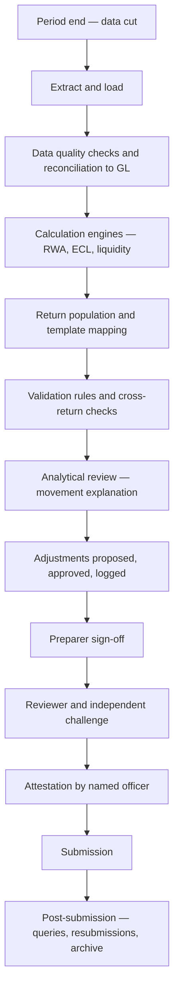
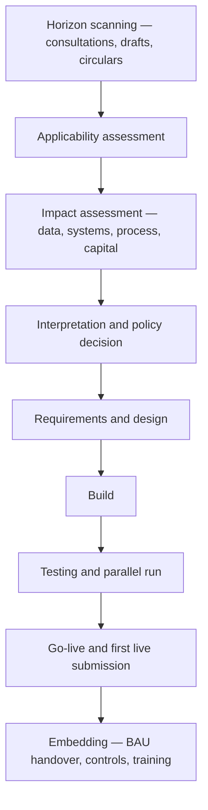

## 1. Why risk data became a regulation

In the 2008 crisis, supervisors asked large banks a simple question: what is your total exposure to this counterparty, right now? Several could not answer within days. Not because the exposure was unknowable, but because it sat in dozens of systems with incompatible identifiers, no aggregation layer, and manual spreadsheets bridging the gaps.

| Failure observed | Consequence |
|---|---|
| No single counterparty identifier across systems | Group exposure unknown |
| Aggregation done manually in spreadsheets | Slow, unauditable, error-prone |
| No lineage from report to source | Numbers could not be defended |
| Risk and finance on different data | Two answers to the same question |
| Days or weeks to produce ad-hoc views | Useless in a fast-moving crisis |

The conclusion was structural rather than analytical: **a bank cannot manage a risk it cannot measure on demand.** BCBS 239 followed in 2013 as the response.

:::mental-model
Every other document in this corpus is about *what the right number is*. This one is about *whether you can produce that number, prove where it came from, and do it again next month under time pressure*. Institutions fail far more often on the second question than the first.
:::

## 2. BCBS 239 — scope and structure

| Element | Position |
|---|---|
| Full title | Principles for effective risk data aggregation and risk reporting |
| Issued | January 2013 |
| Original compliance date | January 2016 for G-SIBs |
| Applies to | G-SIBs mandatorily; D-SIBs at national discretion; supervisors encouraged to extend |
| Nature | Principles, not prescriptive rules |
| Enforcement | Supervisory review, findings, and remediation programmes |

Fourteen principles in four blocks:

| Block | Principles | Owner |
|---|---|---|
| Overarching governance and infrastructure | 1–2 | Board, CDO, IT |
| Risk data aggregation capabilities | 3–6 | Data and risk functions |
| Risk reporting practices | 7–11 | Risk and reporting teams |
| Supervisory review, tools and cooperation | 12–14 | Supervisors |

Principles 1 to 11 are the bank's obligations; 12 to 14 describe what supervisors will do about them. Compliance has been slow and widely reported as such — more than a decade on, full compliance remains uncommon at large institutions, and that fact is itself worth knowing.

## 3. The fourteen principles

| # | Principle | What it actually demands |
|---|---|---|
| 1 | Governance | Board-level ownership; aggregation capability treated as a strategic asset |
| 2 | Data architecture and IT infrastructure | Designed to support aggregation, including in crisis and resolution |
| 3 | Accuracy and integrity | Largely automated; reconciled to authoritative sources; manual workarounds minimised |
| 4 | Completeness | All material risk exposures captured, across the group, by all relevant dimensions |
| 5 | Timeliness | Speed matched to the risk — faster for volatile risks and for crisis conditions |
| 6 | Adaptability | Ad-hoc requests met without a project; flexible enough for new risks and new cuts |
| 7 | Accuracy (reporting) | Reports reconcile to data; approximations documented |
| 8 | Comprehensiveness | All material risk areas covered, with appropriate depth per audience |
| 9 | Clarity and usefulness | Reports drive decisions; tailored to the recipient |
| 10 | Frequency | Set by the recipient's needs; escalating in stress |
| 11 | Distribution | Right people, right time, with confidentiality maintained |
| 12 | Review | Supervisors periodically assess compliance |
| 13 | Remedial actions | Supervisors require fixes and can impose measures |
| 14 | Home–host cooperation | Cross-border supervisory coordination |

**Principle 6, adaptability, is the hardest and the most revealing.** Meeting principles 3 to 5 with a rigid, heavily engineered pipeline is achievable. Meeting principle 6 requires the underlying data to be granular, well-defined and accessible enough that a new question can be answered without a change request. Supervisors probe it with unannounced ad-hoc requests, precisely because it cannot be faked in advance.

## 4. Governance and data ownership

| Role | Accountability |
|---|---|
| Board / Risk Committee | Approves the framework; owns aggregation capability as a strategic matter |
| Chief Data Officer | Owns the data strategy, standards and the remediation programme |
| Data owner (business) | Accountable for a data domain's definition, quality and fitness for use |
| Data steward | Day-to-day quality, issue triage, definition maintenance |
| Data custodian (IT) | Storage, movement, access, technical controls |
| Consumers (risk, finance, reporting) | Define requirements; report issues; do not silently work around them |

**The distinction that matters: owner versus custodian.** IT holds the data; the business owns it. Where this is inverted — IT nominally accountable for the meaning and accuracy of business data — quality issues have no resolver, because IT cannot decide what a field is supposed to mean.

| Artefact | Purpose |
|---|---|
| Data policy and standards | The rules |
| Business glossary | Agreed definitions of business terms |
| Data dictionary | Technical fields mapped to glossary terms |
| Critical data element (CDE) register | The subset that matters most, with owners |
| Data quality issue log | Open issues, severity, owner, remediation date |
| Lineage repository | Where each element comes from |

**Critical data elements** are the practical unlock. Attempting to govern every field in a bank is hopeless; identifying the few hundred that drive capital, provisions and regulatory returns, and governing those properly, is achievable. CDE selection is itself a governance decision requiring sign-off.

## 5. Data architecture

<svg viewBox="0 0 680 300" xmlns="http://www.w3.org/2000/svg">
  <rect x="30" y="30" width="150" height="230" stroke="currentColor" stroke-width="1.4" fill="none"/>
  <text x="105" y="52" fill="currentColor" font-size="13" text-anchor="middle">Source systems</text>
  <text x="105" y="80" fill="currentColor" font-size="11" text-anchor="middle">core banking</text>
  <text x="105" y="100" fill="currentColor" font-size="11" text-anchor="middle">lending / LOS</text>
  <text x="105" y="120" fill="currentColor" font-size="11" text-anchor="middle">treasury</text>
  <text x="105" y="140" fill="currentColor" font-size="11" text-anchor="middle">trade finance</text>
  <text x="105" y="160" fill="currentColor" font-size="11" text-anchor="middle">cards</text>
  <text x="105" y="180" fill="currentColor" font-size="11" text-anchor="middle">collateral</text>
  <text x="105" y="200" fill="currentColor" font-size="11" text-anchor="middle">general ledger</text>
  <line x1="180" y1="145" x2="240" y2="145" stroke="currentColor" stroke-width="1.4"/>
  <path d="M 240 145 l -8 -5 l 0 10 z" fill="currentColor"/>
  <rect x="245" y="60" width="170" height="170" stroke="currentColor" stroke-width="1.4" fill="none"/>
  <text x="330" y="85" fill="currentColor" font-size="13" text-anchor="middle">Integration layer</text>
  <text x="330" y="112" fill="currentColor" font-size="11" text-anchor="middle">golden source</text>
  <text x="330" y="132" fill="currentColor" font-size="11" text-anchor="middle">standard identifiers</text>
  <text x="330" y="152" fill="currentColor" font-size="11" text-anchor="middle">quality controls</text>
  <text x="330" y="172" fill="currentColor" font-size="11" text-anchor="middle">reconciliation to GL</text>
  <text x="330" y="192" fill="currentColor" font-size="11" text-anchor="middle">history retained</text>
  <line x1="415" y1="145" x2="475" y2="145" stroke="currentColor" stroke-width="1.4"/>
  <path d="M 475 145 l -8 -5 l 0 10 z" fill="currentColor"/>
  <rect x="480" y="30" width="170" height="230" stroke="currentColor" stroke-width="1.4" fill="none"/>
  <text x="565" y="52" fill="currentColor" font-size="13" text-anchor="middle">Consumers</text>
  <text x="565" y="82" fill="currentColor" font-size="11" text-anchor="middle">ECL engine</text>
  <text x="565" y="104" fill="currentColor" font-size="11" text-anchor="middle">capital / RWA engine</text>
  <text x="565" y="126" fill="currentColor" font-size="11" text-anchor="middle">liquidity engine</text>
  <text x="565" y="148" fill="currentColor" font-size="11" text-anchor="middle">regulatory returns</text>
  <text x="565" y="170" fill="currentColor" font-size="11" text-anchor="middle">Pillar 3 disclosure</text>
  <text x="565" y="192" fill="currentColor" font-size="11" text-anchor="middle">MI and dashboards</text>
  <text x="565" y="214" fill="currentColor" font-size="11" text-anchor="middle">stress testing</text>
</svg>

| Concept | Definition |
|---|---|
| Golden source | The single authoritative system for a data element |
| Authoritative data source | Approved source for a specific use, where a golden source is absent |
| Integration layer | Where sources are standardised, keyed, controlled and reconciled |
| Risk data mart | Consumer-shaped store built off the integration layer |
| Point-in-time capability | Ability to reproduce a past reporting date exactly |

**Multiple consumers, one integration layer** is the target state, and the reason is not elegance. When ECL, RWA, liquidity and MI each pull directly from source systems with their own logic, the bank produces different exposure totals for the same book on the same date — and cannot explain why. That inconsistency, not any individual number being wrong, is what supervisors escalate.

**Point-in-time reproducibility** is regularly underestimated. A restated return, a supervisory query, or an audit sample requires rebuilding a number as at a past date, with the data and the rules as they stood then. Systems that only hold current state cannot do it.

## 6. Data lineage

Lineage is the documented path from a reported number back to its origin, including every transformation applied on the way.

| Type | Content | Use |
|---|---|---|
| Business lineage | Conceptual flow: system → layer → report, in business terms | Explaining to supervisors, auditors, business users |
| Technical lineage | Field-level: table, column, job, transformation code | Impact analysis and debugging |
| Operational lineage | What actually ran, when, with what result | Incident investigation |

| Granularity | Suitability |
|---|---|
| System-to-system | Too coarse — proves nothing about a specific field |
| Report-to-source, element level | The workable standard for CDEs |
| Every field, every transformation | Complete, expensive; usually unaffordable across the estate |

**Capturing lineage.** Three routes, usually combined: automated harvesting from ETL tools and database catalogues, manual documentation for the gaps (especially spreadsheets and manual adjustments), and metadata standards enforced on new development so the estate does not regress.

**The honest constraint.** Full technical lineage across a large legacy estate is rarely achieved. Sound practice is to scope it to critical data elements, cover those end to end, and maintain an explicit register of the gaps with remediation dates — rather than claiming coverage that a supervisor's spot check will disprove.

## 7. Data quality dimensions

| Dimension | Question | Example measure |
|---|---|---|
| Completeness | Is anything missing? | % of records with a populated CDE |
| Accuracy | Does it match reality? | Sample verification against source documents |
| Consistency | Does it agree across systems? | Reconciliation break count and value |
| Timeliness | Is it current enough? | Age of the latest collateral valuation |
| Validity | Does it conform to rules? | % of values within the permitted domain |
| Uniqueness | Any duplicates? | Duplicate key count |
| Integrity | Do relationships hold? | Orphaned records with no parent |

$$
\text{DQ score} = \sum_{d} w_d \times \text{metric}_d
$$

Weighted scoring is common in MI, but the aggregate score is management information, not a control. **The control is the threshold on each individual dimension for each CDE**, with a breach raising an issue that has an owner and a date. An overall score of 94% conceals a single CDE at 40%, which may be the one that drives the risk weight.

| Issue severity | Response |
|---|---|
| Critical — materially affects a regulatory number | Immediate escalation; adjustment or restatement considered |
| High | Remediation plan with committed date; compensating control |
| Medium | Tracked, prioritised in the backlog |
| Low | Logged, batched |

## 8. Controls, reconciliation and the adjustments register

| Control | Purpose |
|---|---|
| Record and value counts at each hop | No silent loss between systems |
| Reconciliation to the general ledger | Exposure totals tie to the accounts |
| Reconciliation across returns | The same figure agrees wherever it appears |
| Period-on-period movement analysis | Every material change explained before sign-off |
| Threshold and tolerance checks | Values within plausible bounds |
| Access and change controls | Who can alter data or logic |
| Adjustments register | Every manual intervention logged |

**Manual adjustments are the recurring finding across the industry.** They are sometimes unavoidable — a known data defect, a late transaction, a rule the engine does not yet implement. They become a governance failure when they are undocumented, unapproved, permanent, or large enough that the reported number is substantially manual.

| Adjustment discipline | Requirement |
|---|---|
| Logged | Register with reference, amount, direction |
| Justified | Root cause stated, not just the correction |
| Approved | Authority level scaled to materiality |
| Owned | Named individual accountable |
| Time-bound | Linked to a permanent fix with a date |
| Reported | Aggregate quantum visible to the committee |

:::mental-model
The size and age of the adjustments register is the single most informative metric about a bank's reporting health. A small register that clears quickly means the pipeline works. A large register with entries years old means the reported number is being assembled by hand, and the pipeline is decorative.
:::

## 9. Why BCBS 239 compliance stalls

| Cause | Mechanism |
|---|---|
| Legacy estate | Decades of acquisitions, each with its own systems and identifiers |
| Treated as an IT programme | Delivers a repository; nobody changes how they work |
| No business ownership | Quality issues have no accountable resolver |
| Scope defined too widely | Attempting every field instead of critical data elements |
| Tactical fixes preferred | Spreadsheet workarounds meet the deadline and become permanent |
| Benefits are indirect | Hard to fund against revenue projects |
| Adaptability deferred | Principles 3–5 delivered; principle 6 never reached |

The pattern to recognise, and to be able to describe in an interview: **BCBS 239 is a data governance and operating-model problem wearing an IT costume.** Programmes that buy a tool and build a warehouse without changing ownership, definitions and process produce a compliant-looking architecture with the same manual workarounds running alongside it.

## 10. The regulatory reporting landscape

| Category | Content |
|---|---|
| Prudential | Capital adequacy, leverage, large exposures, liquidity |
| Financial | Balance sheet, P&L, asset classification and provisioning |
| Statistical | Sectoral credit, deposits, priority sector |
| Supervisory returns | Risk-based supervision inputs, ad-hoc data calls |
| Market and transaction | Trade and position reporting |
| AML and financial crime | Suspicious transactions, cash transactions |
| Disclosure | Pillar 3, financial statement notes |

| Attribute | Variation |
|---|---|
| Frequency | Daily, fortnightly, monthly, quarterly, half-yearly, annual |
| Basis | Solo, consolidated, sometimes both |
| Deadline | Days to weeks after period end |
| Format | XBRL, structured templates, flat file, portal entry |
| Signatory | Named officer, often at board or CXO level |

**The volume is the difficulty.** A large bank files a very large number of distinct returns across regulators, each with its own definitions, calendar and format. Individually none is hard; collectively they demand an industrialised process, which is exactly what the reporting function is.

## 11. India — the RBI reporting stack

| Element | Position |
|---|---|
| Automated Data Flow (ADF) | RBI's framework requiring returns to be generated from source systems without manual intervention |
| Principle | Straight-through from system of record to submission |
| Submission channels | RBI portals and the XBRL platform |
| Coverage | Prudential, financial and statistical returns across the return set |
| Objective | Accuracy, timeliness, and removal of manual handling |

**ADF is the Indian expression of the same idea as BCBS 239** — that a regulatory number should be produced by a controlled pipeline, not assembled by hand. Where an Indian bank is still building returns in spreadsheets from extracts, it is failing ADF and BCBS 239 simultaneously, and one remediation addresses both.

Alongside returns, Indian banks report into credit information companies and, for large exposures, to the RBI's central repository of large credits. Consistency between these submissions and the prudential returns is an examinable control — the same borrower's exposure reported differently in two places is a finding regardless of which one is right.

> Return names, thresholds and platform details change with circulars. Confirm the current return set and submission mechanics against RBI instructions before relying on specifics.

## 12. International templates — COREP and FINREP

Relevant for Indian roles because global banks run large offshore reporting operations in India, and the JD language of many such roles is European.

| Framework | Content | Authority |
|---|---|---|
| COREP | Common reporting — own funds, capital adequacy, credit/market/operational risk, large exposures, leverage | EBA |
| FINREP | Financial reporting — balance sheet, P&L, asset quality, forbearance, on an IFRS basis | EBA |
| Format | XBRL against a published taxonomy | |
| Validation | Published validation rules applied at submission | |

| Feature | Implication |
|---|---|
| Taxonomy-driven | Templates and rules are machine-readable and versioned |
| Cross-template validations | Figures must agree across templates, not just within one |
| Frequent taxonomy releases | Change is continuous, not occasional |
| Forbearance and non-performing definitions | Prescribed, and differ from local definitions |

The transferable point for interviews: **COREP and FINREP embed the same discipline as ADF but with machine-enforced validation.** A submission that fails a cross-template rule is rejected outright, which makes internal reconciliation a prerequisite rather than good practice.

## 13. The reporting production cycle

| Phase | Typical share of the window | Where time is lost |
|---|---|---|
| Data availability and quality | Largest | Late feeds, unresolved breaks |
| Calculation | Small if automated | Manual runs, reruns after data fixes |
| Review and explanation | Substantial | Unexplained movements sending work back |
| Sign-off | Small | Availability of signatories |

**The critical path is almost always data, not calculation.** Programmes that optimise the engine while leaving feed quality untouched compress a small part of the window and leave the deadline risk exactly where it was.

## 14. Sign-off, attestation and restatement

| Layer | Responsibility |
|---|---|
| Preparer | Produces the return, evidences the controls |
| Reviewer | Independent check of accuracy and completeness |
| Function head | Substantive challenge, movement rationale |
| Attesting officer | Formal declaration to the regulator |
| Internal audit | Periodic assurance over the process |

Attestation is a personal statement of accuracy by a named individual. That personal accountability is what drives the documentation standard — the evidence pack exists so the signatory can sign with a basis, not on faith.

| Restatement trigger | Response |
|---|---|
| Material error found post-submission | Notify the regulator; resubmit |
| Data defect affecting prior periods | Assess materiality across periods |
| Rule interpretation corrected | Restate affected returns; document the change |
| Immaterial error | Correct prospectively; log the decision |

**Restatements are a supervisory signal.** One is an incident. A pattern is treated as evidence that the control environment does not work, and typically triggers a formal review — which is why the materiality assessment and the decision to restate are themselves governed decisions, not judgement calls made by the preparer.

## 15. Reporting controls and the manual problem

| Control | Evidence expected |
|---|---|
| Completeness of the return inventory | Register of all returns, owners, deadlines |
| Calendar management | Tracker with status and escalation |
| Definition control | Documented interpretation of each line item |
| Change control over report logic | Versioned, tested, approved |
| Reconciliation pack | GL, cross-return, prior-period |
| Adjustments register | As section 8 |
| Access control | Segregation of preparer and approver |
| Retention | Submissions and evidence archived and retrievable |

**End-user computing** — spreadsheets and desktop databases performing part of the calculation — is the standard weak point. Where they cannot be eliminated immediately, the mitigations are version control, input/output reconciliation, restricted access, documented logic, and a register with a decommissioning plan. An unregistered spreadsheet performing a material calculation is an audit finding on its own, independent of whether its answer is correct.

## 16. Management information and visualisation

Regulatory returns satisfy the regulator. Management information drives decisions internally, and BCBS 239 principles 7 to 11 apply to it directly.

| Audience | Content | Frequency |
|---|---|---|
| Board / Risk Committee | Aggregate risk profile, appetite utilisation, key movements | Quarterly |
| Executive risk committee | Portfolio detail, emerging risks, limit breaches | Monthly |
| Business line | Segment performance, vintage quality, collections | Weekly to monthly |
| Risk analysts | Granular cuts, drill-down | On demand |
| Regulator | Prescribed returns and ad-hoc data calls | Per calendar |

| Design rule | Reason |
|---|---|
| One message per chart | A chart carrying three arguments carries none |
| Trend over point-in-time | A single figure has no context |
| Actual against limit and appetite | The number matters relative to the threshold |
| Consistent definitions with the returns | Two answers to one question destroys credibility |
| Drill-down available | Principle 6 adaptability, in practice |
| Exceptions surfaced, not buried | The reader should not have to hunt |

| Purpose | Chart |
|---|---|
| Trend over time | Line |
| Composition over time | Stacked area or stacked bar |
| Comparison across categories | Horizontal bar, sorted |
| Distribution | Histogram |
| Vintage or cohort performance | Line per cohort against months on book |
| Migration between states | Heatmap or flow diagram |
| Concentration | Sorted bar with a cumulative line |
| Actual against threshold | Bar or bullet with a reference line |

**The reconciliation discipline extends to MI.** Where the board pack shows a different NPA figure from the regulatory return for the same date, the explanation must exist and be documented — usually a legitimate definitional difference. Where it does not exist, the institution has two sets of numbers and no basis for either.

## 17. Regulatory change management

| Stage | Owner | Output |
|---|---|---|
| Horizon scanning | Regulatory affairs / compliance | Pipeline register with dates |
| Applicability | Compliance + business | In-scope decision, documented |
| Impact assessment | BA + risk + finance + IT | Impact paper, effort estimate |
| Interpretation | Policy + legal, with external advice where needed | Written policy position |
| Delivery | Change / programme | Working solution |
| Embedding | BAU functions | Updated procedures, trained staff |

**Interpretation is the underrated stage.** Regulatory text is rarely unambiguous at the level of a data field. Someone must decide what a definition means for this bank's products, record the decision with its rationale, and apply it consistently — because a supervisor's first question about an unusual number is *how did you interpret this requirement, and where is that written down?*

## 18. Impact assessment

| Dimension | Questions |
|---|---|
| Scope | Which entities, portfolios, products, jurisdictions? |
| Data | New fields required? Do they exist? Where? History available? |
| Systems | Which engines, marts, reporting layers change? |
| Calculation | New logic, or reparameterisation of existing? |
| Process | New controls, new reconciliations, new sign-offs? |
| Financial | Capital, provision, liquidity ratio effect — quantified |
| People | Training, capacity, new roles |
| Timeline | Effective date, parallel run window, dependencies |
| Cost | Build, run, and the cost of not doing it |

**Quantify the financial impact early, even roughly.** A change that moves the CET1 ratio is a board matter with a different funding conversation from one that adds a disclosure column. Programmes that reach design stage before anyone has estimated the capital effect discover the escalation at the worst possible time.

**The data question is the one that determines the timeline.** If a new field does not exist anywhere, the path runs through source system change, which is long, expensive, and outside the reporting team's control. Establishing that on day one changes the plan; discovering it in build changes the delivery date.

## 19. The business analyst role

| Deliverable | Content |
|---|---|
| Business requirements document | What is needed and why, in business language |
| Functional specification | How the system must behave |
| Data requirements and mapping | Source field → target field, with transformation rules |
| Interpretation log | Regulatory text → decision → rationale |
| Process maps | Current and target state |
| Requirements traceability matrix | Requirement → design → build → test case → evidence |
| Test scenarios and expected results | Including boundary and negative cases |
| Defect triage input | Is it a defect, or a misunderstood requirement? |

**Requirements traceability** is the artefact that regulatory delivery genuinely depends on. When a supervisor asks how a specific requirement was implemented and evidenced, the matrix is the answer — a chain from the paragraph in the circular through to a passed test case.

| Trace element | Example |
|---|---|
| Requirement | Circular paragraph reference |
| Interpretation | Documented policy decision |
| Design | Specification section |
| Build | Change ticket / component |
| Test | Test case ID and result |
| Evidence | Signed-off output |

**Where the BA is genuinely difficult in this domain:** the gap between regulatory language and data reality. The circular says "unsecured consumer credit". The systems hold product codes, security flags of varying reliability, and a collateral table with gaps. Translating one into the other, defensibly, is the job — and it requires domain knowledge, not just elicitation technique.

## 20. Waterfall delivery

| Phase | Output |
|---|---|
| Requirements | Signed-off BRD |
| Design | Functional and technical specifications |
| Build | Code and configuration |
| Test | SIT, UAT, parallel run |
| Deploy | Release to production |
| Hyper-care | Post-go-live support |

| Strength | Weakness |
|---|---|
| Fixed regulatory deadline maps to a plan | Late discovery of problems |
| Full scope known up front, from the circular | Poor at absorbing changing interpretation |
| Heavy documentation suits audit and supervision | Slow feedback |
| Clear stage gates and sign-offs | Business sees working software late |
| Easier to coordinate across many teams | Rework is expensive |

Waterfall persists in regulatory reporting for a real reason: the requirement is externally fixed, the deadline is non-negotiable, the audit trail is mandatory, and the scope is genuinely knowable from the published text. Those are the conditions under which waterfall performs well.

## 21. Agile delivery

| Element | Content |
|---|---|
| Backlog | Prioritised, refined continuously |
| Sprints | Fixed-length iterations producing working output |
| Ceremonies | Planning, stand-up, review, retrospective |
| Roles | Product owner, scrum master, delivery team |
| Definition of done | Includes testing, documentation, controls |
| Increment | Demonstrable at the end of each sprint |

| Strength | Weakness |
|---|---|
| Absorbs changing interpretation | Fixed external deadline sits awkwardly with variable scope |
| Early, frequent feedback | Documentation must be deliberately maintained for audit |
| Working output early | Cross-team dependencies harder to sequence |
| Risk surfaced sooner | Requires genuine product owner availability |

**Agile in regulated change works when the discipline is preserved rather than dropped.** Traceability, interpretation logs and evidence packs are not waterfall artefacts — they are regulatory requirements that must be produced whichever method is used. A team that treats "working software over comprehensive documentation" as permission to skip the traceability matrix will pass its sprint reviews and fail its audit.

## 22. Choosing, and the hybrid reality

| Condition | Leans |
|---|---|
| Requirement fixed and published | Waterfall |
| Interpretation genuinely open | Agile |
| Hard external deadline | Waterfall for the critical path |
| Data discovery required | Agile for the discovery phase |
| Many interdependent teams | Waterfall coordination, agile within teams |
| Heavy audit and evidence burden | Either, with evidence built in |
| Business availability high | Agile viable |

Most large banks run a hybrid, and describing it accurately is a strong interview answer: **fixed regulatory milestones and stage gates at programme level, with iterative delivery inside the workstreams.** The programme plan commits to the submission date; the teams iterate on how they get there. Scaled frameworks such as SAFe formalise this, with quarterly planning increments mapped to regulatory milestones.

The failure mode to name is a programme that claims to be agile while every dependency, sign-off and funding gate operates on waterfall governance — teams sprint and then wait, and the ceremony delivers nothing.

## 23. Testing

| Stage | Purpose |
|---|---|
| Unit | Component logic correct |
| System integration (SIT) | Interfaces and end-to-end flow work |
| Data migration testing | Migrated data complete and accurate |
| User acceptance (UAT) | Business confirms it meets the requirement |
| **Parallel run** | New and old produce explainable results on live data |
| Regression | Existing returns still correct |
| Performance | Runs within the reporting window |

**Parallel run is the decisive test for regulatory change**, and the one most often shortened when the plan slips. Running both bases over live data for multiple cycles surfaces exactly the problems that manufactured test data cannot: real edge cases, real volumes, real data quality.

| Parallel run discipline | Requirement |
|---|---|
| Duration | Multiple full reporting cycles, not one |
| Comparison | Line-by-line, with tolerance thresholds |
| Explanation | Every difference above tolerance explained and categorised |
| Categories | Expected (rule change), defect, data issue |
| Exit criteria | Agreed and signed before starting, not negotiated at the end |

Differences are not failures. **Unexplained** differences are failures. A change to the rules should produce differences — that is the point — and the exit criterion is that each one is attributable to a known cause.

## 24. Stakeholder management

| Stakeholder | Cares about | Give them |
|---|---|---|
| Regulator | Accuracy, timeliness, remediation credibility | Precision, evidence, no surprises |
| Board / risk committee | Aggregate position, appetite, material change | One page, trend, exceptions, a clear ask |
| CFO / CRO | Capital and provision impact, deadline risk | Quantified impact, options, recommendation |
| Business lines | Effect on their P&L, growth, pricing | Translation of the rule into commercial consequence |
| IT | Clear, stable, testable requirements | Specification, not aspiration |
| Internal audit | Control design and evidence | Documented controls and traceability |
| External audit | Financial statement assertions | Reconciliations, policy, judgement papers |

| Situation | Approach |
|---|---|
| Deadline at risk | Escalate early with options and a recommendation, never a bare problem |
| Interpretation disputed | Document positions, seek external opinion, escalate to a decision forum |
| Business resists a capital-increasing change | Separate the commercial argument from the compliance obligation |
| Data gap discovered late | Quantify the exposure, propose a compensating control, set the permanent fix |
| Regulator queries a number | Answer precisely and only what was asked; do not volunteer speculation |

:::mental-model
Two questions arrive constantly in this role: *what does this rule mean for us?* and *can we hit the date?* The first requires domain knowledge, the second requires honest status. The people who advance are the ones whose answer to the second is trusted, because they escalated early the last three times.
:::

## 25. Defensible under questioning

| Question | The answer that lands |
|---|---|
| What is BCBS 239 in one sentence? | Principles requiring banks to aggregate risk data accurately and quickly enough to manage risk, including in a crisis |
| Which principle is hardest? | Adaptability — meeting ad-hoc requests without a project; it cannot be faked in advance |
| Why does lineage matter? | It is how a reported number is defended, and how change impact is assessed |
| What is a golden source? | The single authoritative system for a data element; consumers take it from there, not from wherever is convenient |
| Owner versus custodian? | Business owns the meaning and quality; IT holds and moves it |
| What are critical data elements for? | Governing everything is impossible; govern the few hundred that drive capital, provisions and returns |
| What does ADF require? | Returns generated straight from source systems without manual intervention |
| Why do reporting programmes miss deadlines? | The critical path is data availability and quality, not calculation |
| What does an adjustments register tell you? | How much of the reported number is assembled by hand — the best single health metric |
| Waterfall or agile for regulatory change? | Hybrid — fixed milestones and gates at programme level, iterative inside workstreams; traceability is mandatory either way |
| What makes a parallel run adequate? | Multiple full cycles on live data, with every difference above tolerance explained and categorised |
| What triggers a restatement? | Material error post-submission; a pattern of restatements is read as control failure |

**Three things to be able to draw without notes:** the source-to-report data chain with its reconciliation points, the reporting production cycle from data cut to attestation, and the regulatory change lifecycle from horizon scanning to embedding. The third is what the role is; the first two are what it operates on.
